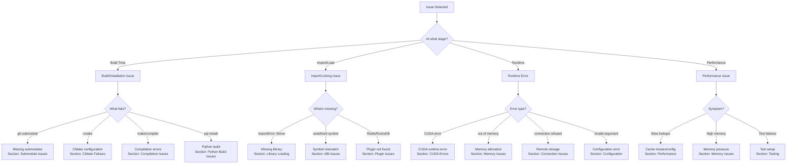
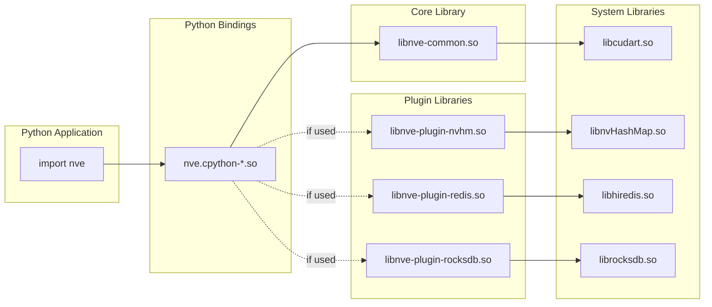
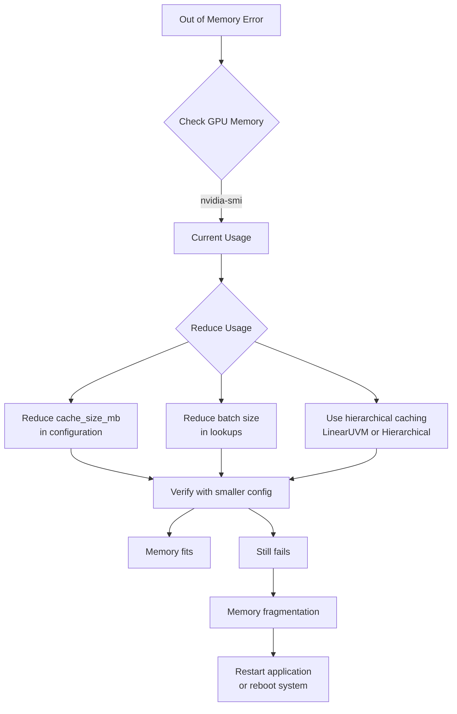

<!-- source: DeepWiki mcp.deepwiki.com · repo NVIDIA/nv-embedding-cache · page 15 Troubleshooting · fetched 2026-10-26 -->

# Troubleshooting

<details>
<summary>Relevant source files</summary>

The following files were used as context for generating this wiki page:

- [CONTRIBUTING.md](CONTRIBUTING.md)
- [README.md](README.md)
- [docs/advanced.md](docs/advanced.md)

</details>


This page provides solutions to common issues encountered when building, installing, and using the NV Embedding Cache SDK. It covers build failures, runtime errors, configuration problems, and debugging techniques.

For general setup instructions, see [Installation and Setup](#2). For performance optimization guidance, see [Performance Tuning](#8.3). For contribution and issue reporting guidelines, see [Contributing](#12).

## Diagnostic Overview

The following diagram shows a high-level decision tree for diagnosing common issues:



Sources: [README.md:1-94](), [docs/advanced.md:1-55](), [CONTRIBUTING.md:1-79]()

## Build and Installation Issues

### Missing Git Submodules

**Symptom**: CMake errors about missing third-party dependencies or "file not found" errors during configuration.

**Solution**: Initialize and update all git submodules:
```bash
git submodule update --init --recursive
```

**Common Errors**:
- `CMake Error: File not found: third_party/googletest`
- `CMake Error: include could not find load file: third_party/pybind11/tools/pybind11Tools.cmake`

**Verification**: Ensure the [third_party/]() directory contains populated subdirectories for all dependencies listed in [README.md:82-93]().

Sources: [README.md:37](), [README.md:80-93]()

### CMake Configuration Failures

**Symptom**: `cmake ..` fails with configuration errors.

**Common Issues**:

| Error | Cause | Solution |
|-------|-------|----------|
| `CMake 3.18 or higher is required` | Outdated CMake | Install CMake 3.18+ from [cmake.org](https://cmake.org) |
| `Could not find CUDA` | CUDA not in PATH | Set `CUDA_HOME` or `CMAKE_CUDA_COMPILER` |
| `C++ compiler must support C++17` | Old compiler | Install GCC 13.3+ or Clang 20.1+ |
| `Feature X requested but dependencies not found` | Missing system library | Install required system dependencies |

**Debugging CMake**:
```bash
# Verbose output to see what's failing
cmake .. -DCMAKE_VERBOSE_MAKEFILE=ON

# Check CUDA detection
cmake .. -DCMAKE_CUDA_COMPILER=/usr/local/cuda/bin/nvcc

# Disable optional features if dependencies missing
cmake .. -DNVE_FEATURES="core;python"
```

The CMake build system is configured in [CMakeLists.txt:1-200]() and feature selection is handled via the `NVE_FEATURES` variable. See [CMake Configuration Options](#10.1) for details.

Sources: [README.md:24](), [README.md:49-54]()

### Compilation Errors

**Symptom**: Build succeeds in configuration but fails during `make`.

**CUDA Architecture Mismatch**:
```
error: unsupported GPU architecture 'compute_XX'
```
**Solution**: The build system auto-detects GPU architecture. For custom architectures:
```bash
cmake .. -DCMAKE_CUDA_ARCHITECTURES="80;86;89"
```

**AVX/SSE Instruction Issues**:
```
Illegal instruction (core dumped)
```
**Solution**: The build auto-detects CPU capabilities. If running on different hardware than build machine:
```bash
cmake .. -DNVE_DISABLE_AVX=ON
```

**Linker Errors with Redis/RocksDB**:
```
undefined reference to `redisConnect'
```
**Solution**: Ensure submodules are fully initialized and Redis feature is enabled:
```bash
git submodule update --init --recursive third_party/hiredis third_party/redis-plus-plus
cmake .. -DNVE_FEATURES="core;redis"
```

Sources: [README.md:22-23](), [README.md:49-54]()

### Python Build Issues

**Symptom**: `pip install .` fails.

**Common Errors**:

1. **Python version mismatch**:
   ```
   ERROR: Python 3.10 or later is required
   ```
   **Solution**: Upgrade Python to 3.10+.

2. **PyTorch not installed**:
   ```
   ImportError: No module named 'torch'
   ```
   **Solution**: Install PyTorch before building:
   ```bash
   pip install torch
   ```

3. **Build directory conflicts**:
   ```
   error: [Errno 17] File exists: 'build'
   ```
   **Solution**: Clean build artifacts:
   ```bash
   pip install . --force-reinstall --no-cache-dir
   ```

4. **pybind11 errors**:
   ```
   fatal error: pybind11/pybind11.h: No such file or directory
   ```
   **Solution**: Ensure pybind11 submodule is initialized:
   ```bash
   git submodule update --init --recursive third_party/pybind11
   ```

Sources: [README.md:25-26](), [README.md:44-46]()

### Docker Build Issues

**Symptom**: Docker build or run commands fail.

**Permission denied errors**:
```bash
# Build with proper user ID mapping
docker build -t nve \
  --build-arg START_DIR=$(pwd) \
  --build-arg UID=$(id -u) \
  --build-arg UNAME=$(id -u -n) \
  --build-arg GID=$(id -g) \
  --build-arg GNAME=$(id -g -n) .
```

**GPU not accessible in container**:
```bash
# Ensure --gpus all flag is set
docker run --cap-add=ALL --net=host --ipc=host --gpus all \
  -it --rm -v $(pwd):$(pwd) nve
```

**CUDA driver version mismatch**:
- Ensure host NVIDIA driver is compatible with CUDA 12.8+ inside container
- Check driver version: `nvidia-smi`

Sources: [README.md:40-43](), [Dockerfile:1-50]()

## Runtime Errors

### Library Loading Errors

The following diagram shows the dependency chain for loading the SDK:



**ImportError: libnve-common.so not found**

**Solution**: Set library path before importing:
```bash
export LD_LIBRARY_PATH=/path/to/build/lib:$LD_LIBRARY_PATH
python
```

Or install Python package which handles paths automatically:
```bash
pip install .
```

**ImportError: undefined symbol**

**Cause**: ABI mismatch between build-time and runtime libraries (often C++ standard library or CUDA runtime).

**Solution**: Rebuild in clean environment or ensure consistent compiler:
```bash
# Clean rebuild
rm -rf build/
pip install . --force-reinstall --no-cache-dir
```

**Plugin not found errors**

**Symptom**:
```python
>>> nve.NVEmbedding(..., cache_type="Hierarchical", host_table_config=...)
RuntimeError: Failed to load host table plugin
```

**Solution**: Verify plugin library exists and is in library path:
```bash
# Check plugin libraries
ls build/lib/libnve-plugin-*.so

# Python automatically finds plugins relative to main library
# C++ applications must ensure plugins are in LD_LIBRARY_PATH
export LD_LIBRARY_PATH=/path/to/build/lib:$LD_LIBRARY_PATH
```

Sources: [README.md:44-46]()

### CUDA Errors

Common CUDA runtime errors and their meanings:

| Error Code | Name | Common Cause | Solution |
|------------|------|--------------|----------|
| 2 | `cudaErrorMemoryAllocation` | Out of GPU memory | Reduce cache size or embedding dimensions |
| 11 | `cudaErrorInvalidValue` | Invalid kernel parameter | Check configuration parameters match dimensions |
| 17 | `cudaErrorInvalidDevice` | Invalid GPU device ID | Verify device ID with `nvidia-smi` |
| 35 | `cudaErrorInsufficientDriver` | Driver too old | Update NVIDIA driver |
| 77 | `cudaErrorIllegalAddress` | Memory access violation | Run with `compute-sanitizer` (see Testing section) |
| 700 | `cudaErrorIllegalInstruction` | Invalid GPU instruction | Check CUDA architecture compatibility |

**Debugging CUDA errors**:

The SDK provides error checking macros. To enable verbose CUDA error reporting, build with debug flags:
```bash
cmake .. -DCMAKE_BUILD_TYPE=Debug
```

Look for CUDA error checks in [src/common/cuda_utils.hpp:1-100]().

**Example**: Invalid memory access
```
terminate called after throwing an instance of 'std::runtime_error'
  what():  CUDA error: an illegal memory access was encountered
```

**Solution**: Run with NVIDIA Compute Sanitizer:
```bash
compute-sanitizer --tool memcheck ./your_application
compute-sanitizer --tool racecheck ./your_application
```

Sources: [CONTRIBUTING.md:29-30]()

### Memory Allocation Failures

**Symptom**: `cudaErrorMemoryAllocation` or `std::bad_alloc` during initialization or operation.

**GPU Memory Issues**:



**Configuration recommendations by GPU memory**:

| GPU Memory | Strategy | Configuration Example |
|------------|----------|----------------------|
| < 8 GB | Use `LinearUVM` or `Hierarchical` | `cache_size_mb=2048` |
| 8-16 GB | `NoCache` if data fits, else `LinearUVM` | `cache_size_mb=4096` |
| 16-32 GB | `NoCache` for medium datasets | Full dataset in GPU |
| 32+ GB | `NoCache` for large datasets | Full dataset in GPU |

**Host Memory Issues**:

For `LinearUVMEmbeddingLayer` or `HierarchicalEmbeddingLayer`, system memory requirements can be large:

```python
# Estimate memory needed
num_embeddings = 1_000_000_000
embedding_dim = 128
bytes_per_value = 4  # float32

total_bytes = num_embeddings * embedding_dim * bytes_per_value
total_gb = total_bytes / (1024**3)
print(f"System memory needed: {total_gb:.1f} GB")
```

**Solution**: Use remote storage (Redis/RocksDB) for datasets exceeding system memory.

Sources: [README.md:11-15]()

### Configuration Errors

**Invalid configuration parameters**:

```python
# Common mistakes
nve.NVEmbedding(
    num_embeddings=1000,
    embedding_dim=128,
    cache_type="Hierarchical",
    cache_size_mb=10000,  # Too large!
    # Missing required host_table_config
)
```

**Error**: `RuntimeError: host_table_config required for Hierarchical mode`

**Solution**: Provide required configuration for hierarchical caching:
```python
host_table_config = {
    "type": "nvhm",
    "capacity_mb": 50000
}
remote_table_config = {
    "type": "redis",
    "address": "127.0.0.1:6379"
}

embedding = nve.NVEmbedding(
    num_embeddings=1_000_000_000,
    embedding_dim=128,
    cache_type="Hierarchical",
    cache_size_mb=4096,
    host_table_config=host_table_config,
    remote_table_config=remote_table_config
)
```

See [Cache Configuration Strategies](#1.2) for valid configurations.

Sources: [README.md:11-17]()

### Connection Issues (Redis/RocksDB)

**Redis connection refused**:

```
RuntimeError: Failed to connect to Redis: Connection refused
```

**Debugging steps**:
1. Verify Redis is running:
   ```bash
   redis-cli ping
   # Should respond: PONG
   ```

2. Check Redis cluster for tests:
   ```bash
   ./tests/embedding_layer/redis_cluster.sh start
   sleep 5
   redis-cli -p 7000 ping
   ```

3. Verify connection string format:
   ```python
   # Single instance
   remote_table_config = {"type": "redis", "address": "127.0.0.1:6379"}
   
   # Cluster (multiple nodes)
   remote_table_config = {
       "type": "redis", 
       "address": "127.0.0.1:7000,127.0.0.1:7001,127.0.0.1:7002"
   }
   ```

**RocksDB initialization failure**:

```
RuntimeError: Failed to open RocksDB: IO error: No such file or directory
```

**Solution**: Ensure directory exists and has write permissions:
```python
import os
db_path = "/tmp/rocksdb_cache"
os.makedirs(db_path, exist_ok=True)

remote_table_config = {
    "type": "rocksdb",
    "path": db_path
}
```

Sources: [docs/advanced.md:37-44]()

## Performance Issues

### Slow Lookup Performance

**Symptom**: Lookups taking longer than expected.

**Diagnostic checklist**:

1. **Check cache hit rate**: Low hit rates indicate poor cache configuration or access patterns.
   
2. **Verify cache mode matches data size**:
   - If dataset fits in GPU: Use `NoCache` / `GPUEmbeddingLayer`
   - If dataset > GPU but fits in system memory: Use `LinearUVM`
   - If dataset > system memory: Use `Hierarchical`

3. **Check kernel mode**: Some operations have multiple implementations. See [performance tuning](#8.3) for kernel mode selection.

4. **Batch size**: Very small batch sizes may underutilize GPU. Try larger batches.

5. **Execution context reuse**: Creating new execution contexts is expensive. Reuse contexts in round-robin fashion as described in [docs/advanced.md:3-10]().

6. **Insert heuristic**: Default heuristic may not match your access pattern. See [Custom Insert Heuristics](#8.4).

Sources: [docs/advanced.md:30-32]()

### Memory Pressure

**Symptom**: System becomes unresponsive or OOM killer terminates processes.

**For `LinearUVMEmbeddingLayer`**:
- UVM allocations can trigger excessive paging
- Monitor with `nvidia-smi` for GPU memory and `free -h` for system memory
- Solution: Reduce total allocation size or use `Hierarchical` with remote storage

**For `HierarchicalEmbeddingLayer`**:
- Monitor host table size separately from GPU cache
- NVHM table may consume significant GPU memory for metadata
- Solution: Adjust `host_table_config.capacity_mb` parameter

Sources: [README.md:11-17]()

## Testing and Debugging

### Running Unit Tests

**C++ GoogleTest tests**:

```bash
# Start Redis cluster for tests that need it
./tests/embedding_layer/redis_cluster.sh start
sleep 5

# Run all tests
for test in build_dir/bin/*test*; do
    echo "Running $test"
    ./$test
done

# Stop Redis cluster
./tests/embedding_layer/redis_cluster.sh stop
```

**Common test failures**:

| Test Name Pattern | Likely Cause | Solution |
|------------------|--------------|----------|
| `*Redis*` | Redis not running | Start Redis cluster script |
| `*MultiGPU*` | Insufficient GPUs | Skip or run on multi-GPU system |
| `*NVHM*` | NVHM plugin not built | Enable NVHM feature in CMake |

**Python PyTest tests**:

```bash
# Install test dependencies first
pip install .
PIP_CONSTRAINT="" pip install -r benchmarks/requirements.txt

# Run all Python tests
pytest tests

# Run specific test file
pytest tests/test_embedding.py -v

# Run with output
pytest tests -s
```

Sources: [docs/advanced.md:34-54]()

### NVIDIA Compute Sanitizer

The CUDA Compute Sanitizer detects memory errors, race conditions, and API misuse:

```bash
# Memory checker (detects out-of-bounds access, use-after-free, etc)
compute-sanitizer --tool memcheck ./build/bin/your_test

# Race condition detector
compute-sanitizer --tool racecheck ./build/bin/your_test

# Initialize checker (detects uninitialized memory usage)
compute-sanitizer --tool initcheck ./build/bin/your_test
```

**Common findings**:

1. **Invalid memory access**: Usually indicates dimension mismatch or buffer overflow
2. **Race condition**: Indicates improper synchronization between CPU/GPU
3. **Uninitialized memory**: Buffers not properly initialized before use

All tests should pass sanitizer checks before merging code. See [CONTRIBUTING.md:29-30]().

Sources: [CONTRIBUTING.md:29-30]()

### Debug Logging

The SDK uses a logging system defined in [src/common/logger.hpp:1-100](). 

**Enabling verbose logging**:

In C++:
```cpp
#include <logger.hpp>

// Set log level
nve::Logger::setLevel(nve::LogLevel::DEBUG);

// In your code, logs will now be verbose
```

In Python:
```python
import logging
logging.basicConfig(level=logging.DEBUG)
```

**Log files**: By default, logs go to stderr. To redirect:
```bash
./your_application 2> debug.log
```

Sources: [src/common/logger.hpp:1-100]()

### Environment Information

When reporting issues, gather environment information using the provided script:

```bash
./print_env.sh > environment.txt
```

This script collects:
- OS version
- CUDA version and driver
- GPU models
- Compiler version
- CMake version
- Python version
- Library versions

Attach this output when filing issues as described in [CONTRIBUTING.md:8-9]().

Sources: [CONTRIBUTING.md:8-9]()

## Getting Help

### Before Filing an Issue

1. **Check this troubleshooting guide** for your specific error
2. **Search existing issues** at https://github.com/NVIDIA/nv-embedding-cache/issues
3. **Verify prerequisites** match [Requirements](#2.1)
4. **Try with Docker environment** to rule out local environment issues
5. **Run environment script**: `./print_env.sh`

### Filing a Bug Report

When filing an issue, include:

1. **Environment information**: Output from `./print_env.sh`
2. **Minimal reproducible example**: Smallest code that triggers the issue
3. **Expected behavior**: What you expected to happen
4. **Actual behavior**: What actually happened, including full error messages
5. **Configuration**: Show your layer/table configuration
6. **Logs**: Include relevant log output with debug logging enabled

See [Contributing](#12) for detailed guidelines.

Sources: [CONTRIBUTING.md:1-35]()

### Common Issue Resolutions

**Issue**: Tests fail with "Redis connection refused"
**Resolution**: Ensure Redis cluster is running via `./tests/embedding_layer/redis_cluster.sh start` before running tests.

**Issue**: ImportError with libnve-common.so
**Resolution**: Either install via pip (`pip install .`) or set `LD_LIBRARY_PATH` to include `build/lib/`.

**Issue**: CUDA out of memory during initialization
**Resolution**: Reduce `cache_size_mb` parameter or switch to `LinearUVM` or `Hierarchical` caching strategy.

**Issue**: Undefined symbol errors after update
**Resolution**: Clean rebuild: `rm -rf build/ && pip install . --force-reinstall --no-cache-dir`

**Issue**: Multi-GPU tests fail on single GPU system
**Resolution**: This is expected. Multi-GPU tests require systems with multiple NVIDIA GPUs.

Sources: [README.md:1-94](), [docs/advanced.md:1-55](), [CONTRIBUTING.md:1-79]()

---

