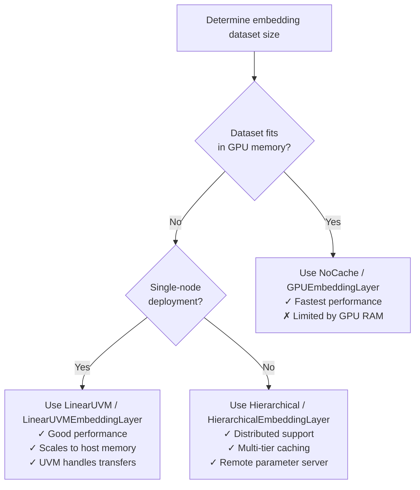
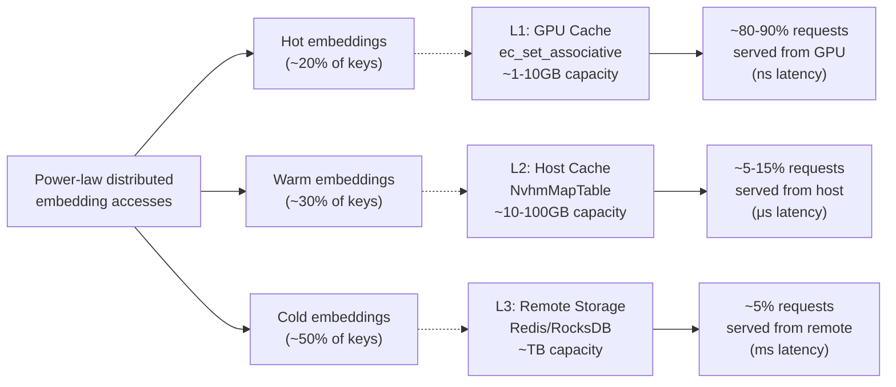
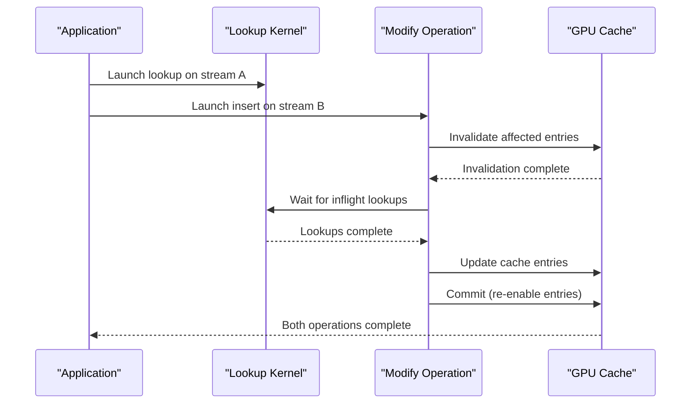
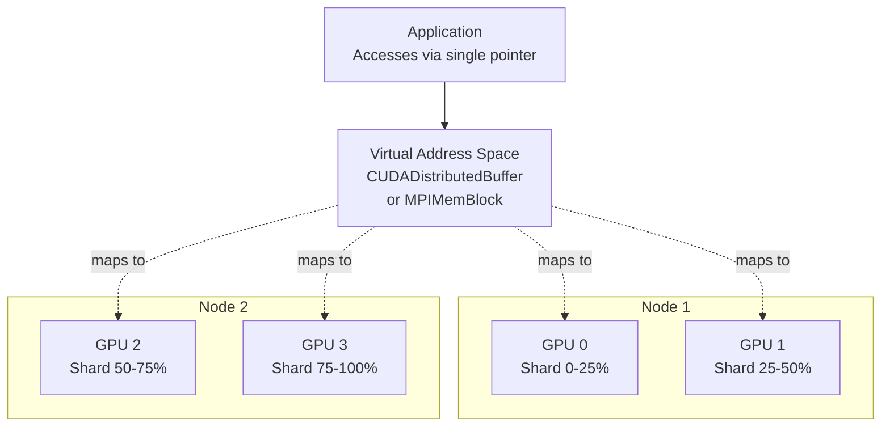
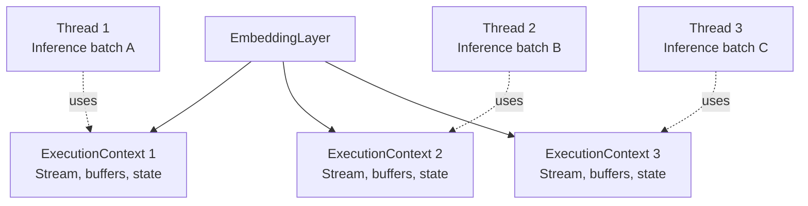

<!-- source: DeepWiki mcp.deepwiki.com · repo NVIDIA/nv-embedding-cache · page 16 FAQ · fetched 2026-10-26 -->

# FAQ

<details>
<summary>Relevant source files</summary>

The following files were used as context for generating this wiki page:

- [README.md](README.md)
- [docs/advanced.md](docs/advanced.md)
- [docs/cpp_api.md](docs/cpp_api.md)

</details>


This document answers frequently asked questions about the NV Embedding Cache SDK. It covers practical questions about configuration, performance, memory management, and integration patterns. For conceptual background, see [Overview](#1). For detailed API documentation, see [C++ API Reference](#4) and [Python API Reference](#5). For troubleshooting specific issues, see [Troubleshooting](#15).

---

## Configuration and Setup

### Q: Which caching strategy should I use for my application?

**A:** The choice depends on your dataset size and deployment architecture:



**Sources:** [README.md:11-15](), [docs/cpp_api.md:19-22]()

| Cache Strategy | Implementation Classes | Typical Use Case | Memory Tiers |
|----------------|----------------------|------------------|--------------|
| NoCache | `GPUEmbeddingLayer` (C++), `NVEmbedding(cache_type="NoCache")` (Python) | Dataset < 80GB (A100) | GPU only |
| LinearUVM | `LinearUVMEmbeddingLayer` (C++), `NVEmbedding(cache_type="LinearUVM")` (Python) | Dataset 100GB-1TB, single node | GPU cache + UVM host |
| Hierarchical | `HierarchicalEmbeddingLayer` (C++), `NVEmbedding(cache_type="Hierarchical")` (Python) | Dataset > 1TB, distributed | GPU + Host + Redis/RocksDB |

**Sources:** [README.md:11-15](), [include/gpu_embedding_layer.hpp](), [include/linear_embedding_layer.hpp](), [include/hierarchical_embedding_layer.hpp]()

---

### Q: What are the minimum system requirements?

**A:** The SDK requires:

| Component | Requirement | Notes |
|-----------|-------------|-------|
| **Compiler** | C++17 capable (GCC 13.3 or Clang 20.1 tested) | [README.md:22]() |
| **CUDA** | 12.8+ (earlier versions work with minor changes) | [README.md:23]() |
| **CMake** | 3.18+ | [README.md:24]() |
| **Python** | 3.10+ | [README.md:25]() |
| **GPU** | NVIDIA GPU with Compute Capability 7.0+ | Required for CUDA kernels |
| **Redis** | 7.0.15+ (optional) | Only needed for `HierarchicalEmbeddingLayer` with Redis |
| **Operating System** | Linux (tested in Docker) | [Dockerfile]() |

The provided [Dockerfile]() satisfies all prerequisites and is the recommended environment.

**Sources:** [README.md:21-27](), [Dockerfile]()

---

### Q: Do I need to install Redis or RocksDB?

**A:** It depends on your caching strategy:

- **NoCache / GPUEmbeddingLayer**: No external dependencies
- **LinearUVM / LinearUVMEmbeddingLayer**: No external dependencies  
- **Hierarchical / HierarchicalEmbeddingLayer**: Requires at least one remote storage backend

The SDK provides plugins for:
- **Redis**: `libnve-plugin-redis.so` - connects to Redis cluster via `RedisClusterTable` [plugins/redis/include/redis_cluster_table.hpp]()
- **RocksDB**: `libnve-plugin-rocksdb.so` - connects to RocksDB instance via `RocksDBTable` [plugins/rocksdb/include/rocksdb_table.hpp]()

These plugins are built separately and loaded at runtime. If you don't use `HierarchicalEmbeddingLayer`, these dependencies are not required.

**Sources:** [README.md:27](), [docs/cpp_api.md:54-55](), [plugins/redis/include/redis_cluster_table.hpp](), [plugins/rocksdb/include/rocksdb_table.hpp]()

---

### Q: How do I build only specific components?

**A:** Use the `NVE_FEATURES` CMake variable to enable/disable components:

```bash
# Build only core without any plugins
cmake -DNVE_FEATURES="" ..

# Build with specific plugins
cmake -DNVE_FEATURES="redis;nvhm" ..

# Default builds all available features
cmake ..
```

Available features: `redis`, `rocksdb`, `nvhm`, `abseil`, `phmap`. The build system will automatically handle dependencies via git submodules in [third_party/]().

**Sources:** [CMakeLists.txt](), [third_party/](), For detailed configuration see [Build System Details](#10)

---

## Performance and Memory

### Q: What is the expected cache hit rate for my workload?

**A:** The cache is optimized for power-law distributions common in recommender systems. Expected performance:



For optimal performance, ensure your GPU cache can hold the top 20-30% hottest embeddings. Use the `InsertHeuristic` interface [include/insert_heuristic.hpp]() to tune cache replacement policy.

**Sources:** [include/ecache/ec_set_associative.h](), [include/insert_heuristic.hpp](), [docs/advanced.md:30-32]()

---

### Q: How much memory does each component require?

**A:** Memory consumption breakdown:

| Component | Memory Type | Formula | Notes |
|-----------|-------------|---------|-------|
| **GPU Cache** | GPU device memory | `num_sets × set_associativity × (key_size + embedding_size)` | Configured in `GpuTable` constructor |
| **UVM Linear Storage** | Host memory (UVM) | `num_embeddings × embedding_size` | Only for `LinearUVMEmbeddingLayer` |
| **NVHM Host Cache** | Host memory | `capacity × (key_size + embedding_size) + overhead` | ~20% overhead for hashmap |
| **Execution Context** | GPU + Host | `~100MB per context` | Allocated lazily per context |

**Example calculation** for 1M embeddings with 128-dim vectors (512 bytes):
- GPU cache (10K entries): `10000 × 512 = ~5MB`
- UVM linear storage: `1000000 × 512 = ~488MB`
- NVHM cache (100K entries): `100000 × 512 × 1.2 = ~59MB`

Execution contexts use lazy allocation and grow with workload size.

**Sources:** [include/gpu_table.hpp](), [include/linear_embedding_layer.hpp](), [plugins/nvhm/include/nvhm_map_table.hpp](), [docs/advanced.md:7-8]()

---

### Q: What kernel modes are available and which should I use?

**A:** The GPU cache supports multiple kernel implementations optimized for different hardware and dimensions:

| Kernel Mode | Description | Best For |
|-------------|-------------|----------|
| `tile_32x4` | 32-way set associativity, 4 keys per thread | Default, balanced performance |
| `tile_32x8` | 32-way set associativity, 8 keys per thread | Large batch sizes |
| `tile_64x4` | 64-way set associativity, 4 keys per thread | Larger cache capacity |
| `tile_64x8` | 64-way set associativity, 8 keys per thread | Large capacity + batches |

The mode is selected during `GpuTable` construction. For most workloads, the default (`tile_32x4`) provides optimal performance. See [Performance Tuning](#8.3) for detailed optimization guidance.

**Sources:** [include/ecache/ec_set_associative.h](), [src/gpu_cache/]()

---

### Q: Can I run lookups and updates concurrently?

**A:** Yes, using the invalidate-and-commit paradigm:



**Key requirements:**
1. Each modify operation requires a separate `ModifyContext`
2. Only one modify operation can be inflight on GPU at a time
3. For custom multi-kernel lookup flows, use `start_custom_flow()` and `end_custom_flow()` APIs

See [Modify Operations and Synchronization](#8.2) for details.

**Sources:** [docs/advanced.md:14-24](), [include/execution_context.hpp]()

---

## Multi-GPU and Distribution

### Q: How do I use embeddings across multiple GPUs?

**A:** Use CUDA's virtual memory management to create a distributed buffer:



**C++ approach:**
```cpp
// Use CUDADistributedBuffer class
#include <distributed.hpp>
CUDADistributedBuffer buffer(total_size, {device_0, device_1});
```

**Python approach:**
```python
# Use MPIMemBlock class
from pynve import MPIMemBlock
buffer = MPIMemBlock(total_size, device_ids=[0, 1])
```

The embedding layer transparently handles cross-device access. See [Multi-GPU Support](#8.1) for advanced configuration.

**Sources:** [docs/advanced.md:26-28](), [include/distributed.hpp](), [python/pynve/]()

---

### Q: Does the SDK support distributed training across nodes?

**A:** Yes, via `HierarchicalEmbeddingLayer` with sharded storage:

| Component | Distribution Method | Implementation |
|-----------|-------------------|----------------|
| **GPU Cache** | Per-node, independent | Each node has local `GpuTable` |
| **Host Cache** | Per-node, independent | Each node has local `NvhmMapTable` |
| **Parameter Server** | Shared across all nodes | Redis Cluster or RocksDB accessed via `RedisClusterTable` / `RocksDBTable` |

**Setup pattern:**
1. Each training node creates a `HierarchicalEmbeddingLayer` instance
2. All nodes connect to the same Redis cluster or RocksDB instance
3. Updates on one node are visible to others via the parameter server
4. Local caches reduce remote access latency

See [Triton Inference Server Integration](#8.6) for production deployment patterns.

**Sources:** [include/hierarchical_embedding_layer.hpp](), [plugins/redis/include/redis_cluster_table.hpp](), [samples/triton/]()

---

## API and Integration

### Q: Should I use the Python API or C++ API?

**A:** Decision matrix:

| Use Python API (`pynve`) if: | Use C++ API if: |
|-------------------------------|-----------------|
| Integrating with PyTorch | Building custom C++ application |
| Rapid prototyping | Performance-critical path |
| Training workflows | Integrating with C++ inference |
| DLPack tensor interop needed | Fine-grained control required |

The Python bindings (via pybind11) provide near-native performance for most operations. The overhead is minimal for batch operations typical in recommender systems.

**Example Python usage:**
```python
from pynve import NVEmbedding
cache = NVEmbedding(
    num_embeddings=1000000,
    embedding_dim=128,
    cache_type="LinearUVM"
)
```

**Example C++ usage:**
```cpp
#include <linear_embedding_layer.hpp>
auto layer = std::make_unique<LinearUVMEmbeddingLayer>(
    num_embeddings, embedding_dim, ...
);
```

See [Python API Reference](#5) and [C++ API Reference](#4) for complete documentation.

**Sources:** [python/pynve/](), [include/linear_embedding_layer.hpp](), [docs/python_api.md](), [docs/cpp_api.md]()

---

### Q: What are execution contexts and how many do I need?

**A:** Execution contexts are containers for state and resources needed during operations:



**Guidelines:**
- Create one context per concurrent operation
- Reuse contexts in round-robin fashion
- Creating contexts at runtime is allowed but slower
- Each context allocates ~100MB (lazily)
- Destroy all contexts before destroying the layer

**Example:**
```cpp
// Create contexts during initialization
std::vector<std::unique_ptr<ExecutionContext>> contexts;
for (int i = 0; i < num_parallel_ops; ++i) {
    contexts.push_back(layer->create_context());
}

// Use in round-robin
int ctx_idx = 0;
while (true) {
    layer->lookup(keys, values, *contexts[ctx_idx % contexts.size()]);
    ctx_idx++;
}
```

**Sources:** [docs/advanced.md:3-10](), [include/execution_context.hpp](), [docs/cpp_api.md:38]()

---

### Q: How do I integrate with PyTorch?

**A:** The SDK provides seamless PyTorch integration via `NVEmbedding`:

```python
import torch
from pynve import NVEmbedding

# Create embedding layer
embedding = NVEmbedding(
    num_embeddings=1000000,
    embedding_dim=128,
    cache_type="LinearUVM"
)

# Use in PyTorch model
class RecommenderModel(torch.nn.Module):
    def __init__(self):
        super().__init__()
        self.embedding = embedding
        self.mlp = torch.nn.Sequential(...)
    
    def forward(self, indices):
        # Lookup embeddings (returns torch.Tensor)
        embeds = self.embedding(indices)
        return self.mlp(embeds)

# Training loop
optimizer = torch.optim.SGD(model.parameters())
for batch in dataloader:
    optimizer.zero_grad()
    output = model(batch.indices)
    loss = criterion(output, batch.labels)
    loss.backward()
    optimizer.step()
    
    # Gradients automatically accumulated in cache
```

The embedding layer supports:
- Automatic gradient accumulation via `accumulate()` [include/embedding_layer.hpp:34]()
- DLPack tensor interop [third_party/dlpack/]()
- CUDA stream synchronization

See [PyTorch Integration](#5.2) for complete examples.

**Sources:** [samples/pytorch/](), [python/pynve/](), [docs/python_api.md]()

---

## Storage and Persistence

### Q: How do I save and load cache state?

**A:** Use the checkpoint APIs:

```cpp
// Save checkpoint
layer->save_checkpoint("checkpoint.bin");

// Load checkpoint
layer->load_checkpoint("checkpoint.bin");
```

**What is saved:**
- GPU cache contents (`GpuTable` state)
- Host cache contents (e.g., `NvhmMapTable` state)
- Cache metadata (keys, values, LRU state)

**What is NOT saved:**
- Remote parameter server data (Redis/RocksDB)
- Execution context state

Checkpointing is useful for:
- Warm-starting inference after training
- Fault tolerance in long-running services
- A/B testing with consistent cache state

See [Checkpointing](#8.5) for detailed format specification.

**Sources:** [include/embedding_layer.hpp](), For checkpoint format see advanced documentation

---

### Q: Can I pre-populate the cache before inference?

**A:** Yes, using the `insert()` operation:

```cpp
// Prepare hot keys and their embeddings
std::vector<KeyType> hot_keys = load_hot_keys();
std::vector<float> embeddings = load_embeddings(hot_keys);

// Insert into cache
auto ctx = layer->create_context();
layer->insert(TableLocation::kGpu, hot_keys, embeddings, *ctx);
```

**Best practices:**
1. Load the most frequently accessed keys first (e.g., top 20% by frequency)
2. Use `DefaultInsertHeuristic` to automatically manage cache residency
3. For `HierarchicalEmbeddingLayer`, pre-populate all tiers:
   ```cpp
   layer->insert(TableLocation::kGpu, hot_keys, ...);
   layer->insert(TableLocation::kHost, warm_keys, ...);
   ```

The cache uses LRU/LFU eviction policies [include/ecache/embed_cache.h]() to maintain optimal residency.

**Sources:** [include/embedding_layer.hpp:26-31](), [include/insert_heuristic.hpp](), [docs/cpp_api.md:26-31]()

---

### Q: What happens when the cache is full?

**A:** The cache uses configurable eviction policies:

| Policy | Behavior | Configuration |
|--------|----------|---------------|
| **LRU** (Least Recently Used) | Evicts oldest accessed entries | Default for most tables |
| **LFU** (Least Frequently Used) | Evicts least frequently accessed entries | Requires frequency tracking |
| **Random** | Evicts random entries | Fastest eviction |

The `ec_set_associative` cache [include/ecache/ec_set_associative.h]() organizes entries into sets, evicting within each set independently. This provides:
- O(1) lookup time
- Efficient parallel eviction
- Optimized for power-law distributions

**Overflow handling:**
- GPU cache: Automatic eviction when full
- Host cache: May allocate more memory if available
- Remote storage: Typically unlimited capacity

**Sources:** [include/ecache/ec_set_associative.h](), [include/ecache/embed_cache.h](), For eviction details see [Cache Eviction Policies](#7.3)

---

## Troubleshooting

### Q: Why am I getting "CUDA illegal memory access" errors?

**A:** Common causes and solutions:

| Cause | Solution |
|-------|----------|
| Using same execution context in parallel | Create one context per concurrent operation [docs/advanced.md:3-10]() |
| Incorrect CUDA device set in multi-GPU | Use `cudaSetDevice()` or `ScopedDevice` before operations |
| Buffer on wrong device | Ensure keys/values are on correct device for table type |
| Modify operations not serialized | Ensure only one modify operation inflight at a time [docs/advanced.md:14-17]() |

**Debugging:**
```bash
# Run with NVIDIA Compute Sanitizer
compute-sanitizer ./your_application

# Enable verbose logging
export NVE_LOG_LEVEL=debug
./your_application
```

See [Troubleshooting](#15) for comprehensive debugging guide.

**Sources:** [docs/advanced.md:3-10](), [docs/advanced.md:14-24](), [include/logging.hpp]()

---

### Q: Why are my tests failing with Redis errors?

**A:** The Redis cluster must be running for tests that use `RedisClusterTable`:

```bash
# Start Redis cluster for testing
./tests/embedding_layer/redis_cluster.sh start
sleep 5

# Run tests
for test in build/bin/*test*; do ./$test; done

# Stop Redis cluster
./tests/embedding_layer/redis_cluster.sh stop
```

The test script [tests/embedding_layer/redis_cluster.sh]() starts a local 6-node Redis cluster. If you're using an external Redis cluster, configure the connection:

```cpp
RedisClusterTable::Config config;
config.address = {"redis://host1:6379", "redis://host2:6379"};
config.password = "...";
```

**Sources:** [docs/advanced.md:37-44](), [tests/embedding_layer/redis_cluster.sh](), [plugins/redis/include/redis_cluster_table.hpp]()

---

### Q: How do I debug performance issues?

**A:** Use the built-in performance metrics:

```cpp
// Enable metrics collection
layer->enable_metrics();

// After operations
auto metrics = layer->get_metrics();
std::cout << "GPU cache hit rate: " 
          << metrics.gpu_hits / (metrics.gpu_hits + metrics.gpu_misses)
          << std::endl;
```

**Key metrics to monitor:**

| Metric | Good Value | Indicates Issue If |
|--------|------------|-------------------|
| GPU cache hit rate | > 80% | < 50% (cache too small or poor distribution) |
| Average lookup latency | < 100μs | > 1ms (possible CPU bottleneck) |
| Remote fetch ratio | < 5% | > 20% (insufficient host cache) |

**Profiling tools:**
- NVIDIA Nsight Systems for CUDA kernel analysis
- Nsight Compute for kernel-level optimization
- Built-in `Logger` with `LoggerBackend` [include/logging.hpp]()

See [Performance Tuning](#8.3) and [Benchmarking](#11.2) for optimization strategies.

**Sources:** [include/gpu_table.hpp](), [benchmarks/](), [docs/benchmarks.md](), [include/logging.hpp]()

---

### Q: What versions of third-party libraries are supported?

**A:** The SDK manages dependencies as git submodules:

| Dependency | Version | Purpose | License |
|------------|---------|---------|---------|
| **nvhashmap** | Latest | NVHM host cache | Apache 2.0 |
| **abseil-cpp** | Latest | Abseil host cache | Apache 2.0 |
| **parallel-hashmap** | Latest | PHMap host cache | Apache 2.0 |
| **hiredis** | Latest | Redis client | BSD |
| **redis-plus-plus** | Latest | Redis C++ wrapper | Apache 2.0 |
| **rocksdb** | Latest | RocksDB storage | Apache 2.0/GPLv2 |
| **googletest** | Latest | C++ testing | BSD |
| **pybind11** | Latest | Python bindings | BSD |
| **dlpack** | Latest | Tensor interop | Apache 2.0 |
| **argparse** | Latest | CLI parsing | MIT |
| **json** | Latest | Config parsing | MIT |

All dependencies are pinned in [third_party/]() and automatically fetched during build:

```bash
git submodule update --init --recursive
```

See [Third-Party Dependencies](#2.4) for detailed license information.

**Sources:** [README.md:77-93](), [third_party/](), [CMakeLists.txt]()

---

### Q: Can I use the SDK without Docker?

**A:** Yes, but you must satisfy all prerequisites manually:

```bash
# Install system dependencies (Ubuntu/Debian)
apt-get install cmake g++ python3 python3-pip

# Install CUDA 12.8+
# (Download from NVIDIA website)

# Install Python dependencies
pip install torch

# Build SDK
git clone https://github.com/NVIDIA/nv-embedding-cache.git
cd nv-embedding-cache
git submodule update --init --recursive
pip install .
```

The [Dockerfile]() provides the canonical reference for all required packages and configuration. For production deployments, consider using the Docker image as a base.

**Sources:** [README.md:21-29](), [Dockerfile](), [CMakeLists.txt]()

---

### Q: How do I contribute or report issues?

**A:** Follow the contribution guidelines:

1. **Report issues**: Use GitHub Issues with reproducible examples
2. **Pull requests**: Include tests and documentation updates
3. **Code review**: Follow C++17 standards and SDK coding conventions

See [Contributing](#12) for detailed process and [Code Review Guidelines](#12.3) for quality standards.

**Sources:** [README.md](), For contribution process see [Contributing](#12)

---