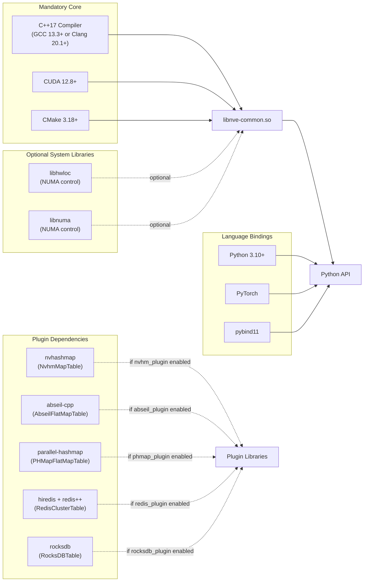
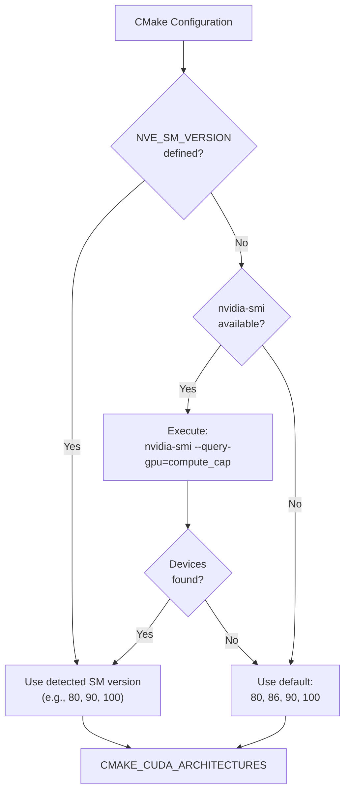
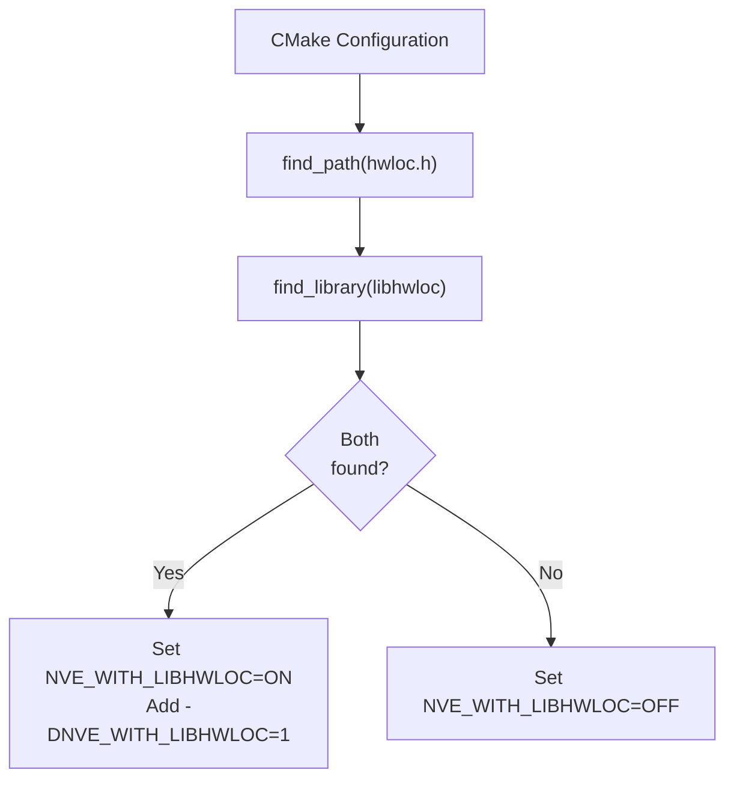
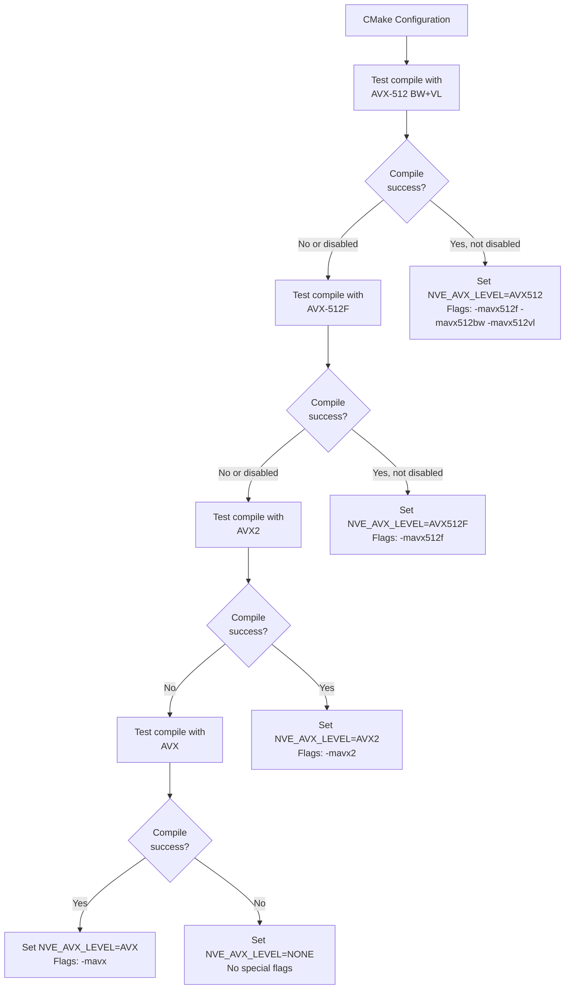
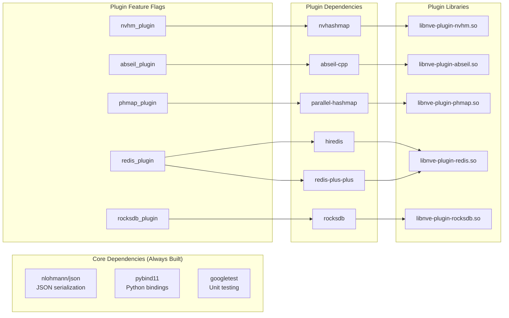

<!-- source: DeepWiki mcp.deepwiki.com · repo NVIDIA/nv-embedding-cache · page 2.1 Prerequisites · fetched 2026-10-26 -->

# Prerequisites

<details>
<summary>Relevant source files</summary>

The following files were used as context for generating this wiki page:

- [CMakeLists.txt](CMakeLists.txt)
- [README.md](README.md)
- [third_party/CMakeLists.txt](third_party/CMakeLists.txt)

</details>


This page details all requirements needed to build and run the NV Embedding Cache SDK. It covers compiler versions, CUDA requirements, system libraries, hardware capabilities, and third-party dependencies managed through git submodules. For step-by-step build instructions after meeting these prerequisites, see [Building from Source](#2.2). For Docker-based setup that pre-satisfies these requirements, see [Docker Setup](#2.3).

## Overview of Requirements

The SDK has both mandatory and optional prerequisites. Mandatory requirements enable basic functionality, while optional components enable specific storage backends or performance optimizations. The build system automatically detects available features and configures accordingly.

### Requirement Categories



**Sources:** [README.md:21-27](), [CMakeLists.txt:16-39](), [CMakeLists.txt:42-68]()

## Core Build Requirements

### Compiler

The SDK requires a C++17 capable compiler with CUDA support. The build system uses the C++17 standard with extensions disabled.

| Requirement | Minimum Version | Tested Versions | Configuration |
|-------------|----------------|-----------------|---------------|
| C++ Standard | C++17 | C++17 | `CMAKE_CXX_STANDARD=17` |
| GCC | 13.3+ | 13.3 | Host compiler for NVCC |
| Clang | 20.1+ | 20.1 | Alternative host compiler |
| Extensions | Disabled | N/A | `CMAKE_CXX_EXTENSIONS=OFF` |

The compiler is configured at [CMakeLists.txt:37-39]():
```
CMAKE_CXX_STANDARD 17
CMAKE_CXX_STANDARD_REQUIRED ON
CMAKE_CXX_EXTENSIONS OFF
```

**Sources:** [README.md:22](), [CMakeLists.txt:37-39]()

### CUDA Toolkit

CUDA 12.8 or later is required. Earlier versions may work with minor code changes but are not officially supported.

| Component | Requirement | Details |
|-----------|------------|---------|
| CUDA Version | 12.8+ | Minimum supported version |
| NVCC Compiler | Included in CUDA | Used for `.cu` files |
| CUDAToolkit | Required | Provides CUDA runtime and libraries |

The build system detects CUDA using CMake's `find_package(CUDAToolkit REQUIRED)` at [CMakeLists.txt:257]().

**Compute Capability Detection:**

The build system automatically detects the GPU compute capability using `nvidia-smi`:



This detection logic is implemented at [CMakeLists.txt:315-342](). Supported compute capabilities:
- SM 80 (Ampere: A100)
- SM 86 (Ampere: RTX 3090)
- SM 89 (Ada: RTX 4090)
- SM 90 (Hopper: H100)
- SM 100 (Blackwell: B100)

**NVCC Compiler Flags:**

The build system sets CUDA-specific flags based on the compiler:

For NVIDIA NVCC [CMakeLists.txt:266-268]():
- `--expt-relaxed-constexpr`: Relaxed constexpr rules
- `--use_fast_math`: Fast math optimizations
- `-Xcompiler -Wall -Xcompiler -Werror`: Host compiler warnings

For Clang CUDA [CMakeLists.txt:269-272]():
- `-Wno-unknown-cuda-version`: Suppress version warnings
- `-ffast-math`: Fast math optimizations
- `-Wno-nan-infinity-disabled`: Suppress fast-math warnings

**Sources:** [README.md:23](), [CMakeLists.txt:257-272](), [CMakeLists.txt:315-342]()

### CMake

CMake 3.18 or later is required. This version is necessary for NVCC target compute architecture features used by the build system.

**Minimum Version Rationale:**

The minimum is set at [CMakeLists.txt:16]() with the comment "Need 3.18 for nvcc target compute arch", referring to CMake's support for the `CMAKE_CUDA_ARCHITECTURES` variable introduced in 3.18.

**Sources:** [README.md:24](), [CMakeLists.txt:16]()

## Python Requirements

The Python bindings require Python 3.10 or later and PyTorch. These are only needed if you plan to use the Python API.

| Component | Requirement | Purpose |
|-----------|------------|---------|
| Python | 3.10+ | Python runtime |
| PyTorch | Latest stable | Tensor interoperability via DLPack |
| pybind11 | Included as submodule | C++ to Python bindings |

The pybind11 submodule is added to the build at [third_party/CMakeLists.txt:27](). Python bindings are built in the `python/pynve/bindings` directory and added to the build at [CMakeLists.txt:382]().

**Note:** Python requirements can be skipped if only building the C++ API.

**Sources:** [README.md:25-26](), [third_party/CMakeLists.txt:27](), [CMakeLists.txt:382]()

## Optional System Libraries

These libraries enhance functionality but are not required for basic operation. The build system auto-detects their presence and enables features accordingly.

### libhwloc (Hardware Locality)

Provides NUMA-aware memory allocation and CPU binding capabilities.

| Attribute | Details |
|-----------|---------|
| Package | `hwloc` |
| Purpose | NUMA topology detection and control |
| Detection | `find_path(hwloc_INCLUDE_DIRS hwloc.h)` |
| CMake Option | `NVE_WITH_LIBHWLOC` |
| Preprocessor | `NVE_WITH_LIBHWLOC=1` if enabled |

Detection logic at [CMakeLists.txt:283-297]():



**Sources:** [CMakeLists.txt:283-297]()

### libnuma (NUMA API)

Alternative/complementary library for NUMA control on Linux systems.

| Attribute | Details |
|-----------|---------|
| Package | `numa` |
| Purpose | NUMA memory policy control |
| Detection | `find_path(numa_INCLUDE_DIRS numa.h)` |
| CMake Option | `NVE_WITH_LIBNUMA` |
| Preprocessor | `NVE_WITH_LIBNUMA=1` if enabled |

Detection logic at [CMakeLists.txt:299-313]() follows the same pattern as libhwloc.

**Sources:** [CMakeLists.txt:299-313]()

## Hardware Capabilities

### CPU Vector Instructions (AVX/SSE)

The build system detects available CPU vector instruction sets and optimizes code accordingly. This affects performance of host-side operations, particularly in the nvhashmap plugin.

**Detection Process:**



**Supported Instruction Sets:**

| Level | Extensions | Compiler Flags | Preprocessor Macro |
|-------|-----------|----------------|-------------------|
| AVX-512 (Full) | F, BW, VL, VBMI | `-mavx512f -mavx512bw -mavx512vl -mavx512vbmi` | `NVE_AVX_LEVEL_AVX512=1` |
| AVX-512 (Partial) | F, BW, VL | `-mavx512f -mavx512bw -mavx512vl` | `NVE_AVX_LEVEL_AVX512=1` |
| AVX-512F | F only | `-mavx512f` | `NVE_AVX_LEVEL_AVX512F=1` |
| AVX2 | AVX2 | `-mavx2` | `NVE_AVX_LEVEL_AVX2=1` |
| AVX | AVX | `-mavx` | `NVE_AVX_LEVEL_AVX=1` |
| None | Standard instructions | None | `NVE_AVX_LEVEL_NONE=1` |

The detection is implemented at [CMakeLists.txt:126-234]() using `check_cxx_source_compiles()` to test compile small programs with specific `#if` preprocessor checks.

**Disabling AVX-512:**

AVX-512 can be explicitly disabled using `NVE_DISABLE_AVX512=ON` [CMakeLists.txt:245-250](). This is useful for CI machines or environments where AVX-512 causes issues.

**NVHM Configuration:**

The detected AVX level is propagated to the nvhashmap submodule through CMake cache variables [third_party/CMakeLists.txt:36-63]():
- `NVHM_WANT_SSE`, `NVHM_WANT_SSE2`, `NVHM_WANT_SSE3`, `NVHM_WANT_SSE4`
- `NVHM_WANT_AVX2`
- `NVHM_WANT_AVX_FVL`, `NVHM_WANT_AVX_BWVL`, `NVHM_WANT_AVX_VBMI`

**Sources:** [CMakeLists.txt:126-234](), [CMakeLists.txt:245-250](), [third_party/CMakeLists.txt:36-63]()

### Cache Line Size

The CPU cache line size is detected at build time and used for alignment optimizations.

**Detection Logic [CMakeLists.txt:112-124]():**
- On non-Windows: `getconf LEVEL1_DCACHE_LINESIZE`
- On Windows: Default to 64 bytes
- Override with: `NVE_CACHE_LINE_SIZE` CMake variable

The detected value is added as a preprocessor macro `-DNVE_CACHE_LINE_SIZE=${NVE_CACHE_LINE_SIZE}` [CMakeLists.txt:279-281]() and passed to nvhashmap via `NVHM_WANT_CACHE_LINE_SIZE` [third_party/CMakeLists.txt:35]().

**Sources:** [CMakeLists.txt:112-124](), [CMakeLists.txt:279-281](), [third_party/CMakeLists.txt:35]()

## Third-Party Dependencies

All third-party dependencies are managed as git submodules in the `third_party/` directory. They are automatically cloned with `git submodule update --init --recursive` and built by CMake.

### Feature-to-Dependency Mapping

The build system uses the `NVE_FEATURES` list to conditionally include dependencies. This reduces compilation time and binary size when features are not needed.



**Sources:** [CMakeLists.txt:42-68](), [third_party/CMakeLists.txt:114-145]()

### Core Dependencies Table

| Dependency | Purpose | License | Always Built |
|------------|---------|---------|--------------|
| nlohmann/json | Configuration serialization | MIT | Yes |
| pybind11 | Python-C++ bindings | BSD-3-Clause | Yes |
| googletest | C++ unit testing | BSD-3-Clause | Yes (unless tests disabled) |

These are added unconditionally at [third_party/CMakeLists.txt:20-27]().

**Sources:** [README.md:77-93](), [third_party/CMakeLists.txt:20-27]()

### Plugin Dependencies Table

| Plugin Feature | Dependency | Purpose | License | Build Configuration |
|---------------|------------|---------|---------|-------------------|
| `nvhm_plugin` | nvhashmap | GPU-accessible hash table for host memory | Apache-2.0 | [third_party/CMakeLists.txt:31-67]() |
| `abseil_plugin` | abseil-cpp | Google's Abseil flat hash map | Apache-2.0 | [third_party/CMakeLists.txt:69-73]() |
| `phmap_plugin` | parallel-hashmap | Greg's parallel flat hash map | Apache-2.0 | [third_party/CMakeLists.txt:75-80]() |
| `redis_plugin` | hiredis<br/>redis-plus-plus | Redis client libraries | BSD-3-Clause<br/>Apache-2.0 | [third_party/CMakeLists.txt:94-112]() |
| `rocksdb_plugin` | rocksdb | Persistent key-value store | Apache-2.0 | [third_party/CMakeLists.txt:82-92]() |

**Conditional Build Logic:**

At [third_party/CMakeLists.txt:114-145](), the build system checks `NVE_FEATURES` list and calls the corresponding `add_*()` function only if the feature is enabled. For example:

```
list(FIND NVE_FEATURES "nvhm_plugin" NVE_FEATURE_ENABLED)
if(${NVE_FEATURE_ENABLED} GREATER -1)
  add_nvhashmap()
endif()
```

**Default Features:**

The default feature set is defined at [CMakeLists.txt:61-70]():
- All plugins enabled
- `ht_mask_64`, `ht_key_32`, `ht_key_64` (hash table configurations)
- `ht_part_fnv1a` (partitioning function)
- `ht_kernel_64`, `ht_kernel_128` (kernel tile sizes)

**Minimal Features:**

A minimal build can be achieved by setting `NVE_FEATURES` to `NVE_MINIMAL_FEATURES` [CMakeLists.txt:55-59](), which includes only:
- `ht_mask_64`, `ht_key_64`, `ht_part_fnv1a`, `ht_kernel_64`
- No plugins

**Sources:** [README.md:77-93](), [CMakeLists.txt:42-109](), [third_party/CMakeLists.txt:31-145]()

### Redis Requirements (Optional)

If using the Redis plugin, you need a Redis server for runtime operation and testing.

| Component | Version | Purpose |
|-----------|---------|---------|
| Redis Server | 7.0.15+ | Runtime parameter server |
| Redis Cluster | 7.0.15+ | Used in integration tests |

Redis is not required at build time, only at runtime when using `RedisClusterTable` or running tests that depend on it.

**Sources:** [README.md:27]()

## Docker Alternative

The SDK provides a Dockerfile that satisfies all prerequisites. Using Docker is the recommended approach to avoid manual dependency management.

**Dockerfile Location:** [Dockerfile]()

The Dockerfile includes:
- Base CUDA image with appropriate CUDA toolkit
- GCC/Clang compilers
- CMake 3.18+
- Python 3.10+ with PyTorch
- All system libraries (hwloc, numa)
- Build tools and utilities

**Build and Run Commands [README.md:39-42]():**
```bash
docker build -t nve --build-arg START_DIR=$(pwd) --build-arg UID=$(id -u) ...
docker run --cap-add=ALL --net=host --ipc=host --gpus all -it --rm -v $(pwd):$(pwd) nve
```

This eliminates the need to manually install prerequisites on your host system. For detailed Docker setup instructions, see [Docker Setup](#2.3).

**Sources:** [README.md:29](), [README.md:39-42]()

## Verification

After installing prerequisites, verify your environment before building:

### Check Compiler Version
```bash
g++ --version  # Should be 13.3 or later
clang++ --version  # Should be 20.1 or later
```

### Check CUDA Version
```bash
nvcc --version  # Should show 12.8 or later
nvidia-smi  # Verify GPU is detected and compute capability
```

### Check CMake Version
```bash
cmake --version  # Should be 3.18 or later
```

### Check Python Environment
```bash
python3 --version  # Should be 3.10 or later
python3 -c "import torch; print(torch.__version__)"  # Verify PyTorch
```

### Verify Git Submodules
```bash
cd nv-embedding-cache
git submodule update --init --recursive
ls third_party/  # Should contain multiple directories
```

## Summary

The prerequisites fall into several categories with different levels of requirement:

| Category | Components | Required | Auto-Detected |
|----------|-----------|----------|---------------|
| **Core Build** | C++17 compiler, CUDA 12.8+, CMake 3.18+ | Yes | Compiler via CMake, CUDA via find_package |
| **Python API** | Python 3.10+, PyTorch, pybind11 | For Python use only | Python version via CMake |
| **System Libraries** | libhwloc, libnuma | No (optional) | Yes via find_path/find_library |
| **Hardware** | GPU SM 80+, AVX/SSE support | GPU required, AVX optional | Yes via nvidia-smi and test compilation |
| **Plugins** | nvhashmap, abseil, phmap, redis, rocksdb | No (feature-dependent) | N/A (built from submodules) |

All plugin dependencies are included as git submodules and built automatically when their corresponding feature is enabled in `NVE_FEATURES`.

**Next Steps:**
- With prerequisites satisfied, proceed to [Building from Source](#2.2)
- For containerized development, see [Docker Setup](#2.3)
- For details on third-party licenses and attributions, see [Third-Party Dependencies](#2.4)

**Sources:** [README.md:21-47](), [CMakeLists.txt:16-390](), [third_party/CMakeLists.txt:1-146]()

---

