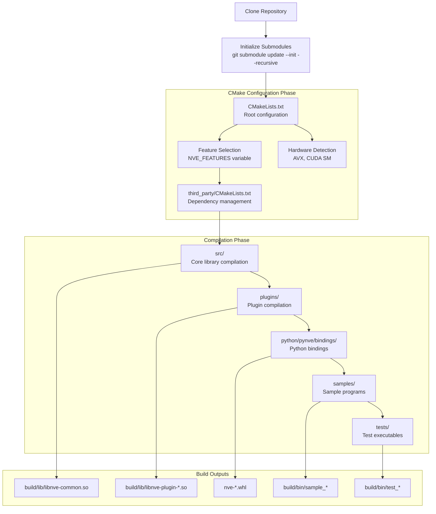
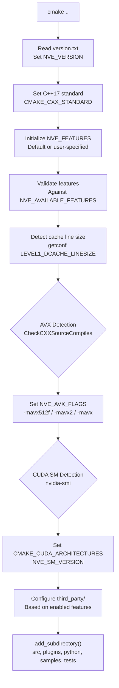
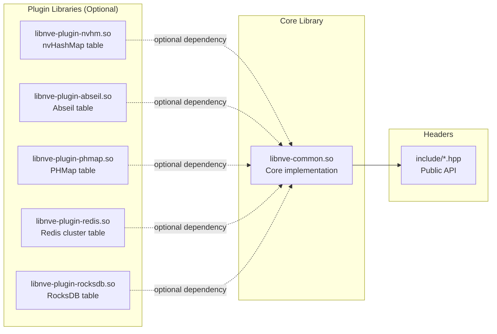
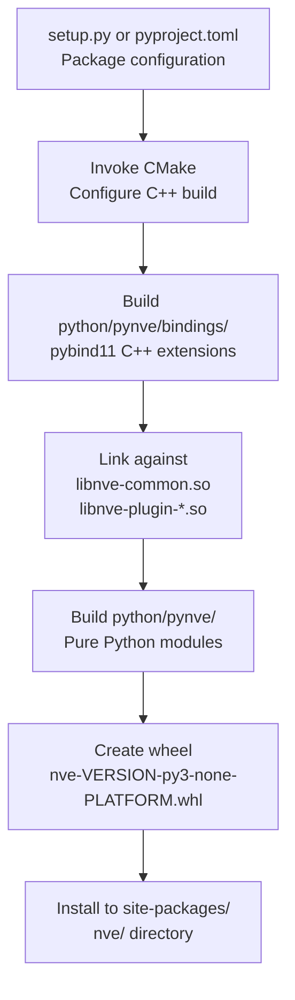
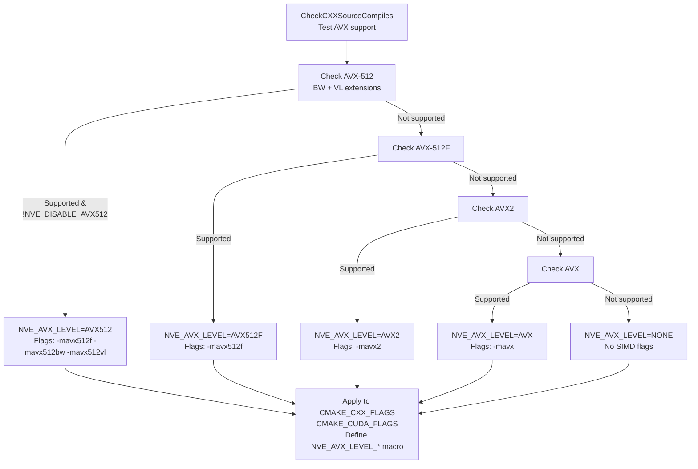
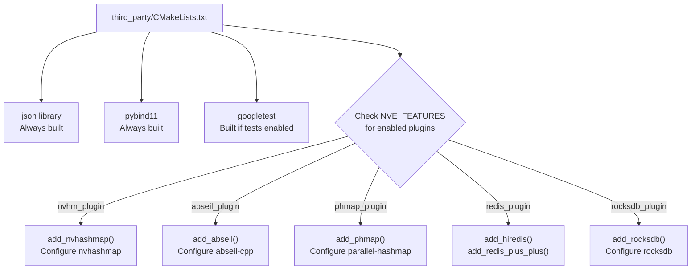

<!-- source: DeepWiki mcp.deepwiki.com · repo NVIDIA/nv-embedding-cache · page 2.2 Building from Source · fetched 2026-10-26 -->

# Building from Source

<details>
<summary>Relevant source files</summary>

The following files were used as context for generating this wiki page:

- [CMakeLists.txt](CMakeLists.txt)
- [README.md](README.md)
- [third_party/CMakeLists.txt](third_party/CMakeLists.txt)

</details>


This page provides step-by-step instructions for building the NV Embedding Cache SDK from source code. It covers both C++ library compilation and Python binding installation, along with build configuration options and feature selection.

For system prerequisites and dependencies, see [Prerequisites](#2.1). For containerized builds using Docker, see [Docker Setup](#2.3). For details on managing third-party dependencies, see [Third-Party Dependencies](#2.4).

---

## Build System Overview

The SDK uses CMake as its primary build system. The build process produces multiple artifacts including the core library, optional plugin libraries, Python bindings, and optionally samples and tests.

**Build System Architecture**



Sources: [README.md:33-55](), [CMakeLists.txt:1-390]()

---

## Building C++ Libraries

### Basic Build Steps

The standard C++ build process uses CMake to configure and compile the SDK:

```bash
# 1. Clone repository and initialize submodules
git clone git@github.com:NVIDIA/nv-embedding-cache.git
cd nv-embedding-cache
git submodule update --init --recursive

# 2. Create build directory
mkdir build
cd build

# 3. Configure with CMake
cmake ..

# 4. Build all targets
make all -j

# 5. Return to root directory
cd ..
```

Sources: [README.md:33-55]()

### Build Configuration Phase

When CMake is invoked, it performs several configuration steps before compilation:

**CMake Configuration Flow**



Sources: [CMakeLists.txt:31-35](), [CMakeLists.txt:42-109](), [CMakeLists.txt:111-124](), [CMakeLists.txt:126-233](), [CMakeLists.txt:315-342](), [CMakeLists.txt:254-255](), [CMakeLists.txt:380-389]()

### Feature Selection

The SDK supports optional features controlled by the `NVE_FEATURES` variable. By default, a standard set of features is enabled.

| Feature Flag | Description | Default |
|-------------|-------------|---------|
| `nvhm_plugin` | nvHashMap-based system memory table | Enabled |
| `abseil_plugin` | Abseil flat hash map table | Enabled |
| `phmap_plugin` | Parallel hash map table | Enabled |
| `redis_plugin` | Redis cluster storage backend | Enabled |
| `rocksdb_plugin` | RocksDB persistent storage backend | Enabled |
| `ht_mask_8` to `ht_mask_64` | Hash table mask sizes | Only `ht_mask_64` enabled |
| `ht_key_32`, `ht_key_64` | Hash table key sizes | `ht_key_32` and `ht_key_64` enabled |
| `ht_kernel_64`, `ht_kernel_128` | CUDA kernel tile sizes | Both enabled |
| `ht_part_fnv1a` | Hash partitioning function | Enabled |

Sources: [CMakeLists.txt:42-73]()

**Customizing Features**

To build with minimal features (fast compile, small binary):

```bash
cmake -DNVE_FEATURES="ht_mask_64 ht_key_64 ht_part_fnv1a ht_kernel_64" ..
```

To disable all plugins:

```bash
cmake -DNVE_DISABLE_PLUGINS=ON ..
```

To disable only the NVHM plugin:

```bash
cmake -DNVE_DISABLE_NVHM_PLUGIN=ON ..
```

Sources: [CMakeLists.txt:76-92]()

### Build Outputs

After successful compilation, build artifacts are organized by type:

| Directory | Contents | Examples |
|-----------|----------|----------|
| `build/lib/` | Shared libraries | `libnve-common.so`, `libnve-plugin-nvhm.so`, `libnve-plugin-redis.so` |
| `build/bin/` | Sample executables and tests | `sample_simple`, `test_embedding_layer`, `benchmark_lookup` |
| `include/` | Public C++ headers | `nve/embedding_layer.hpp`, `nve/table.hpp` |

Sources: [CMakeLists.txt:344-346]()

**Core Library Structure**



Sources: [CMakeLists.txt:344-346](), [CMakeLists.txt:380-381]()

---

## Building Python Bindings

### Installation via pip

The recommended method for building and installing Python bindings is using pip, which internally invokes CMake:

```bash
# From repository root
pip install .
```

This command:
1. Configures CMake with default features
2. Compiles C++ sources
3. Builds Python bindings using pybind11
4. Creates a wheel package
5. Installs the package in your Python environment

Sources: [README.md:44-47]()

### Development Installation

For development with editable installs:

```bash
# Editable install (changes to Python code take effect without reinstall)
pip install -e .

# Install with specific build directory
pip install --config-settings=build-dir=custom_build .
```

### Python Build Components

**Python Binding Build Process**



Sources: [CMakeLists.txt:382](), [README.md:44-47]()

---

## Build Configuration Options

### Important CMake Variables

| Variable | Description | Default |
|----------|-------------|---------|
| `CMAKE_BUILD_TYPE` | Build configuration | `Release` |
| `NVE_FEATURES` | Space-separated list of enabled features | Standard feature set |
| `NVE_DISABLE_PLUGINS` | Disable all plugin features | `OFF` |
| `NVE_DISABLE_NVHM_PLUGIN` | Disable NVHM plugin specifically | `OFF` |
| `NVE_DISABLE_AVX512` | Disable AVX-512 instructions | `OFF` |
| `NVE_SM_VERSION` | CUDA compute capabilities to compile for | Auto-detected |
| `NVE_ENABLE_NVTX` | Enable NVTX profiling markers | `OFF` |
| `NVE_ORIGIN_RPATH` | Set RPATH for relocated libraries | `OFF` |
| `NVE_DISABLE_TESTS_AND_SAMPLES` | Skip building tests and samples | Undefined |
| `NVE_WITH_LIBHWLOC` | Enable hwloc NUMA control | Auto-detected |
| `NVE_WITH_LIBNUMA` | Enable libnuma NUMA control | Auto-detected |

Sources: [CMakeLists.txt:236-238](), [CMakeLists.txt:76-84](), [CMakeLists.txt:88-92](), [CMakeLists.txt:245-250](), [CMakeLists.txt:315-342](), [CMakeLists.txt:373-378](), [CMakeLists.txt:349-353](), [CMakeLists.txt:383-389](), [CMakeLists.txt:283-313]()

### AVX Detection and Configuration

The build system automatically detects CPU capabilities and enables appropriate SIMD instructions:

**AVX Detection Logic**



Sources: [CMakeLists.txt:126-233]()

### CUDA Architecture Detection

The build system detects GPU compute capability using `nvidia-smi`:

```bash
# Automatic detection (default)
cmake ..

# Manual specification
cmake -DNVE_SM_VERSION="80;86;90" ..
```

If `nvidia-smi` is unavailable or no GPUs are detected, the build defaults to compiling for SM 80, 86, 90, and 100.

Sources: [CMakeLists.txt:315-342]()

---

## Advanced Build Options

### Debug Build

To build with debug symbols and disable optimizations:

```bash
cmake -DCMAKE_BUILD_TYPE=Debug ..
make all -j
```

Debug builds include:
- `-O0` optimization level
- `-g` debug symbols
- `-G` for CUDA device-side debugging

Sources: [CMakeLists.txt:236-238](), [CMakeLists.txt:274-277]()

### Minimal Build

For fastest compilation and smallest binary size:

```bash
cmake \
  -DNVE_FEATURES="ht_mask_64 ht_key_64 ht_part_fnv1a ht_kernel_64" \
  -DNVE_DISABLE_TESTS_AND_SAMPLES=ON \
  ..
make all -j
```

Sources: [CMakeLists.txt:55-59](), [CMakeLists.txt:383-389]()

### Custom Install Prefix

To install libraries and headers to a custom location:

```bash
cmake -DCMAKE_INSTALL_PREFIX=/opt/nve ..
make all -j
make install
```

---

## Verifying the Build

### Check Build Outputs

After a successful build, verify the artifacts:

```bash
# List built libraries
ls build/lib/

# Expected output:
# libnve-common.so
# libnve-plugin-nvhm.so (if nvhm_plugin enabled)
# libnve-plugin-redis.so (if redis_plugin enabled)
# ... other plugins

# List sample executables (if not disabled)
ls build/bin/

# Expected output includes sample programs and tests
```

### Run Unit Tests

If tests were built, verify functionality:

```bash
cd build
ctest --output-on-failure
```

Sources: [CMakeLists.txt:383-389]()

### Verify Python Installation

For Python builds:

```python
import nve
print(nve.__version__)

# Check available embedding layer types
from nve import NVEmbedding
print(NVEmbedding.__doc__)
```

---

## Build Output Directory Structure

After compilation, the build directory has the following structure:

```
build/
├── lib/
│   ├── libnve-common.so          # Core library
│   ├── libnve-plugin-nvhm.so     # NVHM plugin (optional)
│   ├── libnve-plugin-abseil.so   # Abseil plugin (optional)
│   ├── libnve-plugin-phmap.so    # PHMap plugin (optional)
│   ├── libnve-plugin-redis.so    # Redis plugin (optional)
│   └── libnve-plugin-rocksdb.so  # RocksDB plugin (optional)
├── bin/
│   ├── sample_simple              # Basic C++ sample
│   ├── sample_layer               # Advanced layer sample
│   ├── test_embedding_layer       # Unit tests
│   └── benchmark_*                # Benchmark executables
├── CMakeCache.txt                 # CMake configuration cache
└── cmake.vars                     # Debug variable dump (if enabled)
```

Sources: [CMakeLists.txt:344-346]()

---

## Third-Party Dependency Management

The build system automatically compiles third-party dependencies based on enabled features:

**Dependency Configuration Flow**



Sources: [third_party/CMakeLists.txt:20-145]()

Each dependency is configured with specific options to disable unneeded features:
- Tests and examples are disabled
- Static linking is preferred where applicable
- Cache configuration (e.g., `NVHM_WANT_CACHE_LINE_SIZE`) is propagated

Sources: [third_party/CMakeLists.txt:31-112]()

---

## Troubleshooting Build Issues

### Submodule Not Initialized

**Error**: Missing third-party header files

**Solution**:
```bash
git submodule update --init --recursive
```

### CUDA Architecture Mismatch

**Error**: `no kernel image available for execution on the device`

**Solution**: Explicitly specify your GPU's compute capability:
```bash
cmake -DNVE_SM_VERSION="89" ..  # For Ada Lovelace (RTX 40 series)
```

### Feature Not Available

**Error**: `undefined reference to` plugin symbols

**Solution**: Ensure the required feature is in `NVE_FEATURES`:
```bash
cmake -DNVE_FEATURES="nvhm_plugin redis_plugin" ..
```

### Out of Memory During Compilation

**Solution**: Reduce parallelism:
```bash
make -j4  # Use only 4 parallel jobs instead of -j
```

Or build with minimal features to reduce template instantiations:
```bash
cmake -DNVE_FEATURES="ht_mask_64 ht_key_64 ht_part_fnv1a ht_kernel_64" ..
```

---

