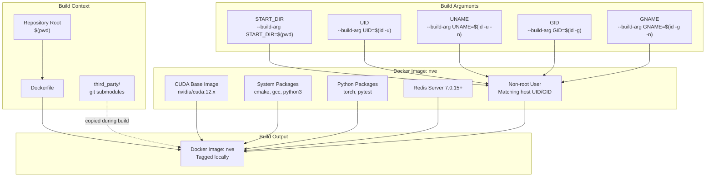
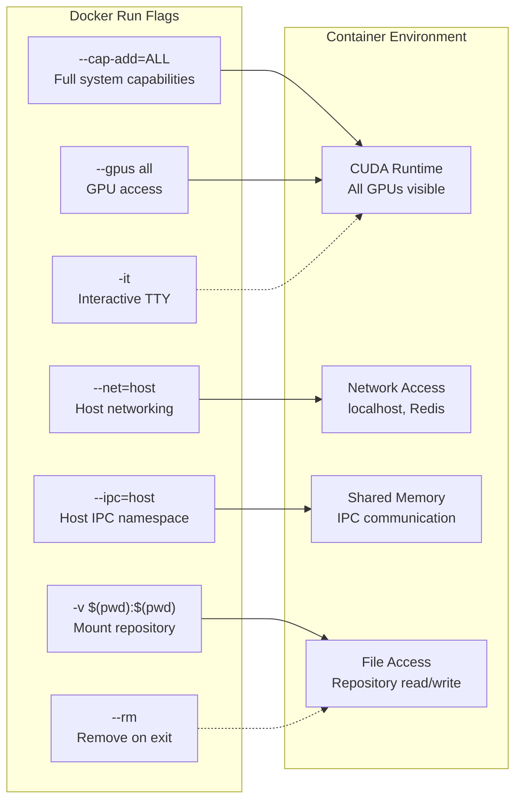
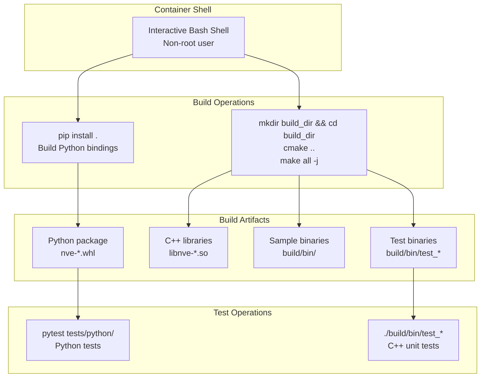
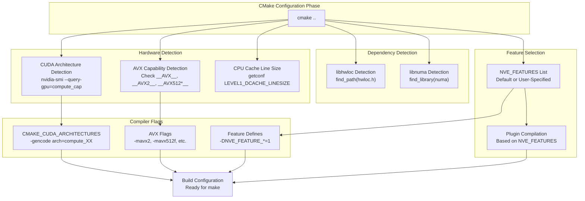
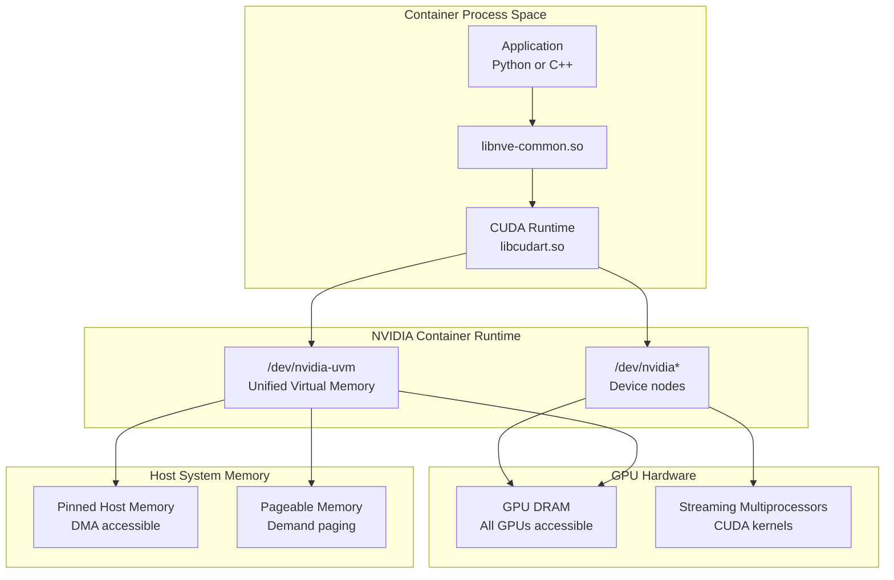
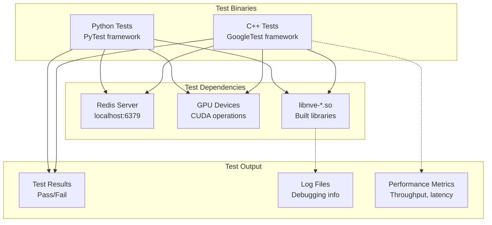
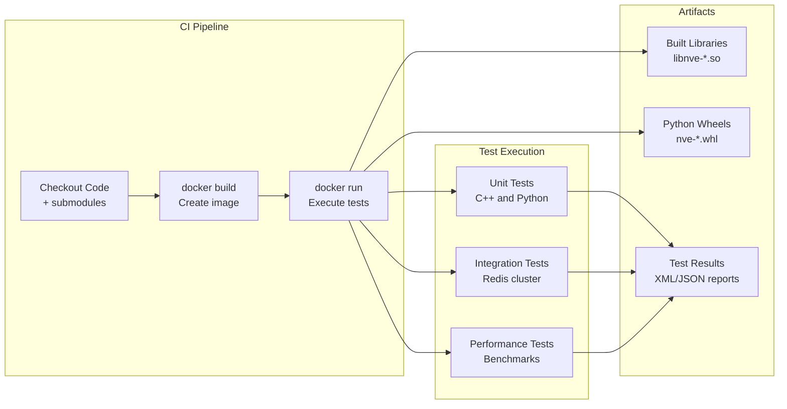

<!-- source: DeepWiki mcp.deepwiki.com · repo NVIDIA/nv-embedding-cache · page 2.3 Docker Setup · fetched 2026-10-26 -->

# Docker Setup

<details>
<summary>Relevant source files</summary>

The following files were used as context for generating this wiki page:

- [CMakeLists.txt](CMakeLists.txt)
- [README.md](README.md)

</details>


This document describes how to use Docker for developing and running the NV Embedding Cache SDK. Docker provides a containerized environment with all required dependencies pre-installed, simplifying setup and ensuring consistency across development environments.

For information about building from source without Docker, see [Building from Source](#2.2). For details about the dependencies themselves, see [Third-Party Dependencies](#2.4).

---

## Overview

The NV Embedding Cache repository includes a Dockerfile that creates a container image with:
- CUDA 12.8+ runtime and development tools
- C++17 capable compiler (GCC 13.3 or Clang 20.1)
- CMake 3.18+
- Python 3.10+ with PyTorch
- All third-party dependencies
- Redis server (for integration tests)

The Docker-based workflow is the recommended approach for getting started, as it eliminates environment-specific configuration issues.

**Sources:** [README.md:19-29](), [README.md:39-43]()

---

## Docker Build Architecture



This diagram shows the inputs to the `docker build` command and the resulting image structure. The build arguments ensure the container user has matching UID/GID with the host, which is critical for file permission management with mounted volumes.

**Sources:** [README.md:39-41]()

---

## Building the Docker Image

### Basic Build Command

The image is built using the following command from the repository root:

```bash
docker build -t nve \
  --build-arg START_DIR=$(pwd) \
  --build-arg UID=$(id -u) \
  --build-arg UNAME=$(id -u -n) \
  --build-arg GID=$(id -g) \
  --build-arg GNAME=$(id -g -n) \
  .
```

**Sources:** [README.md:40-41]()

### Build Arguments Explained

| Argument | Purpose | Value |
|----------|---------|-------|
| `START_DIR` | Sets the working directory path inside container | `$(pwd)` - current directory on host |
| `UID` | User ID for the non-root user in container | `$(id -u)` - host user's UID |
| `UNAME` | Username for the non-root user in container | `$(id -u -n)` - host user's username |
| `GID` | Group ID for the non-root user in container | `$(id -g)` - host user's GID |
| `GNAME` | Group name for the non-root user in container | `$(id -g -n)` - host user's group name |

The UID/GID matching is essential because the container mounts the host repository directory. Without matching IDs, files created in the container would have incorrect ownership on the host filesystem.

**Sources:** [README.md:40-41]()

---

## Running the Docker Container

### Standard Container Launch

```bash
docker run --cap-add=ALL --net=host --ipc=host --gpus all \
  -it --rm \
  -v $(pwd):$(pwd) \
  nve
```

**Sources:** [README.md:42]()

### Container Runtime Configuration



**Sources:** [README.md:42]()

### Runtime Flag Explanations

| Flag | Purpose | Impact |
|------|---------|--------|
| `--cap-add=ALL` | Grants container all Linux capabilities | Required for certain CUDA operations and system-level access |
| `--net=host` | Use host network stack directly | Allows Redis connections on localhost, simplifies networking |
| `--ipc=host` | Share host's IPC namespace | Enables shared memory for multi-process scenarios |
| `--gpus all` | Expose all GPUs to container | Required for CUDA operations; uses nvidia-container-runtime |
| `-it` | Interactive mode with TTY | Enables interactive shell access |
| `--rm` | Automatically remove container on exit | Prevents accumulation of stopped containers |
| `-v $(pwd):$(pwd)` | Mount current directory | Enables editing files on host while building in container |

**Sources:** [README.md:42]()

---

## Inside the Container

### Directory Layout After Launch

When the container starts, the repository is mounted at the same path as on the host. This means:

```
/path/to/nv-embedding-cache/     # Same path inside and outside
├── CMakeLists.txt
├── Dockerfile
├── README.md
├── include/
├── src/
├── plugins/
├── python/
├── samples/
├── tests/
├── third_party/
└── build/                       # Created during build, persists on host
```

The consistent path enables workflows where build artifacts created in the container are immediately accessible on the host filesystem.

**Sources:** [README.md:42](), [README.md:50-54]()

### Development Workflow Inside Container



**Sources:** [README.md:44-54]()

---

## Python Installation Workflow

### Installing Python Bindings

From inside the container, install the Python package:

```bash
pip install .
```

This command:
1. Reads `pyproject.toml` and `setup.py` configuration
2. Invokes CMake to build C++ libraries
3. Builds Python bindings using pybind11
4. Installs the `nve` Python package
5. Places build artifacts in `./build` by default

The installation creates:
- `./build/lib/libnve-*.so` - Core C++ libraries
- `./build/lib/python*/site-packages/nve/` - Python package

**Sources:** [README.md:44-46]()

### CMake Build Options During pip install

The Python installation respects CMake feature flags. To customize the build:

```bash
# Minimal feature set (faster build, smaller binaries)
NVE_FEATURES="ht_mask_64 ht_key_64 ht_part_fnv1a ht_kernel_64" pip install .

# Disable specific plugins
NVE_DISABLE_NVHM_PLUGIN=ON pip install .
```

These environment variables map to the CMake feature selection system described in [CMakeLists.txt:41-108]().

**Sources:** [CMakeLists.txt:76-84](), [CMakeLists.txt:88-92]()

---

## C++ Library Build Workflow

### Manual CMake Build

For C++ development without Python bindings:

```bash
mkdir build_dir
cd build_dir
cmake ..
make all -j
cd -
```

This produces:
- `build_dir/lib/libnve-common.so` - Core embedding cache library
- `build_dir/lib/libnve-plugin-*.so` - Optional storage plugins
- `build_dir/bin/` - Sample executables and test binaries

**Sources:** [README.md:48-54]()

### CMake Configuration Detection



The CMake system automatically detects:
- **CUDA SM version** from `nvidia-smi` or uses defaults [CMakeLists.txt:315-342]()
- **AVX instruction set** support via compiler checks [CMakeLists.txt:126-206]()
- **Cache line size** via `getconf` [CMakeLists.txt:111-124]()
- **Optional libraries** like `libhwloc` and `libnuma` [CMakeLists.txt:283-313]()

**Sources:** [CMakeLists.txt:111-342]()

---

## Container Capabilities and GPU Access

### Required Capabilities Breakdown

The `--cap-add=ALL` flag grants comprehensive system capabilities. Specific capabilities required for NV Embedding Cache operations include:

| Capability | Usage |
|------------|-------|
| `CAP_SYS_ADMIN` | CUDA unified memory (UVM) management |
| `CAP_SYS_PTRACE` | Debugging with compute-sanitizer |
| `CAP_IPC_LOCK` | Pinned memory allocation for DMA |
| `CAP_SYS_NICE` | Thread priority management |

The `--gpus all` flag requires:
- `nvidia-container-toolkit` installed on host
- Compatible NVIDIA driver (supporting CUDA 12.8+)
- Docker configured to use `nvidia-container-runtime`

**Sources:** [README.md:42]()

### GPU Memory Access Patterns



The `--ipc=host` flag enables:
- Shared memory segments for multi-process CUDA applications
- NVIDIA NCCL communication primitives (for multi-GPU)
- Redis server communication on localhost

**Sources:** [README.md:42]()

---

## Testing Inside Docker

### Running Unit Tests

After building, tests can be executed directly:

**C++ Tests:**
```bash
cd build_dir
./bin/test_gpu_table
./bin/test_linear_layer
./bin/test_hierarchical_layer
```

**Python Tests:**
```bash
pytest tests/python/ -v
```

The Docker image includes Redis server pre-installed, which some tests require. Redis can be started inside the container if needed for integration tests.

**Sources:** [README.md:27]()

### Test Environment Configuration



Tests automatically detect available GPUs and Redis connectivity. If Redis is not running, Redis-dependent tests are skipped.

**Sources:** [README.md:27]()

---

## Volume Mounting and File Permissions

### File Ownership Management

The Dockerfile creates a user matching the host's UID/GID:

```mermaid
graph LR
    subgraph "Host System"
        HOST_USER["User: alice<br/>UID: 1000<br/>GID: 1000"]
        HOST_FILES["Repository Files<br/>owner: 1000:1000"]
    end
    
    subgraph "Docker Container"
        CONTAINER_USER["User: alice<br/>UID: 1000<br/>GID: 1000"]
        MOUNTED_FILES["Mounted Files<br/>owner: 1000:1000"]
        BUILD_FILES["Build Artifacts<br/>created as 1000:1000"]
    end
    
    HOST_USER -.->|UID/GID passed<br/>via build args| CONTAINER_USER
    HOST_FILES -.->|mounted via<br/>-v $(pwd):$(pwd)| MOUNTED_FILES
    CONTAINER_USER -->|creates| BUILD_FILES
    BUILD_FILES -.->|persists to host<br/>with correct owner| HOST_FILES
```

This design ensures:
1. Files edited in container are owned by the correct host user
2. Build artifacts created in container are immediately usable on host
3. No permission issues when alternating between host and container workflows

**Sources:** [README.md:40-42]()

---

## Common Docker Workflows

### Workflow 1: Quick Python Development

```bash
# Build and enter container
docker run --cap-add=ALL --net=host --ipc=host --gpus all -it --rm -v $(pwd):$(pwd) nve

# Inside container: install and test
pip install .
pytest tests/python/test_basic.py -v
```

### Workflow 2: C++ Library Development

```bash
# Enter container
docker run --cap-add=ALL --net=host --ipc=host --gpus all -it --rm -v $(pwd):$(pwd) nve

# Inside container: build and run samples
mkdir build && cd build
cmake ..
make all -j
./bin/simple_cpp
```

### Workflow 3: Iterative Development

```bash
# Enter container once
docker run --cap-add=ALL --net=host --ipc=host --gpus all -it --rm -v $(pwd):$(pwd) nve

# Inside container: rapid rebuild cycle
cd build
make -j                    # Rebuild after editing files on host
./bin/test_gpu_table       # Run tests
```

The mounted volume allows editing source files on the host with any IDE while building and testing inside the container.

**Sources:** [README.md:39-54]()

---

## Troubleshooting

### GPU Not Accessible in Container

**Symptom:** `CUDA_ERROR_NO_DEVICE` or `nvidia-smi` fails inside container

**Solution:**
1. Verify `nvidia-container-toolkit` is installed on host
2. Check Docker daemon configuration includes `nvidia` runtime
3. Ensure `--gpus all` flag is present in `docker run`
4. Confirm host NVIDIA driver version supports CUDA 12.8+

### Permission Denied on Build Artifacts

**Symptom:** Cannot modify files created by container on host

**Solution:**
1. Ensure UID/GID build arguments match host user: `$(id -u)` and `$(id -g)`
2. Rebuild image with correct build arguments
3. Check mounted volume path is correct: `-v $(pwd):$(pwd)`

### CMake Configuration Fails

**Symptom:** `cmake ..` fails to find CUDA or dependencies

**Solution:**
1. Verify container has access to GPUs: `nvidia-smi` should work
2. Check `CMAKE_CUDA_COMPILER` is set correctly
3. Initialize git submodules: `git submodule update --init --recursive`
4. Rebuild Docker image to get latest dependencies

**Sources:** [README.md:39-54](), [CMakeLists.txt:257-259]()

---

## Docker Image Customization

### Modifying the Dockerfile

To customize the Docker environment, edit the Dockerfile and rebuild:

```bash
# After modifying Dockerfile
docker build -t nve-custom --build-arg START_DIR=$(pwd) --build-arg UID=$(id -u) --build-arg UNAME=$(id -u -n) --build-arg GID=$(id -g) --build-arg GNAME=$(id -g -n) .

docker run --cap-add=ALL --net=host --ipc=host --gpus all -it --rm -v $(pwd):$(pwd) nve-custom
```

Common customizations:
- Different CUDA base image version
- Additional Python packages
- Alternative compiler versions
- Development tools (gdb, valgrind, nsight-systems)

### Feature-Specific Builds

Build Docker images optimized for specific use cases:

**Minimal Features (Fastest Build):**
```bash
docker build -t nve-minimal --build-arg NVE_FEATURES="ht_mask_64 ht_key_64 ht_part_fnv1a ht_kernel_64" --build-arg START_DIR=$(pwd) --build-arg UID=$(id -u) --build-arg UNAME=$(id -u -n) --build-arg GID=$(id -g) --build-arg GNAME=$(id -g -n) .
```

**Plugin Development (All Plugins):**
```bash
docker build -t nve-plugins --build-arg NVE_FEATURES="nvhm_plugin redis_plugin rocksdb_plugin abseil_plugin phmap_plugin" --build-arg START_DIR=$(pwd) --build-arg UID=$(id -u) --build-arg UNAME=$(id -u -n) --build-arg GID=$(id -g) --build-arg GNAME=$(id -g -n) .
```

**Sources:** [CMakeLists.txt:41-108]()

---

## Integration with CI/CD

The Docker setup supports automated testing and deployment:



The containerized environment ensures consistent test results across different CI platforms (GitHub Actions, GitLab CI, Jenkins, etc.).

**Sources:** [README.md:39-54]()

---

