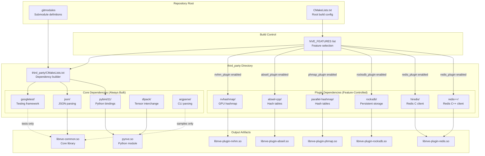
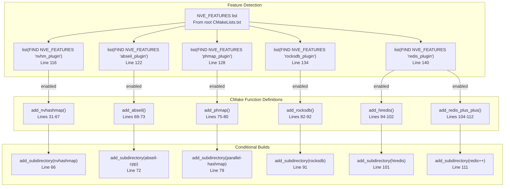
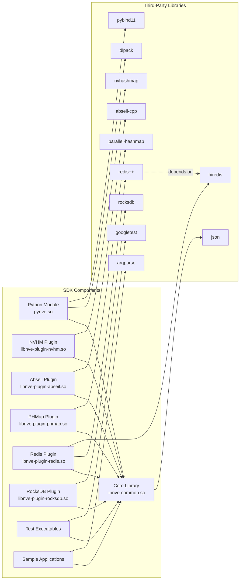

<!-- source: DeepWiki mcp.deepwiki.com · repo NVIDIA/nv-embedding-cache · page 2.4 Third-Party Dependencies · fetched 2026-10-26 -->

# Third-Party Dependencies

<details>
<summary>Relevant source files</summary>

The following files were used as context for generating this wiki page:

- [.gitmodules](.gitmodules)
- [README.md](README.md)
- [third_party/CMakeLists.txt](third_party/CMakeLists.txt)

</details>


## Purpose and Scope

This page documents all third-party libraries used by the NV Embedding Cache SDK, their purposes, licensing, and how they are managed through the build system. This covers the external dependencies required to build the core SDK, optional storage plugins, Python bindings, and testing infrastructure.

For information about building the SDK from source, see [Building from Source](#2.2). For details on feature selection that controls which dependencies are built, see [Feature Selection](#10.2).

---

## Overview

The NV Embedding Cache SDK uses **git submodules** to manage all third-party dependencies. All dependencies are located in the `third_party/` directory and are configured through CMake. The build system supports **feature-based dependency inclusion**, meaning only dependencies required for enabled features are built and linked.

**Sources:** [README.md:77-93](), [.gitmodules:1-38](), [third_party/CMakeLists.txt:1-146]()

---

## Dependency Management Architecture



**Dependency Management Flow:** The build system uses git submodules for source code management and CMake for build configuration. Feature flags in `NVE_FEATURES` control which optional plugin dependencies are built.

**Sources:** [.gitmodules:1-38](), [third_party/CMakeLists.txt:16-27,114-145]()

---

## Complete Dependency Catalog

| Name | Purpose | License | Used By | Feature Flag |
|------|---------|---------|---------|--------------|
| **googletest** | C++ testing framework for unit tests | BSD-3-Clause | Test executables | Always (unless `NVE_DISABLE_TESTS_AND_SAMPLES`) |
| **json** (nlohmann) | JSON parsing for configuration files | MIT | Core library | Always |
| **pybind11** | C++/Python binding generator | BSD-3-Clause | Python module (`pynve`) | Always |
| **dlpack** | Tensor data structure interchange | Apache 2.0 | Python module (tensor support) | Always |
| **argparse** | Command-line argument parsing | MIT | Sample applications | Always |
| **nvhashmap** | GPU-accelerated hash table | Apache 2.0 | `libnve-plugin-nvhm.so` (NvhmMapTable) | `nvhm_plugin` |
| **abseil-cpp** | Google's C++ library (flat_hash_map) | Apache 2.0 | `libnve-plugin-abseil.so` (AbseilFlatMapTable) | `abseil_plugin` |
| **parallel-hashmap** | High-performance hash tables | Apache 2.0 | `libnve-plugin-phmap.so` (PHMapFlatMapTable) | `phmap_plugin` |
| **rocksdb** | Persistent key-value store | Apache 2.0 / GPL 2.0 | `libnve-plugin-rocksdb.so` (RocksDBTable) | `rocksdb_plugin` |
| **hiredis** | Minimalistic C client for Redis | BSD-3-Clause | `libnve-plugin-redis.so` (RedisClusterTable) | `redis_plugin` |
| **redis-plus-plus** | C++ wrapper for hiredis | Apache 2.0 | `libnve-plugin-redis.so` (RedisClusterTable) | `redis_plugin` |

**Sources:** [README.md:82-93](), [.gitmodules:1-38]()

---

## Dependency Categories

### Core Dependencies

These dependencies are required for basic SDK functionality and are always built:

- **googletest** [third_party/googletest/](https://github.com/google/googletest): Testing framework used throughout the test suite. Only built when tests are enabled (default behavior unless `NVE_DISABLE_TESTS_AND_SAMPLES` is set).

- **json** [third_party/json/](https://github.com/nlohmann/json): JSON for Modern C++ library used for configuration file parsing and serialization. Tests and installation are disabled via CMake flags.

- **pybind11** [third_party/pybind11/](https://github.com/pybind/pybind11): Enables creation of Python bindings from C++ code. Used to generate the `pynve` Python module.

- **dlpack** [third_party/dlpack/](https://github.com/dmlc/dlpack): Provides tensor data structure definitions for zero-copy tensor interchange between frameworks (PyTorch, TensorFlow, etc.).

- **argparse** [third_party/argparse/](https://github.com/p-ranav/argparse): Command-line argument parsing library used in sample applications and benchmarks.

**Sources:** [third_party/CMakeLists.txt:20-27](), [.gitmodules:1-18]()

### Host Memory Table Plugins

These dependencies provide system memory hash table implementations for the second-tier cache:

- **nvhashmap** [third_party/nvhashmap/](https://github.com/NVIDIA/nvhashmap): NVIDIA's GPU-accelerated hash table with SIMD optimizations (AVX2/AVX-512). Used by `NvhmMapTable` for high-performance host-side caching. The build is configured with extensive CPU feature detection.

- **abseil-cpp** [third_party/abseil-cpp/](https://github.com/abseil/abseil-cpp): Google's Abseil library, specifically `flat_hash_map`. Used by `AbseilFlatMapTable` as an alternative host memory backend.

- **parallel-hashmap** [third_party/parallel-hashmap/](https://github.com/greg7mdp/parallel-hashmap): Greg Popovitch's high-performance hash table library. Used by `PHMapFlatMapTable` for host memory storage.

**Sources:** [third_party/CMakeLists.txt:31-80,116-131](), [.gitmodules:19-27]()

### Remote Storage Plugins

These dependencies enable distributed parameter server functionality:

- **rocksdb** [third_party/rocksdb/](https://github.com/facebook/rocksdb): Facebook's embedded database for persistent key-value storage. Used by `RocksDBTable` for local persistent storage or as a remote parameter server backend. Built as a static library with all optional tools disabled.

- **hiredis** [third_party/hiredis/](https://github.com/redis/hiredis): Minimalistic C client library for Redis. Provides low-level Redis protocol implementation with SSL support enabled.

- **redis-plus-plus** [third_party/redis++/](https://github.com/sewenew/redis-plus-plus): C++ wrapper around hiredis providing a modern C++ interface. Used by `RedisClusterTable` for Redis Cluster connectivity. Note: This submodule is marked as `ignore = dirty` because it generates header files during CMake configuration.

**Sources:** [third_party/CMakeLists.txt:82-112,134-145](), [.gitmodules:28-37]()

---

## CMake Build Configuration

### Dependency Build Functions

The `third_party/CMakeLists.txt` defines functions for building each optional dependency with appropriate configuration flags:



**Feature-Based Build Flow:** Each plugin dependency is built only when its corresponding feature flag is present in the `NVE_FEATURES` list.

**Sources:** [third_party/CMakeLists.txt:29-145]()

### Configuration Examples

#### nvhashmap Configuration

The `add_nvhashmap()` function [third_party/CMakeLists.txt:31-67]() demonstrates extensive configuration:

- Disables tests, benchmarks, and tools
- Configures cache line size from `NVE_CACHE_LINE_SIZE`
- Enables SSE/SSE2/SSE3/SSE4/AVX2 by default
- Conditionally enables AVX-512 variants based on CPU capability detection:
  - `NVHM_WANT_AVX_FVL` requires both `AVX512F_SUPPORTED` and `AVX512BW_SUPPORTED`
  - `NVHM_WANT_AVX_BWVL` requires both `AVX512BW_SUPPORTED` and `AVX512VL_SUPPORTED`
  - `NVHM_WANT_AVX_VBMI` requires `AVX512VBMI_SUPPORTED`
- Can disable all AVX-512 with `DISABLE_AVX512` flag

#### rocksdb Configuration

The `add_rocksdb()` function [third_party/CMakeLists.txt:82-92]() demonstrates minimal build:

- Static library only (`ROCKSDB_BUILD_SHARED OFF`)
- Disables all optional components: benchmark tools, core tools, gflags, JNI bindings, tests, CLI tools, trace tools

#### Redis Dependencies Configuration

The Redis plugin requires two dependencies configured together:

- `add_hiredis()` [third_party/CMakeLists.txt:94-102](): Static library with SSL support enabled
- `add_redis_plus_plus()` [third_party/CMakeLists.txt:104-112](): Static library with TLS support, configured to use local hiredis headers

**Sources:** [third_party/CMakeLists.txt:31-112]()

---

## License Compliance

All third-party dependencies use permissive open-source licenses. The following table summarizes license types:

| License Type | Dependencies |
|--------------|--------------|
| **Apache 2.0** | abseil-cpp, dlpack, nvhashmap, parallel-hashmap, redis-plus-plus |
| **BSD-3-Clause** | googletest, pybind11, hiredis |
| **MIT** | json, argparse |
| **Apache 2.0 / GPL 2.0 (dual)** | rocksdb |

**Important:** While the NV Embedding Cache SDK itself is licensed under Apache 2.0, you must comply with the individual licenses of all third-party dependencies used in your deployment. Review each dependency's license before use, especially rocksdb which offers dual licensing.

The complete license text for each dependency can be found in their respective subdirectories under `third_party/`.

**Sources:** [README.md:77-93]()

---

## Initialization and Updates

### Cloning with Submodules

When cloning the repository, initialize all submodules:

```bash
git clone git@github.com:NVIDIA/nv-embedding-cache.git
cd nv-embedding-cache
git submodule update --init --recursive
```

The `--recursive` flag is necessary because some dependencies (like redis-plus-plus) have their own submodules.

### Updating Submodules

To update all submodules to their latest tracked commits:

```bash
git submodule update --remote --recursive
```

**Sources:** [README.md:33-38]()

---

## Dependency Resolution Matrix

The following diagram shows which SDK components depend on which third-party libraries:



**Dependency Graph:** Shows direct dependencies between SDK components and third-party libraries. All plugins depend on the core library, and redis++ internally depends on hiredis.

**Sources:** [third_party/CMakeLists.txt:1-146](), [README.md:77-93]()

---

## Build Configuration Reference

### CMake Variables Set by Third-Party Configuration

Each dependency's `add_*()` function sets various CMake cache variables to control its build. Key examples:

| Dependency | Key CMake Variables | Values |
|------------|-------------------|---------|
| **nvhashmap** | `NVHM_BUILD_TESTS`, `NVHM_BUILD_BENCH`, `NVHM_BUILD_TOOLS` | `OFF` |
| | `NVHM_WANT_CACHE_LINE_SIZE` | `${NVE_CACHE_LINE_SIZE}` |
| | `NVHM_WANT_AVX2` | `ON` |
| | `NVHM_WANT_AVX512`, `NVHM_WANT_AVX_FVL`, etc. | CPU-dependent |
| **abseil-cpp** | `ABSL_BUILD_TESTING`, `ABSL_BUILD_TEST_HELPERS` | `OFF` |
| **parallel-hashmap** | `PHMAP_MASTER_PROJECT`, `PHMAP_BUILD_TESTS` | `OFF` |
| **rocksdb** | `ROCKSDB_BUILD_SHARED`, `WITH_TESTS`, `WITH_TOOLS` | `OFF` |
| | `WITH_BENCHMARK_TOOLS`, `WITH_GFLAGS`, `WITH_JNI` | `OFF` |
| **hiredis** | `BUILD_SHARED_LIBS`, `DISABLE_TESTS` | `OFF`, `ON` |
| | `ENABLE_SSL`, `ENABLE_SSL_TESTS` | `ON`, `OFF` |
| **redis-plus-plus** | `REDIS_PLUS_PLUS_BUILD_STATIC` | `ON` |
| | `REDIS_PLUS_PLUS_USE_TLS` | `ON` |
| | `REDIS_PLUS_PLUS_BUILD_TEST` | `OFF` |
| **json** | `JSON_BuildTests`, `JSON_Install` | `OFF` |

These settings ensure minimal builds with only necessary components enabled, reducing compile time and binary size.

**Sources:** [third_party/CMakeLists.txt:24-112]()

---

## Troubleshooting

### Common Issues

**Submodule not initialized:**
```
Error: third_party/googletest does not exist
```
Solution: Run `git submodule update --init --recursive`

**AVX-512 compilation errors:**
Some CPUs don't support AVX-512 instructions. The build system auto-detects this, but you can explicitly disable: `cmake -DDISABLE_AVX512=ON ..`

**redis-plus-plus shows as dirty:**
The `.gitmodules` file marks this submodule as `ignore = dirty` [.gitmodules:37]() because it generates `src/sw/redis++/hiredis_features.h` during CMake configuration. This is expected behavior.

**Missing SSL libraries for hiredis:**
The hiredis build requires OpenSSL development libraries. Install: `apt-get install libssl-dev` (Ubuntu/Debian) or equivalent for your distribution.

**Sources:** [.gitmodules:37](), [third_party/CMakeLists.txt:97]()

---

