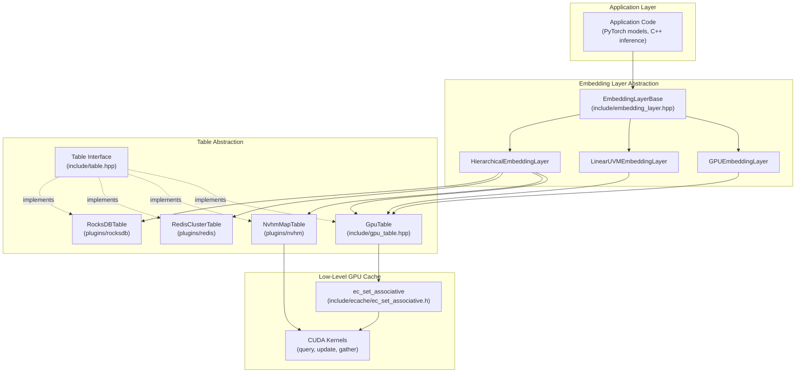
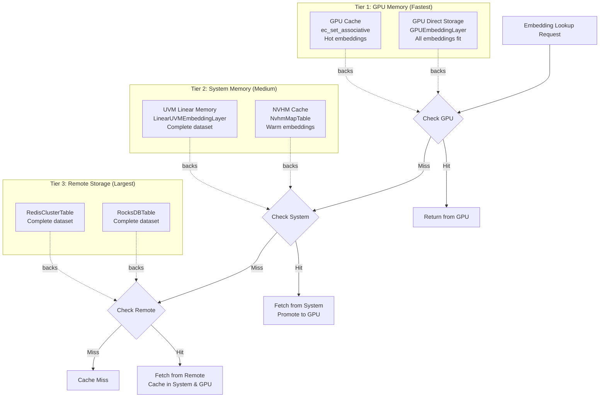
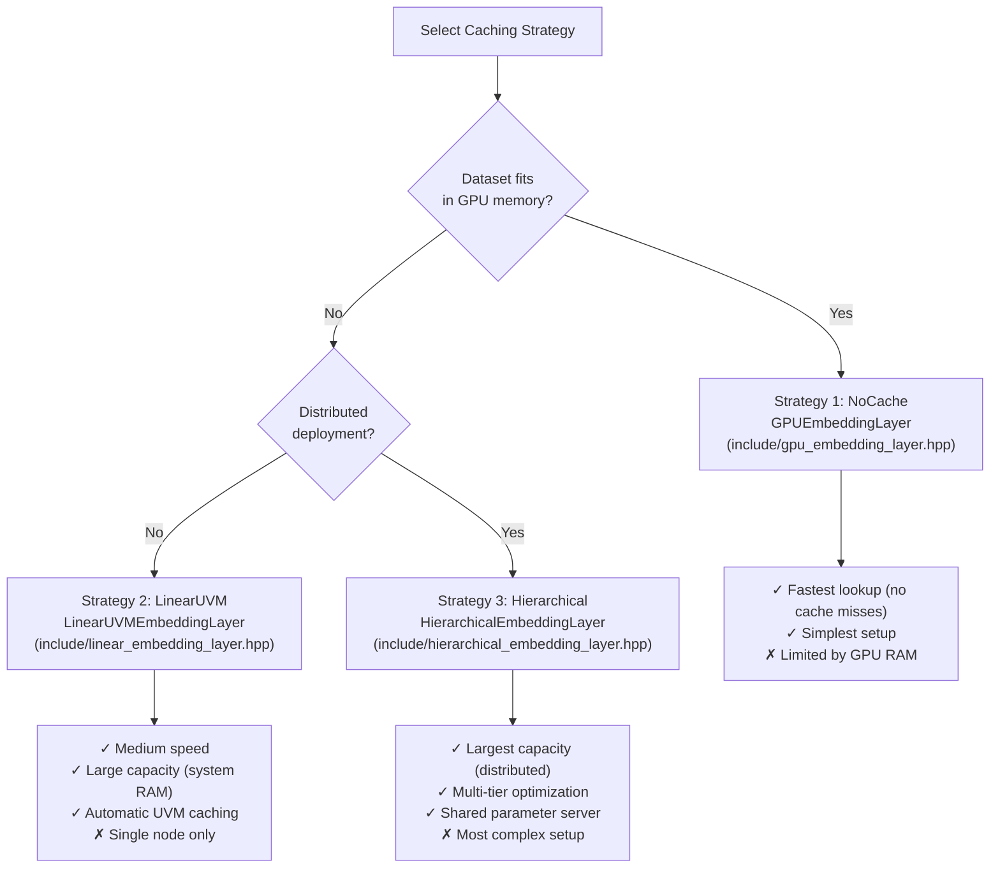
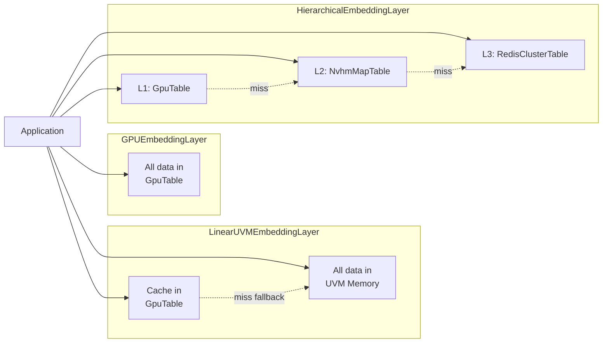
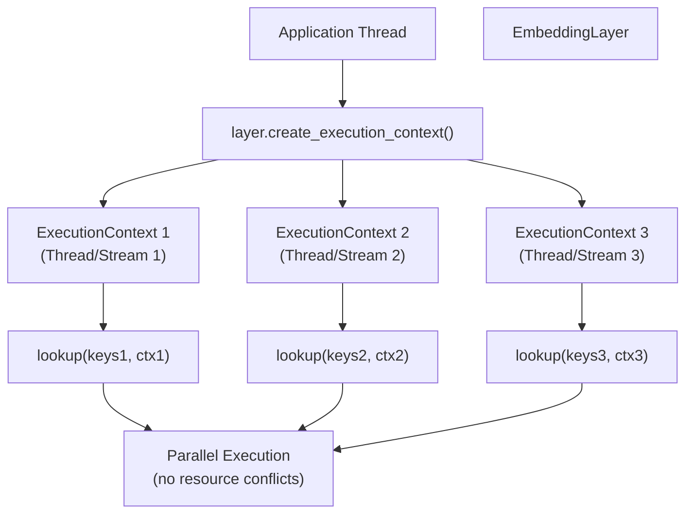
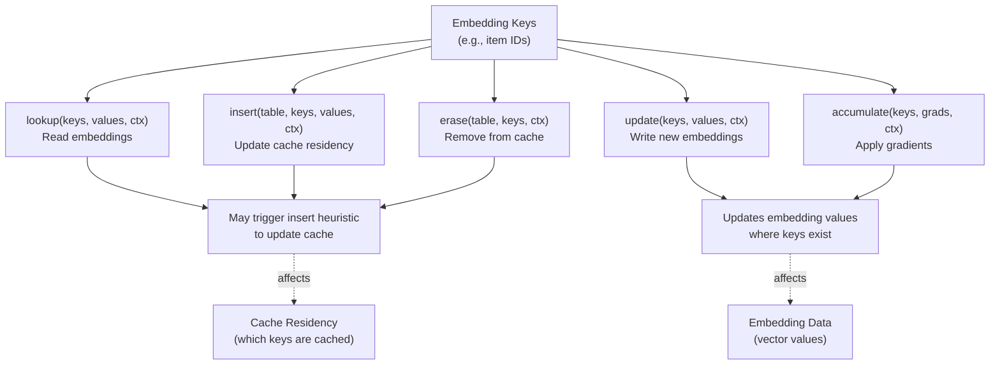
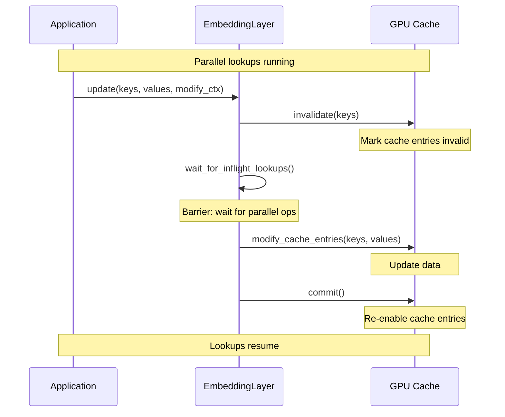
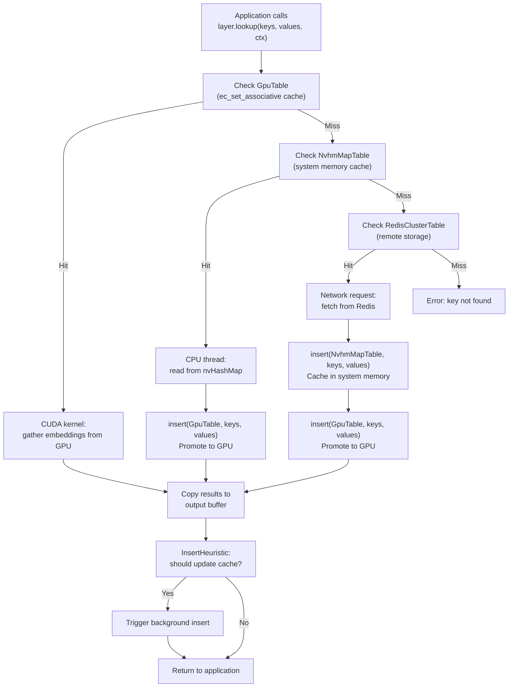

<!-- source: DeepWiki mcp.deepwiki.com · repo NVIDIA/nv-embedding-cache · page 3 Core Concepts · fetched 2026-10-26 -->

# Core Concepts

Relevant source files

The following files were used as context for generating this wiki page:

- [README.md](README.md)
- [docs/advanced.md](docs/advanced.md)
- [docs/cpp_api.md](docs/cpp_api.md)

This page introduces the fundamental concepts, abstractions, and architectural patterns that form the foundation of NV Embedding Cache. It covers the core problem being solved, the layered architecture, memory hierarchy, caching strategies, and key abstractions like layers, tables, and execution contexts.

For detailed API documentation, see the [C++ API Reference](#4) and [Python API Reference](#5). For specific implementation details of each layer type, see [Embedding Layers](#3.1). For storage backend details, see [Tables and Storage Backends](#3.2).

---

## The Embedding Lookup Problem

Recommender systems rely on large embedding tables that map discrete entities (users, items, features) to dense vectors. In production systems, these embeddings often exceed GPU memory capacity by orders of magnitude. For example:
- A table with 10 billion embeddings at 128 dimensions requires ~5TB of storage
- Modern GPUs have 40-80GB of memory
- Access patterns typically follow a power-law distribution (80% of lookups access 20% of embeddings)

The SDK addresses this by providing a multi-tier caching architecture that keeps frequently accessed embeddings in fast GPU memory while storing the complete dataset in slower, larger memories.

**Sources:** [README.md:7-9](), [README.md:17]()

---

## System Architecture Overview

The SDK uses a layered architecture with two primary abstraction levels:

**Diagram: Core Architecture Layers**

The architecture consists of:
- **Embedding Layers**: High-level API that manages multiple tables and provides operations like lookup, insert, update
- **Tables**: Storage backends that implement the core key-value interface for embedding data
- **Low-Level Components**: GPU cache implementation and CUDA kernels for fast lookup operations

**Sources:** [docs/cpp_api.md:14-22](), [include/embedding_layer.hpp](), [include/table.hpp]()

---

## Memory Hierarchy

The system implements a three-tier memory hierarchy optimized for the power-law access pattern typical in recommender systems:

| Tier | Storage Location | Typical Capacity | Latency | Used By |
|------|-----------------|------------------|---------|---------|
| **Tier 1** | GPU Memory | 10s of GB | ~100ns | All layer types |
| **Tier 2** | System Memory | 100s of GB | ~1μs | LinearUVM, Hierarchical |
| **Tier 3** | Remote Storage | TBs | ~1-10ms | Hierarchical only |

**Diagram: Three-Tier Memory Hierarchy with Data Flow**

Data flows from the fastest tier downward on misses, with automatic promotion of frequently accessed embeddings to faster tiers. See [Memory Hierarchy](#3.3) for detailed cache promotion strategies.

**Sources:** [README.md:11-15](), [docs/cpp_api.md:19-22]()

---

## Caching Strategies

The SDK provides three caching strategies, each optimized for different dataset sizes and deployment scenarios:

**Diagram: Caching Strategy Decision Tree**

| Strategy | Layer Class | Use Case | Memory Tiers Used |
|----------|-------------|----------|-------------------|
| **NoCache** | `GPUEmbeddingLayer` | Dataset < 40GB | GPU only |
| **LinearUVM** | `LinearUVMEmbeddingLayer` | Dataset < 1TB, single node | GPU + System |
| **Hierarchical** | `HierarchicalEmbeddingLayer` | Dataset > 1TB, distributed | GPU + System + Remote |

See [Cache Configuration Strategies](#1.2) for usage examples and [Embedding Layers](#3.1) for detailed implementation documentation.

**Sources:** [README.md:11-15](), [docs/cpp_api.md:19-22]()

---

## Core Abstractions

### Embedding Layers

An embedding layer (`EmbeddingLayerBase`) is the primary interface for applications. It manages one or more tables and provides high-level operations on embedding data. The key characteristic of a layer is how it distributes embedding storage across memory tiers:

**Diagram: Layer Types and Their Storage Organization**

Layers handle:
- **Memory management**: Allocating and copying buffers between GPU and system memory as needed
- **Multi-table coordination**: Checking multiple caches in order, promoting data to faster tiers
- **Residency management**: Deciding which embeddings should be cached where (via insert heuristics)

For detailed documentation of each layer type, see [Embedding Layers](#3.1).

**Sources:** [docs/cpp_api.md:14-22](), [include/embedding_layer.hpp]()

### Tables

A table (`Table` interface) is a storage backend for embedding data at a single memory location. Unlike layers, tables do not perform automatic memory copying or multi-tier lookups. Applications typically interact with layers, not tables directly, unless implementing custom caching logic.

Key table implementations:

| Table Class | Storage Location | Plugin Library | Header |
|-------------|-----------------|----------------|---------|
| `GpuTable` | GPU memory | Core (libnve-common.so) | [include/gpu_table.hpp]() |
| `NvhmMapTable` | System memory | libnve-plugin-nvhm.so | [plugins/nvhm/include/nvhm_map_table.hpp]() |
| `RedisClusterTable` | Remote Redis | libnve-plugin-redis.so | [plugins/redis/include/redis_cluster_table.hpp]() |
| `RocksDBTable` | Remote RocksDB | libnve-plugin-rocksdb.so | [plugins/rocksdb/include/rocksdb_table.hpp]() |
| `AbseilFlatMapTable` | System memory | libnve-plugin-abseil.so | [plugins/abseil/include/abseil_flat_map_table.hpp]() |
| `PHMapFlatMapTable` | System memory | libnve-plugin-phmap.so | [plugins/phmap/include/phmap_flat_map_table.hpp]() |

Tables are implemented as plugins to minimize dependencies. For detailed table documentation, see [Tables and Storage Backends](#3.2).

**Sources:** [docs/cpp_api.md:45-56]()

### Execution Contexts

An execution context (`ExecutionContext`) is a container for state and resources needed to execute operations like lookup or update. Each context represents a single, reusable parallel execution environment.

**Diagram: Execution Contexts Enable Parallel Operations**

Key properties:
- **Isolation**: Each context has separate memory buffers and CUDA streams, preventing resource conflicts
- **Reusability**: Create contexts once during initialization, reuse them (e.g., round-robin)
- **Lazy allocation**: Memory is allocated on first use and expands as needed

Usage pattern:
1. Create a fixed number of contexts during initialization (typically one per thread/stream)
2. Use contexts in operations: `layer->lookup(keys, values, context)`
3. Destroy all contexts before destroying the layer

For detailed usage, see [Execution Contexts](#3.4) and [docs/advanced.md:3-10]().

**Sources:** [docs/advanced.md:3-10](), [include/execution_context.hpp]()

---

## Key Operations

All embedding layers support five fundamental operations on embedding data:

| Operation | Purpose | Modifies Residency? | Modifies Values? |
|-----------|---------|---------------------|------------------|
| **Lookup** | Retrieve embedding vectors for given keys | Yes (via insert heuristic) | No |
| **Insert** | Add keys to cache, potentially evicting others | Yes | No |
| **Update** | Replace embedding values for existing keys | No | Yes |
| **Accumulate** | Add gradients to existing embedding values | No | Yes |
| **Erase** | Remove keys from cache | Yes | N/A |

**Diagram: Core Operations and Their Effects**

**Lookup** is the most common operation. It retrieves embeddings and may automatically update cache residency via an `InsertHeuristic` object (see [Advanced Topics](#8) and [docs/advanced.md:30-32]()).

**Insert** explicitly updates which keys should reside in a cache. It is typically called internally by layers, not by applications directly.

**Update** and **Accumulate** are used during training to modify embedding values. They only affect keys already present in caches.

For detailed operation semantics and API signatures, see [Cache Operations](#3.5) and [docs/cpp_api.md:24-37]().

**Sources:** [docs/cpp_api.md:24-37](), [include/embedding_layer.hpp]()

---

## Modify Operations and Synchronization

Operations that change cache state (insert, update, accumulate, erase) are called **modify operations**. They use a special synchronization pattern to allow parallel lookups and modifications:

**Diagram: Invalidate-and-Commit Synchronization Pattern**

This **invalidate-and-commit** paradigm ensures correctness when lookups and modifications run concurrently:
1. Invalidate affected cache entries (atomic)
2. Wait for inflight lookups to complete
3. Modify the cache data
4. Commit (re-enable) the cache entries

Applications must ensure only one modify operation is inflight at a time on the GPU side (e.g., use a single CUDA stream for all modify operations).

For details on modify contexts and custom CUDA flows, see [Modify Operations and Synchronization](#8.2) and [docs/advanced.md:14-24]().

**Sources:** [docs/advanced.md:14-24]()

---

## Complete Data Flow Example

The following diagram shows a complete embedding lookup flowing through a `HierarchicalEmbeddingLayer`:

**Diagram: Complete Lookup Flow in HierarchicalEmbeddingLayer**

This example demonstrates:
- **Multi-tier checking**: Check each cache level in order (GPU → System → Remote)
- **Automatic promotion**: On miss, fetch from slower tier and promote to faster tiers
- **Insert heuristic**: Optionally trigger cache updates based on access patterns
- **Result assembly**: Gather embeddings from multiple sources into output buffer

For simpler flows, `GPUEmbeddingLayer` only performs the L1 check (always hits), and `LinearUVMEmbeddingLayer` performs L1 check then directly accesses UVM memory on miss.

**Sources:** [docs/cpp_api.md:14-37](), [include/hierarchical_embedding_layer.hpp](), [include/ecache/ec_set_associative.h]()

---

## Summary

The NV Embedding Cache SDK is built on these core concepts:

1. **Layered Architecture**: Applications interact with `EmbeddingLayer` objects that manage multi-tier storage
2. **Three-Tier Memory**: GPU (fast) → System (medium) → Remote (slow/large)
3. **Three Caching Strategies**: NoCache, LinearUVM, Hierarchical for different deployment scenarios
4. **Tables as Plugins**: Storage backends implement the `Table` interface, loadable as plugins
5. **Execution Contexts**: Enable safe parallel operations with isolated resources
6. **Five Core Operations**: lookup, insert, update, accumulate, erase with well-defined semantics
7. **Invalidate-and-Commit**: Synchronization pattern for concurrent lookups and modifications

For implementation details, see the child pages:
- [Embedding Layers](#3.1) - Detailed layer documentation
- [Tables and Storage Backends](#3.2) - Storage implementation details
- [Memory Hierarchy](#3.3) - Cache promotion and eviction strategies
- [Execution Contexts](#3.4) - Advanced context usage patterns
- [Cache Operations](#3.5) - Detailed operation semantics

For API references, see [C++ API Reference](#4) and [Python API Reference](#5).

**Sources:** [README.md](), [docs/cpp_api.md](), [docs/advanced.md]()

---

