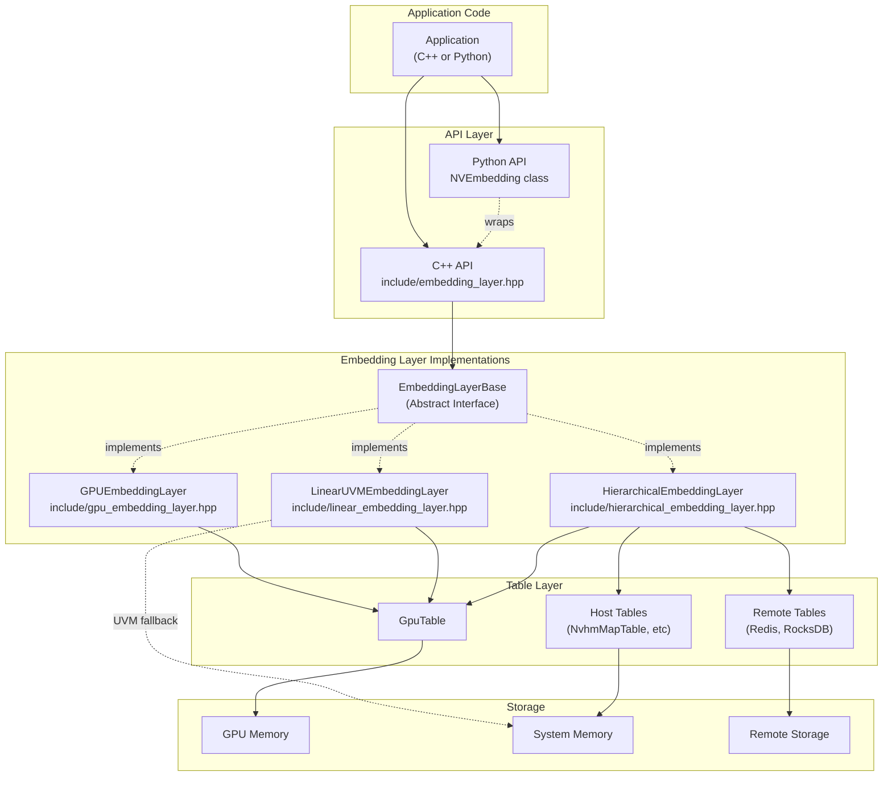
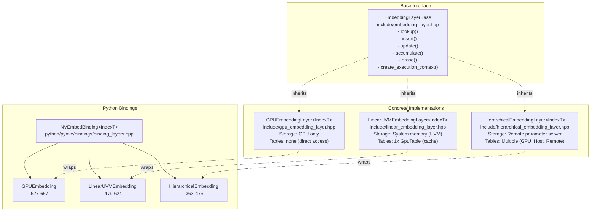
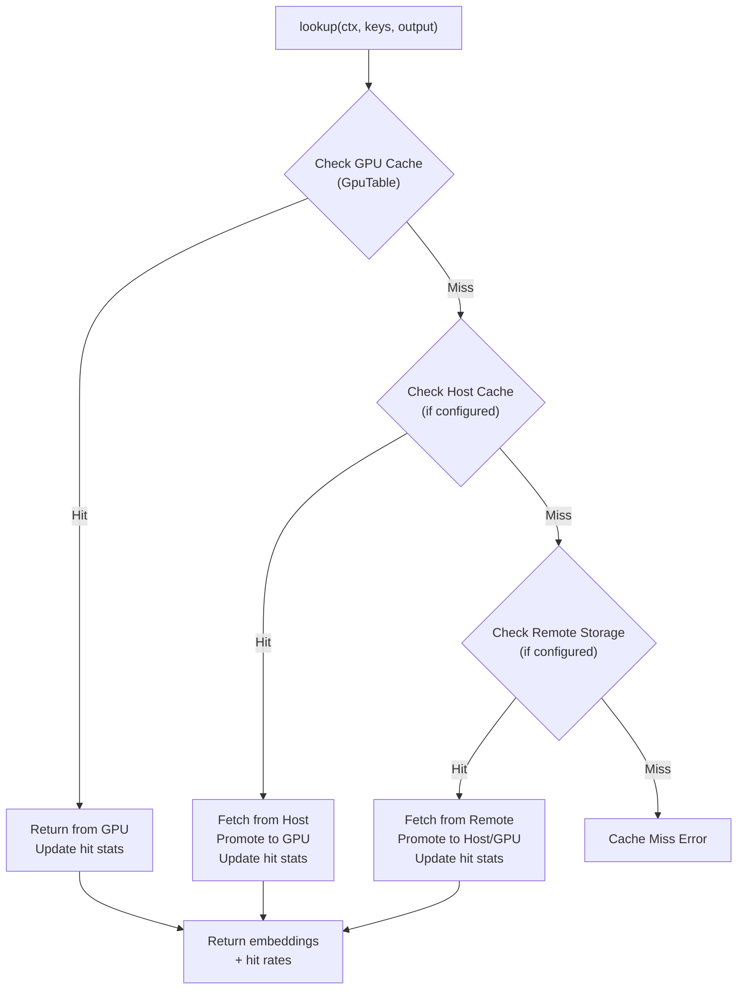
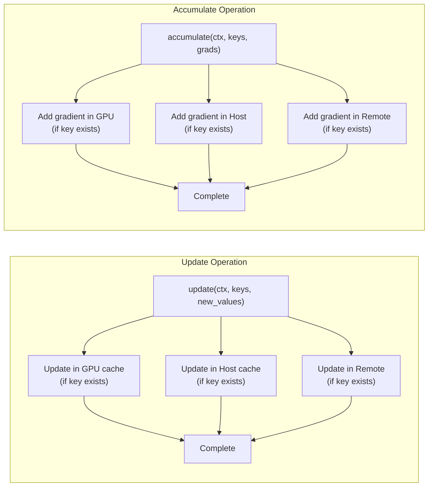
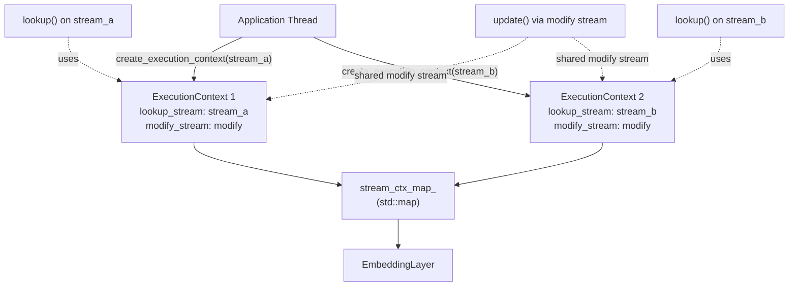

<!-- source: DeepWiki mcp.deepwiki.com · repo NVIDIA/nv-embedding-cache · page 3.1 Embedding Layers · fetched 2026-10-26 -->

# Embedding Layers

Relevant source files

The following files were used as context for generating this wiki page:

- [README.md](README.md)
- [docs/cpp_api.md](docs/cpp_api.md)
- [python/pynve/bindings/binding_layers.hpp](python/pynve/bindings/binding_layers.hpp)

## Purpose and Scope

This document explains the embedding layer abstraction in NV Embedding Cache, which provides the primary interface for embedding lookup and modification operations. Embedding layers manage the storage, retrieval, and caching of embedding vectors across different memory hierarchies (GPU, system, and remote storage).

This page covers the general concepts, architecture, and operations common to all embedding layer types. For detailed information about specific layer implementations, see:
- [GPUEmbeddingLayer](#3.1.1) - GPU-only storage
- [LinearUVMEmbeddingLayer](#3.1.2) - UVM-based storage with GPU caching
- [HierarchicalEmbeddingLayer](#3.1.3) - Multi-tier distributed storage

For language-specific API details, see [C++ API Reference](#4) and [Python API Reference](#5). For information about the underlying table implementations, see [Tables and Storage Backends](#3.2).

## Overview

Embedding layers are objects that encapsulate embedding data and provide read/write operations on embedding rows. Each layer manages one or more tables ([Table](#3.2) instances) depending on where data is stored. Layers abstract away the complexity of multi-tier caching, memory management, and data synchronization, exposing a consistent interface regardless of the underlying storage strategy.

The key characteristics of embedding layers:

- **Abstraction**: Hide storage implementation details from application code
- **Caching**: Automatically manage hot data in faster memory tiers
- **Operations**: Support lookup, insert, update, accumulate, and erase operations
- **Multi-table coordination**: Maintain consistency across multiple storage locations
- **Memory management**: Handle buffer allocation and data movement between memory spaces

**Diagram: Embedding Layer Position in System Architecture**

Sources: [README.md:11-15](), [docs/cpp_api.md:14-22]()

## Layer Class Hierarchy

All embedding layers inherit from the `EmbeddingLayerBase` abstract base class, which defines the common interface for all operations. The three concrete implementations provide different storage and caching strategies.

**Diagram: Layer Class Hierarchy and Associated Tables**

Sources: [docs/cpp_api.md:14-22](), [python/pynve/bindings/binding_layers.hpp:58-360](), [python/pynve/bindings/binding_layers.hpp:363-476](), [python/pynve/bindings/binding_layers.hpp:479-624](), [python/pynve/bindings/binding_layers.hpp:627-657]()

### EmbeddingLayerBase Interface

The `EmbeddingLayerBase` class defines the following key interface methods (actual implementation details vary by subclass):

| Method | Purpose | Key Parameters |
|--------|---------|----------------|
| `lookup()` | Retrieve embedding vectors for given keys | keys, output buffer, pooling params |
| `insert()` | Insert/cache key-value pairs in specified table | keys, values, table_id |
| `update()` | Replace existing embedding values | keys, new values |
| `accumulate()` | Add gradients to existing embeddings | keys, gradients |
| `erase()` | Remove keys from specified table | keys, table_id |
| `create_execution_context()` | Create context for operation execution | lookup stream, modify stream |

Sources: [docs/cpp_api.md:24-38](), [python/pynve/bindings/binding_layers.hpp:61-264]()

## Core Operations

### Lookup Operation

The lookup operation retrieves embedding vectors corresponding to provided keys. This is the primary read operation and may involve:

1. **Multi-tier lookup**: Checking multiple cache levels (GPU → Host → Remote)
2. **Automatic promotion**: Moving frequently accessed data to faster tiers
3. **Insert heuristic**: Deciding which keys to cache based on access patterns
4. **Pooling**: Optional reduction operations (sum, mean) over multiple embeddings

The lookup returns the embedding rows and optionally hit rate statistics indicating cache efficiency across tiers.

Sources: [docs/cpp_api.md:25-26](), [python/pynve/bindings/binding_layers.hpp:61-103]()

### Modify Operations

Modify operations change embedding values but do not affect cache residency (which keys exist in which tables):

- **Update**: Replaces entire embedding vectors with new values
- **Accumulate**: Adds gradient values to existing embeddings (used during training)

Both operations find all occurrences of the specified keys across all tables in the layer and apply changes consistently.

Sources: [docs/cpp_api.md:32-35](), [python/pynve/bindings/binding_layers.hpp:221-240]()

### Insert and Erase Operations

- **Insert**: Updates cache residency by deciding which keys should reside in a specific table. The table's insert heuristic determines which keys to accept and which existing keys to evict. Insert does not guarantee that provided keys will be resident after the operation.

- **Erase**: Removes specified keys from a table. Keys not present in the table are ignored. Typically not needed as eviction happens automatically during insert operations.

Sources: [docs/cpp_api.md:26-37](), [python/pynve/bindings/binding_layers.hpp:242-264]()

## Layer Type Comparison

The following table summarizes the characteristics of each layer type to help select the appropriate implementation:

| Characteristic | GPUEmbeddingLayer | LinearUVMEmbeddingLayer | HierarchicalEmbeddingLayer |
|----------------|-------------------|-------------------------|----------------------------|
| **Primary Storage** | GPU memory | System memory (UVM) | Remote parameter server |
| **GPU Cache** | No (all data in GPU) | Yes (GpuTable) | Yes (GpuTable) |
| **Host Cache** | No | No (direct UVM access) | Optional (NvhmMapTable) |
| **Remote Storage** | No | No | Yes (Redis/RocksDB) |
| **Dataset Size Limit** | GPU memory capacity | System memory capacity | Unlimited (remote storage) |
| **Lookup Latency** | Lowest (~ns) | Low-Medium (~μs) | Medium-High (ms for remote) |
| **Use Case** | Small datasets fitting in GPU | Medium datasets on single node | Large distributed datasets |
| **Configuration Name (Python)** | `NoCache` | `LinearUVM` | `Hierarchical` |
| **Tables Used** | None (direct access) | 1 (GpuTable as cache) | 2-3 (GPU + Host + Remote) |
| **Automatic Caching** | N/A | Yes (implicit via UVM) | Yes (explicit multi-tier) |

Sources: [README.md:11-17](), [docs/cpp_api.md:19-22]()

## Configuration Considerations

### Common Configuration Parameters

All layer types share these configuration parameters:

- **device_id**: GPU device to use for operations
- **row_size**: Width of embedding vectors (in elements or bytes)
- **data_type**: Element type (`Float32` or `Float16`/`__half`)
- **allocator**: Custom memory allocator (optional, uses default if not provided)
- **logging_interval**: Frequency of performance metric logging

### Layer-Specific Configuration

**GPUEmbeddingLayer** ([GPUEmbeddingLayerConfig]()):
- `num_embeddings`: Total number of embedding vectors
- `embedding_width_in_bytes`: Row size in bytes
- `embedding_table`: Pointer to pre-allocated GPU memory

**LinearUVMEmbeddingLayer** ([GPUTableConfig]()):
- `cache_size`: GPU cache capacity (number of embeddings)
- `uvm_table`: Pointer to UVM-allocated system memory
- `kernel_mode_type`: Kernel optimization strategy (SortGather, PipelineGather)
- `kernel_mode_value`: Kernel-specific tuning parameters

**HierarchicalEmbeddingLayer** (Multiple table configs):
- GPU cache configuration (via `GPUTableConfig`)
- Host cache configuration (size, overflow policy)
- Remote storage configuration (connection parameters)
- Insert heuristic thresholds (target hit rates for each tier)

Sources: [python/pynve/bindings/binding_layers.hpp:50-55](), [python/pynve/bindings/binding_layers.hpp:266-283](), [python/pynve/bindings/binding_layers.hpp:369-426](), [python/pynve/bindings/binding_layers.hpp:484-531](), [python/pynve/bindings/binding_layers.hpp:632-650]()

## Execution Contexts

Embedding layers use execution contexts (`ExecutionContext` objects) to manage state and resources for parallel operations. Each execution context contains:

- **Streams**: CUDA streams for lookup and modify operations
- **Buffers**: Temporary memory allocations for intermediate results
- **State**: Operation-specific state variables

Applications typically create one context per CUDA stream used for inference/training. The layer maintains a map of contexts keyed by stream handle to enable concurrent operations.

**Diagram: Execution Context Usage Pattern**

The `get_exec_context()` method in the Python binding retrieves or creates the appropriate context for a given stream, ensuring thread-safe concurrent access.

Sources: [docs/cpp_api.md:38](), [python/pynve/bindings/binding_layers.hpp:308-321](), [python/pynve/bindings/binding_layers.hpp:355-357]()

## Memory Management and Buffer Allocation

Embedding layers may allocate and copy memory buffers during operations. For example:
- A lookup using a GPU table with input keys in system memory may allocate GPU buffers and copy keys to GPU
- Gradient backpropagation operations allocate temporary buffers for deduplication and reduction

Layers accept an optional `allocator_ptr_t` during construction to customize memory allocation. The default allocator uses standard CUDA memory allocation APIs.

The Python bindings maintain `ResizeableBuffer` objects for temporary allocations that grow as needed:
- `d_tmp_device_buf_`: Device memory for intermediate GPU operations
- `d_tmp_host_buf_`: Host memory for CPU-side processing

Sources: [docs/cpp_api.md:17](), [python/pynve/bindings/binding_layers.hpp:267-268](), [python/pynve/bindings/binding_layers.hpp:351-352]()

## Thread Safety and Synchronization

Embedding layers support concurrent operations through:

1. **Execution contexts**: Isolate per-stream state
2. **CUDA streams**: Enable asynchronous GPU operations
3. **Modify stream**: Shared stream for all modify operations (update/accumulate/insert)

The Python binding implementation uses a single `modify_stream_` shared across all execution contexts to serialize modification operations while allowing parallel lookups on different streams.

Applications must ensure proper synchronization:
- Wait for context completion before destroying: `ctx->wait()`
- Synchronize modify stream before layer destruction
- Use `cudaStreamSynchronize()` when necessary

Sources: [python/pynve/bindings/binding_layers.hpp:280](), [python/pynve/bindings/binding_layers.hpp:298-306](), [python/pynve/bindings/binding_layers.hpp:356](), [python/pynve/bindings/binding_layers.hpp:464-470]()

## Python API Integration

The Python API wraps C++ layer implementations through pybind11 bindings. Key differences from C++ API:

- **Simplified interface**: Uses integer pointers (`uintptr_t`) instead of typed pointers
- **DLPack support**: `LinearUVMEmbedding` provides `get_dl_tensor()` for zero-copy tensor sharing with PyTorch
- **Gradient computation**: Integrated backpropagation support via `GradientCalculator` for training
- **Pooling operations**: Built-in `lookup_with_pooling()` and `pooling_backprop()` methods
- **Automatic resource management**: Destructor handles context cleanup and stream synchronization

For detailed Python API usage, see [Python Embedding Layers](#5.1).

Sources: [python/pynve/bindings/binding_layers.hpp:58-660]()

---

