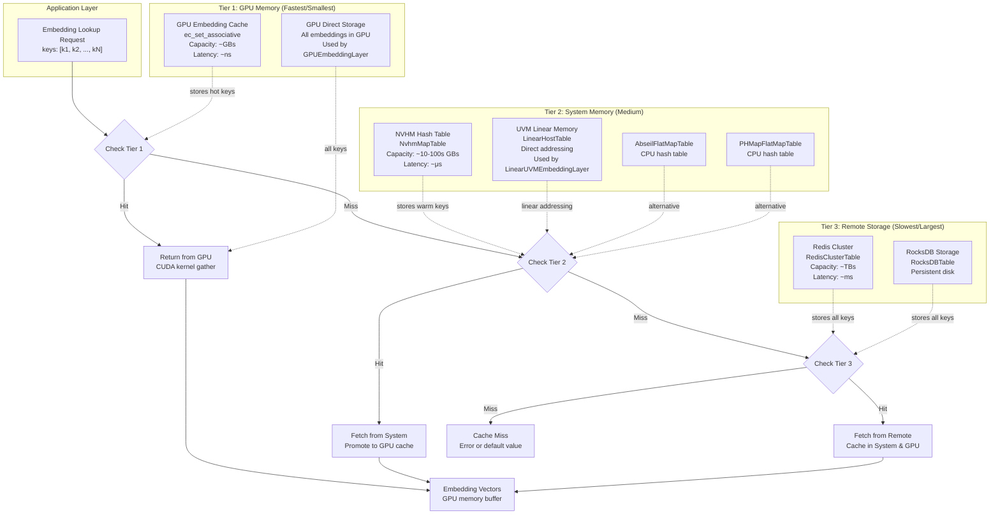
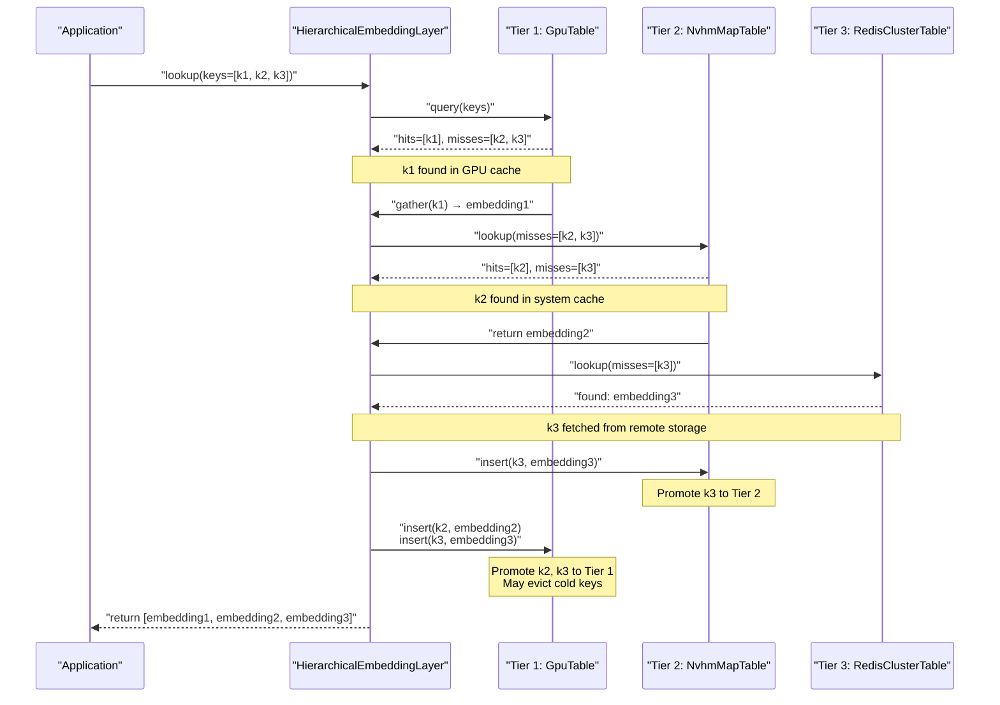
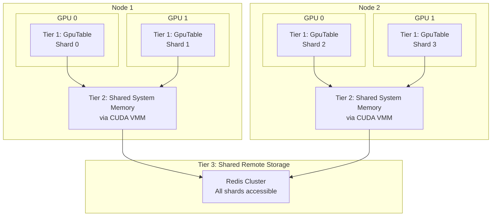

<!-- source: DeepWiki mcp.deepwiki.com · repo NVIDIA/nv-embedding-cache · page 3.3 Memory Hierarchy · fetched 2026-10-26 -->

# Memory Hierarchy

<details>
<summary>Relevant source files</summary>

The following files were used as context for generating this wiki page:

- [README.md](README.md)
- [docs/advanced.md](docs/advanced.md)
- [docs/cpp_api.md](docs/cpp_api.md)

</details>


This page describes the three-tier memory hierarchy used by the NV Embedding Cache SDK to manage embedding data across GPU memory, system memory, and remote storage. The hierarchical architecture enables efficient handling of embedding tables that exceed local GPU memory capacity by leveraging each memory tier's performance and capacity characteristics.

For details on specific embedding layer implementations that use these tiers, see [Embedding Layers](#3.1). For storage backend implementations, see [Tables and Storage Backends](#3.2). For cache operation details, see [Cache Operations](#3.5).

## Overview

The SDK organizes memory into three tiers, each with distinct performance and capacity characteristics:

| Tier | Location | Typical Capacity | Typical Latency | Implementation |
|------|----------|-----------------|-----------------|----------------|
| **Tier 1** | GPU Memory | ~GBs | ~ns | `GpuTable`, `ec_set_associative` cache |
| **Tier 2** | System Memory | ~10-100s GBs | ~μs | `NvhmMapTable`, `LinearHostTable`, UVM |
| **Tier 3** | Remote Storage | ~TBs | ~ms | `RedisClusterTable`, `RocksDBTable` |

The hierarchy follows a classic cache principle: faster memory tiers have smaller capacity, while slower tiers provide larger capacity. Data is promoted from slower to faster tiers on access, and evicted from faster tiers when capacity is exhausted.

**Sources:** [README.md:11-17](), [docs/advanced.md:26-28](), [docs/cpp_api.md:19-23]()

## Three-Tier Architecture



**Diagram: Memory tier lookup sequence showing cache hit/miss path and promotion flow**

This architecture enables the system to handle embedding tables far larger than GPU memory by storing the complete dataset in slower tiers while caching frequently accessed embeddings in faster tiers.

**Sources:** [README.md:11-17](), [docs/cpp_api.md:14-23](), [include/gpu_table.hpp](), [plugins/nvhm/include/nvhm_map_table.hpp](), [plugins/redis/include/redis_cluster_table.hpp](), [plugins/rocksdb/include/rocksdb_table.hpp]()

## Embedding Layer to Tier Mapping

Different embedding layer implementations utilize different subsets of the memory hierarchy:

```mermaid
graph TB
    subgraph GPULayer["GPUEmbeddingLayer"]
        GPULayerImpl["GPUEmbeddingLayer<br/>include/gpu_embedding_layer.hpp"]
        GPULayerTier1["Uses: Tier 1 Only"]
        GPULayerTable["GpuTable stores all embeddings"]
        GPULayerConstraint["Constraint: Dataset must fit in GPU RAM"]
        
        GPULayerImpl --> GPULayerTier1
        GPULayerTier1 --> GPULayerTable
        GPULayerTable --> GPULayerConstraint
    end
    
    subgraph LinearLayer["LinearUVMEmbeddingLayer"]
        LinearLayerImpl["LinearUVMEmbeddingLayer<br/>include/linear_embedding_layer.hpp"]
        LinearLayerTiers["Uses: Tier 1 + Tier 2"]
        LinearLayerCache["GpuTable caches hot embeddings"]
        LinearLayerStorage["LinearHostTable or UVM holds all embeddings"]
        LinearLayerFeature["Feature: Automatic cache management"]
        
        LinearLayerImpl --> LinearLayerTiers
        LinearLayerTiers --> LinearLayerCache
        LinearLayerTiers --> LinearLayerStorage
        LinearLayerStorage --> LinearLayerFeature
    end
    
    subgraph HierLayer["HierarchicalEmbeddingLayer"]
        HierLayerImpl["HierarchicalEmbeddingLayer<br/>include/hierarchical_embedding_layer.hpp"]
        HierLayerTiers["Uses: Tier 1 + Tier 2 + Tier 3"]
        HierLayerL1["L1: GpuTable for hottest keys"]
        HierLayerL2["L2: NvhmMapTable for warm keys"]
        HierLayerL3["L3: RedisClusterTable or RocksDBTable<br/>for complete dataset"]
        HierLayerOptimization["Optimized for: Power-law distributions<br/>Distributed deployments"]
        
        HierLayerImpl --> HierLayerTiers
        HierLayerTiers --> HierLayerL1
        HierLayerTiers --> HierLayerL2
        HierLayerTiers --> HierLayerL3
        HierLayerL3 --> HierLayerOptimization
    end
    
    Decision{Select Layer<br/>Based On}
    
    Decision -->|Dataset < GPU RAM| GPULayer
    Decision -->|Dataset > GPU RAM<br/>Single Node| LinearLayer
    Decision -->|Dataset >> GPU RAM<br/>Multi-Node| HierLayer
```



**Diagram: How each embedding layer type maps to memory tiers**

**Sources:** [README.md:11-16](), [docs/cpp_api.md:19-23](), [include/gpu_embedding_layer.hpp](), [include/linear_embedding_layer.hpp](), [include/hierarchical_embedding_layer.hpp]()

## Memory Tier Characteristics

### Tier 1: GPU Memory

GPU memory provides the fastest access but has limited capacity. The GPU tier is implemented using:

- **`GpuTable`**: GPU-resident hash table for embedding storage ([include/gpu_table.hpp]())
- **`ec_set_associative`**: Set-associative cache implementation optimized for power-law key distributions ([include/ecache/ec_set_associative.h]())

The GPU cache uses CUDA kernels for all operations:
- Query operations identify cache hits/misses
- Gather operations retrieve embedding vectors
- Update operations modify cached embeddings
- Insert operations manage cache residency

**Capacity**: Determined by available GPU DRAM, typically 16-80 GB per GPU.

**Latency**: Sub-microsecond for cache hits; nanosecond-scale memory access once data is located.

**Sources:** [include/gpu_table.hpp](), [include/ecache/ec_set_associative.h](), [docs/cpp_api.md:50-51]()

### Tier 2: System Memory

System memory provides an intermediate tier with larger capacity than GPU memory but higher latency. This tier can be accessed in two modes:

#### Hash-Based Access

System memory hash tables store embeddings in CPU-accessible data structures:

- **`NvhmMapTable`**: Uses NVIDIA's GPU-accelerated `nvHashMap` ([plugins/nvhm/include/nvhm_map_table.hpp]())
- **`AbseilFlatMapTable`**: Uses Abseil's flat hash map ([plugins/abseil/include/abseil_flat_map_table.hpp]())
- **`PHMapFlatMapTable`**: Uses parallel-hashmap library ([plugins/phmap/include/phmap_flat_map_table.hpp]())

These implementations provide cache functionality in system memory, storing a subset of embeddings with hash-based lookup.

#### Linear Access

Linear memory layouts allow direct addressing:

- **`LinearHostTable`**: System memory buffer with linear addressing where embedding *i* is at `base_address + i * embedding_size`
- **Unified Virtual Memory (UVM)**: CUDA-managed memory that appears as a single address space across GPU and system memory

The linear approach used by `LinearUVMEmbeddingLayer` eliminates hash lookups for Tier 2 access, though it requires the complete embedding table to fit in system memory.

**Capacity**: Determined by system RAM, typically 128 GB to 1+ TB.

**Latency**: Single-digit microseconds for CPU hash table access; UVM page faults add overhead when GPU accesses system memory.

**Sources:** [plugins/nvhm/include/nvhm_map_table.hpp](), [docs/cpp_api.md:51-56](), [include/linear_embedding_layer.hpp](), [README.md:17]()

### Tier 3: Remote Storage

Remote storage provides the largest capacity tier, suitable for embedding tables in the terabyte range. This tier is accessed over network connections:

- **`RedisClusterTable`**: Distributed Redis cluster for parameter server deployments ([plugins/redis/include/redis_cluster_table.hpp]())
- **`RocksDBTable`**: Persistent disk-backed key-value storage ([plugins/rocksdb/include/rocksdb_table.hpp]())

Remote storage serves as the source of truth for the complete embedding table. The `HierarchicalEmbeddingLayer` treats Tier 3 as the backing store, promoting frequently accessed embeddings to faster tiers.

**Capacity**: Limited primarily by available disk/distributed storage, easily supporting multi-TB datasets.

**Latency**: Millisecond-range due to network round-trips and remote server processing.

**Sources:** [plugins/redis/include/redis_cluster_table.hpp](), [plugins/rocksdb/include/rocksdb_table.hpp](), [docs/cpp_api.md:54-56]()

## Data Flow and Cache Promotion



**Diagram: Sequence of tier access and cache promotion during lookup operation**

### Cache Promotion Strategy

When an embedding is accessed:

1. **Tier 1 Hit**: Return immediately from GPU cache
2. **Tier 1 Miss, Tier 2 Hit**: 
   - Retrieve from system memory
   - Optionally promote to GPU cache based on `InsertHeuristic`
3. **Tier 1-2 Miss, Tier 3 Hit**:
   - Fetch from remote storage
   - Insert into Tier 2 cache
   - Optionally promote to Tier 1 based on `InsertHeuristic`

The `InsertHeuristic` determines when to trigger cache promotion. By default, the `DefaultInsertHeuristic` promotes embeddings after they accumulate sufficient access frequency to justify cache allocation.

**Sources:** [docs/cpp_api.md:24-32](), [docs/advanced.md:30-32](), [include/insert_heuristic.hpp]()

## Cache Eviction Policies

When inserting embeddings into a cache tier that has reached capacity, the system must evict existing entries. The GPU cache (`ec_set_associative`) supports multiple eviction policies:

| Policy | Description | Use Case |
|--------|-------------|----------|
| **LRU** | Least Recently Used | General-purpose, good for temporal locality |
| **LFU** | Least Frequently Used | Workloads with stable hot-key sets |
| **Random** | Random eviction | Benchmark baseline, low overhead |

The eviction policy is configured during `GpuTable` initialization. For recommendation systems with power-law distributed key access patterns, LFU typically performs well since popular items remain consistently hot.

**Sources:** [include/ecache/ec_set_associative.h](), [include/gpu_table.hpp]()

## Memory Allocation and Management

Each memory tier uses appropriate allocation strategies:

### GPU Memory Allocation

GPU memory is allocated through the `Allocator` interface ([include/allocator.hpp]()), which defaults to CUDA's memory allocation APIs but can be customized. The `GpuTable` allocates:
- Cache storage for embedding vectors
- Metadata structures for the set-associative cache
- Temporary buffers for query/gather operations

### System Memory Allocation

System memory for hash tables is managed by the respective implementations:
- `NvhmMapTable`: Uses `nvHashMap` allocator
- `AbseilFlatMapTable`: Uses Abseil allocator
- `PHMapFlatMapTable`: Uses parallel-hashmap allocator
- `LinearHostTable`: Uses `Allocator` for contiguous buffer allocation

### UVM Considerations

`LinearUVMEmbeddingLayer` uses CUDA Unified Virtual Memory (UVM), which presents a single address space across GPU and system memory. The CUDA driver automatically migrates pages between memory tiers on demand. This simplifies programming but introduces page fault overhead when the GPU accesses data resident in system memory.

**Sources:** [include/allocator.hpp](), [docs/cpp_api.md:75-77](), [include/linear_embedding_layer.hpp]()

## Multi-Device Memory Hierarchy

For distributed deployments spanning multiple GPUs or nodes, embeddings can be sharded across devices. Each device maintains its own tier hierarchy for its shard:



**Diagram: Multi-device memory hierarchy with per-device GPU caches and shared remote storage**

The SDK provides utilities for multi-device memory management:
- **`CUDADistributedBuffer`**: Creates CUDA buffer spanning multiple devices ([include/distributed.hpp]())
- **`MPIMemBlock`** (Python): Shares buffers across MPI process groups

Each device's GPU cache stores only embeddings from its assigned shard, while the remote Tier 3 storage contains all shards and serves as the shared source of truth.

**Sources:** [docs/advanced.md:26-28](), [include/distributed.hpp]()

## Tier Composition Examples

### Example 1: GPUEmbeddingLayer (Single Tier)

```
Application
    ↓
GPUEmbeddingLayer
    ↓
GpuTable (Tier 1 only)
    ↓
All embeddings in GPU DRAM
```

**Use case**: Small embedding tables (< GPU memory), maximum performance

### Example 2: LinearUVMEmbeddingLayer (Two Tiers)

```
Application
    ↓
LinearUVMEmbeddingLayer
    ↓
    ├─→ GpuTable (Tier 1 cache)
    └─→ LinearHostTable / UVM (Tier 2 complete dataset)
```

**Use case**: Medium embedding tables (< system memory), single-node deployment, automatic caching

### Example 3: HierarchicalEmbeddingLayer (Three Tiers)

```
Application
    ↓
HierarchicalEmbeddingLayer
    ↓
    ├─→ GpuTable (Tier 1 cache, hottest keys)
    ├─→ NvhmMapTable (Tier 2 cache, warm keys)
    └─→ RedisClusterTable (Tier 3 complete dataset)
```

**Use case**: Large embedding tables (>> system memory), distributed deployments, power-law access patterns

**Sources:** [README.md:11-16](), [docs/cpp_api.md:19-23]()

## Performance Characteristics

The memory hierarchy directly impacts lookup performance:

| Scenario | Tier 1 Hit Rate | Tier 2 Hit Rate | Effective Latency |
|----------|-----------------|-----------------|-------------------|
| Hot workload, good cache | 95%+ | — | ~tens of ns |
| Moderate workload | 70-95% | 95%+ | ~hundreds of ns |
| Cold workload | 50-70% | 80-95% | ~single μs |
| Very cold workload | < 50% | < 80% | ~ms (remote fetch) |

For recommendation systems with power-law key distributions, properly sized GPU and system caches can achieve 90%+ Tier 1-2 hit rates, minimizing expensive remote storage accesses.

**Sources:** [README.md:7-9](), [include/ecache/ec_set_associative.h]()

---

