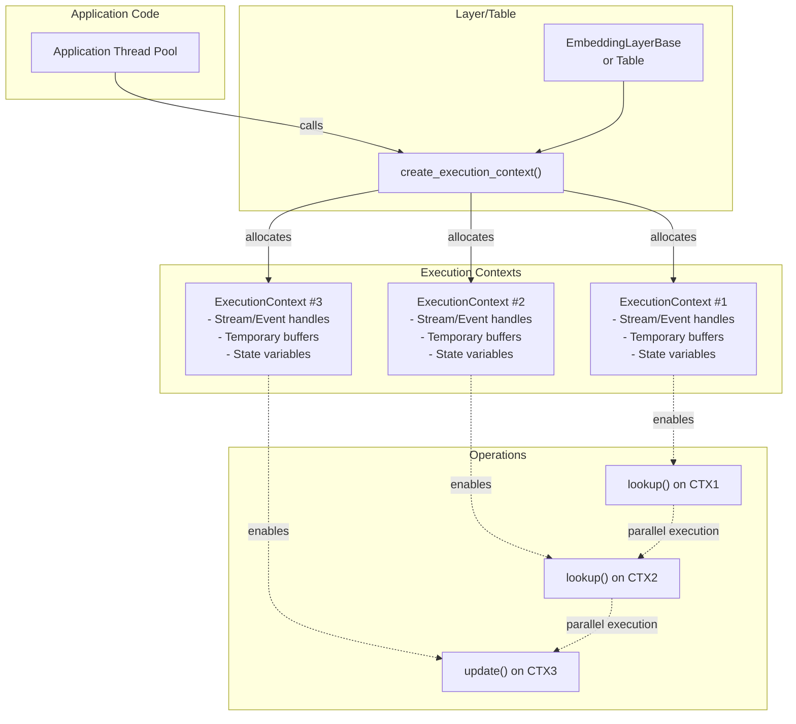
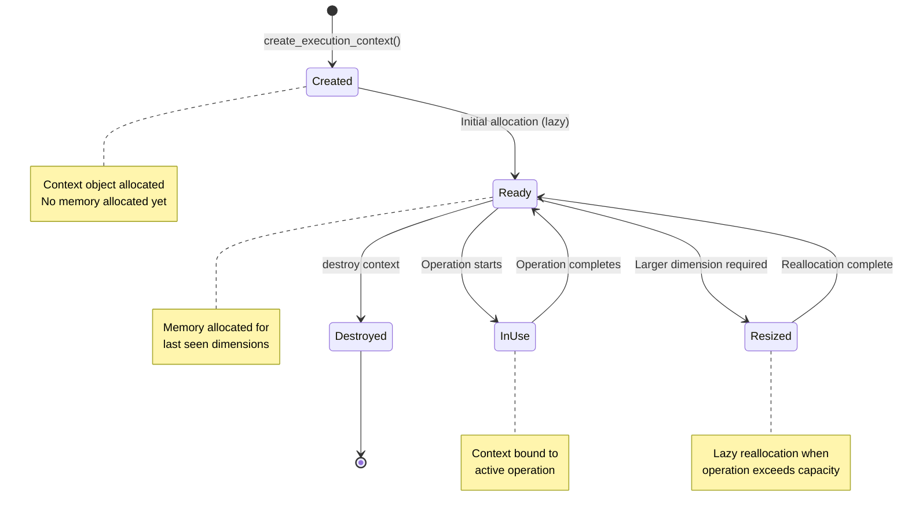
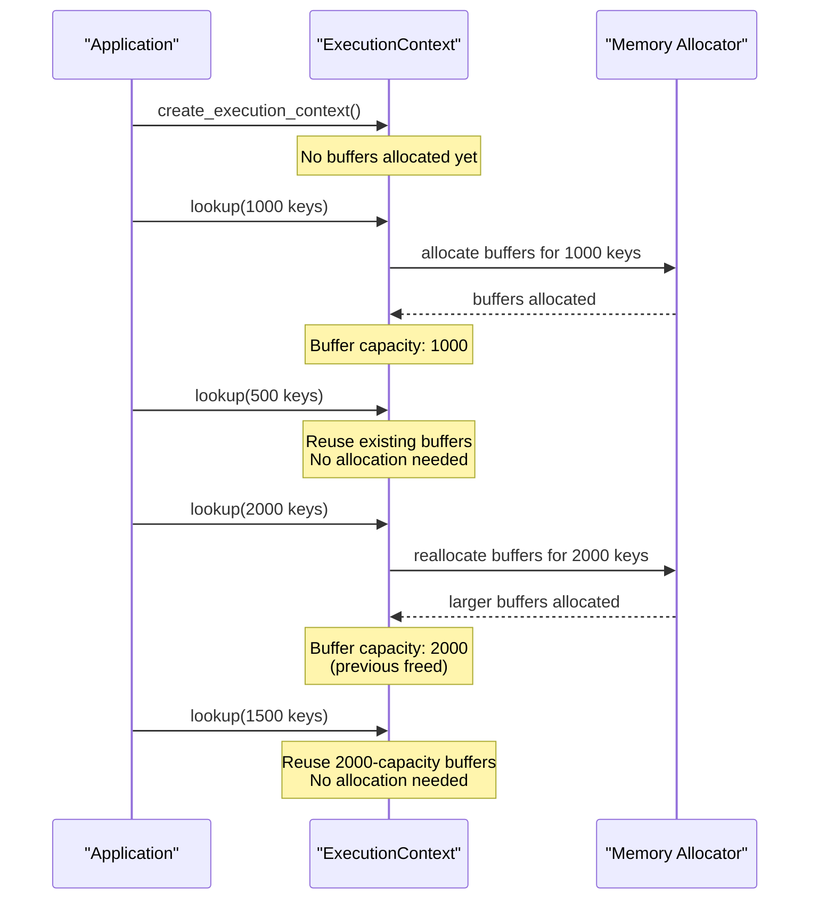
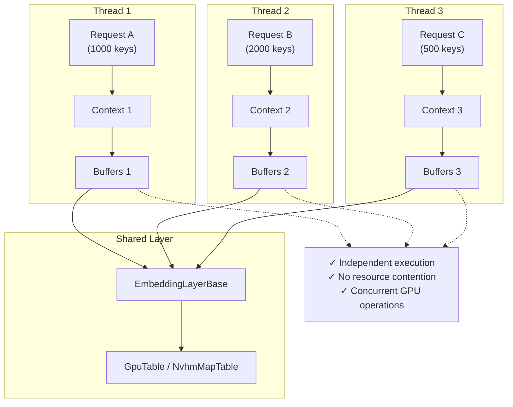
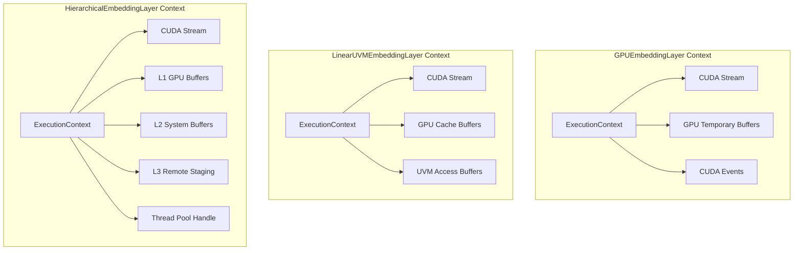
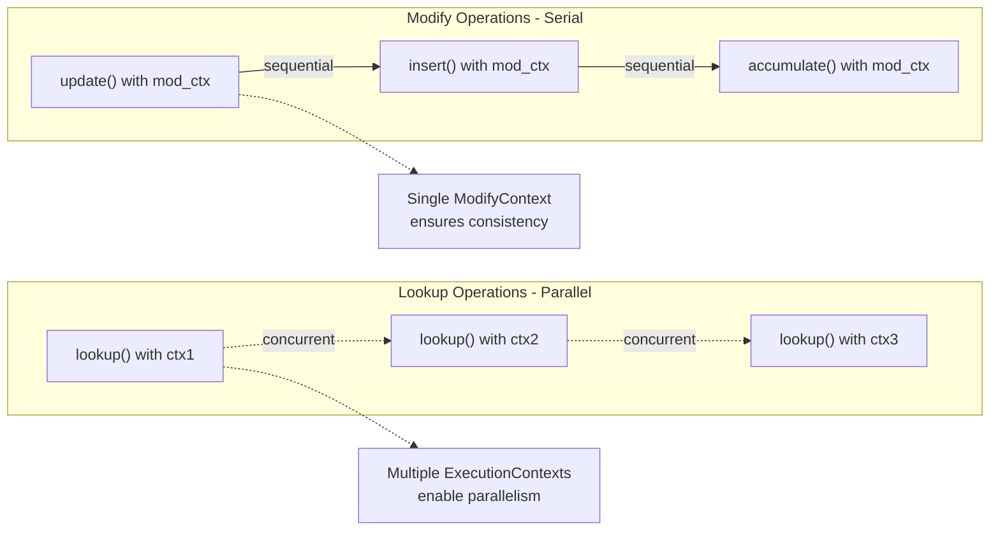
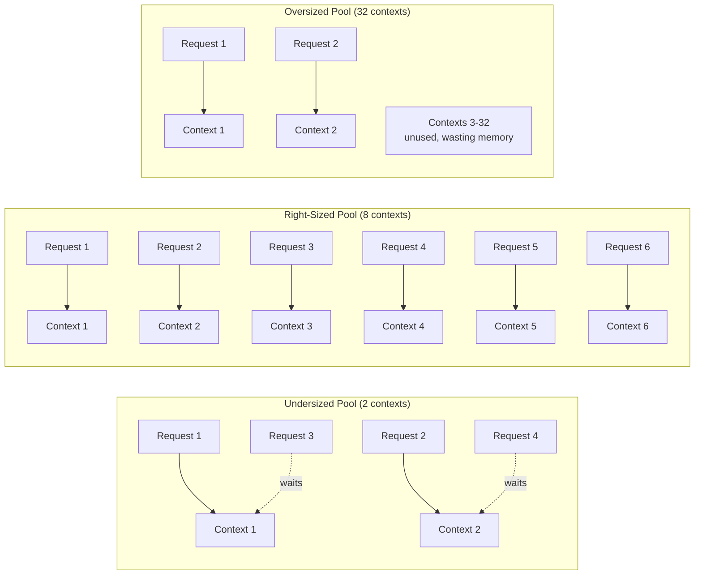
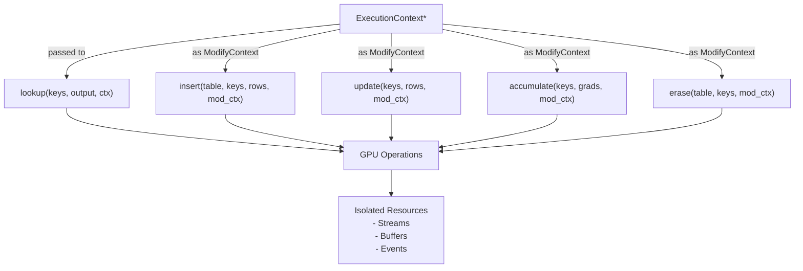

<!-- source: DeepWiki mcp.deepwiki.com · repo NVIDIA/nv-embedding-cache · page 3.4 Execution Contexts · fetched 2026-10-26 -->

# Execution Contexts

<details>
<summary>Relevant source files</summary>

The following files were used as context for generating this wiki page:

- [docs/advanced.md](docs/advanced.md)
- [docs/cpp_api.md](docs/cpp_api.md)

</details>


## Purpose and Scope

This page explains execution contexts, which are fundamental objects for managing parallel operations and resource isolation in the NV Embedding Cache SDK. Execution contexts encapsulate the state and resources (memory buffers, streams, temporary storage) required for individual operations, enabling safe concurrent execution of lookups and modifications.

For information about the operations that use execution contexts (lookup, insert, update), see [Cache Operations](#3.5). For details on parallel modify operations and synchronization, see [Modify Operations and Synchronization](#8.2).

**Sources:** [docs/advanced.md:3-11](), [docs/cpp_api.md:38]()

---

## What is an Execution Context?

An **execution context** is a container object that holds all state variables and memory buffers needed during the execution of cache operations (lookup, insert, update, accumulate). Contexts are created by embedding layers or tables and serve as the mechanism for separating resources across parallel executions.

Each execution context represents a single **reusable parallel execution environment**. This means:
- One context = one operation can execute at a time
- Multiple contexts = multiple operations can execute concurrently
- Using the same context in simultaneous operations results in undefined behavior



**Diagram: Execution Context Architecture**

The execution context abstraction provides **resource isolation** between concurrent operations, preventing interference and race conditions.

**Sources:** [docs/advanced.md:3-4](), [include/execution_context.hpp:1]()

---

## Context Creation and Lifecycle

### Creation

Execution contexts are created by calling the `create_execution_context()` method on a layer or table object. The signature is defined in `EmbeddingLayerBase`:

```
std::unique_ptr<ExecutionContext> create_execution_context(
    Allocator* allocator = nullptr
);
```

The calling application should create a **fixed pool** of execution contexts during initialization. The number of contexts determines the maximum parallelism:

| Number of Contexts | Concurrent Operations | Use Case |
|-------------------|----------------------|----------|
| 1 | Sequential execution only | Simple applications, testing |
| 2-4 | Limited parallelism | Single GPU, modest throughput |
| 8-16 | High parallelism | Multi-GPU, high throughput |
| 32+ | Extreme parallelism | Large-scale distributed systems |

### Lifecycle Management



**Diagram: Execution Context Lifecycle**

### Destruction Order

**Critical:** All execution contexts must be destroyed before destroying the layer or table that created them. Violating this order results in undefined behavior.

```cpp
// Correct order:
// 1. Create layer
EmbeddingLayerBase* layer = ...;

// 2. Create contexts
auto ctx1 = layer->create_execution_context();
auto ctx2 = layer->create_execution_context();

// 3. Perform operations
layer->lookup(..., ctx1.get());
layer->lookup(..., ctx2.get());

// 4. Destroy contexts FIRST
ctx1.reset();
ctx2.reset();

// 5. Destroy layer LAST
delete layer;
```

**Sources:** [docs/advanced.md:6-10](), [docs/cpp_api.md:38]()

---

## Memory Allocation Behavior

Execution contexts use **lazy memory allocation** to minimize resource consumption:

1. **Initial State:** When created, a context allocates minimal resources
2. **First Use:** On the first operation, buffers are allocated to match the operation dimensions
3. **Subsequent Uses:** Existing buffers are reused if dimensions match
4. **Growth:** If an operation requires larger buffers, reallocation occurs automatically
5. **No Shrinking:** Buffers never shrink; they retain their maximum size



**Diagram: Lazy Memory Allocation in Execution Contexts**

### Memory Consumption

Each execution context allocates memory proportional to:
- **Maximum batch size** seen during its lifetime
- **Embedding dimension** (vector size)
- **Number of tables** in the layer
- **Implementation-specific buffers** (streams, events, temporary storage)

Creating contexts during runtime is **allowed but discouraged** because:
- Memory allocation can block operations
- Initial allocations may cause performance spikes
- Resource fragmentation can occur

**Sources:** [docs/advanced.md:7-8](), [docs/cpp_api.md:38]()

---

## Parallel Execution Model

### Resource Separation

Execution contexts provide the fundamental mechanism for parallel execution by isolating resources:



**Diagram: Parallel Execution with Separate Contexts**

### Context Reuse Patterns

The recommended pattern is **round-robin reuse** of a fixed context pool:

```cpp
// Initialization: Create context pool
std::vector<std::unique_ptr<ExecutionContext>> context_pool;
for (int i = 0; i < NUM_CONTEXTS; ++i) {
    context_pool.push_back(layer->create_execution_context());
}

// Runtime: Round-robin assignment
std::atomic<size_t> context_index{0};

// Thread function for parallel lookups
void parallel_lookup(const KeyList& keys, VectorList& output) {
    size_t idx = context_index.fetch_add(1) % NUM_CONTEXTS;
    layer->lookup(keys, output, context_pool[idx].get());
}
```

**Sources:** [docs/advanced.md:3-6]()

---

## Execution Contexts Across Layer Types

Different embedding layer implementations use execution contexts in specific ways:

| Layer Type | Context Usage | Key Considerations |
|-----------|---------------|-------------------|
| **GPUEmbeddingLayer** | GPU-only operations | Contexts contain CUDA streams, GPU buffers |
| **LinearUVMEmbeddingLayer** | GPU + UVM operations | Contexts manage GPU cache and UVM fallback |
| **HierarchicalEmbeddingLayer** | Multi-tier operations | Contexts coordinate GPU, system, remote tiers |



**Diagram: Context Resources Across Layer Types**

**Sources:** [docs/cpp_api.md:19-22](), [include/gpu_embedding_layer.hpp:1](), [include/linear_embedding_layer.hpp:1](), [include/hierarchical_embedding_layer.hpp:1]()

---

## ModifyContext vs. ExecutionContext

There are two types of contexts in the SDK:

### ExecutionContext
- Used for **lookup** operations
- Supports concurrent execution
- Multiple contexts can be active simultaneously
- Thread-safe when used correctly (one context per thread)

### ModifyContext
- Used for **modify operations** (insert, update, accumulate, erase)
- Requires **serialization** on GPU side
- Only one modify operation can be in-flight on GPU
- Application must ensure single-stream execution



**Diagram: ExecutionContext vs. ModifyContext Usage**

For details on the invalidate-and-commit paradigm that governs modify operations, see [Modify Operations and Synchronization](#8.2).

**Sources:** [docs/advanced.md:14-16]()

---

## Code Entity Mapping

The following table maps conceptual entities to actual code locations:

| Concept | C++ Entity | File Location |
|---------|-----------|---------------|
| Execution Context | `ExecutionContext` class | [include/execution_context.hpp:1]() |
| Context creation | `EmbeddingLayerBase::create_execution_context()` | [include/embedding_layer.hpp:1]() |
| Modify Context | `ModifyContext` class | [include/execution_context.hpp:1]() |
| GPU layer context | `GPUEmbeddingLayer::create_execution_context()` | [include/gpu_embedding_layer.hpp:1]() |
| Linear layer context | `LinearUVMEmbeddingLayer::create_execution_context()` | [include/linear_embedding_layer.hpp:1]() |
| Hierarchical layer context | `HierarchicalEmbeddingLayer::create_execution_context()` | [include/hierarchical_embedding_layer.hpp:1]() |
| Table context creation | `Table::create_execution_context()` | [include/table.hpp:1]() |

**Sources:** [include/execution_context.hpp:1](), [include/embedding_layer.hpp:1](), [docs/cpp_api.md:38]()

---

## Best Practices

### 1. Create Contexts During Initialization

```cpp
// ✓ Good: Create once during setup
std::vector<std::unique_ptr<ExecutionContext>> contexts;
for (int i = 0; i < 8; ++i) {
    contexts.push_back(layer->create_execution_context());
}

// ✗ Bad: Create during hot path
void hot_path_lookup(...) {
    auto ctx = layer->create_execution_context();  // Expensive!
    layer->lookup(..., ctx.get());
}
```

### 2. Size Context Pool Appropriately

- **Too few contexts:** Limits parallelism, underutilizes GPU
- **Too many contexts:** Wastes memory, increases overhead
- **Rule of thumb:** 2-4x the number of concurrent operations expected

### 3. Never Share Contexts Across Threads

```cpp
// ✗ DANGER: Undefined behavior
ExecutionContext* shared_ctx = ...;

std::thread t1([&]() { layer->lookup(..., shared_ctx); });
std::thread t2([&]() { layer->lookup(..., shared_ctx); });  // RACE!
```

### 4. Destroy in Correct Order

```cpp
// ✓ Correct: contexts destroyed before layer
{
    auto layer = create_layer(...);
    auto ctx = layer->create_execution_context();
    // ... use ctx ...
}  // ctx destroyed, then layer destroyed

// ✗ Wrong: layer destroyed while contexts live
auto ctx = layer->create_execution_context();
delete layer;  // DANGER: ctx still exists!
```

### 5. Allocator Consistency

When providing a custom allocator, use the same allocator instance for related contexts:

```cpp
MyCustomAllocator allocator;

auto ctx1 = layer->create_execution_context(&allocator);
auto ctx2 = layer->create_execution_context(&allocator);  // Same allocator
```

**Sources:** [docs/advanced.md:3-10](), [docs/cpp_api.md:75-79]()

---

## Performance Implications

### Context Pool Sizing



**Diagram: Context Pool Sizing Trade-offs**

### Memory Growth Patterns

| Scenario | Initial Memory | After Growth | Impact |
|----------|---------------|--------------|--------|
| Fixed batch size (1000) | 1000 × dim × sizeof(float) | No change | Optimal |
| Variable batches (100-1000) | 100 × dim × sizeof(float) | 1000 × dim × sizeof(float) | Acceptable |
| Growing batches (1k → 10k) | 1000 × dim × sizeof(float) | 10000 × dim × sizeof(float) | One-time spike |
| Runtime context creation | 0 (not created) | Variable | Avoid! |

**Sources:** [docs/advanced.md:7-8]()

---

## Integration with Operations

Execution contexts are required parameters for all data operations:



**Diagram: Execution Context in Operation Flow**

For complete documentation of these operations, see [Cache Operations](#3.5).

**Sources:** [docs/cpp_api.md:24-37](), [docs/advanced.md:3-4]()

---

## Related Documentation

- **[Embedding Layers](#3.1)** - Layer implementations that create execution contexts
- **[Cache Operations](#3.5)** - Operations that consume execution contexts
- **[Modify Operations and Synchronization](#8.2)** - Special considerations for modify contexts
- **[Multi-threaded Inference](#9.4)** - Example of context management in concurrent scenarios
- **[Thread Pool](#4.4)** - Thread pool utility for CPU parallelism

**Sources:** [docs/advanced.md:3-11](), [docs/cpp_api.md:38]()

---

