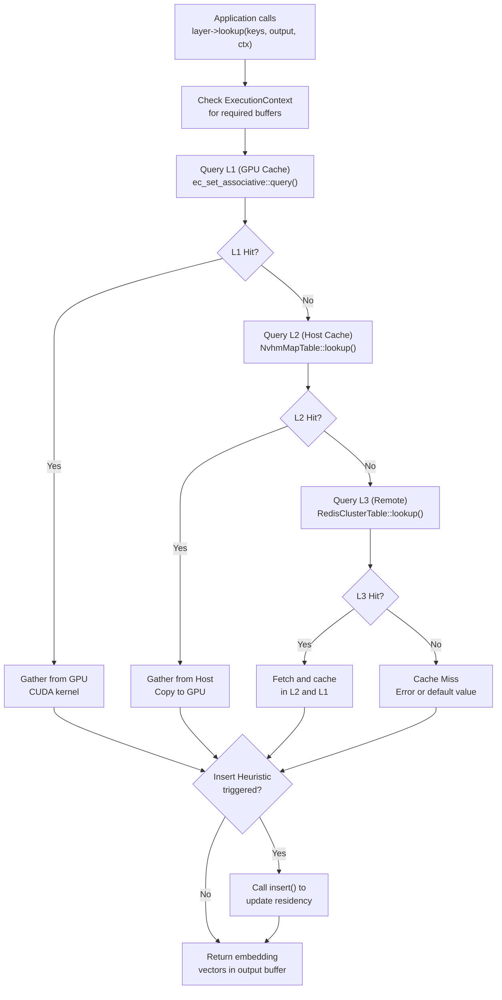
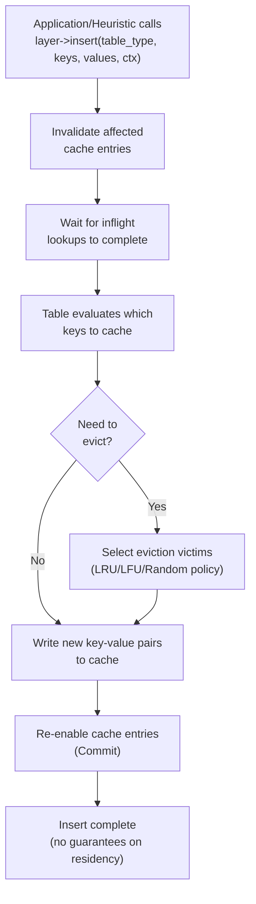
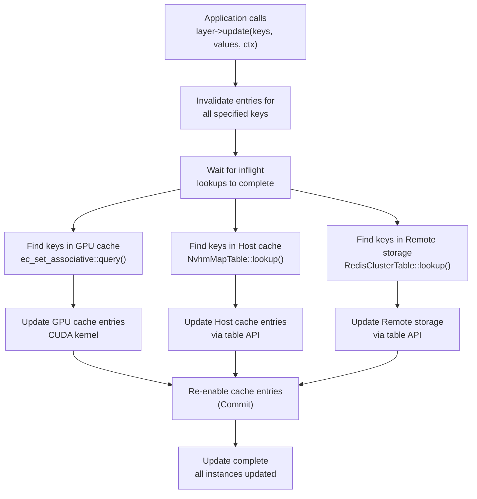
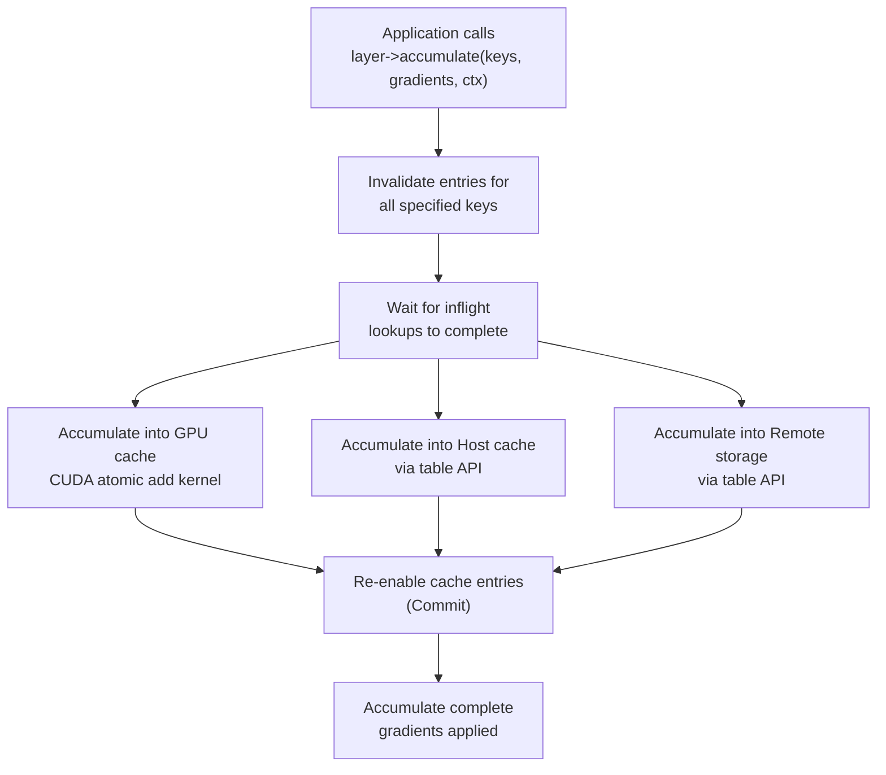
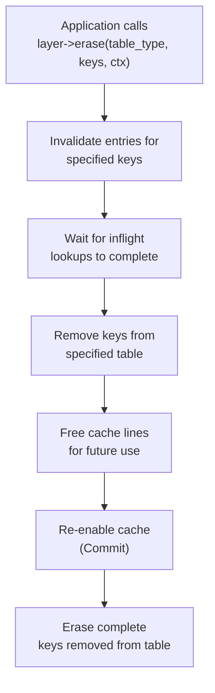
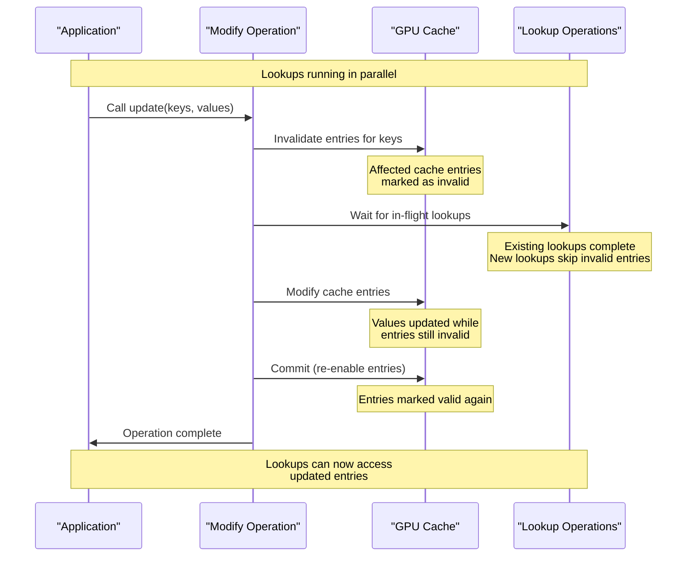
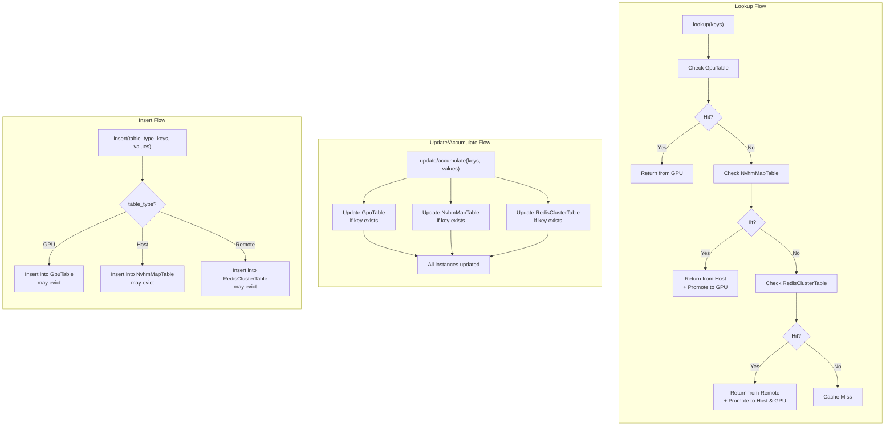

<!-- source: DeepWiki mcp.deepwiki.com · repo NVIDIA/nv-embedding-cache · page 3.5 Cache Operations · fetched 2026-10-26 -->

# Cache Operations

Relevant source files

The following files were used as context for generating this wiki page:

- [README.md](README.md)
- [docs/advanced.md](docs/advanced.md)
- [docs/cpp_api.md](docs/cpp_api.md)

This page describes the core operations available for interacting with embedding caches: **lookup**, **insert**, **update**, **accumulate**, and **erase**. These operations are exposed through the `EmbeddingLayerBase` API and determine how embedding data is read from and written to the cache hierarchy.

For information about execution contexts used by these operations, see [Execution Contexts](#3.4). For advanced synchronization patterns and the invalidate/commit paradigm, see [Modify Operations and Synchronization](#8.2).

---

## Operation Categories

Cache operations are divided into two categories based on their behavior:

| Category | Operations | Execution Context | Cache Behavior |
|----------|-----------|-------------------|----------------|
| **Read Operations** | `lookup` | `ExecutionContext` | May trigger cache insertions via insert heuristic; otherwise read-only |
| **Modify Operations** | `insert`, `update`, `accumulate`, `erase` | `ModifyContext` | Explicitly modify cache residency or values; require synchronization |

**Read operations** retrieve embedding data and may implicitly update cache residency based on access patterns. **Modify operations** explicitly alter cache state and must be serialized on the GPU side to maintain consistency.

Sources: [docs/cpp_api.md:24-38](), [docs/advanced.md:14-21]()

---

## Operation Semantics

### Lookup Operation

**Lookup** retrieves embedding vectors for a list of keys. The operation queries tables in the layer's cache hierarchy from fastest to slowest, gathering data from the first table containing each key. For hierarchical configurations, this means checking GPU cache, then host cache, then remote storage.

**Key Characteristics:**
- **Multi-tier access**: Queries multiple tables in order (GPU → Host → Remote)
- **Implicit caching**: May trigger insertion of frequently accessed embeddings into faster caches based on the insert heuristic (see [Custom Insert Heuristics](#8.4))
- **Memory flexibility**: Layers accept input keys and output buffers in either GPU or system memory, performing copies as needed
- **Parallel execution**: Requires an `ExecutionContext` for parallel operations; each context maintains separate buffers

**Behavior Differences by Layer Type:**
- **GPUEmbeddingLayer**: Direct lookup from GPU memory at computed offset `start_address + key * embedding_size`
- **LinearUVMEmbeddingLayer**: Checks GPU cache first, falls back to UVM linear memory
- **HierarchicalEmbeddingLayer**: Traverses full cache hierarchy (L1 GPU → L2 Host → L3 Remote)

Sources: [docs/cpp_api.md:24-26](), [include/embedding_layer.hpp](), [include/gpu_embedding_layer.hpp](), [include/linear_embedding_layer.hpp](), [include/hierarchical_embedding_layer.hpp]()

---

### Insert Operation

**Insert** updates which keys reside in a specific table. This operation is primarily used internally by layers to maintain cache residency based on access patterns, though it can be called explicitly.

**Key Characteristics:**
- **Residency control**: Determines which embeddings are cached in faster memory
- **Eviction**: May evict existing cache entries when capacity is exceeded (see [Cache Eviction Policies](#7.3))
- **No value guarantee**: If a key already exists in the table, its value may not be updated; use `update` for value changes
- **No residency guarantee**: Keys passed to insert are not guaranteed to remain in the table after the operation completes
- **Requires ModifyContext**: Uses invalidate/commit synchronization to prevent race conditions with concurrent lookups

**Typical Usage:**
- Called automatically by lookup operations via the insert heuristic
- Explicitly called during checkpoint loading to populate caches
- Used during initialization to pre-warm caches with hot embeddings

Sources: [docs/cpp_api.md:26-31](), [docs/advanced.md:14-21](), [include/embedding_layer.hpp]()

---

### Update Operation

**Update** replaces the values of existing embeddings across all tables in the layer. Unlike insert, this operation only affects keys that are already resident in the cache and does not change residency.

**Key Characteristics:**
- **Value modification only**: Updates embedding values for keys that already exist; does not add new keys to tables
- **Multi-table propagation**: Finds and updates the specified keys in all tables where they exist (GPU, Host, Remote)
- **Requires residency**: Keys not present in any table are silently ignored
- **Requires ModifyContext**: Must use invalidate/commit synchronization

**Common Use Cases:**
- Applying optimizer updates after a training iteration
- Correcting embedding values based on new data
- Synchronizing embeddings from an external source

Sources: [docs/cpp_api.md:32-34](), [include/embedding_layer.hpp]()

---

### Accumulate Operation

**Accumulate** adds gradient values to existing embeddings across all tables. This is the primary operation used during training to apply gradients computed from backpropagation.

**Key Characteristics:**
- **Additive update**: Adds provided gradients to existing embedding values: `embedding[key] += gradient[key]`
- **Multi-table propagation**: Accumulates into all tables where the key exists
- **Atomic operations**: Uses atomic add operations on GPU to prevent race conditions
- **Training-focused**: Designed for gradient descent optimization during model training
- **Requires ModifyContext**: Must use invalidate/commit synchronization

**Implementation Notes:**
- GPU implementation uses CUDA atomic operations for thread-safe accumulation
- Host and remote implementations may use locks or other synchronization primitives
- Can be more efficient than update for training workloads since it avoids read-modify-write cycles

Sources: [docs/cpp_api.md:34-36](), [include/embedding_layer.hpp]()

---

### Erase Operation

**Erase** removes specified keys from a table, freeing cache capacity for other embeddings.

**Key Characteristics:**
- **Explicit removal**: Unlike eviction during insert, erase explicitly removes keys from cache
- **Single table scope**: Operates on one table type at a time (e.g., GPU cache only)
- **Idempotent**: Keys not present in the table are silently ignored
- **Rarely needed**: Most applications rely on automatic eviction during insert operations
- **Requires ModifyContext**: Must use invalidate/commit synchronization

**Typical Usage:**
- Removing embeddings for deleted users/items in the recommendation system
- Forcing cache invalidation for embeddings that are known to be stale
- Manual cache management in specialized scenarios

**Note:** In most cases, automatic eviction during insert operations is preferred over explicit erase calls.

Sources: [docs/cpp_api.md:36-37](), [include/embedding_layer.hpp]()

---

## Invalidate and Commit Paradigm

To enable parallel execution of lookup and modify operations, the SDK employs an **invalidate and commit** synchronization pattern:

**Invalidate Phase:**
1. Modify operation launches a CUDA kernel to mark affected cache entries as invalid
2. Cache hardware refuses to serve invalidated entries during lookups
3. Ensures no lookup can read partially-updated data

**Wait Phase:**
1. Modify operation waits until all in-flight lookup operations have completed
2. Guarantees no lookup is accessing the data being modified
3. Uses CUDA stream synchronization to detect completion

**Modify Phase:**
1. With lookups blocked and cache entries invalid, the modify kernel updates values
2. Updates happen atomically from the perspective of future lookups

**Commit Phase:**
1. Affected cache entries are marked valid again
2. Future lookups can now access the updated data

This pattern ensures **consistency** (lookups never see partial updates) while allowing **concurrency** (lookups can proceed in parallel with each other, and with the invalidate/commit phases).

**Important Constraints:**
- Only **one modify operation can be in-flight** on the GPU at a time
- Applications must serialize modify operations (e.g., using a single CUDA stream)
- Multiple lookups can run in parallel with each other
- Lookups can run in parallel with the invalidate and commit phases

Sources: [docs/advanced.md:18-21]()

---

## Multi-Table Operation Flow

For layers with multiple tables (e.g., `HierarchicalEmbeddingLayer`), operations propagate through the cache hierarchy:

**Lookup Propagation:**
- Checks tables in order from fastest to slowest
- First hit returns the data
- May promote data to faster caches (cache warming)

**Update/Accumulate Propagation:**
- Operates on **all tables** where the key exists
- Runs in parallel across tables when possible
- Ensures consistency across the cache hierarchy

**Insert Targeting:**
- Operates on a **single table** specified by `table_type` parameter
- Used to control which cache level should hold the embedding
- Does not automatically propagate to other tables

Sources: [docs/cpp_api.md:24-26](), [include/hierarchical_embedding_layer.hpp]()

---

## Operation Signatures

The following table summarizes the API signatures for all cache operations as exposed by `EmbeddingLayerBase`:

| Operation | Signature | Context Type | Modifies Residency | Modifies Values |
|-----------|-----------|--------------|-------------------|----------------|
| **lookup** | `lookup(keys, output, exec_ctx)` | `ExecutionContext` | Maybe (via heuristic) | No |
| **insert** | `insert(table_type, keys, values, modify_ctx)` | `ModifyContext` | Yes | Maybe |
| **update** | `update(keys, values, modify_ctx)` | `ModifyContext` | No | Yes |
| **accumulate** | `accumulate(keys, gradients, modify_ctx)` | `ModifyContext` | No | Yes (additive) |
| **erase** | `erase(table_type, keys, modify_ctx)` | `ModifyContext` | Yes | N/A |

**Key Points:**
- All operations accept keys as either integer arrays (`int64_t*`) or key structures
- Values are float arrays with dimensions `[num_keys, embedding_dim]`
- Memory locations (GPU/Host) are inferred from pointer addresses; layers handle copying as needed
- All operations are asynchronous with respect to the CPU; use CUDA stream synchronization to wait for completion

Sources: [include/embedding_layer.hpp]()

---

## Performance Considerations

**Lookup Performance:**
- GPU cache lookups: ~100ns latency
- Host cache lookups: ~1-10μs latency  
- Remote storage lookups: ~1-10ms latency
- Batch lookups for better GPU utilization (recommended batch size: 1024+)

**Modify Performance:**
- Invalidate/commit adds ~10-100μs overhead per operation
- Serialize modify operations to avoid GPU contention
- Use accumulate instead of update when possible during training (better atomics)
- Batch multiple key updates into single operations when possible

**Multi-tier Optimization:**
- Insert heuristic controls promotion overhead (see [Custom Insert Heuristics](#8.4))
- Tune cache sizes based on working set (see [Performance Tuning](#8.3))
- Monitor hit rates to validate cache effectiveness

Sources: [docs/advanced.md](), [docs/cpp_api.md]()

---

