<!-- source: DeepWiki mcp.deepwiki.com · repo NVIDIA/nv-embedding-cache · page 4 C++ API Reference · fetched 2026-10-26 -->

# C++ API Reference

<details>
<summary>Relevant source files</summary>

The following files were used as context for generating this wiki page:

- [README.md](README.md)
- [docs/cpp_api.md](docs/cpp_api.md)

</details>


## Purpose and Scope

This document provides a complete reference for the C++ API of the NV Embedding Cache SDK. It covers all public C++ classes, interfaces, and functions available to application developers.

The C++ API is organized into three main levels:
- **High-level Embedding Layers** - Complete embedding management with automatic caching and memory hierarchy
- **Mid-level Table Interfaces** - Direct access to storage backends for custom implementations
- **Low-level GPU Cache Primitives** - Fine-grained control over GPU-resident cache operations

For Python API documentation, see [Python API Reference](#5). For conceptual explanations of layers, tables, and caching strategies, see [Core Concepts](#3). For usage examples, see [Examples and Samples](#9).

Sources: [docs/cpp_api.md:1-80](), [README.md:1-94]()

---

## API Architecture Overview

The following diagram illustrates the complete C++ API hierarchy and how components relate to each other:

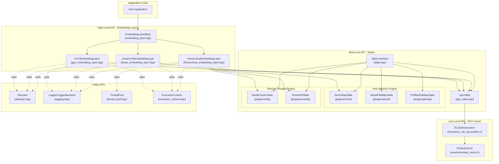

Sources: [docs/cpp_api.md:14-80](), [include/embedding_layer.hpp](), [include/table.hpp](), [include/ecache/embed_cache.h]()

---

## Compilation and Linking

### Building the SDK

Follow the instructions in [Installation and Setup](#2) to build the SDK. The build process produces the following libraries:

| Library | Location | Purpose |
|---------|----------|---------|
| `libnve-common.so` | `build/lib/` | Core SDK with layers, GpuTable, and utilities |
| `libnve-plugin-nvhm.so` | `build/lib/` | NVHM host memory table plugin |
| `libnve-plugin-abseil.so` | `build/lib/` | Abseil host memory table plugin |
| `libnve-plugin-phmap.so` | `build/lib/` | PHMap host memory table plugin |
| `libnve-plugin-redis.so` | `build/lib/` | Redis cluster table plugin |
| `libnve-plugin-rocksdb.so` | `build/lib/` | RocksDB table plugin |

### Linking Applications

Most applications should link against:
- `build/lib/libnve-common.so` - Core SDK functionality
- `libcudart.so` - CUDA runtime
- Any required plugin libraries (e.g., `libnve-plugin-redis.so`)

Plugin libraries must be present in `LD_LIBRARY_PATH` at runtime if they are used by the application.

### Include Paths

Add the following to your include path:
- `include/` - Public SDK headers
- `plugins/[plugin_name]/include/` - Plugin-specific headers (if using plugins directly)

Sources: [docs/cpp_api.md:9-12](), [README.md:44-55]()

---

## Core API Concepts

### Memory Location Types

The SDK uses these memory location identifiers:

| Type | Description | Usage |
|------|-------------|-------|
| `MemoryLocation::kGPU` | GPU device memory | Data resident in GPU VRAM |
| `MemoryLocation::kHost` | System memory | Data in CPU-accessible RAM |
| `MemoryLocation::kManaged` | Unified memory | CUDA managed memory (UVM) |

### Operation Types

All layer and table operations are categorized:

| Operation | Purpose | Modifies Cache State |
|-----------|---------|---------------------|
| `lookup()` | Retrieve embedding rows for given keys | Yes (may trigger inserts) |
| `insert()` | Update cache residency with new keys | Yes |
| `update()` | Modify values for existing keys | No (residency unchanged) |
| `accumulate()` | Add gradients to existing values | No (residency unchanged) |
| `erase()` | Remove keys from cache | Yes |

### Execution Contexts

Execution contexts encapsulate temporary state and memory buffers needed for operations. Create contexts using `layer->create_execution_context()` and reuse them across operations to avoid allocation overhead.

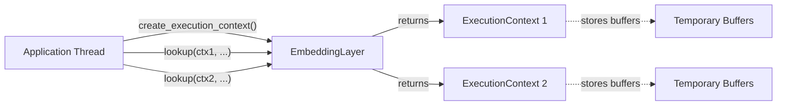

For details, see [Execution Contexts](#3.4).

Sources: [docs/cpp_api.md:14-38](), [include/embedding_layer.hpp](), [include/execution_context.hpp]()

---

## Embedding Layer Operations

The following diagram shows the typical workflow for using embedding layers:

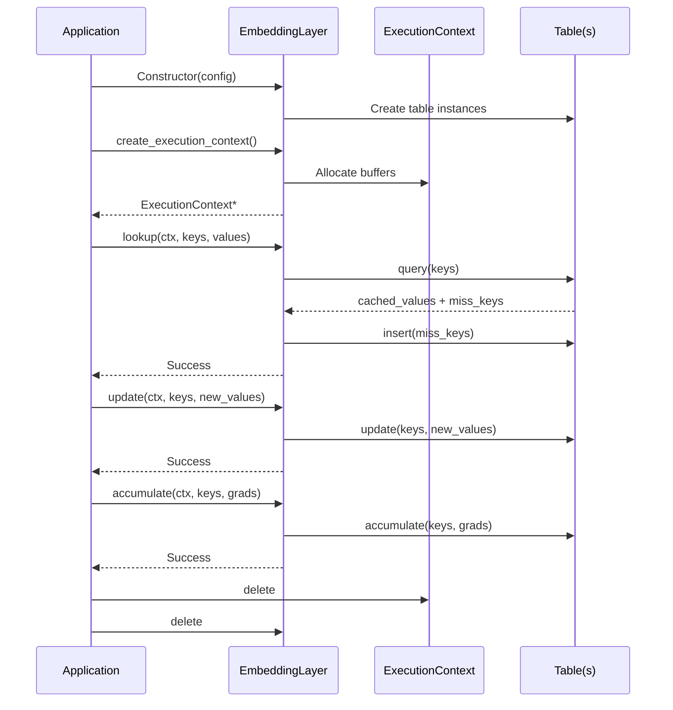

### Common Layer Operations

| Method | Signature | Description |
|--------|-----------|-------------|
| `lookup()` | `Status lookup(ExecutionContext*, keys, values_out)` | Retrieve embedding rows |
| `insert()` | `Status insert(table_type, keys, values)` | Update cache residency |
| `update()` | `Status update(ExecutionContext*, keys, values)` | Modify existing embeddings |
| `accumulate()` | `Status accumulate(ExecutionContext*, keys, grads)` | Add gradients to embeddings |
| `erase()` | `Status erase(table_type, keys)` | Remove embeddings from cache |
| `create_execution_context()` | `ExecutionContext* create_execution_context()` | Allocate execution state |

Sources: [docs/cpp_api.md:24-38](), [include/embedding_layer.hpp]()

---

## Class Hierarchy

The following diagram shows the inheritance relationships between key classes:

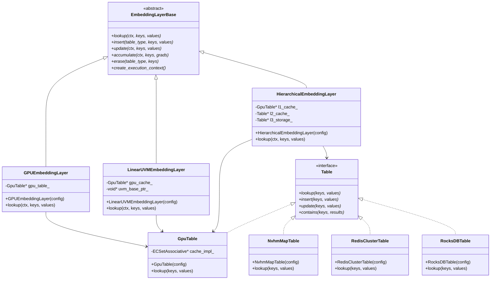

Sources: [include/embedding_layer.hpp](), [include/gpu_embedding_layer.hpp](), [include/linear_embedding_layer.hpp](), [include/hierarchical_embedding_layer.hpp](), [include/table.hpp](), [include/gpu_table.hpp]()

---

## Data Types and Structures

### Key-Value Representation

Embeddings are represented as key-value pairs:

| Type | Description | Typical Size |
|------|-------------|--------------|
| `KeyType` | Embedding ID (typically `int64_t`) | 8 bytes |
| `ValueType` | Embedding vector element (typically `float`) | 4 bytes |
| Embedding row | Array of `ValueType` with length `embedding_vec_size` | `embedding_vec_size * 4` bytes |

### Configuration Structures

Different components use specific configuration structures:

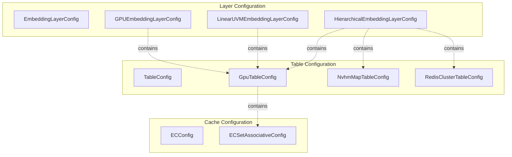

Sources: [include/embedding_layer.hpp](), [include/gpu_table.hpp](), [include/ecache/ec_set_associative.h]()

---

## Header File Organization

The SDK organizes headers into logical groups:

### Core Layer Headers

| Header | Classes | Purpose |
|--------|---------|---------|
| [include/embedding_layer.hpp]() | `EmbeddingLayerBase` | Abstract base class for all layers |
| [include/gpu_embedding_layer.hpp]() | `GPUEmbeddingLayer` | GPU-only embedding storage |
| [include/linear_embedding_layer.hpp]() | `LinearUVMEmbeddingLayer` | UVM-based embeddings with GPU cache |
| [include/hierarchical_embedding_layer.hpp]() | `HierarchicalEmbeddingLayer` | Multi-tier hierarchical caching |

### Table Headers

| Header | Classes | Purpose |
|--------|---------|---------|
| [include/table.hpp]() | `Table` | Abstract table interface |
| [include/gpu_table.hpp]() | `GpuTable` | GPU-resident hash table |
| [plugins/nvhm/include/nvhm_map_table.hpp]() | `NvhmMapTable` | nvHashMap-based system memory table |
| [plugins/abseil/include/abseil_flat_map_table.hpp]() | `AbseilFlatMapTable` | Abseil flat_hash_map table |
| [plugins/phmap/include/phmap_flat_map_table.hpp]() | `PHMapFlatMapTable` | Parallel hashmap table |
| [plugins/redis/include/redis_cluster_table.hpp]() | `RedisClusterTable` | Redis cluster storage |
| [plugins/rocksdb/include/rocksdb_table.hpp]() | `RocksDBTable` | RocksDB storage |

### Low-Level Cache Headers

| Header | Classes/Functions | Purpose |
|--------|-------------------|---------|
| [include/ecache/embed_cache.h]() | `EmbedCache` | Base cache interface |
| [include/ecache/ec_set_associative.h]() | `ECSetAssociative` | Set-associative cache implementation |
| [include/ecache/ec_nocache.h]() | `ECNoCache` | Pass-through (no caching) implementation |

### Utility Headers

| Header | Classes | Purpose |
|--------|---------|---------|
| [include/allocator.hpp]() | `Allocator` | Memory allocation interface |
| [include/logging.hpp]() | `Logger`, `LoggerBackend` | Logging system |
| [include/thread_pool.hpp]() | `ThreadPool`, `SimpleThreadPool` | Thread pool for parallel execution |
| [include/execution_context.hpp]() | `ExecutionContext` | Operation execution state |
| [include/common.hpp]() | Global utilities | Common functions (e.g., `GetGlobalLogger()`) |

Sources: [docs/cpp_api.md:1-80](), [include/]()

---

## Building Custom Applications

### Minimal Example Structure

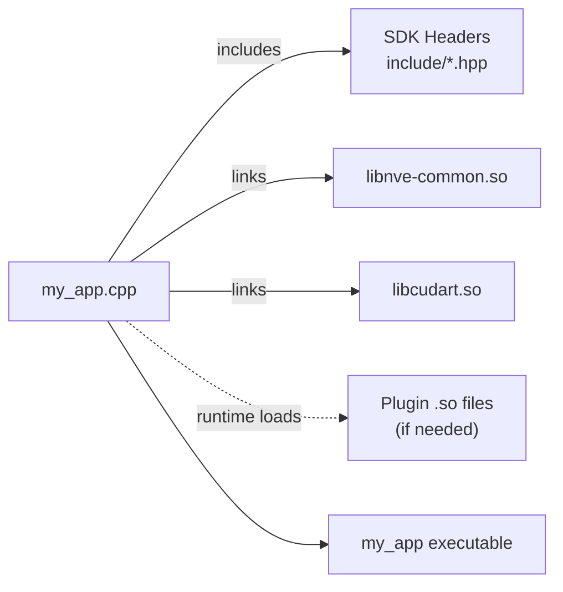

### Required Compiler Flags

| Flag | Purpose |
|------|---------|
| `-std=c++17` | C++17 standard required |
| `-I/path/to/nve/include` | SDK headers |
| `-L/path/to/nve/build/lib` | SDK libraries |
| `-lnve-common` | Link core library |
| `-lcudart` | Link CUDA runtime |
| `-Wl,-rpath,/path/to/nve/build/lib` | Runtime library path |

### Runtime Environment

```bash
export LD_LIBRARY_PATH=/path/to/nve/build/lib:$LD_LIBRARY_PATH
export CUDA_VISIBLE_DEVICES=0  # Set available GPUs
```

Sources: [docs/cpp_api.md:9-12](), [README.md:44-55]()

---

## API Usage Patterns

### Pattern 1: Direct Layer Usage

This is the recommended pattern for most applications:

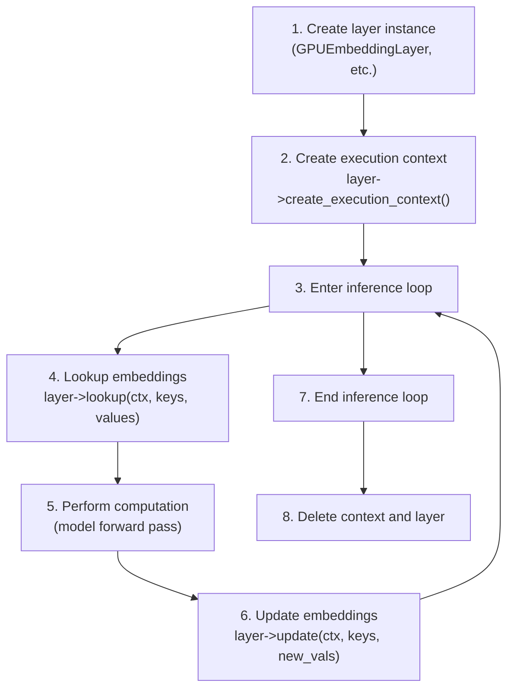

### Pattern 2: Custom Table Composition

For advanced users building custom caching strategies:

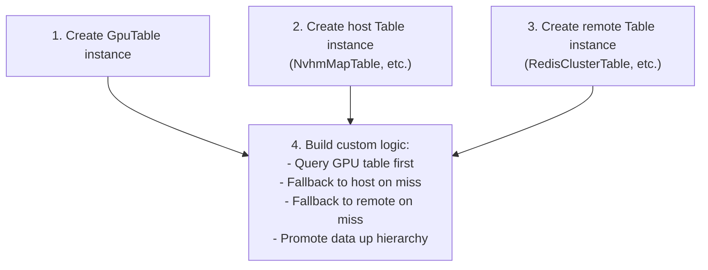

### Pattern 3: Low-Level Cache Control

For applications requiring fine-grained cache management:

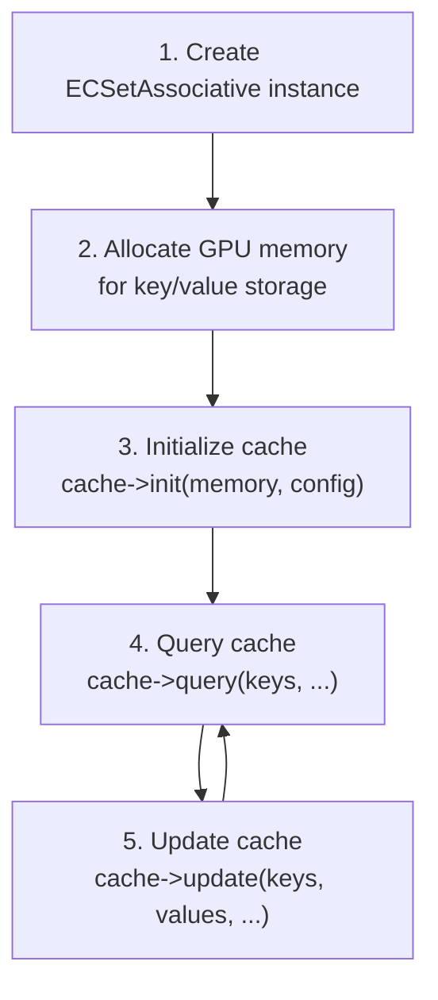

Sources: [docs/cpp_api.md:40-44](), [samples/simple_cpp/](), [samples/layer_sample/]()

---

## Thread Safety and Concurrency

### Thread Safety Guarantees

| Component | Thread Safety | Notes |
|-----------|---------------|-------|
| `EmbeddingLayer` | Thread-safe | Safe to call from multiple threads with different `ExecutionContext` instances |
| `ExecutionContext` | Not thread-safe | Each thread must use its own context |
| `Table` | Implementation-specific | `GpuTable`: thread-safe; Host tables: varies by plugin |
| `GpuTable` | Thread-safe | Safe for concurrent reads and writes |
| `NvhmMapTable` | Thread-safe | Built on thread-safe nvHashMap |
| `ECSetAssociative` | Thread-safe | Atomic operations in CUDA kernels |

### Concurrent Access Pattern

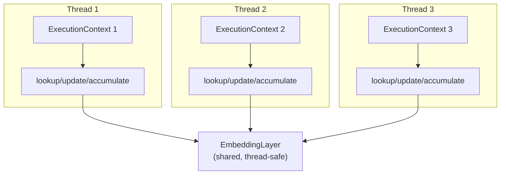

### CUDA Context Management

Applications using custom thread pools must set the CUDA device context per thread:

```cpp
// Before any CUDA calls in worker thread:
cudaSetDevice(device_id);
// Or use ScopedDevice helper class
```

Sources: [docs/cpp_api.md:74-80](), [include/thread_pool.hpp]()

---

## Error Handling

### Status Return Type

Most operations return a `Status` object indicating success or failure:

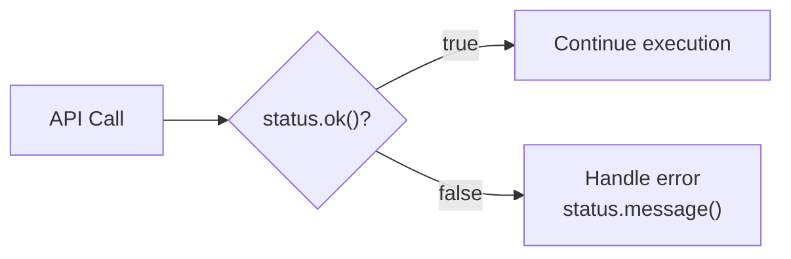

### Exception Policy

The SDK minimizes exception usage:
- Constructors may throw on invalid configuration
- Runtime operations return `Status` objects
- CUDA errors are checked and reported via `Status`

### Error Categories

| Category | Examples | Recovery |
|----------|----------|----------|
| Configuration errors | Invalid parameter values | Fix configuration and retry |
| Memory allocation errors | Out of GPU/host memory | Reduce cache sizes or batch sizes |
| I/O errors | Redis connection failed | Check network/service availability |
| Capacity errors | Key overflow in cache | Increase cache capacity or use different strategy |

Sources: [include/status.hpp]()

---

## Performance Considerations

### Memory Alignment

The SDK assumes aligned memory for optimal performance:
- Embedding rows should be aligned to 128-byte boundaries
- Use SDK `Allocator` interface for automatic alignment

### Batch Sizes

Operations perform best with batch sizes of:
- Minimum: 256 keys
- Optimal: 1024-8192 keys
- Maximum: Limited by available GPU memory

### CUDA Stream Management

Layers and tables support asynchronous execution via CUDA streams:
- Pass CUDA stream handle to operations
- Synchronize appropriately in application code

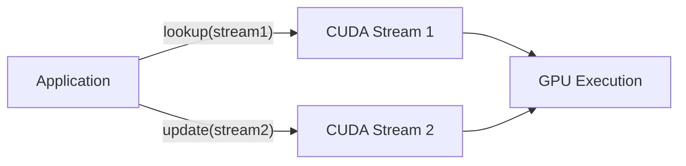

Sources: [docs/cpp_api.md:14-80]()

---

## Subsection References

For detailed information on specific API components, see:

- **Embedding Layer API**: [Embedding Layer API](#4.1) - Complete reference for `EmbeddingLayerBase` and derived classes
- **Table API**: [Table API](#4.2) - Table interface and all storage backend implementations
- **Low-Level GPU Cache API**: [Low-Level GPU Cache API](#4.3) - Direct access to `ECSetAssociative` and cache primitives
- **Utility Classes**: [Utility Classes](#4.4) - `Allocator`, `Logger`, `ThreadPool`, and helper classes

For conceptual understanding, see:
- [Core Concepts](#3) - Fundamental concepts and design patterns
- [Embedding Layers](#3.1) - Layer types and their use cases
- [Tables and Storage Backends](#3.2) - Storage backend options
- [Memory Hierarchy](#3.3) - How the SDK manages multi-tier memory

For usage examples, see:
- [Basic C++ Example](#9.1) - Simple embedding lookup
- [Layer Sample (Advanced)](#9.3) - Complex multi-layer usage
- [Multi-threaded Inference](#9.4) - Concurrent operations example

Sources: [docs/cpp_api.md:1-80]()

---

