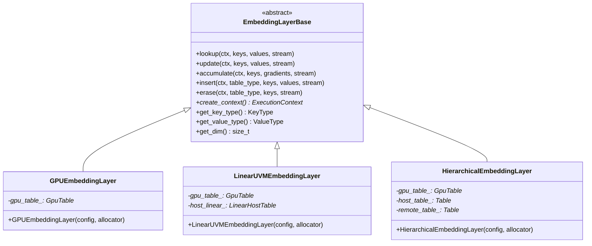
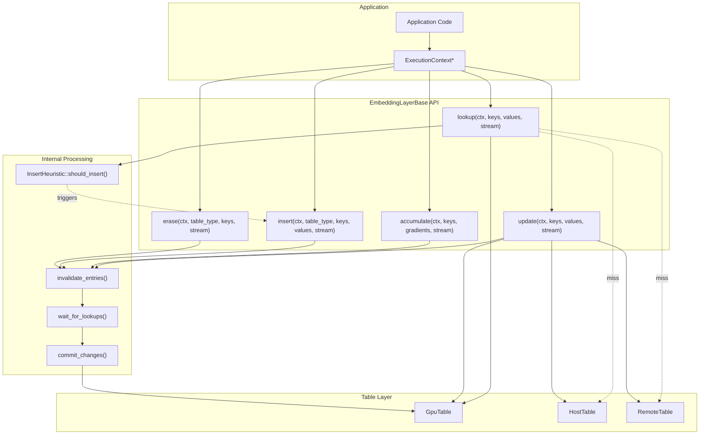
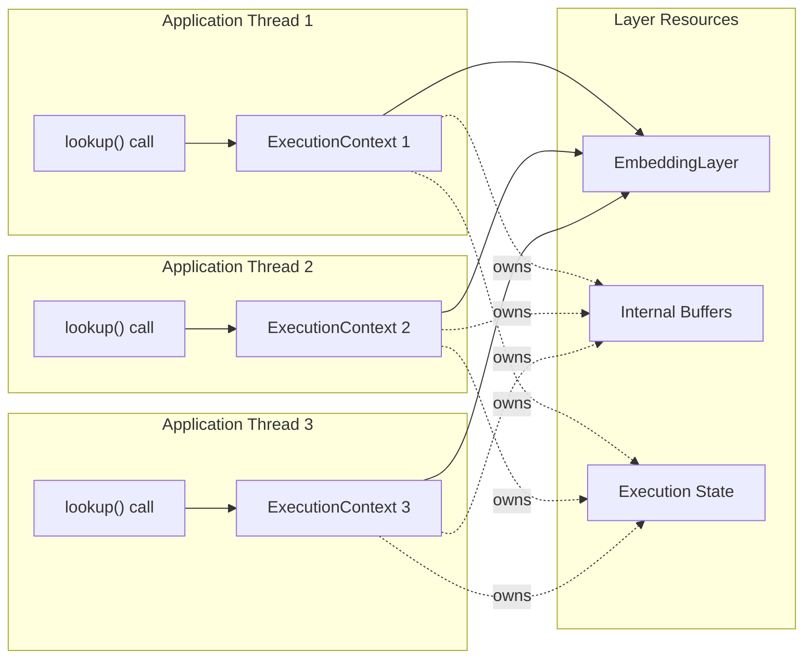
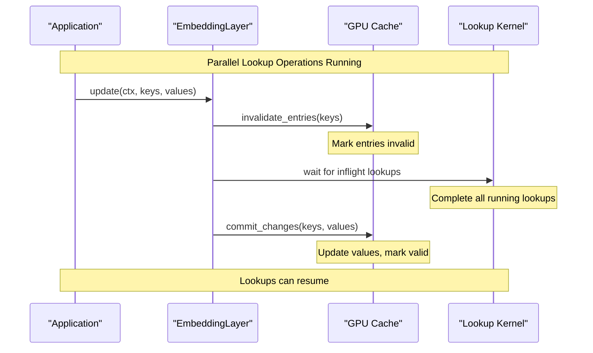
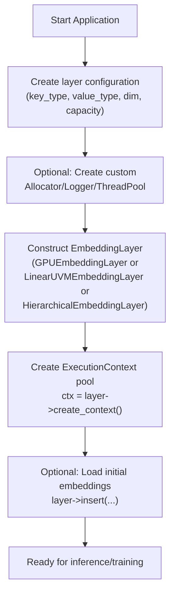
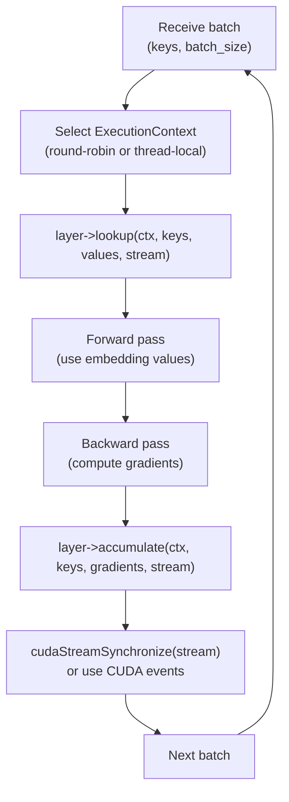
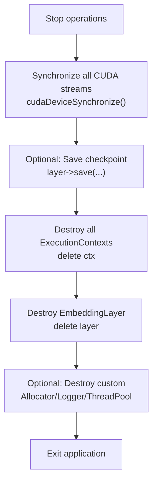

<!-- source: DeepWiki mcp.deepwiki.com · repo NVIDIA/nv-embedding-cache · page 4.1 Embedding Layer API · fetched 2026-10-26 -->

# Embedding Layer API

<details>
<summary>Relevant source files</summary>

The following files were used as context for generating this wiki page:

- [docs/advanced.md](docs/advanced.md)
- [docs/cpp_api.md](docs/cpp_api.md)

</details>


This page documents the C++ API for embedding layers in the NV Embedding Cache SDK. Embedding layers are high-level objects that manage embedding data storage and provide read/write operations on embedding rows. They abstract away the complexity of multi-tier memory hierarchies and provide a unified interface for embedding operations.

**Scope**: This page covers the C++ classes and interfaces defined in [include/embedding_layer.hpp]() and related headers. For conceptual understanding of embedding layers and when to use each type, see [Embedding Layers](#3.1). For the Python API equivalent, see [Python Embedding Layers](#5.1). For lower-level table interfaces, see [Table API](#4.2).

---

## Core Interface: EmbeddingLayerBase

The `EmbeddingLayerBase` class defined in [include/embedding_layer.hpp]() serves as the abstract base class for all embedding layer implementations. All layer types share a common interface defined by this base class.

### Class Hierarchy



**Sources**: [include/embedding_layer.hpp](), [include/gpu_embedding_layer.hpp](), [include/linear_embedding_layer.hpp](), [include/hierarchical_embedding_layer.hpp](), [docs/cpp_api.md:14-23]()

### Common Configuration Parameters

All embedding layers are configured through a configuration structure passed to their constructor. While specific parameters vary by layer type, common configuration fields include:

| Parameter | Type | Description |
|-----------|------|-------------|
| `key_type` | `KeyType` | Data type for embedding keys (int32, int64, etc.) |
| `value_type` | `ValueType` | Data type for embedding values (float, double, etc.) |
| `dim` | `size_t` | Dimensionality of embedding vectors |
| `capacity` | `size_t` | Total number of unique embedding rows |
| `device_id` | `int` | CUDA device ID for GPU operations |

**Sources**: [include/embedding_layer.hpp](), [docs/cpp_api.md:14-17]()

---

## Layer Types

### GPUEmbeddingLayer

The `GPUEmbeddingLayer` class defined in [include/gpu_embedding_layer.hpp]() stores all embedding data in GPU memory. This provides the fastest lookup performance but is limited by GPU memory capacity.

**Key Characteristics**:
- All embedding rows stored in GPU memory
- No caching logic required (all data directly accessible)
- Best performance for small to medium datasets that fit in GPU RAM
- Single table backend (`GpuTable`)

**Configuration**: Uses `GpuLayerConfig` structure. Inherits common parameters and adds GPU-specific settings.

**When to use**: Dataset size < GPU memory capacity. See [GPUEmbeddingLayer](#3.1.1) for detailed discussion.

**Sources**: [include/gpu_embedding_layer.hpp](), [docs/cpp_api.md:20]()

### LinearUVMEmbeddingLayer

The `LinearUVMEmbeddingLayer` class defined in [include/linear_embedding_layer.hpp]() stores embedding data in linear system memory using CUDA Unified Virtual Memory (UVM), with a GPU cache for frequently accessed embeddings.

**Key Characteristics**:
- Complete dataset in linear system memory (UVM)
- GPU cache for hot embeddings
- Automatic cache management via insert heuristics
- Two-tier architecture: GPU cache + system memory
- Single-node deployment

**Configuration**: Uses `LinearUVMLayerConfig` structure with additional cache configuration parameters.

**When to use**: Dataset size > GPU memory but fits in system memory, single-node deployment. See [LinearUVMEmbeddingLayer](#3.1.2) for detailed discussion.

**Sources**: [include/linear_embedding_layer.hpp](), [docs/cpp_api.md:21]()

### HierarchicalEmbeddingLayer

The `HierarchicalEmbeddingLayer` class defined in [include/hierarchical_embedding_layer.hpp]() implements a multi-tier caching strategy with optional GPU cache, system memory cache, and remote parameter server storage.

**Key Characteristics**:
- Three-tier architecture: GPU → System → Remote
- Remote parameter server for complete dataset (Redis or RocksDB)
- Optional system memory cache (NVHM, Abseil, or PHMap)
- Optional GPU cache
- Distributed deployment support

**Configuration**: Uses `HierarchicalLayerConfig` structure with separate configurations for each tier.

**When to use**: Very large datasets requiring distributed storage, multi-node deployments. See [HierarchicalEmbeddingLayer](#3.1.3) for detailed discussion.

**Sources**: [include/hierarchical_embedding_layer.hpp](), [docs/cpp_api.md:22]()

---

## Layer Operations

### Operation Flow Diagram



**Sources**: [include/embedding_layer.hpp](), [docs/cpp_api.md:24-38](), [docs/advanced.md:14-24]()

### Lookup Operation

The `lookup()` method retrieves embedding vectors for a given set of keys.

**Signature**:
```cpp
void lookup(ExecutionContext* ctx, const void* keys, size_t num_keys,
            void* values, cudaStream_t stream = 0);
```

**Parameters**:
- `ctx`: Execution context for this operation
- `keys`: Input buffer containing embedding keys
- `num_keys`: Number of keys to lookup
- `values`: Output buffer for embedding vectors (size: `num_keys * dim * sizeof(value_type)`)
- `stream`: CUDA stream for asynchronous execution

**Behavior**:
- Searches for keys in available tables, starting from fastest tier
- For hierarchical layers, promotes found keys to faster tiers
- May trigger cache insertion via insert heuristic (see [Insert Heuristics](#8.4))
- Output buffer populated with embedding vectors in same order as input keys
- Missing keys result in undefined behavior (keys must exist in at least one table)

**Memory requirements**: Input `keys` and output `values` buffers may reside in host or device memory. The layer will copy data as needed, which may allocate temporary buffers.

**Sources**: [include/embedding_layer.hpp](), [docs/cpp_api.md:25](), [docs/advanced.md:19-24]()

### Insert Operation

The `insert()` method updates cache residency by inserting key-value pairs into a specified table.

**Signature**:
```cpp
void insert(ModifyContext* ctx, TableType table_type,
            const void* keys, size_t num_keys,
            const void* values, cudaStream_t stream = 0);
```

**Parameters**:
- `ctx`: Modify context for synchronization
- `table_type`: Target table type (GPU, system memory, or remote)
- `keys`: Input buffer containing embedding keys
- `num_keys`: Number of keys to insert
- `values`: Input buffer containing embedding vectors
- `stream`: CUDA stream for asynchronous execution

**Important Notes**:
- Updates **residency** (which keys are cached), not necessarily values
- May evict existing entries to make room
- Keys already resident may be ignored
- Not guaranteed all provided keys will be resident after operation
- For updating values of existing keys, use `update()` instead

**Typical Usage**: Called internally by lookup operation via insert heuristic. Applications typically don't call this directly.

**Sources**: [include/embedding_layer.hpp](), [docs/cpp_api.md:26-31]()

### Update Operation

The `update()` method replaces embedding values for existing keys across all tables where they reside.

**Signature**:
```cpp
void update(ModifyContext* ctx, const void* keys, size_t num_keys,
            const void* values, cudaStream_t stream = 0);
```

**Parameters**:
- `ctx`: Modify context for synchronization
- `keys`: Input buffer containing embedding keys
- `num_keys`: Number of keys to update
- `values`: Input buffer containing new embedding vectors
- `stream`: CUDA stream for asynchronous execution

**Behavior**:
- Finds all occurrences of keys in layer's tables
- Replaces existing values with provided values
- Does **not** change residency (which tables contain which keys)
- Keys not resident in any table are ignored
- Uses invalidate-commit paradigm for synchronization

**Sources**: [include/embedding_layer.hpp](), [docs/cpp_api.md:32-33]()

### Accumulate Operation

The `accumulate()` method adds gradient values to existing embedding vectors, typically used during training.

**Signature**:
```cpp
void accumulate(ModifyContext* ctx, const void* keys, size_t num_keys,
                const void* gradients, cudaStream_t stream = 0);
```

**Parameters**:
- `ctx`: Modify context for synchronization
- `keys`: Input buffer containing embedding keys
- `num_keys`: Number of keys to accumulate
- `gradients`: Input buffer containing gradient vectors to add
- `stream`: CUDA stream for asynchronous execution

**Behavior**:
- For each key, performs: `embedding[key] += gradient[key]`
- Accumulates into all occurrences across all tables
- Does **not** change residency
- Keys not resident in any table are ignored
- Uses invalidate-commit paradigm for synchronization

**Sources**: [include/embedding_layer.hpp](), [docs/cpp_api.md:34-35]()

### Erase Operation

The `erase()` method removes keys from a specified table.

**Signature**:
```cpp
void erase(ModifyContext* ctx, TableType table_type,
           const void* keys, size_t num_keys, cudaStream_t stream = 0);
```

**Parameters**:
- `ctx`: Modify context for synchronization
- `table_type`: Target table type to erase from
- `keys`: Input buffer containing embedding keys
- `num_keys`: Number of keys to erase
- `stream`: CUDA stream for asynchronous execution

**Behavior**:
- Removes specified keys from target table
- Keys not resident in table are ignored
- Other tables containing same keys are unaffected

**Typical Usage**: Rarely needed in practice. Automatic eviction during `insert()` handles cache management. May be useful for explicit cache invalidation scenarios.

**Sources**: [include/embedding_layer.hpp](), [docs/cpp_api.md:36-37]()

---

## Execution Contexts

Execution contexts encapsulate the state and resources needed for parallel execution of layer operations. Each context represents a single reusable parallel execution environment.

### ExecutionContext Class



**Sources**: [include/execution_context.hpp](), [docs/advanced.md:3-10](), [docs/cpp_api.md:38]()

### Creating Contexts

Contexts are created through the layer's `create_context()` method:

```cpp
ExecutionContext* ctx = layer->create_context();
```

**Guidelines**:
- Create a fixed number of contexts during initialization
- Use one context per parallel execution path
- Reuse contexts in round-robin or other deterministic order
- Using same context in parallel operations causes undefined behavior
- Destroy all contexts before destroying the layer

**Sources**: [include/execution_context.hpp](), [docs/advanced.md:4-10]()

### Memory Allocation Behavior

Contexts use lazy memory allocation:
- Initial creation allocates minimal memory
- First operation with given dimensions allocates necessary buffers
- Subsequent operations reuse allocated buffers
- Larger-than-seen dimensions trigger additional allocation

**Performance Implication**: Avoid creating contexts at runtime; allocate all needed contexts during initialization.

**Sources**: [docs/advanced.md:8]()

### ModifyContext

The `ModifyContext` class (derived from `ExecutionContext`) is required for all modify operations (insert, update, accumulate, erase). It provides additional synchronization mechanisms for the invalidate-commit paradigm.

**Key Difference**: Regular `ExecutionContext` for lookup operations, `ModifyContext` for modifying operations.

**Sources**: [docs/advanced.md:14-16]()

---

## Modify Operations and Synchronization

### Invalidate-Commit Paradigm

To enable parallel lookup and modify operations, the SDK employs an invalidate-commit paradigm:



**Process**:
1. **Invalidate**: Mark cache entries as invalid for keys being modified
2. **Wait**: Wait for all inflight lookup operations to complete
3. **Commit**: Apply changes and mark entries valid again

**Requirement**: Only one modify operation can be inflight at a time. Application must ensure serialization, typically by using a single CUDA stream for all modify operations.

**Sources**: [docs/advanced.md:18-21]()

### Custom Flow Atomicity

The invalidate-commit mechanism assumes lookup operations are atomic (single CUDA kernel). For custom gather flows using multiple kernels:

**API**:
```cpp
layer->start_custom_flow();
// Launch multiple CUDA kernels for custom gather
kernel1<<<...>>>();
kernel2<<<...>>>();
layer->end_custom_flow();
```

This ensures the entire multi-kernel sequence is treated as atomic with respect to modify operations.

**Sources**: [docs/advanced.md:23-24]()

---

## Configuration and Construction

### Construction Pattern

All layer types follow a similar construction pattern:

```cpp
// 1. Prepare configuration
GpuLayerConfig config;
config.key_type = KeyType::Int64;
config.value_type = ValueType::Float32;
config.dim = 128;
config.capacity = 1000000;
config.device_id = 0;

// 2. Optional: provide custom allocator
Allocator* allocator = new CustomAllocator();

// 3. Construct layer
GPUEmbeddingLayer* layer = new GPUEmbeddingLayer(config, allocator);

// 4. Create execution contexts
std::vector<ExecutionContext*> contexts;
for (int i = 0; i < num_parallel_ops; ++i) {
    contexts.push_back(layer->create_context());
}
```

**Sources**: [include/gpu_embedding_layer.hpp](), [include/linear_embedding_layer.hpp](), [include/hierarchical_embedding_layer.hpp]()

### Insert Heuristics

Layers using caches can customize when to trigger cache insertion through the `InsertHeuristic` interface defined in [include/insert_heuristic.hpp]():

**Interface**:
```cpp
class InsertHeuristic {
    virtual bool should_insert(size_t lookup_count, 
                              const LookupStats& stats) = 0;
};
```

**Built-in Implementation**: `DefaultInsertHeuristic` triggers insertion based on configurable thresholds.

**Custom Implementation**: Applications can derive custom heuristics for domain-specific cache management strategies.

**Sources**: [include/insert_heuristic.hpp](), [docs/advanced.md:30-32](), [docs/cpp_api.md:25]()

---

## Usage Patterns

### Complete Initialization Flow



**Sources**: [docs/cpp_api.md:14-23](), [samples/simple_cpp/]()

### Runtime Operation Flow



**Sources**: [docs/cpp_api.md:24-38](), [samples/layer_sample/]()

### Teardown Flow



**Sources**: [docs/advanced.md:10]()

---

## Layer-Specific Details

### GPUEmbeddingLayer Configuration

| Parameter | Type | Description | Default |
|-----------|------|-------------|---------|
| `gpu_cache_capacity` | `size_t` | Number of embedding rows in GPU | Required |
| `num_sets` | `size_t` | Number of cache sets (power of 2) | Auto-computed |
| `associativity` | `size_t` | Set associativity | 32 |
| `eviction_policy` | `EvictionPolicy` | LRU, LFU, or Random | LRU |

**Sources**: [include/gpu_embedding_layer.hpp]()

### LinearUVMEmbeddingLayer Configuration

| Parameter | Type | Description | Default |
|-----------|------|-------------|---------|
| `gpu_cache_capacity` | `size_t` | Number of embedding rows in GPU cache | Required |
| `uvm_capacity` | `size_t` | Total embedding rows in UVM memory | Required |
| `insert_heuristic` | `InsertHeuristic*` | Cache insertion policy | DefaultInsertHeuristic |

**Sources**: [include/linear_embedding_layer.hpp]()

### HierarchicalEmbeddingLayer Configuration

| Parameter | Type | Description | Default |
|-----------|------|-------------|---------|
| `gpu_cache_capacity` | `size_t` | Number of rows in GPU cache | Optional (0 = no GPU cache) |
| `host_cache_capacity` | `size_t` | Number of rows in system memory cache | Optional (0 = no host cache) |
| `host_table_type` | `TableType` | System memory table type (NVHM, Abseil, PHMap) | Required if host_cache_capacity > 0 |
| `remote_table_type` | `TableType` | Remote storage type (Redis, RocksDB) | Required |
| `remote_config` | `void*` | Remote table configuration | Required |

**Sources**: [include/hierarchical_embedding_layer.hpp]()

---

## Thread Safety and Concurrency

### Thread Safety Guarantees

| Operation | Thread Safety | Notes |
|-----------|---------------|-------|
| `lookup()` | Thread-safe with separate contexts | Each thread must use its own `ExecutionContext` |
| `update()` / `accumulate()` / `insert()` / `erase()` | Serialize using single stream | Only one modify operation at a time |
| `create_context()` | Thread-safe | Can be called concurrently during initialization |

### Best Practices

1. **Context Management**: Create one context per parallel execution path (thread, stream, etc.)
2. **Modify Serialization**: Use a dedicated CUDA stream for all modify operations
3. **Device Context**: When using custom thread pools, explicitly set CUDA device via `cudaSetDevice()`

**Sources**: [docs/advanced.md:3-16](), [docs/cpp_api.md:79]()

---

## Examples and Samples

For complete working examples:
- **Basic C++ usage**: [samples/simple_cpp/]() - Simple embedding lookup example
- **Advanced multi-layer**: [samples/layer_sample/]() - Complex inference with multiple layers and workload runners
- **Multi-threaded**: See [Multi-threaded Inference](#9.4) for concurrent operations

**Sources**: [docs/cpp_api.md:40-43](), [samples/]()

---

