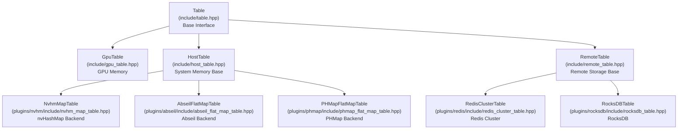
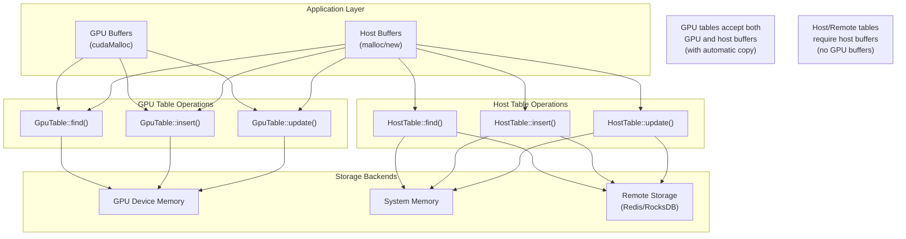
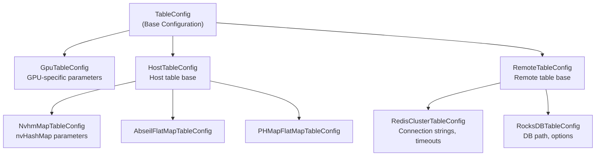

<!-- source: DeepWiki mcp.deepwiki.com · repo NVIDIA/nv-embedding-cache · page 4.2 Table API · fetched 2026-10-26 -->

# Table API

<details>
<summary>Relevant source files</summary>

The following files were used as context for generating this wiki page:

- [docs/cpp_api.md](docs/cpp_api.md)
- [plugins/nvhm/include/nvhm_map_table.hpp](plugins/nvhm/include/nvhm_map_table.hpp)

</details>


## Purpose and Scope

The Table API provides a lower-level interface for embedding storage compared to the Embedding Layer API. Tables represent individual storage backends with specific memory locations (GPU, system memory, or remote storage) and offer direct control over embedding operations without automatic memory management or multi-tier caching.

This document covers the C++ Table API, including the base `Table` interface, available implementations, configuration patterns, and usage guidelines. For higher-level embedding operations with automatic caching and memory management, see [Embedding Layer API](#4.1). For direct GPU cache manipulation, see [Low-Level GPU Cache API](#4.3).

**Sources:** [docs/cpp_api.md:45-60]()

---

## Table Interface Overview

Tables implement a common interface defined in the `Table` base class. Unlike embedding layers, tables:
- Operate on a single storage location (GPU memory, system memory, or remote storage)
- Require buffers to be in specific memory locations (no automatic copying)
- Do not perform multi-tier lookups or cache promotion
- Provide direct control over residency and eviction

The table abstraction allows embedding layers to compose multiple storage backends into hierarchical caching strategies while maintaining a consistent operational interface.

### Table Class Hierarchy



**Sources:** [docs/cpp_api.md:47-56]()

---

## Core Table Operations

All table implementations support a common set of operations defined in the base `Table` interface. These operations manipulate key-value pairs where keys are embedding identifiers and values are embedding vectors.

### Operation Catalog

| Operation | Purpose | Modifies Residency | Modifies Values |
|-----------|---------|-------------------|-----------------|
| `find` | Look up embedding values for given keys | No | No |
| `insert` | Add keys to the table (may evict existing keys) | Yes | No |
| `update` | Modify values for existing keys | No | Yes |
| `update_accumulate` | Add gradients to existing values | No | Yes |
| `erase` | Remove keys from the table | Yes | N/A |
| `clear` | Remove all keys from the table | Yes | N/A |
| `size` | Get the number of keys in the table | No | No |

### Key Operation Semantics

**find**: Queries the table for embedding values corresponding to input keys.
- Returns a hit mask indicating which keys were found
- Populates output buffers with embedding values for found keys
- Does not modify table contents
- May return partial results for keys not resident in the table

**insert**: Controls which keys should reside in the table.
- May evict existing keys to make room for new ones
- Does not guarantee inserted keys will remain resident
- May ignore values for keys already present in the table
- Used internally by embedding layers via insert heuristics

**update**: Replaces values for keys already resident in the table.
- Only affects keys currently in the table
- Does not change residency (no eviction or insertion)
- Keys not resident in the table are ignored

**update_accumulate**: Adds gradient values to existing embeddings.
- Performs element-wise accumulation: `embedding[i] += gradient[i] * scale`
- Supports different data types for gradients and embeddings
- Only affects resident keys
- Critical for training workflows

**erase**: Explicitly removes keys from the table.
- Typically unnecessary as insertion handles eviction automatically
- Useful for explicit cache management in specific scenarios

**Sources:** [docs/cpp_api.md:24-37](), [plugins/nvhm/include/nvhm_map_table.hpp:85-102]()

---

## Table Implementations by Memory Location

### GPU Tables

**GpuTable** stores embeddings in GPU device memory using a set-associative cache structure.

**Key Characteristics:**
- Fastest lookup performance (GPU kernel execution)
- Limited capacity (constrained by GPU DRAM)
- Supports direct access to system memory via Unified Virtual Memory (UVM)
- Implements set-associative caching with configurable eviction policies

**Configuration Parameters:**
- `capacity`: Maximum number of embeddings to store
- `eviction_policy`: Strategy for cache eviction (LRU, LFU, Random)
- `set_associativity`: Number of slots per cache set
- `embedding_dim`: Dimension of embedding vectors
- `embedding_dtype`: Data type of embedding elements

**Header Location:** [include/gpu_table.hpp]()

**Sources:** [docs/cpp_api.md:50]()

### Host Memory Tables

Host memory tables store embeddings in system RAM, providing larger capacity than GPU tables but with higher access latency.

#### NvhmMapTable

Uses NVIDIA's nvHashMap library for high-performance concurrent hash table operations on CPU.

**Key Features:**
- GPU-accelerated operations via nvHashMap CUDA kernels
- Partitioned design for concurrent access
- Software prefetching support
- Configurable overflow handling

**Configuration Parameters (NvhmMapTableConfig):**
```
num_partitions: Number of hash table partitions (power of 2)
partitioner: Function to map keys to partitions
workgroups: Thread pool workgroup assignment per partition
max_find_task_size: Batch size for parallel find operations
kernel_size: nvHashMap kernel size [1, 1024]
initial_capacity: Initial slots per partition
value_alignment: Memory alignment for embedding vectors
key_fetch_queue_length: Prefetch queue depth [0, 1, 2, 4, 8]
prefetch_values: Enable software prefetching of values
minimize_psl: Probe sequence length optimization
auto_shrink: Automatic capacity reduction after evictions
overflow_policy: Overflow detection and handling configuration
```

**Header Location:** [plugins/nvhm/include/nvhm_map_table.hpp]()

**Sources:** [plugins/nvhm/include/nvhm_map_table.hpp:31-54]()

#### AbseilFlatMapTable

Uses Google's Abseil library for hash table storage.

**Key Features:**
- Simple CPU-based hash table
- Lower memory overhead than nvHashMap
- No GPU acceleration

**Header Location:** [plugins/abseil/include/abseil_flat_map_table.hpp]()

**Sources:** [docs/cpp_api.md:52]()

#### PHMapFlatMapTable

Uses the parallel-hashmap library for hash table storage.

**Key Features:**
- Parallel CPU hash table operations
- Memory-efficient design
- Thread-safe operations

**Header Location:** [plugins/phmap/include/phmap_flat_map_table.hpp]()

**Sources:** [docs/cpp_api.md:53]()

### Remote Storage Tables

Remote storage tables provide persistent, distributed storage for embeddings with the largest capacity but highest latency.

#### RedisClusterTable

Connects to a Redis cluster for distributed embedding storage.

**Key Features:**
- Distributed storage across Redis nodes
- Persistence and replication
- Network-based access
- Supports Redis Cluster protocol

**Use Cases:**
- Multi-node deployments
- Shared embedding storage across multiple training/inference workers
- Persistence requirements

**Header Location:** [plugins/redis/include/redis_cluster_table.hpp]()

**Sources:** [docs/cpp_api.md:54]()

#### RocksDBTable

Provides local or networked persistent storage via RocksDB.

**Key Features:**
- LSM-tree based storage
- Compression support
- Local SSD/HDD storage
- High write throughput

**Use Cases:**
- Single-node persistent storage
- Large embedding tables that don't fit in memory
- Training checkpointing

**Header Location:** [plugins/rocksdb/include/rocksdb_table.hpp]()

**Sources:** [docs/cpp_api.md:55]()

---

## Memory Location and Buffer Requirements

### Buffer Memory Constraints

Tables enforce strict memory location requirements for input and output buffers:

| Table Type | Keys Location | Values Location | Notes |
|------------|---------------|-----------------|-------|
| GpuTable | GPU or System | GPU or System | Automatic copying if mismatch |
| NvhmMapTable | System | System | No GPU buffers accepted |
| AbseilFlatMapTable | System | System | No GPU buffers accepted |
| PHMapFlatMapTable | System | System | No GPU buffers accepted |
| RedisClusterTable | System | System | Network serialization required |
| RocksDBTable | System | System | Disk I/O operations |

### Memory Location Diagram



**Sources:** [docs/cpp_api.md:47-48]()

---

## Configuration and Factory Pattern

### Table Configuration Hierarchy

Tables use a hierarchical configuration system with base classes providing common parameters and derived classes adding implementation-specific options.



**Sources:** [plugins/nvhm/include/nvhm_map_table.hpp:31-54]()

### Table Factory Pattern

Tables are instantiated through factory objects that manage plugin loading and configuration validation.

**Factory Classes:**
- `TableFactory`: Base factory interface
- `HostTableFactory`: Factory for host memory tables
- `RemoteTableFactory`: Factory for remote storage tables
- `NvhmMapTableFactory`: Specific factory for NvhmMapTable instances

**Factory Configuration:**
```
NvhmMapTableFactoryConfig
  - Inherits from HostTableFactoryConfig
  - Validates configuration parameters
  - Manages plugin-specific settings
```

**Factory Methods:**
- `produce(table_id, config)`: Creates a table instance with given ID and configuration
- `check()`: Validates factory configuration

**Sources:** [plugins/nvhm/include/nvhm_map_table.hpp:126-149]()

---

## Plugin Architecture

Tables (except GpuTable) are built as separate plugin libraries to minimize dependencies.

### Plugin Libraries

| Plugin | Library Name | Dependencies |
|--------|-------------|--------------|
| NVHM | `libnve-plugin-nvhm.so` | nvHashMap |
| Abseil | `libnve-plugin-abseil.so` | abseil-cpp |
| PHMap | `libnve-plugin-phmap.so` | parallel-hashmap |
| Redis | `libnve-plugin-redis.so` | hiredis, redis++ |
| RocksDB | `libnve-plugin-rocksdb.so` | rocksdb |

### Runtime Loading

Plugins must be present in `LD_LIBRARY_PATH` at runtime. The core SDK (`libnve-common.so`) dynamically loads plugins as needed based on table configuration.

**Example:**
```bash
export LD_LIBRARY_PATH=$LD_LIBRARY_PATH:/path/to/nve/build/lib
```

**Sources:** [docs/cpp_api.md:12](), [docs/cpp_api.md:57]()

---

## Differences from Embedding Layers

Understanding when to use tables directly versus embedding layers:

### Comparison Table

| Aspect | Table API | Embedding Layer API |
|--------|-----------|---------------------|
| **Abstraction Level** | Low-level, single storage location | High-level, multi-tier caching |
| **Memory Management** | Manual buffer placement | Automatic buffer allocation/copying |
| **Cache Hierarchy** | Single tier | Multiple tiers (GPU → Host → Remote) |
| **Insert Heuristics** | Manual control | Automatic via insert heuristics |
| **Use Case** | Custom caching logic, direct control | Standard embedding lookup workflows |
| **Complexity** | More complex to use correctly | Simpler API, automatic optimizations |
| **Performance** | Maximum control, potential for optimization | Good default performance |

### When to Use Table API Directly

- **Custom caching strategies**: Implementing specialized eviction or promotion policies
- **Direct storage access**: Bypassing layer abstractions for specific workflows
- **Plugin development**: Building new table implementations
- **Performance tuning**: Fine-grained control over memory operations
- **Integration**: Embedding NVE tables into existing systems with custom memory management

### When to Use Embedding Layer API

- **Standard workflows**: Training and inference with automatic caching
- **Rapid development**: Less code required, automatic optimizations
- **Multi-tier caching**: Leveraging GPU/Host/Remote hierarchy automatically
- **Production deployments**: Battle-tested configurations with insert heuristics

**Sources:** [docs/cpp_api.md:15-17](), [docs/cpp_api.md:47-48]()

---

## Advanced Table Features

### Execution Contexts

Tables operate with execution contexts that provide:
- Memory allocation pools
- CUDA stream management
- Thread-local state
- Performance metrics tracking

Tables inherit context requirements from the base `Table` interface, with contexts passed as `context_ptr_t` parameters to all operations.

**Sources:** [docs/cpp_api.md:38]()

### Concurrent Operations

Host memory tables support concurrent operations:

**NvhmMapTable Partitioning:**
- Multiple partitions with independent locks ([plugins/nvhm/include/nvhm_map_table.hpp:34]())
- Reader-writer locks per partition ([plugins/nvhm/include/nvhm_map_table.hpp:119]())
- Parallel find operations with configurable task sizes ([plugins/nvhm/include/nvhm_map_table.hpp:37]())

**Thread Safety:**
- GPU tables: Thread-safe for concurrent reads, serialized writes
- Host tables: Partition-level concurrency, configurable workgroups
- Remote tables: Implementation-dependent (Redis: cluster-level, RocksDB: instance-level)

### Overflow Handling

Tables implement overflow detection and handling to prevent unbounded memory growth.

**OverflowPolicyConfig** ([plugins/nvhm/include/nvhm_map_table.hpp:52]()):
- Maximum capacity limits
- Eviction triggers
- Error handling strategies

---

## Type System and Templates

### Generic Key-Value Types

Tables are implemented as templates to support different key and value types:

```
NvhmMapTable Template Parameters:
  - MaskType: Bitmask representation for hit/miss tracking
  - MapType: Underlying hash map implementation
  - PartitionerType: Key-to-partition mapping function
```

**Type Constraints:**
- Keys: Integer types (typically `int64_t`)
- Values: Variable-length byte arrays (aligned per `value_alignment`)
- Masks: Bitmask representation for efficient hit tracking

**Sources:** [plugins/nvhm/include/nvhm_map_table.hpp:60-73]()

### Value Alignment

Tables enforce alignment requirements for optimal memory access patterns:

**NvhmMapTable**: Configurable via `value_alignment` parameter (power of 2)
**Purpose**: Cache line alignment for prefetching and vectorized operations

---

## JSON Configuration

Table configurations support JSON serialization for declarative setup:

**Serialization Functions:**
- `from_json(json, config)`: Populate config from JSON
- `to_json(json, config)`: Serialize config to JSON

**Example Usage:**
```cpp
nlohmann::json config_json = {
  {"num_partitions", 16},
  {"initial_capacity", 8192},
  {"key_fetch_queue_length", 8},
  {"prefetch_values", true}
};

NvhmMapTableConfig config;
from_json(config_json, config);
```

**Sources:** [plugins/nvhm/include/nvhm_map_table.hpp:56-58](), [plugins/nvhm/include/nvhm_map_table.hpp:132-134]()

---

## Summary

The Table API provides direct access to embedding storage backends with explicit control over memory placement, residency, and operations. Tables serve as building blocks for embedding layers, offering:

- **Specialized implementations** for GPU, system memory, and remote storage
- **Consistent interface** across all storage types
- **Plugin architecture** for extensibility
- **Performance tuning** through detailed configuration
- **Type safety** via template-based design

For most applications, the [Embedding Layer API](#4.1) provides sufficient functionality with automatic optimizations. Use the Table API directly when implementing custom caching strategies, developing new storage backends, or requiring fine-grained control over embedding operations.

**Sources:** [docs/cpp_api.md:45-60]()

---

