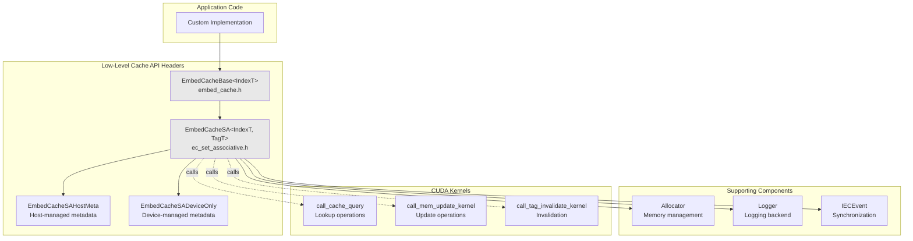
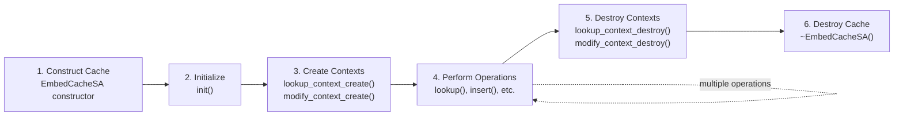
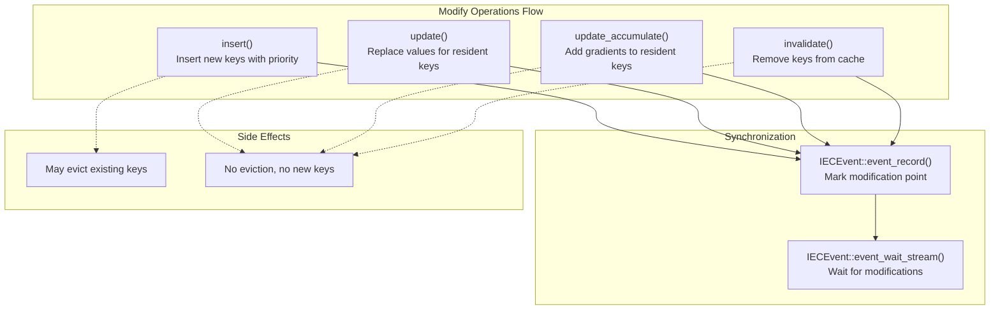

<!-- source: DeepWiki mcp.deepwiki.com · repo NVIDIA/nv-embedding-cache · page 4.3 Low-Level GPU Cache API · fetched 2026-10-26 -->

# Low-Level GPU Cache API

<details>
<summary>Relevant source files</summary>

The following files were used as context for generating this wiki page:

- [docs/cpp_api.md](docs/cpp_api.md)
- [include/ecache/ec_set_associative.h](include/ecache/ec_set_associative.h)
- [include/ecache/embed_cache.h](include/ecache/embed_cache.h)

</details>


## Purpose and Scope

This page documents the low-level GPU embedding cache API located in [include/ecache/](), which provides direct access to GPU cache primitives for building custom caching solutions. These header-only components are designed for applications that need fine-grained control over cache operations beyond what the higher-level Embedding Layer API provides.

The GPU embedding cache implements a software-managed cache optimized for recommendation system embeddings with power-law distributed access patterns. Applications using these APIs must include the headers directly in their build and manage cache lifecycle and operations explicitly.

**Related Documentation:**
- For higher-level layer abstractions, see [Embedding Layer API](#4.1)
- For table implementations that use this cache, see [Table API](#4.2)
- For implementation internals and design details, see [GPU Embedding Cache Internals](#7)

**Sources:** [docs/cpp_api.md:62-72](), [include/ecache/embed_cache.h:18-21]()

## Architecture Overview

The low-level GPU cache API consists of two main components:

1. **`EmbedCacheBase<IndexT>`** - Abstract base interface defining cache operations
2. **`EmbedCacheSA<IndexT, TagT>`** - Set-associative cache implementation (8-way set associative)

All cache implementations are templated on:
- `IndexT`: The key/index type (e.g., `uint64_t`, `int64_t`)
- `TagT`: The tag type used internally for set-associative lookup (typically same as `IndexT`)



**Sources:** [include/ecache/embed_cache.h:354-389](), [include/ecache/ec_set_associative.h:98-99]()

## Core Data Structures

### Cache Configuration

The `CacheConfig` structure defines cache parameters:

| Field | Type | Description |
|-------|------|-------------|
| `cache_sz_in_bytes` | `size_t` | Total cache memory size (includes tags and data) |
| `embed_width_in_bytes` | `uint64_t` | Size of each embedding vector in bytes |
| `num_tables` | `uint64_t` | Number of independent cache tables (typically 1) |
| `decay_rate` | `float` | LFU counter decay rate (default: 0.95) |
| `allocate_data_on_host` | `bool` | If true, allocate data in host memory (for UVM configurations) |

**Sources:** [include/ecache/ec_set_associative.h:113-121]()

### Cache Allocation Size

The `CacheAllocationSize` structure reports memory requirements:

```cpp
struct CacheAllocationSize {
    size_t device_allocation_size;  // GPU memory required
    size_t host_allocation_size;    // System memory required
};
```

**Sources:** [include/ecache/embed_cache.h:321-325]()

### Lookup and Modify Contexts

Operations require context handles for thread-safety and resource management:

| Handle Type | Purpose | Creation Method |
|-------------|---------|-----------------|
| `LookupContextHandle` | Contains cache metadata for lookup operations | `lookup_context_create()` |
| `ModifyContextHandle` | Contains buffers for insert/update operations | `modify_context_create()` |

Both handles are opaque uint64_t wrappers that must be explicitly created and destroyed.

**Sources:** [include/ecache/embed_cache.h:327-339]()

## Initialization and Lifecycle



### Constructor and Initialization

```cpp
// Step 1: Construct cache with configuration
EmbedCacheSA<IndexT, TagT>(
    Allocator* allocator,
    Logger* logger,
    const CacheConfig& cfg,
    CACHE_IMPLEMENTATION_TYPE type
);

// Step 2: Initialize internal buffers
ECError init();
```

The `init()` method:
- Validates configuration parameters
- Calculates number of cache sets based on memory budget
- Allocates device and host memory pools
- Initializes tags to `INVALID_IDX` (-1)

**Sources:** [include/ecache/ec_set_associative.h:178-183](), [include/ecache/ec_set_associative.h:326-401]()

### Context Creation

```cpp
// Create lookup context with optional performance metrics
LookupContextHandle lookup_handle;
PerformanceMetric metrics[1];
performance_metric_create(metrics[0], MERTIC_COUNT_MISSES);
lookup_context_create(lookup_handle, metrics, 1);

// Create modify context with maximum batch size
ModifyContextHandle modify_handle;
modify_context_create(modify_handle, max_update_size);
```

**Sources:** [include/ecache/embed_cache.h:186-211](), [include/ecache/embed_cache.h:642-653]()

## Cache Operations

### Lookup Operations

The cache provides three lookup variants:

#### 1. Lookup with Missing Keys

Returns cache hits and identifies misses for external resolution:

```cpp
ECError lookup(
    const LookupContextHandle& lookup_handle,
    const IndexT* d_keys,           // Input: keys to query
    const size_t len,                // Input: number of keys
    int8_t* d_values,               // Output: values for hits
    uint64_t* d_missing_index,      // Output: indices of misses
    IndexT* d_missing_keys,         // Output: keys that missed
    size_t* d_missing_len,          // Output: number of misses
    uint32_t curr_table,            // Table index (usually 0)
    size_t stride,                   // Bytes between rows in d_values
    cudaStream_t stream
);
```

**Pseudocode:**
```
d_missing_len = 0
for i = 0 to len-1:
    if d_keys[i] in cache:
        d_values[i*stride:...] = cache[d_keys[i]]
    else:
        d_missing_keys[d_missing_len] = d_keys[i]
        d_missing_index[d_missing_len] = i
        d_missing_len++
```

**Sources:** [include/ecache/ec_set_associative.h:411-429](), [include/ecache/embed_cache.h:434-467]()

#### 2. Lookup with Hit Mask

Returns a bitmask indicating which keys hit:

```cpp
ECError lookup(
    const LookupContextHandle& lookup_handle,
    const IndexT* d_keys,
    const size_t len,
    int8_t* d_values,
    uint64_t* d_hit_mask,  // Bit i set if d_keys[i] hit
    uint32_t curr_table,
    size_t stride,
    cudaStream_t stream
);
```

**Sources:** [include/ecache/ec_set_associative.h:431-448](), [include/ecache/embed_cache.h:470-491]()

#### 3. Lookup with UVM Table Fallback

Resolves misses directly from a device-accessible linear table:

```cpp
ECError lookup(
    const LookupContextHandle& lookup_handle,
    const IndexT* d_keys,
    const size_t len,
    int8_t* d_values,
    const int8_t* d_table,  // Linear table for miss resolution
    uint32_t curr_table,
    size_t stride,
    cudaStream_t stream
);
```

This variant assumes `d_table[key * stride]` contains the embedding for `key`.

**Sources:** [include/ecache/ec_set_associative.h:450-467](), [include/ecache/embed_cache.h:494-518]()

#### 4. Lookup with Sort-Gather Optimization

For very large embedding tables, this variant sorts keys by residency before gathering:

```cpp
ECError lookup_sort_gather(
    const LookupContextHandle& lookup_handle,
    const IndexT* d_keys,
    const size_t len,
    int8_t* d_values,
    const int8_t* d_table,
    int8_t* d_auxiliary_buffer,    // Scratch space for sorting
    size_t& auxiliary_buffer_bytes, // In/out: buffer size
    uint32_t curr_table,
    size_t stride,
    int64_t block_size,             // CUDA block size
    cudaStream_t stream
);
```

**Usage pattern:**
1. Call with `d_auxiliary_buffer=nullptr` to query required size
2. Allocate buffer of returned size
3. Call again with allocated buffer to perform lookup

**Sources:** [include/ecache/ec_set_associative.h:479-535](), [include/ecache/embed_cache.h:522-545]()

### Modify Operations



**Sources:** [include/ecache/embed_cache.h:664-762]()

#### Insert Operation

Inserts keys with priority-based eviction:

```cpp
ECError insert(
    ModifyContextHandle& modify_context_handle,
    const IndexT* keys,              // Sorted by priority (high to low)
    const float* priority,           // Higher values = higher priority
    const int8_t* const* pp_data,    // Array of pointers to data vectors
    size_t num_keys,
    uint32_t table_index,
    IECEvent* sync_event,            // Synchronization with lookups
    cudaStream_t stream
);
```

**Key behaviors:**
- Keys must be unique and sorted by descending priority
- May evict lower-priority keys to make room
- Uses insert heuristic to decide which keys to cache (see [Custom Insert Heuristics](#8.4))
- No guarantee that all keys will be resident after insert

**Sources:** [include/ecache/ec_set_associative.h:604-612](), [include/ecache/embed_cache.h:664-687]()

#### Update Operation

Replaces values for keys already in cache:

```cpp
ECError update(
    ModifyContextHandle& modify_context_handle,
    const IndexT* keys,              // Keys to update
    const int8_t* d_values,         // New values (stride-separated)
    int64_t stride,                  // Bytes between rows
    size_t num_keys,
    uint32_t table_index,
    IECEvent* sync_event,
    cudaStream_t stream
);
```

**Key behaviors:**
- Only updates keys already resident in cache
- Does not change residency (no new keys, no evictions)
- Non-resident keys are silently ignored

**Sources:** [include/ecache/ec_set_associative.h:617-624](), [include/ecache/embed_cache.h:689-712]()

#### Update Accumulate Operation

Accumulates gradients into cached embeddings:

```cpp
ECError update_accumulate(
    ModifyContextHandle& modify_context_handle,
    const IndexT* keys,
    const int8_t* d_values,         // Gradient deltas
    int64_t stride,
    size_t num_keys,
    uint32_t table_index,
    DataTypeFormat update_format,    // Format of d_values
    DataTypeFormat cache_format,     // Format in cache
    IECEvent* sync_event,
    cudaStream_t stream
);
```

**Supported format combinations:**
- `DATATYPE_FP32` to `DATATYPE_FP32`
- `DATATYPE_FP16` to `DATATYPE_FP32`
- `DATATYPE_FP32` to `DATATYPE_FP16`
- `DATATYPE_INT8_SCALED` accumulation (quantized)

**Sources:** [include/ecache/ec_set_associative.h:628-638](), [include/ecache/embed_cache.h:714-743]()

#### Update Accumulate (No Sync)

Optimized accumulate for cases where application guarantees no concurrent operations:

```cpp
ECError update_accumulate_no_sync(
    const LookupContextHandle& lookup_handle,
    ModifyContextHandle& modify_handle,
    const IndexT* d_keys,
    const size_t len,
    const int8_t* d_values,
    uint32_t curr_table,
    size_t stride,
    DataTypeFormat input_format,
    DataTypeFormat output_format,
    cudaStream_t stream
);
```

This variant skips synchronization overhead when the application can guarantee that:
1. No concurrent lookups are in flight
2. No concurrent modify operations are occurring

**Sources:** [include/ecache/ec_set_associative.h:537-552](), [include/ecache/embed_cache.h:549-568]()

#### Invalidate Operation

Removes keys from the cache:

```cpp
ECError invalidate(
    ModifyContextHandle& modify_context_handle,
    const IndexT* keys,
    size_t num_keys,
    uint32_t table_index,
    IECEvent* sync_event,
    cudaStream_t stream
);
```

Typically not needed as `insert()` will evict as necessary, but useful for explicit cache management.

**Sources:** [include/ecache/ec_set_associative.h:312-318](), [include/ecache/embed_cache.h:745-762]()

### Clear Cache

Invalidates all cache contents:

```cpp
ECError clear_cache(cudaStream_t stream);
```

After this call, all lookups will miss until new keys are inserted. User must synchronize with in-flight operations before calling.

**Sources:** [include/ecache/ec_set_associative.h:600](), [include/ecache/embed_cache.h:765-775]()

## Performance Metrics

### Creating and Using Metrics

```cpp
// Create miss counter metric
PerformanceMetric miss_metric;
performance_metric_create(miss_metric, MERTIC_COUNT_MISSES);

// Bind to lookup context
LookupContextHandle lookup_handle;
lookup_context_create(lookup_handle, &miss_metric, 1);

// Perform lookups (misses accumulated in metric)
lookup(lookup_handle, ...);

// Read metric value
int64_t num_misses;
performance_metric_get_value(miss_metric, &num_misses, stream);
cudaStreamSynchronize(stream);  // Wait for copy

// Reset for next measurement period
performance_metric_reset(miss_metric, stream);

// Cleanup
performance_metric_destroy(miss_metric);
```

**Available metrics:**
- `MERTIC_COUNT_MISSES`: Counts cache misses during lookups

**Sources:** [include/ecache/embed_cache.h:224-246](), [include/ecache/embed_cache.h:595-638]()

## Synchronization with IECEvent

Modify operations use `IECEvent` for synchronization between concurrent lookups and modifications:

```cpp
class IECEvent {
public:
    virtual ECError event_record() = 0;
    virtual ECError event_wait_stream(cudaStream_t stream) = 0;
};
```

### Default Implementation

```cpp
// Create event tracking multiple lookup streams
std::vector<cudaStream_t> lookup_streams = {...};
DefaultECEvent sync_event(lookup_streams);

// Before modification: record completion point of lookups
sync_event.event_record();  // Records on all lookup streams

// Modification stream waits for lookups
cudaStream_t modify_stream = ...;
sync_event.event_wait_stream(modify_stream);
cache.insert(..., &sync_event, modify_stream);
```

This ensures that:
1. All lookups started before `event_record()` complete before modifications begin
2. Lookups started after modifications see consistent cache state

**Sources:** [include/ecache/embed_cache.h:155-186](), [include/ecache/embed_cache.h:258-310]()

## Cache Inspection

### Get Keys Stored

Retrieve all keys currently in the cache:

```cpp
IndexT* keys_buffer;  // Allocate: sizeof(IndexT) * get_max_num_embedding_vectors_in_cache()
size_t num_keys;
get_keys_stored_in_cache(lookup_handle, keys_buffer, num_keys);
```

Returns keys including duplicates if the same key is in multiple ways of a set. User must synchronize with modify operations before calling.

**Sources:** [include/ecache/ec_set_associative.h:589](), [include/ecache/embed_cache.h:778-790]()

### Get Cache Capacity

```cpp
size_t max_capacity = cache.get_max_num_embedding_vectors_in_cache();
// Returns: num_sets * NUM_WAYS (where NUM_WAYS = 8)
```

**Sources:** [include/ecache/ec_set_associative.h:584-587](), [include/ecache/embed_cache.h:813]()

## Custom Flow Protection

For custom gather implementations that don't use the cache's built-in lookup:

```cpp
// Mark start of atomic gather operation
cache.start_custom_flow();

// Launch multiple custom kernels
my_custom_residency_check<<<...>>>(stream);
my_custom_gather<<<...>>>(stream);

// Mark end of atomic operation
cache.end_custom_flow();
```

This prevents invalidate/commit operations from interfering with multi-kernel custom flows by acquiring a read lock during the custom flow.

**Sources:** [include/ecache/ec_set_associative.h:469-477](), [include/ecache/embed_cache.h:793-808]()

## Implementation Variants

The SDK provides two concrete implementations of `EmbedCacheSA`:

| Implementation | Type Constant | Metadata Location | Use Case |
|----------------|---------------|-------------------|----------|
| `EmbedCacheSAHostMeta` | `SET_ASSOCIATIVE_HOST_METADATA` | Host memory | Default, better for debugging |
| `EmbedCacheSADeviceOnly` | `SET_ASSOCIATIVE_DEVICE_ONLY` | Device memory | Higher performance, lower flexibility |

Both implementations share the same API but differ in where they store metadata for modify operations.

**Sources:** [include/ecache/embed_cache.h:92-99]()

## Error Handling

All operations return `ECError` codes:

| Error Code | Value | Description |
|------------|-------|-------------|
| `ECERROR_SUCCESS` | 0x0 | Operation successful |
| `ECERROR_INVALID_ARGUMENT` | 0x1 | Invalid pointer or parameter |
| `ECERROR_MEMORY_ALLOCATION` | 0x2 | Memory allocation failed |
| `ECERROR_CUDA_ERROR` | 0x3 | CUDA runtime error |
| `ECERROR_NOT_IMPLEMENTED` | 0x5 | Feature not supported |
| `ECERROR_BAD_ALLOCATOR` | 0x7 | Allocator is null |
| `ECERROR_BAD_LOGGER` | 0x8 | Logger is null |
| `ECERROR_MEMORY_ALLOCATED_TO_CACHE_TOO_SMALL` | 0x9 | Insufficient cache size |
| `ECERROR_BAD_KEY_TAG_CONFIG` | 0xA | Incompatible IndexT/TagT types |

Internal code uses exceptions (`ECException`) which are caught and converted to error codes at API boundaries.

**Sources:** [include/ecache/embed_cache.h:39-50](), [include/ecache/embed_cache.h:119-153]()

## Usage Pattern Example

```cpp
// 1. Create allocator and logger
DefaultAllocator allocator;
DefaultLogger logger;

// 2. Configure cache
EmbedCacheSA<uint64_t, uint64_t>::CacheConfig config;
config.cache_sz_in_bytes = 1ULL << 30;  // 1 GB
config.embed_width_in_bytes = 128;
config.num_tables = 1;

// 3. Construct and initialize
EmbedCacheSAHostMeta<uint64_t, uint64_t> cache(
    &allocator, &logger, config, SET_ASSOCIATIVE_HOST_METADATA);
cache.init();

// 4. Create contexts
LookupContextHandle lookup_ctx;
cache.lookup_context_create(lookup_ctx, nullptr, 0);

ModifyContextHandle modify_ctx;
cache.modify_context_create(modify_ctx, 1024);

// 5. Perform operations
cudaStream_t stream;
cudaStreamCreate(&stream);

// Lookup
cache.lookup(lookup_ctx, d_keys, num_keys, d_values, 
             d_missing_idx, d_missing_keys, d_missing_len,
             0, stride, stream);

// Insert (after resolving misses)
std::vector<cudaStream_t> streams = {stream};
DefaultECEvent sync_event(streams);
cache.insert(modify_ctx, keys, priorities, pp_data, num_keys,
             0, &sync_event, stream);

// 6. Cleanup
cache.modify_context_destroy(modify_ctx);
cache.lookup_context_destroy(lookup_ctx);
cudaStreamDestroy(stream);
```

**Sources:** [include/ecache/ec_set_associative.h:178-401](), [docs/cpp_api.md:66-72]()

## Memory Requirements

To estimate memory requirements before allocation:

```cpp
CacheAllocationSize alloc_size;
cache.calc_allocation_size(alloc_size);

std::cout << "Device memory: " << alloc_size.device_allocation_size << " bytes\n";
std::cout << "Host memory: " << alloc_size.host_allocation_size << " bytes\n";

// Context sizes
auto lookup_size = cache.get_lookup_context_size();
auto modify_size = cache.get_modify_context_size(max_update_size);
```

**Memory breakdown:**
- **Tags**: `sizeof(TagT) * NUM_WAYS * num_sets * num_tables` (aligned to 16 bytes)
- **Data**: `embed_width_in_bytes * NUM_WAYS * num_sets * num_tables` (aligned to 16 bytes)
- **Counters** (LFU): Additional space for frequency counters (implementation-dependent)

**Sources:** [include/ecache/ec_set_associative.h:148-176](), [include/ecache/ec_set_associative.h:591-598]()

## Thread Safety

The cache supports concurrent operations with these guarantees:

1. **Multiple concurrent lookups**: Safe with different `LookupContextHandle` instances
2. **Modify operations**: Must be synchronized with `IECEvent` to prevent race conditions with lookups
3. **Custom flows**: Protected by read-write lock via `start_custom_flow()` / `end_custom_flow()`

User must ensure:
- Each thread uses its own context handles
- Modify operations use proper synchronization events
- No overlapping `clear_cache()` calls with other operations

**Sources:** [include/ecache/ec_set_associative.h:734-746](), [include/ecache/embed_cache.h:793-808]()

## Limitations and Requirements

1. **Key/Tag types**: Must be integer types with matching signedness
2. **Maximum key value**: Limited by `TagT::max() * num_sets + (num_sets-1)`
3. **Set associativity**: Fixed at 8 ways (`NUM_WAYS = 8`)
4. **Alignment**: All embedding widths must align to 16 bytes
5. **Uniqueness**: Keys in `insert()` must be unique and sorted by priority
6. **CUDA device context**: Multi-threaded applications must call `cudaSetDevice()` in each thread

**Sources:** [include/ecache/ec_set_associative.h:642-662](), [include/ecache/ec_set_associative.h:749](), [docs/cpp_api.md:79]()

## Sample Code Reference

For a complete working example of the low-level cache API, see:
- [samples/ecache/simple_sample/]() - Demonstrates basic cache operations

**Sources:** [docs/cpp_api.md:70-72]()

---

