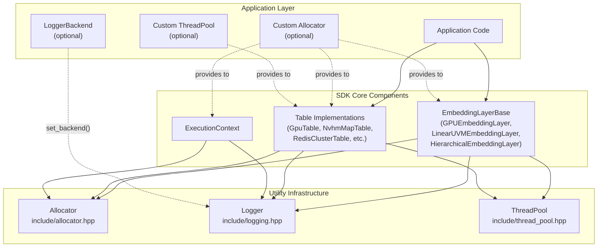
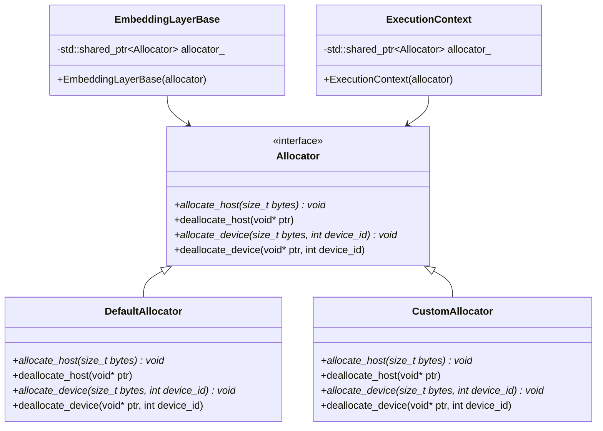
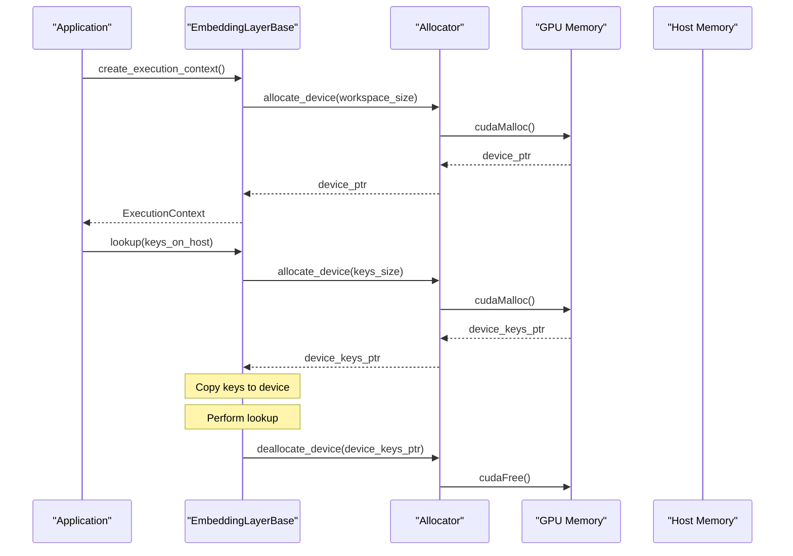
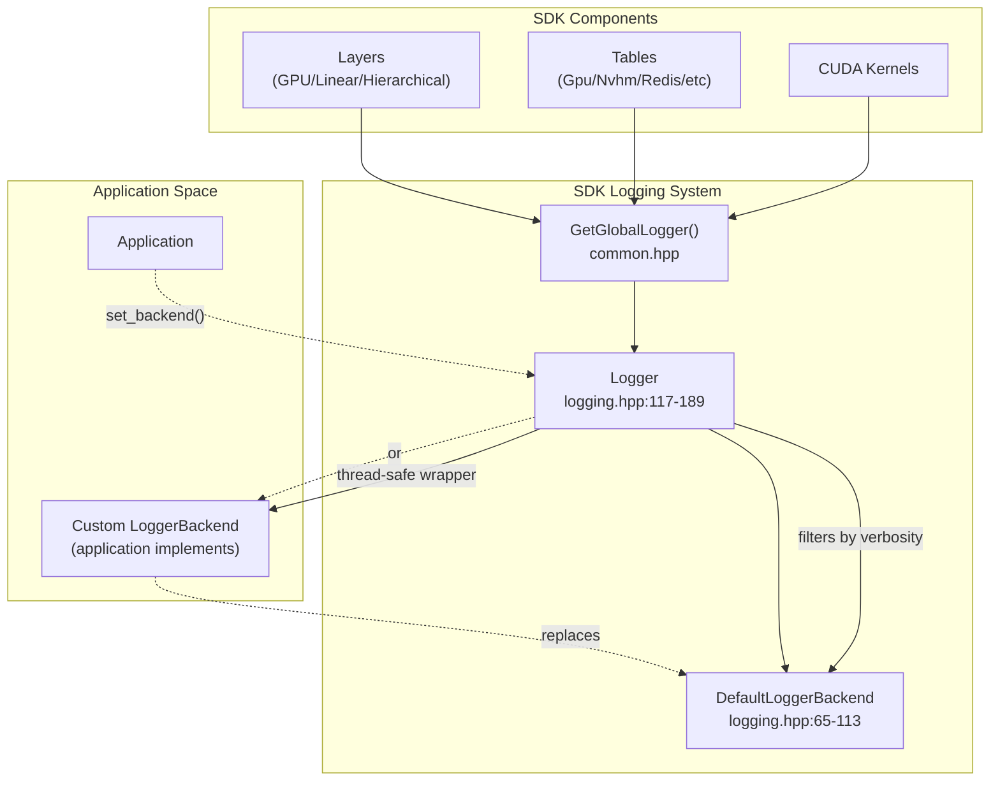
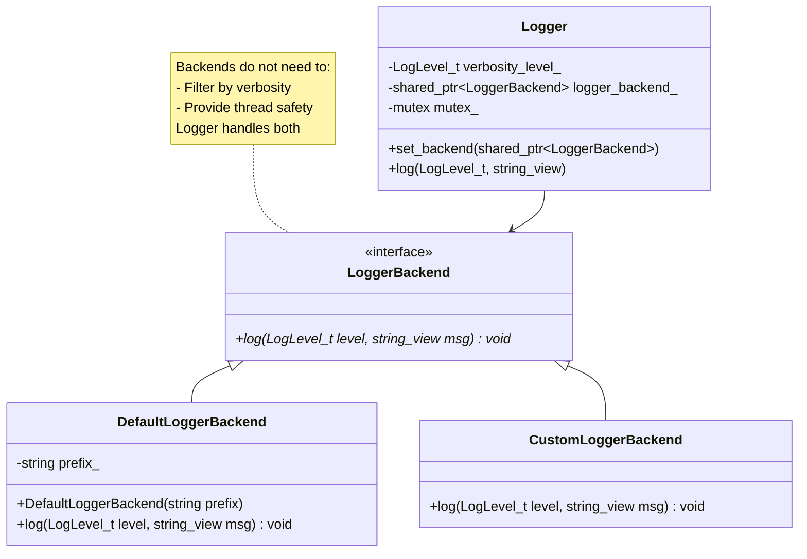
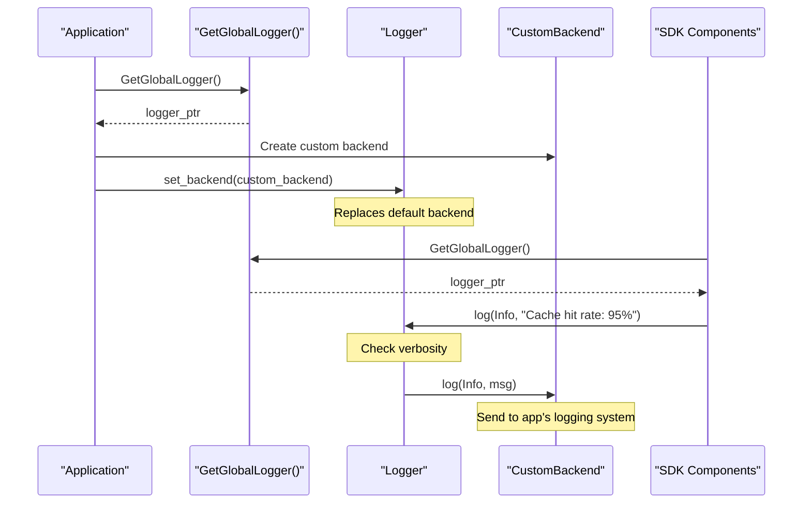
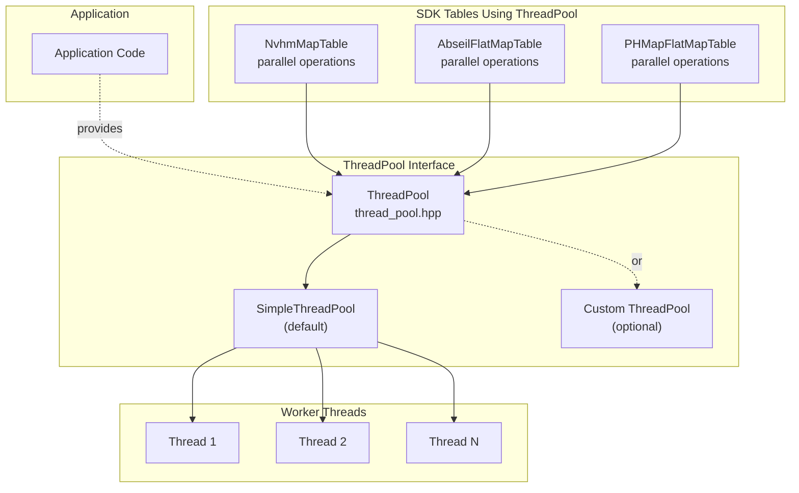
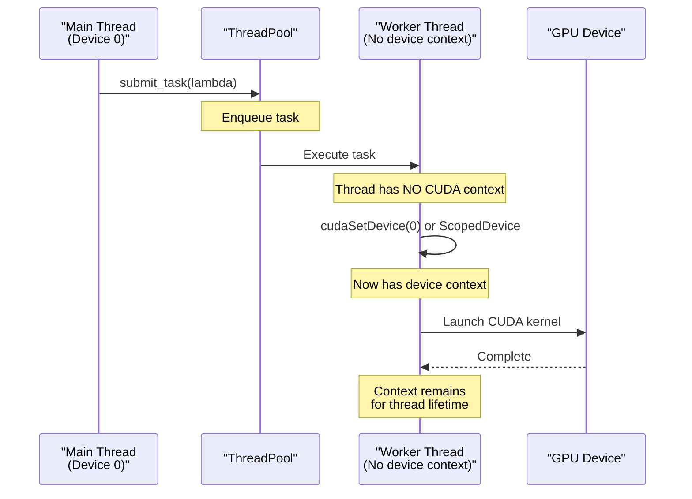
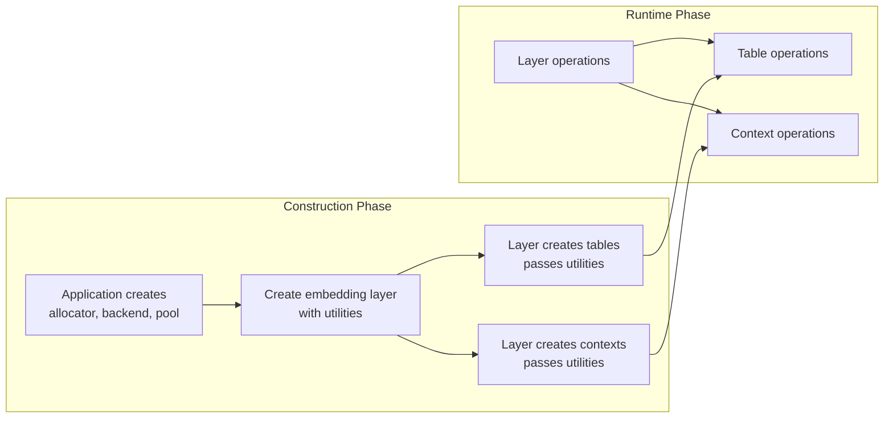
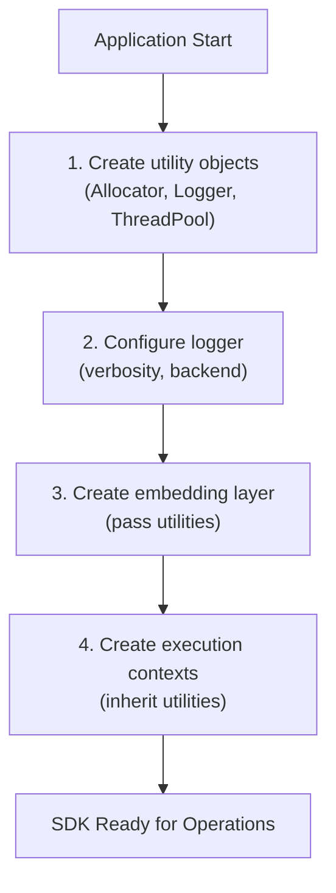

<!-- source: DeepWiki mcp.deepwiki.com · repo NVIDIA/nv-embedding-cache · page 4.4 Utility Classes · fetched 2026-10-26 -->

# Utility Classes

Relevant source files

The following files were used as context for generating this wiki page:

- [docs/cpp_api.md](docs/cpp_api.md)
- [include/logging.hpp](include/logging.hpp)

**Purpose and Scope**: This page documents the utility infrastructure classes that provide cross-cutting functionality across the NV Embedding Cache SDK. These include the `Allocator` for memory management, `Logger` for diagnostics, and `ThreadPool` for parallel CPU execution. Each utility has a default implementation that can be customized without modifying SDK source code.

For information about the higher-level embedding layer and table APIs that use these utilities, see [Embedding Layer API](#4.1) and [Table API](#4.2).

---

## Overview

The SDK architecture separates core caching logic from infrastructure concerns through three key utility classes. These utilities are designed to be injectable, allowing applications to integrate the SDK with existing infrastructure such as custom memory allocators, logging frameworks, or thread pools.

**Utility Class Architecture**

**Injection Points**: Utilities are provided during construction of layers, tables, and execution contexts, allowing different components to use different implementations if needed.

Sources: [docs/cpp_api.md:73-80]()

---

## Allocator

The `Allocator` class provides a unified interface for allocating memory on both system (host) and GPU (device) memory. This abstraction allows the SDK to work with various memory management strategies including pooled allocators, managed memory, or custom allocation schemes.

### Allocator Interface

**Key Responsibilities**:
- Allocate/deallocate system memory buffers
- Allocate/deallocate GPU memory buffers
- Optional support for alignment requirements
- Thread-safe memory management

**Class Structure**

### Usage Patterns

**Providing an Allocator**:

When constructing layers, tables, or execution contexts, an allocator can be passed as a constructor parameter. The SDK documentation describes this pattern:

> "An allocator object can be provided when constructing a layer/table/execution context. It is possible to use different allocators for different objects, but often a single allocator will suffice."

**Default Behavior**: If no allocator is provided, the SDK uses a default implementation that:
- Uses `cudaMalloc`/`cudaFree` for device memory
- Uses system `malloc`/`free` or aligned allocation for host memory

**Common Use Cases**:

| Use Case | Allocator Type | Purpose |
|----------|---------------|---------|
| Production Inference | Pooled Allocator | Reduce allocation overhead |
| Training Workloads | CUDA Managed Memory | Simplify memory management |
| Multi-tenant Systems | Quota-based Allocator | Resource isolation |
| Debugging | Instrumented Allocator | Track memory usage |

### Integration with Layers and Tables

Layers and tables use the allocator for:
- **Temporary buffers**: During `lookup()` operations when keys are in the wrong memory space
- **Internal data structures**: Hash table buckets, metadata arrays
- **Execution contexts**: Workspace memory for parallel operations

**Memory Allocation Flow**:

Sources: [docs/cpp_api.md:75-77](), [include/allocator.hpp]()

---

## Logger

The logging system provides structured diagnostic output throughout the SDK. It consists of a `Logger` class that manages verbosity filtering and thread-safety, and a `LoggerBackend` interface that applications can implement to integrate with existing logging infrastructure.

### Logger Architecture

**Component Structure**:

### Log Levels

The SDK defines six log levels in increasing order of verbosity:

| Level | Enum Value | Purpose | Typical Content |
|-------|-----------|---------|-----------------|
| `Critical` | 0 | Fatal errors requiring immediate attention | System failures, data corruption |
| `Error` | 10 | Non-fatal errors | Operation failures, invalid parameters |
| `Warning` | 20 | Potential issues | Deprecated usage, suboptimal configuration |
| `Perf` | 30 | Performance-related information | Cache hit rates, operation timings |
| `Info` | 40 | General information | Initialization, configuration |
| `Verbose` | 100 | Detailed diagnostic information | Detailed operation traces |

**Level Filtering**: The `Logger` class filters messages based on the configured verbosity level. Only messages at or below the configured level are passed to the backend.

Sources: [include/logging.hpp:33-40]()

### Logger Class

The `Logger` class [include/logging.hpp:117-189]() provides:

**Key Methods**:

| Method | Description |
|--------|-------------|
| `set_verbosity_level(LogLevel_t)` | Configure which messages to log |
| `get_verbosity_level()` | Query current verbosity level |
| `set_backend(std::shared_ptr<LoggerBackend>)` | Replace default backend |
| `get_backend()` | Retrieve current backend |
| `log(LogLevel_t, std::string_view)` | Log a message |

**Thread Safety**: The `Logger` class uses a mutex [include/logging.hpp:185]() to ensure thread-safe access to the backend, protecting against concurrent calls from multiple threads.

**Environment Variable Configuration**: The logger checks the `NVE_LOG_LEVEL` environment variable on initialization [include/logging.hpp:161-182]() to set the verbosity level. Valid values are: `CRITICAL`, `ERROR`, `WARNING`, `INFO`, `VERBOSE`, `PERF`.

### LoggerBackend Interface

Applications implement the `LoggerBackend` interface [include/logging.hpp:53-63]() to customize logging behavior:

**Backend Requirements**:
- Backends do **not** need to filter messages by verbosity (Logger does this)
- Backends do **not** need to be thread-safe (Logger provides synchronization)
- Backends should be lightweight and avoid blocking operations when possible

### DefaultLoggerBackend

The default implementation [include/logging.hpp:65-113]() provides formatted console output:

**Output Format**: `[timestamp][prefix][level] message`

Example: `[2026-01-15 14:23:45.123456][NVE][I] Initializing GPU table with 1M entries`

**Stream Selection**:
- `Critical` and `Error` messages → `std::cerr`
- All other levels → `std::cout`

### Customization Example Flow

Sources: [include/logging.hpp:1-189](), [docs/cpp_api.md:78-79]()

---

## ThreadPool

The `ThreadPool` class provides parallel CPU execution for operations that benefit from multi-threading. The SDK uses thread pools for system memory operations, particularly in the `NvhmMapTable` and other host-based table implementations.

### ThreadPool Interface

**Purpose**: Execute multiple independent tasks concurrently on CPU threads, with support for CUDA operations from worker threads.

**Key Characteristics**:
- Manages a pool of worker threads
- Accepts tasks as `std::function<void()>`
- Provides synchronization primitives for task completion
- Default implementation: `SimpleThreadPool`

### Thread Pool Architecture

### CUDA Context Handling

**Important**: When worker threads perform CUDA operations, they must set the correct CUDA device context. The SDK documentation states:

> "Note that all custom tasks that perform CUDA calls must set the CUDA current device (using cudaSetDevice or using the ScopedDevice class), as the device context is tied to the thread performing the task which can differ from the calling thread."

**Thread-Device Context Flow**:

### Usage in Host Tables

Host memory tables (NVHM, Abseil, PHMap) use thread pools for parallel operations such as:

| Operation | Parallelization Strategy |
|-----------|-------------------------|
| Batch insert | Split keys across threads |
| Batch lookup | Split keys across threads |
| Batch update | Split keys across threads |
| Table initialization | Parallel memory allocation |

**Example Task Pattern**:

When a table needs to process a batch of keys, it:
1. Divides keys into N chunks (N = thread pool size)
2. Submits N tasks to the thread pool
3. Each task processes its chunk independently
4. Waits for all tasks to complete

### Default ThreadPool

The `SimpleThreadPool` default implementation provides:
- Thread count typically based on `std::thread::hardware_concurrency()`
- FIFO task queue
- Basic synchronization primitives (futures, barriers)

### Custom ThreadPool Integration

Applications may provide custom thread pools to:
- Integrate with existing job systems
- Control thread affinity and priorities
- Implement work-stealing or other advanced scheduling
- Share thread resources across multiple SDK instances

**Injection Point**: Thread pools are provided when constructing tables that support parallelism.

Sources: [docs/cpp_api.md:79-80](), [include/thread_pool.hpp]()

---

## Utility Class Integration

### Construction-Time Injection

Utilities are provided during object construction, following the dependency injection pattern:

### Shared vs. Independent Utilities

**Design Considerations**:

| Sharing Strategy | Use Case | Benefit |
|------------------|----------|---------|
| Single shared allocator | Simple applications | Centralized memory tracking |
| Per-layer allocators | Multi-tenant systems | Resource isolation |
| Single shared logger | Standard deployments | Unified logging |
| Custom per-component logger | Complex debugging | Fine-grained control |
| Single shared thread pool | Standard deployments | Efficient thread reuse |
| Multiple thread pools | NUMA systems | Locality optimization |

### Utility Lifecycle

**Ownership Model**:
- Utilities are stored as `std::shared_ptr` in layers, tables, and contexts
- Multiple components may share the same utility instance
- Utilities remain alive as long as any component references them
- No explicit shutdown required (RAII cleanup)

**Initialization Order**:

Sources: [docs/cpp_api.md:73-80]()

---

## Summary

The utility classes provide essential infrastructure that is decoupled from caching logic:

| Utility | Header | Primary Purpose | Customization Level |
|---------|--------|----------------|---------------------|
| `Allocator` | [include/allocator.hpp]() | Memory allocation abstraction | Full interface implementation |
| `Logger` | [include/logging.hpp]() | Diagnostic logging | Backend implementation |
| `ThreadPool` | [include/thread_pool.hpp]() | Parallel CPU execution | Full interface implementation |

**Design Philosophy**: These utilities follow the dependency injection pattern, allowing applications to integrate the SDK with existing infrastructure while providing sensible defaults for quick prototyping.

**Common Workflow**:
1. Use defaults for initial development
2. Add custom logger backend for production diagnostics
3. Implement custom allocator for memory optimization
4. Integrate custom thread pool for advanced scheduling

For examples of utility class usage in context, see the [Basic C++ Example](#9.1) and [Layer Sample](#9.3).

Sources: [docs/cpp_api.md:73-80](), [include/logging.hpp:1-189]()

---

