<!-- source: DeepWiki mcp.deepwiki.com · repo NVIDIA/nv-embedding-cache · page 5 Python API Reference · fetched 2026-10-26 -->

# Python API Reference

<details>
<summary>Relevant source files</summary>

The following files were used as context for generating this wiki page:

- [README.md](README.md)
- [docs/samples.md](docs/samples.md)
- [python/pynve/bindings/binding_layers.hpp](python/pynve/bindings/binding_layers.hpp)

</details>


This document provides comprehensive reference documentation for the Python API of the NV Embedding Cache SDK. The Python bindings, provided through the `pynve` module, expose the C++ core functionality with idiomatic Python interfaces and seamless PyTorch integration.

**Scope**: This page covers the Python-specific API, including the `NVEmbedding` class, configuration objects, data type enumerations, and PyTorch integration patterns. For C++ API details, see [C++ API Reference](#4). For conceptual understanding of the three caching strategies, see [Cache Configuration Strategies](#1.2). For practical examples, see [Python Embedding Layers](#5.1) and [PyTorch Integration](#5.2).

**Sources**: [README.md:1-94](), [docs/samples.md:1-29]()

---

## Python Module Structure

The Python API is organized into several key components that mirror the C++ architecture while providing Pythonic interfaces:

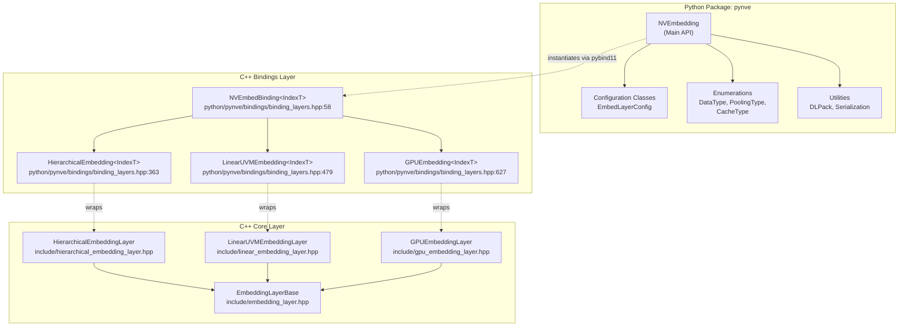

**Sources**: [python/pynve/bindings/binding_layers.hpp:1-660]()

---

## Core Python Classes

### NVEmbedding Class

The `NVEmbedding` class is the primary Python interface for embedding lookups. It provides a unified API that automatically instantiates the appropriate underlying C++ layer based on the `cache_type` parameter.

#### Class Hierarchy and Code Mapping

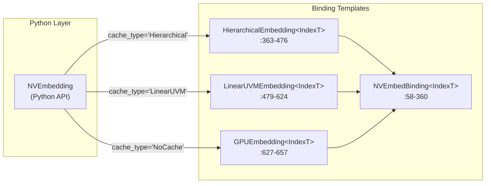

**Sources**: [python/pynve/bindings/binding_layers.hpp:58-657](), [README.md:11-15]()

#### Constructor Parameters

The `NVEmbedding` constructor accepts the following parameters:

| Parameter | Type | Description |
|-----------|------|-------------|
| `device_id` | `int` | CUDA device ID for GPU operations |
| `row_size` | `int` | Embedding dimension (number of elements per embedding) |
| `dtype` | `DataType` | Data type of embeddings (Float32 or Float16) |
| `cache_type` | `str` | Cache strategy: `"NoCache"`, `"LinearUVM"`, or `"Hierarchical"` |
| `num_embeddings` | `int` | Total number of embeddings (required for NoCache and LinearUVM) |
| `gpu_cache_size` | `int` | Size of GPU cache in bytes (for LinearUVM and Hierarchical) |
| `host_cache_size` | `int` | Size of host memory cache in bytes (for Hierarchical only) |
| `remote_table` | `Table` | Remote parameter server table (for Hierarchical only) |
| `embedding_table` | `int` | Pointer to GPU memory (for NoCache only) |
| `mem_block` | `MemBlock` | UVM memory block (for LinearUVM only) |
| `config` | `EmbedLayerConfig` | Advanced configuration options |

**Sources**: [python/pynve/bindings/binding_layers.hpp:266-283](), [python/pynve/bindings/binding_layers.hpp:369-427](), [python/pynve/bindings/binding_layers.hpp:484-537](), [python/pynve/bindings/binding_layers.hpp:632-650]()

### EmbedLayerConfig

Configuration object for advanced layer settings:

| Field | Type | Default | Description |
|-------|------|---------|-------------|
| `logging_interval` | `int` | `-1` | Number of lookups between hit rate logs (-1 disables) |
| `kernel_mode` | `int` | `0` | Kernel execution mode (see Kernel Modes below) |
| `kernel_mode_value_1` | `int` | `0` | First kernel mode parameter |
| `kernel_mode_value_2` | `int` | `0` | Second kernel mode parameter |

**Kernel Modes**:
- `0`: Default kernel
- `KernelType.SortGather`: Sort-based gather (uses `kernel_mode_value_1` as task size, default 1024)
- `KernelType.PipelineGather`: Pipelined gather (uses `kernel_mode_value_1` as task size and `kernel_mode_value_2` as number of auxiliary streams)

**Sources**: [python/pynve/bindings/binding_layers.hpp:50-55](), [python/pynve/bindings/binding_layers.hpp:516-526]()

---

## Core Operations

All embedding layer types expose a consistent set of operations through the `NVEmbedBinding` base class:

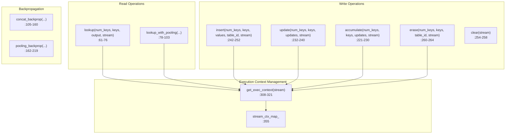

**Sources**: [python/pynve/bindings/binding_layers.hpp:61-321]()

### lookup

Retrieves embeddings for the given keys.

**Python Signature**:
```python
def lookup(self, num_keys: int, keys: int, output: int, stream: int) -> None
```

**Parameters**:
- `num_keys`: Number of embedding IDs to look up
- `keys`: Memory address (uintptr_t) of embedding IDs array (`IndexT*`)
- `output`: Memory address (uintptr_t) of output buffer for embeddings
- `stream`: CUDA stream handle (cudaStream_t cast to int)

**Behavior**: Performs embedding lookup and writes results to the output buffer. Returns hit rates through the configured logging mechanism.

**Sources**: [python/pynve/bindings/binding_layers.hpp:61-76]()

### lookup_with_pooling

Retrieves embeddings with sparse feature pooling.

**Python Signature**:
```python
def lookup_with_pooling(self, num_keys: int, keys: int, output: int,
                        pooling_type: int, num_offsets: int, offsets: int,
                        weight_data_type: int, weights: int, stream: int) -> None
```

**Parameters**:
- `num_keys`: Total number of embedding IDs
- `keys`: Memory address of embedding IDs array
- `output`: Memory address of pooled output buffer
- `pooling_type`: Pooling operation type (see PoolingType enumeration)
- `num_offsets`: Number of offset entries (batch size + 1 for CSR format)
- `offsets`: Memory address of CSR offset array (`int64_t*`)
- `weight_data_type`: Data type of weights (DataType enumeration)
- `weights`: Memory address of weight values (nullable)
- `stream`: CUDA stream handle

**Pooling Types**:
- `PoolingType.Sum`: Sum pooling
- `PoolingType.Mean`: Average pooling
- `PoolingType.Concatenate`: Concatenation (no pooling)

**Sources**: [python/pynve/bindings/binding_layers.hpp:78-103]()

### insert

Inserts new embedding vectors into the cache hierarchy.

**Python Signature**:
```python
def insert(self, num_keys: int, keys: int, values: int, table_id: int, stream: int) -> None
```

**Parameters**:
- `num_keys`: Number of embeddings to insert
- `keys`: Memory address of embedding IDs
- `values`: Memory address of embedding values (row-major format)
- `table_id`: Target table ID in the hierarchy (-1 for all levels)
- `stream`: CUDA stream handle

**Behavior**: Inserts embeddings into the specified table level. The insert heuristic determines whether to propagate to higher cache levels.

**Sources**: [python/pynve/bindings/binding_layers.hpp:242-252]()

### update

Overwrites existing embedding values.

**Python Signature**:
```python
def update(self, num_keys: int, keys: int, updates: int, stream: int) -> None
```

**Parameters**:
- `num_keys`: Number of embeddings to update
- `keys`: Memory address of embedding IDs
- `updates`: Memory address of new embedding values
- `stream`: CUDA stream handle

**Behavior**: Replaces existing embedding values with new values. Does not insert if the key doesn't exist.

**Sources**: [python/pynve/bindings/binding_layers.hpp:232-240]()

### accumulate

Applies additive updates to embeddings (gradient accumulation).

**Python Signature**:
```python
def accumulate(self, num_keys: int, keys: int, updates: int, stream: int) -> None
```

**Parameters**:
- `num_keys`: Number of gradient updates
- `keys`: Memory address of embedding IDs
- `updates`: Memory address of gradient values
- `stream`: CUDA stream handle

**Behavior**: Adds the update values to existing embeddings using atomic operations. Commonly used for gradient descent training.

**Sources**: [python/pynve/bindings/binding_layers.hpp:221-230]()

### erase

Removes embeddings from the cache.

**Python Signature**:
```python
def erase(self, num_keys: int, keys: int, table_id: int, stream: int) -> None
```

**Parameters**:
- `num_keys`: Number of embeddings to remove
- `keys`: Memory address of embedding IDs to erase
- `table_id`: Target table ID (-1 for all levels)
- `stream`: CUDA stream handle

**Behavior**: Removes the specified embeddings from cache. Available in version 26.03+.

**Sources**: [python/pynve/bindings/binding_layers.hpp:260-264]()

### clear

Clears all embeddings from the cache.

**Python Signature**:
```python
def clear(self, stream: int) -> None
```

**Parameters**:
- `stream`: CUDA stream handle

**Behavior**: Removes all cached embeddings across all cache levels.

**Sources**: [python/pynve/bindings/binding_layers.hpp:254-258]()

---

## Backpropagation Operations

The SDK provides specialized operations for computing gradients during training:

### concat_backprop

Computes gradients for concatenated embeddings.

**Python Signature**:
```python
def concat_backprop(self, num_keys: int, keys: int, grads: int,
                    unique_keys: int, output_grads: int, stream: int) -> int
```

**Parameters**:
- `num_keys`: Number of embedding IDs in the forward pass
- `keys`: Memory address of embedding IDs
- `grads`: Memory address of upstream gradients
- `unique_keys`: Memory address for output unique key buffer
- `output_grads`: Memory address for output gradient buffer (deduped)
- `stream`: CUDA stream handle

**Returns**: Number of unique keys after deduplication

**Behavior**: Deduplicates embedding IDs and aggregates their gradients. This is essential for efficiently handling repeated IDs in sparse features.

**Sources**: [python/pynve/bindings/binding_layers.hpp:105-160]()

### pooling_backprop

Computes gradients for pooled embeddings.

**Python Signature**:
```python
def pooling_backprop(self, num_keys: int, keys: int, grads: int,
                     unique_keys: int, output_grads: int,
                     pooling_type: int, num_offsets: int, offsets: int,
                     data_type: int, weights: int, stream: int) -> int
```

**Parameters**:
- `num_keys`: Total number of embedding IDs
- `keys`: Memory address of embedding IDs
- `grads`: Memory address of upstream gradients (pooled)
- `unique_keys`: Memory address for output unique keys
- `output_grads`: Memory address for output gradients (expanded)
- `pooling_type`: Pooling operation used in forward pass
- `num_offsets`: Number of offset entries (batch size + 1)
- `offsets`: Memory address of CSR offset array
- `data_type`: Data type of weights
- `weights`: Memory address of weight values (nullable)
- `stream`: CUDA stream handle

**Returns**: Number of unique keys after deduplication

**Behavior**: Distributes pooled gradients back to individual embeddings according to the pooling operation and CSR structure.

**Sources**: [python/pynve/bindings/binding_layers.hpp:162-219]()

**Implementation Detail**: Both backpropagation operations use the `GradientCalculator` template class internally with a maximum run size of 1024 embeddings per batch.

**Sources**: [python/pynve/bindings/binding_layers.hpp:110-122](), [python/pynve/bindings/binding_layers.hpp:344]()

---

## Layer-Specific Python Interfaces

### LinearUVMEmbedding Extensions

The `LinearUVMEmbedding` class provides additional methods for accessing the underlying UVM memory:

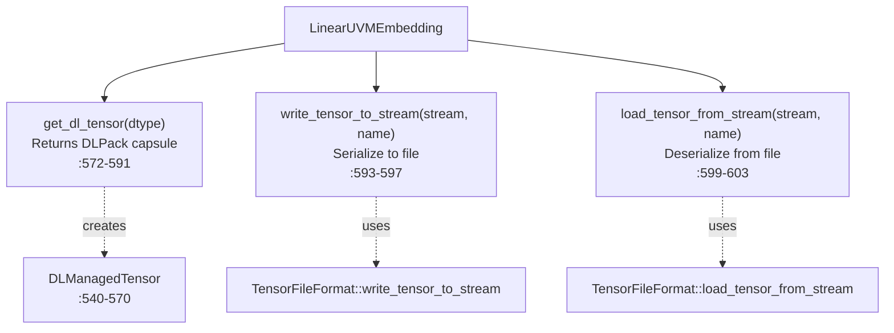

**Sources**: [python/pynve/bindings/binding_layers.hpp:479-624]()

#### get_dl_tensor

Returns a DLPack tensor capsule for PyTorch interoperability.

**Python Signature**:
```python
def get_dl_tensor(self, dtype: DataType) -> capsule
```

**Parameters**:
- `dtype`: Data type of the tensor (Float32 or Float16)

**Returns**: Python capsule containing a `DLManagedTensor` pointer

**Usage**: Allows zero-copy access to UVM embeddings from PyTorch:
```python
# Example usage (conceptual)
embedding_layer = LinearUVMEmbedding(...)
capsule = embedding_layer.get_dl_tensor(DataType.Float32)
torch_tensor = torch.from_dlpack(capsule)
```

**Sources**: [python/pynve/bindings/binding_layers.hpp:572-591](), [python/pynve/bindings/binding_layers.hpp:540-570]()

#### Serialization Methods

**write_tensor_to_stream**: Saves embeddings to a file stream
**load_tensor_from_stream**: Loads embeddings from a file stream

**Python Signature**:
```python
def write_tensor_to_stream(self, stream: object, name: int) -> None
def load_tensor_from_stream(self, stream: object, name: int) -> None
```

**Parameters**:
- `stream`: Python file object
- `name`: Tensor identifier (integer key)

**Sources**: [python/pynve/bindings/binding_layers.hpp:593-603]()

### HierarchicalEmbedding Extensions

The `HierarchicalEmbedding` class provides parameter server integration:

#### set_ps_table

Dynamically sets or updates the remote parameter server table.

**Python Signature**:
```python
def set_ps_table(self, table: Table) -> None
```

**Parameters**:
- `table`: Parameter server table implementation (e.g., RedisClusterTable)

**Behavior**: Allows late binding of the parameter server, enabling dynamic configuration after layer initialization.

**Sources**: [python/pynve/bindings/binding_layers.hpp:429-432](), [python/pynve/bindings/binding_layers.hpp:420-422]()

---

## Data Types and Enumerations

### DataType Enumeration

Specifies the precision of embedding values:

| Value | Description | Bytes per Element |
|-------|-------------|-------------------|
| `DataType.Float32` | 32-bit floating point | 4 |
| `DataType.Float16` | 16-bit floating point (half precision) | 2 |
| `DataType.Unknown` | Uninitialized/invalid | N/A |

**Sources**: [python/pynve/bindings/binding_layers.hpp:266](), [python/pynve/bindings/binding_layers.hpp:116]()

### PoolingType Enumeration

Specifies the sparse feature aggregation method:

| Value | Description |
|-------|-------------|
| `PoolingType.Sum` | Sum all embeddings in the group |
| `PoolingType.Mean` | Average all embeddings in the group |
| `PoolingType.Concatenate` | Concatenate embeddings (no aggregation) |

**Sources**: [python/pynve/bindings/binding_layers.hpp:86](), [python/pynve/bindings/binding_layers.hpp:155-156]()

### CacheType String Values

Configuration strings for selecting the caching strategy:

| Value | Maps To | Description |
|-------|---------|-------------|
| `"NoCache"` | `GPUEmbedding` | All embeddings in GPU memory |
| `"LinearUVM"` | `LinearUVMEmbedding` | GPU cache + UVM storage |
| `"Hierarchical"` | `HierarchicalEmbedding` | Multi-tier cache hierarchy |

**Sources**: [README.md:12-15]()

---

## Memory Management

### Execution Context System

The Python bindings automatically manage execution contexts per CUDA stream:

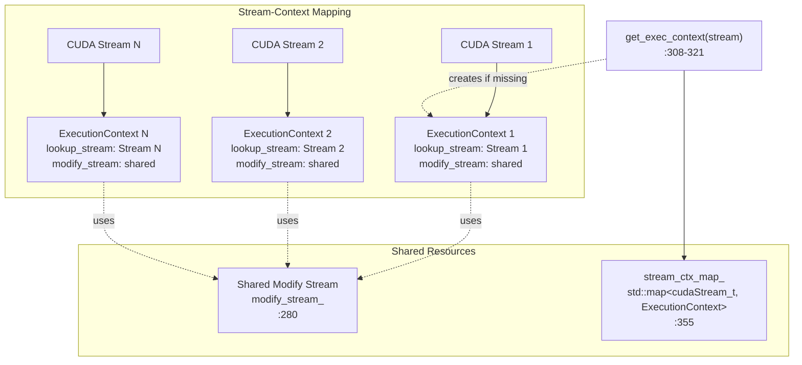

**Key Points**:
- Each CUDA stream gets its own `ExecutionContext`
- All contexts share a single modify stream for write operations
- Context creation is lazy and automatic
- Contexts are destroyed when the layer is destroyed

**Sources**: [python/pynve/bindings/binding_layers.hpp:308-321](), [python/pynve/bindings/binding_layers.hpp:280](), [python/pynve/bindings/binding_layers.hpp:355-356]()

### Resource Lifecycle

The binding classes manage GPU resources with RAII semantics:

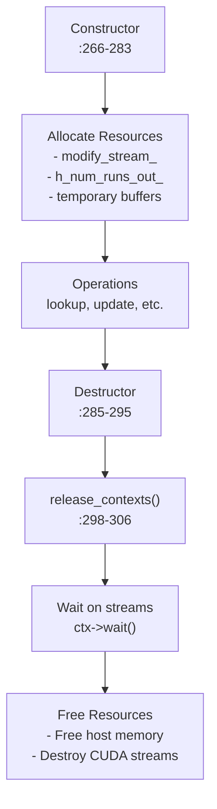

**Memory Allocations**:
- `h_num_runs_out_`: Host memory for tracking unique runs (2 x sizeof(IndexT))
- `d_tmp_device_buf_`: Resizable device memory for gradient computation
- `d_tmp_host_buf_`: Resizable host memory for gradient computation
- `modify_stream_`: Dedicated CUDA stream for modify operations

**Sources**: [python/pynve/bindings/binding_layers.hpp:266-295](), [python/pynve/bindings/binding_layers.hpp:298-306]()

---

## PyTorch Integration Patterns

### Tensor Interoperability

The Python API integrates with PyTorch through multiple mechanisms:

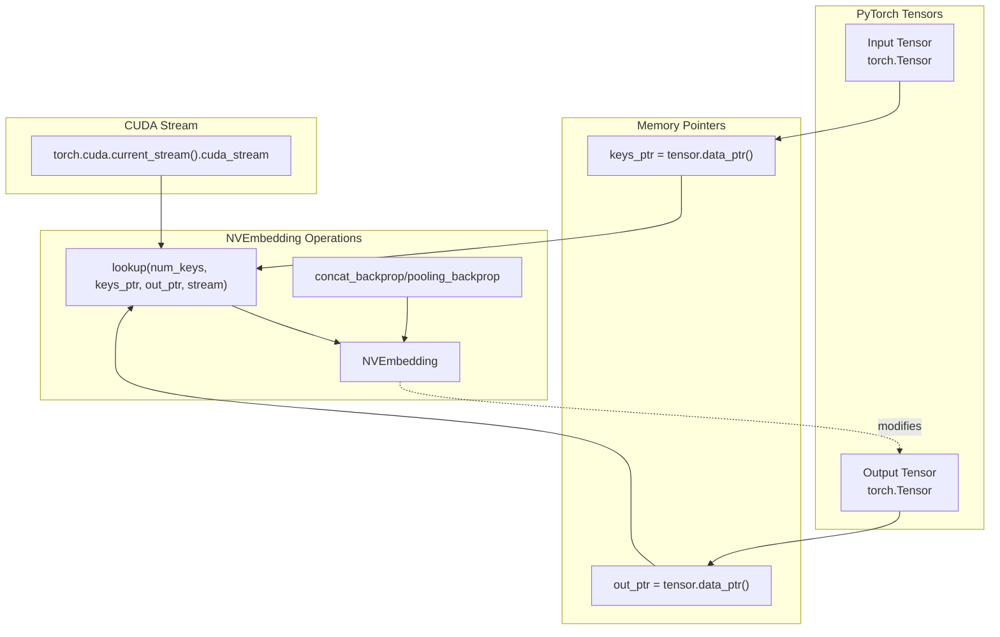

**Usage Pattern**:
```python
# Conceptual example
import torch
import nve

embedding_layer = nve.NVEmbedding(...)
keys = torch.tensor([1, 2, 3], dtype=torch.int64, device='cuda')
output = torch.empty((3, embedding_dim), dtype=torch.float32, device='cuda')
stream = torch.cuda.current_stream().cuda_stream

embedding_layer.lookup(
    num_keys=len(keys),
    keys=keys.data_ptr(),
    output=output.data_ptr(),
    stream=stream
)
```

**Sources**: [python/pynve/bindings/binding_layers.hpp:61-76]()

### DLPack Zero-Copy Access

For `LinearUVMEmbedding`, the entire embedding table can be accessed as a PyTorch tensor without copying:

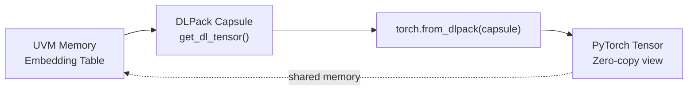

**Tensor Structure**:
- Shape: `[num_embeddings, embedding_dim]`
- Device: CUDA device specified during layer creation
- Memory: Backed by UVM (accessible from both CPU and GPU)
- Lifetime: Managed by the DLManagedTensor deleter

**Sources**: [python/pynve/bindings/binding_layers.hpp:540-591]()

---

## Advanced Features

### Hit Rate Logging

The SDK provides automatic hit rate logging for monitoring cache performance:

```python
config = EmbedLayerConfig()
config.logging_interval = 100  # Log every 100 lookups

embedding_layer = NVEmbedding(..., config=config)
```

**Logged Metrics**:
- Hit rate at each cache level (GPU, Host, Remote)
- Printed via `NVE_LOG_PERF_` macro

**Sources**: [python/pynve/bindings/binding_layers.hpp:324-341](), [python/pynve/bindings/binding_layers.hpp:51]()

### Custom Kernel Modes

For `LinearUVMEmbedding`, specialized kernel execution modes can improve performance:

```python
from nve import KernelType

config = EmbedLayerConfig()
config.kernel_mode = KernelType.PipelineGather
config.kernel_mode_value_1 = 2048  # Task size
config.kernel_mode_value_2 = 32    # Number of auxiliary streams

embedding_layer = LinearUVMEmbedding(..., config=config)
```

**Available Kernel Modes**:
1. **Default Kernel** (mode=0): Standard gather operation
2. **SortGather**: Sort keys before gathering to improve memory access patterns
3. **PipelineGather**: Pipeline gather operations across multiple streams

**Sources**: [python/pynve/bindings/binding_layers.hpp:516-526]()

### Private Streams

Both `LinearUVMEmbedding` and `HierarchicalEmbedding` support private CUDA streams for overlapping operations:

```python
embedding_layer = LinearUVMEmbedding(..., use_private_stream=True)
```

**Benefits**:
- GPU cache operations can proceed independently of user streams
- Better concurrency for multi-threaded inference
- Automatic synchronization when needed

**Sources**: [python/pynve/bindings/binding_layers.hpp:390-394](), [python/pynve/bindings/binding_layers.hpp:507-511]()

### Dynamic Buffer Management

The binding layer automatically resizes temporary buffers for gradient computation:

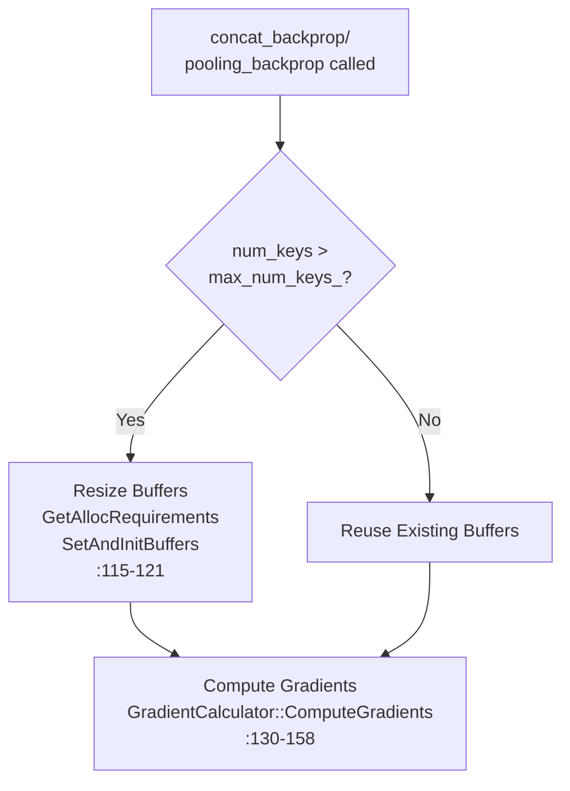

**Memory Pools**:
- `d_tmp_device_buf_`: Device memory (managed by `ResizeableBuffer`)
- `d_tmp_host_buf_`: Pinned host memory (managed by `ResizeableBuffer`)

**Sources**: [python/pynve/bindings/binding_layers.hpp:113-122](), [python/pynve/bindings/binding_layers.hpp:351-352]()

---

## Type Safety and Index Types

All Python binding classes are templated on the index type `IndexT`, which is typically `int64_t` for PyTorch compatibility:

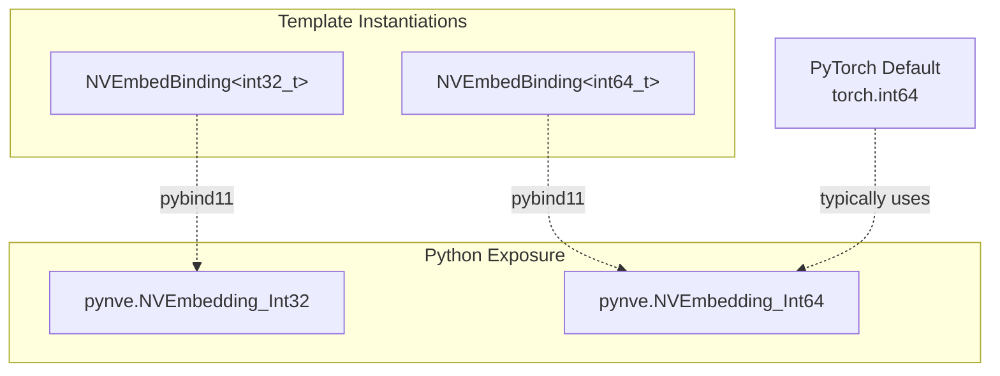

**Key Considerations**:
- PyTorch uses `int64_t` for indices by default
- Ensure consistency between PyTorch tensors and NVEmbedding index type
- 32-bit indices reduce memory overhead but limit to 2^31 embeddings

**Sources**: [python/pynve/bindings/binding_layers.hpp:57](), [python/pynve/bindings/binding_layers.hpp:363](), [python/pynve/bindings/binding_layers.hpp:479](), [python/pynve/bindings/binding_layers.hpp:627]()

---

## Error Handling

The Python bindings propagate C++ exceptions to Python through pybind11:

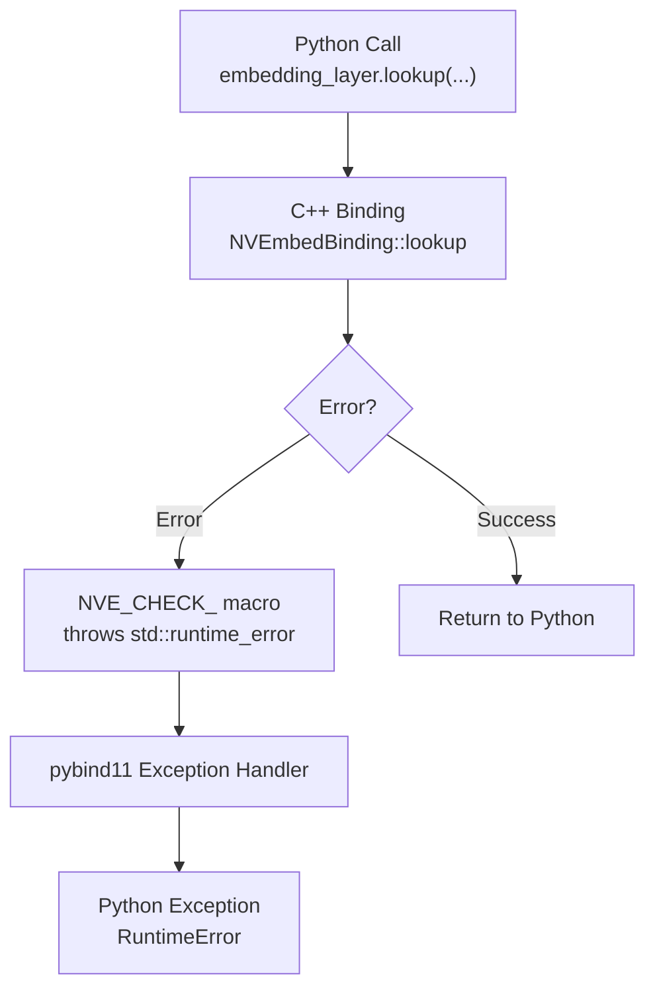

**Common Exceptions**:
- `RuntimeError`: CUDA errors, invalid parameters, memory allocation failures
- `ValueError`: Invalid configuration (caught at Python layer if applicable)

**Best Practices**:
- Always check CUDA stream synchronization status after operations
- Validate tensor shapes and data types before passing pointers
- Use proper RAII patterns for resource management

**Sources**: [python/pynve/bindings/binding_layers.hpp:280](), [python/pynve/bindings/binding_layers.hpp:393]()

---

This Python API reference provides the foundation for building embedding-based recommender systems with the NV Embedding Cache SDK. For practical examples, see the samples in [samples/pytorch/](). For advanced usage patterns including multi-GPU deployment and Triton integration, see [Advanced Topics](#8).

---

