<!-- source: DeepWiki mcp.deepwiki.com · repo NVIDIA/nv-embedding-cache · page 5.1 Python Embedding Layers · fetched 2026-10-26 -->

# Python Embedding Layers

<details>
<summary>Relevant source files</summary>

The following files were used as context for generating this wiki page:

- [README.md](README.md)
- [docs/samples.md](docs/samples.md)
- [python/pynve/bindings/binding_layers.hpp](python/pynve/bindings/binding_layers.hpp)

</details>


## Purpose and Scope

This document describes the Python API for embedding layers in the NV Embedding Cache SDK. The Python bindings provide a high-level interface to the C++ embedding layer implementations through `pybind11`. These bindings expose three cache configurations (NoCache/GPU-only, LinearUVM, and Hierarchical) with support for standard operations like lookup, update, accumulate, and erase.

For details on the underlying C++ embedding layer architecture, see [Embedding Layers](#3.1). For PyTorch-specific integration patterns and `torch.nn.Module` wrappers, see [PyTorch Integration](#5.2). For Python utilities like DLPack tensors and serialization, see [Python Utilities](#5.3).

**Sources:** [README.md:12-15](), [python/pynve/bindings/binding_layers.hpp:1-659]()

## Python to C++ Binding Architecture

The Python embedding layers are thin wrappers around C++ implementations, using `pybind11` to expose functionality. Each Python class corresponds to a C++ layer type and handles CUDA stream management, execution contexts, and memory allocation.

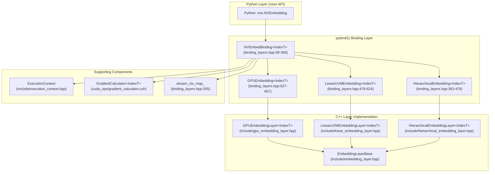

**Sources:** [python/pynve/bindings/binding_layers.hpp:20-48](), [python/pynve/bindings/binding_layers.hpp:58-360]()

## Configuration Classes

### EmbedLayerConfig

The `EmbedLayerConfig` struct controls layer-wide behavior including logging and kernel selection.

| Field | Type | Default | Description |
|-------|------|---------|-------------|
| `logging_interval` | `int64_t` | `-1` | Number of lookups between hit rate log messages. `-1` disables logging |
| `kernel_mode` | `int64_t` | `0` | Kernel type selection (see `KernelType` enum) |
| `kernel_mode_value_1` | `int64_t` | `0` | First kernel-specific parameter |
| `kernel_mode_value_2` | `int64_t` | `0` | Second kernel-specific parameter |

Kernel modes (for LinearUVM only):
- `0`: Default gather kernel
- `KernelType::SortGather`: Sort-based gather. `kernel_mode_value_1` sets sort threshold (default: 1024)
- `KernelType::PipelineGather`: Pipelined gather. `kernel_mode_value_1` sets task size (default: 1024), `kernel_mode_value_2` sets number of auxiliary streams (default: 16)

**Sources:** [python/pynve/bindings/binding_layers.hpp:50-55](), [python/pynve/bindings/binding_layers.hpp:516-526]()

## Base Class: NVEmbedBinding

All Python embedding layers inherit from `NVEmbedBinding<IndexT>`, which provides common functionality:

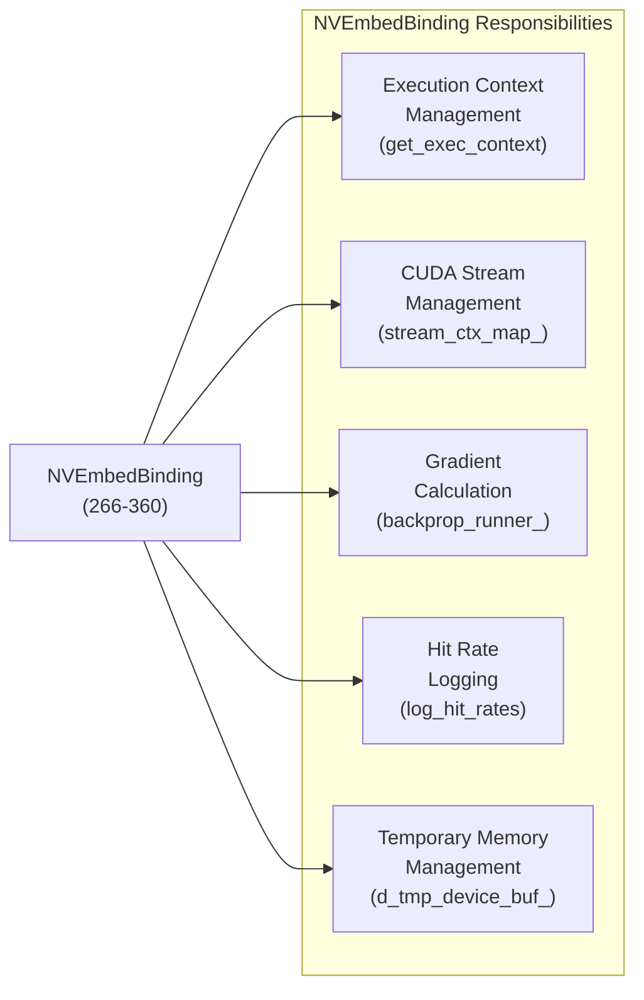

### Key Members

| Member | Type | Purpose |
|--------|------|---------|
| `emb_layer_ptr_` | `std::shared_ptr<EmbeddingLayerBase>` | Pointer to underlying C++ layer |
| `stream_ctx_map_` | `std::map<cudaStream_t, std::shared_ptr<ExecutionContext>>` | Maps CUDA streams to execution contexts |
| `backprop_runner_` | `std::shared_ptr<GradientCalculator>` | Handles gradient deduplication and calculation |
| `modify_stream_` | `cudaStream_t` | Dedicated stream for modify operations |
| `row_size_in_bytes_` | `uint64_t` | Embedding vector size in bytes |
| `device_id_` | `int` | Target GPU device |

**Sources:** [python/pynve/bindings/binding_layers.hpp:266-295](), [python/pynve/bindings/binding_layers.hpp:343-360]()

## GPUEmbedding (NoCache Configuration)

The `GPUEmbedding<IndexT>` class wraps `GPUEmbeddingLayer` for datasets that fit entirely in GPU memory. This configuration provides the fastest lookup with no caching overhead.

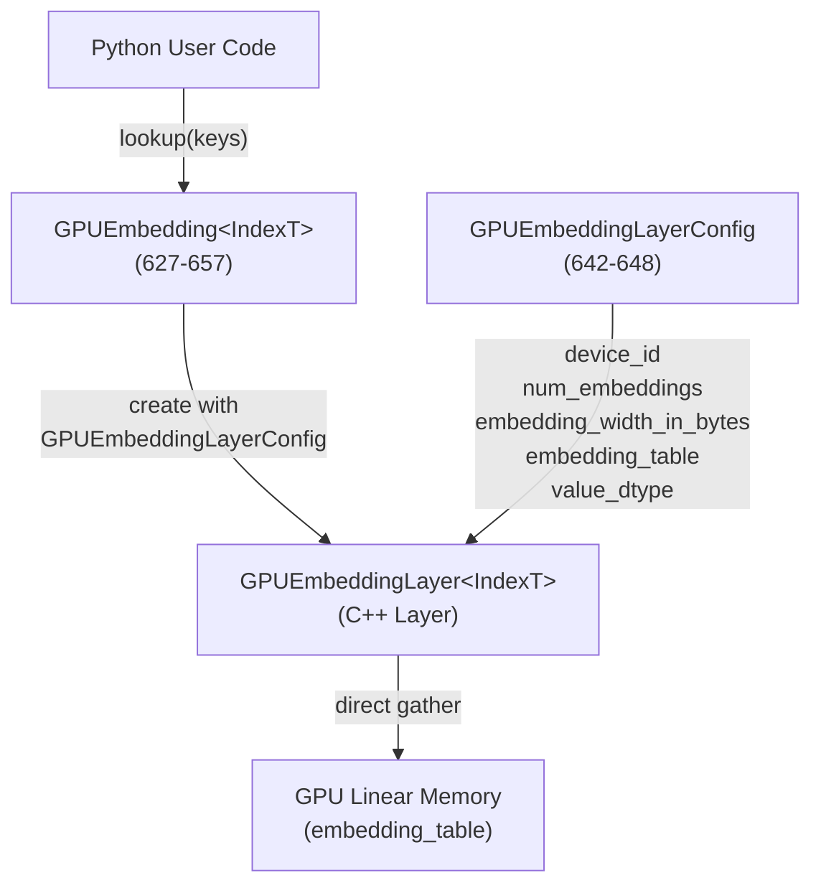

### Constructor Parameters

| Parameter | Type | Description |
|-----------|------|-------------|
| `row_size` | `size_t` | Embedding vector dimension (number of elements) |
| `num_embeddings` | `size_t` | Total number of embeddings in table |
| `dtype` | `DataType_t` | Data type (`Float32` or `Float16`) |
| `embedding_table` | `uintptr_t` | Pointer to pre-allocated GPU memory |
| `device_id` | `int` | GPU device ID |
| `config` | `EmbedLayerConfig` | Layer configuration |

The user is responsible for allocating `embedding_table` memory before construction. The memory layout must be contiguous with embedding `i` at offset `i * row_size * element_size`.

**Sources:** [python/pynve/bindings/binding_layers.hpp:632-650](), [README.md:12]()

## LinearUVMEmbedding

The `LinearUVMEmbedding<IndexT>` class implements GPU caching with Unified Virtual Memory (UVM) backing. Hot embeddings are cached in GPU memory, while all embeddings reside in a linear memory block accessible via UVM.

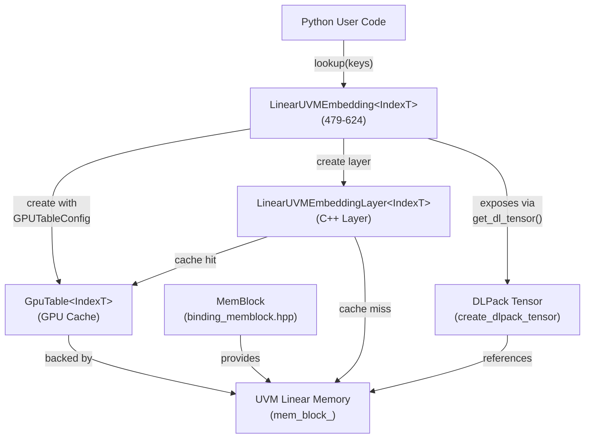

### Constructor Parameters

| Parameter | Type | Description |
|-----------|------|-------------|
| `row_size` | `size_t` | Embedding vector dimension (number of elements) |
| `num_embeddings` | `size_t` | Total number of embeddings |
| `dtype` | `DataType_t` | Data type (`Float32` or `Float16`) |
| `mem_block` | `std::shared_ptr<MemBlock>` | UVM memory block for all embeddings |
| `gpu_cache_size` | `size_t` | GPU cache capacity in bytes |
| `use_private_stream` | `bool` | Whether to create a dedicated CUDA stream |
| `device_id` | `int` | GPU device ID |
| `config` | `EmbedLayerConfig` | Layer configuration including kernel mode |

### Key Features

**Kernel Mode Selection**: LinearUVM supports multiple gather kernel implementations via `config.kernel_mode`:
- Default mode (0): Standard gather
- `SortGather`: Sorts keys before gathering for better memory coalescing
- `PipelineGather`: Overlaps data transfer with computation using multiple streams

**DLPack Tensor Access**: The `get_dl_tensor()` method exposes the UVM memory as a DLPack tensor, enabling zero-copy interoperability with PyTorch and other frameworks.

**Checkpointing**: Methods `write_tensor_to_stream()` and `load_tensor_from_stream()` support saving/loading the embedding table.

**Sources:** [python/pynve/bindings/binding_layers.hpp:484-537](), [python/pynve/bindings/binding_layers.hpp:540-604](), [README.md:13]()

## HierarchicalEmbedding

The `HierarchicalEmbedding<IndexT>` class implements multi-tier caching with GPU cache (L1), host memory cache (L2), and remote parameter server (L3). This configuration is designed for datasets far exceeding GPU memory, particularly in distributed deployments.

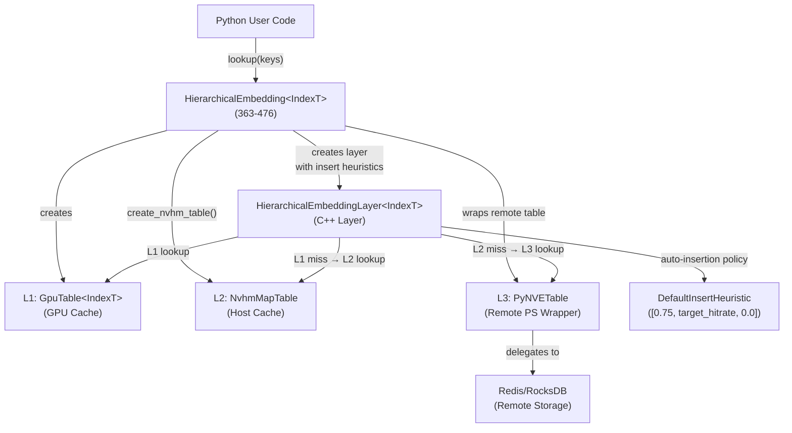

### Constructor Parameters

| Parameter | Type | Description |
|-----------|------|-------------|
| `row_size` | `size_t` | Embedding vector dimension (number of elements) |
| `dtype` | `DataType_t` | Data type (`Float32` or `Float16`) |
| `gpu_cache_size` | `uint64_t` | L1 GPU cache capacity in bytes |
| `host_cache_size` | `uint64_t` | L2 host cache capacity in bytes |
| `remote` | `table_ptr_t` | L3 remote parameter server table (optional) |
| `use_private_stream` | `bool` | Whether to create a dedicated CUDA stream |
| `device_id` | `int` | GPU device ID |
| `config` | `EmbedLayerConfig` | Layer configuration |

### Cache Tier Configuration

The hierarchical setup supports several configurations:

| Configuration | L1 (GPU) | L2 (Host) | L3 (Remote) | Use Case |
|---------------|----------|-----------|-------------|----------|
| GPU + Host | ✓ | ✓ | ✗ | Large single-node deployments |
| GPU + Remote | ✓ | ✗ | ✓ | Distributed with small working set |
| GPU + Host + Remote | ✓ | ✓ | ✓ | Full three-tier hierarchy |

### Insert Heuristics

The layer automatically computes insert heuristic thresholds for each tier:
- **L1 (GPU)**: Fixed at 0.75 target hit rate
- **L2 (Host)**: Proportional to `host_cache_size / total_embeddings` (if L3 exists), or 0.0 (if no L3)
- **L3 (Remote)**: Fixed at 0.0 (typically updated externally)

### NVHM Host Cache Creation

The `create_nvhm_table()` method initializes a `NvhmMapTable` for L2 with the following configuration:
- Single partition for inference (increase for high insert contention)
- Random eviction policy (assumes GPU cache handles hot keys)
- Overflow margin set to `keys_per_partition`

**Sources:** [python/pynve/bindings/binding_layers.hpp:369-427](), [python/pynve/bindings/binding_layers.hpp:434-460](), [README.md:14-15]()

## Common Operations

All embedding layer classes support the following operations through the `NVEmbedBinding` base class:

### Lookup Operations

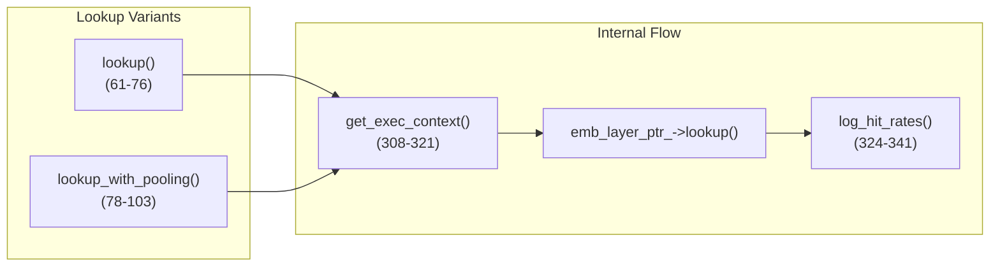

**`lookup(num_keys, keys, output, stream)`**
- Basic embedding lookup without pooling
- Returns embeddings concatenated in `output`
- Hit rates logged if `logging_interval > 0`

**`lookup_with_pooling(num_keys, keys, output, pooling_type, num_offsets, offsets, weight_data_type, weights, stream)`**
- Lookup with sparse pooling (Sum, Mean, or Concatenate)
- Uses CSR format: `offsets[i]` to `offsets[i+1]` specifies key range for output row `i`
- Supports weighted pooling via `weights` parameter

**Sources:** [python/pynve/bindings/binding_layers.hpp:61-103]()

### Backpropagation Operations

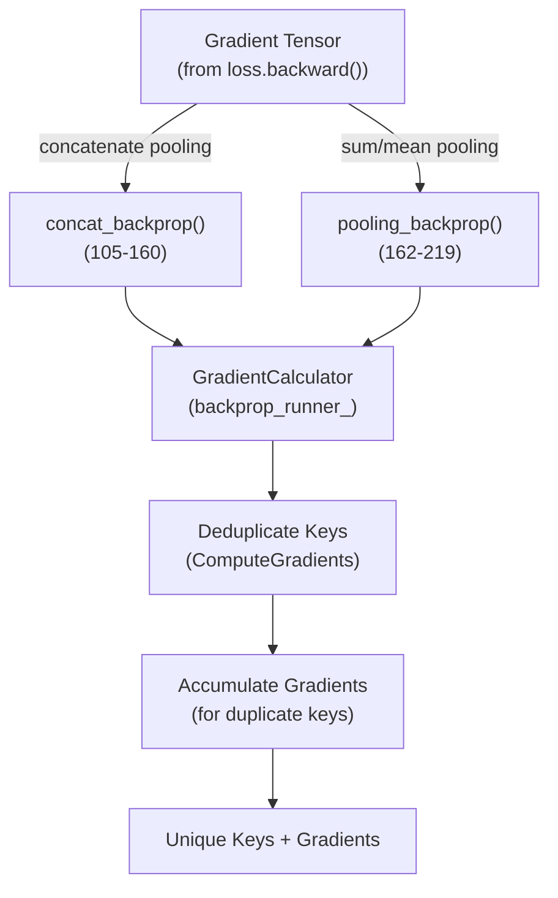

**`concat_backprop(num_keys, keys, grads, unique_keys, output_grads, stream)`**
- Computes gradients for concatenate pooling
- Deduplicates keys and accumulates gradients for repeated keys
- Returns number of unique keys; writes unique keys to `unique_keys` and aggregated gradients to `output_grads`

**`pooling_backprop(num_keys, keys, grads, unique_keys, output_grads, pooling_type, num_offsets, offsets, data_type, weights, stream)`**
- Computes gradients for sum/mean pooling
- Handles weighted gradients if `weights` provided
- Returns number of unique keys with aggregated gradients

Both methods use `GradientCalculator` which automatically resizes temporary buffers as `num_keys` increases.

**Sources:** [python/pynve/bindings/binding_layers.hpp:105-219]()

### Modify Operations

| Method | Parameters | Description |
|--------|------------|-------------|
| `accumulate` | `num_keys, keys, updates, stream` | Adds `updates` to existing embeddings (for gradient application) |
| `update` | `num_keys, keys, updates, stream` | Replaces embeddings with `updates` (overwrite) |
| `insert` | `num_keys, keys, values, table_id, stream` | Inserts new embeddings into specified tier |
| `erase` | `num_keys, keys, table_id, stream` | Removes embeddings from specified tier |
| `clear` | `stream` | Clears all cached data (does not affect remote storage) |

**Execution Context Usage**: All modify operations use `get_exec_context()` which maintains a per-stream execution context. The context manages two streams:
- **Lookup stream**: The user-provided stream for the operation
- **Modify stream**: A shared internal stream (`modify_stream_`) for serializing modifications

This design ensures thread-safe concurrent lookups while serializing modifications.

**Sources:** [python/pynve/bindings/binding_layers.hpp:221-264](), [python/pynve/bindings/binding_layers.hpp:308-321]()

## Execution Context Management

The binding layer manages execution contexts to coordinate CUDA streams and enable parallel operations:

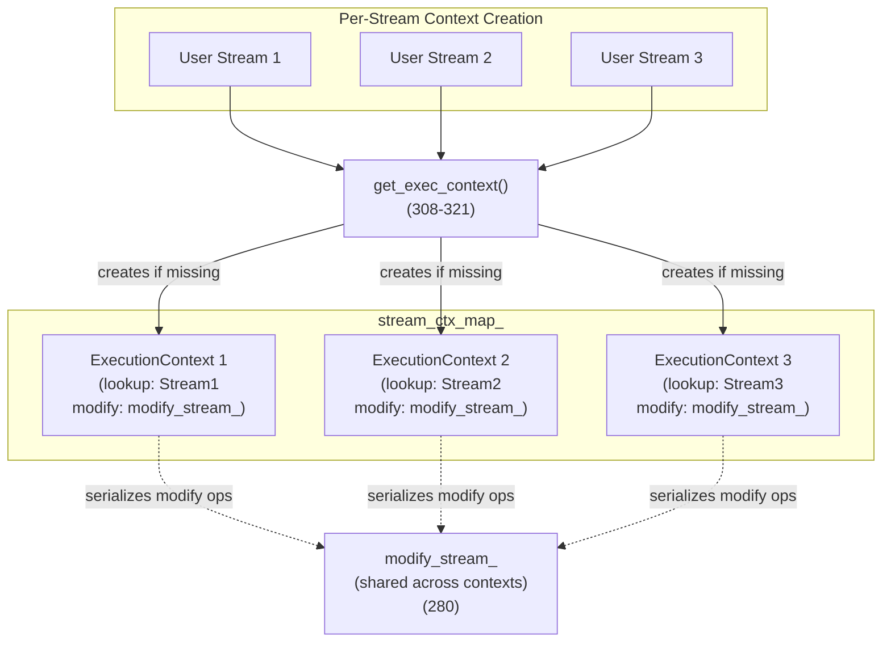

### Context Lifecycle

1. **Creation**: First operation on a stream creates an `ExecutionContext` via `emb_layer_ptr_->create_execution_context()`
2. **Reuse**: Subsequent operations on the same stream reuse the cached context from `stream_ctx_map_`
3. **Cleanup**: `release_contexts()` waits for all contexts and releases them before destructor completes

### Thread Safety

- **Lookups**: Safe to call concurrently from multiple threads/streams (each gets its own context)
- **Modifications**: Serialized through shared `modify_stream_` to prevent race conditions
- **Mixed Workloads**: Training scenarios with concurrent lookups and updates are supported

**Sources:** [python/pynve/bindings/binding_layers.hpp:280](), [python/pynve/bindings/binding_layers.hpp:298-321]()

## Advanced Features

### DLPack Tensor Support (LinearUVM only)

The `LinearUVMEmbedding` class provides zero-copy access to the UVM embedding table via DLPack:

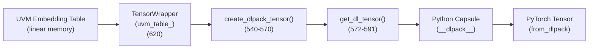

The `get_dl_tensor()` method returns a PyCapsule containing a `DLManagedTensor`. This enables:
- Direct access to embeddings from PyTorch without copying
- Integration with other frameworks supporting DLPack
- Efficient initialization and debugging

**Important**: The tensor references UVM memory, so modifications are visible to the embedding layer.

**Sources:** [python/pynve/bindings/binding_layers.hpp:540-591](), [python/pynve/bindings/binding_layers.hpp:620]()

### Checkpointing (LinearUVM only)

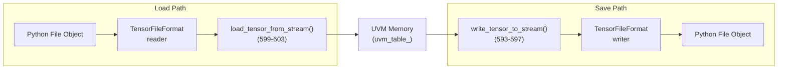

Methods for saving and restoring embedding tables:
- **`write_tensor_to_stream(stream, name)`**: Serializes UVM table to Python file-like object
- **`load_tensor_from_stream(stream, name)`**: Deserializes from Python file-like object into UVM table

These methods use `TensorFileFormat` for serialization, enabling fault tolerance and model distribution.

**Sources:** [python/pynve/bindings/binding_layers.hpp:593-603]()

### Hit Rate Logging

The `log_hit_rates()` method provides performance visibility:

```python
# Example log output when logging_interval=100:
# "Hit rates: 0.850000, 0.950000, 1.000000"
#             ^^^^^^^^  ^^^^^^^^  ^^^^^^^^
#             L1 (GPU)  L2 (Host) L3 (Remote)
```

- Logs every `logging_interval` lookups (default: disabled with `-1`)
- Reports cumulative hit rate for each cache tier
- Useful for tuning cache sizes and insert heuristics

**Sources:** [python/pynve/bindings/binding_layers.hpp:324-341]()

### Parameter Server Table Binding (Hierarchical only)

The `HierarchicalEmbedding` class uses `PyNVETable` as a wrapper to enable late binding of remote parameter servers:

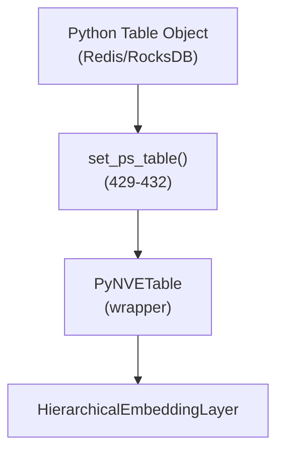

The `set_ps_table()` method allows deferred initialization of the remote storage tier, enabling:
- Creation of embedding layer before parameter server connection
- Runtime switching of parameter servers
- Testing with mock parameter servers

**Sources:** [python/pynve/bindings/binding_layers.hpp:420-432]()

---

