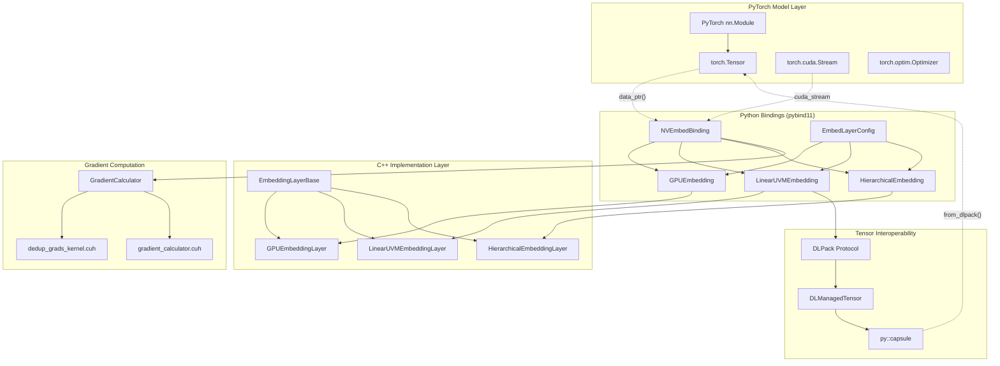
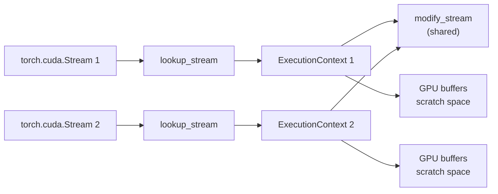
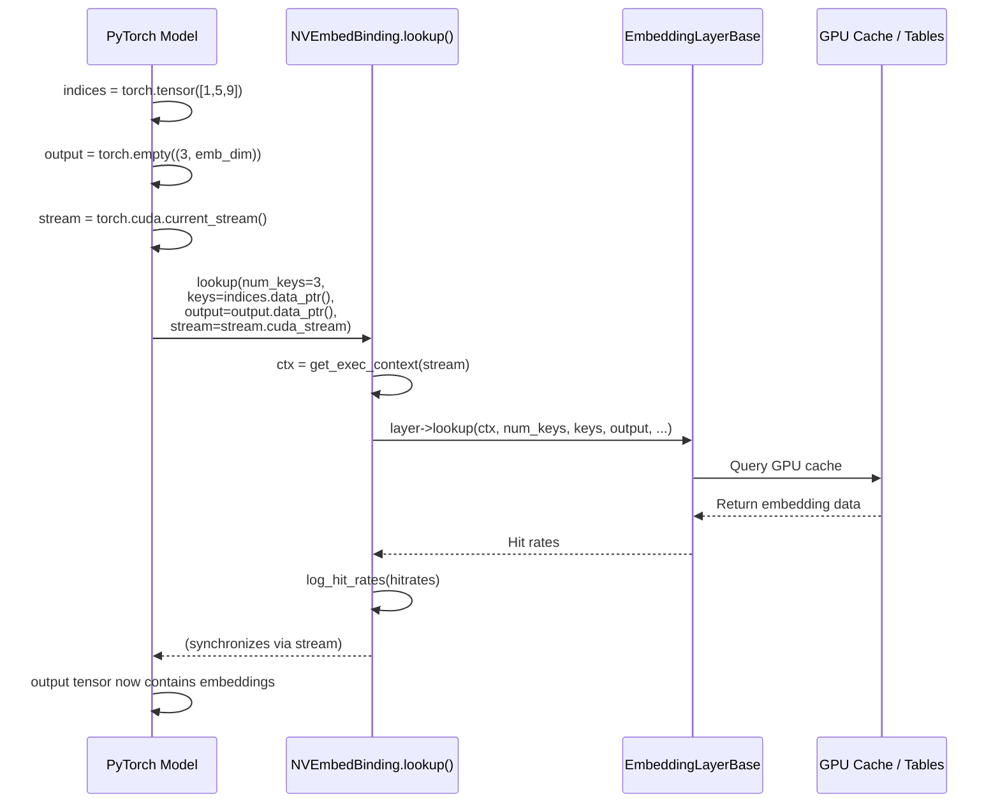
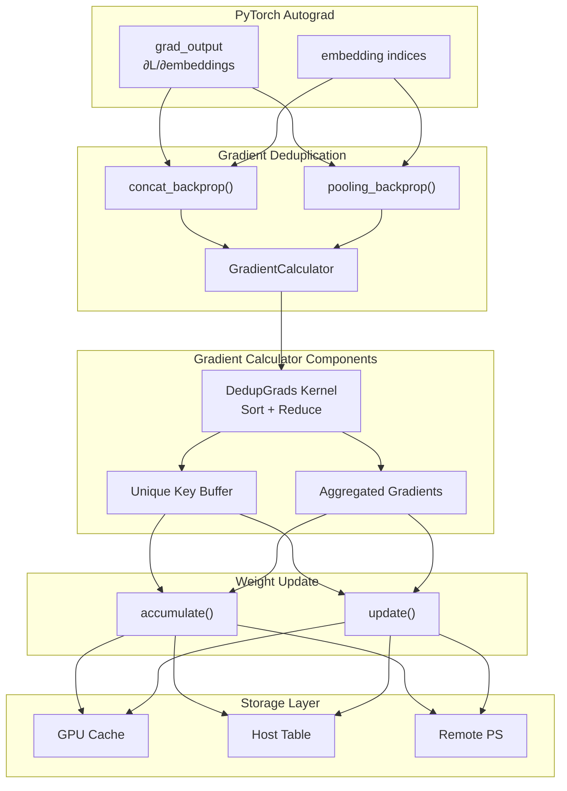
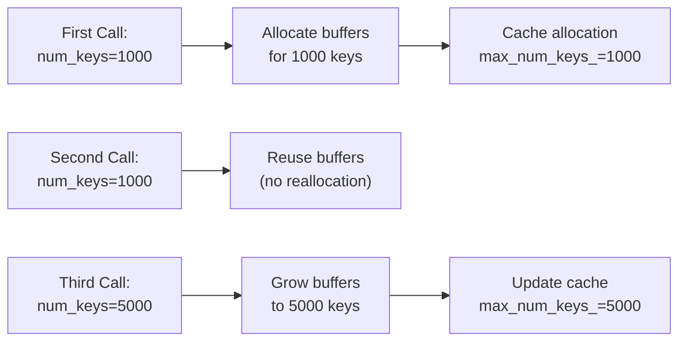
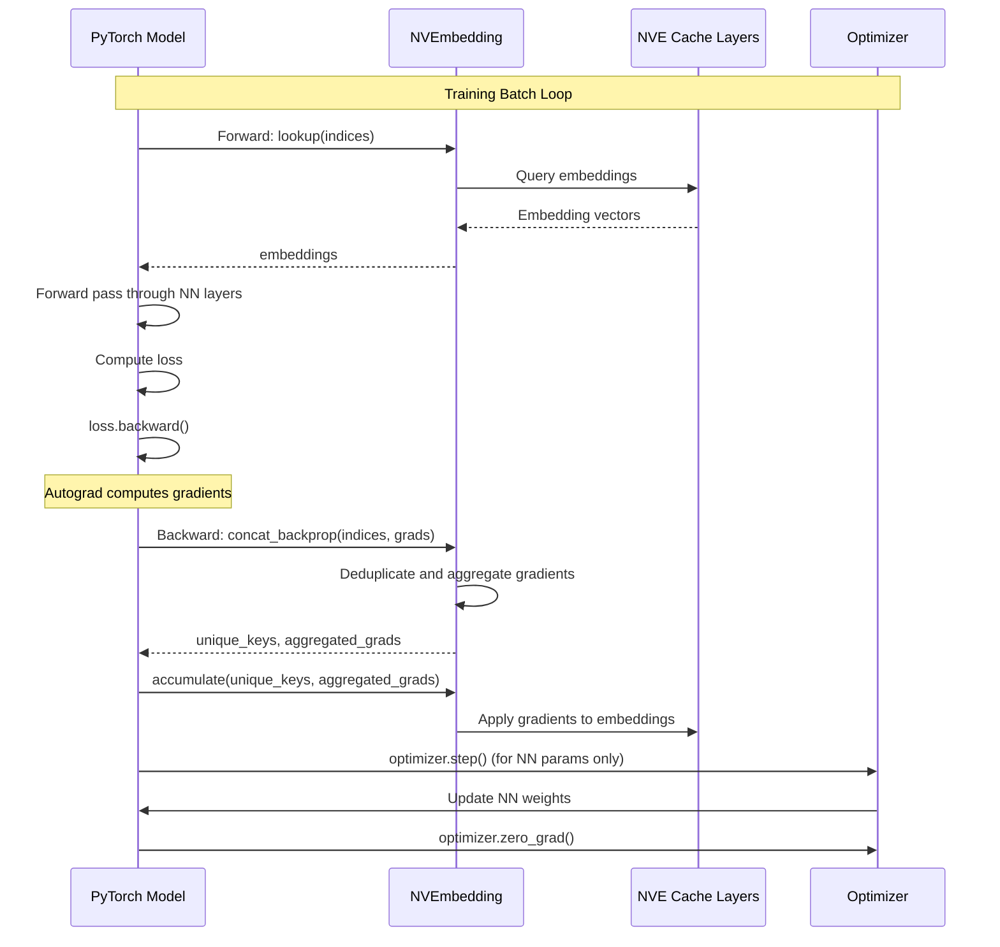
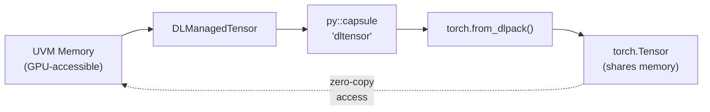

<!-- source: DeepWiki mcp.deepwiki.com · repo NVIDIA/nv-embedding-cache · page 5.2 PyTorch Integration · fetched 2026-10-26 -->

# PyTorch Integration

<details>
<summary>Relevant source files</summary>

The following files were used as context for generating this wiki page:

- [README.md](README.md)
- [docs/samples.md](docs/samples.md)
- [python/pynve/bindings/binding_layers.hpp](python/pynve/bindings/binding_layers.hpp)

</details>


This page describes how to integrate NV Embedding Cache with PyTorch models and training loops. It covers the Python bindings architecture, forward and backward pass operations, gradient computation, tensor interoperability, and serialization support.

For general Python API usage, see [Python Embedding Layers](#5.1). For Python utilities including DLPack support, see [Python Utilities](#5.3).

## Overview

The NV Embedding Cache SDK provides PyTorch integration through Python bindings built with pybind11. These bindings expose the C++ embedding layer implementations as Python classes that can be seamlessly integrated into PyTorch models. The integration supports:

- Zero-copy tensor sharing via DLPack protocol
- Automatic gradient computation for backpropagation
- CUDA stream synchronization with PyTorch operations
- Checkpoint save/load compatibility with PyTorch distributed checkpointing

The Python bindings wrap three C++ embedding layer types:
- `GPUEmbedding` wraps `nve::GPUEmbeddingLayer`
- `LinearUVMEmbedding` wraps `nve::LinearUVMEmbeddingLayer`
- `HierarchicalEmbedding` wraps `nve::HierarchicalEmbeddingLayer`

Sources: [python/pynve/bindings/binding_layers.hpp:48-659](), [README.md:11-16]()

## Python Bindings Architecture



**Python Bindings Architecture**

This diagram shows how PyTorch tensors and streams interact with the pybind11 bindings layer, which wraps the C++ embedding layer implementations. Tensor data is passed by pointer, and CUDA streams ensure synchronization between PyTorch and NVE operations.

Sources: [python/pynve/bindings/binding_layers.hpp:48-659]()

## Core Binding Classes

### NVEmbedBinding Template

`NVEmbedBinding<IndexT>` is the base class template that provides common functionality for all embedding layer Python bindings.

| Member | Type | Purpose |
|--------|------|---------|
| `emb_layer_ptr_` | `std::shared_ptr<EmbeddingLayerBase>` | Pointer to underlying C++ embedding layer |
| `row_size_in_bytes_` | `uint64_t` | Size of each embedding vector in bytes |
| `backprop_runner_` | `std::shared_ptr<GradientCalculator<IndexT, MAX_RUN_SIZE>>` | Gradient computation engine |
| `stream_ctx_map_` | `std::map<cudaStream_t, std::shared_ptr<ExecutionContext>>` | Maps CUDA streams to execution contexts |
| `modify_stream_` | `cudaStream_t` | Dedicated stream for modify operations |

Key methods exposed to Python:

- `lookup(num_keys, keys, output, stream)` - Forward pass for standard embedding lookup
- `lookup_with_pooling(...)` - Forward pass with pooling operations (sum, mean, etc.)
- `concat_backprop(num_keys, keys, grads, unique_keys, output_grads, stream)` - Backward pass for concatenated embeddings
- `pooling_backprop(...)` - Backward pass for pooled embeddings
- `accumulate(num_keys, keys, updates, stream)` - Gradient accumulation
- `update(num_keys, keys, updates, stream)` - Direct weight update
- `insert(num_keys, keys, values, table_id, stream)` - Insert new embeddings
- `erase(num_keys, keys, table_id, stream)` - Remove embeddings
- `clear(stream)` - Clear all cached embeddings

Sources: [python/pynve/bindings/binding_layers.hpp:57-360]()

### Execution Context Management

Each CUDA stream used with the embedding layer gets a corresponding `ExecutionContext` that manages resources and synchronization:



**Execution Context Per Stream**

Each PyTorch CUDA stream gets its own `ExecutionContext` with dedicated lookup resources, but all contexts share a single `modify_stream` for insert/update/accumulate operations. This design optimizes for concurrent inference while serializing modifications.

Sources: [python/pynve/bindings/binding_layers.hpp:308-321]()

## Forward Pass Integration

### Standard Lookup

The `lookup()` method performs the forward pass, retrieving embedding vectors for given indices:



**Standard Lookup Sequence**

The lookup operation converts PyTorch tensor pointers to raw pointers, manages execution contexts, and performs the cache lookup. The CUDA stream ensures proper synchronization with PyTorch operations.

**Key Parameters:**
- `num_keys` (size_t): Number of embedding indices to look up
- `keys` (uintptr_t): Pointer to indices tensor data (typically `int64_t*` or `int32_t*`)
- `output` (uintptr_t): Pointer to output tensor data (float or half precision)
- `stream_` (uint64_t): CUDA stream handle cast to uint64_t

Sources: [python/pynve/bindings/binding_layers.hpp:61-76]()

### Lookup with Pooling

The `lookup_with_pooling()` method supports sparse feature aggregation with CSR format:

| Pooling Type | Enum Value | Description |
|--------------|------------|-------------|
| Sum | `PoolingType_t::Sum` | Sum embeddings within each sample |
| Mean | `PoolingType_t::Mean` | Average embeddings within each sample |
| Max | `PoolingType_t::Max` | Take maximum across embeddings |
| Concatenate | `PoolingType_t::Concatenate` | Concatenate all embeddings (no reduction) |

**CSR Format Parameters:**
- `offsets`: Array of size `num_samples + 1` defining sparse boundaries
- `keys`: Array of embedding indices (length = `offsets[num_samples]`)
- `weights`: Optional per-key weights for weighted pooling
- `output`: Array of size `num_samples × embedding_dim`

Sources: [python/pynve/bindings/binding_layers.hpp:78-103]()

## Backward Pass Integration

### Gradient Computation Architecture



**Backward Pass Gradient Flow**

Gradients from PyTorch's autograd engine are deduplicated and aggregated before being applied to the embedding storage. This is critical because the same embedding may appear multiple times in a batch, requiring gradient accumulation.

Sources: [python/pynve/bindings/binding_layers.hpp:105-219]()

### Concatenate Backpropagation

The `concat_backprop()` method computes gradients for simple embedding lookups without pooling:

**Process:**
1. Input: `keys` (indices), `grads` (∂L/∂embeddings from autograd)
2. Sort keys and corresponding gradients
3. Identify unique keys and sum gradients for duplicate keys
4. Output: `unique_keys` and `output_grads` (deduplicated)
5. Returns: Number of unique keys

**Memory Management:**
The method uses resizable buffers (`d_tmp_device_buf_`, `d_tmp_host_buf_`) that grow as needed to accommodate increasing batch sizes:



**Dynamic Buffer Resizing**

Temporary buffers for gradient computation grow dynamically but never shrink, avoiding repeated allocations during training.

Sources: [python/pynve/bindings/binding_layers.hpp:105-160](), [python/pynve/bindings/binding_layers.hpp:113-122]()

### Pooling Backpropagation

The `pooling_backprop()` method computes gradients for lookups with pooling operations:

**Additional Parameters:**
- `offsets` (uintptr_t): CSR offset array defining sample boundaries
- `num_offsets` (uint32_t): Number of samples (= length of offsets - 1)
- `weights` (uintptr_t): Optional per-key weights used in forward pass
- `pooling_type` (uint32_t): Same pooling type used in forward pass

**Gradient Distribution:**
For pooling operations, the gradient from each output element must be distributed back to the contributing input embeddings according to the pooling formula:

| Pooling Type | Gradient Distribution |
|--------------|----------------------|
| Sum | Each contributing embedding gets the full gradient |
| Mean | Gradient divided by count of embeddings in the sample |
| Max | Gradient goes only to the max element (requires forward cache) |

Sources: [python/pynve/bindings/binding_layers.hpp:162-219]()

## Training Loop Integration Pattern

### Typical PyTorch Training Integration



**Training Loop with NV Embedding Cache**

The embedding layer gradients are handled separately from the PyTorch optimizer. After backpropagation, deduplicated gradients are accumulated directly into the embedding cache rather than being managed by `torch.optim`.

### Update vs Accumulate

The Python bindings expose two methods for applying gradients:

| Method | Operation | Use Case |
|--------|-----------|----------|
| `accumulate()` | `embedding[i] += gradient[i]` | Gradient accumulation (most common) |
| `update()` | `embedding[i] = new_value[i]` | Direct weight replacement |

**Important:** The `accumulate()` method adds gradients to existing embeddings. If you want to apply SGD-style updates with learning rate, you must scale gradients by `-learning_rate` before calling `accumulate()`.

Sources: [python/pynve/bindings/binding_layers.hpp:221-240]()

## Configuration and Initialization

### EmbedLayerConfig

The `EmbedLayerConfig` struct controls logging and kernel behavior:

```cpp
struct EmbedLayerConfig {
    int64_t logging_interval = -1;        // Log hit rates every N lookups (-1 = disabled)
    int64_t kernel_mode = 0;              // Kernel type selection
    int64_t kernel_mode_value_1 = 0;      // Kernel-specific parameter 1
    int64_t kernel_mode_value_2 = 0;      // Kernel-specific parameter 2
};
```

**Kernel Modes for LinearUVMEmbedding:**

| kernel_mode | Type | value_1 | value_2 | Description |
|-------------|------|---------|---------|-------------|
| 0 | Default | - | - | Standard gather kernel |
| 1 | SortGather | Task size (default: 1024) | - | Sort keys before gathering |
| 2 | PipelineGather | Task size (default: 1024) | Aux streams (default: 16) | Pipelined gather with multiple streams |

Sources: [python/pynve/bindings/binding_layers.hpp:50-55](), [python/pynve/bindings/binding_layers.hpp:516-526]()

### Embedding Type Initialization

#### GPUEmbedding

```python
# Python construction (simplified)
gpu_embedding = GPUEmbedding(
    row_size=128,              # Embedding dimension
    num_embeddings=1000000,    # Total number of embeddings
    dtype=DataType.Float32,    # Float32 or Float16
    embedding_table=table_ptr, # Pointer to pre-allocated GPU memory
    device_id=0,               # GPU device
    config=EmbedLayerConfig()
)
```

Sources: [python/pynve/bindings/binding_layers.hpp:632-650]()

#### LinearUVMEmbedding

```python
# Python construction (simplified)
linear_embedding = LinearUVMEmbedding(
    row_size=128,
    num_embeddings=10000000,
    dtype=DataType.Float32,
    mem_block=uvm_memory_block,  # UVM-allocated memory
    gpu_cache_size=1073741824,   # 1 GB GPU cache
    use_private_stream=True,     # Dedicated stream for cache operations
    device_id=0,
    config=EmbedLayerConfig()
)
```

The `mem_block` parameter is a `MemBlock` object that wraps UVM-allocated memory accessible from both CPU and GPU.

Sources: [python/pynve/bindings/binding_layers.hpp:484-537]()

#### HierarchicalEmbedding

```python
# Python construction (simplified)
hierarchical_embedding = HierarchicalEmbedding(
    row_size=128,
    dtype=DataType.Float32,
    gpu_cache_size=1073741824,   # 1 GB GPU cache (L1)
    host_cache_size=10737418240, # 10 GB host cache (L2)
    remote=redis_table,          # Remote parameter server (L3)
    use_private_stream=True,
    device_id=0,
    config=EmbedLayerConfig()
)
```

The three-tier architecture automatically manages data movement between GPU, host memory, and remote storage.

Sources: [python/pynve/bindings/binding_layers.hpp:369-427]()

## DLPack Tensor Interface

### Zero-Copy Memory Sharing

`LinearUVMEmbedding` provides a DLPack interface for zero-copy sharing of the UVM embedding table with PyTorch:



**DLPack Zero-Copy Tensor Sharing**

The embedding table memory is exposed as a DLPack tensor, allowing PyTorch to create a tensor that directly references the same memory without copying.

### Implementation Details

The `get_dl_tensor()` method creates a `DLManagedTensor` structure:

**DLTensor Fields:**
- `data`: Pointer to UVM embedding table
- `device`: `{kDLCUDA, device_id}`
- `ndim`: 2 (rows × columns)
- `dtype`: `{kDLFloat, 32 or 16, 1}` (float32 or float16)
- `shape`: `[num_embeddings, embedding_dim]`
- `strides`: NULL (contiguous row-major layout)

**Capsule Deleter:**
The Python capsule includes a custom deleter that frees the shape array but does not free the underlying data (which is managed by `MemBlock`):

Sources: [python/pynve/bindings/binding_layers.hpp:540-591]()

### Usage Pattern

```python
# Get DLPack capsule from NVE
dl_capsule = linear_embedding.get_dl_tensor(DataType.Float32)

# Convert to PyTorch tensor (zero-copy)
embeddings_tensor = torch.from_dlpack(dl_capsule)

# Now both NVE and PyTorch reference the same memory
# Modifications in PyTorch are visible in NVE lookups
embeddings_tensor[0, :] = torch.randn(128)  # Modifies embedding 0
```

**Warning:** Direct tensor modification bypasses NVE's caching logic. Use `update()` or `insert()` methods for proper cache coherency.

Sources: [python/pynve/bindings/binding_layers.hpp:572-591]()

## Serialization Support

### TensorFileFormat

`LinearUVMEmbedding` supports checkpoint serialization through Python file-like objects:

| Method | Purpose |
|--------|---------|
| `write_tensor_to_stream(stream, name)` | Save embedding table to file stream |
| `load_tensor_from_stream(stream, name)` | Load embedding table from file stream |

The serialization format is compatible with PyTorch's distributed checkpoint format, enabling:
- Fault tolerance through periodic checkpointing
- Model deployment after training
- Transfer learning with pre-trained embeddings

**TensorWrapper Structure:**
The serialization operates on a `TensorWrapper` that encapsulates:
- `row`: Number of embeddings
- `col`: Embedding dimension
- `data`: UVM memory pointer
- `element_size_in_bytes`: Size of each element (4 for float32, 2 for float16)

Sources: [python/pynve/bindings/binding_layers.hpp:593-603](), [python/pynve/bindings/binding_layers.hpp:533-537]()

### Checkpoint Compatibility

The serialization integrates with PyTorch's `torch.distributed.checkpoint` module:

```python
# Saving
with open('checkpoint.pt', 'wb') as f:
    linear_embedding.write_tensor_to_stream(f, name=0)

# Loading
with open('checkpoint.pt', 'rb') as f:
    linear_embedding.load_tensor_from_stream(f, name=0)
```

See [Load Checkpoint Sample](#9) in the samples documentation for complete examples.

Sources: [docs/samples.md:16]()

## Multi-GPU Considerations

### Device Scoping

All embedding layer methods use `ScopedDevice` internally to ensure operations execute on the correct GPU:

```cpp
ScopedDevice scope_device(device_id_);
// Operations execute on specified device
```

When using multi-GPU PyTorch, ensure the device context matches:

```python
# PyTorch device context
with torch.cuda.device(device_id):
    # Create embedding on same device
    embedding = LinearUVMEmbedding(..., device_id=device_id)
    
    # Operations automatically use correct device
    output = embedding.lookup(indices.to(f'cuda:{device_id}'))
```

Sources: [python/pynve/bindings/binding_layers.hpp:266-283]()

### Stream Management

Each PyTorch CUDA stream gets a unique `ExecutionContext`:

```python
# Multiple streams for concurrent operations
stream1 = torch.cuda.Stream()
stream2 = torch.cuda.Stream()

with torch.cuda.stream(stream1):
    output1 = embedding.lookup(indices1)  # Uses stream1

with torch.cuda.stream(stream2):
    output2 = embedding.lookup(indices2)  # Uses stream2
```

Modify operations (`accumulate`, `update`, `insert`) use a shared `modify_stream_` to serialize modifications and maintain consistency.

Sources: [python/pynve/bindings/binding_layers.hpp:308-321](), [python/pynve/bindings/binding_layers.hpp:280]()

## Performance Monitoring

### Hit Rate Logging

When `logging_interval` is set in `EmbedLayerConfig`, the bindings log cache hit rates periodically:

```python
config = EmbedLayerConfig()
config.logging_interval = 100  # Log every 100 lookups

embedding = LinearUVMEmbedding(..., config=config)

# After 100, 200, 300, ... lookups, logs appear:
# "Hit rates: 0.85, 0.92, 0.78"
```

Hit rates are reported per cache tier:
- **Index 0**: GPU cache hit rate
- **Index 1**: Host cache hit rate (for HierarchicalEmbedding)
- **Index 2**: Remote cache hit rate (for HierarchicalEmbedding with remote PS)

Sources: [python/pynve/bindings/binding_layers.hpp:324-341](), [python/pynve/bindings/binding_layers.hpp:62-75]()

## Memory Management

### Resizable Buffers

The `NVEmbedBinding` class maintains resizable buffers for gradient computation:

| Buffer | Type | Growth Policy | Purpose |
|--------|------|---------------|---------|
| `d_tmp_device_buf_` | Device memory | Grows on demand | GPU temporary storage for gradient aggregation |
| `d_tmp_host_buf_` | Pinned host | Grows on demand | CPU temporary storage for sorting/reduction |

Buffers are allocated through the `ResizeableBuffer` class and grow to accommodate the largest batch size seen:

```cpp
if (num_keys > max_num_keys_) {
    // Reallocate buffers for larger batch
    backprop_runner_->GetAllocRequirements(num_keys, ...);
    char* tmp_device = d_tmp_device_buf_.get_ptr(new_size_device);
    char* tmp_host = d_tmp_host_buf_.get_ptr(new_size_host);
    backprop_runner_->SetAndInitBuffers(...);
    max_num_keys_ = num_keys;
}
```

Sources: [python/pynve/bindings/binding_layers.hpp:113-122](), [python/pynve/bindings/binding_layers.hpp:266-283]()

### Cleanup on Destruction

The destructor ensures proper resource cleanup:

1. Wait for all pending operations on execution contexts
2. Destroy execution contexts
3. Free host-allocated buffers
4. Destroy private streams (if used)
5. Set device context before CUDA operations

Sources: [python/pynve/bindings/binding_layers.hpp:285-295](), [python/pynve/bindings/binding_layers.hpp:298-306]()

## Example Integration Code

### Basic Forward/Backward Pass

```python
import torch
import nve  # NV Embedding Cache Python bindings

# Initialize embedding layer
embedding = nve.LinearUVMEmbedding(
    row_size=128,
    num_embeddings=10000000,
    dtype=nve.DataType.Float32,
    gpu_cache_size=1 << 30,  # 1 GB cache
    device_id=0
)

# Forward pass
indices = torch.tensor([0, 1, 2, 3], device='cuda:0', dtype=torch.int64)
output = torch.empty((4, 128), device='cuda:0', dtype=torch.float32)

embedding.lookup(
    num_keys=indices.size(0),
    keys=indices.data_ptr(),
    output=output.data_ptr(),
    stream=torch.cuda.current_stream().cuda_stream
)

# Backward pass (after loss.backward())
grads = torch.randn((4, 128), device='cuda:0', dtype=torch.float32)  # From autograd
unique_keys = torch.empty(4, device='cuda:0', dtype=torch.int64)
unique_grads = torch.empty((4, 128), device='cuda:0', dtype=torch.float32)

num_unique = embedding.concat_backprop(
    num_keys=indices.size(0),
    keys=indices.data_ptr(),
    grads=grads.data_ptr(),
    unique_keys=unique_keys.data_ptr(),
    output_grads=unique_grads.data_ptr(),
    stream=torch.cuda.current_stream().cuda_stream
)

# Apply gradients
embedding.accumulate(
    num_keys=num_unique,
    keys=unique_keys.data_ptr(),
    updates=unique_grads.data_ptr(),
    stream=torch.cuda.current_stream().cuda_stream
)
```

For complete examples, see [PyTorch API samples](#9.2) and [PyTorch Inference sample](#9).

Sources: [docs/samples.md:13]()

---

