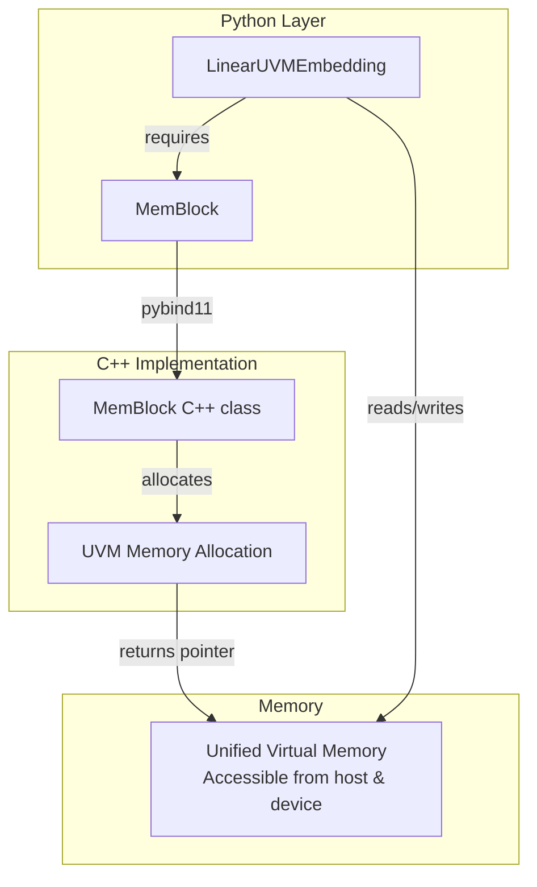
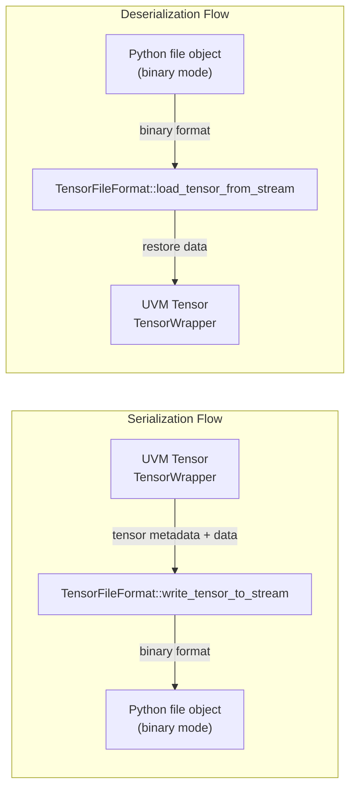
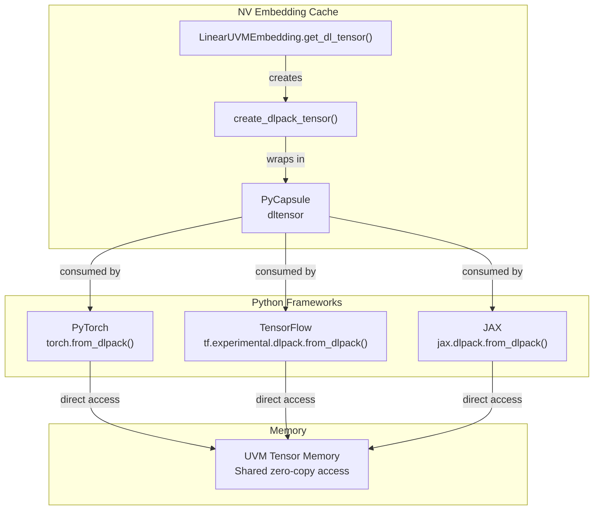
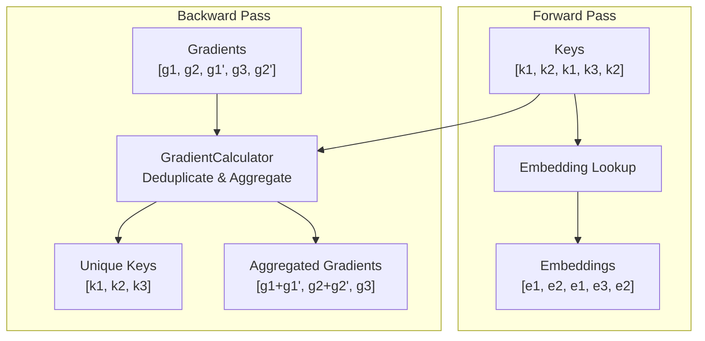
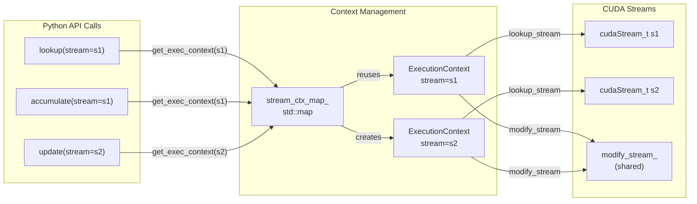

<!-- source: DeepWiki mcp.deepwiki.com · repo NVIDIA/nv-embedding-cache · page 5.3 Python Utilities · fetched 2026-10-26 -->

# Python Utilities

Relevant source files

The following files were used as context for generating this wiki page:

- [.gitmodules](.gitmodules)
- [python/pynve/bindings/binding_layers.hpp](python/pynve/bindings/binding_layers.hpp)

## Purpose and Scope

This page documents Python-specific utility functionality provided by the NV Embedding Cache SDK. These utilities support advanced use cases including memory management, tensor serialization, zero-copy tensor sharing via DLPack, and gradient computation for training scenarios. 

For general Python API documentation covering embedding layer operations (lookup, insert, update), see [Python Embedding Layers](#5.1). For PyTorch-specific integration patterns, see [PyTorch Integration](#5.2).

---

## Overview

The Python bindings expose several utility classes and functions beyond the core embedding operations. These utilities enable:

- **Memory management**: Allocation and buffer management for host and device memory
- **Tensor serialization**: Checkpoint saving/loading for embedding tables
- **DLPack integration**: Zero-copy tensor sharing with PyTorch, TensorFlow, and JAX
- **Gradient computation**: Backpropagation support for pooled embeddings
- **Stream management**: Mapping CUDA streams to execution contexts

The utilities are implemented in C++ and exposed to Python via pybind11, providing high-performance operations while maintaining Python usability.

**Sources:** [python/pynve/bindings/binding_layers.hpp:1-660]()

---

## Memory Management Utilities

### MemBlock

The `MemBlock` class provides managed memory allocation for embedding tables, particularly for `LinearUVMEmbedding`. It allocates unified virtual memory (UVM) that can be accessed from both host and device.

**Usage Pattern:**

In `LinearUVMEmbedding` constructor, a `MemBlock` is passed to manage the backing storage:

[python/pynve/bindings/binding_layers.hpp:487-494]()

The memory block pointer is extracted and used as the UVM table:

[python/pynve/bindings/binding_layers.hpp:513]()

**Sources:** [python/pynve/bindings/binding_layers.hpp:487-537](), [python/pynve/bindings/binding_memblock.hpp]()

### ResizeableBuffer

The `ResizeableBuffer` class manages dynamically-sized temporary buffers for operations like gradient computation. It automatically grows as needed and supports both device and host memory.

**Key Features:**

| Feature | Description |
|---------|-------------|
| **Auto-resize** | Automatically reallocates when requested size exceeds capacity |
| **Memory type** | Supports both device (GPU) and host (CPU) memory |
| **Allocator-based** | Uses the SDK's allocator interface for memory management |

**Implementation in NVEmbedBinding:**

[python/pynve/bindings/binding_layers.hpp:266-283]()

The buffers are used to store temporary data during gradient computation:

[python/pynve/bindings/binding_layers.hpp:117-120]()

**Sources:** [python/pynve/bindings/binding_layers.hpp:351-352](), [include/resizeable_buffer.hpp]()

---

## Tensor Serialization

The SDK provides serialization utilities for saving and loading embedding tables to/from disk or streams. This enables checkpointing for fault tolerance and model persistence.

### TensorFileFormat

The `TensorFileFormat` class handles reading and writing tensor data in a compact binary format.

### Write Operations

The `write_tensor_to_stream()` method serializes an embedding table to a Python stream object:

[python/pynve/bindings/binding_layers.hpp:593-597]()

### Load Operations

The `load_tensor_from_stream()` method deserializes an embedding table from a Python stream object:

[python/pynve/bindings/binding_layers.hpp:599-603]()

### TensorWrapper Structure

The `TensorWrapper` struct encapsulates tensor metadata required for serialization:

| Field | Type | Description |
|-------|------|-------------|
| `data` | `void*` | Pointer to tensor data |
| `row` | `size_t` | Number of embeddings |
| `col` | `size_t` | Embedding dimension |
| `element_size_in_bytes` | `size_t` | Size of each element (4 for float32, 2 for float16) |

[python/pynve/bindings/binding_layers.hpp:533-537]()

**Sources:** [python/pynve/bindings/binding_layers.hpp:593-603](), [python/pynve/bindings/binding_serialization.hpp]()

---

## DLPack Integration

DLPack is a standard for zero-copy tensor exchange between frameworks. The SDK exposes UVM embedding tables as DLPack tensors, enabling direct access from PyTorch, TensorFlow, and JAX without copying data.

### Architecture

### DLManagedTensor Creation

The `create_dlpack_tensor()` method constructs a `DLManagedTensor` structure that describes the UVM embedding table:

[python/pynve/bindings/binding_layers.hpp:540-570]()

**Key DLPack Fields:**

| Field | Value | Description |
|-------|-------|-------------|
| `dl_tensor.data` | `uvm_table_.data` | Pointer to UVM memory |
| `dl_tensor.device` | `{kDLCUDA, device_id}` | Device location |
| `dl_tensor.ndim` | `2` | Number of dimensions (rows × cols) |
| `dl_tensor.dtype` | `{kDLFloat, bits, 1}` | Data type (32-bit or 16-bit float) |
| `dl_tensor.shape` | `[num_embeddings, embedding_dim]` | Tensor shape |
| `deleter` | Lambda function | Cleanup callback |

### PyCapsule Wrapper

The `get_dl_tensor()` method wraps the `DLManagedTensor` in a PyCapsule for Python interoperability:

[python/pynve/bindings/binding_layers.hpp:572-591]()

The capsule implements the DLPack protocol, allowing frameworks to:
1. Extract the managed tensor pointer
2. Access the tensor data directly
3. Trigger cleanup when done (via the deleter function)

### Zero-Copy Benefits

| Aspect | Traditional Approach | DLPack Approach |
|--------|---------------------|-----------------|
| **Memory copies** | 2 copies (GPU→CPU→Framework) | 0 copies (direct access) |
| **Latency** | High (copy overhead) | Low (pointer passing) |
| **Memory usage** | 2× original size | 1× original size |
| **Synchronization** | Manual sync required | Framework-managed |

**Sources:** [python/pynve/bindings/binding_layers.hpp:540-591](), [.gitmodules:16-18]()

---

## Gradient Computation Utilities

The SDK provides utilities for computing gradients during backpropagation, supporting both concatenated and pooled embedding lookups.

### GradientCalculator

The `GradientCalculator` class handles gradient computation with automatic deduplication of repeated keys:

### Concatenate Backpropagation

The `concat_backprop()` method handles backpropagation for concatenated embeddings (no pooling):

[python/pynve/bindings/binding_layers.hpp:105-160]()

**Workflow:**

1. **Initialize** `GradientCalculator` on first use
2. **Resize buffers** if batch size increases
3. **Compute gradients** with deduplication
4. **Return** number of unique keys for subsequent operations

### Pooling Backpropagation

The `pooling_backprop()` method handles backpropagation for pooled embeddings (sum, mean, or weighted):

[python/pynve/bindings/binding_layers.hpp:162-219]()

**Additional Parameters:**

| Parameter | Type | Description |
|-----------|------|-------------|
| `pooling_type` | `uint32_t` | Pooling operation (sum=0, mean=1) |
| `num_offsets` | `uint32_t` | Number of CSR offset values |
| `offsets` | `uintptr_t` | Pointer to CSR offsets array |
| `weights` | `uintptr_t` | Pointer to sparse weights (optional) |

### Buffer Management

Both methods use `ResizeableBuffer` instances to manage temporary memory:

[python/pynve/bindings/binding_layers.hpp:117-120]()

This ensures efficient memory usage while handling varying batch sizes.

**Sources:** [python/pynve/bindings/binding_layers.hpp:105-219](), [cuda_ops/dedup_grads_kernel.cuh](), [cuda_ops/gradient_calculator.cuh]()

---

## Execution Context Management

The SDK uses execution contexts to manage CUDA streams and coordinate between lookup and modify operations.

### Stream-to-Context Mapping

The `get_exec_context()` method maintains a mapping from CUDA streams to `ExecutionContext` objects:

[python/pynve/bindings/binding_layers.hpp:308-321]()

### Shared Modify Stream

All contexts share a single modify stream to serialize write operations:

[python/pynve/bindings/binding_layers.hpp:280]()

This design:
- **Simplifies** synchronization for inference workloads
- **Prevents** data races during concurrent modifications
- **Allows** parallel lookups on different streams

### Context Lifecycle

Contexts are cleaned up during layer destruction:

[python/pynve/bindings/binding_layers.hpp:298-306]()

The cleanup waits for all pending operations before destroying contexts, ensuring proper resource management.

**Sources:** [python/pynve/bindings/binding_layers.hpp:298-321](), [include/execution_context.hpp]()

---

## Configuration Utilities

### EmbedLayerConfig

The `EmbedLayerConfig` structure provides Python-friendly configuration for embedding layers:

[python/pynve/bindings/binding_layers.hpp:50-55]()

**Configuration Parameters:**

| Parameter | Type | Default | Description |
|-----------|------|---------|-------------|
| `logging_interval` | `int64_t` | `-1` | Log hit rates every N lookups (-1 = disabled) |
| `kernel_mode` | `int64_t` | `0` | Kernel type selection (see below) |
| `kernel_mode_value_1` | `int64_t` | `0` | First kernel parameter |
| `kernel_mode_value_2` | `int64_t` | `0` | Second kernel parameter |

### Kernel Mode Selection

For `LinearUVMEmbedding`, the kernel mode determines the gather strategy:

[python/pynve/bindings/binding_layers.hpp:516-526]()

**Kernel Types:**

| Mode | Type | Value 1 | Value 2 | Description |
|------|------|---------|---------|-------------|
| `0` | Default | - | - | Standard gather kernel |
| `SortGather` | Sorted gather | Tile size | - | Sort keys before gathering (default: 1024) |
| `PipelineGather` | Pipeline gather | Task size | Aux streams | Pipelined multi-stream gather (defaults: 1024, 16) |

### Hit Rate Logging

The logging system tracks and periodically reports cache hit rates:

[python/pynve/bindings/binding_layers.hpp:324-341]()

When enabled (`logging_interval > 0`), hit rates for each cache tier are logged every N lookup operations.

**Sources:** [python/pynve/bindings/binding_layers.hpp:50-55](), [python/pynve/bindings/binding_layers.hpp:516-526](), [python/pynve/bindings/binding_layers.hpp:324-341]()

---

## Summary

The Python utilities in the NV Embedding Cache SDK provide essential infrastructure for:

1. **Memory Management**: `MemBlock` and `ResizeableBuffer` for flexible memory allocation
2. **Serialization**: `TensorFileFormat` for checkpoint save/load operations
3. **Interoperability**: DLPack integration for zero-copy tensor sharing with ML frameworks
4. **Training Support**: `GradientCalculator` for efficient backpropagation
5. **Resource Management**: Stream-to-context mapping and lifecycle management
6. **Configuration**: Flexible kernel selection and performance monitoring

These utilities bridge the gap between Python's ease of use and C++'s high performance, enabling production-ready embedding cache deployments with minimal overhead.

**Sources:** [python/pynve/bindings/binding_layers.hpp:1-660](), [.gitmodules:10-18]()

---

