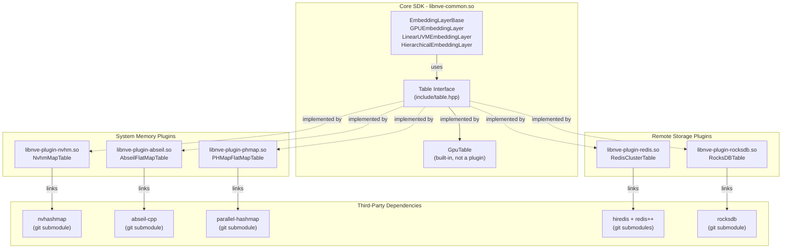
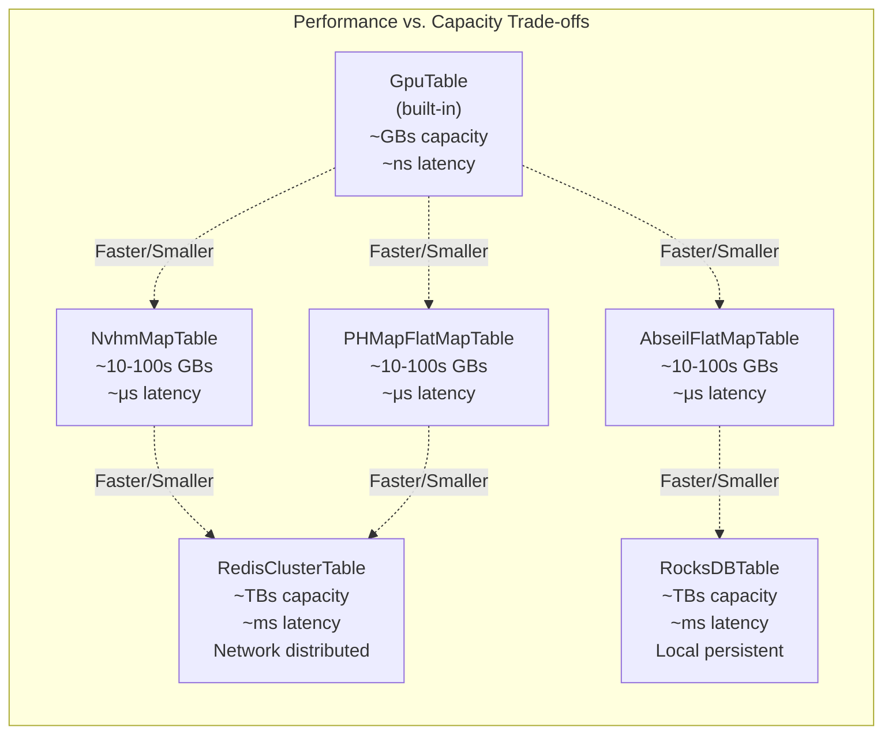
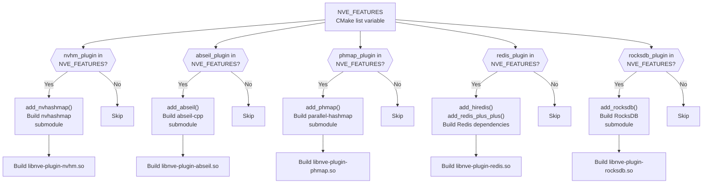
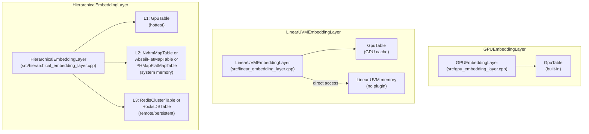
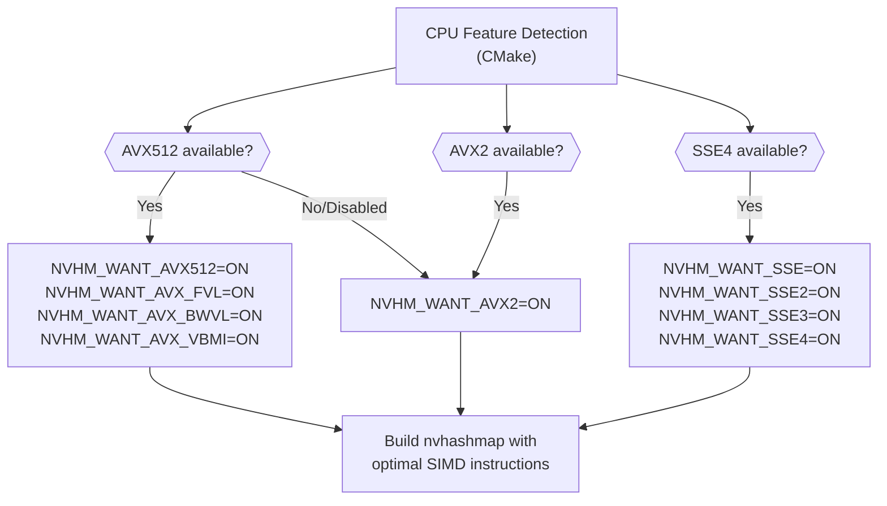

<!-- source: DeepWiki mcp.deepwiki.com · repo NVIDIA/nv-embedding-cache · page 6 Storage Plugins · fetched 2026-10-26 -->

# Storage Plugins

<details>
<summary>Relevant source files</summary>

The following files were used as context for generating this wiki page:

- [README.md](README.md)
- [docs/cpp_api.md](docs/cpp_api.md)
- [third_party/CMakeLists.txt](third_party/CMakeLists.txt)

</details>


This page provides an overview of the storage plugin system in NV Embedding Cache SDK. Storage plugins are dynamically loadable libraries that implement different backend storage systems for embedding data. Each plugin provides a specific `Table` implementation that can be used by embedding layers to store and retrieve embedding vectors.

For detailed information on how to use these plugins with embedding layers, see [Embedding Layers](#3.1). For implementation details of the `Table` interface that all plugins implement, see [Tables and Storage Backends](#3.2).

## Purpose and Architecture

Storage plugins enable the SDK to support multiple storage backends without requiring all dependencies to be linked into the core library. Each plugin is compiled as a separate shared object (`.so` file) that implements the `Table` interface defined in [include/table.hpp]().

The plugin architecture serves two main purposes:

1. **Dependency Isolation**: Heavy dependencies (Redis, RocksDB, Abseil, etc.) are only loaded when their corresponding plugin is used, reducing the core SDK's footprint.

2. **Extensibility**: New storage backends can be added by implementing the `Table` interface without modifying the core SDK.

### Plugin Architecture Overview



Sources: [docs/cpp_api.md:45-56](), [README.md:77-94]()

## Available Storage Plugins

The SDK provides five storage plugin implementations, each optimized for different use cases:

| Plugin | Library Name | Table Class | Primary Use Case | Memory Tier |
|--------|-------------|-------------|------------------|-------------|
| NVHM | `libnve-plugin-nvhm.so` | `NvhmMapTable` | High-performance system memory cache | System RAM |
| Abseil | `libnve-plugin-abseil.so` | `AbseilFlatMapTable` | Alternative system memory cache | System RAM |
| PHMap | `libnve-plugin-phmap.so` | `PHMapFlatMapTable` | Alternative system memory cache | System RAM |
| Redis | `libnve-plugin-redis.so` | `RedisClusterTable` | Distributed remote storage | Network/Disk |
| RocksDB | `libnve-plugin-rocksdb.so` | `RocksDBTable` | Local persistent storage | Disk |

Sources: [docs/cpp_api.md:49-56](), [README.md:82-94]()

### Plugin Characteristics



Sources: [docs/cpp_api.md:49-56]()

## Build System Integration

Storage plugins are conditionally built based on the `NVE_FEATURES` CMake variable. Each feature corresponds to a specific plugin:

| Feature Flag | Plugin Built | Dependencies |
|-------------|--------------|--------------|
| `nvhm_plugin` | `libnve-plugin-nvhm.so` | nvhashmap |
| `abseil_plugin` | `libnve-plugin-abseil.so` | abseil-cpp |
| `phmap_plugin` | `libnve-plugin-phmap.so` | parallel-hashmap |
| `redis_plugin` | `libnve-plugin-redis.so` | hiredis, redis-plus-plus |
| `rocksdb_plugin` | `libnve-plugin-rocksdb.so` | rocksdb |

### CMake Plugin Loading Logic



Sources: [third_party/CMakeLists.txt:114-145]()

The build system uses CMake functions to configure each dependency before building:

- **add_nvhashmap()**: Configures nvHashMap with AVX/SSE optimizations ([third_party/CMakeLists.txt:31-67]())
- **add_abseil()**: Disables Abseil tests and helpers ([third_party/CMakeLists.txt:69-73]())
- **add_phmap()**: Disables parallel-hashmap tests and examples ([third_party/CMakeLists.txt:75-80]())
- **add_rocksdb()**: Disables RocksDB tools and benchmarks ([third_party/CMakeLists.txt:82-92]())
- **add_hiredis()** and **add_redis_plus_plus()**: Configures Redis clients with SSL support ([third_party/CMakeLists.txt:94-112]())

Sources: [third_party/CMakeLists.txt:29-112]()

## Runtime Plugin Loading

At runtime, plugin shared objects must be available in the `LD_LIBRARY_PATH` for the application to use them. The typical deployment includes:

```
build/lib/
├── libnve-common.so              # Core SDK (always required)
├── libnve-plugin-nvhm.so         # NVHM plugin (optional)
├── libnve-plugin-abseil.so       # Abseil plugin (optional)
├── libnve-plugin-phmap.so        # PHMap plugin (optional)
├── libnve-plugin-redis.so        # Redis plugin (optional)
└── libnve-plugin-rocksdb.so      # RocksDB plugin (optional)
```

Applications must:
1. Link against `libnve-common.so` and `libcudart.so`
2. Ensure required plugin `.so` files are in `LD_LIBRARY_PATH` at runtime
3. Instantiate the appropriate table class from the plugin

Sources: [docs/cpp_api.md:10-12]()

## Plugin Usage in Embedding Layers

Different embedding layer types use different combinations of plugins:

### Layer-Plugin Mapping



Sources: [README.md:11-16](), [docs/cpp_api.md:19-23]()

### Typical Configuration Scenarios

| Scenario | Layers Used | Plugins Required |
|----------|-------------|------------------|
| Small dataset (< GPU RAM) | `GPUEmbeddingLayer` | None |
| Medium dataset (< System RAM) | `LinearUVMEmbeddingLayer` | None |
| Large dataset, single node | `HierarchicalEmbeddingLayer` | `nvhm_plugin` or `abseil_plugin` or `phmap_plugin` |
| Distributed system | `HierarchicalEmbeddingLayer` | `nvhm_plugin` + `redis_plugin` |
| Persistent storage | `HierarchicalEmbeddingLayer` | `nvhm_plugin` + `rocksdb_plugin` |

Sources: [README.md:11-16]()

## Table Interface Contract

All plugins implement the `Table` interface, which defines standard operations for embedding storage:

### Core Operations

The `Table` interface ([include/table.hpp]()) specifies these key operations:

1. **Lookup**: Retrieve embedding vectors for given keys
2. **Insert**: Add new key-value pairs (may evict existing entries)
3. **Update**: Modify existing embedding values in-place
4. **Accumulate**: Add gradients to existing embedding values
5. **Erase**: Remove specific keys from the table

Each plugin implements these operations according to its storage backend characteristics:

- **GPU and system memory plugins** (NVHM, Abseil, PHMap) provide low-latency access for cached data
- **Remote storage plugins** (Redis, RocksDB) handle network/disk I/O with higher latency but larger capacity

Sources: [docs/cpp_api.md:45-58]()

## System Memory Plugins Comparison

The three system memory plugins provide alternative implementations with different performance characteristics:

| Feature | NvhmMapTable | AbseilFlatMapTable | PHMapFlatMapTable |
|---------|--------------|--------------------|--------------------|
| Backend | nvHashMap | Abseil flat_hash_map | parallel_hashmap |
| SIMD Optimizations | AVX512, AVX2, SSE | No | No |
| Thread Safety | Lock-free operations | External locking required | Built-in locking |
| Typical Use | Default choice for L2 cache | Alternative when nvHashMap unavailable | Alternative with good parallelism |
| Header Location | [plugins/nvhm/include/nvhm_map_table.hpp]() | [plugins/abseil/include/abseil_flat_map_table.hpp]() | [plugins/phmap/include/phmap_flat_map_table.hpp]() |

Sources: [docs/cpp_api.md:51-54](), [third_party/CMakeLists.txt:31-80]()

### NVHM Plugin SIMD Configuration

The NVHM plugin is configured with CPU-specific optimizations at build time:



Sources: [third_party/CMakeLists.txt:42-63]()

## Remote Storage Plugins

Remote storage plugins enable distributed and persistent embedding storage:

### Redis Plugin

The Redis plugin ([plugins/redis/include/redis_cluster_table.hpp]()) provides distributed storage using Redis Cluster. It supports:

- **SSL/TLS encryption** for secure communication
- **Cluster topology** for horizontal scaling
- **Asynchronous operations** for throughput optimization
- **Automatic sharding** across cluster nodes

Typical use case: Multi-node distributed inference with shared parameter server.

### RocksDB Plugin

The RocksDB plugin ([plugins/rocksdb/include/rocksdb_table.hpp]()) provides local persistent storage. It supports:

- **LSM-tree architecture** for write-heavy workloads
- **Compression** to reduce disk usage
- **Disk-based storage** for datasets exceeding memory capacity
- **Snapshot isolation** for consistent reads

Typical use case: Single-node inference with embeddings persisted to disk.

Sources: [docs/cpp_api.md:54-56](), [third_party/CMakeLists.txt:82-112]()

## Feature Selection and Dependencies

The CMake build system conditionally includes plugins based on the `NVE_FEATURES` list. To enable specific plugins:

```bash
# Enable all plugins
cmake -DNVE_FEATURES="nvhm_plugin;abseil_plugin;phmap_plugin;redis_plugin;rocksdb_plugin" ..

# Enable only NVHM and Redis plugins
cmake -DNVE_FEATURES="nvhm_plugin;redis_plugin" ..

# Build Python bindings (enables default plugins)
pip install .
```

The feature selection mechanism ([third_party/CMakeLists.txt:116-145]()) uses CMake's `list(FIND)` to check if each feature is enabled, then conditionally calls the corresponding `add_*()` function to configure and build the dependency.

For more details on build configuration, see [Build System Details](#10).

Sources: [third_party/CMakeLists.txt:114-145](), [README.md:44-55]()

## Summary

Storage plugins provide a modular architecture for extending the SDK with different storage backends. Key points:

1. **Five plugins available**: NVHM (default system memory), Abseil, PHMap, Redis (distributed), RocksDB (persistent)
2. **Plugin isolation**: Dependencies only loaded when plugins are used
3. **Flexible deployment**: Enable only the plugins needed for your use case
4. **CMake feature flags**: Control plugin building via `NVE_FEATURES`
5. **Runtime loading**: Plugins must be in `LD_LIBRARY_PATH` at runtime

For detailed usage of specific plugins, see:
- [NVHM Plugin](#6.1)
- [Redis Plugin](#6.2)
- [RocksDB Plugin](#6.3)
- [Other Plugins](#6.4)

Sources: [docs/cpp_api.md:45-58](), [third_party/CMakeLists.txt](), [README.md:77-94]()

---

