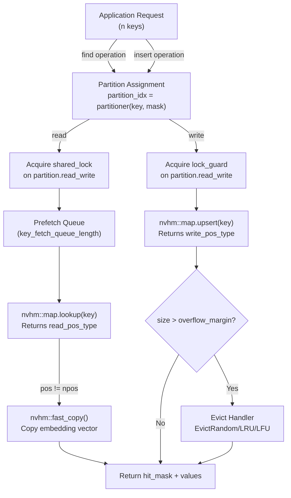
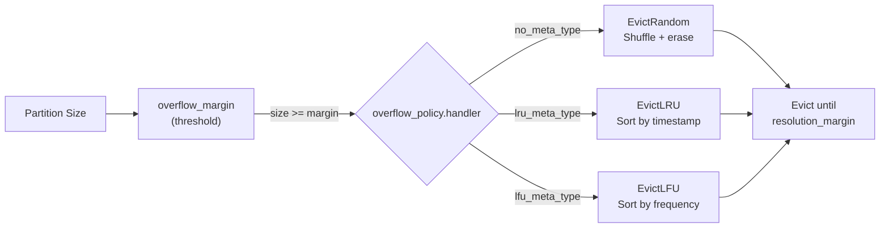
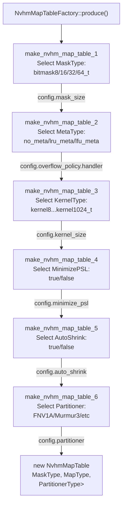
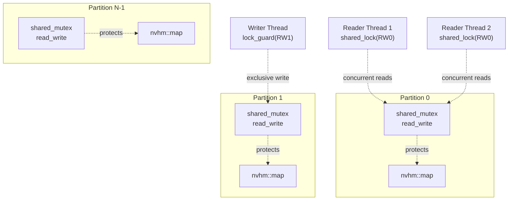
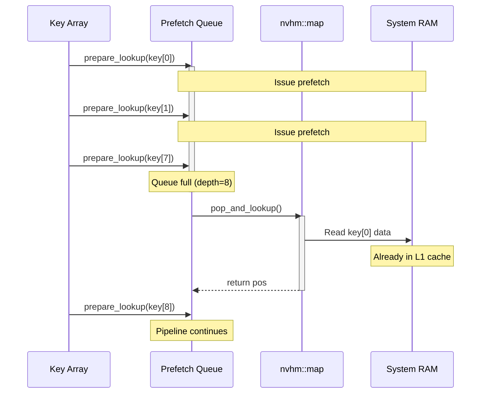
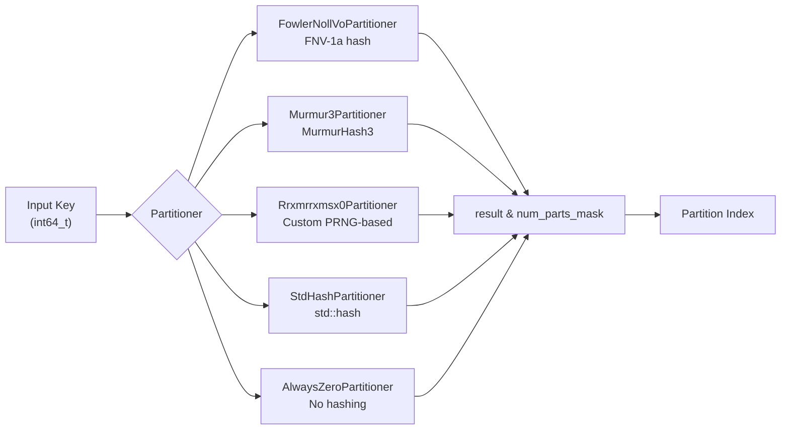
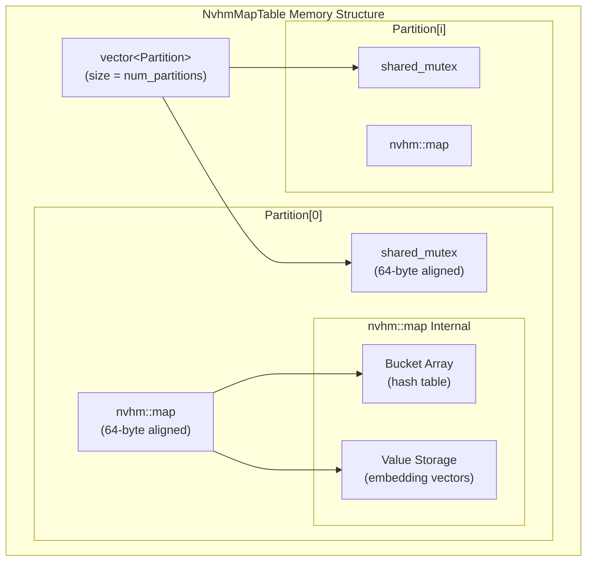

<!-- source: DeepWiki mcp.deepwiki.com · repo NVIDIA/nv-embedding-cache · page 6.1 NVHM Plugin · fetched 2026-10-26 -->

# NVHM Plugin

<details>
<summary>Relevant source files</summary>

The following files were used as context for generating this wiki page:

- [CHANGELOG.md](CHANGELOG.md)
- [plugins/nvhm/include/nvhm_map_table.hpp](plugins/nvhm/include/nvhm_map_table.hpp)
- [plugins/nvhm/src/nvhm_map_table.cpp](plugins/nvhm/src/nvhm_map_table.cpp)

</details>


## Purpose and Scope

The NVHM Plugin provides a high-performance system memory (host RAM) hash table implementation for the NV Embedding Cache SDK, built on top of the [nvHashMap](https://github.com/NVIDIA/nvhashmap) library. This plugin enables large-scale embedding storage in system memory with configurable partitioning, prefetching, and overflow handling strategies.

This page covers the configuration, architecture, and performance characteristics of the NVHM plugin specifically. For information about how this plugin integrates with the broader cache hierarchy, see [HierarchicalEmbeddingLayer](#3.1.3). For details on other host memory table implementations, see [Host Memory Tables](#3.2.2). For general table abstraction concepts, see [Tables and Storage Backends](#3.2).

---

## Overview

The NVHM Plugin (`libnve-plugin-nvhm.so`) is a host memory table backend that stores embedding key-value pairs in system RAM using the nvHashMap data structure. It is primarily used as the L2 cache tier in hierarchical configurations but can also be used standalone.

**Key Features:**
- **Partitioned hash table** - Multiple independent hash map partitions for parallel access
- **Configurable overflow handling** - Random, LRU, or LFU eviction policies
- **Software prefetching** - Key and value prefetch queues to hide memory latency
- **Thread-safe operations** - Reader-writer locks per partition
- **Dynamic capacity** - Auto-shrink capability to reclaim memory after evictions
- **Variable kernel sizes** - Support for 8 to 1024-way vectorized operations

**Availability:**
- Added in v26.02.1 (was missing in v26.02)
- Overflow handling fixes in v26.03

Sources: [CHANGELOG.md:1-41](), [plugins/nvhm/include/nvhm_map_table.hpp:1-153]()

---

## Architecture

### Class Hierarchy

```mermaid
classDiagram
    class HostTable {
        <<interface>>
        +find()
        +insert()
        +update()
        +update_accumulate()
        +erase()
        +clear()
        +size()
    }
    
    class NvhmMapTable {
        -vector~Partition~ parts_
        -NvhmMapTableConfig config_
        +find(ctx, n, keys, hit_mask, ...)
        +insert(ctx, n, keys, values, ...)
        +update(ctx, n, keys, values, ...)
        +update_accumulate(ctx, ...)
        +erase(ctx, n, keys)
        +clear(ctx)
        +size(ctx, exact)
        -find_~KeyFetchQueueLength~()
    }
    
    class Partition {
        +shared_mutex read_write
        +map_type map
    }
    
    class NvhmMapTableFactory {
        +produce(id, config)
    }
    
    class NvhmMapTableConfig {
        +int64_t num_partitions
        +Partitioner_t partitioner
        +vector~int64_t~ workgroups
        +int64_t kernel_size
        +int64_t initial_capacity
        +int64_t key_fetch_queue_length
        +bool prefetch_values
        +OverflowPolicyConfig overflow_policy
        +check()
    }
    
    HostTable <|-- NvhmMapTable
    NvhmMapTable *-- Partition : contains multiple
    NvhmMapTable ..> NvhmMapTableConfig : configured by
    NvhmMapTableFactory ..> NvhmMapTable : creates
    NvhmMapTableFactory ..> NvhmMapTableConfig : uses
    Partition *-- "nvhm::map" : wraps
```

**Key Components:**

1. **`NvhmMapTable`** - Main table implementation with template parameters:
   - `MaskType` - Bitmask type for hit tracking (8/16/32/64-bit)
   - `MapType` - Underlying nvHashMap instantiation
   - `PartitionerType` - Hash function for partition assignment

2. **`Partition`** - Thread-safe wrapper around a single nvHashMap instance:
   - One `shared_mutex` for read-write synchronization
   - One `nvhm::map` instance for actual storage

3. **`NvhmMapTableFactory`** - Factory for creating table instances with complex template configurations

Sources: [plugins/nvhm/include/nvhm_map_table.hpp:60-124](), [plugins/nvhm/src/nvhm_map_table.cpp:88-98]()

---

### Data Flow



**Find Operation Path** [plugins/nvhm/src/nvhm_map_table.cpp:144-200]():
1. Iterate through bitmask to identify keys to lookup
2. For each key, compute partition index using `partitioner(key, num_parts_mask)`
3. Acquire shared lock on partition's `read_write` mutex
4. Use prefetch queue to pipeline key lookups
5. Call `map.lookup(key)` to get `read_pos_type`
6. Copy value using `nvhm::fast_copy()` if found
7. Update metadata (LRU timestamp or LFU counter)

**Insert Operation Path** [plugins/nvhm/src/nvhm_map_table.cpp:203-307]():
1. Compute partition index for each key
2. Acquire exclusive lock on partition
3. Call `map.upsert(key, new_size)` to insert/update
4. Set raw values using `map.set_raw_values_at()`
5. Check if partition size exceeds `overflow_margin`
6. If overflow, trigger eviction based on `overflow_policy.handler`

Sources: [plugins/nvhm/src/nvhm_map_table.cpp:144-307](), [plugins/nvhm/src/nvhm_map_table.cpp:424-640]()

---

## Configuration Parameters

### NvhmMapTableConfig Structure

The `NvhmMapTableConfig` structure [plugins/nvhm/include/nvhm_map_table.hpp:31-54]() controls all aspects of table behavior:

| Parameter | Type | Default | Description |
|-----------|------|---------|-------------|
| `num_partitions` | `int64_t` | 1 | Number of independent hash map partitions (must be power of 2) |
| `partitioner` | `Partitioner_t` | `default_partitioner` | Hash function for partition assignment |
| `workgroups` | `vector<int64_t>` | `{0}` | Thread pool workgroup assignment per partition (wraps around) |
| `max_find_task_size` | `int64_t` | 128 | Maximum bitmask elements per find task (must be power of 2) |
| `kernel_size` | `int64_t` | `nvhm::default_kernel_t::size` | SIMD vectorization width: 1, 2, 4, 8, 16, 32, 64, 128 |
| `initial_capacity` | `int64_t` | 4096 | Initial capacity per partition |
| `value_alignment` | `int64_t` | 16 | Memory alignment for embedding values (must be power of 2) |
| `key_fetch_queue_length` | `int64_t` | 8 | Prefetch queue depth: 0, 1, 2, 4, or 8 |
| `prefetch_values` | `bool` | `true` | Enable software prefetching of embedding values |
| `minimize_psl` | `bool` | `false` | Minimize probe sequence length in hash table |
| `auto_shrink` | `bool` | `false` | Automatically shrink map after evictions to reclaim memory |
| `overflow_policy` | `OverflowPolicyConfig` | - | Overflow detection and eviction configuration |

### Overflow Policy Configuration



**Overflow Policy Fields:**
- `overflow_margin` - Partition size threshold triggering eviction
- `resolution_margin` - Target size after eviction (fraction of `overflow_margin`)
- `handler` - Eviction strategy: `EvictRandom`, `EvictLRU`, or `EvictLFU`

**Eviction Behavior** [plugins/nvhm/src/nvhm_map_table.cpp:260-303]():
- **EvictRandom**: Fetches all keys, shuffles them, erases oldest entries
- **EvictLRU**: Sorts by LRU timestamp (ascending), erases least recently used
- **EvictLFU**: Sorts by frequency counter (ascending), erases least frequently used, then halves remaining counters

Sources: [plugins/nvhm/include/nvhm_map_table.hpp:31-54](), [plugins/nvhm/src/nvhm_map_table.cpp:29-65](), [plugins/nvhm/src/nvhm_map_table.cpp:214-303]()

---

## Template Instantiation Pipeline

The factory uses a six-level template instantiation pipeline to select the correct type based on configuration:



**Configuration to Type Mapping:**

| Config Field | Template Parameter | Possible Values |
|--------------|-------------------|-----------------|
| `mask_size` | `MaskType` | `bitmask8_t`, `bitmask16_t`, `bitmask32_t`, `bitmask64_t` |
| `overflow_policy.handler` | `MetaType` | `no_meta_type`, `lru_meta_type`, `lfu_meta_type` |
| `kernel_size` | `KernelType` | `default_kernel8_t` ... `default_kernel1024_t` |
| `minimize_psl` | Template bool | `true`, `false` |
| `auto_shrink` | Template bool | `true`, `false` |
| `partitioner` | `PartitionerType` | `FowlerNollVoPartitioner`, `Murmur3Partitioner`, etc. |

Each level narrows down the template parameters until a concrete `NvhmMapTable` instantiation is created at level 6.

Sources: [plugins/nvhm/src/nvhm_map_table.cpp:654-821]()

---

## Thread Safety and Concurrency

### Partition-Level Locking



**Concurrency Model** [plugins/nvhm/src/nvhm_map_table.cpp:104-141]():

1. **Per-Partition Locks**: Each `Partition` has its own `std::shared_mutex`
2. **Read Operations**: Acquire `std::shared_lock` - multiple concurrent readers allowed
3. **Write Operations**: Acquire `std::lock_guard` - exclusive access required
4. **Lock Granularity**: Different partitions can be accessed concurrently without contention

**Parallel Task Execution:**

The plugin uses the thread pool's `execute_n()` to distribute work across partitions:

```cpp
ctx->get_thread_pool()->execute_n(0, num_parts, f, config.workgroups, 1);
```

- `num_parts` tasks created (one per partition)
- `config.workgroups` specifies thread affinity
- Tasks can run in parallel on different partitions

Sources: [plugins/nvhm/src/nvhm_map_table.cpp:104-142](), [plugins/nvhm/include/nvhm_map_table.hpp:114-121]()

---

## Performance Optimization Techniques

### 1. Key Prefetching Pipeline

The plugin implements a ring prefetch queue to hide memory latency during lookups [plugins/nvhm/src/nvhm_map_table.cpp:527-565]():



**Prefetch Queue Depths:**
- `key_fetch_queue_length = 0`: No prefetching (simple loop)
- `key_fetch_queue_length = 1, 2, 4, 8`: Ring queue with corresponding depth

**Performance Impact:**
- Hides ~100-200ns memory latency
- Most effective when keys exhibit random access patterns
- Trade-off: Deeper queue → more prefetch overhead but better cache utilization

### 2. Value Prefetching

When `prefetch_values = true` [plugins/nvhm/src/nvhm_map_table.cpp:496-507](), the plugin:

1. Issues `l1_prefetch()` for current embedding vector
2. Copies previous embedding while next one prefetches
3. Effectively doubles the number of in-flight memory operations

### 3. Task Parallelism

For `find()` operations, the work is split into tasks to maximize CPU utilization [plugins/nvhm/src/nvhm_map_table.cpp:441-442]():

```
num_tasks_per_part = (hm_size + max_find_task_size - 1) / max_find_task_size
num_tasks = num_parts * num_tasks_per_part
```

Each task processes `max_find_task_size` bitmask elements (default 128), allowing fine-grained parallelism.

### 4. SIMD Kernel Selection

The `kernel_size` parameter controls vectorization width:

| kernel_size | Description | Use Case |
|-------------|-------------|----------|
| 1 (8-bit) | Minimal vectorization | Small embeddings, low memory |
| 2 (16-bit) | SSE/NEON width | Balanced |
| 4 (32-bit) | AVX width | High performance |
| 8 (64-bit) | AVX2 width | Modern CPUs |
| 16-128 (128-1024 bit) | AVX-512 width | High-end CPUs with AVX-512 |

Larger kernel sizes improve throughput but increase memory overhead and require CPU support.

Sources: [plugins/nvhm/src/nvhm_map_table.cpp:424-640](), [plugins/nvhm/src/nvhm_map_table.cpp:156-196]()

---

## Partition Strategies

### Partitioner Types



**Partitioner Selection Criteria:**

1. **`AlwaysZeroPartitioner`** - Automatically used when `num_partitions = 1` [plugins/nvhm/src/nvhm_map_table.cpp:659-663]()
2. **`FowlerNollVoPartitioner`** - Fast, good distribution for most workloads
3. **`Murmur3Partitioner`** - Better avalanche properties, slightly slower
4. **`Rrxmrrxmsx0Partitioner`** - Custom high-quality hash function
5. **`StdHashPartitioner`** - Uses standard library hash (implementation-dependent)

**Partition Count Guidelines:**
- Must be a power of 2 (enforced by [plugins/nvhm/src/nvhm_map_table.cpp:32]())
- Typical values: 1, 2, 4, 8, 16, 32, 64
- More partitions = less lock contention but higher memory overhead
- Recommendation: `num_partitions = num_cpu_cores / 2` for balanced workloads

Sources: [plugins/nvhm/src/nvhm_map_table.cpp:656-686](), [plugins/nvhm/src/nvhm_map_table.cpp:129-142]()

---

## Usage Example

### Configuration JSON

```json
{
  "table_type": "NvhmMap",
  "num_partitions": 16,
  "partitioner": "Murmur3",
  "workgroups": [0, 1, 2, 3],
  "max_find_task_size": 128,
  "kernel_size": 8,
  "initial_capacity": 1000000,
  "value_alignment": 64,
  "key_fetch_queue_length": 8,
  "prefetch_values": true,
  "minimize_psl": false,
  "auto_shrink": false,
  "overflow_policy": {
    "handler": "EvictLRU",
    "overflow_margin": 10000000,
    "resolution_margin": 0.9
  }
}
```

This configuration creates:
- 16 independent partitions with Murmur3 hashing
- Workgroup distribution across threads 0-3 (wrapping)
- 8-wide SIMD kernel (64-bit operations)
- 1M initial capacity per partition = 16M total
- LRU eviction when any partition exceeds 10M entries
- Evicts down to 9M entries (90% of overflow margin)

### Integration with HierarchicalEmbeddingLayer

The NVHM plugin is typically used as the `l2_table` in hierarchical configurations:

```cpp
// C++ API usage (conceptual)
HierarchicalEmbeddingLayerConfig config;
config.l1_table = gpu_table_config;      // GpuTable
config.l2_table = nvhm_table_config;     // NvhmMapTable
config.l3_table = redis_table_config;    // RedisClusterTable
```

The embedding layer will:
1. Query L1 (GPU) first
2. On miss, query L2 (NVHM) - this plugin
3. On miss, query L3 (Redis)
4. Promote found embeddings up the hierarchy

Sources: [plugins/nvhm/src/nvhm_map_table.cpp:44-86]()

---

## Implementation Details

### Metadata Types

The plugin supports three metadata strategies for overflow handling:

| MetaType | Size | Purpose | Maintained By |
|----------|------|---------|---------------|
| `no_meta_type` | 0 bytes | No metadata, random eviction | N/A |
| `lru_meta_type` | 8 bytes | Timestamp for LRU tracking | [plugins/nvhm/src/nvhm_map_table.cpp:517-518]() |
| `lfu_meta_type` | 8 bytes | Frequency counter for LFU | [plugins/nvhm/src/nvhm_map_table.cpp:519-520]() |

**LRU Timestamp Generation** [plugins/nvhm/src/nvhm_map_table.cpp:471]():
```cpp
const lru_meta_type lru_time{lru_meta_value()};
```

Uses `std::chrono::steady_clock` to generate monotonically increasing timestamps.

**LFU Frequency Management:**
- Incremented on each access [plugins/nvhm/src/nvhm_map_table.cpp:520]()
- Right-shifted by 1 during eviction to prevent saturation [plugins/nvhm/src/nvhm_map_table.cpp:295]()

### nvHashMap Integration

The plugin wraps `nvhm::map` template instantiations:

```cpp
template<typename KeyType,      // int8_t, int16_t, int32_t, int64_t
         typename MetaType,     // no_meta_type, lru_meta_type, lfu_meta_type
         typename RawValueType, // char (for embedding vectors)
         typename KernelType,   // default_kernel8_t...default_kernel1024_t
         typename SeqType,      // default_seq_t
         bool MinimizePSL,      // minimize_psl config
         bool AutoShrink>       // auto_shrink config
class nvhm::map;
```

**Key nvHashMap Operations:**
- `lookup(key)` → `read_pos_type` - Find key, returns position or `nvhm::npos`
- `upsert(key, size)` → `write_pos_type` - Insert or get existing position
- `update(key)` → `write_pos_type` - Update existing key only
- `raw_values_at(pos)` → `char*` - Direct pointer to embedding storage
- `set_raw_values_at(pos, src, size)` - Copy embedding data

Sources: [plugins/nvhm/include/nvhm_map_table.hpp:66-71](), [plugins/nvhm/src/nvhm_map_table.cpp:689-701]()

---

## Memory Layout



**Alignment Requirements:**
- Each `Partition` struct: Cache-line aligned (64 bytes) [plugins/nvhm/include/nvhm_map_table.hpp:119-120]()
- `shared_mutex`: 64-byte alignment to prevent false sharing
- `nvhm::map`: 64-byte alignment for performance
- Embedding values: `value_alignment` bytes (default 16, configurable)

**Memory Overhead:**
- Per partition: ~200 bytes for mutex and map metadata
- Per entry: Key size + metadata size + value alignment overhead
- Example: 64-bit key + LRU (8 bytes) + 128-byte embedding + 16-byte alignment = ~208 bytes per entry

Sources: [plugins/nvhm/include/nvhm_map_table.hpp:114-121]()

---

## Debugging and Monitoring

### Overflow Logging

When a partition overflows, verbose logging is emitted [plugins/nvhm/src/nvhm_map_table.cpp:261-262]():

```cpp
NVE_LOG_VERBOSE_("NV map table ", table_id, " part ", task_idx,
                 " is overflowing. Attempting to resolve...");
```

**Monitoring Overflow Events:**
1. Enable verbose logging level
2. Watch for "is overflowing" messages
3. If frequent, increase `overflow_margin` or adjust eviction policy

### Performance Counters

The plugin tracks internal hit counts [plugins/nvhm/src/nvhm_map_table.cpp:197-199]():

```cpp
auto counter = this->get_internal_counter(ctx);
*counter += n;  // Number of keys processed
```

Access via the execution context's counter mechanism.

### Common Issues

| Issue | Symptom | Solution |
|-------|---------|----------|
| **Excessive evictions** | High overflow logging frequency | Increase `overflow_margin` or `resolution_margin` |
| **High lock contention** | Low throughput with many threads | Increase `num_partitions` |
| **Memory bloat** | Memory grows after evictions | Enable `auto_shrink = true` |
| **Poor hit rate** | Many misses despite large capacity | Check eviction policy (LRU vs LFU) |

Sources: [plugins/nvhm/src/nvhm_map_table.cpp:197-199](), [plugins/nvhm/src/nvhm_map_table.cpp:260-303](), [CHANGELOG.md:18]()

---

