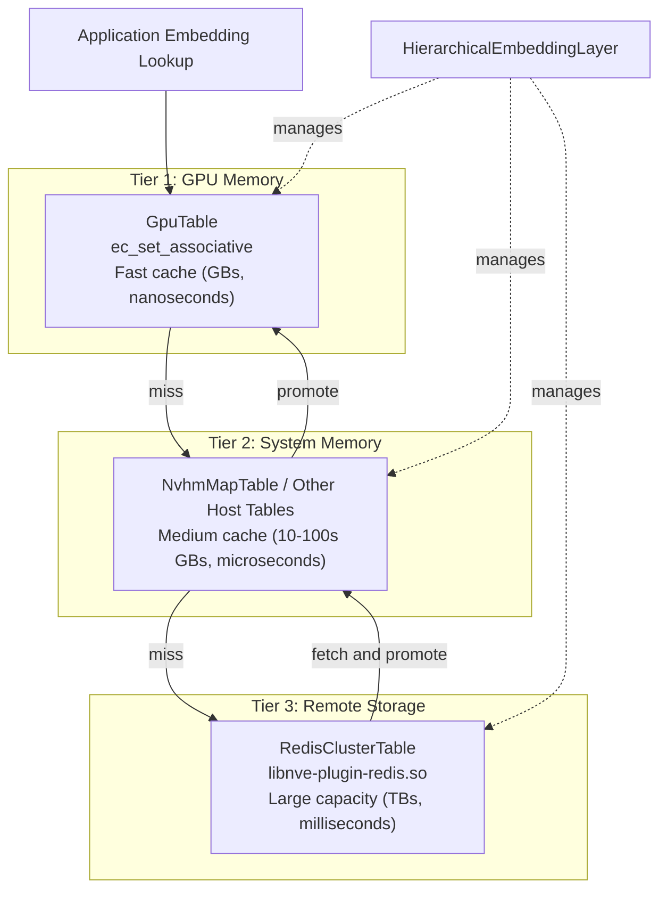
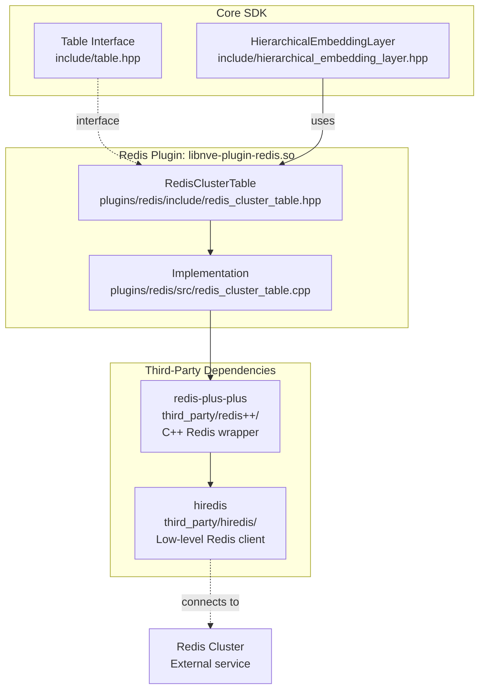
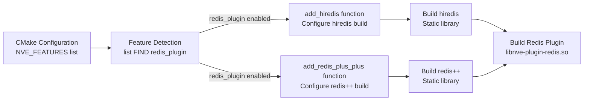
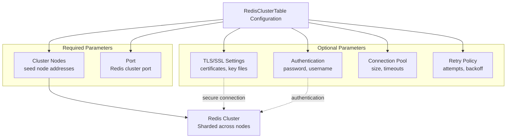
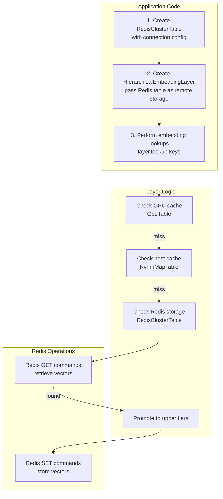
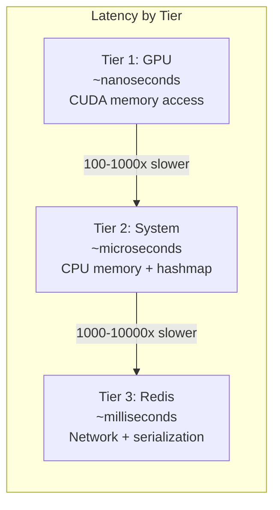
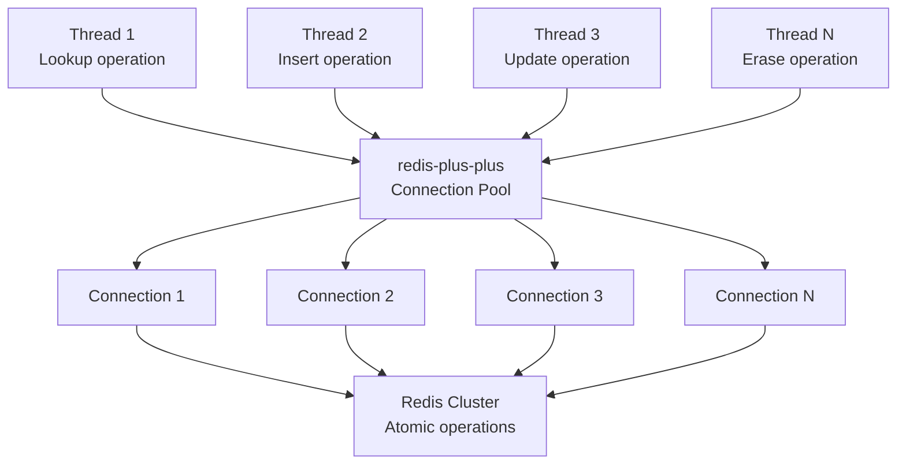

<!-- source: DeepWiki mcp.deepwiki.com · repo NVIDIA/nv-embedding-cache · page 6.2 Redis Plugin · fetched 2026-10-26 -->

# Redis Plugin

<details>
<summary>Relevant source files</summary>

The following files were used as context for generating this wiki page:

- [.gitmodules](.gitmodules)
- [docs/cpp_api.md](docs/cpp_api.md)
- [third_party/CMakeLists.txt](third_party/CMakeLists.txt)

</details>


## Purpose and Scope

The Redis Plugin provides integration with Redis Cluster for distributed parameter server functionality in the NV Embedding Cache SDK. This plugin implements the `RedisClusterTable` class, which enables storage and retrieval of embedding vectors from a remote Redis cluster, serving as the third tier (slowest but largest capacity) in the hierarchical memory architecture.

This document covers the Redis plugin architecture, configuration, and usage. For information about other remote storage options, see [RocksDB Plugin](#6.3). For details on how Redis fits into the hierarchical caching strategy, see [HierarchicalEmbeddingLayer](#3.1.3). For general information about remote storage tables, see [Remote Storage Tables](#3.2.3).

**Sources:** [docs/cpp_api.md:54-55](), [third_party/CMakeLists.txt:94-112]()

---

## System Integration

The Redis plugin is an optional component that provides remote storage capabilities for the `HierarchicalEmbeddingLayer`. It operates at the third tier of the memory hierarchy, offering large-scale storage (terabytes) with millisecond-level access latency.

### Memory Hierarchy Position



**Sources:** [docs/cpp_api.md:22](), System architecture diagrams

### Plugin Architecture



**Sources:** [docs/cpp_api.md:54-55](), [.gitmodules:31-37](), [third_party/CMakeLists.txt:94-112]()

---

## RedisClusterTable Class

The `RedisClusterTable` class implements the `Table` interface for Redis Cluster storage. It provides key-value storage where keys are embedding IDs and values are embedding vectors.

### Key Characteristics

| Characteristic | Value |
|----------------|-------|
| **Header File** | `plugins/redis/include/redis_cluster_table.hpp` |
| **Implementation** | `plugins/redis/src/redis_cluster_table.cpp` |
| **Shared Library** | `libnve-plugin-redis.so` |
| **Table Type** | Remote storage (Tier 3) |
| **Capacity** | Limited by Redis cluster capacity (typically TBs) |
| **Latency** | Network latency + Redis operations (~milliseconds) |
| **Thread Safety** | Thread-safe via redis-plus-plus connection pool |
| **Persistence** | Durable (configurable via Redis settings) |

### Core Operations

The `RedisClusterTable` implements standard table operations:

1. **Lookup**: Retrieve embedding vectors for given keys
   - Executes Redis `GET` commands (possibly batched)
   - Returns miss status for keys not found in cluster
   - Parallel requests handled via connection pool

2. **Insert**: Store new key-vector pairs
   - Executes Redis `SET` commands
   - May overwrite existing keys

3. **Update**: Modify existing vectors
   - Similar to insert, uses `SET` commands
   - Does not verify key existence before update

4. **Accumulate**: Add gradients to existing vectors
   - May require read-modify-write operations
   - Transactional guarantees depend on implementation

5. **Erase**: Remove keys from storage
   - Executes Redis `DEL` commands

**Sources:** [docs/cpp_api.md:46-56]()

---

## Dependencies

The Redis plugin relies on two external libraries, managed as git submodules:

### hiredis

**hiredis** is the minimalistic C client library for Redis.

| Property | Value |
|----------|-------|
| **Repository** | `https://github.com/redis/hiredis.git` |
| **Submodule Path** | `third_party/hiredis` |
| **Purpose** | Low-level Redis protocol implementation |
| **Build Type** | Static library |
| **SSL Support** | Enabled (`ENABLE_SSL ON`) |

Configuration in CMake:
```
SET(BUILD_SHARED_LIBS OFF CACHE BOOL "" FORCE)
SET(DISABLE_TESTS ON CACHE BOOL "" FORCE)
SET(ENABLE_SSL ON CACHE BOOL "" FORCE)
SET(ENABLE_SSL_TESTS OFF CACHE BOOL "" FORCE)
SET(ENABLE_EXAMPLES OFF CACHE BOOL "" FORCE)
SET(ENABLE_ASYNC_TESTS OFF CACHE BOOL "" FORCE)
```

### redis-plus-plus

**redis-plus-plus** (also known as **redis++**) is a C++ client library built on top of hiredis.

| Property | Value |
|----------|-------|
| **Repository** | `https://github.com/sewenew/redis-plus-plus.git` |
| **Submodule Path** | `third_party/redis++` |
| **Purpose** | High-level C++ API for Redis |
| **Build Type** | Static library |
| **TLS Support** | Enabled (`REDIS_PLUS_PLUS_USE_TLS ON`) |

Configuration in CMake:
```
SET(REDIS_PLUS_PLUS_CXX_STANDARD ${CMAKE_CXX_STANDARD} CACHE STRING "" FORCE)
SET(REDIS_PLUS_PLUS_USE_TLS ON CACHE BOOL "" FORCE)
SET(REDIS_PLUS_PLUS_BUILD_STATIC ON CACHE BOOL "" FORCE)
SET(REDIS_PLUS_PLUS_BUILD_SHARED OFF CACHE BOOL "" FORCE)
SET(REDIS_PLUS_PLUS_BUILD_TEST OFF CACHE BOOL "" FORCE)
SET(HIREDIS_HEADER ${NVE_THIRD_PARTY_DIR} CACHE STRING "" FORCE)
```

**Sources:** [.gitmodules:31-37](), [third_party/CMakeLists.txt:94-112]()

---

## Build Configuration

The Redis plugin is built as an optional feature controlled by the NVE_FEATURES system.

### Enabling the Redis Plugin

The plugin is enabled by including `"redis_plugin"` in the `NVE_FEATURES` list during CMake configuration:

```bash
cmake -DNVE_FEATURES="redis_plugin;other_features" ..
```

### Build Process



The relevant CMake code:

[third_party/CMakeLists.txt:140-145]()
```
list(FIND NVE_FEATURES "redis_plugin" NVE_FEATURE_ENABLED)
if(${NVE_FEATURE_ENABLED} GREATER -1)
  add_hiredis()
  add_redis_plus_plus()
endif()
```

### Runtime Dependencies

At runtime, the plugin must be discoverable via `LD_LIBRARY_PATH`:

```bash
export LD_LIBRARY_PATH=/path/to/build/lib:$LD_LIBRARY_PATH
```

The `libnve-plugin-redis.so` library will dynamically load when `RedisClusterTable` is instantiated.

**Sources:** [third_party/CMakeLists.txt:94-145](), [docs/cpp_api.md:12]()

---

## Configuration Parameters

The `RedisClusterTable` requires configuration parameters to connect to a Redis cluster.

### Connection Configuration



### Typical Configuration Parameters

| Parameter | Type | Description | Default |
|-----------|------|-------------|---------|
| **nodes** | `vector<string>` | List of seed node addresses (host:port) | Required |
| **connection_pool_size** | `int` | Number of connections to maintain | Implementation-dependent |
| **socket_timeout** | `milliseconds` | Timeout for socket operations | Implementation-dependent |
| **connect_timeout** | `milliseconds` | Timeout for initial connection | Implementation-dependent |
| **enable_tls** | `bool` | Enable SSL/TLS encryption | `false` |
| **tls_cert_path** | `string` | Path to TLS certificate file | Empty |
| **password** | `string` | Redis authentication password | Empty |

**Note:** Specific configuration parameters are defined in the `RedisClusterTable` implementation. Consult `plugins/redis/include/redis_cluster_table.hpp` for the exact API.

**Sources:** [third_party/CMakeLists.txt:97](), [third_party/CMakeLists.txt:106]()

---

## Usage with HierarchicalEmbeddingLayer

The Redis plugin is primarily used with `HierarchicalEmbeddingLayer` to provide the remote storage tier.

### Integration Pattern



### Typical Usage Flow

1. **Initialization**
   - Configure Redis connection parameters
   - Create `RedisClusterTable` instance
   - Pass to `HierarchicalEmbeddingLayer` constructor as remote storage

2. **Lookup Operations**
   - Layer checks GPU cache first
   - On miss, checks system memory cache
   - On miss, queries Redis cluster
   - Retrieved vectors promoted to faster tiers

3. **Update Operations**
   - Updates propagate through all tiers
   - Redis receives updates for persistent storage
   - Ensures consistency across distributed nodes

4. **Insert Operations**
   - New embeddings stored in Redis
   - Caching layers populated based on access patterns

**Sources:** [docs/cpp_api.md:22](), System architecture diagrams

---

## Performance Considerations

### Latency Characteristics



| Operation | Approximate Latency |
|-----------|-------------------|
| **GPU Cache Hit** | < 1 μs |
| **Host Cache Hit** | 1-10 μs |
| **Redis Cache Hit** | 0.1-10 ms (network dependent) |
| **Redis Cache Miss** | Error condition |

### Throughput Optimization

1. **Connection Pooling**
   - redis-plus-plus maintains connection pool
   - Multiple threads can execute parallel requests
   - Pool size configurable via constructor parameters

2. **Batching**
   - Lookup/insert operations typically batch multiple keys
   - Reduces round-trip overhead
   - Redis pipeline commands can be used

3. **Cluster Sharding**
   - Redis cluster automatically shards keys
   - Parallel requests to different shards
   - Topology-aware routing in redis-plus-plus

### Network Considerations

| Factor | Impact | Mitigation |
|--------|--------|------------|
| **Network Latency** | Dominates access time | Co-locate Redis cluster with compute nodes |
| **Bandwidth** | Limits throughput for large vectors | Use fast interconnect (InfiniBand, etc.) |
| **Connection Overhead** | Initial connection cost | Connection pooling, persistent connections |
| **Serialization** | CPU overhead for encoding/decoding | Efficient binary formats, minimize copies |

**Sources:** System architecture diagrams, memory hierarchy information

---

## Thread Safety and Concurrency

The `RedisClusterTable` is designed for multi-threaded access:

### Thread Safety Guarantees



1. **Connection-Level Safety**
   - redis-plus-plus connection pool is thread-safe
   - Each thread acquires connection from pool
   - Connections released after operation

2. **Redis-Level Atomicity**
   - Individual Redis commands are atomic
   - Multi-key operations may require Lua scripts or transactions
   - Cluster mode implications for multi-key operations

3. **SDK-Level Considerations**
   - Execution contexts manage per-thread state
   - No shared mutable state in `RedisClusterTable`
   - Safe for concurrent reads and writes

### Concurrent Access Pattern

```
Thread A: lookup([key1, key2, key3])  \
Thread B: insert([key4, key5, key6])  |-- Concurrent execution safe
Thread C: update([key7, key8, key9])  /
```

**Sources:** [third_party/CMakeLists.txt:105-112]() (connection pool configuration)

---

## Comparison with RocksDB Plugin

Both Redis and RocksDB plugins provide remote/persistent storage, but with different characteristics:

| Feature | Redis Plugin | RocksDB Plugin |
|---------|-------------|----------------|
| **Architecture** | Distributed cluster | Single-node or distributed file system |
| **Persistence** | Configurable (RDB/AOF) | Always persistent (LSM tree) |
| **Access Pattern** | Remote network calls | Local disk I/O or network FS |
| **Scalability** | Horizontal (add nodes) | Vertical (larger disks) |
| **Latency** | Network + Redis (~ms) | Disk I/O or network FS (~ms) |
| **Consistency** | Eventual consistency in cluster mode | Strong consistency locally |
| **Use Case** | Multi-node deployments, shared state | Single-node, disk-based caching |

**Sources:** [docs/cpp_api.md:54-56]()

---

## Best Practices

### When to Use Redis Plugin

✓ **Use Redis when:**
- Deploying across multiple nodes requiring shared state
- Need distributed parameter server capability
- Embedding dataset exceeds single-node capacity
- Require fault tolerance through Redis replication
- Need to share embeddings across multiple training/inference jobs

✗ **Avoid Redis when:**
- Single-node deployment (use LinearUVMEmbeddingLayer instead)
- Network latency is prohibitive
- Dataset fits in GPU + system memory
- Don't need persistence across restarts

### Configuration Recommendations

1. **Connection Pool Sizing**
   - Set pool size ≥ number of concurrent execution contexts
   - Monitor connection utilization and adjust

2. **Network Optimization**
   - Use low-latency network (RDMA if available)
   - Co-locate Redis cluster and compute nodes
   - Consider network topology in Redis cluster setup

3. **Redis Cluster Configuration**
   - Size cluster based on dataset size and access patterns
   - Enable persistence (RDB/AOF) for durability
   - Configure appropriate eviction policies
   - Monitor memory usage per node

4. **Error Handling**
   - Implement retry logic for transient network failures
   - Monitor Redis cluster health
   - Have fallback strategy for cluster unavailability

**Sources:** System architecture and performance information

---

## Summary

The Redis Plugin (`libnve-plugin-redis.so`) provides integration with Redis Cluster for distributed parameter server functionality. Key points:

- **Implementation**: `RedisClusterTable` class implementing `Table` interface
- **Dependencies**: hiredis (C client) and redis-plus-plus (C++ wrapper)
- **Build**: Optional plugin enabled via `NVE_FEATURES="redis_plugin"`
- **Usage**: Primarily with `HierarchicalEmbeddingLayer` as Tier 3 storage
- **Performance**: ~millisecond latency, throughput limited by network
- **Thread Safety**: Safe for concurrent access via connection pooling
- **Best For**: Multi-node deployments requiring shared, persistent embedding storage

For usage examples, see [Examples and Samples](#9). For detailed API reference, see [C++ API Reference](#4) and [Table API](#4.2).

**Sources:** All sections above

---

