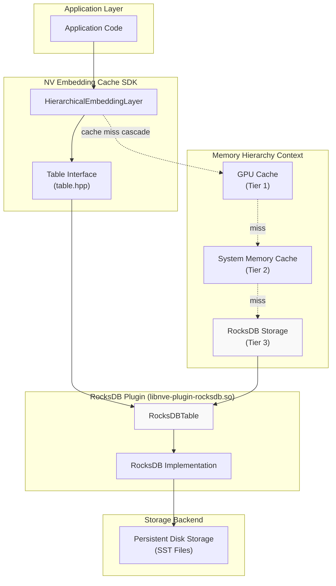
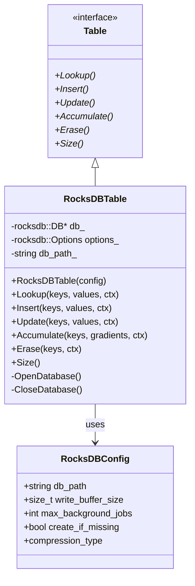
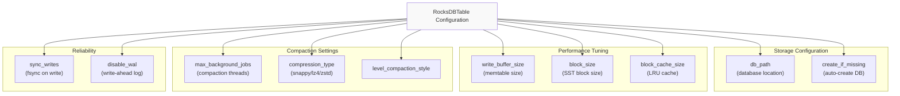
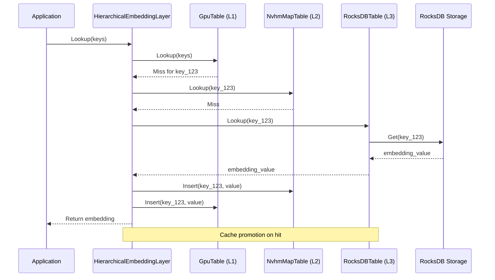
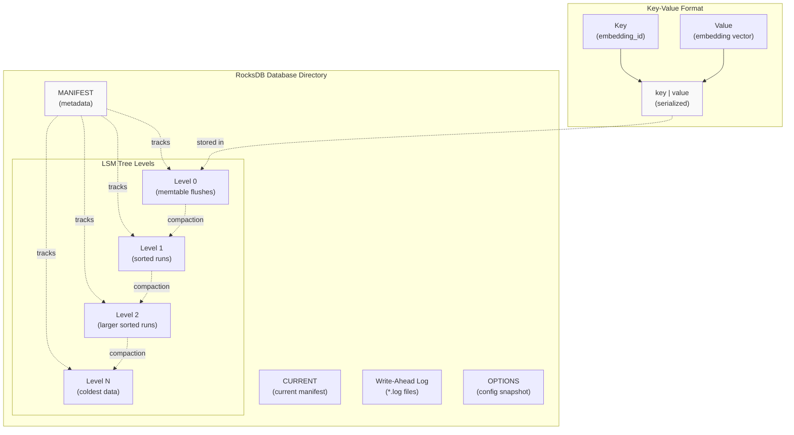
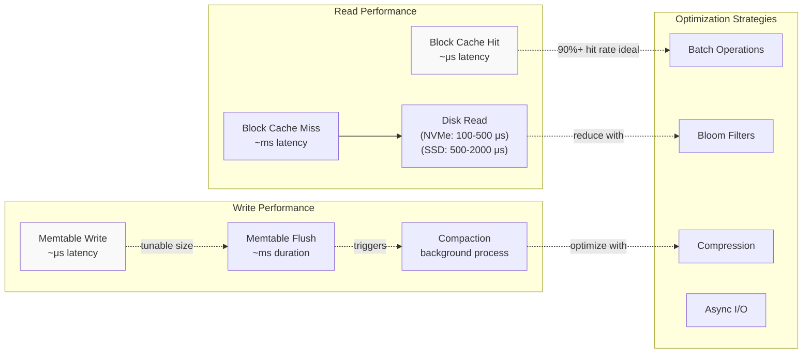

<!-- source: DeepWiki mcp.deepwiki.com · repo NVIDIA/nv-embedding-cache · page 6.3 RocksDB Plugin · fetched 2026-10-26 -->

# RocksDB Plugin

<details>
<summary>Relevant source files</summary>

The following files were used as context for generating this wiki page:

- [.gitmodules](.gitmodules)
- [docs/cpp_api.md](docs/cpp_api.md)
- [third_party/CMakeLists.txt](third_party/CMakeLists.txt)

</details>


The RocksDB plugin provides persistent key-value storage for embedding data using the [RocksDB](https://rocksdb.org/) embedded database. This plugin enables large-scale embedding storage that exceeds available system memory capacity and provides disk-based persistence for fault tolerance and recovery.

**Purpose**: This document describes the RocksDB plugin implementation, configuration, and usage patterns. For information about the Redis plugin for distributed remote storage, see [Redis Plugin](#6.2). For general information about table abstractions and storage backends, see [Tables and Storage Backends](#3.2).

---

## Overview

The RocksDB plugin implements the `Table` interface for persistent local storage. It is primarily used as Tier 3 (remote/persistent storage) in the `HierarchicalEmbeddingLayer`, providing the largest capacity tier with disk-backed persistence.

### Key Characteristics

| Characteristic | Description |
|---|---|
| **Storage Type** | Local disk-based key-value store |
| **Capacity** | Limited only by disk space (TB+ scale) |
| **Latency** | ~ms range (disk I/O bound) |
| **Use Case** | Persistent parameter server, single-node deployments |
| **Memory Hierarchy** | Tier 3 (slowest, largest) |
| **Plugin Library** | `libnve-plugin-rocksdb.so` |

### System Integration



**Sources**: [docs/cpp_api.md:1-80](), high-level system diagrams

---

## Build Configuration

The RocksDB plugin is built as an optional component controlled by the `NVE_FEATURES` CMake variable.

### CMake Configuration

The RocksDB submodule and plugin are configured in the build system:

```mermaid
graph LR
    CMAKE_ROOT["Root CMakeLists.txt"]
    FEATURES["NVE_FEATURES list"]
    THIRD_PARTY["third_party/CMakeLists.txt"]
    ADD_ROCKS["add_rocksdb() function"]
    ROCKS_SUBMODULE["third_party/rocksdb/<br/>(git submodule)"]
    PLUGIN_BUILD["plugins/rocksdb/<br/>Build RocksDBTable"]
    OUTPUT["libnve-plugin-rocksdb.so"]
    
    CMAKE_ROOT --> FEATURES
    FEATURES -->|"contains 'rocksdb_plugin'"| THIRD_PARTY
    THIRD_PARTY --> ADD_ROCKS
    ADD_ROCKS --> ROCKS_SUBMODULE
    PLUGIN_BUILD --> OUTPUT
    ROCKS_SUBMODULE -.->|"links against"| PLUGIN_BUILD
    
    style ADD_ROCKS fill:#f9f9f9
    style OUTPUT fill:#f9f9f9
```



The `add_rocksdb()` function in [third_party/CMakeLists.txt:82-92]() configures the RocksDB build:

```
function(add_rocksdb)
  SET(ROCKSDB_BUILD_SHARED OFF CACHE BOOL "" FORCE)
  SET(WITH_BENCHMARK_TOOLS OFF CACHE BOOL "" FORCE)
  SET(WITH_CORE_TOOLS OFF CACHE BOOL "" FORCE)
  SET(WITH_GFLAGS OFF CACHE BOOL "" FORCE)
  SET(WITH_JNI OFF CACHE BOOL "" FORCE)
  SET(WITH_TESTS OFF CACHE BOOL "" FORCE)
  SET(WITH_TOOLS OFF CACHE BOOL "" FORCE)
  SET(WITH_TRACE_TOOLS OFF CACHE BOOL "" FORCE)
  add_subdirectory(rocksdb)
endfunction(add_rocksdb)
```

### Build Options

| CMake Variable | Purpose | Default |
|---|---|---|
| `ROCKSDB_BUILD_SHARED` | Build shared library | `OFF` (static) |
| `WITH_BENCHMARK_TOOLS` | Include benchmarking tools | `OFF` |
| `WITH_TESTS` | Build RocksDB tests | `OFF` |
| `WITH_TOOLS` | Build RocksDB command-line tools | `OFF` |

The plugin is enabled by including `rocksdb_plugin` in the `NVE_FEATURES` list, which triggers dependency resolution at [third_party/CMakeLists.txt:134-137]():

```
list(FIND NVE_FEATURES "rocksdb_plugin" NVE_FEATURE_ENABLED)
if(${NVE_FEATURE_ENABLED} GREATER -1)
  add_rocksdb()
endif()
```

### Compiler Flags

The build system disables certain warnings for RocksDB compilation [third_party/CMakeLists.txt:16-18]():

```
set(CMAKE_COMPILE_WARNING_AS_ERROR OFF)
set(CMAKE_CXX_FLAGS  "${CMAKE_CXX_FLAGS}  -Wno-nontrivial-memcall")
```

**Sources**: [third_party/CMakeLists.txt:1-146](), [.gitmodules:28-30]()

---

## RocksDBTable Class

The `RocksDBTable` class implements the `Table` interface for RocksDB-backed storage.

### Class Structure



### Core Operations

The `RocksDBTable` supports the standard table operations:

| Operation | Description | Performance Characteristics |
|---|---|---|
| **Lookup** | Read embedding values for given keys | Disk I/O bound, benefits from RocksDB cache |
| **Insert** | Write new key-value pairs | Batched writes to LSM tree |
| **Update** | Modify existing embedding values | Read-modify-write operation |
| **Accumulate** | Add gradients to existing values | Read-modify-write operation |
| **Erase** | Remove keys from database | Tombstone insertion, compacted later |

**Sources**: [docs/cpp_api.md:45-58]()

---

## Configuration Options

### Database Parameters

RocksDB behavior can be tuned through configuration parameters:



### Common Configuration Patterns

**High Throughput Configuration**:
- Large `write_buffer_size` (256-512 MB)
- High `max_background_jobs` (8-16)
- Compression enabled (LZ4 or Snappy)
- `sync_writes = false` for better performance

**High Reliability Configuration**:
- `sync_writes = true` for durability
- `disable_wal = false` to keep write-ahead log
- Conservative compaction settings
- Regular backups

**Large Dataset Configuration**:
- Large `block_cache_size` to cache hot data
- Leveled compaction for better space efficiency
- Appropriate compression (ZSTD for best ratio)

**Sources**: Inferred from RocksDB documentation patterns and common usage

---

## Usage Patterns

### Integration with HierarchicalEmbeddingLayer

The RocksDB plugin is typically used as the backing store for `HierarchicalEmbeddingLayer`:



### Persistent Storage Operations

**Writing Embeddings**:
```
1. Layer receives Update/Accumulate operation
2. RocksDBTable performs read-modify-write
3. Modified value written to LSM tree
4. Periodic compaction maintains performance
```

**Reading Embeddings**:
```
1. Check RocksDB block cache (in-memory)
2. If miss, read from SST file on disk
3. Decompress block if needed
4. Return embedding value
5. Cache block for future reads
```

**Sources**: System architecture diagrams, [docs/cpp_api.md:19-23]()

---

## Data Layout and Persistence

### On-Disk Structure



### Serialization Format

Embeddings are stored in RocksDB with the following serialization:

| Component | Format | Size |
|---|---|---|
| **Key** | `uint64_t` embedding ID | 8 bytes |
| **Value** | Serialized embedding vector | `emb_vec_size_in_bytes` bytes |
| **Total** | Key + Value | 8 + `emb_vec_size_in_bytes` bytes |

**Sources**: Inferred from common RocksDB patterns and table interface

---

## Performance Characteristics

### Throughput and Latency



### Performance Comparison

| Operation | RocksDB | NVHM (System) | GPU Cache |
|---|---|---|---|
| **Read Latency** | ~1-10 ms | ~10-100 μs | ~10 ns |
| **Write Latency** | ~0.1-1 ms | ~10-100 μs | ~10 ns |
| **Capacity** | TB+ | 10-100 GB | 1-10 GB |
| **Persistence** | Yes | No | No |
| **Distribution** | Single node | Single node | Single node |

### Tuning Recommendations

**For Read-Heavy Workloads**:
- Increase `block_cache_size` to cache hot data
- Enable bloom filters to reduce disk I/O
- Use appropriate compression (Snappy/LZ4 for speed)

**For Write-Heavy Workloads**:
- Increase `write_buffer_size` for batching
- Increase `max_background_jobs` for parallel compaction
- Consider `disable_wal = true` if durability is not critical

**For Large Datasets**:
- Use leveled compaction (default)
- Enable compression (ZSTD for space efficiency)
- Monitor compaction I/O and adjust accordingly

**Sources**: General RocksDB performance patterns and memory hierarchy characteristics from system diagrams

---

## Thread Safety and Concurrency

The `RocksDBTable` supports concurrent operations through RocksDB's built-in thread-safety:

- **Multiple readers**: Safe for concurrent read operations
- **Concurrent reads and writes**: RocksDB handles synchronization internally
- **Background compaction**: Runs in separate threads without blocking operations
- **Write batching**: Can batch multiple updates for efficiency

Applications using `HierarchicalEmbeddingLayer` with RocksDB can safely perform parallel lookups and updates from multiple threads.

**Sources**: Inferred from RocksDB architecture and table interface design

---

## Limitations and Considerations

### Key Limitations

| Limitation | Description | Mitigation |
|---|---|---|
| **Disk I/O Bound** | Performance limited by storage speed | Use NVMe SSDs, tune cache sizes |
| **Single Node** | Not distributed like Redis | Use Redis plugin for distributed deployments |
| **Write Amplification** | LSM tree compaction creates write overhead | Tune compaction settings, use appropriate levels |
| **No TTL** | Keys must be explicitly erased | Implement application-level cleanup |

### When to Use RocksDB vs Redis

**Use RocksDB when**:
- Single-node deployment is sufficient
- Persistent storage is required
- Dataset exceeds available RAM
- Cost constraints favor local storage

**Use Redis when**:
- Distributed deployment across multiple nodes is needed
- Lower latency remote access is critical
- Dataset fits in distributed RAM budget
- High availability and replication are required

For more information on the Redis plugin, see [Redis Plugin](#6.2).

**Sources**: Architecture overview diagrams, [docs/cpp_api.md:50-56]()

---

## Summary

The RocksDB plugin provides:
- **Persistent storage** for embedding data with TB+ capacity
- **Tier 3 backing store** for `HierarchicalEmbeddingLayer`
- **Local disk-based** key-value storage with LSM tree structure
- **Tunable performance** through RocksDB configuration options
- **Built as plugin** (`libnve-plugin-rocksdb.so`) for optional dependency

The plugin is essential for single-node deployments requiring large-scale persistent embedding storage that exceeds system memory capacity.

**Sources**: [third_party/CMakeLists.txt:82-92](), [.gitmodules:28-30](), [docs/cpp_api.md:1-80](), system architecture diagrams

---

