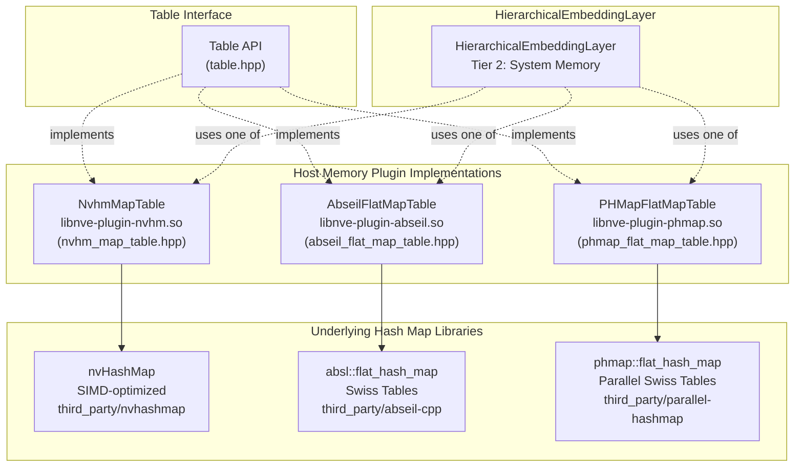
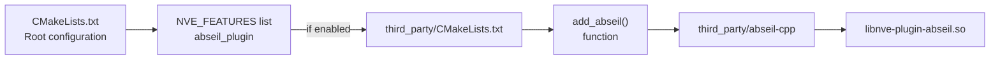
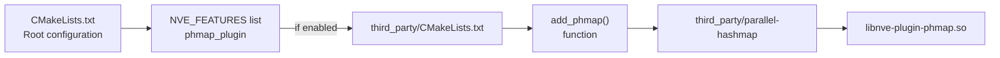
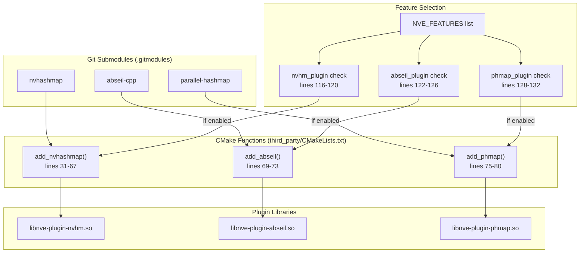
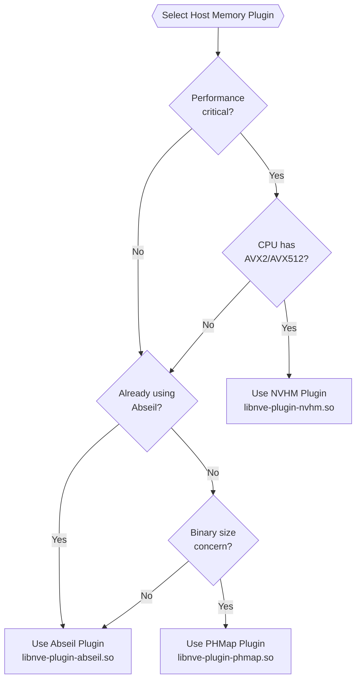

<!-- source: DeepWiki mcp.deepwiki.com · repo NVIDIA/nv-embedding-cache · page 6.4 Other Plugins · fetched 2026-10-26 -->

# Other Plugins

<details>
<summary>Relevant source files</summary>

The following files were used as context for generating this wiki page:

- [.gitmodules](.gitmodules)
- [docs/cpp_api.md](docs/cpp_api.md)
- [third_party/CMakeLists.txt](third_party/CMakeLists.txt)

</details>


This page documents the **Abseil** and **PHMap** plugin implementations for host (system) memory table storage. These plugins provide alternative hash map implementations for the system memory tier in the cache hierarchy, complementing the NVHM plugin covered in [6.1](#6.1).

For GPU memory tables, see [GpuTable](#3.2.1). For remote storage plugins, see [Redis Plugin](#6.2) and [RocksDB Plugin](#6.3). For the primary host memory plugin using NVIDIA's nvHashMap, see [NVHM Plugin](#6.1).

---

## Overview

The NV Embedding Cache SDK provides two additional host memory table plugins as alternatives to the NVHM plugin:

1. **AbseilFlatMapTable** - Based on Google's Abseil C++ library
2. **PHMapFlatMapTable** - Based on the parallel-hashmap library

These plugins implement the same `Table` interface as other table types and can be used interchangeably in the `HierarchicalEmbeddingLayer` for the system memory tier (Tier 2). Both plugins are built as separate shared libraries to minimize dependencies.

### Plugin Architecture



**Sources:** [docs/cpp_api.md:49-56](), [third_party/CMakeLists.txt:69-80]()

---

## Abseil Plugin (AbseilFlatMapTable)

The Abseil plugin provides a host memory table implementation using Google's Abseil C++ library, specifically the `absl::flat_hash_map` container (Swiss Tables).

### Implementation

The `AbseilFlatMapTable` class implements the `Table` interface using Abseil's flat hash map for key-value storage in system memory. The Swiss Tables algorithm provides good average-case performance with minimal memory overhead.

**Key characteristics:**
- Uses `absl::flat_hash_map` for storage
- Single-threaded hash map (requires external synchronization)
- Efficient memory layout with open addressing
- Good cache locality for lookups

**Class location:** [plugins/abseil/include/abseil_flat_map_table.hpp]()

### CMake Configuration

The Abseil plugin is built conditionally based on feature selection:



The `add_abseil()` function configures the Abseil build with appropriate settings:

**Configuration in [third_party/CMakeLists.txt:69-73]():**
- Disables Abseil's own testing infrastructure
- Disables test helper libraries
- Adds the `abseil-cpp` submodule

**Feature activation in [third_party/CMakeLists.txt:122-126]():**
```
list(FIND NVE_FEATURES "abseil_plugin" NVE_FEATURE_ENABLED)
if(${NVE_FEATURE_ENABLED} GREATER -1)
  add_abseil()
endif()
```

### Use Cases

The Abseil plugin is suitable when:
- You need a well-tested, industry-standard hash map implementation
- Your application already uses Abseil for other purposes
- You want predictable, consistent performance without SIMD-specific optimizations
- You're deploying on platforms where NVHM's SIMD optimizations aren't available

**Sources:** [third_party/CMakeLists.txt:69-73](), [third_party/CMakeLists.txt:122-126](), [docs/cpp_api.md:52](), [.gitmodules:22-24]()

---

## PHMap Plugin (PHMapFlatMapTable)

The PHMap plugin provides a host memory table implementation using the parallel-hashmap library, which extends Google's Swiss Tables design with parallel features.

### Implementation

The `PHMapFlatMapTable` class implements the `Table` interface using the parallel-hashmap's `phmap::flat_hash_map` container, which is based on Abseil's Swiss Tables but with additional optimizations.

**Key characteristics:**
- Uses `phmap::flat_hash_map` for storage
- Header-only library (faster compilation)
- Similar performance to Abseil with lower memory footprint
- Open-source alternative to Abseil's implementation

**Class location:** [plugins/phmap/include/phmap_flat_map_table.hpp]()

### CMake Configuration

The PHMap plugin is built conditionally based on feature selection:



The `add_phmap()` function configures the parallel-hashmap build:

**Configuration in [third_party/CMakeLists.txt:75-80]():**
- Disables the "master project" mode
- Disables tests and examples
- Adds the `parallel-hashmap` submodule

**Feature activation in [third_party/CMakeLists.txt:128-132]():**
```
list(FIND NVE_FEATURES "phmap_plugin" NVE_FEATURE_ENABLED)
if(${NVE_FEATURE_ENABLED} GREATER -1)
  add_phmap()
endif()
```

### Use Cases

The PHMap plugin is suitable when:
- You want Swiss Tables performance without the full Abseil dependency
- You prefer a lightweight, header-only implementation
- You need a drop-in replacement for `std::unordered_map` with better performance
- Build time and binary size are concerns

**Sources:** [third_party/CMakeLists.txt:75-80](), [third_party/CMakeLists.txt:128-132](), [docs/cpp_api.md:53](), [.gitmodules:25-27]()

---

## Build System Integration

All host memory plugins follow a consistent pattern in the build system:

### Dependency Management



### CMake Function Pattern

Each plugin follows this pattern in [third_party/CMakeLists.txt]():

1. **Define configuration function** - Encapsulates CMake variables to avoid scope pollution
2. **Set library-specific options** - Disables tests, examples, and unnecessary features
3. **Add subdirectory** - Includes the third-party library's CMake configuration
4. **Conditional inclusion** - Only built if the corresponding feature is in `NVE_FEATURES`

**Sources:** [third_party/CMakeLists.txt:29-145](), [.gitmodules:1-37]()

---

## Choosing Between Host Memory Plugins

The SDK provides three host memory table implementations with different characteristics:

### Feature Comparison

| Feature | NVHM | Abseil | PHMap |
|---------|------|--------|-------|
| **Base Library** | nvHashMap | Abseil C++ | parallel-hashmap |
| **Optimization** | SIMD (AVX/SSE) | Cache-friendly | Cache-friendly |
| **Thread Safety** | Built-in | External | External |
| **Memory Model** | Lock-free | Open addressing | Open addressing |
| **Dependencies** | NVIDIA library | Google library | Header-only |
| **Best For** | High performance | Industry standard | Lightweight |

### Performance Characteristics

**NVHM (NvhmMapTable):**
- **Fastest** for most workloads due to SIMD optimizations
- Requires AVX/SSE CPU support
- Higher CPU utilization
- Recommended for production deployments

**Abseil (AbseilFlatMapTable):**
- **Balanced** performance across platforms
- More predictable than SIMD-based approaches
- Lower CPU requirements
- Good for portable deployments

**PHMap (PHMapFlatMapTable):**
- **Similar** to Abseil with slightly lower overhead
- Smaller dependency footprint
- Header-only reduces link time
- Good for embedded or constrained environments

### Selection Guidelines



**Recommendation:** For most production deployments, use the **NVHM plugin** ([6.1](#6.1)) as it provides the best performance. Use Abseil or PHMap plugins when:
- Deploying on non-x86 architectures without SIMD support
- Integrating with existing Abseil-based codebases
- Minimizing dependencies or binary size

**Sources:** [docs/cpp_api.md:49-56](), [third_party/CMakeLists.txt:29-145]()

---

## Runtime Usage

Host memory table plugins are loaded dynamically at runtime. The specific plugin used is determined by the table configuration passed to `HierarchicalEmbeddingLayer`.

### Plugin Loading Requirements

All host memory plugins must be present in the library search path:

- **Linux:** Add plugin directory to `LD_LIBRARY_PATH`
- **Required libraries:** `libnve-plugin-abseil.so` or `libnve-plugin-phmap.so`
- **Core dependency:** `libnve-common.so` must also be in the path

### API Usage

The C++ API for all host memory table plugins is identical since they implement the same `Table` interface defined in [include/table.hpp](). The specific plugin is selected at instantiation time based on the table type parameter.

**Example instantiation patterns:**
- Create via factory methods in embedding layer configuration
- Specify table type in hierarchical layer constructor
- Plugin library is loaded automatically when table is instantiated

For detailed API documentation, see [C++ API Reference](#4) and specifically [Table API](#4.2).

**Sources:** [docs/cpp_api.md:46-58](), [docs/cpp_api.md:10-12]()

---

## Summary

The Abseil and PHMap plugins provide portable, well-tested alternatives to the NVHM plugin for system memory caching. Both are based on Google's Swiss Tables design and offer good general-purpose performance without requiring SIMD instruction support.

**Key takeaways:**
- Both plugins implement the standard `Table` interface
- Built conditionally via `NVE_FEATURES` CMake list
- Managed as git submodules in `third_party/`
- Suitable for non-x86 platforms or when minimizing dependencies
- NVHM plugin remains the recommended choice for performance-critical x86 deployments

For complete details on the plugin architecture and build system, see [Build System Details](#10) and [Feature Selection](#10.2).

**Sources:** [third_party/CMakeLists.txt:69-132](), [docs/cpp_api.md:49-58](), [.gitmodules:22-27]()

---

