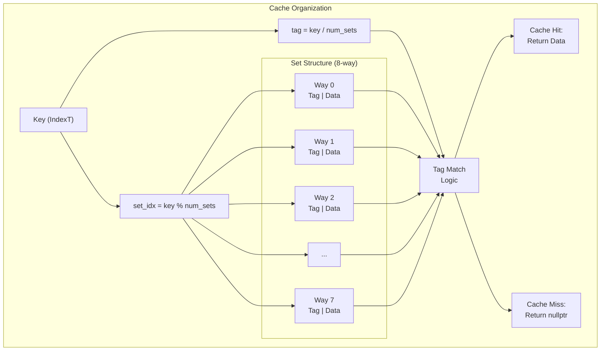
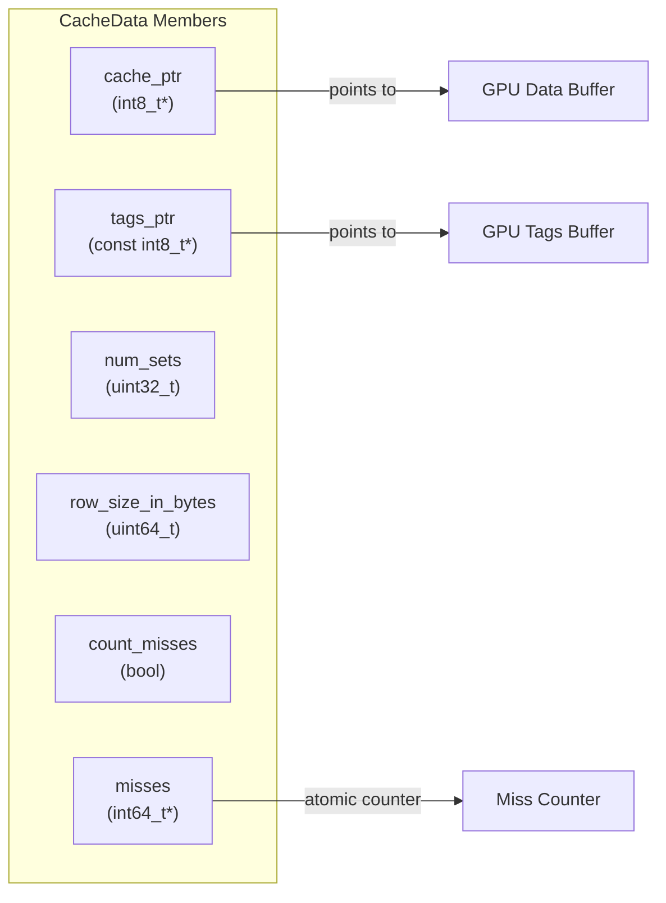
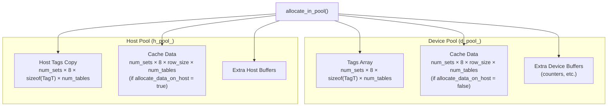
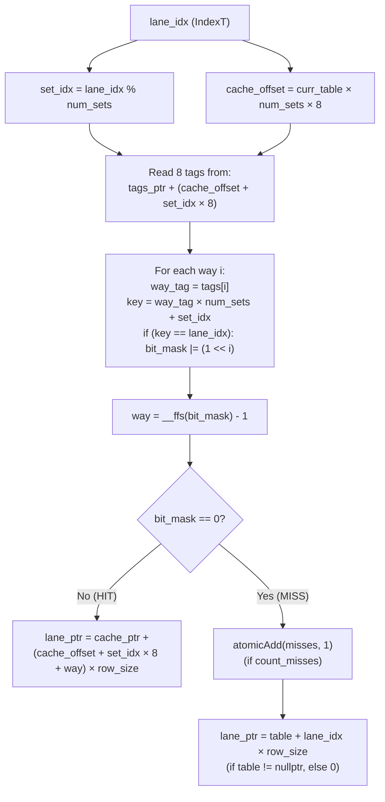
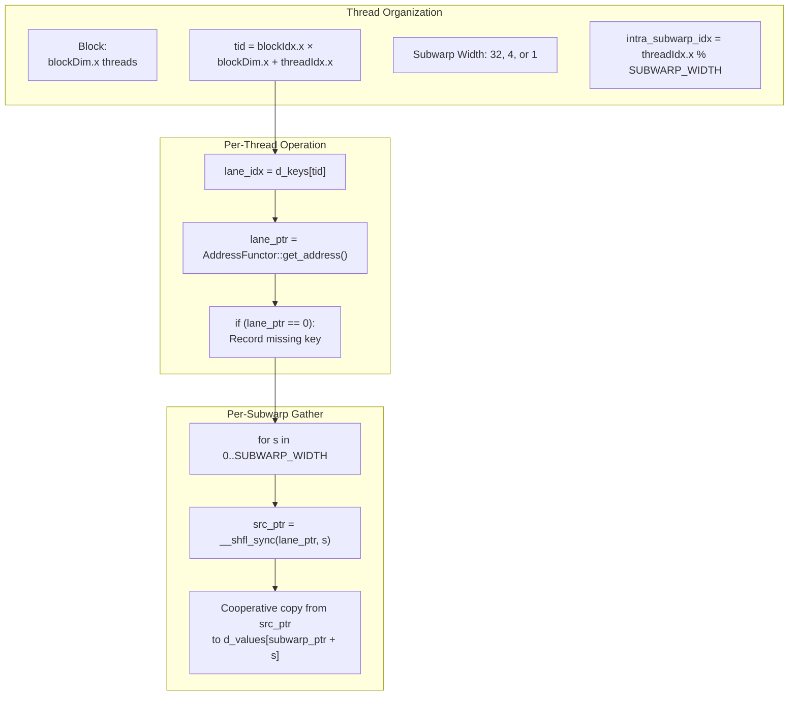
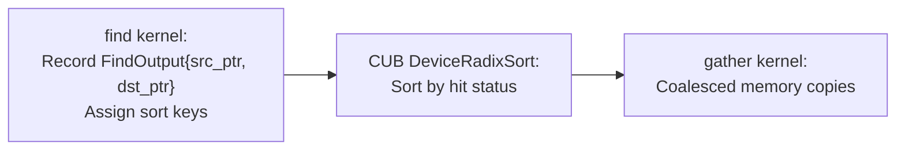
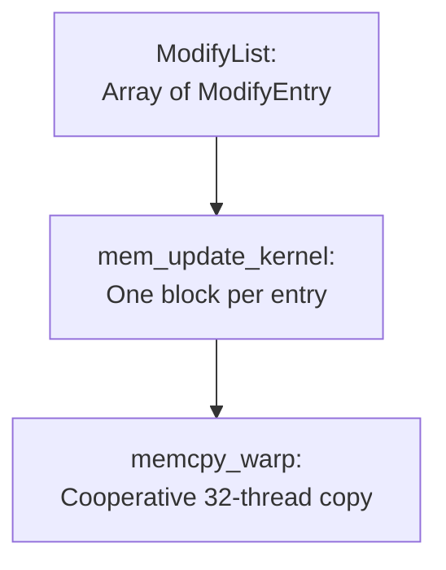
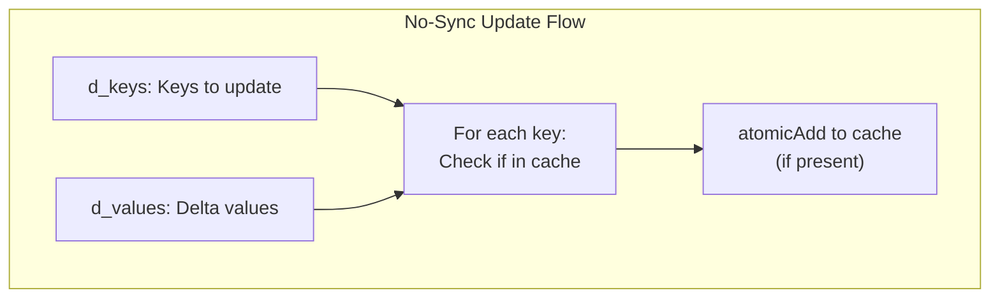
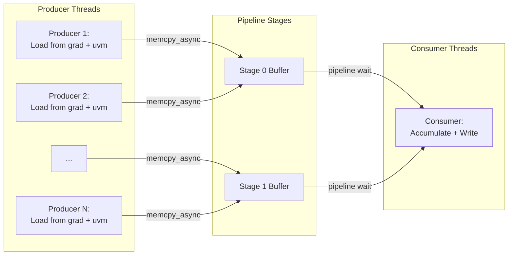

<!-- source: DeepWiki mcp.deepwiki.com · repo NVIDIA/nv-embedding-cache · page 7 GPU Embedding Cache Internals · fetched 2026-10-26 -->

# GPU Embedding Cache Internals

<details>
<summary>Relevant source files</summary>

The following files were used as context for generating this wiki page:

- [include/ecache/ec_set_associative.cuh](include/ecache/ec_set_associative.cuh)
- [include/ecache/ec_set_associative.h](include/ecache/ec_set_associative.h)
- [include/ecache/embed_cache.h](include/ecache/embed_cache.h)

</details>


This page provides a detailed technical examination of the low-level GPU embedding cache implementation, focusing on the set-associative cache architecture, CUDA kernel implementations, and performance optimizations. This documentation is intended for developers who need to understand or extend the cache internals.

For high-level usage and API documentation, see [C++ API Reference](#4). For information about cache configuration strategies and when to use different cache types, see [Cache Configuration Strategies](#1.2).

## Architecture Overview

The GPU embedding cache is implemented as a set-associative cache optimized for the power-law access patterns typical in recommender systems. The implementation is template-based, with `EmbedCacheSA<IndexT, TagT>` serving as the core class.

**Set-Associative Cache Structure**



Sources: [include/ecache/ec_set_associative.h:97-750](), [include/ecache/ec_set_associative.cuh:42-76]()

### Key Design Decisions

The cache uses an 8-way set-associative design (`NUM_WAYS = 8`) where:
- Each key is mapped to a set using modulo arithmetic: `set_idx = key % num_sets`
- The tag is computed as: `tag = key / num_sets`
- Each set contains 8 ways, each storing a tag-data pair
- Tags are stored separately from data for efficient parallel lookup

Sources: [include/ecache/ec_set_associative.h:749]()

## Core Data Structures

### CacheData Structure

The `CacheData` structure encapsulates the essential information needed for GPU kernels to access the cache:



| Field | Type | Purpose |
|-------|------|---------|
| `cache_ptr` | `int8_t*` | Pointer to the cache data buffer in GPU memory |
| `tags_ptr` | `const int8_t*` | Pointer to the tags buffer in GPU memory |
| `num_sets` | `uint32_t` | Number of sets in the cache |
| `row_size_in_bytes` | `uint64_t` | Size of each embedding vector in bytes |
| `count_misses` | `bool` | Whether to count cache misses |
| `misses` | `int64_t*` | Device pointer to atomic miss counter |

Sources: [include/ecache/ec_set_associative.h:103-111]()

### CacheConfig Structure

The `CacheConfig` structure defines cache initialization parameters:

| Field | Type | Purpose |
|-------|------|---------|
| `cache_sz_in_bytes` | `size_t` | Total cache memory budget |
| `embed_width_in_bytes` | `uint64_t` | Size of each embedding vector |
| `num_tables` | `uint64_t` | Number of embedding tables |
| `decay_rate` | `float` | Counter decay rate for LFU eviction (default: 0.95) |
| `allocate_data_on_host` | `bool` | Whether to allocate data on host memory (for GPU-managed host cache) |

Sources: [include/ecache/ec_set_associative.h:113-121]()

### ModifyEntry Structure

The `ModifyEntry` structure represents a single cache modification operation:

| Field | Type | Purpose |
|-------|------|---------|
| `src` | `const int8_t*` | Source data pointer |
| `dst` | `int8_t*` | Destination pointer in cache |
| `set` | `uint32_t` | Set index to modify |
| `way` | `uint32_t` | Way index within the set |
| `tag` | `TagT` | Tag value to write |

Sources: [include/ecache/ec_set_associative.h:123-130]()

## Memory Layout

The cache allocates memory from two pools: device pool (`d_pool_`) and host pool (`h_pool_`). The layout is carefully organized to ensure alignment and minimize fragmentation.

**Memory Pool Organization**



### Memory Calculation

The number of sets is calculated based on the cache size budget:

```
sz_per_set = tag_size_per_set + entry_size_per_set + counter_size_per_set
num_sets = (cache_sz_in_bytes / num_tables) / sz_per_set

where:
  tag_size_per_set = ALIGN(sizeof(TagT) × 8, 16)
  entry_size_per_set = ALIGN(embed_width_in_bytes × 8, 16)
```

Sources: [include/ecache/ec_set_associative.h:690-694](), [include/ecache/ec_set_associative.h:676-683]()

### Initialization Process

The `init()` method performs the following steps:

1. Calculate allocation sizes using `calc_allocation_size()`
2. Allocate device and host memory pools
3. Allocate pointers within pools using `allocate_in_pool()`
4. Initialize tags to `INVALID_IDX` (-1)
5. Initialize extra buffers (counters for LFU, etc.)

Sources: [include/ecache/ec_set_associative.h:326-401]()

## Address Calculation

The core of the cache lookup is the address calculation that determines whether a key is present and where its data resides.

**Address Calculation Flow**



### AddressFunctor Specializations

The `AddressFunctor` template is specialized for different tag types to optimize address calculation:

**uint16_t Tag Specialization**

For `uint16_t` tags, a vectorized load is used to read all 8 ways at once:

```
uint4 ways_vec = *(uint4*)(tags_ptr + offset);
uint16_t* ways = (uint16_t*)(&ways_vec);
```

This loads all 8 tags (8 × 16 bits = 128 bits = 1 × uint4) in a single memory transaction.

Sources: [include/ecache/ec_set_associative.cuh:79-108]()

**Other Tag Type Specializations**

For `uint32_t`, `uint64_t`, `int32_t`, and `int64_t` tags, the implementation uses the generic `embed_cache_get_address()` function:

Sources: [include/ecache/ec_set_associative.cuh:113-151]()

## Query Operations

Query operations are the most performance-critical path in the cache. The implementation provides several optimized query kernels.

### Query Kernel with Missing Keys

The primary query kernel returns both hit data and information about missing keys:

**Query Kernel Structure (`query<IndexT, TagT, SUBWARP_WIDTH, DataType>`)**



**Implementation Details:**

1. **Thread Assignment**: Each thread handles one key lookup
2. **Address Calculation**: Uses `embed_cache_get_way_mask()` to check for hits
3. **Miss Recording**: Atomically increments `d_missing_len` and records index/key
4. **Data Gathering**: Uses warp shuffle to broadcast addresses and cooperative copying

The kernel is templated on `SUBWARP_WIDTH` (32, 4, or 1) and `DataType` (uint4, uint32_t, uint8_t) to optimize for different row sizes:

| Row Size Condition | SUBWARP_WIDTH | DataType |
|-------------------|---------------|----------|
| `row_size % (16 × 32) == 0` | 32 | `uint4` |
| `row_size % (4 × 32) == 0` | 32 | `uint32_t` |
| `row_size % (16 × 4) == 0` | 4 | `uint4` |
| Otherwise | 32 | `uint8_t` |

Sources: [include/ecache/ec_set_associative.cuh:259-322](), [include/ecache/ec_set_associative.h:586-616]()

### Query Kernel with Hit Mask

An alternative query kernel returns a bit mask indicating hits rather than recording missing keys:

```
if d_keys[i] is in cache:
    d_hit_mask[i / 32] |= (1 << (i % 32))
```

This is useful when the caller wants to process hits and misses differently without separate lists.

Sources: [include/ecache/ec_set_associative.cuh:384-462]()

### Sort-Gather Optimization

For very large tables, the cache provides a sort-gather optimization that:

1. **Find Phase**: Determines which keys are hits/misses and records their addresses
2. **Sort Phase**: Sorts keys by hit status and address using CUB's `DeviceRadixSort`
3. **Gather Phase**: Performs coalesced memory accesses in sorted order



The sort key is chosen such that cache hits come first, enabling better memory coalescing:

```
sort_key = hit ? (key + offset) : (key % offset)
```

Sources: [include/ecache/ec_set_associative.cuh:826-869](), [include/ecache/ec_set_associative.cuh:872-953](), [include/ecache/ec_set_associative.h:479-535]()

## Update Operations

Update operations modify the cache contents. The cache supports several update modes.

### Update Kernel (Replace)

The basic update kernel replaces cache entries with new data:



The kernel uses `memcpy_warp()` to efficiently copy data with the entire warp participating.

Sources: [include/ecache/ec_set_associative.cuh:153-160]()

### Update-Accumulate Kernel

The accumulate kernel adds deltas to existing cache entries rather than replacing them:

```
for each element in row:
    atomicAdd(dst_ptr[i], src_ptr[i])
```

This is used for gradient accumulation in training. The kernel is templated on the data type (FP16 or FP32):

Sources: [include/ecache/ec_set_associative.cuh:162-180]()

### Update-Accumulate with Quantization

A specialized kernel handles INT8 input with scale factor, accumulating into FP16 or FP32 cache:

```
scale = *(float*)(src + input_sz)
for each element:
    val = static_cast<CacheDataT>(int8_input[i]) * scale
    atomicAdd(dst[i], val)
```

This enables efficient gradient communication with reduced bandwidth.

Sources: [include/ecache/ec_set_associative.cuh:201-233]()

### Update-Accumulate No-Sync

For cases where synchronization with lookups is not needed, an optimized no-sync kernel performs accumulation directly:



Each thread handles one key, looks up its address, and atomically accumulates if present.

Sources: [include/ecache/ec_set_associative.cuh:324-381]()

### Update-Accumulate Fused with Pipeline

An experimental fused kernel uses CUDA pipeline for maximum performance:

**Pipeline Architecture**



The pipeline allows overlapping of memory loads with computation, improving throughput for accumulation operations.

Sources: [include/ecache/ec_set_associative.cuh:645-766]()

## Tag Operations

Tags determine which keys are resident in the cache. The cache provides kernels for tag updates and invalidation.

### Tag Update Kernel

Updates tags after inserting new entries:

```
for each entry in ModifyList:
    tags[entry.set × 8 + entry.way] = entry.tag
```

Sources: [include/ecache/ec_set_associative.cuh:247-257]()

### Tag Invalidate Kernel

Invalidates cache entries by setting their tags to -1:

```
for each entry in ModifyList:
    tags[entry.set × 8 + entry.way] = -1
```

Sources: [include/ecache/ec_set_associative.cuh:235-245]()

## Performance Optimizations

### Vectorized Loads

The cache uses vectorized loads (`uint4`, `uint2`) whenever alignment permits:

```cpp
// Load 16 bytes at once for uint16_t tags
uint4 ways_vec = *(uint4*)(tags_ptr + offset);
```

### Warp-Level Primitives

Extensive use of warp shuffle and cooperative operations:
- `__shfl_sync()` for broadcasting addresses
- `__activemask()` for dynamic warp management
- Cooperative copying with all threads in a subwarp

### Template Specialization

The code heavily uses template specialization to generate optimized code paths:
- Different tile sizes (SUBWARP_WIDTH = 32, 4, 1)
- Different data types (uint4, uint32_t, uint8_t)
- Different tag types (uint16_t, uint32_t, uint64_t)

### Memory Coalescing

The sort-gather optimization ensures memory accesses are coalesced by:
1. Sorting by memory address
2. Processing hits first (cache accesses) then misses (table accesses)
3. Using appropriate unroll factors in the gather kernel

Sources: [include/ecache/ec_set_associative.cuh:872-953]()

## Kernel Launch Configuration

The cache uses carefully chosen launch configurations based on row size and operation type:

### Query Kernels

```cpp
blockX = 32
blockY = 4
block_size = blockX × blockY = 128
n_block = (len + block_size - 1) / block_size
```

### Update Kernels

```cpp
// One block per modify entry
grid_size = (num_entries)
block_size = 32  // One warp
```

### Fused Pipeline Kernel

```cpp
block_y = 16  // 15 producers, 1 consumer
block_dims = (32, 16)
keys_per_block = 32 × 15 = 480
```

Sources: [include/ecache/ec_set_associative.cuh:593-615](), [include/ecache/ec_set_associative.cuh:777-800]()

## Error Handling

The cache uses exception-based error handling internally with the `ECException` class, converting to error codes at API boundaries:

```cpp
try {
    // Cache operation
    return ECERROR_SUCCESS;
}
catch(const ECException& e) {
    LOG_ERROR_AND_RETURN(e);
}
```

The `CHECK_ERR_AND_THROW` and `CACHE_CUDA_ERR_CHK_AND_THROW` macros provide consistent error checking throughout.

Sources: [include/ecache/embed_cache.h:52-76](), [include/ecache/ec_set_associative.h:95]()

## Thread Safety

The cache provides thread safety through:

1. **Read-Write Locks**: The `custom_flow_mutex_` allows concurrent lookups while serializing modifications
2. **Separate Contexts**: Each thread should use its own `LookupContextHandle` and `ModifyContextHandle`
3. **Event Synchronization**: The `IECEvent` interface ensures proper ordering between lookups and modifications

Sources: [include/ecache/ec_set_associative.h:734-746](), [include/ecache/ec_set_associative.h:469-477]()

## Related Pages

For details on specific subsystems covered here:
- [Set-Associative Cache Design](#7.1) - Detailed cache architecture and eviction policies
- [CUDA Kernel Implementation](#7.2) - In-depth kernel analysis
- [Cache Eviction Policies](#7.3) - LRU, LFU, and custom insertion heuristics
- [NoCache Implementation](#7.4) - Passthrough implementation details

For higher-level context:
- [Core Concepts](#3) - Understanding layers, tables, and memory hierarchy
- [Low-Level GPU Cache API](#4.3) - Direct cache API usage

---

