<!-- source: DeepWiki mcp.deepwiki.com · repo NVIDIA/nv-embedding-cache · page 7.1 Set-Associative Cache Design · fetched 2026-10-26 -->

# Set-Associative Cache Design

<details>
<summary>Relevant source files</summary>

The following files were used as context for generating this wiki page:

- [docs/cpp_api.md](docs/cpp_api.md)
- [include/ecache/ec_set_associative.cuh](include/ecache/ec_set_associative.cuh)
- [include/ecache/ec_set_associative.h](include/ecache/ec_set_associative.h)

</details>


## Purpose and Scope

This document describes the architectural design of the set-associative GPU embedding cache, which is the core caching mechanism used by the NV Embedding Cache SDK. The cache is implemented in the `EmbedCacheSA` class template and is optimized for power-law access patterns typical in recommendation systems.

This page focuses on the cache's structural design, data organization, and address calculation mechanisms. For details on CUDA kernel implementations, see [CUDA Kernel Implementation](#7.2). For cache eviction strategies, see [Cache Eviction Policies](#7.3). For high-level layer usage, see [GPU Embedding Cache API](#4.3).

## Set-Associative Cache Fundamentals

The embedding cache uses an 8-way set-associative design. In a set-associative cache, the cache storage is divided into **sets**, and each set contains multiple **ways** (slots) where data can be stored. This design balances the flexibility of a fully-associative cache with the speed of a direct-mapped cache.

### Mapping Keys to Cache Locations

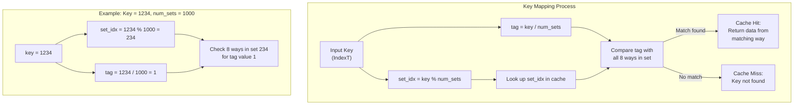

**Sources:** [include/ecache/ec_set_associative.cuh:43-76](), [include/ecache/ec_set_associative.cuh:279-282]()

### Why 8-Way Set Associative?

An 8-way design (`NUM_WAYS = 8`) provides:
- **Reduced Conflict Misses**: Multiple keys mapping to the same set can coexist
- **Efficient GPU Memory Access**: 8 ways can be checked in parallel using warp operations
- **Balanced Performance**: Trade-off between hardware complexity and hit rate

**Sources:** [include/ecache/ec_set_associative.h:749]()

## Architecture Overview

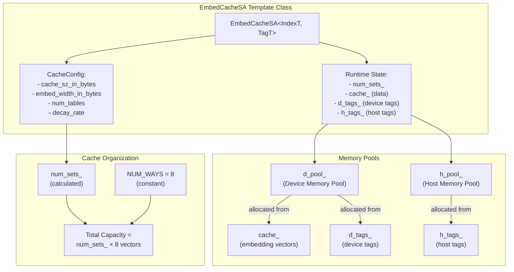

**Sources:** [include/ecache/ec_set_associative.h:98-184](), [include/ecache/ec_set_associative.h:738-744]()

## Data Structures

### CacheConfig

The `CacheConfig` struct defines cache parameters at construction time:

| Field | Type | Description |
|-------|------|-------------|
| `cache_sz_in_bytes` | `size_t` | Total memory allocated to the cache (including tags) |
| `embed_width_in_bytes` | `uint64_t` | Size of each embedding vector in bytes |
| `num_tables` | `uint64_t` | Number of embedding tables to support (default: 1) |
| `decay_rate` | `float` | Decay rate for LFU counter updates (default: 0.95) |
| `allocate_data_on_host` | `bool` | Whether to allocate cache data in host memory (for UVM) |

**Sources:** [include/ecache/ec_set_associative.h:113-121]()

### CacheData

The `CacheData` struct is passed to CUDA kernels for runtime cache access:

| Field | Type | Description |
|-------|------|-------------|
| `cache_ptr` | `int8_t*` | Pointer to embedding vector storage |
| `tags_ptr` | `const int8_t*` | Pointer to tag array |
| `num_sets` | `uint32_t` | Number of sets in the cache |
| `row_size_in_bytes` | `uint64_t` | Size of each embedding row |
| `count_misses` | `bool` | Whether to count cache misses |
| `misses` | `int64_t*` | Device pointer for miss counter |

**Sources:** [include/ecache/ec_set_associative.h:103-111](), [include/ecache/ec_set_associative.h:186-203]()

### ModifyEntry and ModifyList

Used for batched cache modification operations:

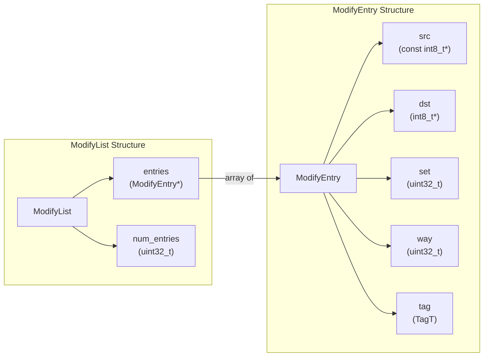

**Sources:** [include/ecache/ec_set_associative.h:123-144]()

## Memory Layout

### Single Table Layout

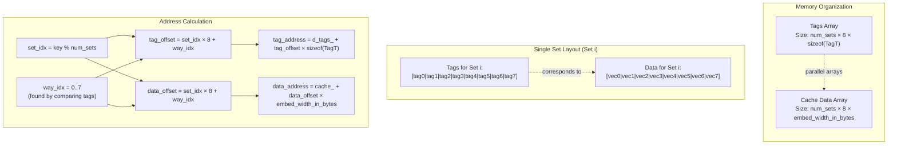

**Sources:** [include/ecache/ec_set_associative.h:353-387](), [include/ecache/ec_set_associative.h:675-694]()

### Multi-Table Layout

For supporting multiple embedding tables, storage is partitioned:

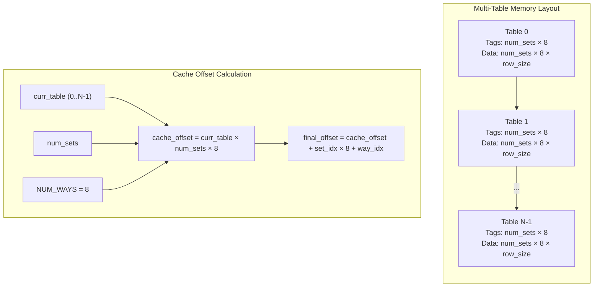

**Sources:** [include/ecache/ec_set_associative.cuh:45](), [include/ecache/ec_set_associative.cuh:280](), [include/ecache/ec_set_associative.cuh:343]()

## Address Calculation

### Way Mask Generation

The core operation is finding which way (if any) contains a given key:

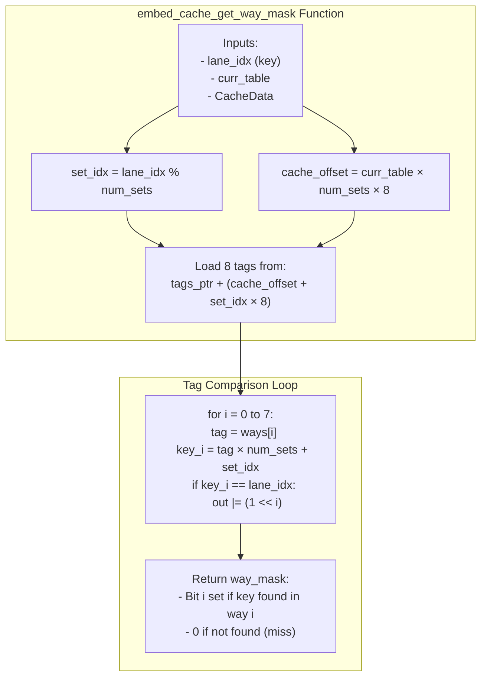

**Sources:** [include/ecache/ec_set_associative.cuh:42-58]()

### Optimized Tag Loading for uint16_t

For the common case of `TagT = uint16_t`, tags are loaded in a single vectorized operation:

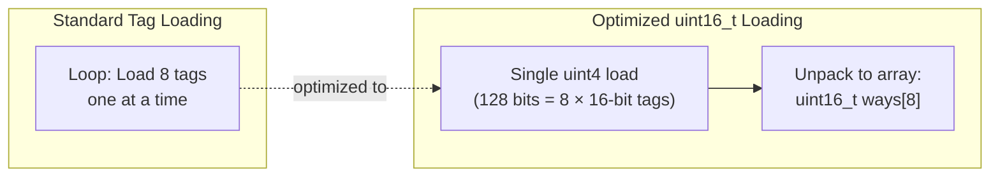

**Sources:** [include/ecache/ec_set_associative.cuh:79-108]()

### Complete Address Calculation

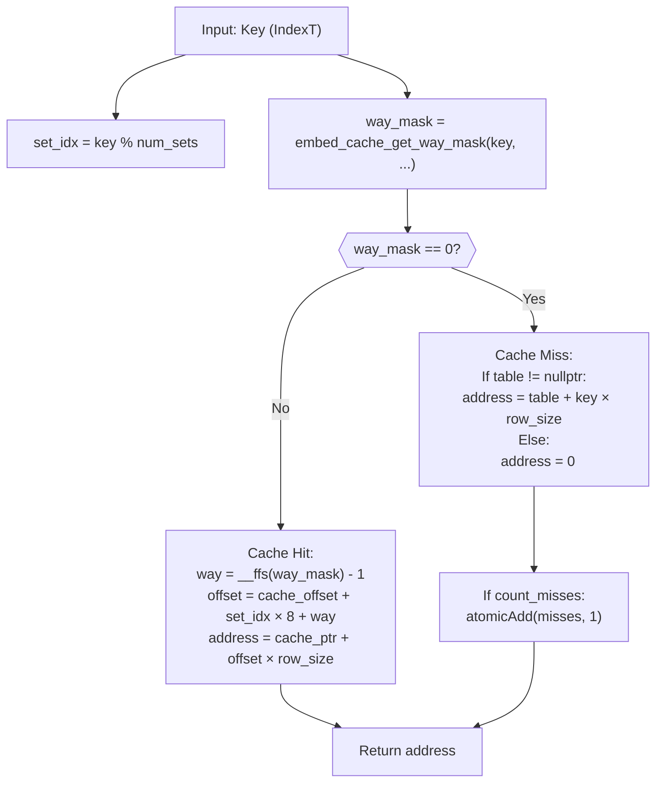

**Sources:** [include/ecache/ec_set_associative.cuh:60-76](), [include/ecache/ec_set_associative.cuh:82-107]()

## Implementation Classes

### EmbedCacheSA Class Hierarchy

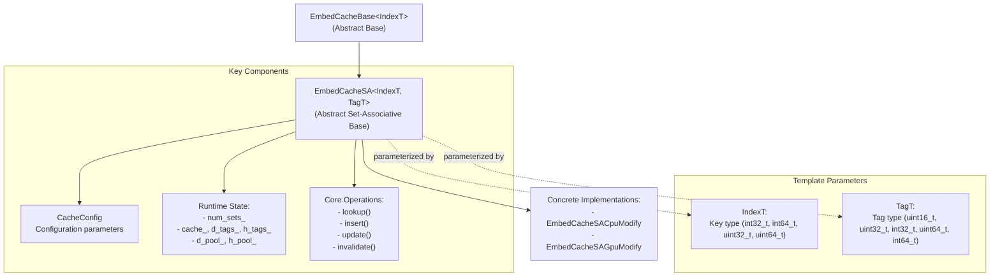

**Sources:** [include/ecache/ec_set_associative.h:98-99](), [include/ecache/ec_set_associative.h:178-183]()

### Key Methods

| Method | Purpose | Parameters |
|--------|---------|------------|
| `init()` | Initialize cache, allocate memory pools | None |
| `calc_allocation_size()` | Calculate required memory | `CacheAllocationSize& out` |
| `lookup()` | Query cache for keys | `d_keys`, `d_values`, `d_missing_keys`, etc. |
| `insert()` | Add keys to cache with eviction | `keys`, `priority`, `data`, `table_index` |
| `update()` | Modify existing entries | `keys`, `d_values`, `table_index` |
| `update_accumulate()` | Accumulate gradients into entries | `keys`, `d_values`, `table_index` |
| `invalidate()` | Remove keys from cache | `keys`, `table_index` |
| `clear_cache()` | Reset all cache entries | `stream` |

**Sources:** [include/ecache/ec_set_associative.h:326-401](), [include/ecache/ec_set_associative.h:411-467](), [include/ecache/ec_set_associative.h:604-638]()

### AddressFunctor Template Specialization

The address calculation is encapsulated in `AddressFunctor` with specializations for different tag types:

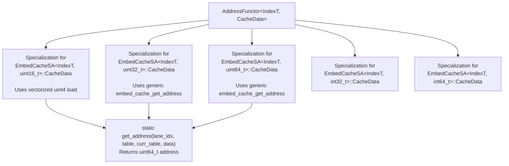

**Sources:** [include/ecache/ec_set_associative.cuh:79-151]()

## Memory Pool Allocation

The cache uses pre-allocated memory pools for all internal buffers:

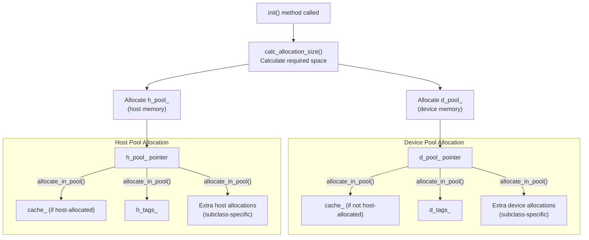

The `allocate_in_pool()` helper method [include/ecache/ec_set_associative.h:698-727]() carves out aligned regions from the memory pools without requiring multiple allocation calls.

**Sources:** [include/ecache/ec_set_associative.h:326-401](), [include/ecache/ec_set_associative.h:359-387]()

## Cache Capacity Calculation

The number of sets is calculated to fit within the allocated memory:

```
sz_per_set = get_tag_size_per_set() + get_entry_size_per_set() + get_counter_size_per_set()
num_sets = (cache_sz_in_bytes / num_tables) / sz_per_set

where:
  get_tag_size_per_set() = ALIGN(sizeof(TagT) × 8, 16)
  get_entry_size_per_set() = ALIGN(embed_width_in_bytes × 8, 16)
  
Total cache capacity = num_sets × 8 embedding vectors per table
```

**Sources:** [include/ecache/ec_set_associative.h:675-694](), [include/ecache/ec_set_associative.h:584-587]()

## Thread Safety

The cache provides read-write locking for "custom flow" operations:

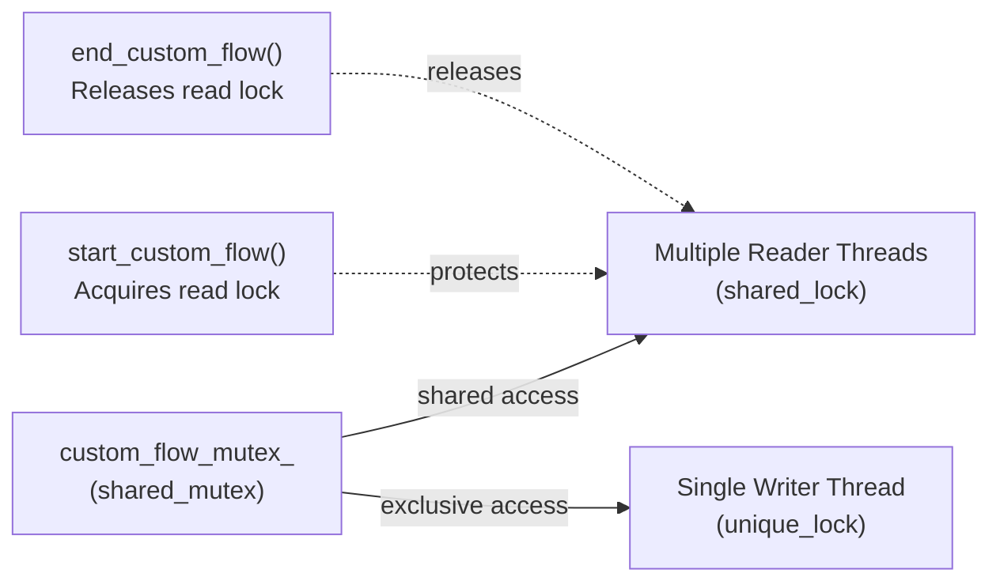

This allows concurrent lookups while ensuring exclusive access during modifications.

**Sources:** [include/ecache/ec_set_associative.h:469-477](), [include/ecache/ec_set_associative.h:734-746]()

---

