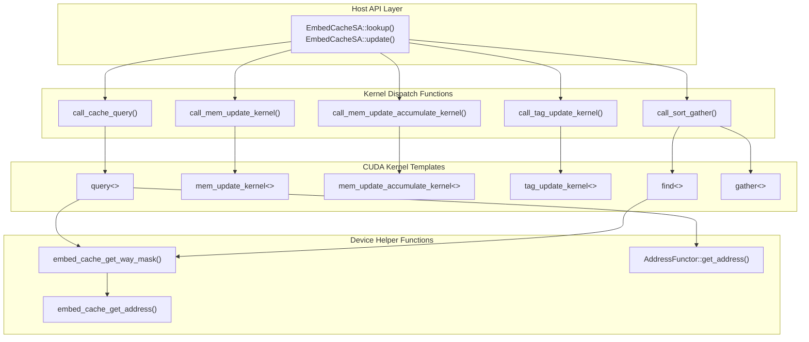
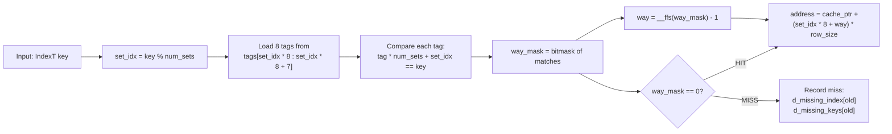
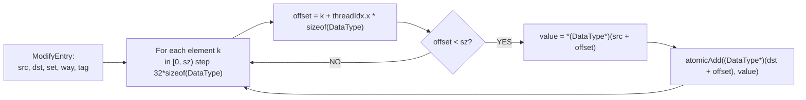
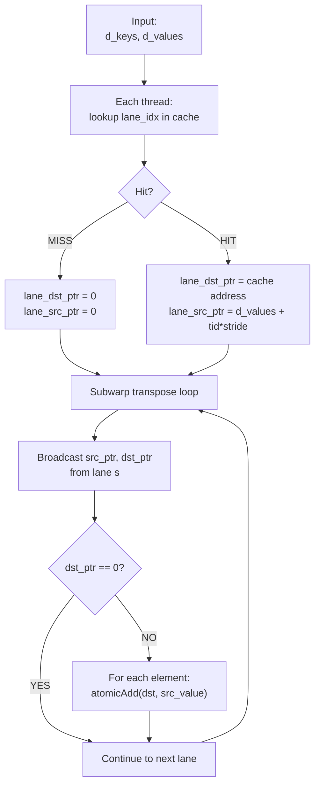
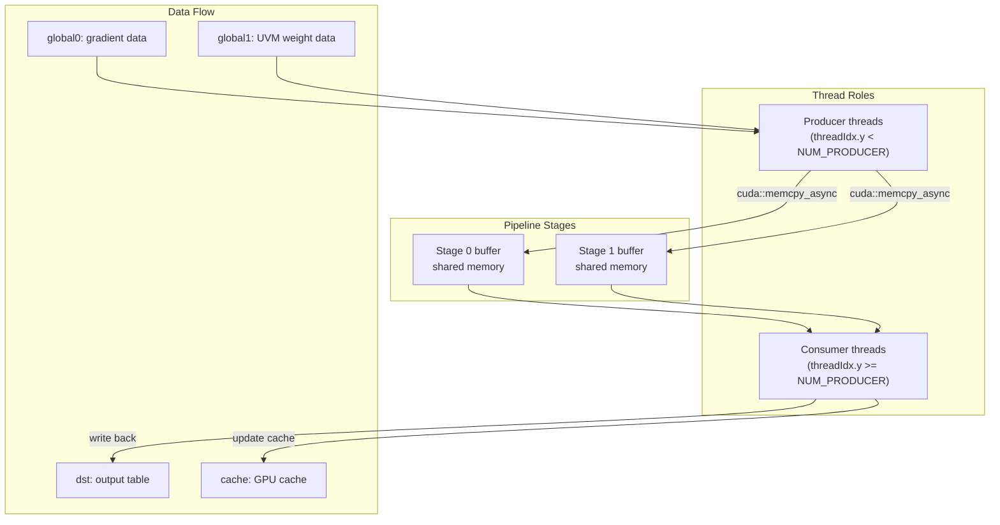
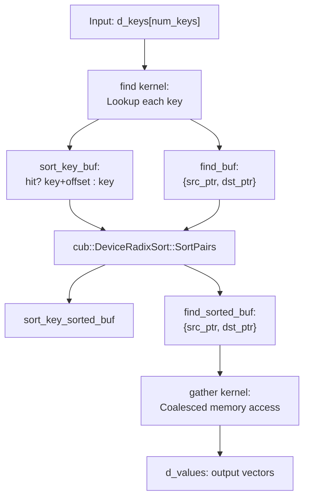
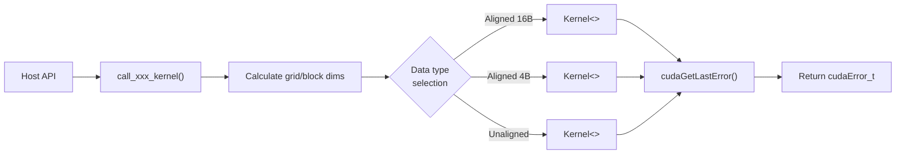

<!-- source: DeepWiki mcp.deepwiki.com · repo NVIDIA/nv-embedding-cache · page 7.2 CUDA Kernel Implementation · fetched 2026-10-26 -->

# CUDA Kernel Implementation

<details>
<summary>Relevant source files</summary>

The following files were used as context for generating this wiki page:

- [include/ecache/ec_set_associative.cuh](include/ecache/ec_set_associative.cuh)
- [include/ecache/ec_set_associative.h](include/ecache/ec_set_associative.h)

</details>


This page provides a detailed technical reference for the CUDA kernels that implement the core operations of the GPU embedding cache. These kernels handle lookup, update, accumulate, and tag management operations on the set-associative cache structure.

For information about the overall cache architecture and eviction policies, see [Set-Associative Cache Design](#7.1). For details on how these kernels are invoked through the C++ API, see [Low-Level GPU Cache API](#4.3).

## Overview

The GPU embedding cache implements several categories of CUDA kernels, each optimized for specific access patterns and data types:

| Kernel Category | Purpose | Key Characteristics |
|----------------|---------|---------------------|
| **Query Kernels** | Lookup embedding vectors from cache | Subwarp-level parallelism, miss tracking |
| **Update Kernels** | Replace cache entries with new data | Memcpy-based transfers, data type specialization |
| **Accumulate Kernels** | Add gradients to cached embeddings | Atomic operations, quantization support |
| **Tag Management Kernels** | Maintain cache tags for validity | Batch invalidation and updates |
| **Gather Kernels** | Bulk data movement with sorting | CUB integration, coalesced access |

All kernels are templated on `IndexT` (key type) and `TagT` (tag type) to support different cache configurations. The kernels leverage cooperative groups, shared memory, and asynchronous copy pipelines for optimal performance.

**Sources:** [include/ecache/ec_set_associative.cuh:1-1049](), [include/ecache/ec_set_associative.h:33-91]()

## Kernel Architecture



**Kernel invocation architecture showing dispatch functions and device helpers**

**Sources:** [include/ecache/ec_set_associative.h:37-91](), [include/ecache/ec_set_associative.cuh:42-151]()

## Query Kernels

### Address Calculation and Tag Matching

The query operation begins with address calculation using the set-associative structure. For a given key (embedding ID), the system computes which set and way contains the data.



**Address calculation flow for set-associative lookup**

The `embed_cache_get_way_mask` function [include/ecache/ec_set_associative.cuh:42-58]() performs tag matching across all 8 ways in a set. For each way, it reconstructs the full key from the tag and compares it against the requested key:

```
For each way i in [0..7]:
    reconstructed_key = tag[i] * num_sets + set_idx
    if reconstructed_key == requested_key:
        set bit i in output mask
```

The `AddressFunctor` template [include/ecache/ec_set_associative.cuh:79-151]() provides specialized implementations for different tag types (uint16_t, uint32_t, uint64_t, int32_t, int64_t). The uint16_t specialization [include/ecache/ec_set_associative.cuh:79-108]() loads all 8 tags in a single uint4 vector load for improved memory bandwidth.

**Sources:** [include/ecache/ec_set_associative.cuh:42-151]()

### Query Kernel with Missing Keys

The main query kernel [include/ecache/ec_set_associative.cuh:260-322]() performs lookup and tracks cache misses:

**Kernel signature:**
```
template<typename IndexT, typename TagT, uint32_t SUBWARP_WIDTH, typename DataType>
__global__ void query(
    const IndexT* d_keys,           // Input: embedding IDs
    const size_t len,                // Number of keys
    int8_t* d_values,                // Output: embedding vectors
    uint64_t* d_missing_index,       // Output: indices of misses
    IndexT* d_missing_keys,          // Output: keys that missed
    size_t* d_missing_len,           // Output: count of misses
    CacheData data,                  // Cache metadata
    uint32_t curr_table,             // Table index for multi-table
    size_t stride                    // Stride for output layout
)
```

**Key implementation details:**

1. **Thread Organization**: Block size is `blockDim.x * blockDim.y` (typically 32x4 = 128 threads). Each thread handles one key lookup [include/ecache/ec_set_associative.cuh:265-270]().

2. **Subwarp Transpose Pattern**: After each thread finds its pointer, threads within a subwarp cooperate to copy data. Thread `s` broadcasts its source pointer, and all threads copy one element from that location [include/ecache/ec_set_associative.cuh:302-321]().

3. **Miss Tracking**: When `way_mask == 0` (cache miss), the thread atomically increments `d_missing_len` and records the miss [include/ecache/ec_set_associative.cuh:286-293]().

4. **Data Type Specialization**: The kernel is templated on `DataType` (uint4, uint32_t, or uint8_t) to match the embedding width for optimal memory access [include/ecache/ec_set_associative.cuh:599-614]().

**Sources:** [include/ecache/ec_set_associative.cuh:260-322](), [include/ecache/ec_set_associative.cuh:586-616]()

### Query Kernel with Hit Mask

The hit mask variant [include/ecache/ec_set_associative.cuh:384-462]() is used for multi-tier lookup where subsequent tiers should only process keys that missed in earlier tiers:

**Key differences from the missing keys variant:**

1. **Input Hit Mask Check**: Before lookup, each thread checks if its key already hit in a previous tier [include/ecache/ec_set_associative.cuh:408-411]().

2. **Bitmask Output**: Instead of a list of misses, outputs a bitmask where bit `i` indicates whether key `i` hit [include/ecache/ec_set_associative.cuh:435-461]().

3. **Local Hit Accumulation**: Each subwarp builds a local hit mask during the transpose loop, then writes it atomically [include/ecache/ec_set_associative.cuh:435-461]().

This allows efficient hierarchical lookups where L1 cache misses flow to L2, and so on.

**Sources:** [include/ecache/ec_set_associative.cuh:384-462](), [include/ecache/ec_set_associative.h:44-47]()

## Update Kernels

### Memory Update Kernel

The `mem_update_kernel` [include/ecache/ec_set_associative.cuh:154-160]() performs simple memory copies to update cache entries:

```
template<typename IndexT, typename TagT, typename DataType>
__global__ void mem_update_kernel(
    typename EmbedCacheSA<IndexT, TagT>::ModifyList* list,
    uint32_t sz
)
```

Each block handles one entry from the `ModifyList`. The list contains `ModifyEntry` structures [include/ecache/ec_set_associative.h:123-130]() with source pointer, destination pointer, set index, way index, and tag value.

The kernel uses `memcpy_warp<32, DataType>` to leverage warp-level cooperation for efficient copying. The dispatcher [include/ecache/ec_set_associative.cuh:511-528]() selects `DataType` based on row size alignment:
- uint4 (16 bytes) if row_size % 16 == 0
- uint32_t (4 bytes) if row_size % 4 == 0  
- int8_t (1 byte) otherwise

**Sources:** [include/ecache/ec_set_associative.cuh:154-160](), [include/ecache/ec_set_associative.cuh:511-528]()

### Accumulate Kernel (Synchronized)

The `mem_update_accumulate_kernel` [include/ecache/ec_set_associative.cuh:163-180]() adds updates to existing cache entries using atomic operations:



**Accumulate kernel data flow with atomic updates**

The kernel processes each entry in parallel across the warp. Each thread handles a subset of elements within the embedding vector using atomic additions. This is thread-safe for concurrent updates to the same cache entry.

**Dispatcher logic** [include/ecache/ec_set_associative.cuh:531-549]():
- Supports FP16 (`__half`) and FP32 (`float`)
- Returns `cudaErrorNotSupported` for other formats
- Asserts that input and output formats match

**Sources:** [include/ecache/ec_set_associative.cuh:163-180](), [include/ecache/ec_set_associative.cuh:531-549]()

### Quantized Accumulate Kernel

The `mem_update_accumulate_quantized_kernel` [include/ecache/ec_set_associative.cuh:202-233]() handles quantized gradient updates where input data is int8 with a scale factor:

**Quantized data layout:**
```
Input buffer: [int8_t values (num_elements)] [ScaleT scale (1 element)]
```

**Kernel steps:**
1. Load the scale factor from end of input buffer [include/ecache/ec_set_associative.cuh:213]()
2. Load quantized values using vector loads (char4 or char2) [include/ecache/ec_set_associative.cuh:222]()
3. Unpack vector into individual int8 elements [include/ecache/ec_set_associative.cuh:225]()
4. Dequantize and accumulate: `atomicAdd(dst[i], (CacheDataT)input[i] * scale)` [include/ecache/ec_set_associative.cuh:228]()

The dispatcher [include/ecache/ec_set_associative.cuh:475-507]() currently supports:
- Input: `DATATYPE_INT8_SCALED`
- Output: `DATATYPE_FP16` or `DATATYPE_FP32`

**Sources:** [include/ecache/ec_set_associative.cuh:202-233](), [include/ecache/ec_set_associative.cuh:475-507]()

### Direct Accumulate Without Sync

The `update_accumulate_no_sync` kernel [include/ecache/ec_set_associative.cuh:325-381]() combines lookup and accumulate in a single kernel pass, avoiding the need for a separate modify list:



**Direct accumulate kernel flow avoiding modify list overhead**

This kernel is more efficient than the two-phase approach (build modify list, then accumulate) when all updates occur in a single stream. Key optimizations:

1. **Warp Shuffle**: Uses `__shfl_sync(__activemask(), ...)` to broadcast pointers [include/ecache/ec_set_associative.cuh:363-364]()
2. **Skip on Miss**: Threads with misses set pointers to 0, causing cooperative threads to skip [include/ecache/ec_set_associative.cuh:347-351](), [include/ecache/ec_set_associative.cuh:365-368]()
3. **Atomic Updates**: Direct atomic adds without intermediate storage [include/ecache/ec_set_associative.cuh:376]()

**Sources:** [include/ecache/ec_set_associative.cuh:325-381](), [include/ecache/ec_set_associative.cuh:552-574]()

## Tag Management Kernels

### Tag Update Kernel

The `tag_update_kernel` [include/ecache/ec_set_associative.cuh:248-257]() updates cache tags when new entries are inserted:

```
__global__ void tag_update_kernel(
    typename EmbedCacheSA<IndexT, TagT>::ModifyList* list,
    TagT* tags
)
```

Each thread processes one entry from the modify list:
1. Load `ModifyEntry` with set, way, and new tag value [include/ecache/ec_set_associative.cuh:253]()
2. Calculate tag pointer: `tags + set * NUM_WAYS + way` [include/ecache/ec_set_associative.cuh:254]()
3. Write new tag value [include/ecache/ec_set_associative.cuh:255]()

This is called during the "commit" phase of a modify operation to make insertions visible to subsequent lookups.

**Sources:** [include/ecache/ec_set_associative.cuh:248-257](), [include/ecache/ec_set_associative.h:58]()

### Tag Invalidate Kernel

The `invalidate_tag_kernel` [include/ecache/ec_set_associative.cuh:236-245]() marks cache entries as invalid by setting tags to -1:

```
__global__ void invalidate_tag_kernel(
    typename EmbedCacheSA<IndexT, TagT>::ModifyList* list,
    TagT* tags
)
```

The special value `static_cast<TagT>(-1)` represents an invalid entry [include/ecache/ec_set_associative.cuh:243](). This is used during:
- Explicit cache invalidation operations
- Eviction before inserting new entries
- Cache clearing

The constant `INVALID_IDX` is defined as -1 [include/ecache/ec_set_associative.h:93]() and is cast to the appropriate tag type.

**Sources:** [include/ecache/ec_set_associative.cuh:236-245](), [include/ecache/ec_set_associative.h:61]()

## Advanced Optimization Kernels

### Fused Pipeline Kernel

The `update_accumulate_no_sync_fused_with_pipeline` kernel [include/ecache/ec_set_associative.cuh:646-766]() uses CUDA's asynchronous copy pipeline for maximum throughput:

**Architecture:**



**Asynchronous pipeline architecture with producer/consumer threads**

**Key implementation details:**

1. **Thread Role Assignment** [include/ecache/ec_set_associative.cuh:666-669]():
   - First `NUM_PRODUCER` threads per block are producers
   - Remaining threads are consumers
   - Creates `cuda::pipeline` with role-based behavior

2. **Producer Loop** [include/ecache/ec_set_associative.cuh:704-731]():
   - Performs cache lookup per key
   - Issues `cuda::memcpy_async` for gradient and weight data
   - Stores destination pointers in shared memory
   - Commits pipeline stage after each key

3. **Consumer Loop** [include/ecache/ec_set_associative.cuh:735-764]():
   - Waits for pipeline stage completion
   - Loads data from shared memory
   - Computes accumulation: `acc = Add(gradient, weight)`
   - Writes result to both output table and cache
   - Releases pipeline stage

4. **Shared Memory Layout** [include/ecache/ec_set_associative.cuh:654-660]():
   ```
   For each stage:
       [gradient data (ROW_SIZE)] [weight data (ROW_SIZE)] 
       [dst_ptr (8 bytes)] [cache_ptr (8 bytes)]
   ```

The pipeline overlap hides memory latency by allowing producers to fetch the next batch while consumers process the current batch. Current implementation supports only 128 or 512 byte row sizes with float data [include/ecache/ec_set_associative.cuh:786-799]().

**Sources:** [include/ecache/ec_set_associative.cuh:646-766](), [include/ecache/ec_set_associative.cuh:769-801]()

### Sort-Gather Kernels

The sort-gather optimization [include/ecache/ec_set_associative.cuh:956-1046]() improves cache locality for bulk lookups by sorting keys based on hit/miss status:



**Sort-gather pipeline for improved memory coalescing**

**Find Kernel** [include/ecache/ec_set_associative.cuh:827-870]():
- Performs cache lookup for each key
- Generates sort key using `get_sort_key` [include/ecache/ec_set_associative.cuh:812-824]():
  - Hits: `key + large_offset` (sorts to end)
  - Misses: `key` (sorts to beginning)
- Stores `FindOutput` with source and destination pointers
- Miss accesses go to UVM memory

**CUB Sort** [include/ecache/ec_set_associative.cuh:1015-1019]():
- Uses `cub::DeviceRadixSort::SortPairs` to sort by key
- Rearranges both sort keys and FindOutput structures
- Misses (UVM) sorted before hits (cache) for sequential access

**Gather Kernel** [include/ecache/ec_set_associative.cuh:873-953]():
- Processes sorted list in order
- Template parameters control unrolling and subwarp size
- Block processes multiple keys cooperatively
- Inner loop with `UNROLL` pragma [include/ecache/ec_set_associative.cuh:902-927]():
  ```
  For each key in subwarp:
      Broadcast src_ptr, dst_ptr
      For each element:
          Read from src_ptr
          Write to dst_ptr
  ```

The sort-gather approach trades CPU overhead (sorting) for GPU benefits (sequential UVM access, better cache hit clustering). The `block_size` parameter [include/ecache/ec_set_associative.h:89]() controls keys processed per block for tuning.

**Sources:** [include/ecache/ec_set_associative.cuh:812-1046](), [include/ecache/ec_set_associative.h:83-91]()

## Kernel Dispatch Functions

All kernel invocations go through type-safe dispatch functions that handle:

1. **Grid/Block Configuration**: Calculate appropriate dimensions based on input size
2. **Data Type Selection**: Choose kernel instantiation based on alignment and format
3. **Error Handling**: Return `cudaError_t` for propagation to caller

### Dispatch Function Pattern



**Common kernel dispatch pattern for type selection**

**Example: Query Dispatcher** [include/ecache/ec_set_associative.cuh:586-616]():

```cpp
cudaError_t call_cache_query(...) {
    const uint32_t block_size = 32 * 4;  // 128 threads
    const uint32_t n_block = (len / block_size) + min(len % block_size, 1);
    dim3 grid_dims(n_block);
    dim3 block_dims(block_size);
    
    if (row_size % (sizeof(uint4)*32) == 0) {
        query<IndexT, TagT, 32, uint4><<<...>>>();
    } else if (row_size % (sizeof(uint32_t)*32) == 0) {
        query<IndexT, TagT, 32, uint32_t><<<...>>>();
    } else if (row_size % (sizeof(uint4)*4) == 0) {
        query<IndexT, TagT, 4, uint4><<<...>>>();
    } else {
        query<IndexT, TagT, 32, uint8_t><<<...>>>();
    }
    return cudaGetLastError();
}
```

The dispatcher selects both `SUBWARP_WIDTH` and `DataType` to match the embedding dimensions. Smaller subwarps (4 instead of 32) allow more flexibility for non-standard sizes while maintaining some cooperation.

**Sources:** [include/ecache/ec_set_associative.cuh:466-643]()

## Performance Considerations

### Memory Access Patterns

| Kernel | Access Pattern | Optimization |
|--------|---------------|--------------|
| `query` | Scattered reads from cache | Subwarp transpose for coalescing |
| `update` | Scattered writes to cache | Warp-level memcpy |
| `accumulate` | Scattered atomic updates | Warp-level cooperation reduces conflicts |
| `sort_gather` | Sequential UVM access | Pre-sorting for sequential bandwidth |
| `pipeline` | Overlapped loads | Producer-consumer hiding latency |

**Sources:** [include/ecache/ec_set_associative.cuh:260-322](), [include/ecache/ec_set_associative.cuh:325-381](), [include/ecache/ec_set_associative.cuh:646-766]()

### Data Type Specialization

The codebase provides multiple kernel instantiations based on data alignment:

- **uint4 (16 bytes)**: Best for 128-bit aligned embeddings (e.g., 128, 256, 512 dimensional float32)
- **uint32_t (4 bytes)**: Good for 32-bit aligned embeddings (e.g., single float, int32)
- **uint8_t (1 byte)**: Fallback for arbitrary sizes, lower memory bandwidth

The `AddressFunctor` specialization for uint16_t tags [include/ecache/ec_set_associative.cuh:79-108]() demonstrates the value: loading 8 uint16_t tags as a single uint4 reduces memory transactions from 8 to 1.

**Sources:** [include/ecache/ec_set_associative.cuh:79-151](), [include/ecache/ec_set_associative.cuh:599-614]()

### Warp-Level Primitives

All kernels leverage warp intrinsics for efficiency:

- **`__shfl_sync()`**: Broadcast pointers during transpose loops [include/ecache/ec_set_associative.cuh:305](), [include/ecache/ec_set_associative.cuh:363]()
- **`__ffs()`**: Find first set bit in way mask (fast way selection) [include/ecache/ec_set_associative.cuh:66](), [include/ecache/ec_set_associative.cuh:283]()
- **`__activemask()`**: Dynamic mask for warp operations [include/ecache/ec_set_associative.cuh:363]()
- **`atomicAdd()`**: Thread-safe accumulation [include/ecache/ec_set_associative.cuh:176](), [include/ecache/ec_set_associative.cuh:376]()

**Sources:** [include/ecache/ec_set_associative.cuh:260-381]()

### Cooperative Groups

The fused pipeline kernel uses cooperative groups for producer-consumer coordination [include/ecache/ec_set_associative.cuh:653]():

```cpp
auto group = cooperative_groups::this_thread_block();
const cuda::pipeline_role thread_role = 
    group.thread_index().y < NUM_PRODUCER 
        ? cuda::pipeline_role::producer 
        : cuda::pipeline_role::consumer;
auto pipeline = cuda::make_pipeline(group, &shared_state, thread_role);
```

This enables explicit control over data movement stages and synchronization without global barriers.

**Sources:** [include/ecache/ec_set_associative.cuh:646-766]()

---

