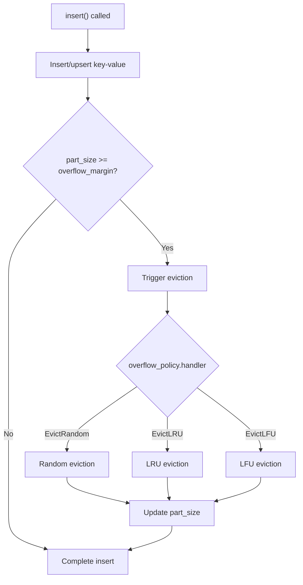
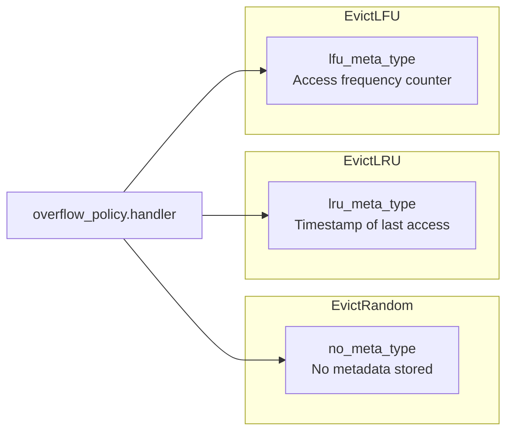
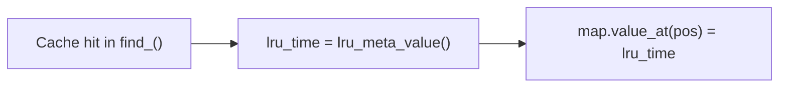
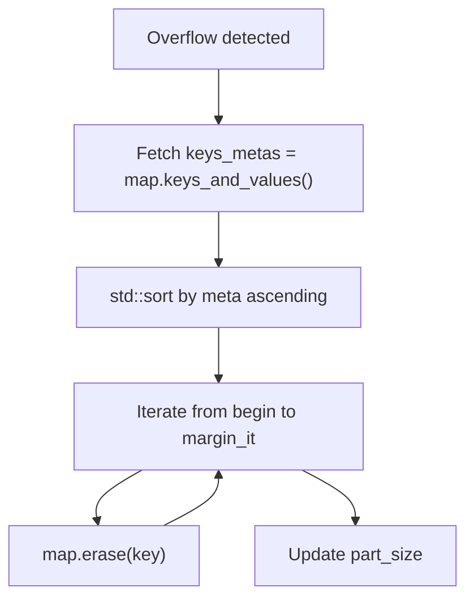
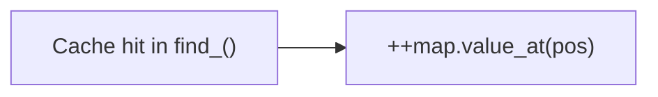
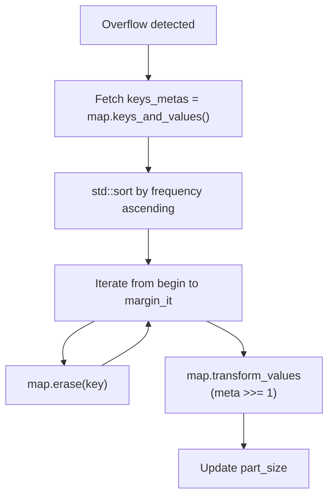
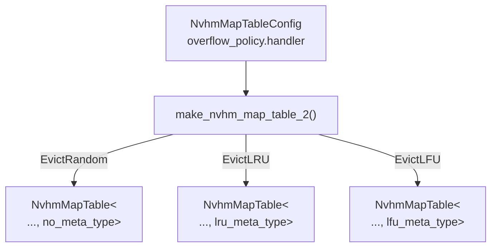
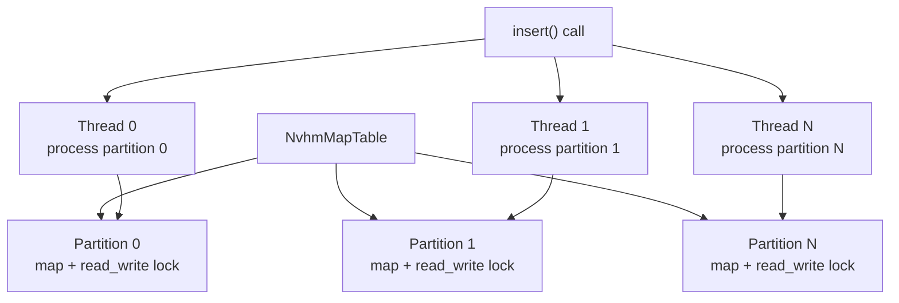

<!-- source: DeepWiki mcp.deepwiki.com · repo NVIDIA/nv-embedding-cache · page 7.3 Cache Eviction Policies · fetched 2026-10-26 -->

# Cache Eviction Policies

<details>
<summary>Relevant source files</summary>

The following files were used as context for generating this wiki page:

- [docs/advanced.md](docs/advanced.md)
- [include/ecache/embed_cache.h](include/ecache/embed_cache.h)
- [plugins/nvhm/src/nvhm_map_table.cpp](plugins/nvhm/src/nvhm_map_table.cpp)

</details>


This document describes the cache eviction policies used by the GPU embedding cache system when the cache reaches capacity. It covers the conditions that trigger eviction, the available eviction strategies (Random, LRU, LFU), their implementations, and configuration options.

For information about when cache insertions are triggered, see [Custom Insert Heuristics](#8.4). For details about the set-associative cache structure that these policies operate on, see [Set-Associative Cache Design](#7.1).

---

## Overview

Cache eviction occurs when the cache storage reaches its capacity limit and new embeddings need to be inserted. The system supports three eviction policies that determine which existing cache entries are removed to make space for new ones. These policies are configurable at the storage backend level, primarily implemented in the NVHM host memory table plugin.

The eviction policy is specified through the `overflow_policy.handler` configuration parameter and operates per partition within the storage backend. When a partition exceeds its capacity threshold, the eviction policy determines which keys to remove to free space.

**Sources:** [plugins/nvhm/src/nvhm_map_table.cpp:214-307](), [docs/advanced.md:30-32]()

---

## Overflow Detection and Resolution

### Overflow Policy Configuration

The overflow behavior is controlled by an `OverflowPolicy` configuration structure with the following parameters:

| Parameter | Type | Description |
|-----------|------|-------------|
| `overflow_policy.handler` | `OverflowHandler_t` | Eviction strategy: `EvictRandom`, `EvictLRU`, or `EvictLFU` |
| `overflow_policy.overflow_margin` | `int64_t` | Capacity threshold that triggers eviction |
| `overflow_policy.resolution_margin` | `double` | Fraction of overflow margin to free during eviction |

When a partition's size exceeds `overflow_margin`, the eviction process removes entries until the size is reduced to `overflow_margin * resolution_margin`.

**Sources:** [plugins/nvhm/src/nvhm_map_table.cpp:214-216]()

### Overflow Detection Flow



**Sources:** [plugins/nvhm/src/nvhm_map_table.cpp:239-303]()

---

## Eviction Policy Types

### Policy Selection and Metadata

Each eviction policy is associated with specific metadata stored alongside cache entries:



**Sources:** [plugins/nvhm/src/nvhm_map_table.cpp:764-773](), [plugins/nvhm/src/nvhm_map_table.cpp:229-236]()

---

## Random Eviction (`EvictRandom`)

### Description

Random eviction does not track any access patterns. When overflow occurs, it randomly selects keys to evict until sufficient space is freed.

### Implementation Details

The `no_meta_type` template parameter indicates that no metadata is stored for cache entries.

**Insertion Logic:**
```
1. Insert new key-value pair normally
2. If overflow_margin exceeded:
   a. Fetch all keys from partition
   b. Shuffle keys randomly using std::shuffle
   c. Erase keys from beginning until resolution_margin reached
```

**Access Logic:**
- No metadata updates during `find()` operations
- No tracking overhead

### Code Implementation

The random eviction implementation in the `insert()` function:

**Sources:** [plugins/nvhm/src/nvhm_map_table.cpp:264-276]()

Key characteristics:
- **Metadata overhead:** None
- **Access cost:** None (no metadata updates)
- **Eviction cost:** O(n log n) due to shuffling, where n = partition size
- **Cache efficiency:** Unpredictable; may evict hot entries

---

## LRU Eviction (`EvictLRU`)

### Description

Least Recently Used (LRU) eviction tracks when each cache entry was last accessed. During overflow, it evicts the entries with the oldest access timestamps.

### Implementation Details

The `lru_meta_type` template parameter stores a timestamp for each cache entry. This timestamp is updated on every successful cache hit during `find()` operations.

**Metadata Structure:**
```
lru_meta_type: 64-bit timestamp value
```

**Insertion Logic:**
```
1. Insert new key-value pair with lru_meta_value() timestamp
2. If overflow_margin exceeded:
   a. Fetch all (key, timestamp) pairs from partition
   b. Sort pairs by timestamp (ascending - oldest first)
   c. Erase keys with oldest timestamps until resolution_margin reached
```

**Access Logic:**
```
On successful lookup:
1. Update entry's lru_meta_type to current lru_meta_value()
```

### Timestamp Generation



**Sources:** [plugins/nvhm/src/nvhm_map_table.cpp:471-472](), [plugins/nvhm/src/nvhm_map_table.cpp:517-518](), [plugins/nvhm/src/nvhm_map_table.cpp:608-609]()

### Eviction Process



**Sources:** [plugins/nvhm/src/nvhm_map_table.cpp:278-291]()

Key characteristics:
- **Metadata overhead:** 8 bytes per entry (typical timestamp size)
- **Access cost:** One write per cache hit to update timestamp
- **Eviction cost:** O(n log n) for sorting, where n = partition size
- **Cache efficiency:** Good for temporal locality workloads

---

## LFU Eviction (`EvictLFU`)

### Description

Least Frequently Used (LFU) eviction tracks how often each cache entry is accessed. During overflow, it evicts the entries with the lowest access frequencies.

### Implementation Details

The `lfu_meta_type` template parameter stores an access counter for each cache entry. This counter is incremented on every successful cache hit during `find()` operations.

**Metadata Structure:**
```
lfu_meta_type: Integer counter (typically 32 or 64-bit)
```

**Insertion Logic:**
```
1. Insert new key-value pair with frequency counter = 1
2. If overflow_margin exceeded:
   a. Fetch all (key, frequency) pairs from partition
   b. Sort pairs by frequency (ascending - lowest first)
   c. Erase keys with lowest frequencies until resolution_margin reached
   d. Right-shift all remaining frequency values by 1 (counter realignment)
```

**Access Logic:**
```
On successful lookup:
1. Increment entry's lfu_meta_type: ++map.value_at(pos)
```

### Frequency Tracking



**Sources:** [plugins/nvhm/src/nvhm_map_table.cpp:519-520](), [plugins/nvhm/src/nvhm_map_table.cpp:610-611]()

### Eviction Process with Counter Realignment



**Sources:** [plugins/nvhm/src/nvhm_map_table.cpp:278-298]()

### Counter Realignment Rationale

After eviction, LFU performs a critical step: it right-shifts all remaining frequency counters by 1 (`meta >>= 1`). This prevents the system from entering a steady state where:
1. Old entries have very high frequency counts
2. New entries can never compete, even if access patterns change
3. The cache becomes "frozen" with stale entries

The realignment gives newer entries a fighting chance while still preserving the relative ordering of frequencies.

**Sources:** [plugins/nvhm/src/nvhm_map_table.cpp:293-295]()

Key characteristics:
- **Metadata overhead:** 4-8 bytes per entry (counter size)
- **Access cost:** One atomic increment per cache hit
- **Eviction cost:** O(n log n) for sorting + O(n) for realignment, where n = partition size
- **Cache efficiency:** Good for frequency-based workloads; realignment prevents staleness

---

## Implementation Architecture

### Template-Based Policy Selection

The eviction policy is selected at compile-time through template specialization based on the metadata type:



**Sources:** [plugins/nvhm/src/nvhm_map_table.cpp:761-774]()

### Partition-Level Eviction

The NVHM table is divided into multiple partitions, and eviction operates independently within each partition:



**Sources:** [plugins/nvhm/src/nvhm_map_table.cpp:91-97](), [plugins/nvhm/src/nvhm_map_table.cpp:218-227]()

### Thread Safety

Each partition has its own `read_write` lock (shared_mutex). During `insert()`, the worker thread acquires a write lock on its assigned partition before performing eviction:

```cpp
std::lock_guard lock(part.read_write);
```

This ensures that eviction operations are thread-safe and isolated per partition.

**Sources:** [plugins/nvhm/src/nvhm_map_table.cpp:226]()

---

## Policy Comparison

| Aspect | Random | LRU | LFU |
|--------|--------|-----|-----|
| **Metadata per entry** | 0 bytes | ~8 bytes | ~4-8 bytes |
| **Lookup overhead** | None | 1 write (timestamp) | 1 increment (counter) |
| **Eviction time complexity** | O(n log n) shuffle | O(n log n) sort | O(n log n) sort + O(n) realign |
| **Best for workload** | Uniform access | Temporal locality | Frequency-based patterns |
| **Steady state risk** | None | None | Mitigated by realignment |
| **Implementation simplicity** | Simple | Moderate | Complex |

**Sources:** [plugins/nvhm/src/nvhm_map_table.cpp:264-299]()

---

## Configuration Example

### JSON Configuration

```json
{
  "overflow_policy": {
    "handler": "EvictLRU",
    "overflow_margin": 1000000,
    "resolution_margin": 0.9
  }
}
```

This configuration:
- Uses LRU eviction
- Triggers eviction when partition size exceeds 1,000,000 entries
- Evicts entries until size is reduced to 900,000 entries (90% of margin)

**Sources:** [plugins/nvhm/src/nvhm_map_table.cpp:44-47](), [plugins/nvhm/src/nvhm_map_table.cpp:63]()

### C++ Configuration

```cpp
NvhmMapTableConfig config;
config.overflow_policy.handler = OverflowHandler_t::EvictLFU;
config.overflow_policy.overflow_margin = 500000;
config.overflow_policy.resolution_margin = 0.85;
```

**Sources:** [plugins/nvhm/src/nvhm_map_table.cpp:29-42]()

---

## Design Rationale

### Why Partition-Level Eviction?

Eviction operates at the partition level rather than globally because:

1. **Parallelism:** Each worker thread can independently manage its partition's capacity
2. **Lock granularity:** Finer-grained locking reduces contention
3. **Scalability:** Partitioning allows linear scaling with the number of threads

### Why Sort-Based Eviction?

Both LRU and LFU use sorting rather than maintaining a heap or priority queue because:

1. **Batch efficiency:** Eviction is an infrequent bulk operation
2. **Simple implementation:** Sorting is straightforward and well-optimized
3. **Cache locality:** Sorting improves memory access patterns for subsequent erasures

### Why LFU Counter Realignment?

Without realignment, LFU can enter a pathological state where:
- Old entries accumulate very high frequency counts over time
- New entries never reach competitive counts, even if they become hot
- The cache becomes "stuck" with stale content

The right-shift operation (`meta >>= 1`) is a simple, effective decay mechanism that balances historical frequency with recent behavior.

**Sources:** [plugins/nvhm/src/nvhm_map_table.cpp:293-298]()

---

## GPU Cache Eviction

Note that the policies described in this document apply to the **host memory** NVHM table plugin. The GPU embedding cache (set-associative cache on device) has different eviction mechanisms tied to its hardware-optimized structure, described in [Set-Associative Cache Design](#7.1) and [CUDA Kernel Implementation](#7.2).

For insert heuristics that determine **when** to trigger cache updates (as opposed to **what** to evict), see [Custom Insert Heuristics](#8.4).

**Sources:** [docs/advanced.md:30-32]()

---

