<!-- source: DeepWiki mcp.deepwiki.com · repo NVIDIA/nv-embedding-cache · page 7.4 NoCache Implementation · fetched 2026-10-26 -->

# NoCache Implementation

<details>
<summary>Relevant source files</summary>

The following files were used as context for generating this wiki page:

- [include/ecache/ec_no_cache.h](include/ecache/ec_no_cache.h)
- [include/ecache/embed_cache.h](include/ecache/embed_cache.h)

</details>


## Purpose and Scope

This document describes the `ECNoCache` implementation, a passthrough cache implementation that intentionally performs no caching. The NoCache implementation conforms to the `EmbedCacheBase` interface but always reports cache misses, enabling applications to bypass GPU caching while maintaining API compatibility with cached embedding layers.

For information about actual caching implementations, see [Set-Associative Cache Design](#7.1) and [CUDA Kernel Implementation](#7.2). For details about cache eviction policies, see [Cache Eviction Policies](#7.3).

---

## Architecture Overview

The NoCache implementation serves as both a testing tool and a legitimate deployment option when caching is undesirable. It implements the full `EmbedCacheBase` interface but all cache operations are no-ops or report complete misses.

### NoCache in the Cache Hierarchy

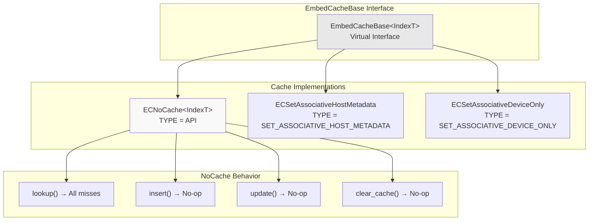

**Sources:** [include/ecache/ec_no_cache.h:30-398](), [include/ecache/embed_cache.h:92-99]()

---

## Class Structure

### ECNoCache Template Class

The `ECNoCache` class is templated on the index type and implements the complete `EmbedCacheBase` interface with minimal overhead.

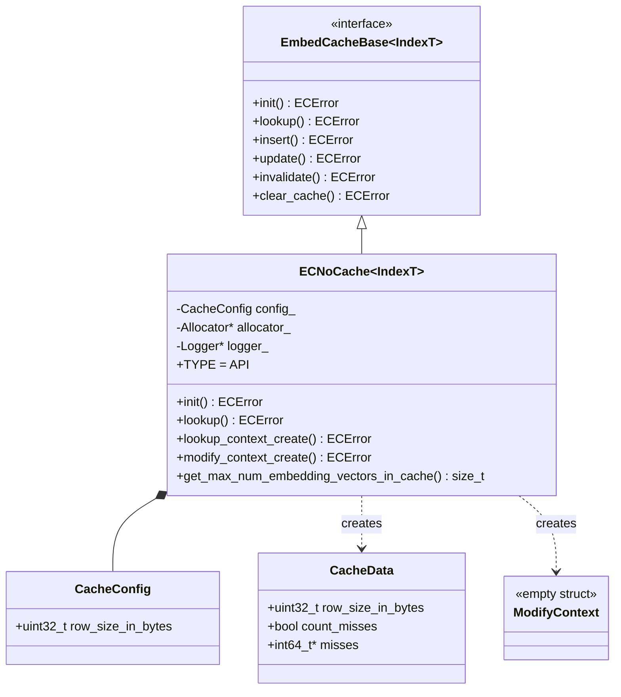

**Sources:** [include/ecache/ec_no_cache.h:36-398](), [include/ecache/embed_cache.h:354-375]()

---

## Configuration and Initialization

### CacheConfig Structure

The NoCache implementation requires minimal configuration, only tracking the embedding vector size:

| Field | Type | Purpose |
|-------|------|---------|
| `row_size_in_bytes` | `uint32_t` | Size of each embedding vector in bytes |

**Sources:** [include/ecache/ec_no_cache.h:42-45]()

### CacheData Structure

The `CacheData` structure is used as a context for lookup operations and optionally tracks cache miss metrics:

| Field | Type | Purpose |
|-------|------|---------|
| `row_size_in_bytes` | `uint32_t` | Size of each embedding vector |
| `count_misses` | `bool` | Whether to count cache misses |
| `misses` | `int64_t*` | Device pointer to miss counter |

**Sources:** [include/ecache/ec_no_cache.h:47-52]()

### Initialization Flow

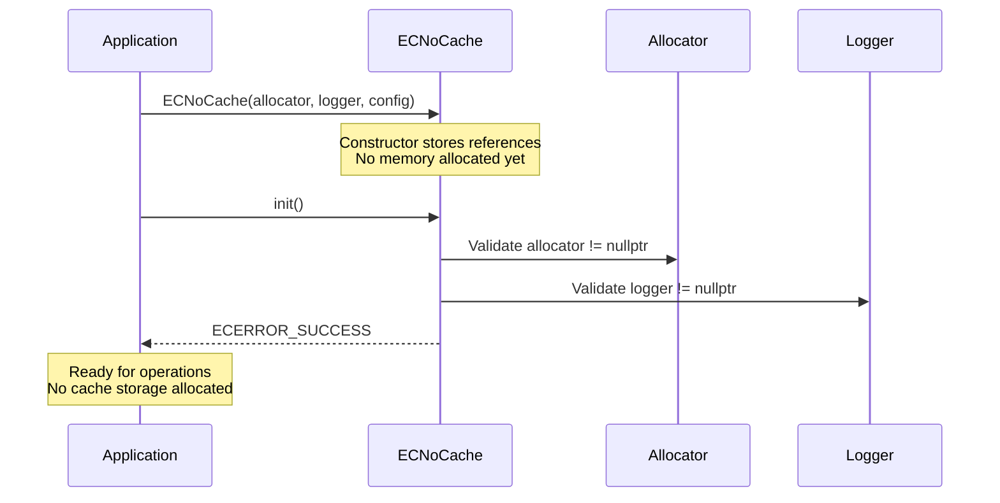

**Sources:** [include/ecache/ec_no_cache.h:58-61](), [include/ecache/ec_no_cache.h:212-231]()

---

## Lookup Operations

### Lookup with Missing Keys Variant

The NoCache implementation reports all keys as missing, providing their indices and keys in the output buffers.

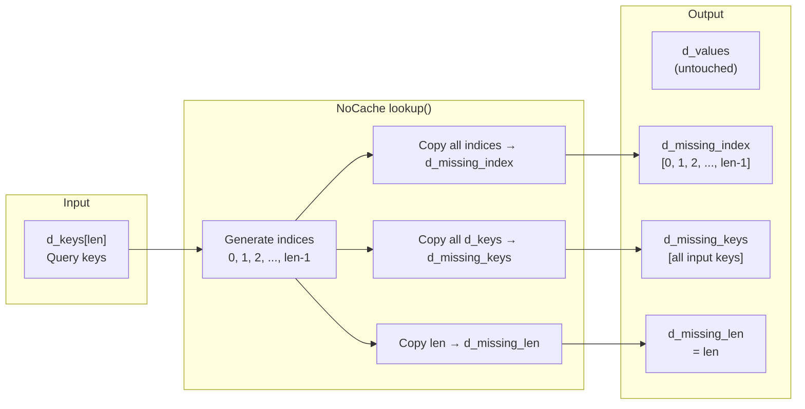

**Implementation Details:**

```cpp
// All keys reported as missing
std::vector<uint64_t> indx(len);
std::iota(indx.begin(), indx.end(), 0);  // Generate 0..len-1
cudaMemcpyAsync(d_missing_index, indx.data(), ...);
cudaMemcpyAsync(d_missing_keys, d_keys, ...);
cudaMemcpyAsync(d_missing_len, &len, ...);
```

**Sources:** [include/ecache/ec_no_cache.h:256-274]()

### Lookup with Hit Mask Variant

This variant sets all bits in the hit mask to zero, indicating no hits:

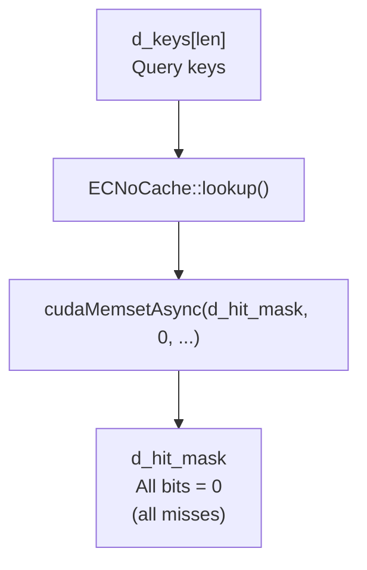

**Sources:** [include/ecache/ec_no_cache.h:276-290]()

### Lookup with UVM Table Variant

When a UVM table is provided, the NoCache implementation directly copies from the table to the output without performing any caching:

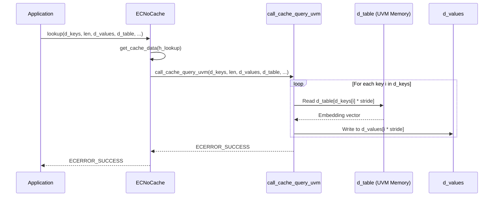

**Sources:** [include/ecache/ec_no_cache.h:292-309](), [include/ecache/ec_no_cache.h:30-33]()

---

## Modify Operations

All modify operations in the NoCache implementation are no-ops since there is no cache to modify.

### Modify Operation Behavior

| Operation | Implementation | Return Value |
|-----------|----------------|--------------|
| `insert()` | No-op | `ECERROR_SUCCESS` |
| `update()` | No-op | `ECERROR_SUCCESS` |
| `update_accumulate()` | No-op | `ECERROR_SUCCESS` |
| `invalidate()` | No-op | `ECERROR_SUCCESS` |
| `clear_cache()` | No-op | `ECERROR_SUCCESS` |

**Sources:** [include/ecache/ec_no_cache.h:360-395]()

### Modify Context

The `ModifyContext` for NoCache is an empty struct, requiring no storage:

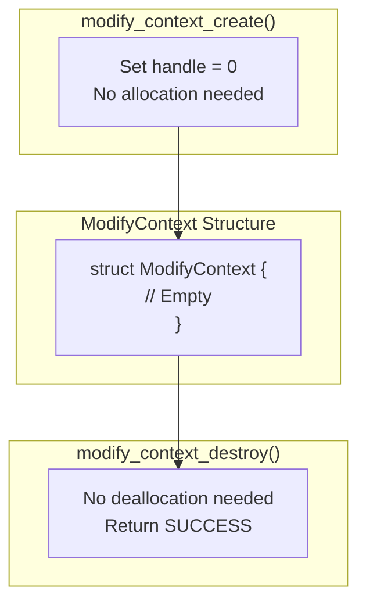

**Sources:** [include/ecache/ec_no_cache.h:54-56](), [include/ecache/ec_no_cache.h:186-195]()

---

## Performance Metrics

### Miss Counting

The NoCache implementation supports the `MERTIC_COUNT_MISSES` performance metric, which can track the total number of cache misses (which is all queries):

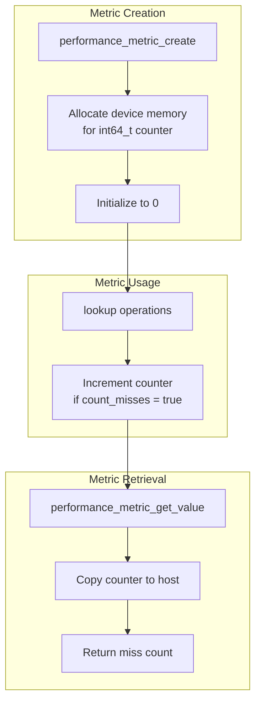

**Metric Lifecycle:**

1. **Create:** Allocates device memory for counter via `performance_metric_create()`
2. **Bind:** Associates metric with lookup context in `lookup_context_create()`
3. **Count:** Increments on each lookup if `count_misses` is enabled
4. **Read:** Copies value to host via `performance_metric_get_value()`
5. **Reset:** Zeros counter via `performance_metric_reset()`
6. **Destroy:** Deallocates via `performance_metric_destroy()`

**Sources:** [include/ecache/ec_no_cache.h:99-184](), [include/ecache/ec_no_cache.h:63-86]()

---

## Context Management

### Lookup Context Lifecycle

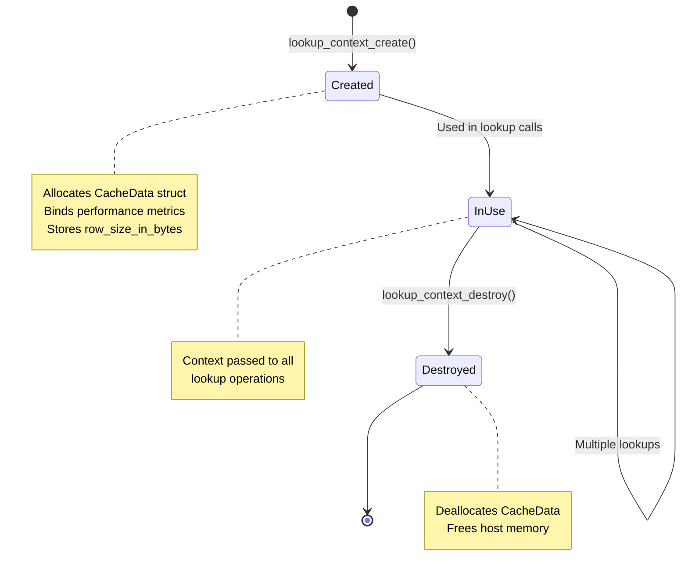

**Memory Requirements:**

| Context Type | Device Memory | Host Memory |
|-------------|---------------|-------------|
| Lookup Context | 0 bytes | `sizeof(CacheData)` ≈ 24 bytes |
| Modify Context | 0 bytes | 0 bytes |

**Sources:** [include/ecache/ec_no_cache.h:63-96](), [include/ecache/ec_no_cache.h:186-195](), [include/ecache/ec_no_cache.h:335-346]()

---

## Comparison with Cache Implementations

### Behavioral Differences

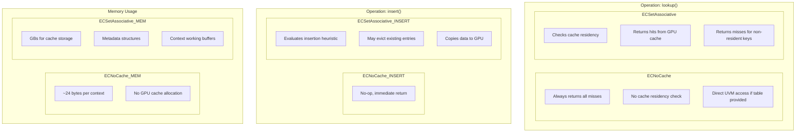

**Sources:** [include/ecache/ec_no_cache.h:256-395]()

### Performance Characteristics

| Aspect | ECNoCache | Set-Associative Cache |
|--------|-----------|----------------------|
| Lookup latency | UVM access latency | Sub-microsecond for hits, UVM latency for misses |
| Insert latency | ~0 (no-op) | Milliseconds (GPU kernel execution) |
| Memory footprint | Minimal | Gigabytes |
| Cache hit rate | 0% (by design) | Depends on workload and capacity |
| Best use case | Debugging, testing, no benefit from caching | Production workloads with locality |

---

## Use Cases

### When to Use NoCache

1. **Testing and Debugging**
   - Validate application behavior without caching effects
   - Isolate caching-related bugs by comparing with and without cache
   - Performance baseline measurements

2. **Workloads Without Locality**
   - Uniformly distributed access patterns
   - Single-use embeddings (no reuse)
   - Memory-bound workloads where cache adds overhead

3. **API Compatibility**
   - Maintain consistent API when caching is undesirable
   - Runtime switching between cached and non-cached modes
   - Testing cache-agnostic application code

### Integration Pattern

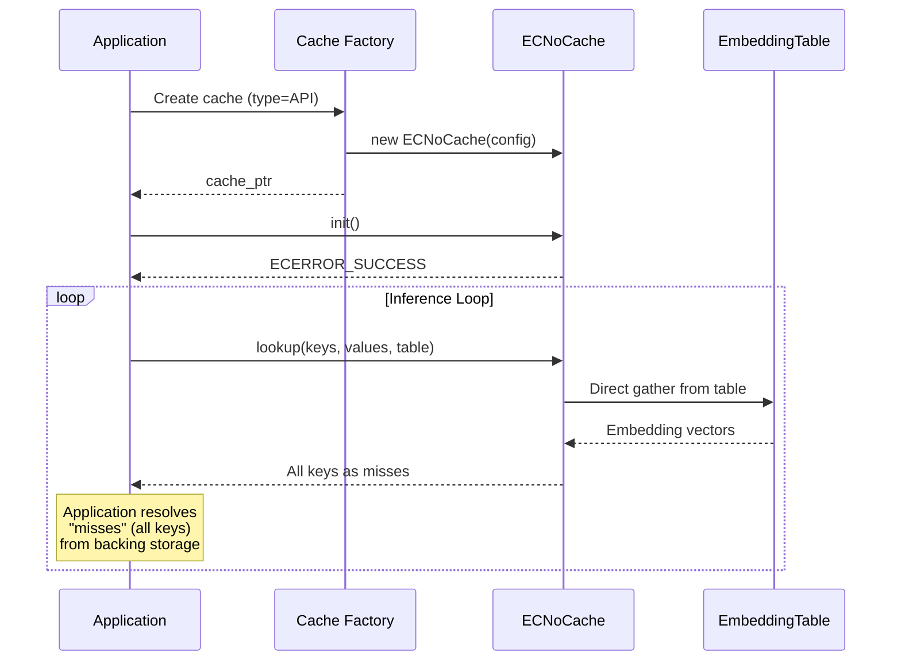

**Sources:** [include/ecache/ec_no_cache.h:40]()

---

## Implementation Details

### Key Implementation Patterns

1. **Minimal State:** The NoCache implementation maintains minimal state, only storing configuration and references to allocator/logger.

2. **Passthrough Semantics:** All operations that would modify cache state are no-ops, returning success immediately.

3. **Miss Reporting Consistency:** The implementation consistently reports all lookups as misses, maintaining API contracts.

4. **UVM Direct Access:** When a UVM table is provided, the implementation calls `call_cache_query_uvm` to directly gather from the table without caching.

**Key Methods Summary:**

| Method | Implementation | Lines |
|--------|----------------|-------|
| `init()` | Validates allocator and logger | [212-231]() |
| `lookup()` (missing variant) | Reports all keys as missing | [256-274]() |
| `lookup()` (hit mask variant) | Sets all mask bits to 0 | [276-290]() |
| `lookup()` (UVM variant) | Direct UVM gather | [292-309]() |
| `insert()` | No-op, returns success | [360-371]() |
| `update()` | No-op, returns success | [374-385]() |
| `get_max_num_embedding_vectors_in_cache()` | Returns 0 | [330-333]() |

**Sources:** [include/ecache/ec_no_cache.h:30-398]()

---

## API Contract Compliance

The NoCache implementation fully complies with the `EmbedCacheBase` interface contract while providing semantically correct passthrough behavior:

- **Lookup Operations:** Always report misses but provide correct indices/keys
- **Modify Operations:** Accept all operations successfully but perform no caching
- **Performance Metrics:** Support miss counting accurately (counts all lookups)
- **Context Management:** Properly allocate and deallocate contexts with minimal overhead
- **Memory Reporting:** Correctly reports zero cache capacity

This design ensures that applications using the `EmbedCacheBase` interface can seamlessly switch between NoCache and actual cache implementations without code changes.

**Sources:** [include/ecache/ec_no_cache.h:37-398](), [include/ecache/embed_cache.h:354-822]()

---

