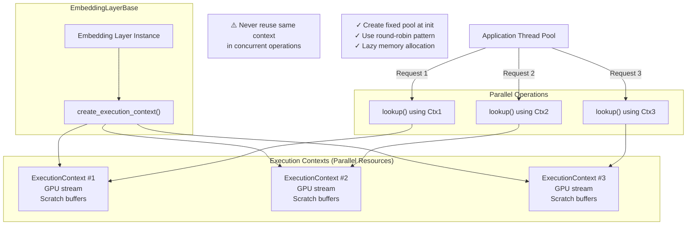
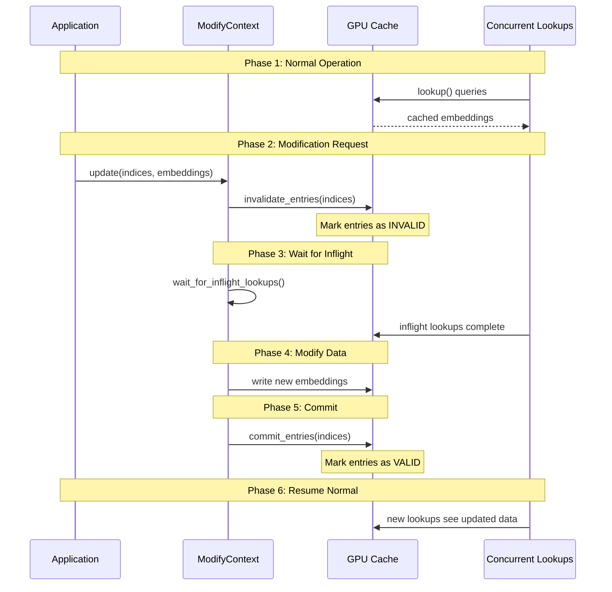
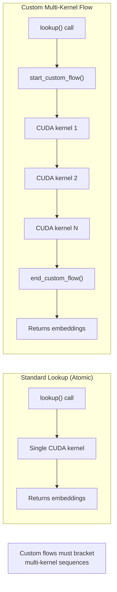
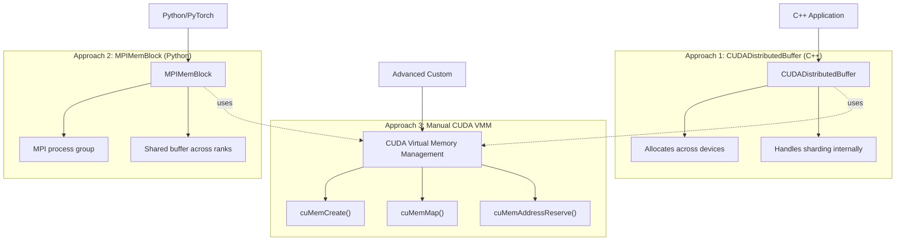
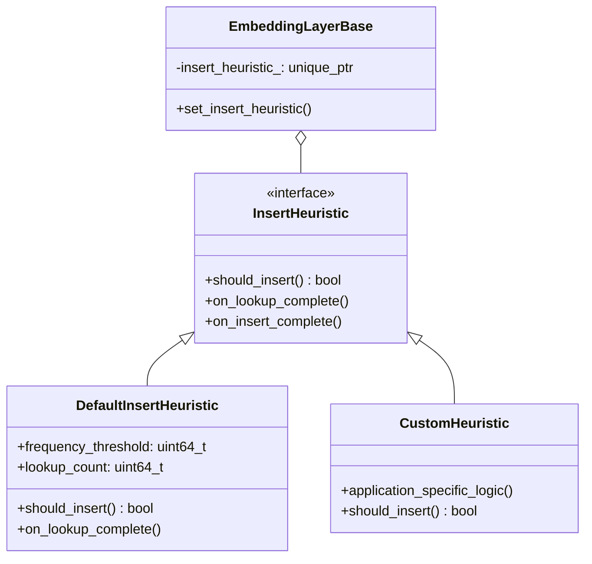

<!-- source: DeepWiki mcp.deepwiki.com · repo NVIDIA/nv-embedding-cache · page 8 Advanced Topics · fetched 2026-10-26 -->

# Advanced Topics

<details>
<summary>Relevant source files</summary>

The following files were used as context for generating this wiki page:

- [CHANGELOG.md](CHANGELOG.md)
- [README.md](README.md)
- [docs/advanced.md](docs/advanced.md)

</details>


## Purpose and Scope

This page provides an overview of advanced usage patterns, optimization techniques, and specialized features in the NV Embedding Cache SDK. Topics include execution context management, cache synchronization primitives, multi-GPU deployment, performance tuning, and production integration patterns.

For foundational concepts about embedding layers and caching strategies, see [Core Concepts](#3). For basic usage examples, see [Examples and Samples](#9).

The following advanced topics are covered in detail in their respective child pages:
- **Multi-GPU Support** ([#8.1](#8.1)) - Distributed embedding storage across devices
- **Modify Operations and Synchronization** ([#8.2](#8.2)) - Thread safety and invalidate/commit paradigm
- **Performance Tuning** ([#8.3](#8.3)) - Configuration parameters and kernel optimization
- **Custom Insert Heuristics** ([#8.4](#8.4)) - Implementing application-specific cache insertion policies
- **Checkpointing** ([#8.5](#8.5)) - Saving and restoring cache state
- **Triton Inference Server Integration** ([#8.6](#8.6)) - Production deployment with NVIDIA Triton

---

## Execution Contexts for Parallel Operations

Execution contexts encapsulate the state and resources required for parallel execution of lookup and modify operations. Each context represents a single reusable parallel execution environment.

### ExecutionContext Architecture



### Key Implementation Details

| Aspect | Details |
|--------|---------|
| **Interface** | `ExecutionContext` class in [include/execution_context.hpp]() |
| **Creation** | Via `layer->create_execution_context()` or `table->create_execution_context()` |
| **Memory Allocation** | Lazy - expands on first use with larger dimensions |
| **Lifecycle** | Create at initialization, destroy before layer/table destruction |
| **Thread Safety** | One context per concurrent operation - **not thread-safe to share** |

**Sources:** [docs/advanced.md:3-10](), [include/execution_context.hpp]()

---

## Cache Modification and Synchronization Overview

Cache modification operations (insert, update, erase) require special synchronization to allow concurrent lookups. The SDK implements an **invalidate-and-commit** pattern to achieve this.

### Invalidate-Commit Pattern



### ModifyContext vs ExecutionContext

| Context Type | Purpose | Concurrency | Operations |
|--------------|---------|-------------|------------|
| `ExecutionContext` | Read operations | Multiple concurrent instances allowed | `lookup()`, `gather()` |
| `ModifyContext` | Write operations | **Only one inflight on GPU at a time** | `insert()`, `update()`, `erase()`, `accumulate()` |

The user must ensure only one modify operation is inflight at the GPU level, typically by launching all modify operations on a single CUDA stream.

**Sources:** [docs/advanced.md:14-21]()

---

## Custom Lookup Flows and Atomicity

For applications implementing custom gather flows with multiple CUDA kernels, the SDK provides APIs to maintain atomicity required by the invalidate-commit pattern.

### Custom Flow API



The `start_custom_flow()` and `end_custom_flow()` API calls bracket multi-kernel lookup sequences to maintain the atomicity guarantees expected by concurrent modify operations.

**Sources:** [docs/advanced.md:23-24]()

---

## Multi-Device Embedding Distribution

Embeddings can span multiple GPUs or nodes through sharding. The SDK supports two approaches for creating distributed memory allocations.

### Distribution Approaches



### Implementation References

| Method | Interface | Documentation |
|--------|-----------|---------------|
| **C++ Helper** | `CUDADistributedBuffer` | [include/distributed.hpp]() |
| **Python Helper** | `MPIMemBlock` | Python bindings |
| **Manual CUDA VMM** | CUDA Driver API | [CUDA Programming Guide](https://docs.nvidia.com/cuda/cuda-programming-guide/) Virtual Memory Management |

The distributed buffer spans multiple devices as a contiguous virtual address space, with physical memory sharded across GPUs. Each device stores a subset of embeddings based on the sharding policy (typically round-robin or hash-based).

**Sources:** [docs/advanced.md:26-28](), [include/distributed.hpp]()

---

## Insert Heuristics for Cache Management

Embedding layers that use caches determine when to update cache residency through `InsertHeuristic` objects. This allows applications to customize when cache insertions occur based on workload characteristics.

### Insert Heuristic Interface



### Heuristic Implementation Pattern

| Component | Purpose | Example |
|-----------|---------|---------|
| `should_insert()` | Determines if cache should be updated now | Check if N lookups have occurred |
| `on_lookup_complete()` | Called after each lookup | Increment counter |
| `on_insert_complete()` | Called after cache insertion | Reset counter |
| `DefaultInsertHeuristic` | Built-in frequency-based policy | Insert every N lookups |

Applications can derive custom heuristics based on:
- Lookup frequency patterns
- Cache hit rate metrics
- Time-based policies
- Application-specific signals (e.g., batch boundaries)

**Sources:** [docs/advanced.md:30-32](), [include/insert_heuristic.hpp]()

---

## Advanced Features Roadmap

The following table summarizes advanced features and their availability in recent releases:

| Feature | Version | C++ API | Python API | Key Use Case |
|---------|---------|---------|------------|--------------|
| **Execution Contexts** | 26.02 | ✓ | N/A | Parallel inference |
| **ModifyContext** | 26.02 | ✓ | Limited | Concurrent updates |
| **Multi-GPU** | 26.03 | ✓ | ✓ | Distributed embeddings |
| **Custom Heuristics** | 26.02 | ✓ | N/A | Cache optimization |
| **Checkpointing** | 26.03 | ✓ | ✓ | Fault tolerance |
| **Triton Integration** | 26.03 | ✓ | N/A | Production deployment |
| **`erase()` API** | 26.03 | ✓ | ✓ | Dynamic embedding removal |
| **Redis Parameter Server** | 26.03 | ✓ | ✓ | Distributed storage |

See [Release History](#13) for detailed changelog information.

**Sources:** [CHANGELOG.md:7-18](), [README.md:8-15]()

---

## Testing Advanced Features

Unit tests for advanced functionality are located in [tests/]() and use GoogleTest (C++) and PyTest (Python).

### Running Advanced Feature Tests

```bash
# Start Redis cluster for distributed tests
./tests/embedding_layer/redis_cluster.sh start
sleep 5

# Run C++ tests including multi-GPU, modify contexts, etc.
for test in build_dir/bin/*test*; do
    ./$test
done

# Stop Redis cluster
./tests/embedding_layer/redis_cluster.sh stop

# Run Python tests
pytest tests/
```

The test suite includes:
- Concurrent modify operation tests
- Multi-GPU sharding validation
- Custom insert heuristic tests
- Checkpoint save/load verification
- Redis cluster integration tests

**Sources:** [docs/advanced.md:34-54]()

---

## See Also

- [Multi-GPU Support](#8.1) - Detailed multi-device configuration and sharding
- [Modify Operations and Synchronization](#8.2) - Deep dive into invalidate/commit and thread safety
- [Performance Tuning](#8.3) - Kernel modes, cache sizing, and optimization strategies
- [Custom Insert Heuristics](#8.4) - Implementing application-specific insertion policies
- [Checkpointing](#8.5) - Saving and loading cache state for fault tolerance
- [Triton Inference Server Integration](#8.6) - Production deployment patterns
- [GPU Embedding Cache Internals](#7) - Low-level cache implementation details

---

