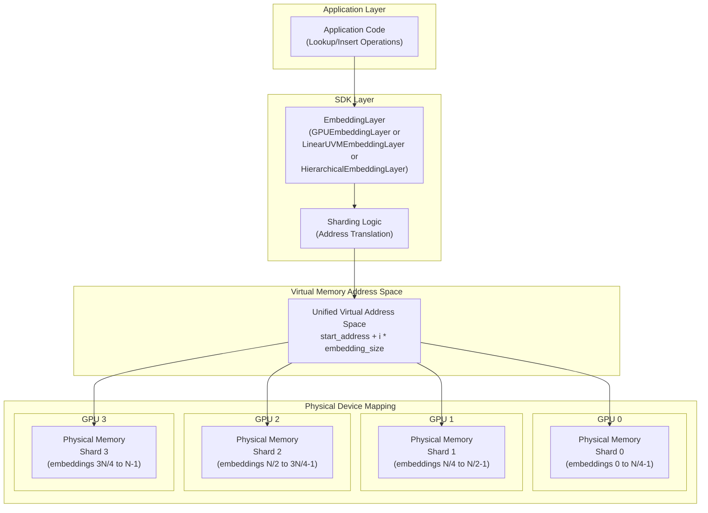
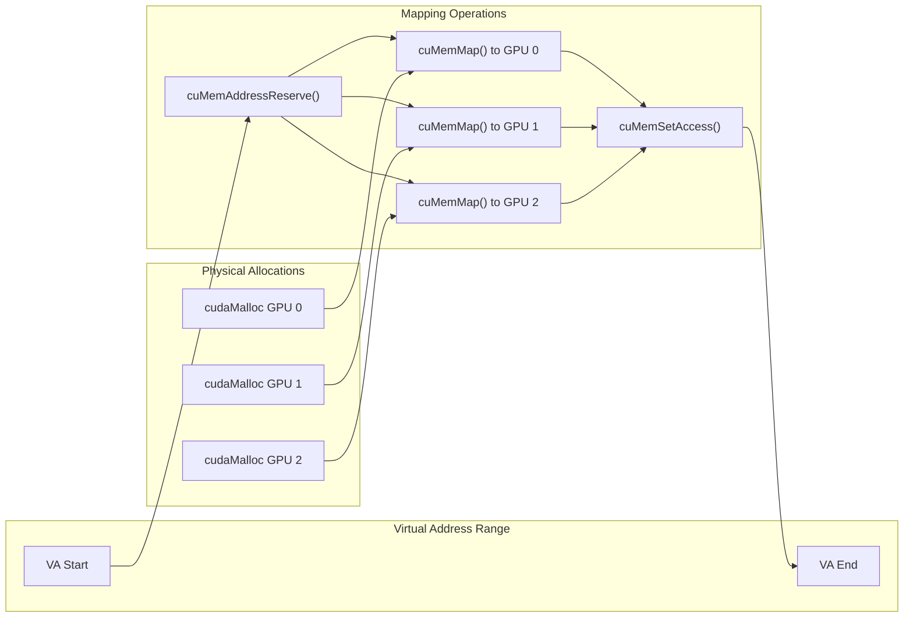
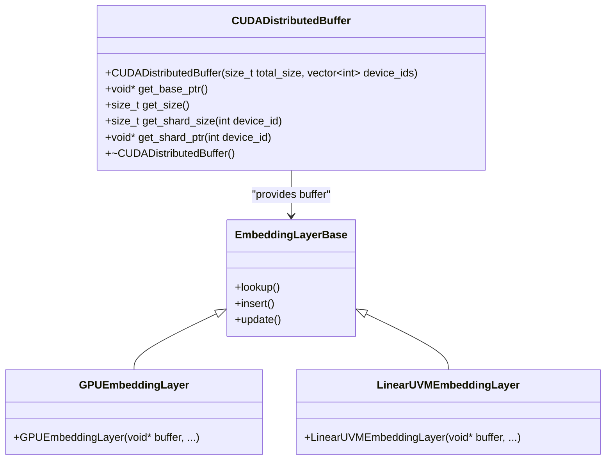
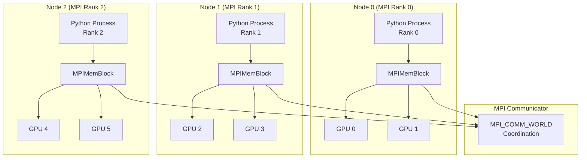
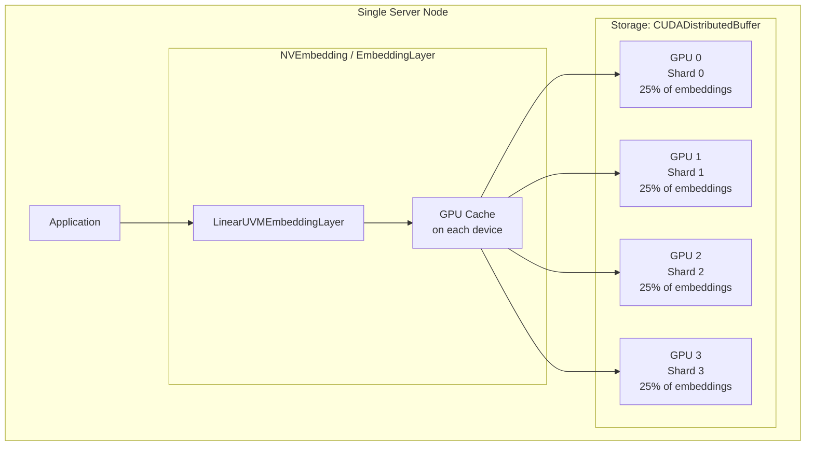
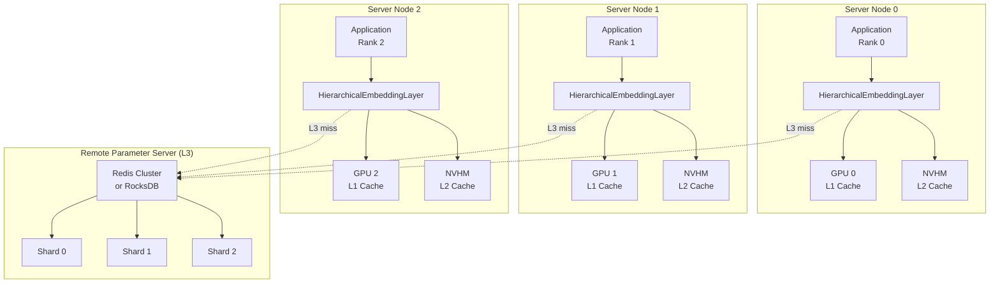
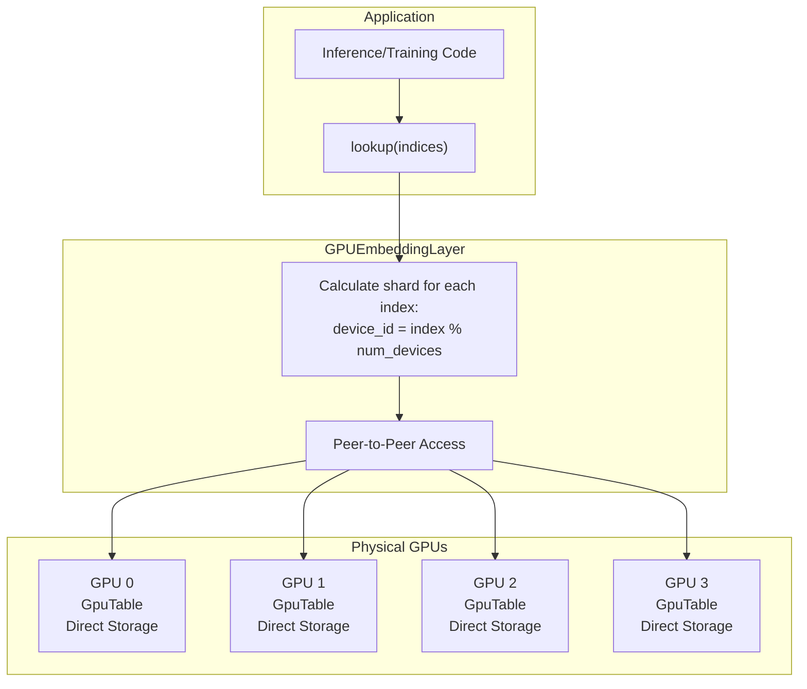
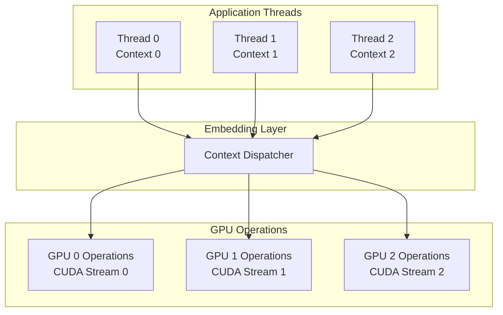

<!-- source: DeepWiki mcp.deepwiki.com · repo NVIDIA/nv-embedding-cache · page 8.1 Multi-GPU Support · fetched 2026-10-26 -->

# Multi-GPU Support

<details>
<summary>Relevant source files</summary>

The following files were used as context for generating this wiki page:

- [CHANGELOG.md](CHANGELOG.md)
- [README.md](README.md)
- [docs/advanced.md](docs/advanced.md)

</details>


This document describes how to configure and deploy NV Embedding Cache across multiple GPUs and nodes using memory sharding techniques. Multi-GPU support enables embedding tables to exceed the memory capacity of a single GPU by distributing them across multiple devices.

For general caching strategies and memory hierarchy concepts, see [Cache Configuration Strategies](#1.2) and [Memory Hierarchy](#3.3). For performance optimization across multiple GPUs, see [Performance Tuning](#8.3).

---

## Overview

NV Embedding Cache supports distributing embeddings across multiple GPUs through memory sharding. Each GPU stores a portion (shard) of the total embedding table, and the SDK manages transparent access across devices. This approach leverages CUDA's virtual memory management capabilities to create a unified address space that spans multiple physical devices.

**Key capabilities:**
- **Single-node multi-GPU**: Embeddings distributed across GPUs within a single server
- **Multi-node multi-GPU**: Embeddings distributed across GPUs in multiple servers using MPI
- **Transparent sharding**: Application code accesses embeddings through a single linear address space
- **Flexible configurations**: Compatible with all three caching strategies (NoCache, LinearUVM, Hierarchical)

Sources: [docs/advanced.md:26-28](), [CHANGELOG.md:12]()

---

## Multi-GPU Architecture

The following diagram illustrates how embeddings are sharded across multiple GPUs using virtual memory mapping:



**Memory Layout**: Each shard contains consecutive embeddings in the virtual address space. The mapping from virtual addresses to physical GPU memory is managed by CUDA's virtual memory management system. The SDK uses this to maintain the linear memory property where `embedding[i]` is located at `start_address + i * embedding_size`.

Sources: [docs/advanced.md:26-28](), [README.md:17]()

---

## CUDA Virtual Memory Management

Multi-GPU support relies on CUDA's virtual memory management capabilities introduced in CUDA 10.2+. This feature allows creating a virtual address range that maps to physical memory across multiple GPUs.



**Key CUDA APIs used:**
- `cuMemAddressReserve()`: Reserve a virtual address range
- `cuMemCreate()`: Create physical memory allocations on specific GPUs
- `cuMemMap()`: Map physical allocations to virtual address ranges
- `cuMemSetAccess()`: Set access permissions for peer-to-peer access

The SDK abstracts these low-level operations through the `CUDADistributedBuffer` class and `MPIMemBlock` class.

Sources: [docs/advanced.md:27]()

---

## C++ API: CUDADistributedBuffer

The `CUDADistributedBuffer` class provides a C++ interface for creating and managing multi-GPU buffer allocations.

### Class Overview



### Usage Pattern

The typical usage pattern involves:
1. Creating a `CUDADistributedBuffer` with desired total size and list of GPU device IDs
2. Passing the buffer pointer to an embedding layer constructor
3. The layer automatically handles sharding across the specified GPUs

**Example workflow:**
```
// Conceptual C++ usage (not actual code)
std::vector<int> devices = {0, 1, 2, 3};
size_t total_size = num_embeddings * embedding_dim * sizeof(float);

CUDADistributedBuffer buffer(total_size, devices);

GPUEmbeddingLayer layer(
    buffer.get_base_ptr(),
    num_embeddings,
    embedding_dim,
    /* other parameters */
);

// Layer operations now automatically use sharded memory
```

Sources: [docs/advanced.md:28](), [include/distributed.hpp]()

---

## Python API: MPIMemBlock

The `MPIMemBlock` class provides Python/MPI integration for multi-node multi-GPU deployments. It enables sharing a distributed buffer across an MPI process group where each process manages GPUs on a different node.

### Architecture



### Integration with NVEmbedding

The `MPIMemBlock` integrates with the Python `NVEmbedding` class to enable distributed embedding tables:

1. Each MPI rank creates an `MPIMemBlock` for its local GPUs
2. The block is passed to `NVEmbedding` initialization
3. MPI coordination ensures consistent sharding across all ranks
4. Each rank can access embeddings across all GPUs in the cluster

**Example workflow:**
```python
# Conceptual Python usage (not actual code)
from mpi4py import MPI
from pynve import MPIMemBlock, NVEmbedding

comm = MPI.COMM_WORLD
rank = comm.Get_rank()
local_devices = get_local_gpu_ids()  # e.g., [0, 1] on each node

# Create distributed buffer
mem_block = MPIMemBlock(
    total_embeddings=num_embeddings,
    embedding_dim=embedding_dim,
    local_devices=local_devices,
    comm=comm
)

# Create embedding layer with distributed buffer
embedding = NVEmbedding(
    num_embeddings=num_embeddings,
    embedding_dim=embedding_dim,
    cache_type="NoCache",  # or "LinearUVM" or "Hierarchical"
    buffer=mem_block
)
```

Sources: [docs/advanced.md:28]()

---

## Multi-GPU Configuration Patterns

### Pattern 1: Single-Node Multi-GPU

**Use case**: Dataset exceeds single GPU memory but fits across multiple GPUs in one server



**Configuration characteristics:**
- Uses `CUDADistributedBuffer` (C++) or `MPIMemBlock` with single-rank MPI (Python)
- Typically paired with `LinearUVMEmbeddingLayer` for automatic caching
- Fast peer-to-peer GPU access via NVLink
- No network latency

**Best for**: Large models on single DGX/HGX systems

Sources: [docs/advanced.md:26-28]()

### Pattern 2: Multi-Node Multi-GPU with Hierarchical Caching

**Use case**: Very large datasets requiring distributed storage across multiple servers



**Configuration characteristics:**
- Uses `MPIMemBlock` for coordination across nodes
- Combines multi-GPU sharding with `HierarchicalEmbeddingLayer`
- Redis or RocksDB provides final backing store
- Each node maintains local L1/L2 caches for hot embeddings

**Best for**: Trillion-scale embedding tables in production inference clusters

Sources: [README.md:14-15](), [docs/advanced.md:26-28]()

### Pattern 3: NoCache with GPU Sharding

**Use case**: Full dataset fits across multiple GPUs with direct access, no caching overhead



**Configuration characteristics:**
- Uses `GPUEmbeddingLayer` with `CUDADistributedBuffer`
- No caching overhead, direct memory access
- Lowest latency for uniformly accessed embeddings
- Simple configuration

**Best for**: Models where dataset fits across available GPU memory and access patterns are uniform

Sources: [README.md:12]()

---

## Memory Layout and Sharding Strategy

### Round-Robin Sharding

By default, embeddings are distributed in round-robin fashion across devices:

| Embedding Index | Device Assignment | Physical Location |
|----------------|-------------------|-------------------|
| 0 | GPU 0 | Shard 0 |
| 1 | GPU 1 | Shard 1 |
| 2 | GPU 2 | Shard 2 |
| 3 | GPU 3 | Shard 3 |
| 4 | GPU 0 | Shard 0 |
| 5 | GPU 1 | Shard 1 |
| ... | ... | ... |

**Formula**: `device_id = embedding_index % num_devices`

This ensures balanced distribution and leverages CUDA's virtual memory mapping to maintain the linear address property.

### Contiguous Sharding

Alternatively, embeddings can be distributed in contiguous blocks:

| Embedding Index Range | Device Assignment | Physical Location |
|----------------------|-------------------|-------------------|
| 0 to N/4-1 | GPU 0 | Shard 0 |
| N/4 to N/2-1 | GPU 1 | Shard 1 |
| N/2 to 3N/4-1 | GPU 2 | Shard 2 |
| 3N/4 to N-1 | GPU 3 | Shard 3 |

**Formula**: `device_id = embedding_index / (num_embeddings / num_devices)`

This pattern can improve locality for certain access patterns but may create load imbalance if access patterns are skewed.

Sources: [README.md:17]()

---

## Performance Considerations

### Peer-to-Peer Access

Multi-GPU performance depends heavily on peer-to-peer (P2P) GPU connectivity:

| Topology | Bandwidth | Latency | Use Case |
|----------|-----------|---------|----------|
| **NVLink** | ~300-600 GB/s | ~1-2 μs | Best for single-node multi-GPU |
| **PCIe 4.0** | ~32 GB/s per x16 link | ~5-10 μs | Acceptable for moderate traffic |
| **PCIe switches** | ~16-32 GB/s shared | ~10-20 μs | May bottleneck high-traffic scenarios |
| **Cross-node (IB/Ethernet)** | ~100-400 Gb/s | ~5-50 μs | Requires careful caching strategy |

**Recommendations:**
- Prefer NVLink-enabled systems (DGX, HGX) for best performance
- For PCIe-only systems, use `LinearUVMEmbeddingLayer` with larger cache sizes
- For cross-node deployments, use `HierarchicalEmbeddingLayer` with Redis/RocksDB

### Memory Access Patterns

The SDK optimizes for common recommender system access patterns:
- **Power-law distribution**: Hot embeddings automatically promoted to local GPU cache
- **Batch locality**: Multiple indices in same batch often access nearby embeddings
- **Temporal locality**: Recent embeddings likely to be accessed again

Multi-GPU configurations benefit from:
- Larger batch sizes to amortize cross-GPU access overhead
- Intelligent cache placement based on access frequency
- Prefetching strategies for predictable access patterns

### Benchmarking

The SDK includes multi-GPU benchmark scripts for measuring performance:

**Location**: [benchmarks/]()

**Usage pattern:**
```bash
# Single-GPU baseline
python benchmarks/benchmark_single_gpu.py --num_embeddings 1e9 --embedding_dim 128

# Multi-GPU scaling
python benchmarks/benchmark_multi_gpu.py --num_embeddings 1e9 --embedding_dim 128 --num_gpus 4
```

**Metrics measured:**
- Throughput (lookups/second)
- Latency (ms per batch)
- Cache hit rates per tier
- Cross-GPU traffic volume
- Scaling efficiency

Sources: [CHANGELOG.md:13](), [docs/benchmarks.md]()

---

## Thread Safety and Synchronization

### Execution Contexts in Multi-GPU Scenarios

When using multi-GPU configurations, each execution context operates on a specific GPU. For parallel operations:



**Key points:**
- Each execution context maintains separate GPU resources
- Contexts can be used concurrently from different threads
- CUDA streams ensure non-blocking GPU operations
- For modify operations, use single stream across all GPUs (as per invalidate/commit paradigm)

Sources: [docs/advanced.md:3-10](), [docs/advanced.md:14-24]()

### Modify Operations Across GPUs

Modify operations (insert, update, accumulate) in multi-GPU configurations require coordination:

1. **Invalidation phase**: Mark affected entries across all relevant GPU caches
2. **Wait phase**: Ensure no inflight lookups accessing invalidated entries
3. **Modification phase**: Update storage on appropriate GPUs
4. **Commit phase**: Re-enable affected cache entries

This ensures consistency when embeddings are being modified while lookups are in flight.

Sources: [docs/advanced.md:18-24]()

---

## Integration Examples

### C++ Example: 4-GPU Configuration

```cpp
// Conceptual example structure (not executable code)
// See include/distributed.hpp for actual API

// Step 1: Create distributed buffer across 4 GPUs
std::vector<int> device_ids = {0, 1, 2, 3};
size_t total_size = num_embeddings * embedding_dim * sizeof(float);
auto buffer = std::make_unique<CUDADistributedBuffer>(total_size, device_ids);

// Step 2: Configure layer with distributed buffer
LinearUVMEmbeddingLayer layer(
    buffer->get_base_ptr(),
    num_embeddings,
    embedding_dim,
    gpu_cache_capacity_per_device,
    // ... other parameters
);

// Step 3: Create execution contexts
std::vector<ExecutionContext*> contexts;
for (int i = 0; i < num_parallel_ops; ++i) {
    contexts.push_back(layer.create_execution_context());
}

// Step 4: Perform lookups (automatically uses all 4 GPUs)
layer.lookup(indices, num_indices, output_embeddings, contexts[0]);
```

Sources: [include/distributed.hpp](), [docs/advanced.md:28]()

### Python Example: Multi-Node MPI Configuration

```python
# Conceptual example structure (not executable code)
# See Python API documentation for actual usage

from mpi4py import MPI
from pynve import MPIMemBlock, NVEmbedding

# Step 1: Initialize MPI
comm = MPI.COMM_WORLD
rank = comm.Get_rank()
size = comm.Get_size()

# Step 2: Determine local GPU assignment
gpus_per_node = 4
local_gpu_ids = list(range(gpus_per_node))

# Step 3: Create distributed memory block
mem_block = MPIMemBlock(
    num_embeddings=1_000_000_000,  # 1 billion embeddings
    embedding_dim=128,
    local_devices=local_gpu_ids,
    comm=comm
)

# Step 4: Initialize embedding layer with distributed buffer
embedding = NVEmbedding(
    num_embeddings=1_000_000_000,
    embedding_dim=128,
    cache_type="Hierarchical",
    buffer=mem_block,
    # ... cache configuration
)

# Step 5: Perform distributed inference
# Each rank can lookup any embedding, SDK handles routing
indices = get_batch_indices()  # May span all GPUs/nodes
result = embedding.lookup(indices)
```

Sources: [docs/advanced.md:28]()

---

## Troubleshooting

### Common Issues

**Issue**: CUDA out of memory when creating distributed buffer
- **Cause**: Insufficient GPU memory for requested shard size
- **Solution**: Reduce embeddings per GPU or increase number of GPUs; use `LinearUVMEmbeddingLayer` instead of `GPUEmbeddingLayer`

**Issue**: Peer-to-peer access not available
- **Cause**: GPUs not on same PCIe root complex or P2P disabled
- **Solution**: Check GPU topology with `nvidia-smi topo -m`; enable P2P in BIOS; consider NVLink-enabled hardware

**Issue**: Poor multi-GPU scaling efficiency
- **Cause**: Cross-GPU bandwidth bottleneck or small batch sizes
- **Solution**: Increase batch size; ensure NVLink connectivity; verify P2P bandwidth with benchmarks

**Issue**: MPI coordination timeouts
- **Cause**: Network issues or rank synchronization failures  
- **Solution**: Check MPI configuration; verify network connectivity; ensure all ranks call MPI operations in same order

Sources: [docs/advanced.md:26-28]()

---

## Related Topics

- For overall caching strategies, see [Cache Configuration Strategies](#1.2)
- For memory tier management, see [Memory Hierarchy](#3.3)
- For synchronization details, see [Modify Operations and Synchronization](#8.2)
- For performance optimization, see [Performance Tuning](#8.3)
- For production deployment, see [Triton Inference Server Integration](#8.6)
- For distributed examples, see [Layer Sample (Advanced)](#9.3)

Sources: [README.md](), [docs/advanced.md](), [CHANGELOG.md]()

---

