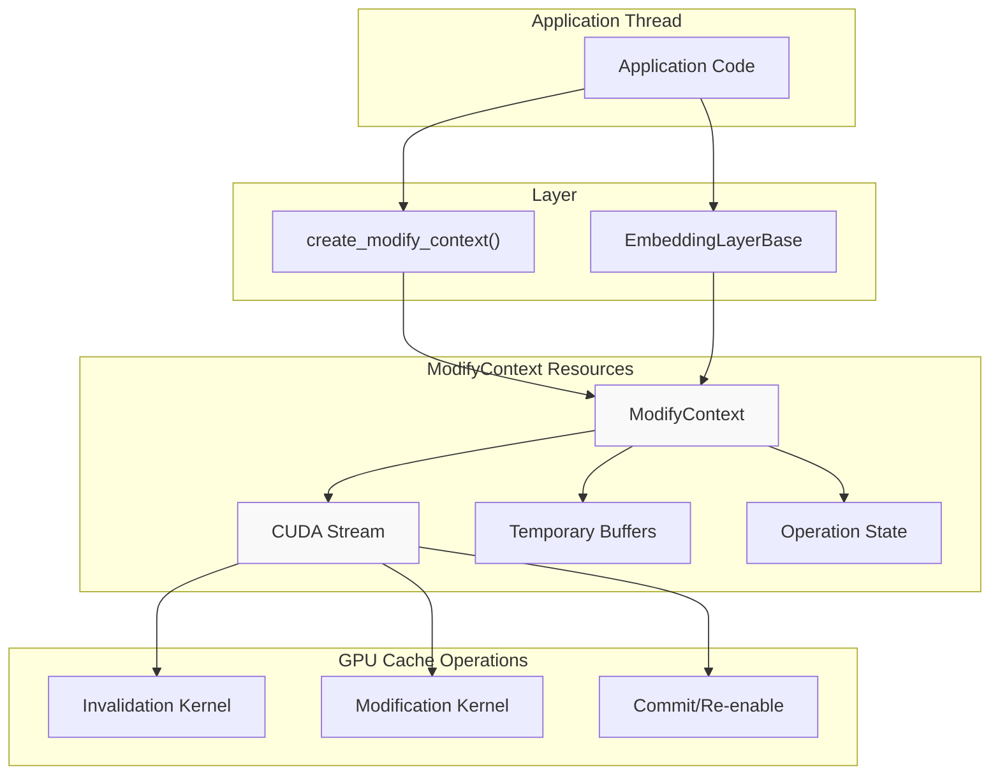
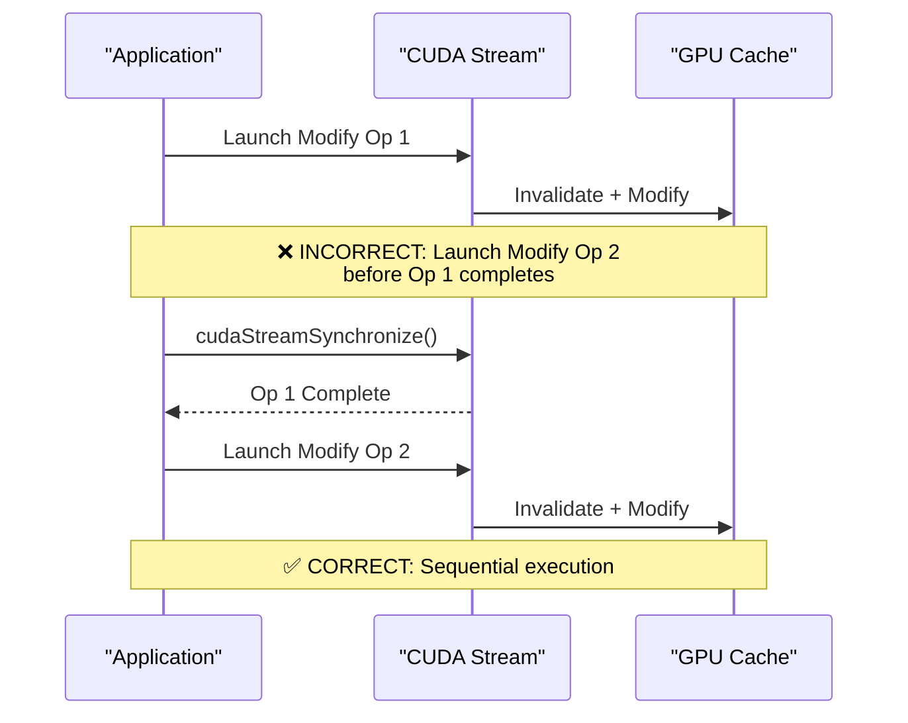
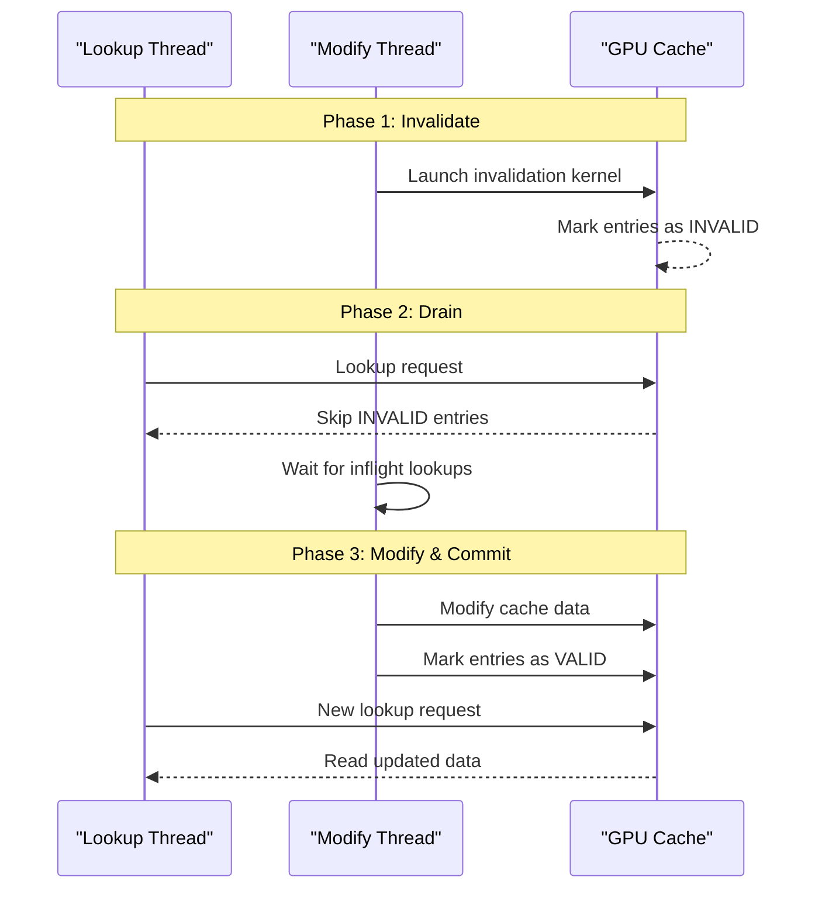
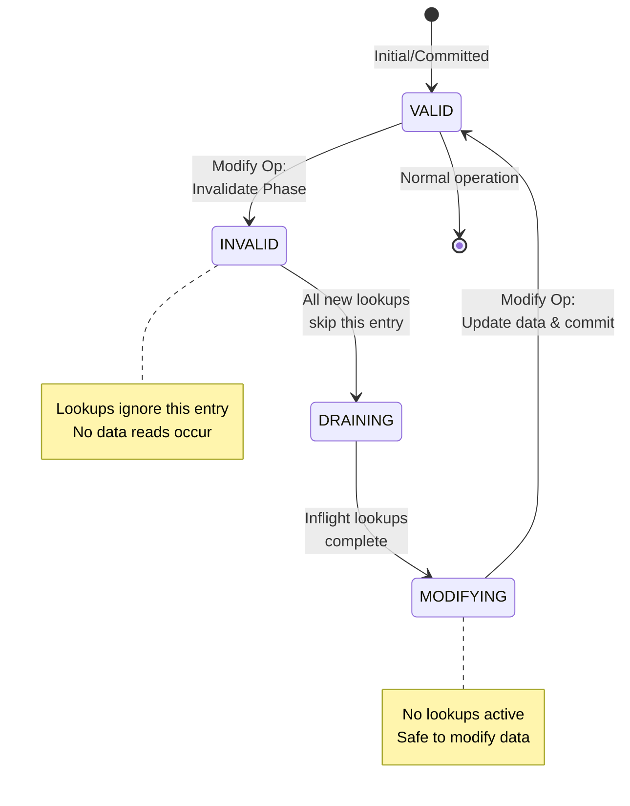
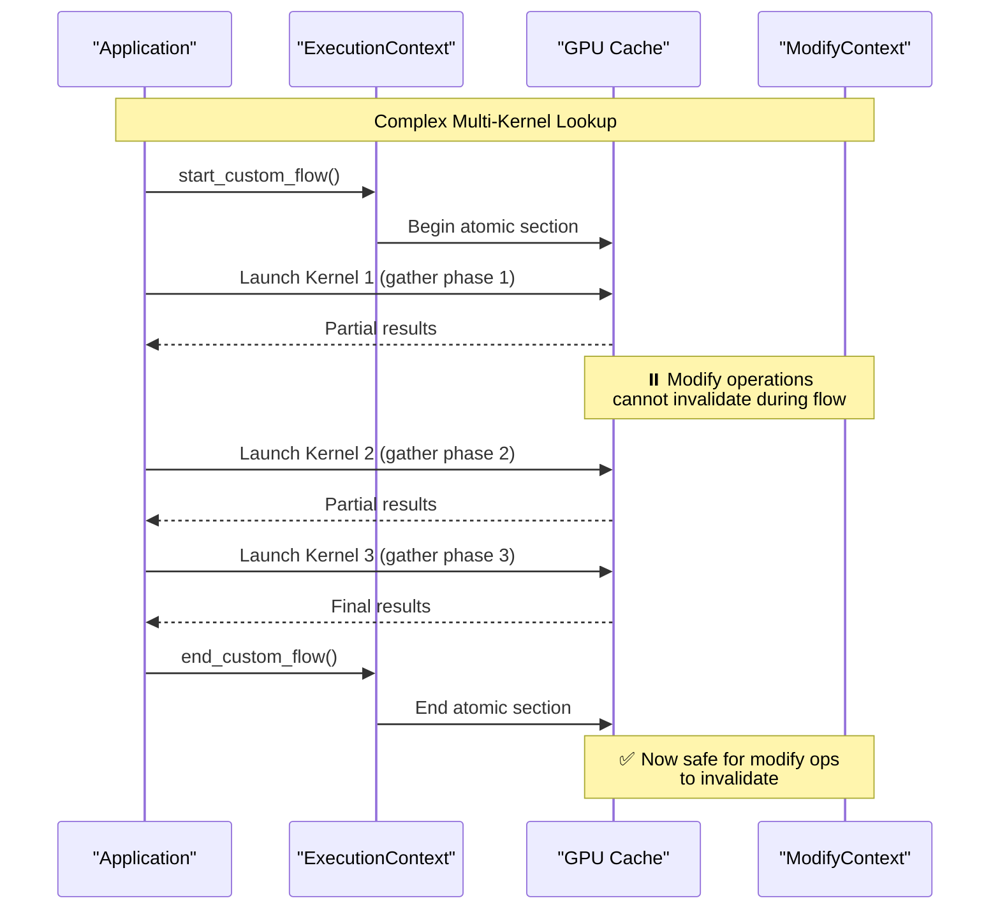
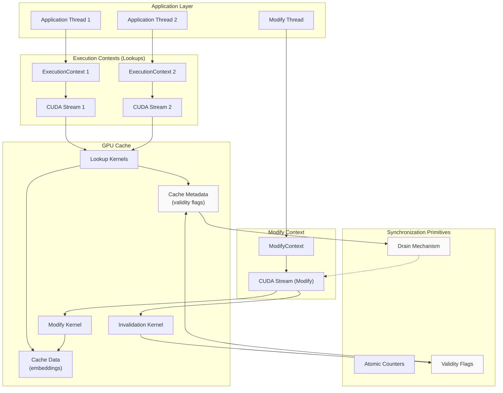

<!-- source: DeepWiki mcp.deepwiki.com · repo NVIDIA/nv-embedding-cache · page 8.2 Modify Operations and Synchronization · fetched 2026-10-26 -->

# Modify Operations and Synchronization

<details>
<summary>Relevant source files</summary>

The following files were used as context for generating this wiki page:

- [docs/advanced.md](docs/advanced.md)
- [docs/cpp_api.md](docs/cpp_api.md)

</details>


This page documents the modify operation system and synchronization mechanisms in the NV Embedding Cache SDK. It covers how cache-modifying operations (insert, update, accumulate, erase) are managed, the invalidate-and-commit paradigm for safe concurrent execution with lookups, and thread safety requirements.

For general information about execution contexts and resource management, see [Execution Contexts](#3.4). For details on specific layer operations and APIs, see [Embedding Layer API](#4.1). For performance optimization of these operations, see [Performance Tuning](#8.3).

---

## Overview

Modify operations are any operations that alter the cache residency (which keys are stored) or the stored embedding values. The SDK implements a sophisticated synchronization system to allow safe concurrent execution of read (lookup) and write (modify) operations without data races or corruption.

---

## Modify Operation Types

The SDK supports four types of modify operations:

| Operation | Purpose | Changes Residency | Changes Values | Typical Use Case |
|-----------|---------|-------------------|----------------|------------------|
| **Insert** | Add keys to cache | Yes | No* | Cache warming, residency updates |
| **Update** | Replace embedding values | No | Yes | Gradient application, weight updates |
| **Accumulate** | Add gradients to embeddings | No | Yes | Distributed gradient accumulation |
| **Erase** | Remove keys from cache | Yes | N/A | Manual cache management |

*Insert may ignore new values for keys already present in the cache.

Each operation is defined in [include/embedding_layer.hpp]() and implemented by layer classes like `GPUEmbeddingLayer`, `LinearUVMEmbeddingLayer`, and `HierarchicalEmbeddingLayer`.

### Insert Operation

Insert updates cache residency by determining which keys should be stored in a given table/cache level. The cache decides which keys to retain based on available capacity and eviction policies.

**Key Characteristics:**
- May evict existing keys if cache is full
- Does not guarantee keys will remain resident after operation
- Not intended for updating values of existing keys (use Update instead)
- Controlled by insert heuristics (see [Custom Insert Heuristics](#8.4))

### Update Operation

Update replaces the embedding values for keys that already exist in any of the layer's tables. It does not change which keys are resident.

**Key Characteristics:**
- Only affects keys already present in tables
- Modifies all occurrences across all cache levels (GPU, system memory, remote)
- Does not add new keys to cache
- Thread-safe through invalidate-and-commit

### Accumulate Operation

Accumulate adds gradient values to existing embedding rows, commonly used during distributed training where gradients are computed across multiple workers.

**Key Characteristics:**
- Performs in-place addition: `embedding[key] += gradient[key]`
- Only affects keys already present in tables
- Atomic at the cache entry level
- Useful for gradient aggregation in parameter servers

### Erase Operation

Erase explicitly removes keys from a specified table type. This is rarely needed as the cache automatically evicts entries during Insert operations.

**Key Characteristics:**
- Removes keys from specified table level
- Keys not present are silently ignored
- Does not affect other cache levels
- Generally not required for normal operation

**Sources:** [docs/cpp_api.md:24-37](), [docs/advanced.md:14-16]()

---

## ModifyContext: Execution Environment

Every modify operation requires a `ModifyContext`, which provides a parallel execution unit with dedicated resources and state for the operation.


**Diagram: ModifyContext Creation and Resource Management**

**Sources:** [docs/advanced.md:14-16]()

---

## Thread Safety and Single-Flight Constraint

**Critical Constraint:** The GPU cache does not support multiple modify operations executing simultaneously on the GPU side.

### Enforcement Requirements

The application must ensure that only one modify operation is inflight on the GPU at any given time. This is typically accomplished by:

1. **Single Stream Approach:** Launch all modify operations on the same CUDA stream
2. **Explicit Synchronization:** Use CUDA events or stream synchronization between modify operations
3. **Single ModifyContext:** Reuse the same `ModifyContext` for sequential modify operations


**Diagram: Correct Serialization of Modify Operations**

### Why This Constraint Exists

The GPU cache uses shared metadata structures that track cache line validity and occupancy. Concurrent modifications would create race conditions on this metadata, potentially corrupting the cache state.

**Sources:** [docs/advanced.md:16-16]()

---

## Invalidate and Commit Paradigm

To enable parallel execution of lookup (read) and modify (write) operations, the SDK implements an invalidate-and-commit synchronization protocol.

### The Problem

Without synchronization, a modify operation could alter cache entries while a concurrent lookup is reading them, leading to:
- Stale data being returned
- Partially updated embedding values
- Invalid cache metadata

### The Solution: Three-Phase Protocol


**Diagram: Invalidate-and-Commit Protocol Phases**

### Phase-by-Phase Breakdown

#### Phase 1: Invalidate
The modify operation launches a kernel that marks all affected cache entries as `INVALID`. This is a lightweight operation that sets flags in cache metadata.

**Cache Entry State Transition:** `VALID` → `INVALID`

#### Phase 2: Drain Inflight Operations
The modify operation waits for all inflight lookup operations to complete. Lookups that started before invalidation will skip any entries marked `INVALID`, ensuring they don't read inconsistent data.

**Synchronization Point:** All concurrent lookups must observe the INVALID state before proceeding.

#### Phase 3: Modify and Commit
Once all lookups have drained, the modify operation:
1. Alters the cache data (insert/update/accumulate/erase)
2. Re-enables affected entries by marking them `VALID`

**Cache Entry State Transition:** `INVALID` → `VALID` (with updated data)

### State Diagram


**Diagram: Cache Entry State During Invalidate-and-Commit**

**Sources:** [docs/advanced.md:18-21]()

---

## Custom Flows and Atomicity

The invalidate-and-commit protocol assumes that lookup operations execute atomically from the cache's perspective, typically as a single CUDA kernel. However, some applications implement complex gather flows using multiple kernels.

### The Problem

If a lookup operation spans multiple CUDA kernels without proper bracketing, the invalidate phase might occur between these kernels, causing:
- First kernel reads valid entries
- Invalidation occurs
- Second kernel skips now-invalid entries
- Inconsistent partial results returned

### The Solution: Custom Flow APIs

The SDK provides `start_custom_flow()` and `end_custom_flow()` APIs to maintain atomicity across multi-kernel lookup sequences.


**Diagram: Custom Flow API Usage for Multi-Kernel Atomicity**

### API Usage

**When to Use:**
- Custom gather implementations with multiple CUDA kernels
- Complex embedding transformations spanning several GPU operations
- Any lookup sequence where intermediate results depend on consistent cache state

**When NOT to Use:**
- Single-kernel lookup operations (already atomic)
- Operations that don't read from cache
- CPU-side processing between kernels (no atomicity guarantee anyway)

**Code Reference:** See [include/execution_context.hpp]() for `start_custom_flow()` and `end_custom_flow()` method signatures.

**Sources:** [docs/advanced.md:23-24]()

---

## Synchronization Architecture

The following diagram shows how the different contexts and synchronization mechanisms interact:


**Diagram: Complete Synchronization Architecture**

### Key Components

- **ExecutionContext**: Provides isolated resources for parallel lookup operations
- **ModifyContext**: Specialized context for modify operations with serialization enforcement
- **Cache Metadata**: Tracks validity state of each cache entry
- **Validity Flags**: Boolean flags marking entries as VALID or INVALID
- **Drain Mechanism**: Ensures all inflight lookups complete before modification
- **Atomic Counters**: Track number of active lookups for drain synchronization

**Sources:** [docs/advanced.md:3-10](), [docs/advanced.md:14-24]()

---

## Best Practices

### 1. Use a Single Modify Stream

Always launch modify operations on the same CUDA stream to ensure serialization:

```cpp
// CORRECT
cudaStream_t modify_stream;
cudaStreamCreate(&modify_stream);

layer->update(keys, values, modify_context, modify_stream);
cudaStreamSynchronize(modify_stream);
layer->insert(new_keys, new_values, modify_context, modify_stream);
```

### 2. Separate Lookup and Modify Contexts

Create distinct `ExecutionContext` instances for lookups and a separate `ModifyContext` for modifications:

```cpp
// Create multiple execution contexts for parallel lookups
auto ec1 = layer->create_execution_context();
auto ec2 = layer->create_execution_context();

// Create a single modify context
auto mc = layer->create_modify_context();
```

### 3. Bracket Custom Multi-Kernel Flows

Always use `start_custom_flow()` and `end_custom_flow()` for complex gather operations:

```cpp
ec->start_custom_flow(stream);

// Launch multiple kernels
gather_kernel_phase1<<<...>>>(keys, intermediate1);
gather_kernel_phase2<<<...>>>(intermediate1, intermediate2);
gather_kernel_phase3<<<...>>>(intermediate2, results);

ec->end_custom_flow(stream);
```

### 4. Minimize Modify Frequency

Batch updates together to reduce synchronization overhead:

```cpp
// INEFFICIENT: Many small updates
for (auto& batch : micro_batches) {
    layer->update(batch.keys, batch.values, mc, stream);
}

// EFFICIENT: One large update
layer->update(all_keys, all_values, mc, stream);
```

### 5. Context Lifecycle Management

Always destroy execution contexts before destroying the layer:

```cpp
{
    auto layer = create_layer(...);
    auto ec = layer->create_execution_context();
    auto mc = layer->create_modify_context();
    
    // Use contexts...
    
    // Correct order: destroy contexts first
    ec.reset();  // or delete ec;
    mc.reset();  // or delete mc;
    
    // Then destroy layer
    layer.reset();  // or delete layer;
}
```

**Sources:** [docs/advanced.md:4-10](), [docs/advanced.md:14-24]()

---

## Performance Implications

### Invalidate-and-Commit Overhead

The synchronization protocol introduces overhead:

| Phase | Typical Latency | Optimization |
|-------|----------------|--------------|
| Invalidate | ~10-50 μs | Kernel launch overhead |
| Drain | ~100-500 μs | Depends on inflight lookups |
| Modify | Varies | Depends on operation type |
| Commit | ~10-50 μs | Kernel launch overhead |

**Total Overhead:** ~120-600 μs per modify operation

### Mitigation Strategies

1. **Batch Updates:** Combine multiple updates into a single operation
2. **Async Execution:** Use CUDA streams to overlap modify with CPU work
3. **Reduce Frequency:** Use insert heuristics to control cache update rate
4. **Pipeline Design:** Structure application to have distinct update phases

### Lookup Performance During Modify

Lookups remain highly performant during modify operations:
- Invalidated entries are skipped (not accessed)
- Lookup kernels continue executing on separate streams
- Only the drain phase blocks briefly

**Sources:** [docs/advanced.md:18-21]()

---

## Related Topics

- **[Execution Contexts](#3.4)**: General context creation and resource management
- **[Custom Insert Heuristics](#8.4)**: Controlling when modify operations occur
- **[Performance Tuning](#8.3)**: Optimizing modify operation performance
- **[Cache Operations](#3.5)**: Detailed operation semantics
- **[Multi-GPU Support](#8.1)**: Synchronization in distributed scenarios

---

## Summary

The modify operation system in NV Embedding Cache provides:

1. **Four Operation Types:** Insert, Update, Accumulate, Erase for different cache management needs
2. **ModifyContext:** Dedicated execution environment with serialization constraints
3. **Thread Safety:** Single-flight constraint prevents concurrent modify operations
4. **Invalidate-and-Commit:** Three-phase protocol enabling safe concurrent lookup/modify
5. **Custom Flow APIs:** Atomicity guarantees for multi-kernel operations

This design enables high-performance concurrent reads while maintaining cache consistency during writes, essential for recommender system workloads with continuous embedding updates.

---

