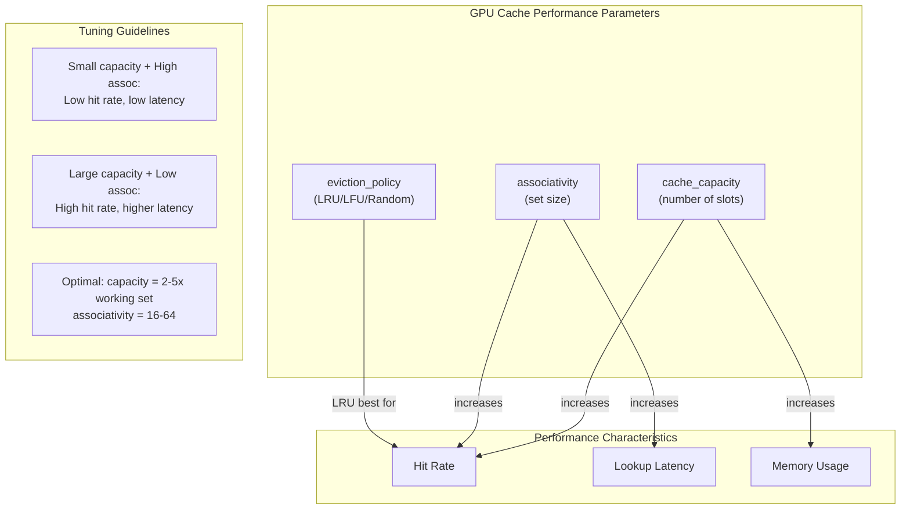
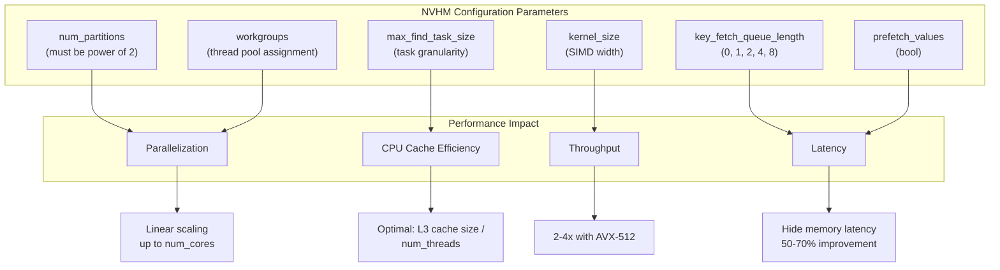
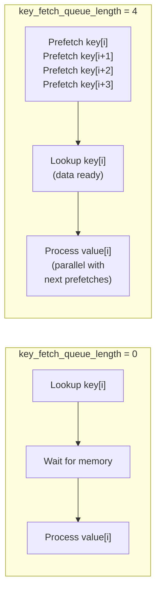
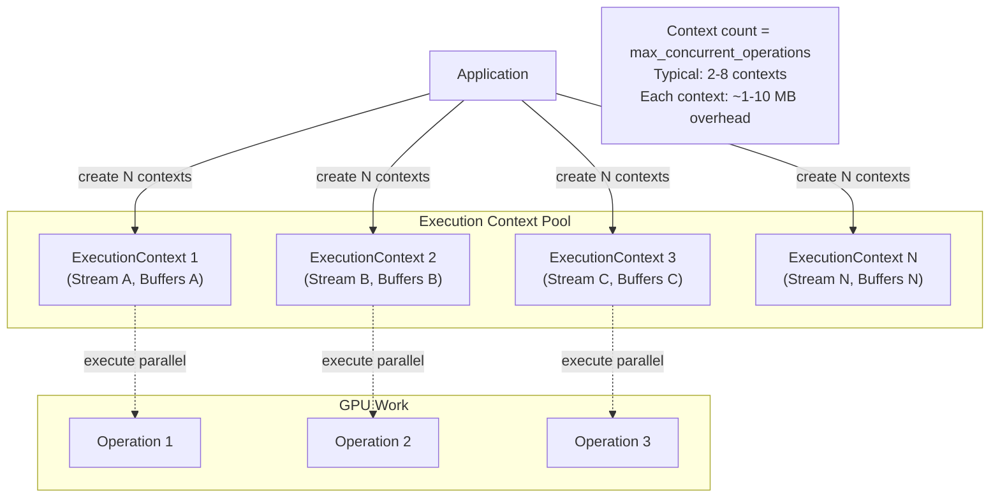
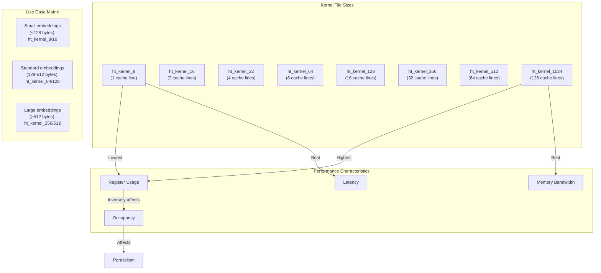
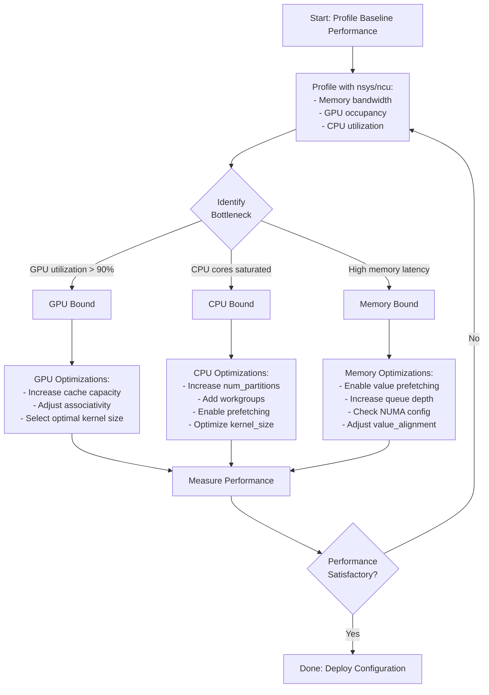

<!-- source: DeepWiki mcp.deepwiki.com · repo NVIDIA/nv-embedding-cache · page 8.3 Performance Tuning · fetched 2026-10-26 -->

# Performance Tuning

<details>
<summary>Relevant source files</summary>

The following files were used as context for generating this wiki page:

- [CMakeLists.txt](CMakeLists.txt)
- [docs/advanced.md](docs/advanced.md)
- [plugins/nvhm/src/nvhm_map_table.cpp](plugins/nvhm/src/nvhm_map_table.cpp)

</details>


## Purpose and Scope

This document covers performance optimization strategies for the NV Embedding Cache SDK, including build-time feature selection, runtime configuration parameters, and hardware-specific tuning. For information about cache configuration strategies (NoCache, LinearUVM, Hierarchical), see [Cache Configuration Strategies](#1.2). For multi-GPU scaling, see [Multi-GPU Support](#8.1). For custom cache eviction policies, see [Custom Insert Heuristics](#8.4).

## Build-Time Performance Configuration

The SDK uses a compile-time feature selection system to optimize binary size and performance for specific use cases.

### Feature Selection System

The `NVE_FEATURES` CMake variable controls which components are compiled into the SDK. Features are defined in [CMakeLists.txt:42-53]():

```cmake
NVE_AVAILABLE_FEATURES:
  - Plugin backends: abseil_plugin, nvhm_plugin, phmap_plugin, redis_plugin, rocksdb_plugin
  - Mask sizes: ht_mask_8, ht_mask_16, ht_mask_32, ht_mask_64
  - Key sizes: ht_key_8, ht_key_16, ht_key_32, ht_key_64
  - Kernel tile sizes: ht_kernel_8, ht_kernel_16, ht_kernel_32, ht_kernel_64, ht_kernel_128, ht_kernel_256, ht_kernel_512, ht_kernel_1024
  - Partitioners: ht_part_fnv1a, ht_part_murmur3, ht_part_rrxmrrxmsx0, ht_part_std_hash
```

**Minimal Build** ([CMakeLists.txt:55-59]()):
```cmake
NVE_MINIMAL_FEATURES = ht_mask_64, ht_key_64, ht_part_fnv1a, ht_kernel_64
```
- Smallest binary size (~30% reduction)
- Fastest compile time
- Supports only 64-bit keys/masks, single kernel size
- Suitable for constrained deployment environments

**Default Build** ([CMakeLists.txt:61-70]()):
```cmake
NVE_DEFAULT_FEATURES = NVE_MINIMAL_FEATURES + all plugins + ht_key_32 + ht_kernel_128
```
- Balanced binary size and flexibility
- Includes all storage backends
- Supports common key sizes and kernel configurations

To select features:
```bash
cmake -DNVE_FEATURES="ht_mask_64 ht_key_64 ht_kernel_64 nvhm_plugin" ..
```

Sources: [CMakeLists.txt:42-108]()

### AVX/SIMD Optimization

The build system automatically detects and enables the highest available AVX instruction set level on the build machine ([CMakeLists.txt:126-233]()):

| AVX Level | Requirements | Flags | Performance Benefit |
|-----------|-------------|-------|---------------------|
| AVX-512 (BW/VL/VBMI) | AVX512F, AVX512BW, AVX512VL, AVX512VBMI | `-mavx512f -mavx512bw -mavx512vl -mavx512vbmi` | 2-4x faster host table operations |
| AVX-512 (BW/VL) | AVX512F, AVX512BW, AVX512VL | `-mavx512f -mavx512bw -mavx512vl` | 2-3x faster host table operations |
| AVX-512F | AVX512F only | `-mavx512f` | 1.5-2x faster host table operations |
| AVX2 | AVX2 | `-mavx2` | 1.2-1.5x faster host table operations |
| AVX | AVX | `-mavx` | Baseline SIMD performance |
| None | No AVX support | None | Standard scalar operations |

The detected level is exposed via preprocessor macro `NVE_AVX_LEVEL_*=1` ([CMakeLists.txt:224-227]()).

**Disabling AVX-512:** On systems where AVX-512 causes thermal throttling or is unsupported, disable it with:
```bash
cmake -DNVE_DISABLE_AVX512=ON ..
```

Sources: [CMakeLists.txt:126-250]()

### CUDA Architecture Targeting

The SDK automatically detects the GPU compute capability and compiles CUDA kernels for optimal performance ([CMakeLists.txt:315-342]()):

**Automatic Detection:**
```bash
# Uses nvidia-smi to detect local GPU capability
# Example output: sm_80, sm_86, sm_90
```

**Manual Override:**
```bash
cmake -DNVE_SM_VERSION="80;90" ..
```

**Multi-Architecture Builds:**
For distributable binaries supporting multiple GPU generations:
```bash
cmake -DNVE_SM_VERSION="80;86;89;90;100" ..
```

**Trade-offs:**
- Single architecture: Fastest compile, smallest binary, optimal runtime performance
- Multi-architecture: Slower compile, larger binary (5-10x per additional SM), portable

Sources: [CMakeLists.txt:315-342]()

---

## Runtime Configuration Parameters

### GPU Cache Configuration

GPU cache performance is controlled by three primary parameters configured via `GpuTableConfig`:



**Capacity Tuning:**
- Formula: `cache_capacity = target_hit_rate * unique_keys_per_batch`
- For 95% hit rate with power-law distribution: `capacity ≈ 2-3x working set size`
- For 99% hit rate: `capacity ≈ 5-10x working set size`

**Associativity Trade-offs:**
| Associativity | Lookup Latency | Hit Rate | Use Case |
|--------------|----------------|----------|----------|
| 8-16 | Lowest (1-2 GPU cycles) | Moderate | Latency-critical applications |
| 32-64 | Medium (2-4 GPU cycles) | High | Balanced workloads |
| 128-256 | Higher (4-8 GPU cycles) | Highest | Hit-rate-critical applications |

**Eviction Policy Selection:**
- `LRU` (Least Recently Used): Best for temporal locality patterns (recommended default)
- `LFU` (Least Frequently Used): Best for skewed access patterns
- `Random`: Lowest overhead, acceptable for uniform access patterns

Sources: See [Cache Eviction Policies](#7.3) for implementation details

### Host Table Configuration (NVHM Plugin)

The NVHM plugin provides CPU-based hash table storage with extensive performance tuning parameters configured via `NvhmMapTableConfig`:



#### Partitioning Configuration

**num_partitions** ([plugins/nvhm/src/nvhm_map_table.cpp:32]()):
- Must be power of 2
- Creates independent hash table partitions to reduce lock contention
- Each partition has its own read-write lock

Tuning guidelines:
```
num_partitions = min(num_physical_cores, max_concurrent_writers * 2)

Examples:
- 16-core system, 4 writers: num_partitions = 8
- 64-core system, 32 writers: num_partitions = 32-64
- Single-threaded: num_partitions = 1
```

**Trade-offs:**
- Too few partitions: Lock contention limits parallelization
- Too many partitions: Overhead from partition management, poor cache locality
- Optimal: 1-2 partitions per concurrent writer thread

**partitioner** ([plugins/nvhm/src/nvhm_map_table.cpp:49](), [666-685]()):
- Determines how keys are distributed across partitions
- Options: `FowlerNollVo` (FNV1a), `Murmur3`, `Rrxmrrxmsx0`, `StdHash`
- FNV1a recommended for balanced distribution with low overhead

Sources: [plugins/nvhm/src/nvhm_map_table.cpp:29-42](), [88-98]()

#### Thread Pool Configuration

**workgroups** ([plugins/nvhm/src/nvhm_map_table.cpp:33](), [50]()):
- Vector of thread pool IDs to use for parallel operations
- Each workgroup represents a set of CPU cores
- Example: `[0, 1, 2]` uses 3 workgroups for parallel find/insert/update operations

Tuning:
```cpp
// Single workgroup (default)
config.workgroups = {0};

// Multi-workgroup for NUMA systems
config.workgroups = {0, 1};  // One workgroup per NUMA node

// Maximum parallelization
config.workgroups = {0, 1, 2, 3, ...};  // One per physical core
```

Sources: [plugins/nvhm/src/nvhm_map_table.cpp:114](), [306](), [638]()

#### Task Granularity

**max_find_task_size** ([plugins/nvhm/src/nvhm_map_table.cpp:34](), [51]()):
- Controls how many keys are processed per parallel task in find operations
- Affects load balancing vs. task overhead trade-off

Tuning formula:
```
max_find_task_size = batch_size / (num_partitions * num_workgroups * 2)

Constraints:
- Minimum: 64 (avoid excessive task overhead)
- Maximum: 4096 (ensure load balancing)
- Must be aligned with mask_size for efficient bitmask operations
```

Example configuration:
```cpp
config.num_partitions = 16;
config.workgroups = {0, 1, 2, 3};  // 4 workgroups
config.max_find_task_size = 512;   // batch_size=32768 → 16*4*2*512=65536 tasks
```

Sources: [plugins/nvhm/src/nvhm_map_table.cpp:435-442]()

#### SIMD Kernel Configuration

**kernel_size** ([plugins/nvhm/src/nvhm_map_table.cpp:53](), [716-758]()):
- Number of cache lines processed per SIMD operation
- Must match one of the compiled kernel sizes (ht_kernel_8, ht_kernel_16, etc.)
- Interacts with AVX instruction set level

| kernel_size | Cache Lines | AVX Level | Memory BW | Use Case |
|-------------|-------------|-----------|-----------|----------|
| 1 | 8 bytes | SSE/AVX | Lowest | Small values (<64 bytes) |
| 2 | 16 bytes | AVX | Low | Medium values (64-128 bytes) |
| 4 | 32 bytes | AVX2 | Medium | Standard embeddings (128-256 bytes) |
| 8 | 64 bytes | AVX-512F | High | Large embeddings (256-512 bytes) |
| 16 | 128 bytes | AVX-512 BW/VL | Very High | Extra-large embeddings (512-1024 bytes) |
| 32-128 | 256-1024 bytes | AVX-512 BW/VL | Maximum | Specialized large vectors |

**Optimization guideline:**
```
kernel_size = ceil(value_size / 64) * 8
```

Sources: [plugins/nvhm/src/nvhm_map_table.cpp:713-759]()

#### Memory Prefetching

**key_fetch_queue_length** ([plugins/nvhm/src/nvhm_map_table.cpp:36](), [157-195]()):
- Depth of software prefetch queue for hash table lookups
- Valid values: 0, 1, 2, 4, 8

Performance model:


| Queue Length | Latency Hiding | Overhead | Recommendation |
|-------------|----------------|----------|----------------|
| 0 | None | Lowest | Workloads with cache-resident keys |
| 1 | ~40% | Very Low | Default for most workloads |
| 2 | ~60% | Low | High cache miss rate |
| 4 | ~70% | Medium | Very high cache miss rate |
| 8 | ~75% | High | Maximum memory latency hiding |

**prefetch_values** ([plugins/nvhm/src/nvhm_map_table.cpp:58](), [156](), [496-507]()):
- When true, prefetches embedding values in addition to keys
- Increases latency hiding for large embeddings
- Overhead increases with embedding size

Configuration:
```cpp
// For small embeddings (<128 bytes)
config.key_fetch_queue_length = 1;
config.prefetch_values = false;

// For large embeddings (>512 bytes) with high miss rate
config.key_fetch_queue_length = 4;
config.prefetch_values = true;
```

Sources: [plugins/nvhm/src/nvhm_map_table.cpp:157-195](), [403-640]()

#### Hash Table Optimizations

**minimize_psl** (Probe Sequence Length) ([plugins/nvhm/src/nvhm_map_table.cpp:60](), [706-710]()):
- When true, optimizes hash table to minimize probe sequence lengths
- Improves lookup performance by reducing cache line accesses
- Slightly increases insertion overhead

**auto_shrink** ([plugins/nvhm/src/nvhm_map_table.cpp:61](), [692-700]()):
- Automatically shrinks hash table when load factor drops significantly
- Reduces memory usage and improves cache efficiency
- Adds periodic overhead for resize operations

**value_alignment** ([plugins/nvhm/src/nvhm_map_table.cpp:39](), [55]()):
- Memory alignment for embedding values (must be power of 2)
- Aligns to cache line boundaries for optimal memory access

Configuration:
```cpp
config.value_alignment = 64;  // Align to cache line (recommended)
config.value_alignment = 128; // Align to 2x cache line (for large embeddings)
```

Sources: [plugins/nvhm/src/nvhm_map_table.cpp:39](), [55](), [60-61](), [92-97]()

#### Overflow Management

**overflow_policy** ([plugins/nvhm/src/nvhm_map_table.cpp:41](), [63](), [214-304]()):
- Controls behavior when hash table partition exceeds capacity
- Configured via `overflow_margin` and `resolution_margin`

```cpp
config.overflow_policy.overflow_margin = 100000;      // Trigger eviction at 100K entries
config.overflow_policy.resolution_margin = 0.8;       // Evict down to 80K entries
config.overflow_policy.handler = OverflowHandler_t::EvictLRU;
```

Eviction strategies:
- `EvictRandom`: Lowest overhead, random eviction ([plugins/nvhm/src/nvhm_map_table.cpp:264-276]())
- `EvictLRU`: Best cache hit rate, timestamp-based eviction ([plugins/nvhm/src/nvhm_map_table.cpp:277-291]())
- `EvictLFU`: Frequency-based eviction with periodic normalization ([plugins/nvhm/src/nvhm_map_table.cpp:292-299]())

Sources: [plugins/nvhm/src/nvhm_map_table.cpp:63](), [213-304](), [764-773]()

---

## Execution Context Management

Execution contexts manage resources for parallel operations. Each context represents an independent execution environment with its own memory allocations and CUDA streams.

### Context Sizing



**Optimization guidelines** ([docs/advanced.md:3-10]()):
```cpp
// Create fixed pool of contexts during initialization
std::vector<context_ptr_t> contexts;
for (int i = 0; i < num_concurrent_ops; ++i) {
    contexts.push_back(layer->create_execution_context());
}

// Reuse contexts in round-robin fashion
int ctx_idx = 0;
for (auto& batch : batches) {
    auto& ctx = contexts[ctx_idx];
    layer->lookup(ctx, ...);
    ctx_idx = (ctx_idx + 1) % contexts.size();
}
```

**Memory allocation behavior:**
- Contexts use lazy allocation ([docs/advanced.md:8]())
- First operation with large batch size triggers allocation
- Subsequent operations reuse allocated memory
- Creating contexts during runtime incurs allocation overhead

**Best practices:**
1. Pre-allocate all contexts during initialization
2. Use 1 context per parallel operation
3. For streaming inference: contexts = num_concurrent_streams
4. For batch processing: contexts = 2-4 (pipeline stages)

Sources: [docs/advanced.md:3-10]()

---

## Kernel Mode Selection

The SDK compiles multiple CUDA kernel variants optimized for different tile sizes. Select the appropriate kernel mode via the `NVE_FEATURES` build flag.

### Kernel Tile Size Trade-offs



### Performance Comparison Table

| Tile Size | Embedding Size | Register Pressure | Occupancy | Throughput | Compile Time |
|-----------|----------------|-------------------|-----------|------------|--------------|
| ht_kernel_8 | <64 bytes | Lowest | Highest | Baseline | Fastest |
| ht_kernel_16 | 64-128 bytes | Low | High | 1.2x | Fast |
| ht_kernel_32 | 128-256 bytes | Medium | Medium | 1.4x | Medium |
| ht_kernel_64 | 256-512 bytes | Medium-High | Medium | 1.6x | Medium |
| ht_kernel_128 | 512-1024 bytes | High | Medium-Low | 1.8x | Slow |
| ht_kernel_256 | 1024-2048 bytes | Very High | Low | 2.0x | Very Slow |
| ht_kernel_512 | 2048-4096 bytes | Extreme | Very Low | 2.2x | Extremely Slow |
| ht_kernel_1024 | >4096 bytes | Extreme | Very Low | 2.4x | Extremely Slow |

### Selection Strategy

```cpp
// Minimal configuration (fastest compile, smallest binary)
NVE_FEATURES = "ht_kernel_64"

// Standard configuration (supports common embedding sizes)
NVE_FEATURES = "ht_kernel_64 ht_kernel_128"

// Comprehensive configuration (supports all sizes)
NVE_FEATURES = "ht_kernel_64 ht_kernel_128 ht_kernel_256"
```

**Compile time impact:**
- Each additional kernel adds 30-60 seconds to compile time
- Binary size increases by 2-5 MB per kernel
- For production: compile only needed kernel sizes

Sources: [CMakeLists.txt:52](), [plugins/nvhm/src/nvhm_map_table.cpp:716-758]()

---

## Hardware-Specific Optimizations

### NUMA Awareness

The SDK detects and utilizes NUMA (Non-Uniform Memory Access) libraries for optimal memory placement on multi-socket systems ([CMakeLists.txt:283-313]()):

**libhwloc Integration:**
```bash
# Check if libhwloc is available
apt-get install libhwloc-dev  # Ubuntu/Debian
yum install hwloc-devel       # RHEL/CentOS

# Enable during build
cmake -DNVE_WITH_LIBHWLOC=ON ..
```

**libnuma Integration:**
```bash
# Install libnuma
apt-get install libnuma-dev   # Ubuntu/Debian
yum install numactl-devel     # RHEL/CentOS

# Enable during build
cmake -DNVE_WITH_LIBNUMA=ON ..
```

**Benefits:**
- Automatic CPU-to-memory affinity for host tables
- Reduced cross-socket memory access latency (50-70% improvement)
- Better scaling on multi-socket systems

**Configuration:**
```cpp
// Thread pool automatically uses NUMA-aware allocation when available
NvhmMapTableConfig config;
config.workgroups = {0, 1};  // One workgroup per NUMA node
config.num_partitions = 16;  // Partitions distributed across NUMA nodes
```

Sources: [CMakeLists.txt:283-313]()

### Multi-GPU Configuration

For multi-GPU setups, see [Multi-GPU Support](#8.1) for detailed configuration. Key performance parameters:

- `device_id`: GPU device assignment
- `distributed_buffer`: Cross-GPU memory mapping
- Sharding strategy: Controls key distribution across GPUs

Sources: [docs/advanced.md:26-28]()

---

## Performance Monitoring

### Internal Counters

The SDK tracks performance metrics accessible through execution contexts:

```cpp
auto ctx = layer->create_execution_context();
layer->lookup(ctx, ...);

// Access internal counter (tracks number of keys processed)
auto counter = ctx->get_internal_counter();
int64_t keys_processed = *counter;
```

**Available metrics:**
- Keys processed per operation ([plugins/nvhm/src/nvhm_map_table.cpp:197-199]())
- Cache hit/miss statistics (via bitmask analysis)
- Insertion/update counts

Sources: [plugins/nvhm/src/nvhm_map_table.cpp:197-199]()

### NVTX Profiling

Enable NVIDIA Tools Extension (NVTX) markers for detailed profiling:

```bash
cmake -DNVE_ENABLE_NVTX=ON ..
```

Profile with NVIDIA Nsight Systems:
```bash
nsys profile --trace=cuda,nvtx ./your_application
```

Sources: [CMakeLists.txt:373-378]()

### Compute Sanitizer

Validate memory access patterns and detect race conditions:

```bash
compute-sanitizer --tool memcheck ./your_application
compute-sanitizer --tool racecheck ./your_application
```

Sources: [docs/advanced.md:40-44]()

---

## Optimization Workflow



### Quick Tuning Checklist

**Initial Setup:**
1. ✓ Compile with `-DCMAKE_BUILD_TYPE=Release`
2. ✓ Enable AVX-512 if available (unless thermal issues)
3. ✓ Target specific CUDA architecture (not multi-arch)
4. ✓ Include only needed features in `NVE_FEATURES`

**GPU Configuration:**
1. ✓ Set `cache_capacity = 2-5x working_set_size`
2. ✓ Set `associativity = 32` (increase to 64 for higher hit rate)
3. ✓ Use `LRU` eviction policy for temporal locality

**NVHM Configuration:**
1. ✓ Set `num_partitions = num_concurrent_writers * 2`
2. ✓ Configure `workgroups` for NUMA topology
3. ✓ Set `kernel_size = ceil(embedding_size / 64) * 8`
4. ✓ Enable `prefetch_values` for embeddings >512 bytes
5. ✓ Set `key_fetch_queue_length = 1` (increase to 4 for high miss rate)
6. ✓ Set `max_find_task_size = batch_size / (partitions * workgroups * 2)`

**Runtime:**
1. ✓ Pre-allocate execution contexts
2. ✓ Reuse contexts in round-robin fashion
3. ✓ Monitor hit rates and adjust capacity accordingly

Sources: [CMakeLists.txt:236-250](), [plugins/nvhm/src/nvhm_map_table.cpp:29-86]()

---

