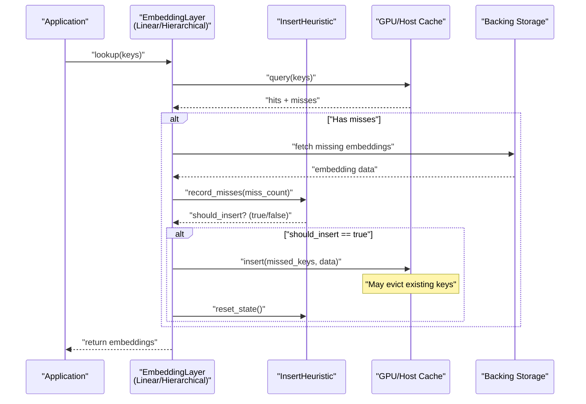
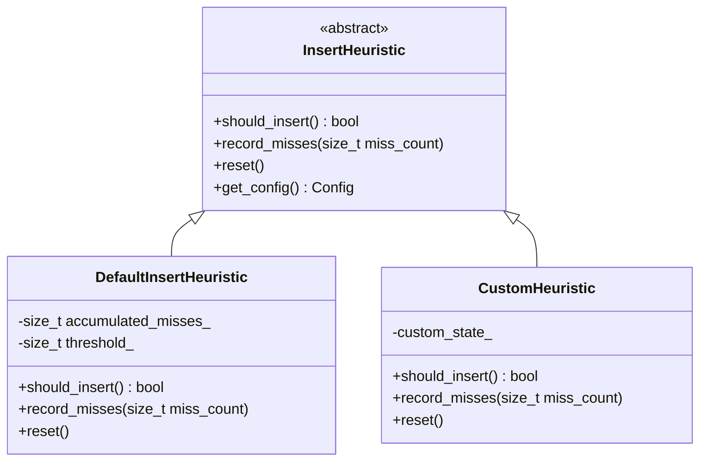
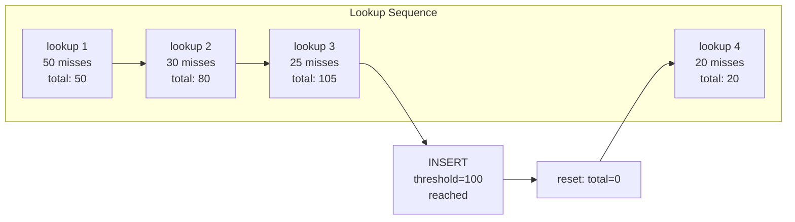
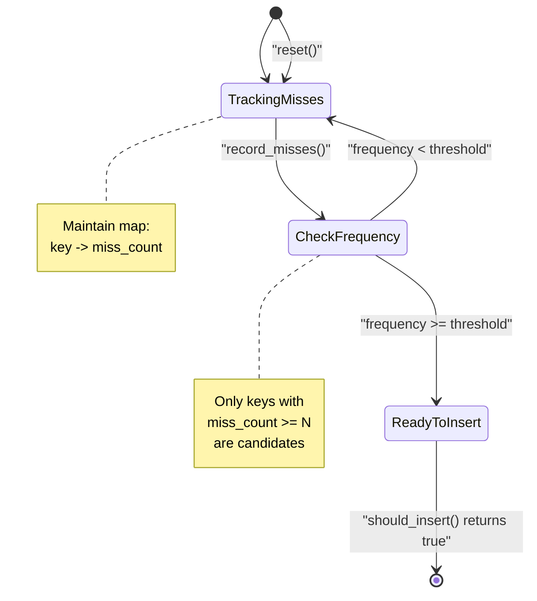
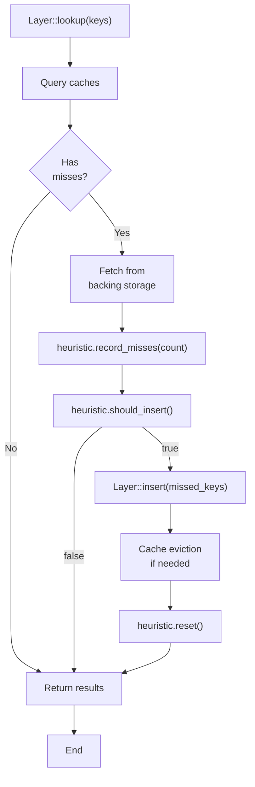

<!-- source: DeepWiki mcp.deepwiki.com · repo NVIDIA/nv-embedding-cache · page 8.4 Custom Insert Heuristics · fetched 2026-10-26 -->

# Custom Insert Heuristics

<details>
<summary>Relevant source files</summary>

The following files were used as context for generating this wiki page:

- [docs/advanced.md](docs/advanced.md)
- [docs/cpp_api.md](docs/cpp_api.md)

</details>


This page describes how to implement and use custom cache insertion strategies in the NV Embedding Cache SDK. Insert heuristics control when the cache residency should be updated by inserting new embedding keys into faster storage tiers.

For general information about cache operations, see [Cache Operations](#3.5). For details on cache eviction policies, see [Cache Eviction Policies](#7.3). For the complete Embedding Layer API, see [Embedding Layer API](#4.1).

## What Are Insert Heuristics

Insert heuristics are decision-making objects that determine **when** to update cache residency by inserting new keys into caches. When embedding layers with caching (such as `LinearUVMEmbeddingLayer` and `HierarchicalEmbeddingLayer`) perform lookup operations, they track which keys were requested but not found in the cache (cache misses). The insert heuristic decides when to actually insert these missed keys into the cache, potentially evicting existing keys.

Insert heuristics are critical because:
- **Cache insertion is expensive**: Moving data between memory tiers (remote storage → system memory → GPU memory) has overhead
- **Not all misses are worth inserting**: A key accessed once may not justify cache insertion
- **Batching improves efficiency**: Inserting many keys at once is more efficient than inserting one at a time
- **Workload patterns vary**: Different applications have different access patterns that benefit from different insertion strategies

Sources: [docs/advanced.md:30-32]()

## When Heuristics Are Invoked

Insert heuristics are checked during lookup operations in embedding layers that use caching. The typical flow is:



Sources: [docs/cpp_api.md:25-26](), [docs/advanced.md:30-32]()

## The InsertHeuristic Interface

The `InsertHeuristic` base class defines the interface that all heuristic implementations must follow. It is defined in [include/insert_heuristic.hpp]().

### Core Methods

| Method | Purpose | When Called |
|--------|---------|-------------|
| `should_insert()` | Returns whether cache insertion should occur now | After each lookup with misses |
| `record_misses()` | Tracks miss count and other statistics | After each lookup with misses |
| `reset()` | Resets internal state after insertion | After cache insertion completes |
| `get_config()` | Returns configuration parameters | During layer initialization |

### Conceptual Interface



Sources: [docs/advanced.md:30-32]()

## DefaultInsertHeuristic

The SDK provides `DefaultInsertHeuristic` as the standard implementation. This heuristic uses a simple threshold-based approach:

### Behavior

1. **Accumulates misses**: Each lookup operation with misses increments an internal counter
2. **Threshold check**: When accumulated misses reach a configured threshold, `should_insert()` returns `true`
3. **Reset after insert**: After insertion completes, the miss counter resets to zero

### Strategy Rationale

The threshold-based approach balances:
- **Insertion overhead**: By batching multiple misses, insertion operations become more efficient
- **Cache freshness**: Regular insertions keep the cache updated with recently accessed keys
- **Simplicity**: Easy to configure and reason about

### Configuration

The default heuristic typically accepts a configuration parameter:
- **miss_threshold**: Number of accumulated misses before triggering insertion (e.g., 1000, 10000)

### Example Flow



Sources: [docs/advanced.md:31]()

## Creating Custom Insert Heuristics

Applications can implement custom insert heuristics by deriving from the `InsertHeuristic` base class. This allows for application-specific insertion strategies.

### Implementation Approach

1. **Subclass InsertHeuristic**: Create a class that inherits from the base interface
2. **Maintain custom state**: Store whatever state your heuristic needs (counters, timers, statistics, etc.)
3. **Implement decision logic**: Define `should_insert()` with your custom logic
4. **Track metrics**: Implement `record_misses()` to update your state
5. **Reset state**: Implement `reset()` to clear state after insertion

### Custom Heuristic Strategies

Different strategies serve different workload patterns:

| Strategy | Use Case | Implementation Approach |
|----------|----------|------------------------|
| **Time-based** | Regular batch updates | Track elapsed time since last insert; trigger every N seconds |
| **Frequency-based** | Multi-pass training | Track key access frequency; insert only keys seen multiple times |
| **Adaptive threshold** | Variable workload | Adjust threshold based on cache hit rate or system load |
| **Periodic with minimum** | Stable workloads | Combine time-based and count-based triggers (whichever comes first) |
| **Per-key tracking** | Selective caching | Maintain per-key statistics; insert only high-value keys |

### Example: Frequency-Based Heuristic

A frequency-based heuristic only inserts keys that have been missed multiple times:



**Pseudocode logic**:
```
class FrequencyInsertHeuristic : public InsertHeuristic {
  std::unordered_map<KeyType, size_t> key_frequencies_;
  size_t frequency_threshold_;
  size_t candidate_keys_;

  void record_misses(const KeyType* keys, size_t count) {
    for (size_t i = 0; i < count; i++) {
      key_frequencies_[keys[i]]++;
      if (key_frequencies_[keys[i]] == frequency_threshold_) {
        candidate_keys_++;
      }
    }
  }

  bool should_insert() {
    return candidate_keys_ >= batch_threshold_;
  }

  void reset() {
    // Keep frequency map, but reset candidate count
    candidate_keys_ = 0;
  }
};
```

### Example: Time-Based Heuristic

A time-based heuristic triggers insertion after a fixed time interval:

**Pseudocode logic**:
```
class TimeBasedInsertHeuristic : public InsertHeuristic {
  std::chrono::time_point last_insert_time_;
  std::chrono::milliseconds interval_;
  size_t accumulated_misses_;

  void record_misses(size_t count) {
    accumulated_misses_ += count;
  }

  bool should_insert() {
    auto now = std::chrono::steady_clock::now();
    auto elapsed = now - last_insert_time_;
    
    return (elapsed >= interval_) && (accumulated_misses_ > 0);
  }

  void reset() {
    last_insert_time_ = std::chrono::steady_clock::now();
    accumulated_misses_ = 0;
  }
};
```

Sources: [docs/advanced.md:31-32]()

## Integration with Embedding Layers

Embedding layers that support caching use insert heuristics during their operation. The integration points are:

### Layer Construction

Layers accept an insert heuristic object during construction or initialization. The layer takes ownership or shares ownership of the heuristic.

**Conceptual usage pattern**:
```
// Create custom heuristic
auto custom_heuristic = std::make_shared<CustomInsertHeuristic>(config);

// Pass to layer during construction
LayerConfig layer_config;
layer_config.insert_heuristic = custom_heuristic;
auto layer = std::make_shared<LinearUVMEmbeddingLayer>(layer_config);
```

### Lookup Operation Flow



### Which Layers Use Heuristics

| Layer Type | Uses Insert Heuristic? | Cache Tiers Updated |
|------------|------------------------|---------------------|
| `GPUEmbeddingLayer` | No | N/A (no caching) |
| `LinearUVMEmbeddingLayer` | Yes | GPU cache |
| `HierarchicalEmbeddingLayer` | Yes | GPU cache and system memory cache |

Sources: [docs/cpp_api.md:19-22]()

## Configuration and Lifecycle

### Configuration Parameters

Custom heuristics typically need configuration. Common patterns include:

| Parameter Type | Purpose | Example |
|----------------|---------|---------|
| Threshold values | Trigger points for insertion | `miss_threshold=10000` |
| Time intervals | Time-based triggering | `insert_interval_ms=5000` |
| Capacity limits | State management | `max_tracked_keys=100000` |
| Behavior flags | Enable/disable features | `enable_frequency_tracking=true` |

### Lifecycle Management

The heuristic lifecycle follows the layer lifecycle:

1. **Construction**: Heuristic created with configuration
2. **Initialization**: Layer takes ownership/reference
3. **Runtime**: `record_misses()` and `should_insert()` called repeatedly
4. **Periodic resets**: `reset()` called after each insertion
5. **Destruction**: Heuristic destroyed when layer is destroyed

### Thread Safety Considerations

If the embedding layer supports concurrent lookups (via multiple execution contexts), the insert heuristic must be thread-safe:

- **Lock-protected state**: Use mutexes for shared state
- **Atomic counters**: Use `std::atomic` for simple counters
- **Per-context state**: Maintain separate state for each execution context

Sources: [docs/advanced.md:3-10]()

## Use Cases and Examples

### Use Case 1: Training with Multiple Epochs

**Scenario**: Multi-epoch training where early epochs see many unique keys, but later epochs see mostly repeated keys.

**Strategy**: Frequency-based heuristic that only caches keys seen multiple times.

**Benefits**:
- Avoids polluting cache with one-time keys in early epochs
- Focuses cache capacity on frequently accessed keys
- Improves hit rate in later epochs

### Use Case 2: Real-Time Inference with Burst Traffic

**Scenario**: Inference service with bursty request patterns; periods of high traffic followed by low traffic.

**Strategy**: Adaptive threshold that increases during high traffic (to batch more) and decreases during low traffic (to stay responsive).

**Benefits**:
- Maintains low latency during bursts by batching efficiently
- Keeps cache fresh during quiet periods
- Adapts to traffic patterns automatically

### Use Case 3: Multi-Tier Storage with Selective Promotion

**Scenario**: Three-tier hierarchy (GPU → System → Remote) where GPU cache is limited.

**Strategy**: Custom heuristic that tracks system memory hit rates and only promotes to GPU if frequently accessed from system memory.

**Benefits**:
- Prevents one-time system memory accesses from evicting stable GPU cache
- Focuses GPU cache on hottest keys
- Reduces GPU cache churn

### Use Case 4: Periodic Checkpointing

**Scenario**: Application needs to checkpoint cache state periodically.

**Strategy**: Time-based heuristic that triggers insertion before each checkpoint window.

**Benefits**:
- Ensures cache is up-to-date before checkpoint
- Coordinates cache updates with checkpoint schedule
- Maintains consistent cache state

Sources: [docs/advanced.md:30-32]()

## Best Practices

### Design Considerations

1. **Keep state lightweight**: Heuristic is called frequently; minimize memory overhead
2. **Avoid expensive operations**: `should_insert()` should be O(1) or very fast
3. **Coordinate with workload**: Match heuristic strategy to access patterns
4. **Test under load**: Measure impact on throughput and latency
5. **Monitor effectiveness**: Track cache hit rates with different heuristics

### Common Pitfalls

| Pitfall | Impact | Solution |
|---------|--------|----------|
| Too aggressive insertion | Cache thrashing, high overhead | Increase thresholds or use frequency filtering |
| Too conservative insertion | Poor cache utilization, low hit rate | Decrease thresholds or add time-based trigger |
| Unbounded state growth | Memory leak, performance degradation | Limit state size, periodic cleanup |
| Thread contention | Scalability issues | Use lock-free structures or per-context state |
| Ignoring reset | State accumulation, incorrect behavior | Always clear state in `reset()` |

### Debugging Custom Heuristics

To debug custom heuristic behavior:

1. **Add logging**: Log when `should_insert()` returns true and state values
2. **Track metrics**: Count total insertions triggered, average miss accumulation
3. **Compare baselines**: Measure hit rate vs. `DefaultInsertHeuristic`
4. **Visualize patterns**: Plot insertion frequency over time
5. **Profile overhead**: Measure time spent in heuristic methods

### Performance Tuning

To optimize custom heuristic performance:

- **Profile hotspots**: Use profiling tools to identify expensive operations
- **Batch state updates**: Update internal state in batches rather than per-key
- **Use efficient data structures**: Hash tables for O(1) lookups, bloom filters for membership tests
- **Cache-friendly layout**: Organize state to minimize cache misses
- **Consider lock-free algorithms**: For high-concurrency scenarios

Sources: [docs/advanced.md:30-32]()

## Integration Code Patterns

### Pattern 1: Simple Custom Heuristic

Reference the base class in [include/insert_heuristic.hpp]() and implement the required methods.

**Key files to reference**:
- Base interface: [include/insert_heuristic.hpp]()
- Layer integration: [include/embedding_layer.hpp]()
- Default implementation: Check SDK source for `DefaultInsertHeuristic`

### Pattern 2: Configurable Heuristic Factory

For applications that need runtime configuration:

**Conceptual pattern**:
```
class HeuristicFactory {
  static std::shared_ptr<InsertHeuristic> create(const Config& cfg) {
    if (cfg.type == "default") {
      return std::make_shared<DefaultInsertHeuristic>(cfg.threshold);
    } else if (cfg.type == "frequency") {
      return std::make_shared<FrequencyInsertHeuristic>(cfg.freq_threshold);
    } else if (cfg.type == "time") {
      return std::make_shared<TimeBasedInsertHeuristic>(cfg.interval_ms);
    }
    // ... more types
  }
};
```

### Pattern 3: Composite Heuristic

Combine multiple strategies:

**Conceptual pattern**:
```
class CompositeInsertHeuristic : public InsertHeuristic {
  std::vector<std::shared_ptr<InsertHeuristic>> sub_heuristics_;
  enum class Mode { ANY, ALL };
  Mode mode_;

  bool should_insert() override {
    if (mode_ == Mode::ANY) {
      // Insert if ANY sub-heuristic says yes
      for (auto& h : sub_heuristics_) {
        if (h->should_insert()) return true;
      }
      return false;
    } else {
      // Insert if ALL sub-heuristics say yes
      for (auto& h : sub_heuristics_) {
        if (!h->should_insert()) return false;
      }
      return true;
    }
  }
};
```

Sources: [docs/advanced.md:31-32]()

## Related Concepts

Understanding insert heuristics requires familiarity with several related concepts:

- **Cache Eviction Policies** ([#7.3](#7.3)): Once insertion is triggered, eviction policies determine which existing keys to remove
- **Execution Contexts** ([#3.4](#3.4)): Parallel operations may require per-context heuristic state
- **Cache Operations** ([#3.5](#3.5)): Insert heuristics integrate with the broader cache operation lifecycle
- **Performance Tuning** ([#8.3](#8.3)): Heuristic configuration is part of overall performance optimization
- **Modify Operations and Synchronization** ([#8.2](#8.2)): Insert operations are modify operations with synchronization requirements

Sources: [docs/advanced.md:30-32](), [docs/cpp_api.md:25-26]()

---

