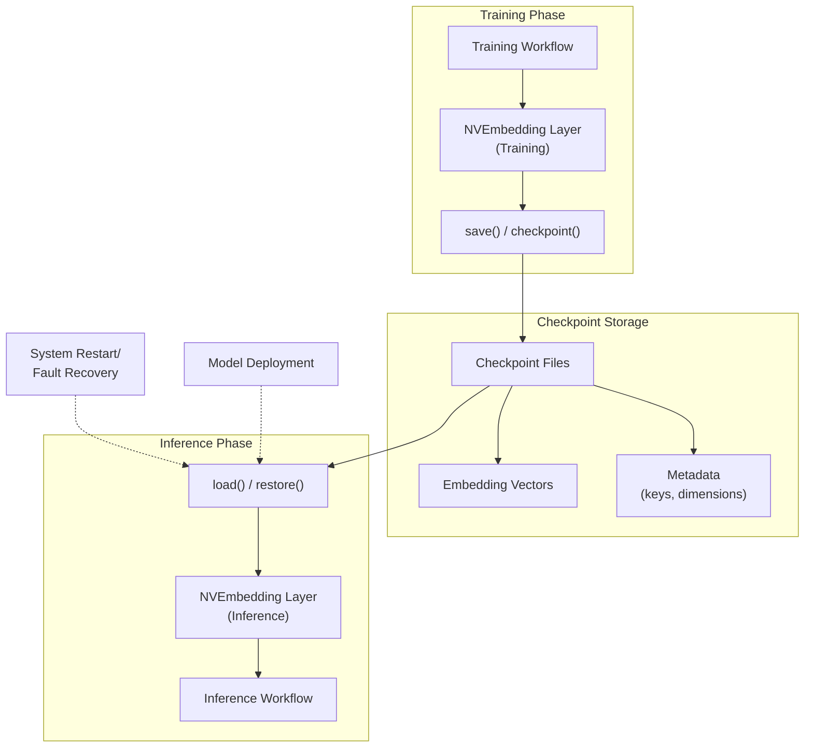
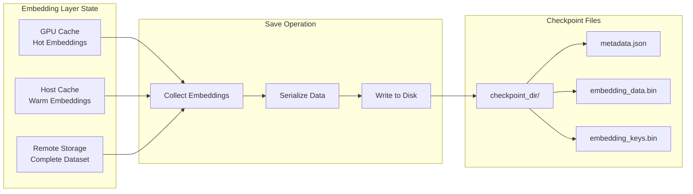
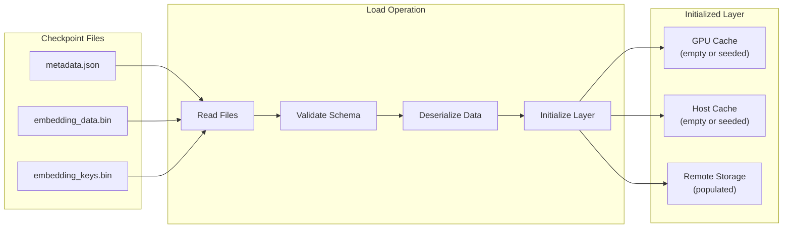
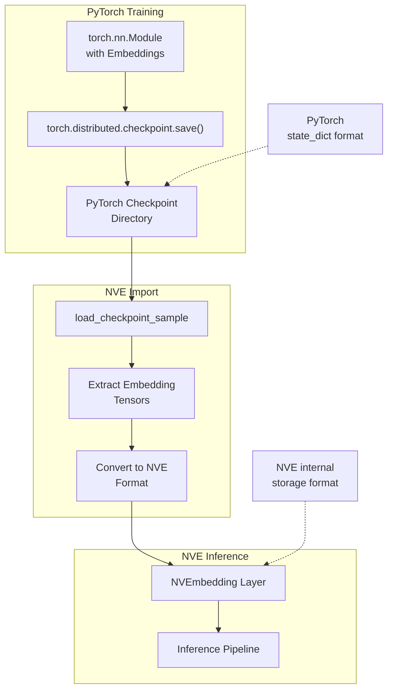
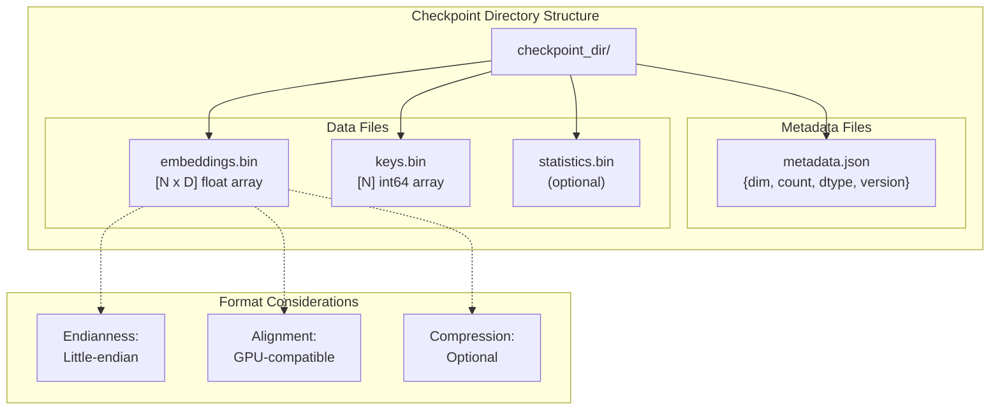
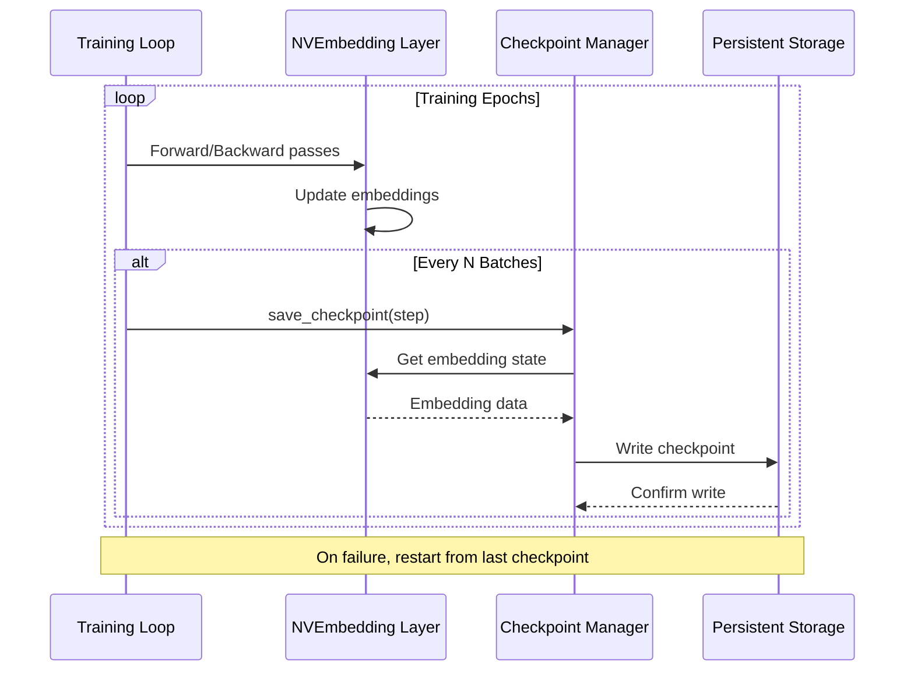
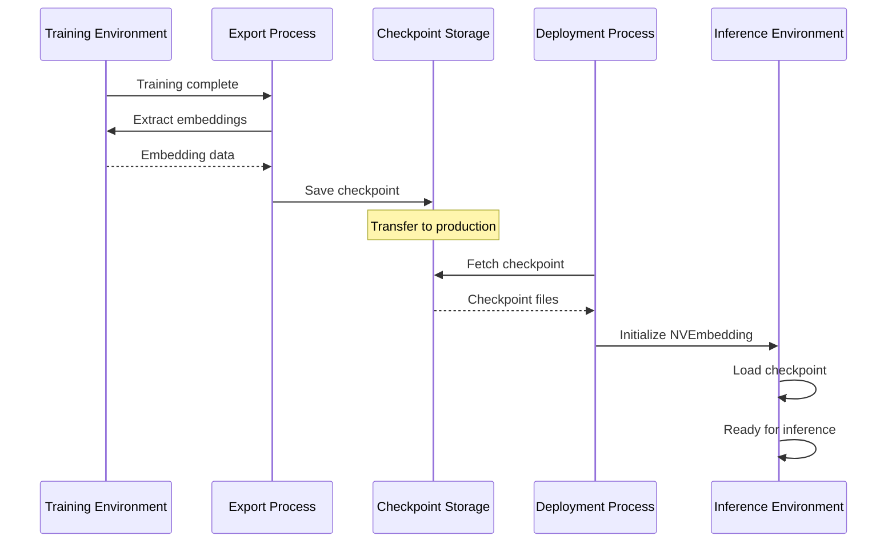
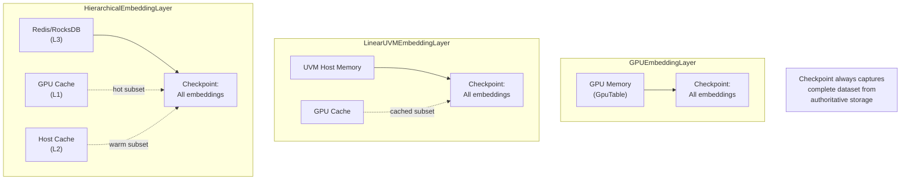

<!-- source: DeepWiki mcp.deepwiki.com · repo NVIDIA/nv-embedding-cache · page 8.5 Checkpointing · fetched 2026-10-26 -->

# Checkpointing

Relevant source files

The following files were used as context for generating this wiki page:

- [CHANGELOG.md](CHANGELOG.md)
- [README.md](README.md)
- [docs/samples.md](docs/samples.md)

## Purpose and Scope

This document describes the checkpointing capabilities of NV Embedding Cache, which enable saving and loading the state of embedding vectors for fault tolerance, model deployment, and transfer learning scenarios. Checkpointing allows you to persist trained embeddings from training workflows and restore them in inference deployments or after system failures.

For information about the underlying storage implementations that checkpoints interact with, see [Tables and Storage Backends](#3.2). For details on integrating checkpoints with PyTorch training workflows, see [PyTorch Integration](#5.2).

**Sources:** [README.md:1-94](), [CHANGELOG.md:7-11](), [docs/samples.md:16-16]()

---

## Overview

Checkpointing in NV Embedding Cache provides mechanisms to serialize and deserialize embedding vectors and their associated metadata. The system supports:

- **Saving embedding state** from any of the three embedding layer types (GPUEmbeddingLayer, LinearUVMEmbeddingLayer, HierarchicalEmbeddingLayer)
- **Loading embedding state** into initialized embedding layers for inference or continued training
- **PyTorch integration** with `torch.distributed.checkpoint` format for seamless workflow integration
- **Selective persistence** of hot embeddings from GPU cache and/or complete embedding sets from backing storage

**Diagram: Checkpoint Lifecycle in NV Embedding Cache**

The checkpointing system enables two primary workflows:
1. **Fault Tolerance**: Periodically save embedding state during training to enable recovery from failures
2. **Model Deployment**: Export trained embeddings from training environments and import them into production inference systems

**Sources:** [CHANGELOG.md:8-11](), [docs/samples.md:16-17]()

---

## Checkpoint Operations

### Save Operation

The save operation serializes the current state of embeddings from an embedding layer to persistent storage. The operation captures:

- **Embedding vectors**: The actual floating-point embedding data
- **Embedding keys**: The IDs/indices associated with each embedding
- **Dimension metadata**: Embedding vector dimensions and data types
- **Cache statistics** (optional): Information about access patterns and cache state

**Diagram: Save Operation Flow**

The save operation behavior varies by embedding layer type:

| Layer Type | Save Behavior | Data Source |
|------------|---------------|-------------|
| `GPUEmbeddingLayer` | Saves all embeddings from GPU memory | GpuTable |
| `LinearUVMEmbeddingLayer` | Saves complete dataset from UVM linear memory | UVM-backed storage |
| `HierarchicalEmbeddingLayer` | Saves embeddings from remote parameter server | RedisClusterTable or RocksDBTable |

**Sources:** [README.md:12-15]()

### Load Operation

The load operation deserializes embedding data from checkpoint files and initializes an embedding layer with the saved state. This operation:

- **Validates checkpoint compatibility** (dimension, data type, count)
- **Restores embedding vectors** to the appropriate storage tier
- **Reconstructs lookup indices** for efficient access
- **Initializes cache state** based on the checkpoint or from scratch

**Diagram: Load Operation Flow**

**Sources:** [docs/samples.md:16-17]()

---

## PyTorch Integration

NV Embedding Cache provides native integration with PyTorch's distributed checkpoint format (`torch.distributed.checkpoint`), enabling seamless interoperability with PyTorch-based training workflows.

### Loading PyTorch Checkpoints

The load checkpoint sample demonstrates importing embeddings trained with PyTorch distributed training into NV Embedding Cache for inference:

**Diagram: PyTorch Checkpoint Import Pipeline**

The load checkpoint sample at [samples/pytorch/load_checkpoint_sample]() demonstrates:
- Loading a saved `torch.distributed.checkpoint` 
- Extracting embedding weights from the checkpoint state
- Initializing an `NVEmbedding` layer with the loaded embeddings
- Using the populated layer for inference

**Sources:** [docs/samples.md:16-17]()

### Integration with Dynamic Embedding SDK

Checkpoints from NVIDIA's Dynamic Embedding SDK (see [NVIDIA/recsys-examples](https://github.com/NVIDIA/recsys-examples)) can also be imported into NV Embedding Cache. The import samples demonstrate this workflow:

- **C++ import**: [samples/import_sample]() for C++ API
- **Python import**: [samples/pytorch/simple_sample/simple_hierarchical_embedding.py]() for Python API

This enables training embeddings with the Dynamic Embedding SDK and deploying them with NV Embedding Cache for inference.

**Sources:** [docs/samples.md:14-15]()

---

## Checkpoint Storage Format

While the exact binary format is implementation-specific, checkpoints conceptually store:

### Metadata

Checkpoint metadata typically includes:

| Field | Description | Purpose |
|-------|-------------|---------|
| `embedding_dim` | Dimension of each embedding vector | Validation during load |
| `embedding_count` | Total number of embeddings | Memory allocation planning |
| `data_type` | Floating-point precision (FP32, FP16, etc.) | Type compatibility check |
| `version` | Checkpoint format version | Format compatibility |
| `creation_time` | Timestamp of checkpoint creation | Tracking and management |
| `layer_type` | Type of embedding layer (GPU/LinearUVM/Hierarchical) | Restoration hints |

### Embedding Data

The binary data includes:
- **Embedding vectors**: Contiguous array of floating-point values, shape `[embedding_count, embedding_dim]`
- **Embedding keys**: Array of integer IDs mapping to each embedding vector
- **Optional cache state**: Statistics, access frequencies, LRU state (implementation-dependent)

**Diagram: Checkpoint Directory Structure**

**Sources:** [README.md:12-15]()

---

## Use Cases and Patterns

### Fault Tolerance Pattern

Periodically save checkpoints during long-running training to enable recovery:

**Diagram: Periodic Checkpointing for Fault Tolerance**

### Model Deployment Pattern

Export trained embeddings and deploy to inference system:

**Diagram: Training-to-Inference Deployment**

### Warm Start Pattern

Initialize inference systems with pre-trained embeddings:

| Scenario | Approach | Benefit |
|----------|----------|---------|
| Cold start | Initialize with empty caches | GPU cache warms up over time |
| Warm start | Load checkpoint into GPU cache | Immediate high cache hit rate |
| Hybrid | Load subset of hot embeddings | Balance initialization cost and hit rate |

**Sources:** [docs/samples.md:16-17]()

---

## Checkpointing Across Layer Types

Different embedding layer types have different checkpointing characteristics:

### GPUEmbeddingLayer Checkpointing

- **Storage source**: GpuTable in GPU memory
- **Checkpoint scope**: Complete embedding dataset
- **Considerations**: Dataset must fit in GPU memory; fast to checkpoint
- **Use case**: Small to medium datasets that fit in GPU RAM

### LinearUVMEmbeddingLayer Checkpointing

- **Storage source**: UVM-backed linear memory
- **Checkpoint scope**: Complete embedding dataset from UVM
- **Considerations**: May involve data transfer from host memory
- **Use case**: Large datasets on single nodes

### HierarchicalEmbeddingLayer Checkpointing

- **Storage source**: Remote parameter server (Redis/RocksDB)
- **Checkpoint scope**: Complete embedding dataset from remote storage
- **Considerations**: Network transfer time; distributed checkpoint possible
- **Use case**: Very large datasets across distributed systems

**Diagram: Checkpointing Data Sources by Layer Type**

**Sources:** [README.md:12-15]()

---

## Best Practices

### Checkpoint Frequency

| Scenario | Recommended Frequency | Rationale |
|----------|----------------------|-----------|
| Long training jobs | Every 1000-5000 batches | Balance checkpoint overhead vs recovery time |
| Critical production training | Every epoch | Minimize data loss on failure |
| Large distributed training | Every N minutes of wall time | Account for varying batch throughput |
| Small experiments | End of training only | Minimal overhead concern |

### Storage Considerations

**Checkpoint Size Estimation:**
- Size ≈ `embedding_count × embedding_dim × sizeof(dtype)` + metadata overhead
- Example: 1M embeddings × 128 dimensions × 4 bytes (FP32) = ~512 MB

**Storage Strategy:**
- Use fast local storage for checkpoint writes during training
- Copy to reliable remote storage asynchronously for durability
- Keep N most recent checkpoints; delete older ones to manage space

### Performance Optimization

**During Training:**
- Checkpoint asynchronously if possible to avoid blocking training
- Use separate CUDA streams for checkpoint operations
- Consider checkpointing only changed embeddings if supported

**During Load:**
- Pre-warm GPU cache with hot embeddings from checkpoint statistics
- Load embeddings in batches to avoid memory pressure
- Parallelize loading across multiple storage tiers for hierarchical layers

### Compatibility and Versioning

**Checkpoint Versioning:**
- Include format version in metadata for forward compatibility
- Document breaking changes in checkpoint format across SDK releases
- Provide migration tools for old checkpoint formats when possible

**Cross-Environment Compatibility:**
- Ensure consistent data types (FP32/FP16) between save and load
- Validate embedding dimensions match layer configuration
- Handle endianness differences if transferring between architectures

**Sources:** [README.md:1-94](), [CHANGELOG.md:8-11]()

---

## Code Examples

### C++ Checkpoint Save Example

The C++ API provides checkpoint functionality through the embedding layer interface. The [samples/import_sample]() directory demonstrates checkpoint loading patterns.

Key classes involved:
- Embedding layer classes (`GPUEmbeddingLayer`, `LinearUVMEmbeddingLayer`, `HierarchicalEmbeddingLayer`) provide save/load methods
- Storage tables (`GpuTable`, `NvhmMapTable`, `RedisClusterTable`, `RocksDBTable`) provide underlying persistence

### Python Checkpoint Load Example

The [samples/pytorch/load_checkpoint_sample]() demonstrates loading PyTorch distributed checkpoints into NV Embedding Cache layers for inference deployment.

The sample shows:
- Loading `torch.distributed.checkpoint` format
- Extracting embedding tensors from checkpoint state
- Initializing `NVEmbedding` with loaded embeddings
- Using the layer for inference

**Sources:** [docs/samples.md:16-17](), [docs/samples.md:14-15]()

---

## Related Topics

- For information on the underlying storage implementations, see [Tables and Storage Backends](#3.2)
- For PyTorch-specific integration patterns, see [PyTorch Integration](#5.2)
- For deployment to production inference systems, see [Triton Inference Server Integration](#8.6)
- For importing embeddings from Dynamic Embedding SDK, see [Dynamic Embedding Import](#9.5)
- For performance considerations during checkpoint operations, see [Performance Tuning](#8.3)

**Sources:** [README.md:58-73](), [docs/samples.md:1-29]()

---

