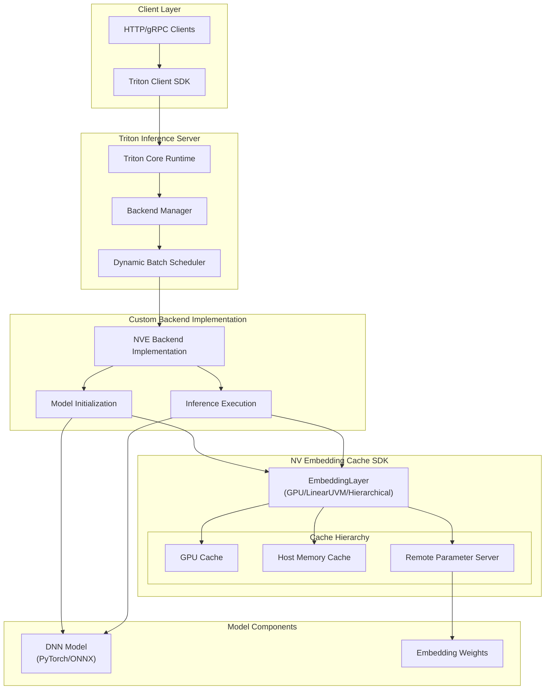
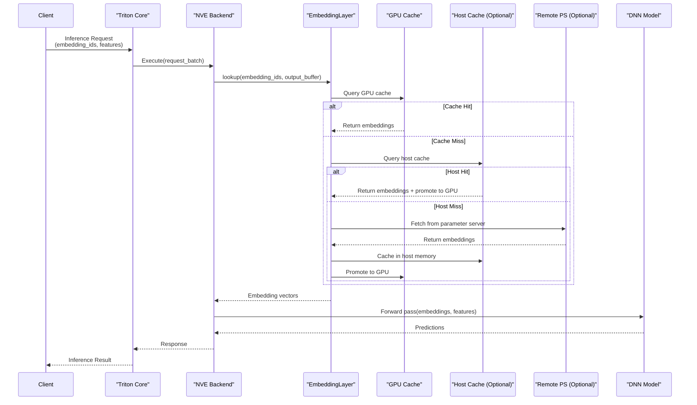
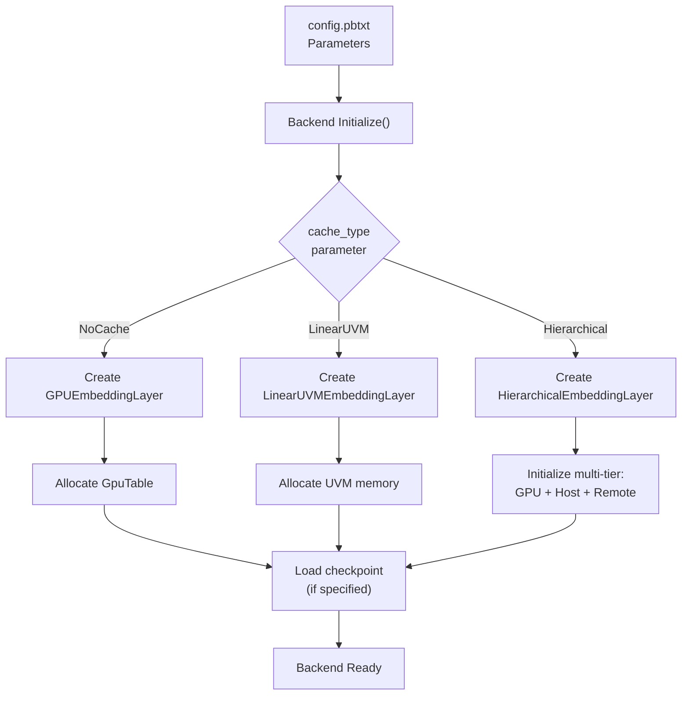
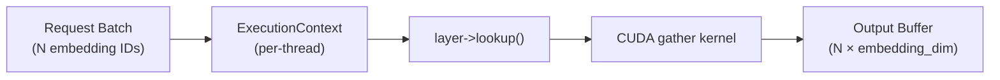
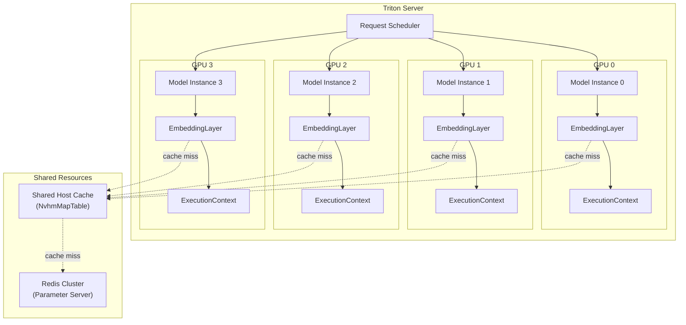
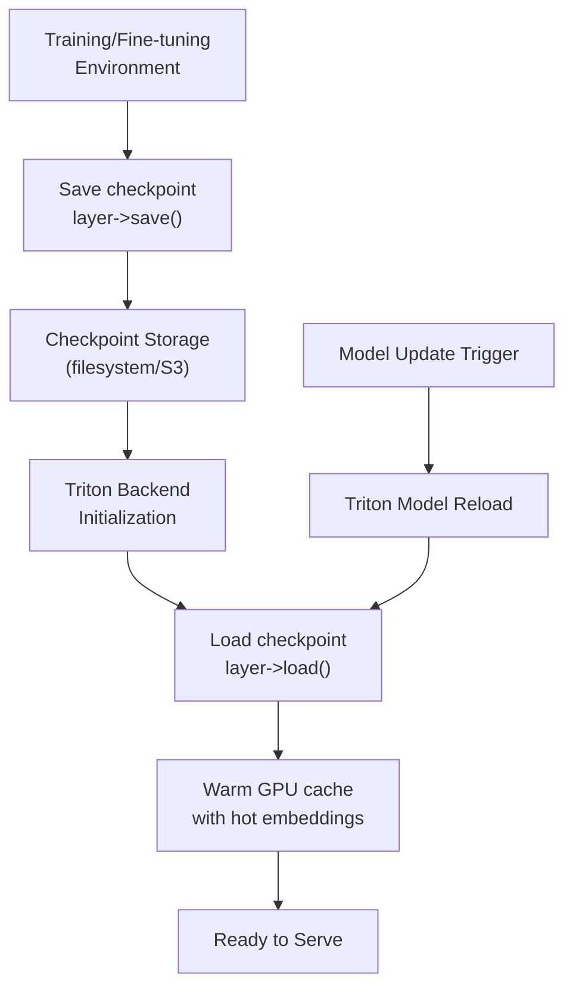
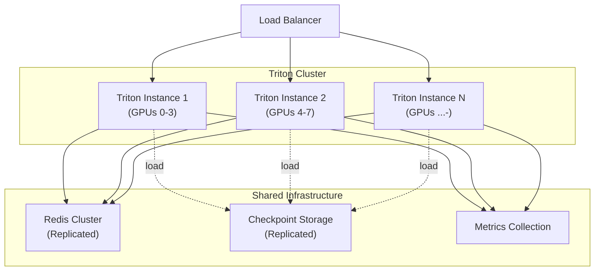

<!-- source: DeepWiki mcp.deepwiki.com · repo NVIDIA/nv-embedding-cache · page 8.6 Triton Inference Server Integration · fetched 2026-10-26 -->

# Triton Inference Server Integration

<details>
<summary>Relevant source files</summary>

The following files were used as context for generating this wiki page:

- [CHANGELOG.md](CHANGELOG.md)
- [README.md](README.md)
- [docs/samples.md](docs/samples.md)

</details>


## Purpose and Scope

This document describes how to deploy NV Embedding Cache with NVIDIA Triton Inference Server for production inference workloads. Triton Inference Server provides a standardized inference serving framework with features like dynamic batching, concurrent model execution, and model management. The integration enables efficient serving of recommender system models that require high-throughput embedding lookups exceeding GPU memory capacity.

For basic PyTorch integration and training workflows, see [PyTorch Integration](#5.2). For multi-GPU deployment strategies, see [Multi-GPU Support](#8.1). For general performance optimization, see [Performance Tuning](#8.3).

**Sources:** [docs/samples.md:27](), [CHANGELOG.md:10-11](), [README.md:1-76]()

---

## Overview

NVIDIA Triton Inference Server is a production-grade inference serving platform that supports multiple deep learning frameworks. The NV Embedding Cache SDK integrates with Triton through custom backends, allowing recommender models to leverage the SDK's hierarchical caching strategies while benefiting from Triton's enterprise features:

- **Dynamic Batching**: Automatic request batching for improved throughput
- **Concurrent Execution**: Multiple model instances across GPUs
- **Model Management**: Version control and hot-swapping of models
- **Metrics and Monitoring**: Prometheus-compatible performance metrics
- **Multi-Framework Support**: Integration with TensorFlow, PyTorch, ONNX models

The integration supports all three caching strategies (`GPUEmbeddingLayer`, `LinearUVMEmbeddingLayer`, `HierarchicalEmbeddingLayer`), enabling production deployments to scale from single-GPU to multi-node distributed configurations with remote parameter servers.

**Sources:** [docs/samples.md:27](), [README.md:7-15]()

---

## Architecture

### Triton Custom Backend Integration

The NV Embedding Cache SDK integrates with Triton through the Triton Backend API, which allows custom model implementations to run within the Triton serving framework. The architecture consists of three main components:



**Triton Custom Backend Integration Architecture**

The custom backend handles:
1. **Model Loading**: Initialize `EmbeddingLayer` instances with configuration from Triton model repository
2. **Request Processing**: Extract embedding IDs from inference requests
3. **Embedding Lookup**: Call `lookup()` on the appropriate embedding layer
4. **DNN Execution**: Pass embedding vectors to the downstream neural network
5. **Response Formatting**: Package results according to Triton output specification

**Sources:** [docs/samples.md:27](), [README.md:11-15]()

---

### Request Flow



**Request Processing Sequence**

This sequence illustrates how a single inference request flows through the Triton server and the embedding cache hierarchy. The multi-tier caching strategy minimizes latency for frequently accessed embeddings while supporting datasets exceeding GPU capacity.

**Sources:** [docs/samples.md:27]()

---

## Sample Implementation

The SDK includes a complete Triton Inference Server sample demonstrating production deployment patterns. The sample is located at `samples/triton_server_sample/`.

### Directory Structure

A typical Triton integration includes:

| Component | Purpose |
|-----------|---------|
| `model_repository/` | Triton model repository containing model configurations |
| `config.pbtxt` | Model configuration specifying inputs, outputs, and backend |
| `1/` (model version directory) | Version-specific model artifacts and weights |
| Backend implementation | Custom backend code linking to NV Embedding Cache |
| Checkpoint files | Saved embedding weights and cache state |

**Sources:** [docs/samples.md:27]()

---

### Model Configuration

Triton models are configured using a `config.pbtxt` file that specifies:

```
name: "embedding_model"
backend: "nve_backend"
max_batch_size: 1024

input [
  {
    name: "embedding_ids"
    data_type: TYPE_INT64
    dims: [-1]
  }
]

output [
  {
    name: "embeddings"
    data_type: TYPE_FP32
    dims: [-1, embedding_dim]
  }
]

instance_group [
  {
    count: 4
    kind: KIND_GPU
    gpus: [0, 1, 2, 3]
  }
]

parameters {
  key: "cache_type"
  value: { string_value: "Hierarchical" }
}

parameters {
  key: "embedding_size"
  value: { string_value: "128" }
}

parameters {
  key: "redis_cluster_address"
  value: { string_value: "localhost:6379" }
}
```

Key configuration parameters:
- **backend**: Custom backend name linking to NV Embedding Cache
- **max_batch_size**: Maximum request batch size for dynamic batching
- **instance_group**: GPU allocation and model instance configuration
- **parameters**: Custom parameters for embedding layer configuration

**Sources:** [README.md:11-15]()

---

### Embedding Layer Initialization

The backend initialization creates the appropriate `EmbeddingLayer` type based on configuration:



**Backend Initialization Flow**

The initialization follows these steps:
1. Parse configuration parameters from `config.pbtxt`
2. Determine caching strategy based on `cache_type` parameter
3. Allocate memory and initialize tables according to strategy
4. Load checkpointed weights if specified
5. Create execution contexts for concurrent inference

**Sources:** [README.md:11-15](), [docs/samples.md:16-17]()

---

### Inference Execution

The backend's execution function processes batched requests:

| Step | Operation | Code Entity |
|------|-----------|-------------|
| 1. Extract IDs | Parse `embedding_ids` tensor from request | Backend input handling |
| 2. Allocate output | Create output tensor for embedding vectors | Backend output allocation |
| 3. Lookup | Call `layer->lookup()` with IDs and output buffer | `EmbeddingLayerBase::lookup()` |
| 4. DNN forward | Execute downstream neural network model | Model-specific |
| 5. Return results | Package predictions in Triton response format | Backend output formatting |

The lookup operation leverages the SDK's asynchronous execution model:



**Parallel Lookup Execution**

Multiple execution contexts enable concurrent request processing across Triton model instances, maximizing GPU utilization.

**Sources:** [README.md:11-15]()

---

## Configuration Strategies

### Strategy Selection

Choose the appropriate caching strategy based on deployment requirements:

| Strategy | Use Case | Configuration |
|----------|----------|---------------|
| **GPUEmbeddingLayer** | Dataset fits in GPU memory<br/>Lowest latency requirements | `cache_type: "NoCache"`<br/>Allocate full table in GPU |
| **LinearUVMEmbeddingLayer** | Dataset larger than GPU<br/>Single-node deployment | `cache_type: "LinearUVM"`<br/>Configure GPU cache size and UVM backing |
| **HierarchicalEmbeddingLayer** | Very large datasets<br/>Multi-node deployment<br/>Shared parameter server | `cache_type: "Hierarchical"`<br/>Configure GPU, host, and remote tiers |

**Sources:** [README.md:11-15]()

---

### Multi-Instance Deployment

Triton supports multiple model instances for concurrent execution:



**Multi-Instance Concurrent Execution**

Each model instance maintains its own GPU cache but shares host memory and remote storage tiers. This architecture:
- Maximizes GPU utilization through parallel inference
- Reduces memory pressure by sharing cold storage tiers
- Maintains cache coherency across instances

**Sources:** [README.md:11-15]()

---

## Deployment Considerations

### Performance Optimization

| Consideration | Recommendation |
|---------------|----------------|
| **Batch Size** | Configure `max_batch_size` to match typical request patterns. Larger batches improve throughput but increase latency. |
| **Dynamic Batching** | Enable for variable request sizes. Set `max_queue_delay_microseconds` to balance latency vs. throughput. |
| **Instance Count** | Start with 1-2 instances per GPU. Monitor GPU utilization and adjust. |
| **Cache Sizing** | GPU cache should hold the working set. Use profiling to determine optimal size. See [Performance Tuning](#8.3). |
| **Thread Pool** | Configure execution context thread pool size based on concurrent request load. |

**Sources:** [README.md:11-15]()

---

### Checkpointing and Model Updates

The integration supports checkpoint loading for warm-start deployment:



**Checkpoint Loading and Model Updates**

The checkpoint workflow:
1. Save trained embeddings using `save()` API
2. Store checkpoint in accessible location (filesystem, S3, etc.)
3. Configure checkpoint path in Triton `config.pbtxt`
4. Backend loads checkpoint during initialization
5. Use Triton's model reload API for zero-downtime updates

For checkpoint API details, see [Checkpointing](#8.5).

**Sources:** [docs/samples.md:16](), [CHANGELOG.md:10]()

---

### Monitoring and Metrics

Triton provides built-in metrics for model performance. Custom metrics can be added to track:

| Metric | Purpose |
|--------|---------|
| **Cache Hit Rate** | GPU/host/remote cache effectiveness |
| **Lookup Latency** | P50/P95/P99 embedding lookup times |
| **Throughput** | Requests per second per instance |
| **Memory Usage** | GPU/host memory consumption |
| **Remote Fetches** | Frequency of parameter server queries |

Access metrics through Triton's Prometheus endpoint or custom logging within the backend implementation.

**Sources:** [README.md:7-15]()

---

### High Availability

For production deployments requiring high availability:



**High Availability Deployment**

Key considerations:
- **Stateless Triton Instances**: Each instance can handle any request
- **Shared Parameter Server**: Redis cluster with replication for fault tolerance
- **Checkpoint Replication**: Ensure checkpoint storage is highly available
- **Load Balancing**: Distribute requests across instances
- **Health Checks**: Monitor instance health and remove failed nodes

**Sources:** [README.md:11-15]()

---

## Sample Usage

The Triton sample demonstrates end-to-end deployment:

```
samples/triton_server_sample/
├── model_repository/          # Triton model repository
├── backend/                   # Custom NVE backend implementation
├── client_example.py          # Example client code
└── README.md                  # Sample-specific documentation
```

To run the sample:

1. Build the custom backend linking to NV Embedding Cache SDK
2. Configure model repository with desired caching strategy
3. Start Triton server pointing to model repository
4. Execute client requests using Triton client SDK

Detailed instructions are provided in the sample's README.

**Sources:** [docs/samples.md:27]()

---

## Integration with Other Features

The Triton integration works seamlessly with other SDK features:

| Feature | Integration Point | Reference |
|---------|-------------------|-----------|
| **Multi-GPU** | Configure instance_group with multiple GPUs | [Multi-GPU Support](#8.1) |
| **Checkpointing** | Load saved state during backend initialization | [Checkpointing](#8.5) |
| **Custom Heuristics** | Configure insert heuristics in model parameters | [Custom Insert Heuristics](#8.4) |
| **Modify Operations** | Support online updates via modify context | [Modify Operations](#8.2) |

**Sources:** [README.md:11-15](), [CHANGELOG.md:10-18]()

---

## Summary

The Triton Inference Server integration enables production deployment of NV Embedding Cache with enterprise-grade serving capabilities. Key benefits include:

- **Standardized Serving**: Leverage Triton's model management and serving infrastructure
- **Scalability**: Deploy across multiple GPUs and nodes with shared parameter servers
- **Flexibility**: Support all three caching strategies within the same framework
- **Monitoring**: Built-in metrics and health checks for production operations
- **Zero-Downtime Updates**: Hot-reload models with updated embeddings

The integration is production-ready as of version 26.03 and includes complete sample implementations for reference.

**Sources:** [CHANGELOG.md:7-18](), [docs/samples.md:27](), [README.md:1-76]()

---

