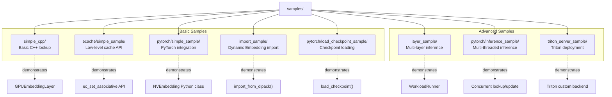
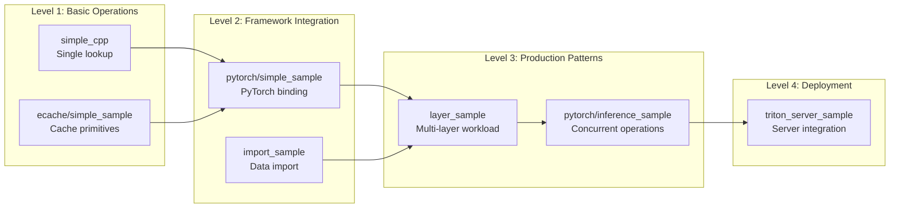
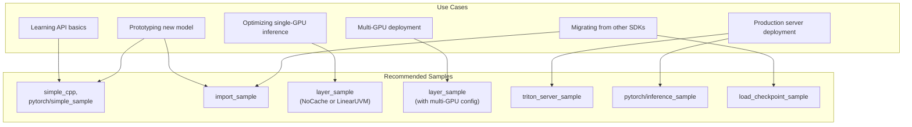
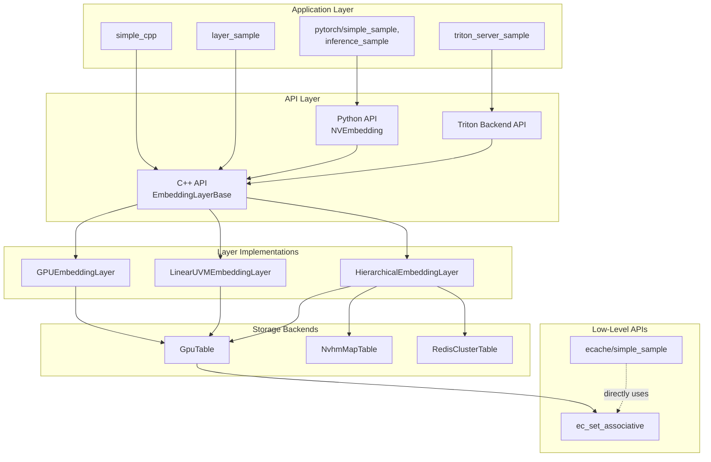

<!-- source: DeepWiki mcp.deepwiki.com · repo NVIDIA/nv-embedding-cache · page 9 Examples and Samples · fetched 2026-10-26 -->

# Examples and Samples

<details>
<summary>Relevant source files</summary>

The following files were used as context for generating this wiki page:

- [README.md](README.md)
- [docs/samples.md](docs/samples.md)

</details>


This document provides a comprehensive overview of the code examples and sample applications included with the NV Embedding Cache SDK. These samples demonstrate practical usage patterns ranging from basic API operations to production-ready deployment scenarios.

For detailed API documentation, see [C++ API Reference](#4) and [Python API Reference](#5). For architectural concepts underlying these samples, see [Core Concepts](#3). For specific caching strategies demonstrated in samples, see [Cache Configuration Strategies](#1.2).

**Sources:** [README.md:57-73](), [docs/samples.md:1-29]()

## Sample Categories and Organization

The SDK provides two categories of samples, organized by complexity and intended audience:

| Category | Target Audience | Purpose | Location |
|----------|----------------|---------|----------|
| **Basic Samples** | New users, quick prototyping | Demonstrate fundamental API usage with minimal complexity | [samples/simple_cpp/](), [samples/pytorch/simple_sample/](), [samples/ecache/simple_sample/]() |
| **Advanced Samples** | Production deployments, performance optimization | Show complex multi-threaded scenarios, deployment patterns, and integration with external systems | [samples/layer_sample/](), [samples/pytorch/inference_sample/](), [samples/triton_server_sample/]() |

**Sources:** [docs/samples.md:5-28]()

## Sample Directory Structure



**Sources:** [docs/samples.md:9-28](), [README.md:70]()

## Feature Coverage Matrix

The following table maps each sample to the SDK features it demonstrates:

| Sample | Layer Type | Cache Type | Multi-threading | Remote Storage | Import/Export | Deployment |
|--------|-----------|------------|-----------------|----------------|---------------|------------|
| `simple_cpp` | GPUEmbeddingLayer | NoCache | ❌ | ❌ | ❌ | Local |
| `ecache/simple_sample` | Low-level API | Set-associative | ❌ | Mock only | ❌ | Local |
| `pytorch/simple_sample` | All three types | All types | ❌ | Redis (Hierarchical) | ✅ | Local |
| `import_sample` | GPUEmbeddingLayer | NoCache | ❌ | ❌ | ✅ | Local |
| `load_checkpoint_sample` | HierarchicalEmbeddingLayer | Hierarchical | ❌ | Redis | ✅ | Local |
| `layer_sample` | All three types | All types | ✅ | Optional | ❌ | Local/Multi-GPU |
| `pytorch/inference_sample` | HierarchicalEmbeddingLayer | Hierarchical | ✅ | Redis | ❌ | Production |
| `triton_server_sample` | HierarchicalEmbeddingLayer | Hierarchical | ✅ | Redis | ❌ | Production |

**Sources:** [docs/samples.md:9-28]()

## Building and Running Samples

### C++ Samples

C++ samples are built automatically when compiling the SDK with samples enabled:

```bash
mkdir build_dir
cd build_dir
cmake ..
make all -j
```

Executables are placed in `build_dir/bin/`. Each sample includes command-line options for configuration.

**Sources:** [README.md:48-55]()

### Python Samples

Python samples require the SDK to be installed:

```bash
pip install .
```

Then navigate to the sample directory and execute the Python script:

```bash
cd samples/pytorch/simple_sample
python simple_hierarchical_embedding.py
```

**Sources:** [README.md:44-47](), [docs/samples.md:13-16]()

## Sample Complexity Progression

The samples are designed to demonstrate progressively more complex usage patterns:



**Sources:** [docs/samples.md:5-28]()

## Sample Dependencies and Prerequisites

Different samples have varying external dependencies:

| Sample | Redis Required | RocksDB Required | Triton Required | PyTorch Required |
|--------|---------------|------------------|-----------------|------------------|
| `simple_cpp` | ❌ | ❌ | ❌ | ❌ |
| `ecache/simple_sample` | ❌ | ❌ | ❌ | ❌ |
| `pytorch/simple_sample` | Optional* | ❌ | ❌ | ✅ |
| `import_sample` | ❌ | ❌ | ❌ | ❌ |
| `load_checkpoint_sample` | ✅ | ❌ | ❌ | ✅ |
| `layer_sample` | Optional* | Optional* | ❌ | ❌ |
| `pytorch/inference_sample` | ✅ | ❌ | ❌ | ✅ |
| `triton_server_sample` | ✅ | ❌ | ✅ | ❌ |

\* Required when using `Hierarchical` cache type with Redis backend

**Sources:** [README.md:21-28](), [docs/samples.md:9-28]()

## Mapping Samples to Use Cases



**Sources:** [docs/samples.md:9-28]()

## Basic Sample Descriptions

### simple_cpp

Location: [samples/simple_cpp/]()

Demonstrates fundamental C++ API usage including:
- Creating a `GPUEmbeddingLayer` instance
- Performing lookup operations
- Basic memory management

This is the recommended starting point for C++ developers.

**Key Classes:** `GPUEmbeddingLayer`, `EmbeddingLayerConfig`

**Sources:** [docs/samples.md:11]()

### ecache/simple_sample

Location: [samples/ecache/simple_sample/]()

Demonstrates low-level GPU embedding cache API usage:
- Direct usage of `ec_set_associative` cache
- Mock system memory cache implementation
- Mock parameter server implementation

This sample is useful for developers implementing custom storage backends or understanding cache internals.

**Key APIs:** `ec_set_associative`, cache primitives

**Sources:** [docs/samples.md:12]()

### pytorch/simple_sample

Location: [samples/pytorch/simple_sample/]()

Demonstrates PyTorch integration:
- Using `NVEmbedding` class in PyTorch models
- All three cache types: `NoCache`, `LinearUVM`, `Hierarchical`
- Integration with PyTorch training loops
- Importing embeddings trained with Dynamic Embedding SDK

Contains multiple Python scripts demonstrating different configurations.

**Key Classes:** `NVEmbedding`, `NVEParameters`

**Sources:** [docs/samples.md:13](), [docs/samples.md:15]()

### import_sample

Location: [samples/import_sample/]()

Demonstrates importing embeddings trained with the NVIDIA Dynamic Embedding SDK:
- Using `import_from_dlpack()` API
- Loading embeddings from external training frameworks
- Format conversion and validation

Essential for users migrating from or integrating with other NVIDIA recommender system tools.

**Key Functions:** `import_from_dlpack()`

**Sources:** [docs/samples.md:14]()

### load_checkpoint_sample

Location: [samples/pytorch/load_checkpoint_sample/]()

Demonstrates checkpoint loading functionality:
- Loading saved `torch.distributed.checkpoint`
- Restoring model state with NVE embeddings
- Checkpoint format compatibility

Useful for fault tolerance and model deployment scenarios.

**Key Functions:** `load_checkpoint()`

**Sources:** [docs/samples.md:16]()

## Advanced Sample Descriptions

### layer_sample

Location: [samples/layer_sample/]()

Advanced multi-layer inference demonstration:
- Multiple embedding layers in a single model
- Configurable workload runners
- Support for all three cache types
- Multi-GPU configuration support
- Performance measurement and profiling

This sample represents a production-like inference scenario and is useful for performance tuning.

**Key Classes:** `WorkloadRunner`, configuration management

**Sources:** [docs/samples.md:25]()

### pytorch/inference_sample

Location: [samples/pytorch/inference_sample/]()

Multi-threaded inference with concurrent updates:
- Parallel inference threads
- Concurrent embedding updates
- Thread-safe operations
- `HierarchicalEmbeddingLayer` with Redis backend
- Real-world production patterns

Demonstrates best practices for high-throughput inference systems.

**Key Patterns:** Thread management, concurrent access, modify contexts

**Sources:** [docs/samples.md:26]()

### triton_server_sample

Location: [samples/triton_server_sample/]()

NVIDIA Triton Inference Server integration:
- Custom Triton backend implementation
- Deploying embedding layers as Triton models
- Production server deployment
- Model configuration and management
- Integration with Triton's model lifecycle

Essential for deploying embeddings in production inference serving infrastructure.

**Key Components:** Triton custom backend, model configuration files

**Sources:** [docs/samples.md:27]()

## Sample Data Flow

The following diagram illustrates how different samples exercise different parts of the SDK stack:



**Sources:** [docs/samples.md:1-29](), [README.md:57-73]()

## Running Samples in Docker

All samples are designed to run within the provided Docker container:

```bash
# Build Docker image
docker build -t nve --build-arg START_DIR=$(pwd) \
  --build-arg UID=$(id -u) --build-arg UNAME=$(id -u -n) \
  --build-arg GID=$(id -g) --build-arg GNAME=$(id -g -n) .

# Start container
docker run --cap-add=ALL --net=host --ipc=host --gpus all \
  -it --rm -v $(pwd):$(pwd) nve

# Navigate to sample directory and run
cd samples/simple_cpp
../../build/bin/simple_cpp
```

The Docker environment includes all prerequisites and dependencies.

**Sources:** [README.md:29-43](), [Dockerfile]()

## Sample Configuration Patterns

Each sample demonstrates specific configuration patterns:

| Configuration Aspect | simple_cpp | pytorch/simple_sample | layer_sample | inference_sample | triton_server_sample |
|---------------------|------------|----------------------|--------------|------------------|---------------------|
| **Cache Type** | NoCache | All three | All three | Hierarchical | Hierarchical |
| **Memory Allocation** | GPU only | Varies | Varies | GPU+Host+Remote | GPU+Host+Remote |
| **Execution Contexts** | Single | Single | Multiple | Multiple | Multiple per request |
| **Configuration Method** | Code-based | Code-based | JSON file | Code-based | Triton config.pbtxt |
| **Error Handling** | Basic | Basic | Comprehensive | Comprehensive | Production-grade |

**Sources:** [docs/samples.md:9-28]()

## Next Steps

After exploring the samples:

1. **For basic usage:** Start with [Basic C++ Example](#9.1) or [Basic PyTorch Example](#9.2)
2. **For advanced scenarios:** Review [Layer Sample (Advanced)](#9.3) and [Multi-threaded Inference](#9.4)
3. **For migration:** See [Dynamic Embedding Import](#9.5)
4. **For production deployment:** Study [Triton Inference Server Integration](#8.6)
5. **For API details:** Consult [C++ API Reference](#4) or [Python API Reference](#5)
6. **For optimization:** Review [Performance Tuning](#8.3)

Additional resources:
- Benchmarking methodology: See [docs/benchmarks.md]()
- Advanced topics: See [docs/advanced.md]()
- Complete API documentation: See [docs/cpp_api.md]() and [docs/python_api.md]()

**Sources:** [README.md:57-73](), [docs/samples.md:1-29]()

---

