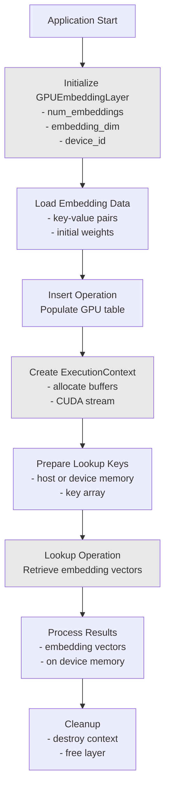
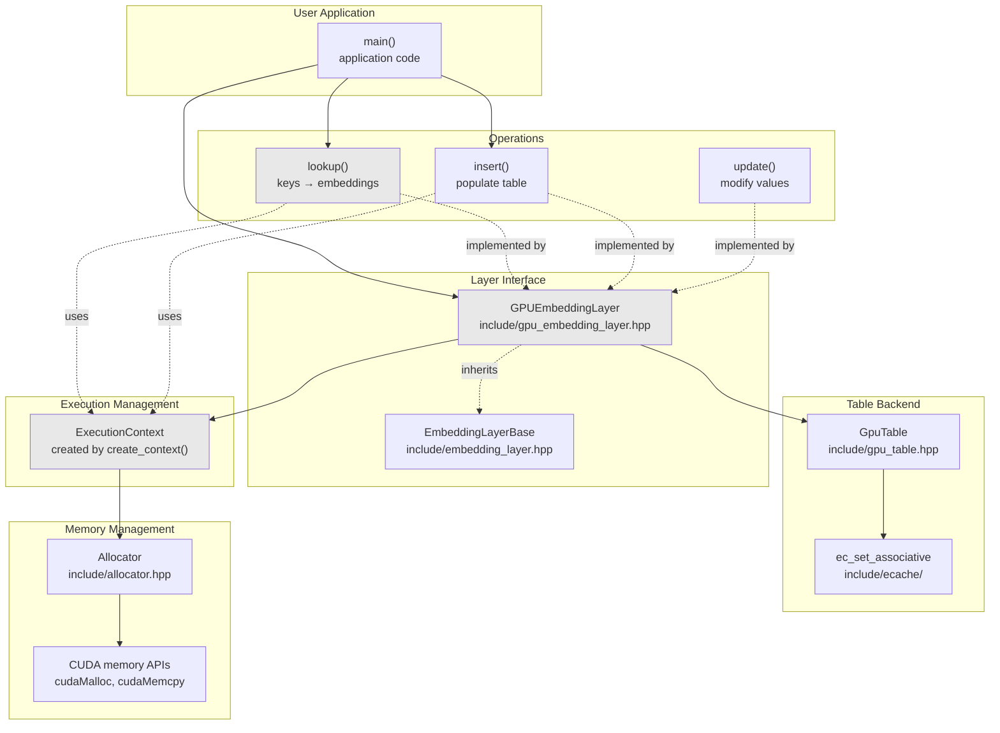
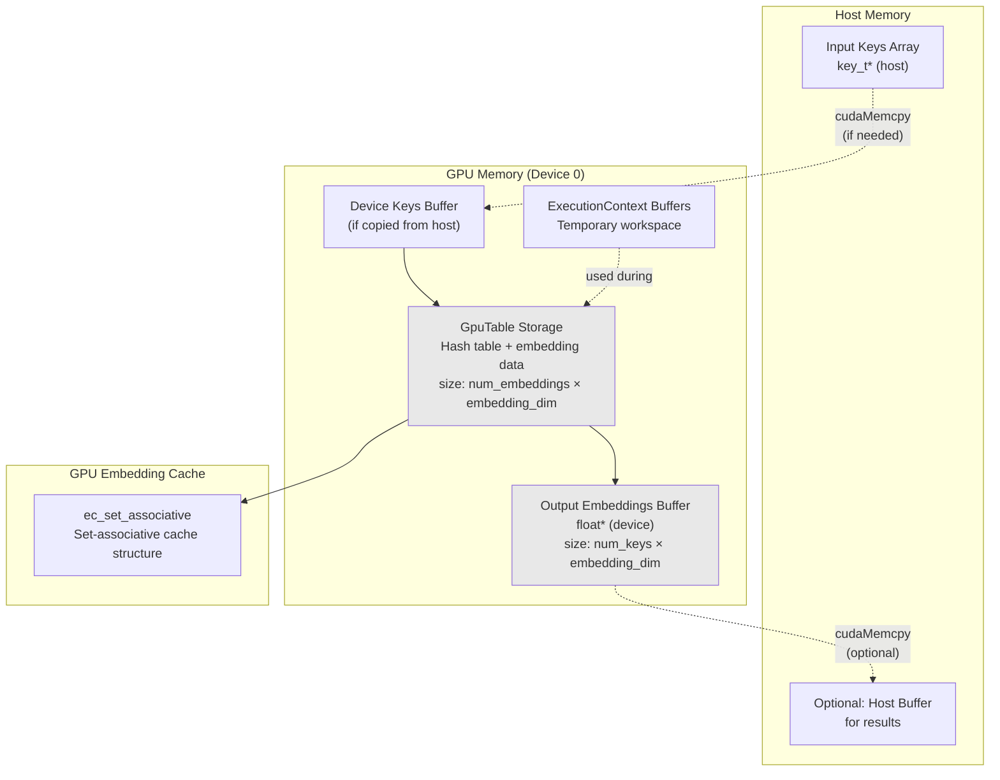

<!-- source: DeepWiki mcp.deepwiki.com · repo NVIDIA/nv-embedding-cache · page 9.1 Basic C++ Example · fetched 2026-10-26 -->

# Basic C++ Example

<details>
<summary>Relevant source files</summary>

The following files were used as context for generating this wiki page:

- [docs/cpp_api.md](docs/cpp_api.md)
- [docs/samples.md](docs/samples.md)

</details>


## Purpose and Scope

This page demonstrates the most basic usage of the NV Embedding Cache SDK from C++. It covers initializing an embedding layer, creating an execution context, and performing simple lookup operations to retrieve embedding vectors. This example uses the simplest configuration: a GPU-only embedding layer with all data resident in GPU memory.

For more complex scenarios, see:
- Advanced multi-layer inference with workload runners: [Layer Sample (Advanced)](#9.3)
- Multi-threaded concurrent operations: [Multi-threaded Inference](#9.4)
- Complete C++ API reference: [C++ API Reference](#4)
- Python-based examples: [Basic PyTorch Example](#9.2)

## Overview

The basic C++ example demonstrates a minimal working program that:

1. Creates a `GPUEmbeddingLayer` to store embeddings entirely in GPU memory
2. Initializes the layer with embedding data (key-value pairs)
3. Creates an `ExecutionContext` for managing operation state
4. Performs `lookup` operations to retrieve embedding vectors by their keys
5. Properly manages GPU memory and CUDA streams

This example is located at [samples/simple_cpp/](). It shows the fundamental API pattern that applies to all layer types, making it an essential starting point for understanding the SDK.

**Sources:** [docs/samples.md:11](), [docs/cpp_api.md:42]()

## Key Components

The basic C++ example involves these core SDK classes:

| Component | Header File | Purpose |
|-----------|-------------|---------|
| `GPUEmbeddingLayer` | `include/gpu_embedding_layer.hpp` | Stores all embedding data in GPU memory; simplest layer type |
| `EmbeddingLayerBase` | `include/embedding_layer.hpp` | Base interface for all layer types |
| `ExecutionContext` | `include/embedding_layer.hpp` | Container for operation state, buffers, and CUDA streams |
| `GpuTable` | `include/gpu_table.hpp` | Underlying GPU-resident hash table implementation |
| `Allocator` | `include/allocator.hpp` | Memory allocation interface (system and GPU memory) |

**Sources:** [docs/cpp_api.md:14-23](), [docs/cpp_api.md:46-50](), [docs/cpp_api.md:73-79]()

## Example Workflow



**Diagram: Basic C++ Example Execution Flow**

This flow represents the typical lifecycle of a simple embedding lookup application.

**Sources:** [docs/cpp_api.md:24-38]()

## Code Entity Relationships



**Diagram: Class and Function Relationships in Basic Example**

This diagram maps the natural language concepts to actual code entities. The main entry point (`main()`) interacts with `GPUEmbeddingLayer`, which internally uses `GpuTable` for storage and `ExecutionContext` for operation management.

**Sources:** [docs/cpp_api.md:14-23](), [docs/cpp_api.md:46-50]()

## Implementation Steps

### Step 1: Include Required Headers

The basic example requires these headers:

```cpp
#include "gpu_embedding_layer.hpp"  // GPUEmbeddingLayer class
#include "embedding_layer.hpp"       // EmbeddingLayerBase interface
#include "allocator.hpp"             // Memory allocator
```

These headers are located in [include/]().

**Sources:** [docs/cpp_api.md:7]()

### Step 2: Create GPUEmbeddingLayer

The `GPUEmbeddingLayer` is constructed with configuration parameters:

```cpp
GPUEmbeddingLayerConfig config;
config.num_embeddings = total_keys;     // Total number of embedding keys
config.embedding_dim = vector_size;     // Dimension of each embedding vector
config.device_id = 0;                   // GPU device ID

auto layer = std::make_unique<GPUEmbeddingLayer>(config);
```

The layer constructor allocates GPU memory via `GpuTable` to store all embedding data.

**Key Configuration Parameters:**

| Parameter | Type | Description |
|-----------|------|-------------|
| `num_embeddings` | `size_t` | Total number of unique embedding keys to store |
| `embedding_dim` | `size_t` | Dimension of each embedding vector (e.g., 128, 256) |
| `device_id` | `int` | CUDA device ID (0 for single-GPU systems) |

**Sources:** [docs/cpp_api.md:20]()

### Step 3: Populate Initial Embeddings

Before performing lookups, the layer must be populated with initial embedding data using the `insert` operation:

```cpp
// Prepare keys and embedding values (typically from trained model)
std::vector<key_t> keys;           // Embedding keys
std::vector<float> embeddings;      // Flattened embedding vectors

// Insert into the layer
layer->insert(table_type, keys.data(), embeddings.data(), 
              keys.size(), stream);
```

The `insert` operation places key-value pairs into the `GpuTable`. For `GPUEmbeddingLayer`, all data must fit in GPU memory.

**Sources:** [docs/cpp_api.md:26-31]()

### Step 4: Create Execution Context

An `ExecutionContext` manages buffers and state for operations:

```cpp
auto context = layer->create_context();
```

The execution context:
- Allocates temporary GPU buffers for operations
- Manages CUDA streams for asynchronous execution
- Stores operation-specific state variables

Each thread performing operations should have its own execution context to avoid conflicts.

**Sources:** [docs/cpp_api.md:38](), [docs/cpp_api.md:76-79]()

### Step 5: Perform Lookup

The `lookup` operation retrieves embedding vectors for given keys:

```cpp
// Input: keys to lookup (on host or device)
key_t* lookup_keys;           // Array of keys
size_t num_keys;              // Number of keys

// Output: embedding vectors (on device)
float* output_embeddings;     // Allocated: num_keys * embedding_dim

// Perform lookup
layer->lookup(context.get(), lookup_keys, output_embeddings, 
              num_keys, stream);
```

The lookup operation:
1. Queries the `GpuTable` for each key
2. Retrieves corresponding embedding vectors
3. Copies results to the output buffer

**Important Notes:**
- Input keys can be in host or device memory (layer handles copying)
- Output embeddings are always written to device memory
- The operation is asynchronous with respect to the CUDA stream
- Missing keys may trigger errors or return zero vectors depending on configuration

**Sources:** [docs/cpp_api.md:24-26]()

## Memory Layout



**Diagram: Memory Layout and Data Flow**

The diagram shows how data moves between host and device memory during a lookup operation.

**Sources:** [docs/cpp_api.md:17](), [docs/cpp_api.md:46-50]()

## Error Handling

The basic example should handle common error cases:

| Error Condition | Cause | Handling |
|----------------|-------|----------|
| CUDA errors | Failed memory allocation, invalid device | Check CUDA return codes |
| Missing keys | Lookup key not present in table | Depends on configuration; may error or return zeros |
| Out of memory | Dataset too large for GPU | Use `LinearUVMEmbeddingLayer` instead (see [#3.1.2](#3.1.2)) |
| Context nullptr | Failed to create execution context | Check allocator and device state |

**Sources:** [docs/cpp_api.md:14-23]()

## Performance Considerations

For basic examples, consider:

1. **Memory Allocation**: Use the default `Allocator` or provide a custom one for pooled memory
2. **CUDA Streams**: Pass the same stream to maintain operation ordering
3. **Batch Size**: Larger batches (more keys per lookup) improve GPU utilization
4. **Context Reuse**: Create context once and reuse across multiple operations

For detailed performance tuning, see [Performance Tuning](#8.3).

**Sources:** [docs/cpp_api.md:73-79]()

## Build and Link Instructions

To build an application using the basic C++ API:

1. **Include Paths**: Add `include/` to compiler include paths
2. **Link Libraries**: 
   - `build/lib/libnve-common.so` (core SDK)
   - `libcudart.so` (CUDA runtime)
3. **Runtime**: Ensure plugin libraries are in `LD_LIBRARY_PATH` if used

Example compilation command:
```bash
g++ -I./include my_app.cpp -L./build/lib -lnve-common -lcudart -o my_app
```

**Sources:** [docs/cpp_api.md:9-12]()

## Sample Code Location

The complete basic C++ example is located at:
- **Directory**: [samples/simple_cpp/]()
- **Description**: Basic API usage in C++ (single layer lookup)

This sample provides a fully working implementation demonstrating all the steps outlined above.

**Sources:** [docs/samples.md:11](), [docs/cpp_api.md:42]()

## Comparison with Other Examples

| Example | Complexity | Features Demonstrated |
|---------|------------|----------------------|
| **Basic C++ (this page)** | Simple | Single-layer GPU lookup, basic operations |
| Layer Sample ([#9.3](#9.3)) | Advanced | Multi-layer inference, workload runners, complex scenarios |
| Multi-threaded ([#9.4](#9.4)) | Advanced | Concurrent inference with parallel updates |
| GPU Cache Simple ([docs/samples.md:12]()) | Low-level | Direct GPU embedding cache API usage |

**Sources:** [docs/samples.md:3-28]()

## Related Documentation

- For complete layer API details: [Embedding Layer API](#4.1)
- For table implementation details: [Table API](#4.2)
- For understanding layer types: [Embedding Layers](#3.1)
- For execution context details: [Execution Contexts](#3.4)
- For Python equivalent: [Basic PyTorch Example](#9.2)

**Sources:** [docs/cpp_api.md:1-80]()

---

