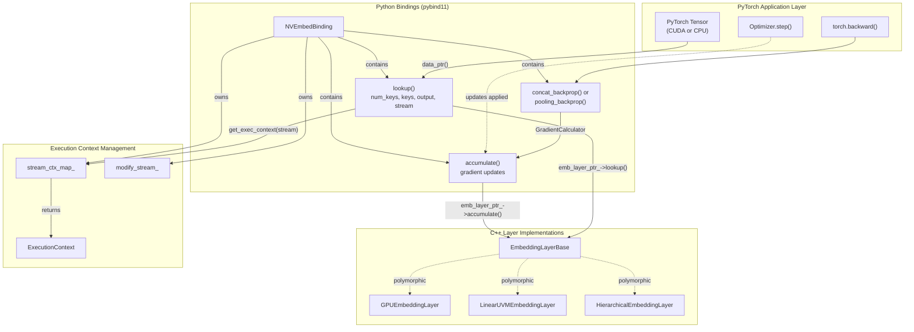
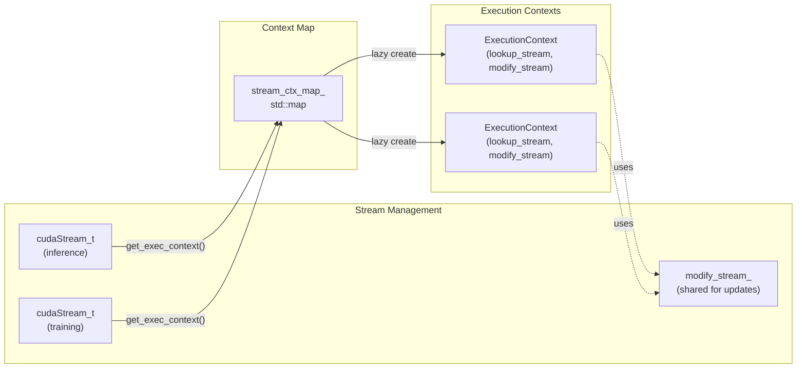
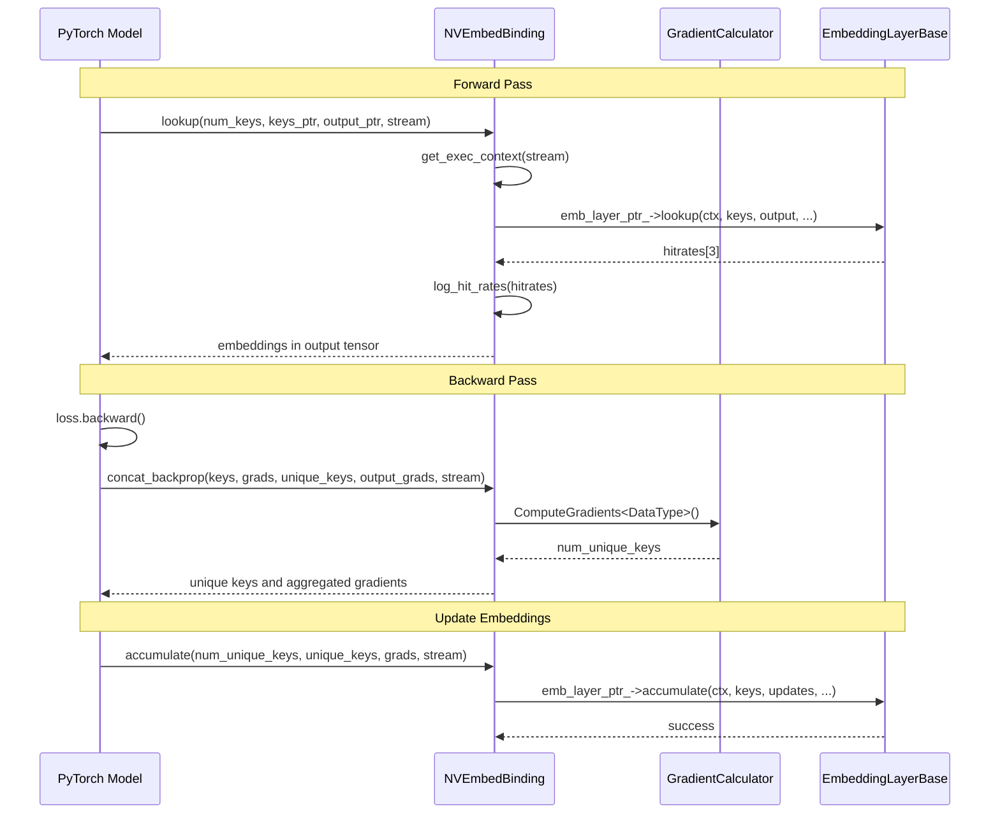
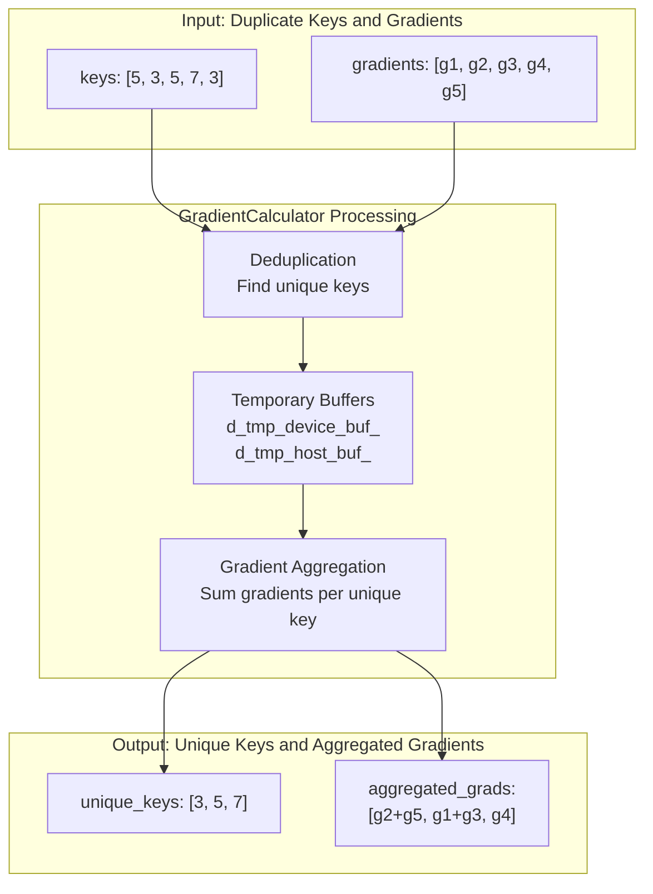
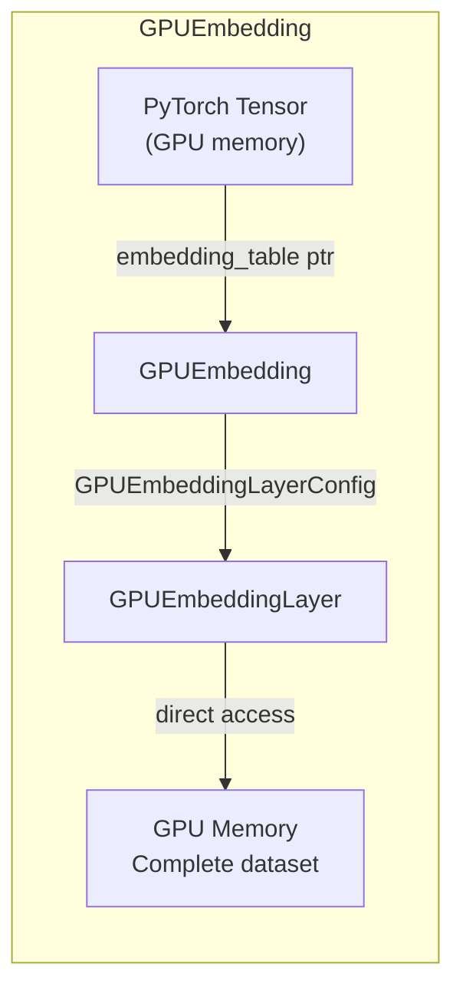
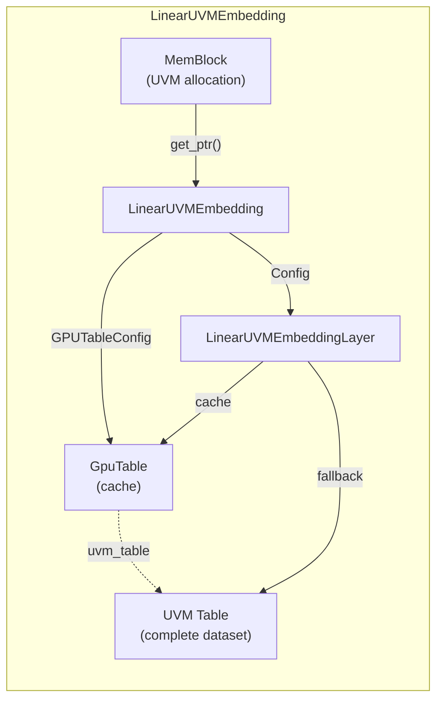
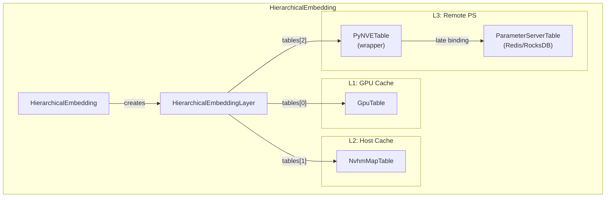
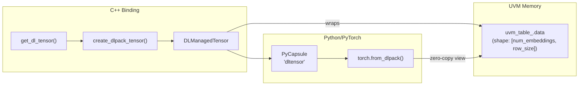
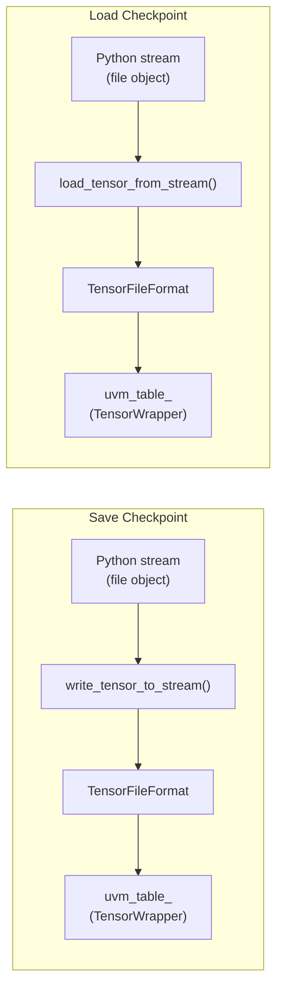
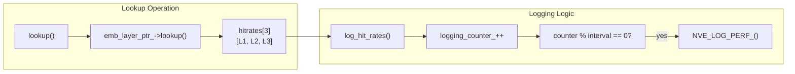

<!-- source: DeepWiki mcp.deepwiki.com · repo NVIDIA/nv-embedding-cache · page 9.2 Basic PyTorch Example · fetched 2026-10-26 -->

# Basic PyTorch Example

Relevant source files

The following files were used as context for generating this wiki page:

- [docs/samples.md](docs/samples.md)
- [python/pynve/bindings/binding_layers.hpp](python/pynve/bindings/binding_layers.hpp)

## Purpose and Scope

This page demonstrates a simple PyTorch integration using the NV Embedding Cache SDK. It covers the fundamental workflow of creating an embedding layer, performing forward passes (lookups), backward passes (gradient computation), and updating embeddings within a PyTorch training or inference context.

For comprehensive API documentation of the Python bindings, see [Python API Reference](#5). For advanced multi-threaded inference patterns, see [Multi-threaded Inference](#9.4). For importing embeddings trained with Dynamic Embedding SDK, see [Dynamic Embedding Import](#9.5).

## Overview

The basic PyTorch example located at [samples/pytorch/simple_sample/]() demonstrates the minimal code required to integrate NV Embedding Cache into a PyTorch workflow. The example illustrates:

- Creating an NVE embedding layer that integrates with PyTorch tensors
- Forward pass: Looking up embeddings using PyTorch tensors
- Backward pass: Computing gradients and updating embeddings
- Automatic gradient accumulation for training workflows

**Sources:** [docs/samples.md:13]()

## Sample Location and Files

The basic PyTorch sample is organized as follows:

| Component | Location | Purpose |
|-----------|----------|---------|
| Main sample script | `samples/pytorch/simple_sample/` | Basic PyTorch embedding lookup |
| Hierarchical example | `samples/pytorch/simple_sample/simple_hierarchical_embedding.py` | Demonstrates hierarchical caching with Dynamic Embedding import |

**Sources:** [docs/samples.md:13-15]()

## Python Binding Architecture

The following diagram shows how PyTorch tensors flow through the Python bindings to the C++ embedding layer implementation:

**Sources:** [python/pynve/bindings/binding_layers.hpp:58-360]()

## Key Classes and Methods

### NVEmbedBinding Template Class

The `NVEmbedBinding<IndexT>` class provides the Python-facing interface for all embedding operations:

| Method | Signature | Purpose |
|--------|-----------|---------|
| `lookup()` | `(num_keys, keys, output, stream)` | Forward pass - retrieve embeddings |
| `lookup_with_pooling()` | `(num_keys, keys, output, pooling_type, offsets, weights, stream)` | Forward pass with aggregation |
| `concat_backprop()` | `(num_keys, keys, grads, unique_keys, output_grads, stream)` | Backward pass for concatenated embeddings |
| `pooling_backprop()` | `(num_keys, keys, grads, unique_keys, output_grads, pooling_type, offsets, weights, stream)` | Backward pass for pooled embeddings |
| `accumulate()` | `(num_keys, keys, updates, stream)` | Apply gradient updates |
| `update()` | `(num_keys, keys, updates, stream)` | Overwrite embeddings |
| `insert()` | `(num_keys, keys, values, table_id, stream)` | Insert new embeddings |
| `erase()` | `(num_keys, keys, table_id, stream)` | Remove embeddings |

**Sources:** [python/pynve/bindings/binding_layers.hpp:61-264]()

### Execution Context Management

Each CUDA stream is mapped to an `ExecutionContext` for efficient parallel operations:

**Sources:** [python/pynve/bindings/binding_layers.hpp:308-321](), [python/pynve/bindings/binding_layers.hpp:355-356]()

## Typical PyTorch Integration Workflow

The following diagram illustrates the typical sequence of operations in a PyTorch training step:

**Sources:** [python/pynve/bindings/binding_layers.hpp:61-76](), [python/pynve/bindings/binding_layers.hpp:105-160](), [python/pynve/bindings/binding_layers.hpp:221-230]()

## Gradient Computation and Deduplication

The backward pass uses the `GradientCalculator` to handle duplicate keys and aggregate gradients:

**Sources:** [python/pynve/bindings/binding_layers.hpp:105-160](), [python/pynve/bindings/binding_layers.hpp:347-352]()

## Three Embedding Layer Types for PyTorch

The Python bindings support three distinct embedding layer implementations:

### 1. GPUEmbedding

Configuration: `GPUEmbedding(row_size, num_embeddings, dtype, embedding_table, device_id, config)`

**Sources:** [python/pynve/bindings/binding_layers.hpp:626-657]()

### 2. LinearUVMEmbedding

Configuration: `LinearUVMEmbedding(row_size, num_embeddings, dtype, mem_block, gpu_cache_size, use_private_stream, device_id, config)`

**Sources:** [python/pynve/bindings/binding_layers.hpp:478-624]()

### 3. HierarchicalEmbedding

Configuration: `HierarchicalEmbedding(row_size, dtype, gpu_cache_size, host_cache_size, remote_table, use_private_stream, device_id, config)`

**Sources:** [python/pynve/bindings/binding_layers.hpp:363-476]()

## Configuration Parameters

The `EmbedLayerConfig` structure controls layer behavior:

| Parameter | Type | Default | Purpose |
|-----------|------|---------|---------|
| `logging_interval` | `int64_t` | `-1` (disabled) | Log hit rates every N lookups |
| `kernel_mode` | `int64_t` | `0` (default) | Kernel type selection (see kernel modes) |
| `kernel_mode_value_1` | `int64_t` | `0` | Kernel-specific parameter 1 |
| `kernel_mode_value_2` | `int64_t` | `0` | Kernel-specific parameter 2 |

### Kernel Mode Configuration

For `LinearUVMEmbedding`, kernel modes control the gather operation:

- **Mode 0 (Default)**: Standard gather kernel
- **SortGather**: Sort keys before gathering
  - `kernel_mode_value_1`: Tile size (default: 1024)
- **PipelineGather**: Pipelined gather with auxiliary streams
  - `kernel_mode_value_1`: Task size (default: 1024)
  - `kernel_mode_value_2`: Number of auxiliary streams (default: 16)

**Sources:** [python/pynve/bindings/binding_layers.hpp:50-55](), [python/pynve/bindings/binding_layers.hpp:516-526]()

## Data Type Support

All embedding layer types support two data types:

| Data Type | C++ Enum | Element Size | Python Usage |
|-----------|----------|--------------|--------------|
| Float32 | `nve::DataType_t::Float32` | 4 bytes | Standard precision training |
| Float16 | `nve::DataType_t::Float16` | 2 bytes | Half-precision for memory efficiency |

The data type is specified at layer creation and affects:
- Memory footprint (`row_size_in_bytes_ = row_size * element_size`)
- Gradient computation kernels (template specialization)
- DLPack tensor metadata

**Sources:** [python/pynve/bindings/binding_layers.hpp:116](), [python/pynve/bindings/binding_layers.hpp:129-158](), [python/pynve/bindings/binding_layers.hpp:275-276]()

## DLPack Tensor Access (LinearUVMEmbedding)

`LinearUVMEmbedding` exposes the underlying UVM table as a DLPack tensor for zero-copy PyTorch integration:

The DLPack tensor exposes:
- **Shape**: `[num_embeddings, row_size]`
- **Device**: `kDLCUDA` with specified `device_id`
- **DType**: `kDLFloat` with 32 or 16 bits
- **Data pointer**: Direct access to UVM memory

**Sources:** [python/pynve/bindings/binding_layers.hpp:540-591]()

## Serialization Support (LinearUVMEmbedding)

`LinearUVMEmbedding` supports saving and loading embeddings via Python streams:

Methods:
- `write_tensor_to_stream(stream, name)`: Serialize embeddings to file
- `load_tensor_from_stream(stream, name)`: Deserialize embeddings from file

**Sources:** [python/pynve/bindings/binding_layers.hpp:593-603]()

## Hit Rate Logging

When `logging_interval > 0`, the binding layer logs cache hit rates at the specified interval:

Hit rates are reported per cache tier:
- `hitrates[0]`: GPU cache (L1) hit rate
- `hitrates[1]`: Host cache (L2) hit rate  
- `hitrates[2]`: Remote cache (L3) hit rate

**Sources:** [python/pynve/bindings/binding_layers.hpp:75](), [python/pynve/bindings/binding_layers.hpp:324-341](), [python/pynve/bindings/binding_layers.hpp:358-359]()

## Example Integration Pattern

A typical PyTorch training step follows this pattern:

1. **Initialize embedding layer** with appropriate configuration
2. **Forward pass**: `lookup()` retrieves embeddings for input keys
3. **Model forward**: Pass embeddings through neural network
4. **Loss computation**: Calculate loss from model outputs
5. **Backward pass**: `concat_backprop()` or `pooling_backprop()` computes unique gradients
6. **Gradient application**: `accumulate()` applies gradients to embeddings
7. **Repeat** for next batch

For complete working examples, refer to:
- Basic usage: [samples/pytorch/simple_sample/]()
- Advanced patterns: [samples/pytorch/inference_sample/]()
- Checkpoint loading: [samples/pytorch/load_checkpoint_sample/]()

**Sources:** [docs/samples.md:13-16](), [docs/samples.md:26]()

---

