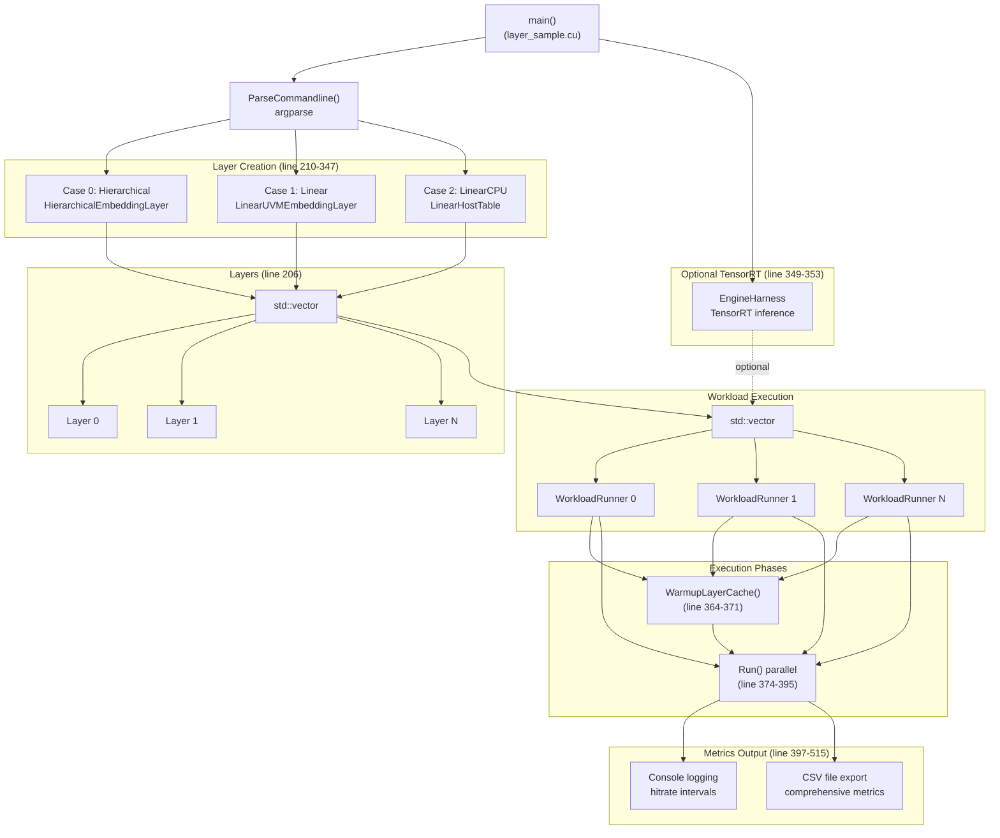
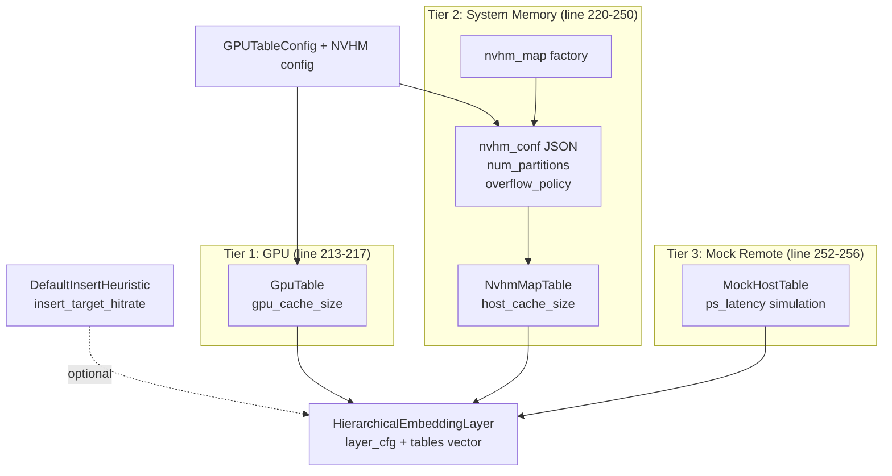
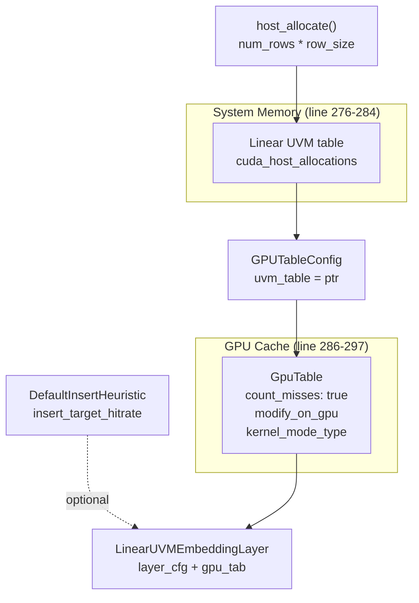
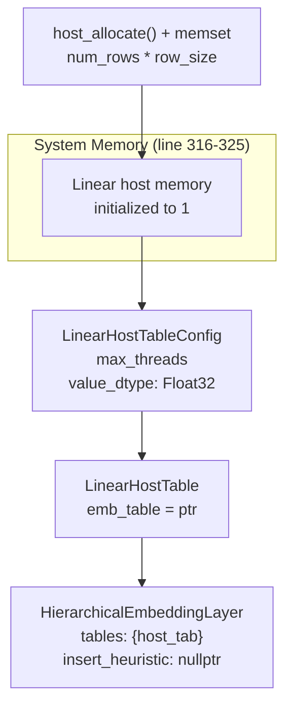
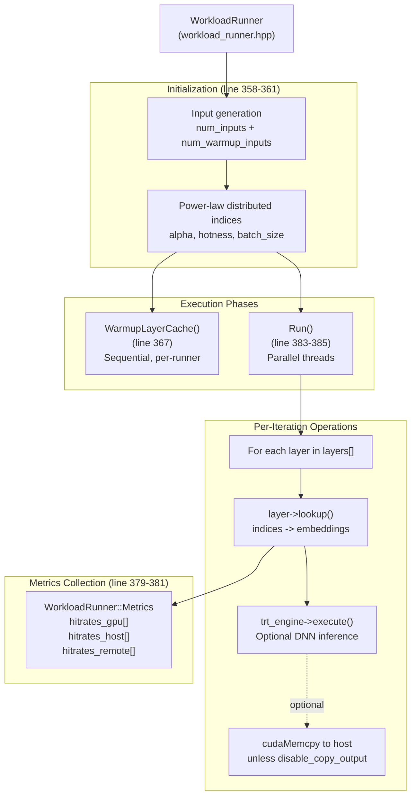
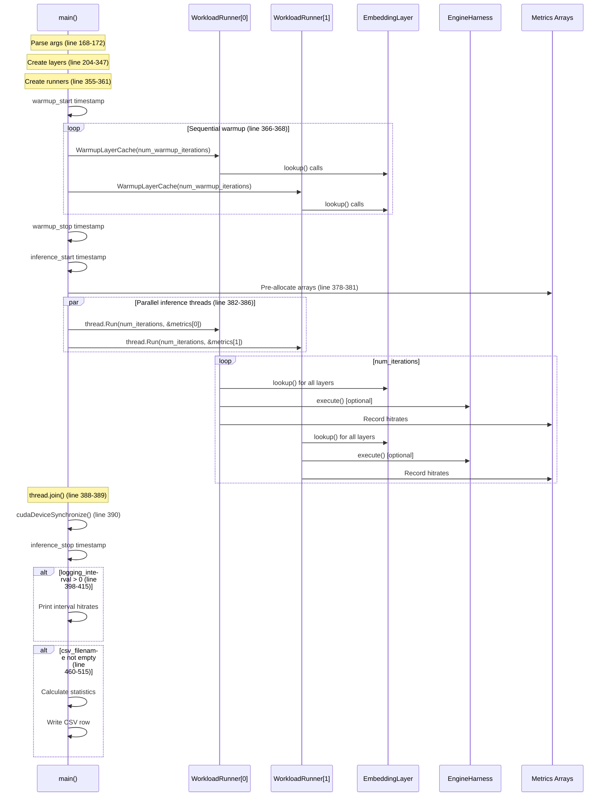
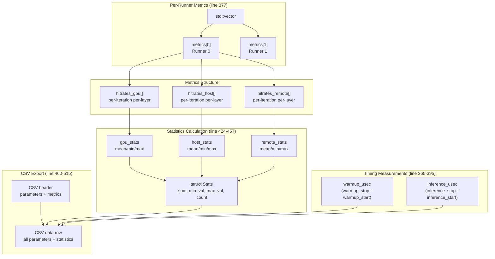
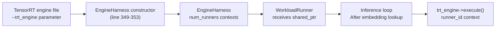

<!-- source: DeepWiki mcp.deepwiki.com · repo NVIDIA/nv-embedding-cache · page 9.3 Layer Sample (Advanced) · fetched 2026-10-26 -->

# Layer Sample (Advanced)

<details>
<summary>Relevant source files</summary>

The following files were used as context for generating this wiki page:

- [docs/samples.md](docs/samples.md)
- [samples/layer_sample/layer_sample.cu](samples/layer_sample/layer_sample.cu)

</details>


This document describes the advanced layer sample located at [samples/layer_sample/](), which demonstrates complex multi-layer embedding inference with parallel workload execution. This sample showcases production-ready patterns including multi-threaded inference, cache warmup strategies, comprehensive metrics collection, and optional TensorRT integration.

For basic embedding usage, see [Basic C++ Example](#9.1). For multi-threaded inference with concurrent updates, see [Multi-threaded Inference](#9.4).

**Sources:** [samples/layer_sample/layer_sample.cu:1-533](), [docs/samples.md:19-28]()

## Purpose and Scope

The layer sample (`layer_sample.cu`) is a comprehensive benchmarking and testing tool that demonstrates:

- **Three layer configuration strategies**: Hierarchical, Linear UVM, and LinearCPU modes
- **Parallel inference execution**: Multiple concurrent `WorkloadRunner` instances
- **Realistic workload simulation**: Power-law distributed embedding lookups with configurable hotness
- **Cache warmup patterns**: Pre-population of cache tiers before measurement
- **Performance metrics**: Hit rates, throughput, and latency measurements with CSV export
- **TensorRT integration**: Optional inference engine execution alongside embedding lookups
- **Production-ready patterns**: Resource management, error handling, and configurable parameters

This sample is designed for performance evaluation, configuration tuning, and understanding how embedding layers behave under realistic inference workloads.

**Sources:** [samples/layer_sample/layer_sample.cu:39-157](), [samples/layer_sample/layer_sample.cu:165-531]()

## Sample Architecture Overview



**Architecture Overview: Layer Sample Components and Execution Flow**

The sample follows a standard benchmarking pattern: parse configuration, create layers based on selected mode, instantiate multiple workload runners, perform cache warmup, execute parallel inference, and collect metrics.

**Sources:** [samples/layer_sample/layer_sample.cu:165-531]()

## Layer Configuration Modes

The sample supports three distinct layer configuration modes, selected via the `--layer_type` parameter. Each mode represents a different caching strategy and memory hierarchy.

### Mode 0: Hierarchical (Three-Tier Cache)



**Hierarchical Mode Configuration**

Hierarchical mode creates a full three-tier memory hierarchy optimized for large-scale distributed deployments. This configuration is selected with `--layer_type 0`.

**Configuration Details:**

| Component | Configuration | Purpose |
|-----------|--------------|---------|
| **GpuTable** | `cache_size` from `--gpu_cache_size` | Fast GPU-resident cache for hot embeddings |
| **NvhmMapTable** | `host_cache_size` from `--host_cache_size` | System memory cache using nvHashMap |
| **MockHostTable** | `ps_latency` from `--ps_latency` | Simulates remote parameter server with configurable latency |
| **DefaultInsertHeuristic** | `insert_target_hitrate` | Controls cache admission based on target hit rate |

The NVHM configuration uses a single partition for inference optimization (`num_partitions = 1`) and configures an eviction policy with random overflow handling.

**Sources:** [samples/layer_sample/layer_sample.cu:210-268]()

### Mode 1: Linear UVM (Two-Tier Cache)



**Linear UVM Mode Configuration**

Linear UVM mode uses CUDA Unified Virtual Memory to provide a two-tier cache with the complete embedding table in system memory. This configuration is selected with `--layer_type 1`.

**Configuration Details:**

| Component | Configuration | Purpose |
|-----------|--------------|---------|
| **UVM Allocation** | `host_allocate()` for full table | Complete embedding table in system memory |
| **GpuTable** | `uvm_table` pointer set to UVM allocation | GPU cache with automatic fallback to UVM |
| **modify_on_gpu** | From `--gpu_modify` flag | Controls where modify operations execute |
| **kernel_mode_type** | From `--kernel_mode` | Selects CUDA kernel implementation variant |

The `GpuTable` is configured with `count_misses = true` to track cache performance. The UVM pointer enables automatic page migration between GPU and system memory.

**Sources:** [samples/layer_sample/layer_sample.cu:270-308]()

### Mode 2: LinearCPU (Host-Only)



**LinearCPU Mode Configuration**

LinearCPU mode executes all operations on the CPU using a linear host table, suitable for CPU-only inference or baseline comparisons. This configuration is selected with `--layer_type 2`.

**Configuration Details:**

| Component | Configuration | Purpose |
|-----------|--------------|---------|
| **LinearHostTable** | `emb_table` pointer to host memory | Direct CPU-based embedding lookups |
| **max_threads** | `numeric_limits<int64_t>::max()` | Uses all available threads from thread pool |
| **HierarchicalEmbeddingLayer** | Single-table configuration | Wrapper for consistent API |
| **insert_heuristic** | `nullptr` | No caching needed for direct access |

The memory is initialized with `memset(ptr, 1, table_size)` to ensure valid data. The `HierarchicalEmbeddingLayer` is used as a wrapper with a single table for API consistency.

**Sources:** [samples/layer_sample/layer_sample.cu:310-344]()

## Workload Runner Architecture



**WorkloadRunner Component Interaction**

Each `WorkloadRunner` instance operates independently, generating its own input sets and executing inference loops. Multiple runners execute in parallel threads to simulate concurrent inference requests.

**Workload Runner Responsibilities:**

| Responsibility | Implementation |
|----------------|----------------|
| **Input Generation** | Creates power-law distributed embedding indices with configurable `alpha` parameter |
| **Cache Warmup** | Sequential execution to pre-populate cache tiers |
| **Parallel Inference** | Executes as independent thread with private execution context |
| **Layer Iteration** | Performs lookups across all configured layers in sequence |
| **TensorRT Integration** | Optional DNN inference execution per iteration |
| **Metrics Collection** | Tracks hit rates per layer per iteration |

The runner accepts references to shared `layers` and optional `trt_engine`, but maintains independent iteration state and metrics storage.

**Sources:** [samples/layer_sample/layer_sample.cu:355-395]()

## Execution Flow



**Execution Sequence with Two-Phase Pattern**

The sample uses a two-phase execution pattern: sequential warmup followed by parallel inference. This ensures cache tiers are pre-populated before measurement begins.

**Phase Timing:**

| Phase | Synchronization | Purpose |
|-------|----------------|---------|
| **Warmup** | Sequential per runner | Cache pre-population without timing |
| **Inference** | Parallel threads | Performance measurement under load |
| **Device Sync** | Global barrier | Ensures all GPU operations complete |
| **Metrics** | Post-execution | Calculate statistics and export |

Pre-allocation of metrics arrays (`line 378-381`) prevents dynamic growth during measurement, ensuring consistent timing.

**Sources:** [samples/layer_sample/layer_sample.cu:364-395]()

## Command-Line Parameters

### Configuration Categories

The sample accepts a comprehensive set of command-line parameters organized into functional categories:

**Cache Configuration Parameters:**

| Parameter | Default | Description |
|-----------|---------|-------------|
| `-gcs`, `--gpu_cache_size` | 1.0 | GPU cache size in GB (`<=0` disables cache) |
| `-hcs`, `--host_cache_size` | 10.0 | Host cache size in GB (`<=0` disables cache) |
| `-nl`, `--num_layers` | 1 | Number of embedding layers to create |
| `-lt`, `--layer_type` | 0 | Layer type: 0=Hierarchical, 1=Linear, 2=LinearCPU |
| `-cht`, `--cache_heuristic_target` | 0.0 | Target hit rate for insert heuristic (0=disabled) |

**Workload Generation Parameters:**

| Parameter | Default | Description |
|-----------|---------|-------------|
| `-is`, `--input_sets` | 100 | Number of unique input batches to generate |
| `-r`, `--rows` | 67,108,864 | Total number of embedding rows (`1 << 26`) |
| `-rs`, `--row_size` | 256 | Embedding size in bytes |
| `-h`, `--hotness` | 512 | Number of indices per batch |
| `-bs`, `--batch_size` | 512 | Batch size for lookups |
| `-a`, `--alpha` | 1.05 | Power-law distribution parameter |

**Execution Parameters:**

| Parameter | Default | Description |
|-----------|---------|-------------|
| `-wi`, `--warmup_iterations` | 250 | Warmup iterations before measurement |
| `-ws`, `--warmup_sets` | 250 | Number of warmup input sets |
| `-i`, `--iterations` | 1000 | Measurement iterations per runner |
| `-nr`, `--num_runners` | 2 | Parallel workload runner count |
| `-te`, `--trt_engine` | "" | TensorRT engine file path (optional) |
| `-pl`, `--ps_latency` | 0 | Mock parameter server latency in nanoseconds |
| `-gm`, `--gpu_modify` | false | Execute modify operations on GPU |
| `-km`, `--kernel_mode` | 0 | CUDA kernel implementation variant |

**Output Parameters:**

| Parameter | Default | Description |
|-----------|---------|-------------|
| `--verbose` | false | Enable verbose logging |
| `-cm`, `--collect_metrics` | false | Enable metrics collection flag |
| `-csv`, `--csv_filename` | "" | CSV file path for metrics export |
| `-li`, `--logging_interval` | 0 | Print hit rates every N iterations (0=disabled) |
| `-dc`, `--disable_copy_output` | false | Skip copying outputs to host |

**Sources:** [samples/layer_sample/layer_sample.cu:39-157]()

## Metrics and Performance Measurement



**Metrics Collection and Export Pipeline**

The sample collects comprehensive performance metrics during execution and supports both console logging and CSV export for further analysis.

### Collected Metrics

**Timing Metrics:**

- `warmup_time_ms`: Total cache warmup duration
- `inference_time_ms`: Total parallel inference duration  
- `iterations_per_second`: Throughput metric (total iterations × num_runners) / time

**Hit Rate Metrics (per-layer, per-iteration):**

- `hitrates_gpu[]`: GPU cache hit rate (0.0 to 1.0)
- `hitrates_host[]`: Host cache hit rate (0.0 to 1.0)
- `hitrates_remote[]`: Remote cache hit rate (0.0 to 1.0)

**Statistical Aggregations:**

For each hit rate category, the sample calculates:
- **Mean**: Average across all iterations and runners
- **Min**: Minimum observed value
- **Max**: Maximum observed value  
- **Count**: Total number of samples

### CSV Export Format

The CSV output includes:
1. **Parameter columns** (prefixed with `_`): All input configuration parameters
2. **Metric columns**: Calculated timing and hit rate statistics

Example CSV structure:
```
_rows,_row_size,_batch_size,_hotness,_alpha,_gpu_cache_size,_host_cache_size,...,warmup_time_ms,inference_time_ms,iterations_per_second,gpu_hitrate_mean,gpu_hitrate_min,gpu_hitrate_max,...
```

The CSV file is created with headers on first write, then appends subsequent runs as new rows, enabling parameter sweep experiments.

**Sources:** [samples/layer_sample/layer_sample.cu:377-515]()

## TensorRT Integration



**TensorRT Engine Integration Flow**

The sample supports optional TensorRT inference engine execution alongside embedding lookups, simulating realistic inference scenarios where embeddings feed into downstream neural networks.

### Integration Details

**Initialization (line 349-353):**
```cpp
std::shared_ptr<EngineHarness> trt_engine;
if (trt_engine_filename.size()) {
  trt_engine = std::make_shared<EngineHarness>(trt_engine_filename, num_runners);
}
```

The `EngineHarness` class:
- Loads a pre-compiled TensorRT engine from disk
- Creates `num_runners` execution contexts for parallel inference
- Manages CUDA stream assignment per runner

**Usage Pattern:**

Each `WorkloadRunner` receives a shared pointer to the `EngineHarness`. During the inference loop:
1. Embedding lookup completes and produces output tensors
2. If `trt_engine` is non-null, execute DNN inference with `runner_id` for context selection
3. TensorRT execution overlaps with next iteration's embedding lookup

This pattern enables realistic benchmarking of end-to-end inference pipelines where embedding retrieval is the first stage of a multi-stage inference process.

**Sources:** [samples/layer_sample/layer_sample.cu:349-361]()

## Running the Sample

### Basic Execution Examples

**1. Hierarchical Mode with Default Settings:**
```bash
./layer_sample --verbose
```

**2. Linear UVM Mode with Custom Cache Sizes:**
```bash
./layer_sample -lt 1 -gcs 2.0 -hcs 0 --verbose
```

**3. Multi-Runner Performance Test with CSV Export:**
```bash
./layer_sample -nr 4 -i 2000 -csv results.csv --verbose
```

**4. Cache Heuristic Tuning:**
```bash
./layer_sample -cht 0.95 -gcs 0.5 -hcs 5.0 --verbose
```

**5. Multi-Layer Configuration:**
```bash
./layer_sample -nl 3 -bs 1024 -h 256 --verbose
```

**6. With TensorRT Engine:**
```bash
./layer_sample -te model_engine.trt -nr 2 --verbose
```

### Interpreting Output

**Console Output (with `--verbose`):**

```
Creating layer (0)
Allocating sysmem table (X.X GB)
Cache warmup (250)
Warmup done (XXX.XXX ms)
Inference (1000)
Inference done (total E2E: XXX.XXX ms)
```

**Interval Logging (with `-li 100`):**

```
Worker 0:
  Iteration 0, Layer 0: Hitrates: 0.25 0.35 0.40
  Iteration 100, Layer 0: Hitrates: 0.82 0.15 0.03
  ...
```

The three hitrate values represent GPU, host, and remote cache hit rates respectively.

**CSV Metrics File:**

The CSV output enables:
- Parameter sweep analysis across multiple runs
- Performance comparison between configurations
- Statistical analysis of hit rate distributions
- Throughput vs. cache size relationships

### Common Configuration Patterns

| Use Case | Recommended Parameters |
|----------|----------------------|
| **Maximum Performance** | `-lt 0 -gcs 8.0 -hcs 32.0 -nr 8` |
| **Memory Constrained** | `-lt 1 -gcs 0.5 -hcs 0` |
| **CPU Baseline** | `-lt 2 -gcs 0 -hcs 0` |
| **Cache Tuning** | `-cht 0.90 -li 50 -csv sweep.csv` |
| **High Throughput** | `-nr 16 -bs 2048 -h 1024` |
| **Cold Start Simulation** | `-wi 0 -ws 0` |

**Sources:** [samples/layer_sample/layer_sample.cu:165-531](), [docs/samples.md:24-25]()

## Key Implementation Details

### Resource Management

The sample carefully manages allocated resources with cleanup at exit:

**Host Memory Allocations (line 518-523):**
```cpp
for (auto ptr : cuda_host_allocations) {
  nve::GetDefaultAllocator()->host_free(ptr);
}
```

All UVM and host allocations use the default allocator's `host_allocate()` and `host_free()` methods for proper CUDA integration.

### Mock Parameter Server

The `MockHostTable` (line 255-256) simulates remote parameter server latency using the `ps_latency` parameter specified in nanoseconds. This enables realistic testing of hierarchical configurations without actual network infrastructure.

### Power-Law Distribution

The workload runner generates indices following a power-law distribution controlled by the `alpha` parameter. Higher alpha values create more skewed access patterns (more hotness concentration), which is characteristic of real recommendation systems.

### Metrics Pre-allocation

Lines 378-381 pre-allocate metrics arrays before measurement begins:
```cpp
for (uint64_t i = 0; i < workers.size(); i++) {
  worker_metrics[i].resize(num_iterations, num_layers);
}
```

This prevents dynamic memory allocation during timed inference, ensuring accurate performance measurement.

**Sources:** [samples/layer_sample/layer_sample.cu:255-256](), [samples/layer_sample/layer_sample.cu:378-381](), [samples/layer_sample/layer_sample.cu:518-523]()

---

