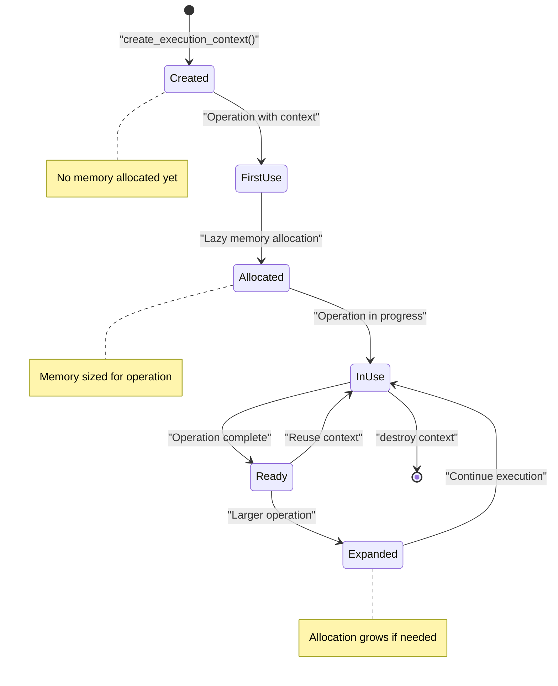
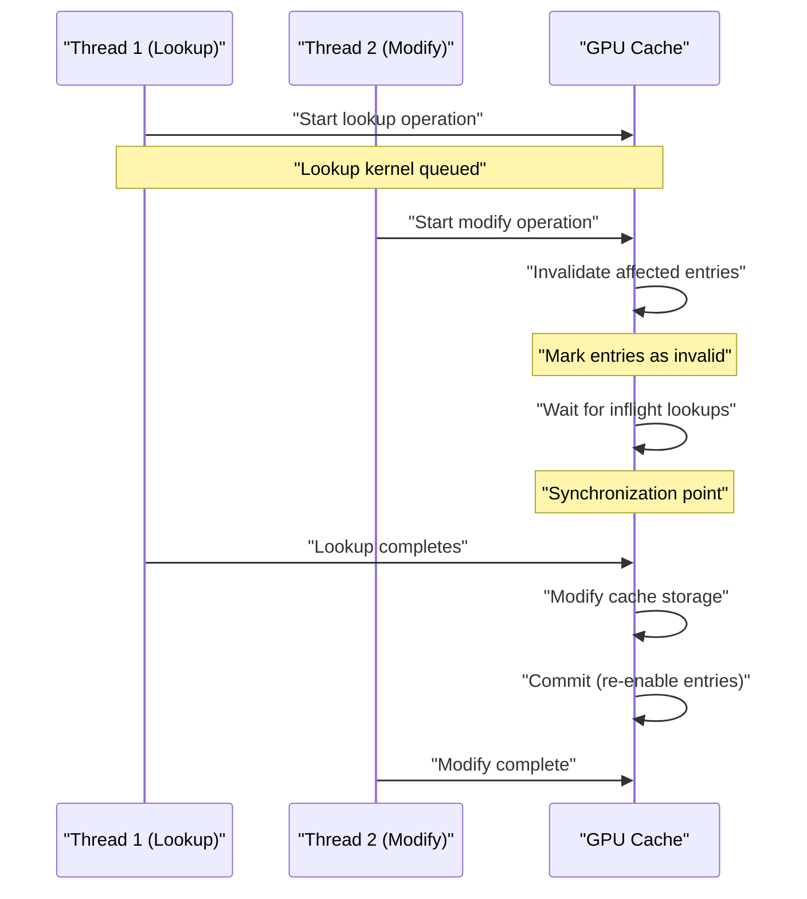
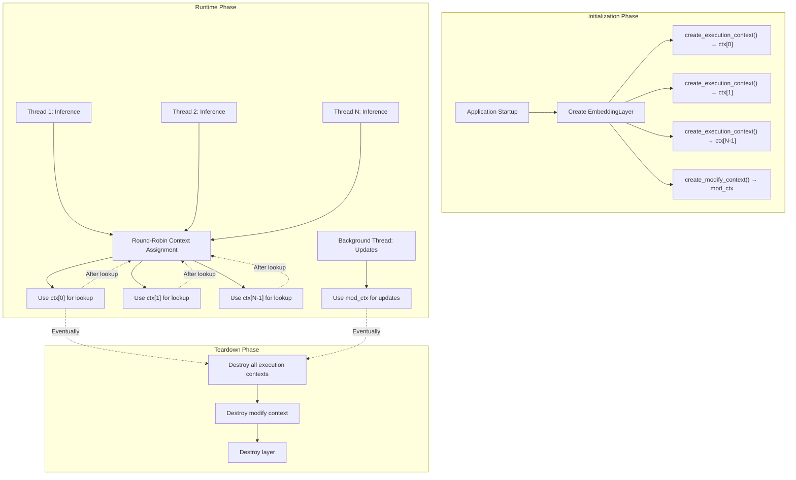
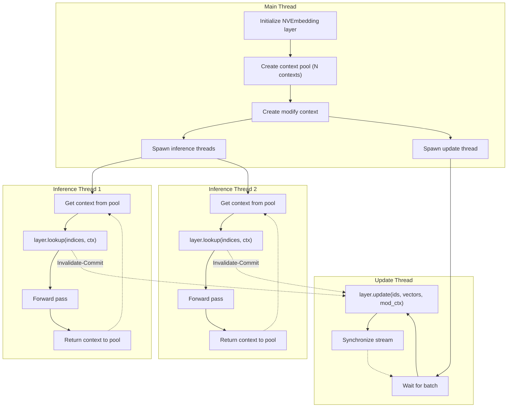
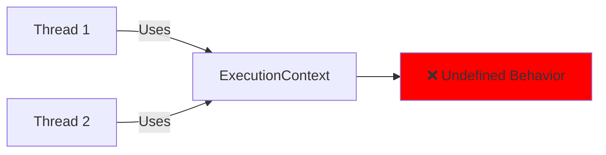

<!-- source: DeepWiki mcp.deepwiki.com · repo NVIDIA/nv-embedding-cache · page 9.4 Multi-threaded Inference · fetched 2026-10-26 -->

# Multi-threaded Inference

Relevant source files

The following files were used as context for generating this wiki page:

- [docs/advanced.md](docs/advanced.md)
- [docs/samples.md](docs/samples.md)

## Purpose and Scope

This document explains how to implement parallel inference with concurrent cache updates using the NV Embedding Cache SDK. It covers execution contexts for parallel operations, thread safety guarantees, and the invalidate-commit synchronization paradigm that enables lookup and modify operations to run concurrently without data races.

For information about basic single-threaded inference, see [Basic PyTorch Example](#9.2). For general performance optimization strategies, see [Performance Tuning](#8.3). For details about modify operations and cache management, see [Modify Operations and Synchronization](#8.2).

---

## Execution Contexts

### Purpose

An execution context represents a collection of state and resources needed during execution of lookup or modify operations. Contexts enable parallel execution by providing isolated resource pools for concurrent operations. Each context represents a single reusable parallel execution environment.

**Key Principle**: Each execution context can only be used by one operation at a time. Using the same context in multiple parallel operations results in undefined behavior.

Sources: [docs/advanced.md:1-11]()

### Context Types

The SDK provides two types of execution contexts:

| Context Type | Purpose | Created By | Used For |
|--------------|---------|------------|----------|
| `ExecutionContext` | Lookup operations | Layer or Table | Parallel embedding lookups |
| `ModifyContext` | Modify operations | Layer or Table | Insert, update, accumulate, erase |

Sources: [docs/advanced.md:3-4](), [docs/advanced.md:14-16]()

### Context Lifecycle

**Memory Allocation Strategy**:
- Contexts use lazy memory allocation - no memory is allocated at creation time
- First use allocates memory based on operation dimensions (e.g., number of indices)
- Subsequent operations with larger dimensions may trigger reallocation
- Creating contexts during initialization is more efficient than runtime creation

**Destruction Requirements**: All execution contexts must be destroyed before destroying the layer or table that created them.

Sources: [docs/advanced.md:6-10]()

---

## Thread Safety and Synchronization

### The Invalidate-Commit Paradigm

The SDK employs an invalidate-commit paradigm to enable lookup and modify operations to run in parallel without data races. This mechanism ensures that cache modifications do not corrupt in-flight lookups.

**Synchronization Flow**:
1. Modify operation launches kernel to invalidate relevant cache entries
2. System waits until all inflight lookups have concluded
3. Cache storage is altered
4. Affected cache entries are re-enabled (committed)

This ensures that lookups never read partially-modified cache state.

Sources: [docs/advanced.md:18-21]()

### Modify Operation Constraints

**Critical Constraint**: The cache does not support multiple Modify operations inflight on the GPU side simultaneously.

Applications must ensure that only one modify operation is active at a time. This is typically accomplished by:
- Using a single CUDA stream for all modify operations
- Implementing explicit synchronization between modify operations
- Using a single `ModifyContext` for all modify operations

Sources: [docs/advanced.md:14-16]()

### Custom Flow Atomicity

The invalidate-commit mechanism assumes lookup operations are queued on the GPU atomically (e.g., a single CUDA kernel). Applications implementing custom multi-kernel gather flows must call `start_custom_flow()` and `end_custom_flow()` APIs to maintain the required atomicity.

Sources: [docs/advanced.md:23-24]()

---

## Multi-threaded Inference Architecture

### Recommended Pattern

**Best Practices**:

1. **Fixed Context Pool**: Create a fixed number of execution contexts during initialization (typically equal to the number of inference threads)

2. **Round-Robin Assignment**: Assign contexts to inference requests in round-robin fashion:
   - Request 0 uses context 0
   - Request 1 uses context 1
   - Request N uses context (N mod num_contexts)

3. **Single Modify Context**: Use a single `ModifyContext` for all modify operations, typically on a dedicated background thread

4. **Proper Ordering**: Always destroy contexts before destroying the layer

Sources: [docs/advanced.md:3-10]()

### Thread Safety Guarantees

| Operation | Thread Safety | Notes |
|-----------|---------------|-------|
| Multiple lookups with different contexts | ✓ Safe | Each context isolates resources |
| Multiple lookups with same context | ✗ Undefined | Never reuse context concurrently |
| Lookup + Modify with different contexts | ✓ Safe | Invalidate-commit handles synchronization |
| Multiple modifies | ✗ Unsafe | Only one modify operation allowed at a time |
| Context creation during runtime | ✓ Safe (but slow) | Prefer initialization-time creation |

Sources: [docs/advanced.md:3-16]()

---

## Implementation Example

### Sample Location

The SDK provides a complete multi-threaded inference example:

**Location**: [samples/pytorch/inference_sample/]()

**Description**: Demonstrates multi-threaded inference with parallel updates using PyTorch integration.

Sources: [docs/samples.md:26]()

### Architecture Overview

### Key Components Demonstrated

The sample demonstrates the following critical patterns:

1. **Context Pool Management**: Creating and managing a pool of execution contexts for parallel lookups

2. **Round-Robin Context Usage**: Distributing contexts across inference threads to avoid contention

3. **Background Updates**: Running cache updates on a separate thread with proper synchronization

4. **Invalidate-Commit Interaction**: Showing how concurrent lookups and modifies interact safely

5. **Stream Management**: Proper CUDA stream usage for modify operations

6. **Proper Teardown**: Correct destruction order for contexts and layers

Sources: [docs/samples.md:19-28]()

---

## Performance Considerations

### Context Pool Sizing

The optimal number of execution contexts depends on:

| Factor | Guideline |
|--------|-----------|
| Number of inference threads | Create one context per thread |
| Memory constraints | Each context allocates working memory |
| Operation batch size | Larger batches require more context memory |
| Runtime context creation | Avoid if possible; creates allocation overhead |

### Memory Overhead

Each execution context allocates memory proportional to:
- Maximum batch size (number of indices per lookup)
- Embedding dimension
- Number of tables queried

**Recommendation**: Profile memory usage with representative workloads to determine optimal context count.

Sources: [docs/advanced.md:6-8]()

### Modify Operation Throughput

Since only one modify operation can be inflight at a time, modify throughput is bounded by single-operation performance. To maximize throughput:

1. **Batch Updates**: Accumulate multiple updates and apply in larger batches
2. **Async Updates**: Use background thread for updates to avoid blocking inference
3. **Stream Synchronization**: Ensure proper stream synchronization to avoid unnecessary waits

Sources: [docs/advanced.md:14-16]()

---

## Common Pitfalls

### Context Reuse Error

**Problem**: Multiple threads using the same context simultaneously.

**Solution**: Each parallel operation must use a different context.

### Missing Synchronization

**Problem**: Launching multiple modify operations without synchronization.

**Solution**: Use a single CUDA stream for all modify operations, or add explicit synchronization between modify operations.

### Early Context Destruction

**Problem**: Destroying execution contexts before destroying the layer.

**Solution**: Always destroy contexts first, then destroy the layer.

Sources: [docs/advanced.md:4-10]()

---

## Summary

Multi-threaded inference in the NV Embedding Cache SDK requires:

1. **Execution Context Pool**: Create fixed contexts during initialization, one per parallel execution unit
2. **Round-Robin Assignment**: Distribute contexts across inference requests
3. **Single Modify Path**: Use one modify context with proper stream synchronization
4. **Invalidate-Commit**: Trust the built-in synchronization for lookup-modify parallelism
5. **Proper Lifecycle**: Destroy all contexts before destroying the layer

The [samples/pytorch/inference_sample/]() provides a complete reference implementation demonstrating these patterns.

Sources: [docs/advanced.md:1-24](), [docs/samples.md:26]()

---

