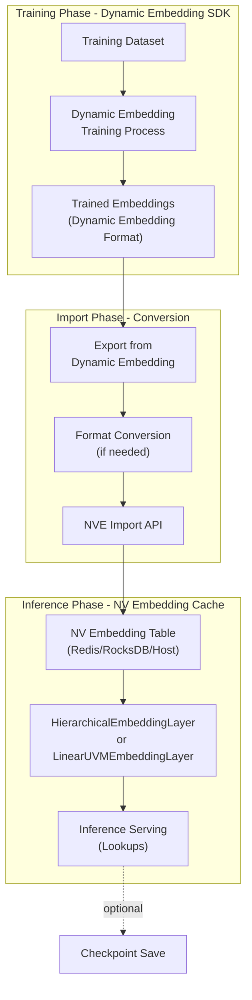
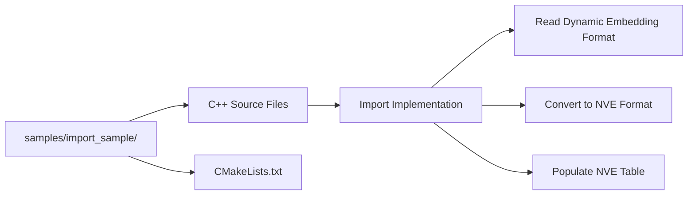
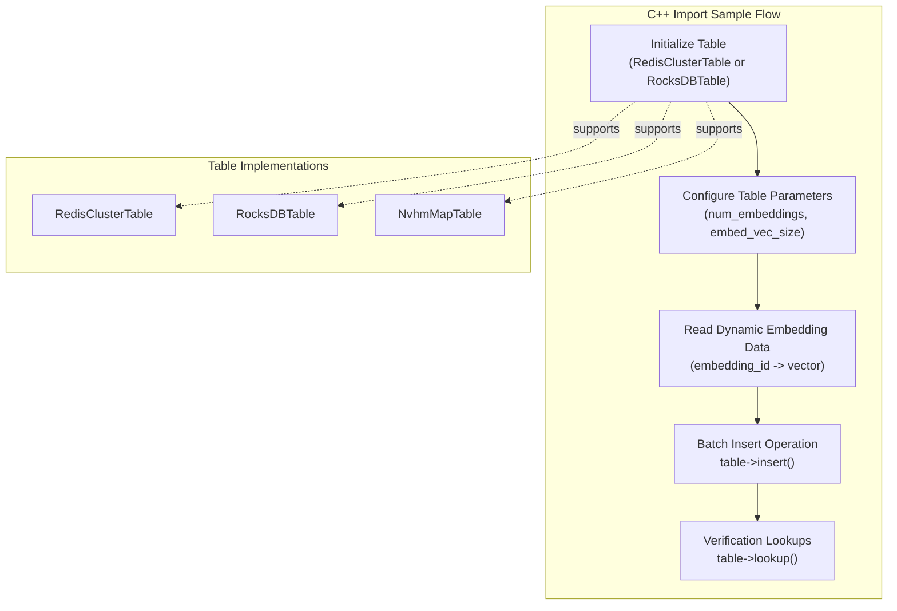
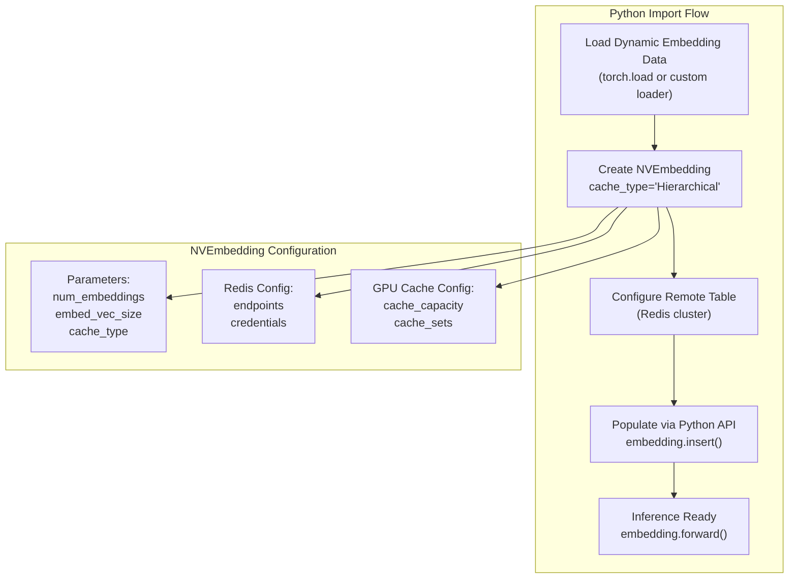
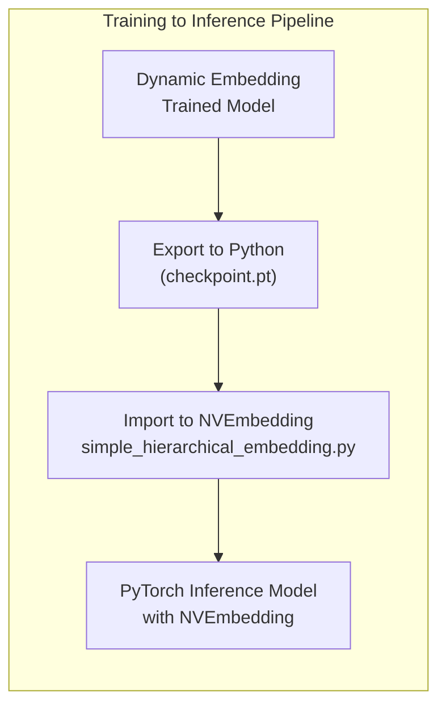
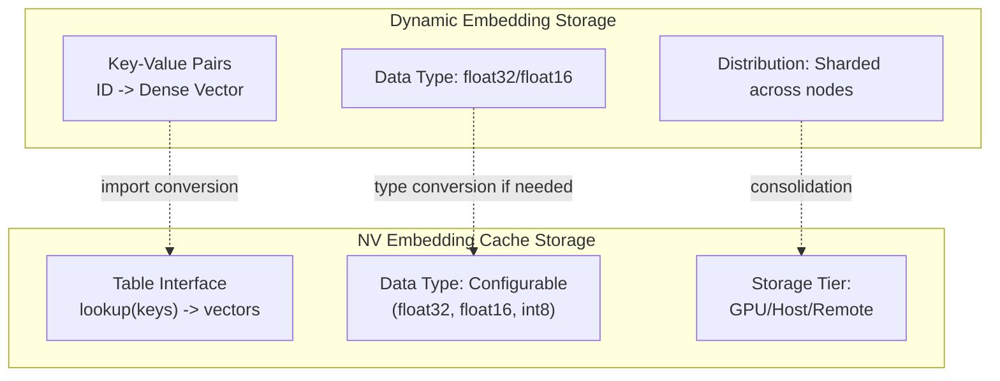
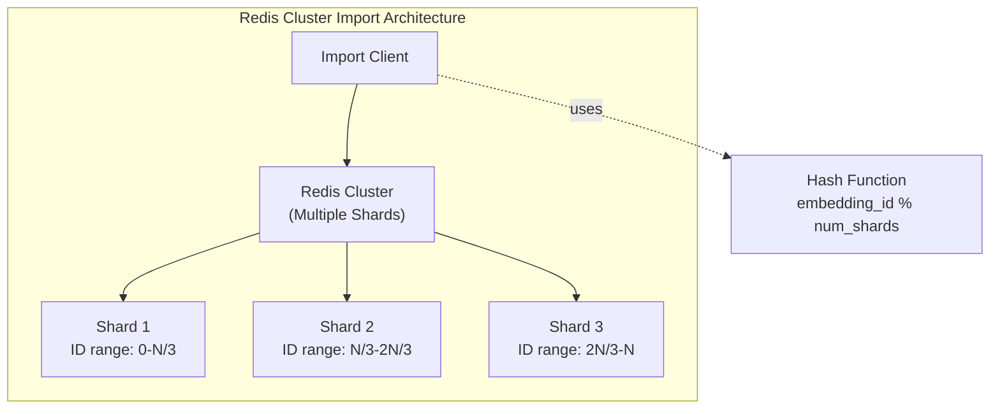
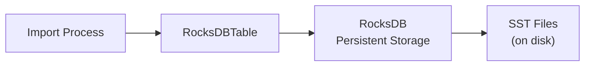
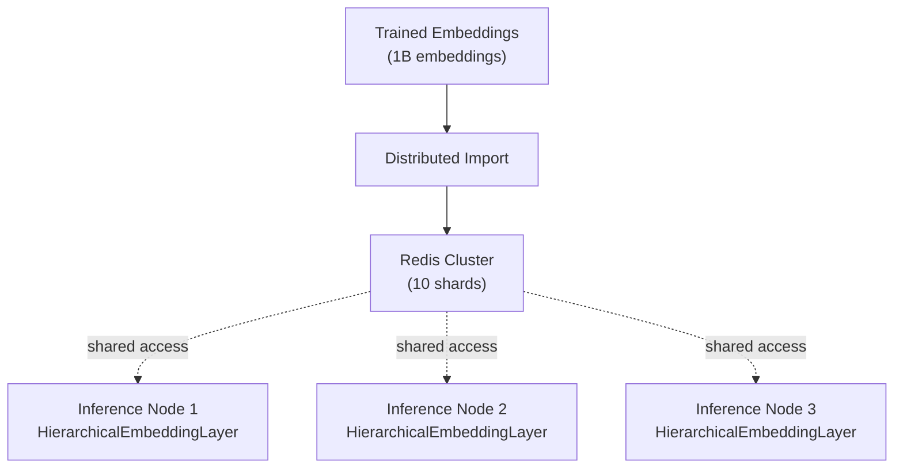
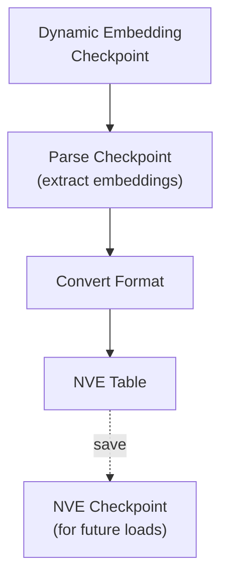

<!-- source: DeepWiki mcp.deepwiki.com · repo NVIDIA/nv-embedding-cache · page 9.5 Dynamic Embedding Import · fetched 2026-10-26 -->

# Dynamic Embedding Import

Relevant source files

The following files were used as context for generating this wiki page:

- [README.md](README.md)
- [docs/samples.md](docs/samples.md)

## Purpose and Scope

This document describes how to import embeddings trained with the [NVIDIA Dynamic Embedding SDK](https://github.com/NVIDIA/recsys-examples) into NV Embedding Cache for inference. Dynamic Embedding provides distributed training capabilities for extremely large embedding tables that cannot fit in GPU memory, while NV Embedding Cache provides optimized inference with multi-tier caching. This page covers the import process, data format compatibility, and example implementations.

For general embedding layer usage, see [Embedding Layers](#3.1). For checkpoint saving/loading within NV Embedding Cache, see [Checkpointing](#8.5).

**Sources:** [docs/samples.md:14-16]()

---

## Overview

The Dynamic Embedding SDK and NV Embedding Cache serve complementary purposes in the recommender systems lifecycle:

| Phase | System | Purpose |
|-------|--------|---------|
| Training | Dynamic Embedding SDK | Distributed training of massive embedding tables across multiple GPUs/nodes with dynamic memory management |
| Inference | NV Embedding Cache | High-performance lookup with GPU/Host/Remote caching for latency-sensitive serving |

The import process bridges these systems by converting trained embeddings from Dynamic Embedding's storage format into a format compatible with NV Embedding Cache's table implementations.

**Sources:** [docs/samples.md:14-15](), [README.md:7-15]()

---

## Import Workflow

The following diagram illustrates the end-to-end workflow from training to inference:

**Key Steps:**
1. Train embeddings using Dynamic Embedding SDK with distributed training infrastructure
2. Export trained embeddings from Dynamic Embedding storage (typically Redis or distributed storage)
3. Convert format if necessary (embedding ID mapping, data layout)
4. Import into NV Embedding Cache table (Redis, RocksDB, or host memory)
5. Configure NV Embedding Cache layer for inference serving

**Sources:** [docs/samples.md:14-16]()

---

## C++ Import Example

The C++ import sample demonstrates loading embeddings into NV Embedding Cache tables programmatically.

### Sample Location and Structure

### Import Process Components

| Component | Purpose | Key Operations |
|-----------|---------|----------------|
| Format Reader | Parse Dynamic Embedding output | Read embedding IDs and vectors from trained model |
| ID Mapper | Map Dynamic Embedding IDs to NVE IDs | Handle any ID space transformations |
| Table Populator | Insert into NVE table | Batch insert operations for efficiency |

### Typical Usage Pattern

The C++ import sample typically follows this pattern:

1. **Initialize NVE Table** - Create the target table (e.g., `RedisClusterTable`, `RocksDBTable`, or host table)
2. **Read Source Data** - Parse embeddings from Dynamic Embedding checkpoint or export
3. **Batch Import** - Use table's insert/update operations to populate embeddings
4. **Verify** - Perform sample lookups to verify correctness

**Sources:** [docs/samples.md:14](), [README.md:14-15]()

---

## Python Import Example

The Python import functionality is demonstrated in the hierarchical embedding sample, which shows how to import Dynamic Embedding data into a `NVEmbedding` instance configured for hierarchical caching.

### Sample Location

The Python import example is located at: [samples/pytorch/simple_sample/simple_hierarchical_embedding.py]()

### Import with HierarchicalEmbedding

The Python sample demonstrates import into a hierarchical configuration with remote parameter server:

### Key Python Classes and Methods

| Class/Method | Location | Purpose |
|--------------|----------|---------|
| `NVEmbedding` | Python bindings | Main PyTorch-compatible embedding layer |
| `NVEmbedding.__init__()` | `cache_type='Hierarchical'` | Initialize with remote parameter server support |
| `insert()` | Python API | Insert embedding vectors by ID |
| `forward()` | PyTorch integration | Perform inference lookups |

### Integration with PyTorch Training

The Python import enables seamless integration with PyTorch models:

**Sources:** [docs/samples.md:15](), [README.md:13-15]()

---

## Data Format Considerations

### Embedding ID Space

Dynamic Embedding and NV Embedding Cache may use different ID conventions:

| System | ID Format | Notes |
|--------|-----------|-------|
| Dynamic Embedding | Training-specific IDs | May include vocabulary mapping, padding IDs |
| NV Embedding Cache | 64-bit unsigned integers | Expects contiguous or sparse ID space |

The import process must handle any necessary ID remapping or translation.

### Vector Storage Layout

Both systems store embeddings as dense floating-point vectors, but storage details differ:

### Batch Import Optimization

For large embedding tables (millions to billions of embeddings), the import process should use batch operations:

| Strategy | Implementation | Performance Benefit |
|----------|---------------|---------------------|
| Batch Insert | Insert multiple embeddings per API call | Reduces overhead, network round-trips |
| Parallel Import | Multi-threaded import across ID ranges | Leverages concurrent table operations |
| Pipeline Import | Overlap read, transform, and write stages | Maximizes throughput |

**Sources:** [README.md:7-17]()

---

## Remote Parameter Server Import

When using `HierarchicalEmbeddingLayer`, embeddings are typically imported into a remote parameter server (Redis or RocksDB):

### Redis Cluster Import

The `RedisClusterTable` implementation handles automatic sharding based on embedding IDs.

### RocksDB Import

For single-node deployments with persistent storage:

RocksDB import benefits from batch writes and proper LSM tree configuration for optimal ingestion performance.

**Sources:** [README.md:14-15](), [docs/samples.md:14-16]()

---

## Common Import Scenarios

### Scenario 1: Single GPU Inference

**Source:** Dynamic Embedding trained model  
**Target:** `GPUEmbeddingLayer` or `LinearUVMEmbeddingLayer`  
**Import Method:** Direct load into GPU/UVM memory

### Scenario 2: Multi-Node Distributed Inference

**Source:** Dynamic Embedding trained model  
**Target:** `HierarchicalEmbeddingLayer` with Redis cluster  
**Import Method:** Distributed import to Redis shards

### Scenario 3: Checkpoint-based Import

**Source:** Dynamic Embedding checkpoint file  
**Target:** NV Embedding Cache with restore  
**Import Method:** Load checkpoint, then populate NVE tables

**Sources:** [docs/samples.md:14-16]()

---

## Sample Code References

### C++ Import Sample

The C++ import sample is located at: [samples/import_sample]()

Key implementation files to review:
- Main import logic and table population
- Format parsing from Dynamic Embedding
- Batch insert operations
- Verification and testing

### Python Import Sample

The Python hierarchical embedding sample is located at: [samples/pytorch/simple_sample/simple_hierarchical_embedding.py]()

This sample demonstrates:
- Creating `NVEmbedding` with `cache_type='Hierarchical'`
- Configuring Redis cluster connection
- Populating embeddings via Python API
- Integration with PyTorch inference

**Sources:** [docs/samples.md:14-16]()

---

## Performance Considerations

### Import Speed

| Factor | Impact | Optimization |
|--------|--------|--------------|
| Batch Size | Larger batches reduce overhead | Use 1000-10000 embeddings per batch |
| Parallelism | Multiple threads increase throughput | Import ID ranges in parallel |
| Network Latency | Critical for remote tables | Co-locate import client with Redis/RocksDB |
| Data Format | Parsing overhead | Pre-process to efficient binary format |

### Memory Usage

During import, consider memory requirements:

For large imports, streaming or chunked processing avoids excessive memory consumption.

**Sources:** [README.md:7-15]()

---

## Related Documentation

- For general embedding layer configuration, see [Embedding Layers](#3.1)
- For hierarchical layer setup with remote storage, see [HierarchicalEmbeddingLayer](#3.1.3)
- For Redis table configuration, see [Redis Plugin](#6.2)
- For RocksDB table configuration, see [RocksDB Plugin](#6.3)
- For checkpoint operations within NVE, see [Checkpointing](#8.5)
- For PyTorch integration patterns, see [PyTorch Integration](#5.2)

**Sources:** [docs/samples.md:1-29](), [README.md:57-70]()

---

