# Page: Overview

# Overview

<details>
<summary>Relevant source files</summary>

The following files were used as context for generating this wiki page:

- [CHANGELOG.md](CHANGELOG.md)
- [README.md](README.md)

</details>


## Purpose and Scope

This document provides a high-level introduction to the **NV Embedding Cache SDK**, a domain-specific software development kit designed for high-performance embedding lookup operations in recommender systems. The SDK addresses the challenge of serving large embedding tables that exceed GPU memory capacity by implementing multi-tier caching strategies with optimized CUDA kernels.

This overview covers the SDK's purpose, core architecture, and main usage patterns. For detailed installation instructions, see [Installation and Setup](#2). For in-depth explanations of caching strategies, see [Cache Configuration Strategies](#1.2). For architectural details, see [System Architecture](#1.3).

**Sources:** [README.md:1-18]()

## The Problem: Embedding Lookup at Scale

Recommender systems typically use embedding tables to represent categorical features (users, items, contexts) as dense vectors. In production systems, these tables can contain billions of entries with embedding dimensions ranging from tens to hundreds of values. For example:

| Scenario | Table Size | Embedding Dim | Total Memory |
|----------|------------|---------------|--------------|
| Small catalog | 1M items | 128 | ~512 MB |
| Medium catalog | 100M items | 128 | ~50 GB |
| Large catalog | 1B items | 256 | ~1 TB |

Modern GPUs typically have 40-80 GB of memory, making it impossible to store large embedding tables entirely on-device. Traditional solutions either:
- Use CPU-only inference (too slow for low-latency serving)
- Partition embeddings across multiple GPUs (increases cost and complexity)
- Use naive host-to-device transfers (introduces significant PCIe bottlenecks)

The NV Embedding Cache SDK solves this by implementing intelligent multi-tier caching that exploits the power-law distribution of embedding access patterns common in recommender workloads.

**Sources:** [README.md:7-17]()

## Solution: Three Caching Strategies

The SDK provides three distinct caching strategies, each optimized for different deployment scenarios:

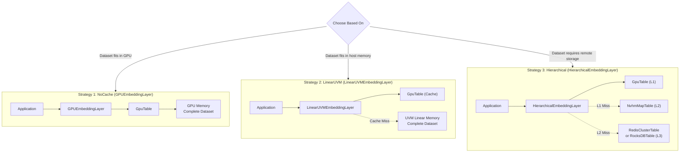

**Diagram: Three Caching Strategies and Decision Criteria**

### Strategy Comparison

| Strategy | Class | Dataset Size | Latency | Complexity | Use Case |
|----------|-------|--------------|---------|------------|----------|
| NoCache | `GPUEmbeddingLayer` | < GPU RAM | Lowest (~μs) | Simple | Small models, inference |
| LinearUVM | `LinearUVMEmbeddingLayer` | < Host RAM | Medium (~10μs) | Moderate | Single-node deployments |
| Hierarchical | `HierarchicalEmbeddingLayer` | Unlimited | Variable | Complex | Distributed systems |

**Sources:** [README.md:11-15](), [CHANGELOG.md:7-18]()

## Core Components

The SDK architecture consists of three primary layers: the API layer, the embedding layer, and the storage layer.

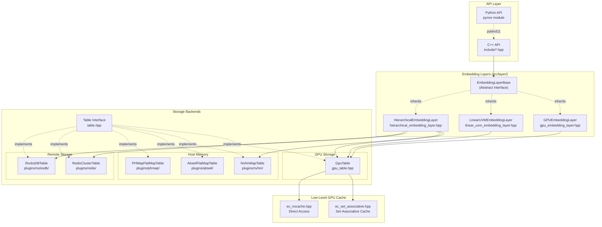

**Diagram: Core Component Architecture with File References**

### Component Descriptions

**Embedding Layers** (`src/layer/`)
- `EmbeddingLayerBase`: Abstract base class defining the common interface for all embedding layers
- `GPUEmbeddingLayer`: Stores all embeddings in GPU memory with optional caching
- `LinearUVMEmbeddingLayer`: Uses CUDA Unified Virtual Memory (UVM) with GPU-side caching
- `HierarchicalEmbeddingLayer`: Implements multi-tier caching across GPU, host, and remote storage

**Storage Backends**
- `GpuTable` (`src/table/gpu_table.hpp`): GPU-resident hash table using set-associative cache
- Host Tables: System memory implementations using various hash map libraries
- Remote Tables: Distributed storage using Redis clusters or RocksDB

**Low-Level Cache** (`src/ec/`)
- `ec_set_associative.hpp`: Set-associative cache implementation optimized for power-law distributions
- `ec_nocache.hpp`: Direct access implementation bypassing cache logic

**Sources:** [README.md:11-15](), Diagram 1 from provided context, Diagram 4 from provided context

## Key Features

### Performance Optimizations
- **Custom CUDA Kernels**: Specialized kernels for query, update, and gather operations with support for multiple tile sizes
- **Set-Associative Cache**: GPU cache design optimized for power-law access patterns common in recommender systems
- **Zero-Copy UVM**: Leverages CUDA Unified Virtual Memory for transparent host-device memory management
- **Asynchronous Operations**: Non-blocking operations using CUDA streams and execution contexts

### Flexibility
- **Plugin Architecture**: Extensible storage backend system supporting custom table implementations
- **Multiple Eviction Policies**: Configurable cache eviction (LRU, LFU, Random) for different workload characteristics
- **Multi-GPU Support**: Distribute embeddings across multiple GPUs within a node or across nodes
- **Language Bindings**: Native C++ API and Python bindings via `pybind11`

### Production Features
- **Checkpointing**: Save and restore cache state for fault tolerance (see [Checkpointing](#8.5))
- **Thread Safety**: Modify contexts and synchronization primitives for concurrent access
- **Triton Integration**: Deployment samples for NVIDIA Triton Inference Server (see [Triton Integration](#8.6))
- **Performance Metrics**: Built-in instrumentation for cache hit rates, throughput, and latency

**Sources:** [CHANGELOG.md:7-18](), [README.md:7-9]()

## Memory Hierarchy

The SDK implements a three-tier memory hierarchy that balances latency, capacity, and cost:

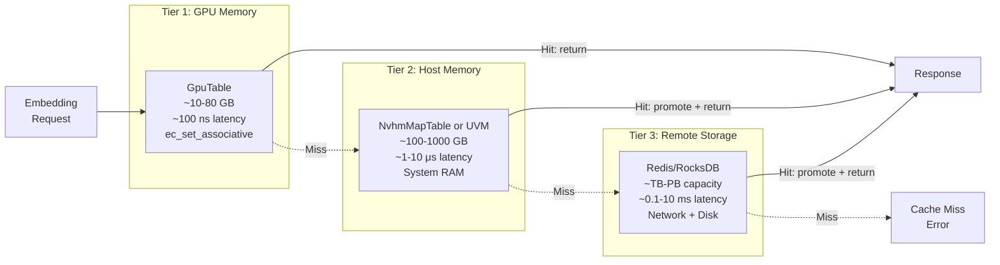

**Diagram: Three-Tier Memory Hierarchy and Lookup Flow**

Each tier represents a trade-off between capacity and performance:
- **Tier 1 (GPU)**: Highest performance, limited capacity. Typically stores the hottest 1-10% of embeddings.
- **Tier 2 (Host)**: Medium performance, moderate capacity. Stores warm embeddings or serves as overflow for Tier 1.
- **Tier 3 (Remote)**: Lowest performance, unlimited capacity. Stores the complete embedding table.

Not all configurations use all tiers. `GPUEmbeddingLayer` uses only Tier 1, `LinearUVMEmbeddingLayer` uses Tiers 1-2, and `HierarchicalEmbeddingLayer` can use all three tiers.

**Sources:** Diagram 2 from provided context, [README.md:11-17]()

## Use Cases

### When to Use Each Strategy

**GPUEmbeddingLayer (NoCache)**
- Embedding table fits entirely in GPU memory
- Lowest latency requirement (<10 μs)
- Simple deployment without host/remote storage
- Example: Small item catalogs, user embeddings for specific segments

**LinearUVMEmbeddingLayer**
- Embedding table fits in host memory but exceeds GPU capacity
- Single-node deployment
- Moderate latency tolerance (~10-50 μs)
- Example: Medium-sized catalogs on high-memory servers

**HierarchicalEmbeddingLayer**
- Embedding table exceeds single-node capacity
- Distributed deployment across multiple nodes
- Can tolerate variable latency (10 μs - 10 ms)
- Need for centralized parameter server
- Example: Large-scale catalogs with billions of embeddings

### Integration Scenarios

The SDK integrates with existing ML frameworks and infrastructure:

| Integration | Description | Reference |
|-------------|-------------|-----------|
| PyTorch | Direct tensor interop via DLPack | [PyTorch Integration](#5.2) |
| Triton | Production serving with model ensembles | [Triton Integration](#8.6) |
| Redis | Distributed parameter server | [Redis Plugin](#6.2) |
| Custom Training | Import from Dynamic Embedding SDK | [Examples](#9.5) |

**Sources:** [README.md:11-15](), [CHANGELOG.md:10-11]()

## Quick Start

To begin using the NV Embedding Cache SDK:

1. **Installation**: Follow [Installation and Setup](#2) to build from source or use the provided Docker container
2. **Choose Strategy**: Review [Cache Configuration Strategies](#1.2) to select the appropriate caching approach
3. **Basic Usage**: See [Quick Start Guide](#1.1) for a minimal working example
4. **API Reference**: 
   - C++ developers: [C++ API Reference](#4)
   - Python developers: [Python API Reference](#5)
5. **Examples**: Explore [Examples and Samples](#9) for complete code samples

### Minimal Python Example

```python
from nve import NVEmbedding

# Create GPU-only embedding layer
embedding = NVEmbedding(
    num_embeddings=1000000,
    embedding_dim=128,
    cache_type="NoCache"  # All data in GPU
)

# Lookup embeddings
indices = torch.tensor([1, 42, 999], device='cuda')
vectors = embedding(indices)  # Shape: (3, 128)
```

For more examples, see [Basic PyTorch Example](#9.2) and [samples/pytorch/simple_sample/](samples/pytorch/simple_sample/).

**Sources:** [README.md:19-70]()

## Version and Support

**Current Version**: 26.03.0

Recent releases:
- **v26.03**: Multi-GPU support, Triton Inference Server integration, checkpointing, kernel optimizations
- **v26.02.1**: NVHM submodule integration
- **v26.02**: Initial public release

For detailed release notes, see [Release History](#13).

For reporting issues or contributing, see [Contributing](#12).

**Sources:** [README.md:5](), [CHANGELOG.md:7-28]()

---

**Next Steps:**
- Follow the [Quick Start Guide](#1.1) for hands-on usage
- Review [Cache Configuration Strategies](#1.2) to understand when to use each approach
- Explore [System Architecture](#1.3) for architectural deep-dive

---

# Page: Quick Start Guide

# Quick Start Guide

<details>
<summary>Relevant source files</summary>

The following files were used as context for generating this wiki page:

- [README.md](README.md)
- [docs/samples.md](docs/samples.md)

</details>


**Purpose**: This guide provides step-by-step instructions to install NV Embedding Cache and run your first embedding lookup operation. It covers prerequisites, installation via Docker or source build, and minimal working examples in both C++ and Python.

**Scope**: This guide focuses on getting a working installation and running basic examples. For in-depth understanding of cache configuration strategies, see [Cache Configuration Strategies](#1.2). For architectural details, see [System Architecture](#1.3). For complete API documentation, see [C++ API Reference](#4) or [Python API Reference](#5).

---

## Prerequisites

The following requirements must be satisfied before installation:

| Component | Minimum Version | Notes |
|-----------|----------------|-------|
| C++ Compiler | C++17 capable | Tested with GCC 13.3 and Clang 20.1 |
| CUDA | 12.8+ | Earlier versions work with minor modifications |
| CMake | 3.18+ | Required for building from source |
| Python | 3.10+ | Required for Python bindings |
| PyTorch | Latest stable | Required for Python integration |
| Redis | 7.0.15+ | Optional, used for hierarchical caching tests |

The provided `Dockerfile` satisfies all prerequisites. Using Docker is the recommended installation method.

**Sources**: [README.md:21-27]()

---

## Installation Process

### Method 1: Docker Installation (Recommended)

The Docker-based installation provides a pre-configured environment with all dependencies.

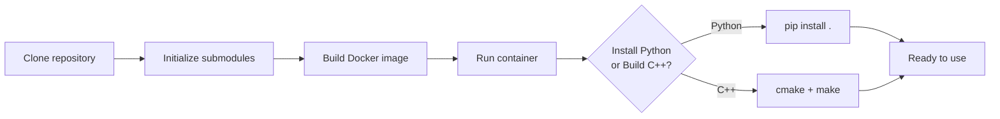

**Step 1**: Clone the repository and initialize submodules

```bash
git clone git@github.com:NVIDIA/nv-embedding-cache.git
cd nv-embedding-cache
git submodule update --init --recursive
```

The submodules contain third-party dependencies (googletest, pybind11, redis-plus-plus, etc.). See [Third-Party Dependencies](#2.4) for details.

**Step 2**: Build the Docker image

```bash
docker build -t nve \
  --build-arg START_DIR=$(pwd) \
  --build-arg UID=$(id -u) \
  --build-arg UNAME=$(id -u -n) \
  --build-arg GID=$(id -g) \
  --build-arg GNAME=$(id -g -n) .
```

This creates an image named `nve` with user permissions matching your host system.

**Step 3**: Launch the container

```bash
docker run --cap-add=ALL --net=host --ipc=host \
  --gpus all -it --rm -v $(pwd):$(pwd) nve
```

The container requires `--gpus all` for GPU access and mounts the repository directory for development.

**Step 4**: Install Python bindings (inside container)

```bash
pip install .
```

This builds `libnve-common.so`, plugin libraries, and the Python `nve` package, installing them to the `build/` directory.

**Sources**: [README.md:33-47]()

---

### Method 2: Building C++ from Source (Advanced)

For users who need to build C++ libraries and samples without Python:

```bash
mkdir build_dir
cd build_dir
cmake ..
make all -j
cd -
```

This produces:
- Core library: `build_dir/lib/libnve-common.so`
- Plugin libraries: `build_dir/lib/libnve-plugin-*.so`
- Sample executables: `build_dir/bin/*`
- Test executables: `build_dir/bin/*_test`

For detailed CMake configuration options, see [CMake Configuration Options](#10.1).

**Sources**: [README.md:48-55]()

---

## Basic Usage Examples

### Understanding the Three Configurations

NV Embedding Cache supports three configurations based on where embeddings are stored:

| Configuration | Python Class | C++ Class | Use Case |
|---------------|-------------|-----------|----------|
| **NoCache** | `NVEmbedding(cache_type="NoCache")` | `GPUEmbeddingLayer` | All embeddings fit in GPU memory |
| **LinearUVM** | `NVEmbedding(cache_type="LinearUVM")` | `LinearUVMEmbeddingLayer` | Embeddings exceed GPU memory, single node |
| **Hierarchical** | `NVEmbedding(cache_type="Hierarchical")` | `HierarchicalEmbeddingLayer` | Distributed deployment with remote parameter server |

For detailed comparison and selection criteria, see [Cache Configuration Strategies](#1.2).

**Sources**: [README.md:11-15]()

---

### Python Quick Start

The simplest way to use NV Embedding Cache is through the Python API with the `NoCache` configuration.

#### Minimal Working Example

```python
import torch
from nve import NVEmbedding

# Create embedding layer (all data in GPU)
num_embeddings = 100000
embedding_dim = 128

embedding = NVEmbedding(
    num_embeddings=num_embeddings,
    embedding_dim=embedding_dim,
    cache_type="NoCache",  # All embeddings in GPU memory
    device="cuda:0"
)

# Initialize with random weights
embedding.weight.uniform_(-1, 1)

# Lookup embeddings
indices = torch.tensor([0, 1, 42, 999], device="cuda:0")
output = embedding(indices)  # Returns: [4, 128] tensor

print(f"Output shape: {output.shape}")
print(f"Output device: {output.device}")
```

This example demonstrates:
1. Creating a `NVEmbedding` instance with `NoCache` configuration
2. Initializing embedding weights
3. Performing a lookup operation with a batch of indices

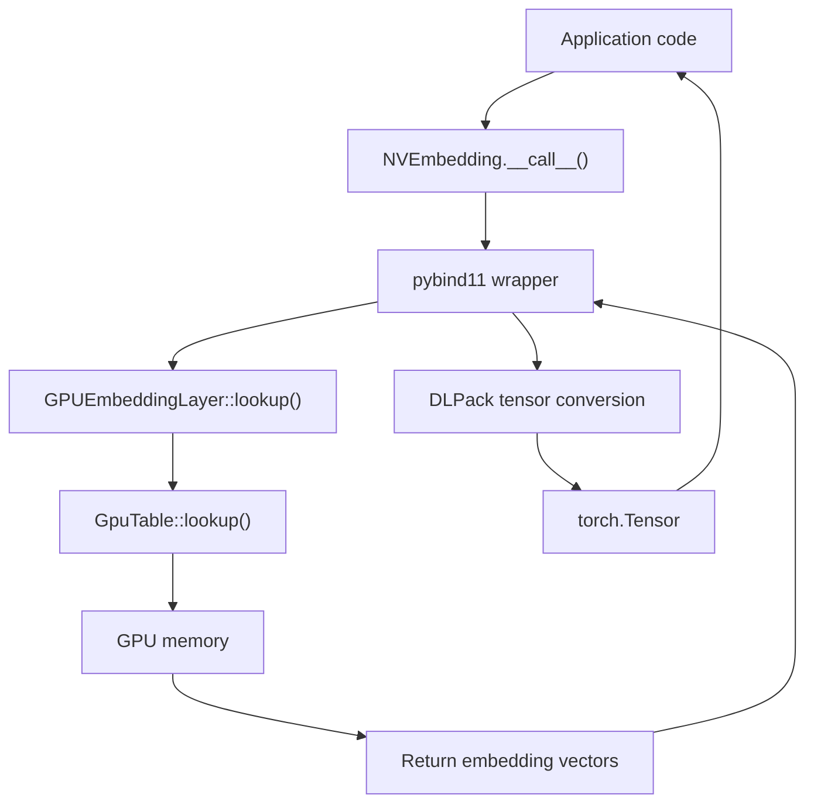

**Code Entities in Flow**:
- `NVEmbedding`: Python class in Python bindings (pybind11 wrapper)
- `GPUEmbeddingLayer`: C++ class implementing all-GPU storage
- `GpuTable`: C++ class for GPU hash table operations
- `DLPack`: Zero-copy tensor exchange format

For a complete working example, see [samples/pytorch/simple_sample/]().

**Sources**: [README.md:12](), [docs/samples.md:13]()

---

### C++ Quick Start

For applications requiring direct C++ integration, the API provides similar functionality.

#### Minimal Working Example

```cpp
#include "nve/embedding_layer/gpu_embedding_layer.hpp"
#include <cuda_runtime.h>

// Configuration
const size_t num_embeddings = 100000;
const size_t embedding_dim = 128;
const size_t batch_size = 4;

// Create embedding layer
nve::GPUEmbeddingLayer<float> layer(
    num_embeddings,
    embedding_dim,
    0  // GPU device ID
);

// Allocate and initialize embedding data
std::vector<float> embedding_data(num_embeddings * embedding_dim);
// ... initialize embedding_data ...

// Upload to GPU
layer.load(embedding_data.data());

// Prepare lookup indices on GPU
size_t* d_indices;
cudaMalloc(&d_indices, batch_size * sizeof(size_t));
size_t h_indices[] = {0, 1, 42, 999};
cudaMemcpy(d_indices, h_indices, batch_size * sizeof(size_t), 
           cudaMemcpyHostToDevice);

// Prepare output buffer
float* d_output;
cudaMalloc(&d_output, batch_size * embedding_dim * sizeof(float));

// Perform lookup
layer.lookup(d_indices, batch_size, d_output, 0);  // stream 0

// Results are now in d_output
```

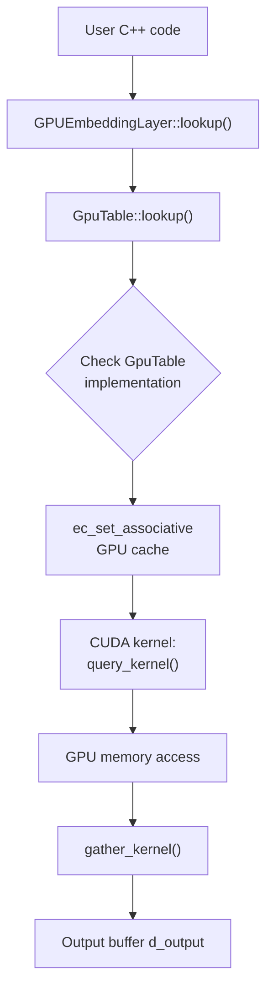

**Code Entities in Flow**:
- `GPUEmbeddingLayer<T>`: Template class defined in [include/nve/embedding_layer/gpu_embedding_layer.hpp]()
- `GpuTable`: Implements GPU hash table, defined in [include/nve/table/gpu_table.hpp]()
- `ec_set_associative`: Low-level GPU cache structure
- `query_kernel()`, `gather_kernel()`: CUDA kernels for lookup operations

For a complete working example, see [samples/simple_cpp/]().

**Sources**: [README.md:12](), [docs/samples.md:11]()

---

## Verification

### Running Sample Programs

After installation, verify the setup by running the provided samples:

**Python sample**:
```bash
cd samples/pytorch/simple_sample
python simple_gpu_embedding.py
```

Expected output: Successfully creates embedding layer and performs lookups without errors.

**C++ sample** (if built from source):
```bash
cd build_dir
./bin/simple_cpp
```

Expected output: Embedding lookup results printed to stdout.

**Sources**: [docs/samples.md:6-16]()

---

### Running Tests

To verify the installation more thoroughly:

**Python tests**:
```bash
pytest tests/python/
```

**C++ tests** (if built from source):
```bash
cd build_dir
ctest --output-on-failure
```

For detailed testing documentation, see [Testing](#11).

---

## Quick Configuration Reference

### Selecting the Right Configuration

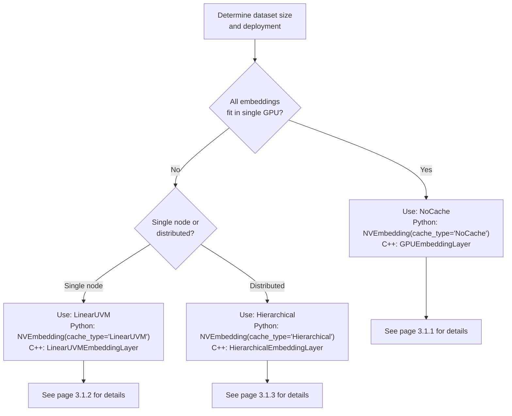

| Metric | NoCache | LinearUVM | Hierarchical |
|--------|---------|-----------|--------------|
| **Lookup latency** | ~1 μs | ~10 μs (cache hit)<br/>~100 μs (cache miss) | ~1 μs (L1 hit)<br/>~10 μs (L2 hit)<br/>~1-10 ms (L3 fetch) |
| **Capacity** | GPU VRAM only (~24-80 GB) | Host memory (~100s GB) | Unlimited (remote storage) |
| **Setup complexity** | Minimal | Low | High (requires Redis/RocksDB) |
| **Best for** | Small datasets, highest performance | Medium datasets, single node | Large datasets, multi-node |

**Sources**: [README.md:11-17](), High-level system diagrams

---

## Next Steps

After completing this quick start:

1. **Understand configurations**: Read [Cache Configuration Strategies](#1.2) to select the optimal configuration for your workload
2. **Learn architecture**: Review [System Architecture](#1.3) to understand how components interact
3. **Explore advanced features**: See [Advanced Topics](#8) for multi-GPU support, checkpointing, and performance tuning
4. **Study examples**: Review [Examples and Samples](#9) for more complex usage patterns
5. **API reference**: Consult [C++ API Reference](#4) or [Python API Reference](#5) for complete documentation

---

## Common Issues

| Issue | Solution |
|-------|----------|
| `ImportError: cannot import name 'NVEmbedding'` | Ensure `pip install .` completed successfully. Check `build/` directory for artifacts. |
| `CUDA out of memory` | Reduce `num_embeddings` or use `LinearUVM`/`Hierarchical` configuration instead of `NoCache`. |
| `CMake cannot find CUDA` | Set `CUDA_HOME` environment variable or specify `-DCMAKE_CUDA_COMPILER=/path/to/nvcc`. |
| Docker build fails | Verify NVIDIA Container Toolkit is installed: `nvidia-docker --version`. |

For comprehensive troubleshooting, see [Troubleshooting](#15).

**Sources**: [README.md:19-30]()

---

# Page: Cache Configuration Strategies

# Cache Configuration Strategies

<details>
<summary>Relevant source files</summary>

The following files were used as context for generating this wiki page:

- [README.md](README.md)
- [docs/advanced.md](docs/advanced.md)

</details>


## Purpose and Scope

This document describes the three primary caching strategies available in NV Embedding Cache SDK and provides guidance on selecting the appropriate strategy for your deployment scenario. Each strategy represents a different trade-off between memory capacity, lookup latency, and architectural complexity.

For implementation details of the individual embedding layers, see [Embedding Layers](#3.1). For memory hierarchy concepts, see [Memory Hierarchy](#3.3). For storage backend options, see [Tables and Storage Backends](#3.2).

Sources: [README.md:11-17]()

---

## Strategy Overview

NV Embedding Cache SDK provides three distinct configuration strategies to accommodate different dataset sizes and deployment architectures:

| Strategy | Python Class | C++ Class | Primary Use Case | Memory Tiers |
|----------|-------------|-----------|------------------|--------------|
| **NoCache** | `NVEmbedding(cache_type="NoCache")` | `GPUEmbeddingLayer` | Dataset fits in GPU memory | GPU only |
| **LinearUVM** | `NVEmbedding(cache_type="LinearUVM")` | `LinearUVMEmbeddingLayer` | Dataset exceeds GPU but fits in system memory | GPU cache + Host linear memory |
| **Hierarchical** | `NVEmbedding(cache_type="Hierarchical")` | `HierarchicalEmbeddingLayer` | Large-scale distributed deployments | GPU cache + Host cache + Remote storage |

Sources: [README.md:11-17]()

---

## Strategy Comparison

### Memory Architecture Comparison

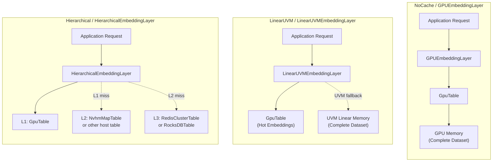

**Memory Hierarchy Across Strategies**

Sources: [README.md:11-17]()

---

### Characteristics Comparison

| Characteristic | NoCache | LinearUVM | Hierarchical |
|----------------|---------|-----------|--------------|
| **Lookup Latency** | ~100-500 ns | ~1-10 μs | ~100 ns - 10 ms (tier-dependent) |
| **Memory Capacity** | Limited to GPU DRAM | Limited to system DRAM | Effectively unlimited |
| **Architectural Complexity** | Minimal | Low | High |
| **Cache Management** | None required | Automatic via UVM | Explicit multi-tier |
| **Distributed Support** | Single GPU | Single node (multi-GPU) | Multi-node clusters |
| **Typical Dataset Size** | < 40 GB (A100 80GB) | < 2 TB (system memory) | > 2 TB |
| **Configuration Complexity** | Simple | Medium | Complex |
| **Failure Modes** | OOM crash | OOM crash or thrashing | Network/storage failures |

Sources: [README.md:11-17](), High-level diagrams from context

---

## NoCache / GPUEmbeddingLayer Strategy

### Architecture

The NoCache strategy stores the complete embedding table in contiguous GPU memory without any caching mechanism. The Python API uses `cache_type="NoCache"` and the C++ implementation is `GPUEmbeddingLayer`.

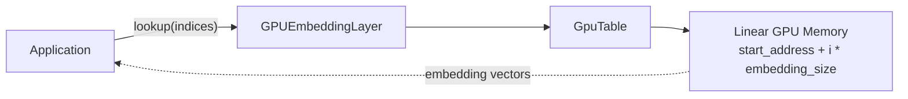

**NoCache Strategy Data Flow**

### Key Characteristics

- **Memory Layout**: All embeddings stored in linear GPU memory where embedding `i` is at `start_address + i * embedding_size`
- **No Cache Logic**: Direct memory access without cache eviction or promotion
- **Best Performance**: Minimal overhead for datasets that fit entirely in GPU memory
- **Predictable Latency**: Consistent lookup times with no cache miss penalty

### When to Use

Use the NoCache strategy when:
- Complete embedding table fits in available GPU memory
- Predictable, minimal latency is critical
- Simplicity of deployment is preferred
- Single-GPU inference workloads

### Configuration Example

**Python:**
```python
from pynve import NVEmbedding

embedding = NVEmbedding(
    num_embeddings=1000000,      # 1M embeddings
    embedding_dim=128,            # 128-dimensional vectors
    cache_type="NoCache",         # Use GPU-only strategy
    device_id=0
)
```

**C++:**
Reference: `GPUEmbeddingLayer` class and `GpuTable` implementation

Sources: [README.md:12]()

---

## LinearUVM / LinearUVMEmbeddingLayer Strategy

### Architecture

The LinearUVM strategy uses CUDA Unified Virtual Memory (UVM) to transparently manage a GPU cache backed by system memory. The Python API uses `cache_type="LinearUVM"` and the C++ implementation is `LinearUVMEmbeddingLayer`.

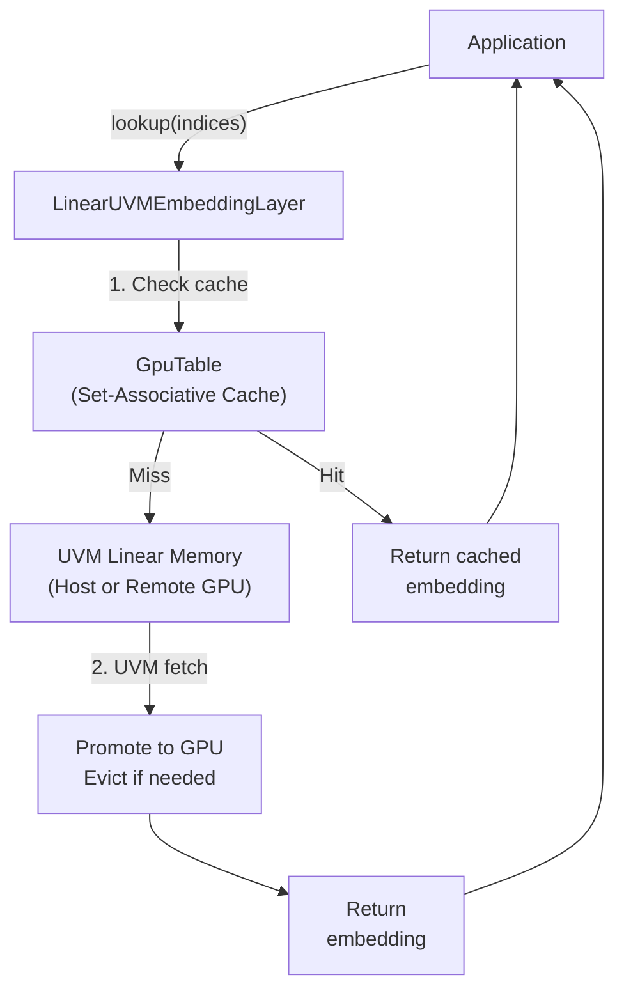

**LinearUVM Strategy Cache Lookup Flow**

### Key Characteristics

- **Automatic Caching**: GPU cache automatically managed by the embedding layer
- **UVM Backing Store**: Complete dataset in system memory or distributed across GPUs via UVM
- **Cache Promotion**: Frequently accessed embeddings automatically migrate to GPU cache
- **Transparent Fallback**: Cache misses transparently fetch from backing memory
- **Single Node**: Designed for single-node multi-GPU configurations

### Memory Management

The LinearUVM strategy employs a two-tier hierarchy:

1. **L1 (GPU Cache)**: `GpuTable` implementing set-associative cache with configurable eviction policy
2. **L2 (Linear Memory)**: UVM-allocated memory accessible from GPU but physically in system RAM or remote GPU memory

Linear memory organization ensures that embedding `i` can be computed as:
```
address = start_address + i * embedding_size
```

This property is critical for efficient UVM page fault handling and bulk operations.

### When to Use

Use the LinearUVM strategy when:
- Dataset exceeds single GPU memory capacity
- Dataset fits in aggregate system memory
- Single-node deployment (possibly multi-GPU)
- Access patterns exhibit temporal locality
- Acceptable to trade some latency for capacity

### Configuration Considerations

- **Cache Size**: Configure GPU cache size based on working set characteristics
- **Eviction Policy**: Choose LRU, LFU, or other policies based on access patterns
- **UVM Allocation**: Consider page size and prefetching hints for optimal performance

Sources: [README.md:13](), [README.md:17]()

---

## Hierarchical / HierarchicalEmbeddingLayer Strategy

### Architecture

The Hierarchical strategy implements a three-tier memory hierarchy with explicit cache management at each level. The Python API uses `cache_type="Hierarchical"` and the C++ implementation is `HierarchicalEmbeddingLayer`.

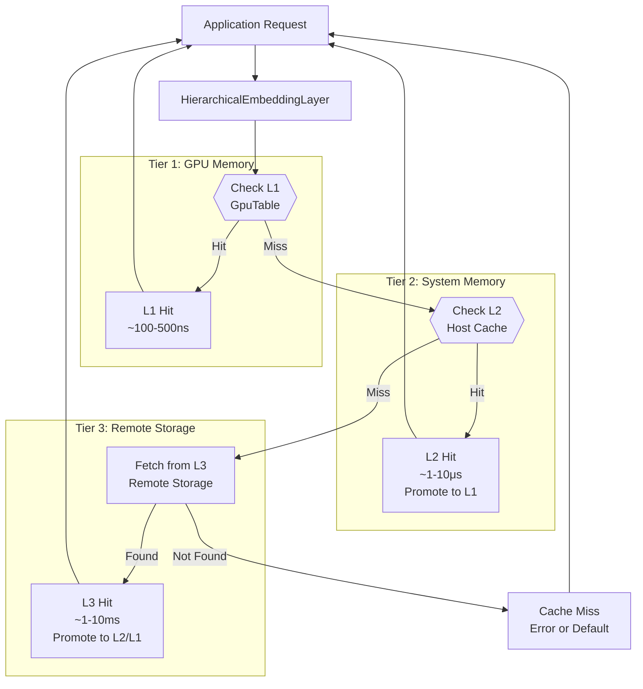

**Hierarchical Strategy Multi-Tier Lookup**

### Tier Configuration

| Tier | Implementation Options | Capacity | Latency | Use Case |
|------|----------------------|----------|---------|----------|
| **L1 (GPU)** | `GpuTable` | GBs | 100-500 ns | Hottest embeddings |
| **L2 (Host)** | `NvhmMapTable`, `AbseilFlatMapTable`, `PHMapFlatMapTable`, `LinearHostTable` | 10-100s GB | 1-10 μs | Warm embeddings |
| **L3 (Remote)** | `RedisClusterTable`, `RocksDBTable` | TBs | 1-10 ms | Complete dataset |

### Key Characteristics

- **Explicit Tier Management**: Application controls which tiers are active and how they're configured
- **Cache Promotion**: Cache misses trigger promotion of embeddings to higher (faster) tiers
- **Distributed Storage**: L3 tier supports distributed parameter servers (Redis, RocksDB)
- **Plugin Architecture**: L2 and L3 tiers use plugin-based table implementations
- **Configurable Eviction**: Each tier can use different eviction policies

### Storage Backend Selection

**L2 Host Memory Options:**

- `NvhmMapTable`: NVIDIA GPU-accelerated hash map using `nvHashMap` library (requires NVHM plugin)
- `AbseilFlatMapTable`: CPU-based hash map using Abseil library
- `PHMapFlatMapTable`: CPU-based parallel hash map
- `LinearHostTable`: Linear memory layout (similar to LinearUVM but CPU-managed)

**L3 Remote Storage Options:**

- `RedisClusterTable`: Distributed Redis cluster for high-throughput scenarios
- `RocksDBTable`: Embedded persistent key-value store for single-node with disk persistence

### When to Use

Use the Hierarchical strategy when:
- Dataset size exceeds system memory capacity
- Multi-node distributed deployment required
- Embeddings stored in external parameter server
- Access patterns follow power-law distribution (few hot embeddings, long tail of cold)
- Willing to manage complexity for maximum capacity

### Configuration Example

**Python:**
```python
from pynve import NVEmbedding

embedding = NVEmbedding(
    num_embeddings=10000000000,   # 10B embeddings
    embedding_dim=128,
    cache_type="Hierarchical",
    gpu_cache_capacity=1000000,   # 1M embeddings in L1
    host_cache_capacity=10000000, # 10M embeddings in L2
    device_id=0,
    # L3 configured via table parameters
)
```

**C++:**
Reference: `HierarchicalEmbeddingLayer` class

Sources: [README.md:14-15]()

---

## Strategy Selection Guide

### Decision Flowchart

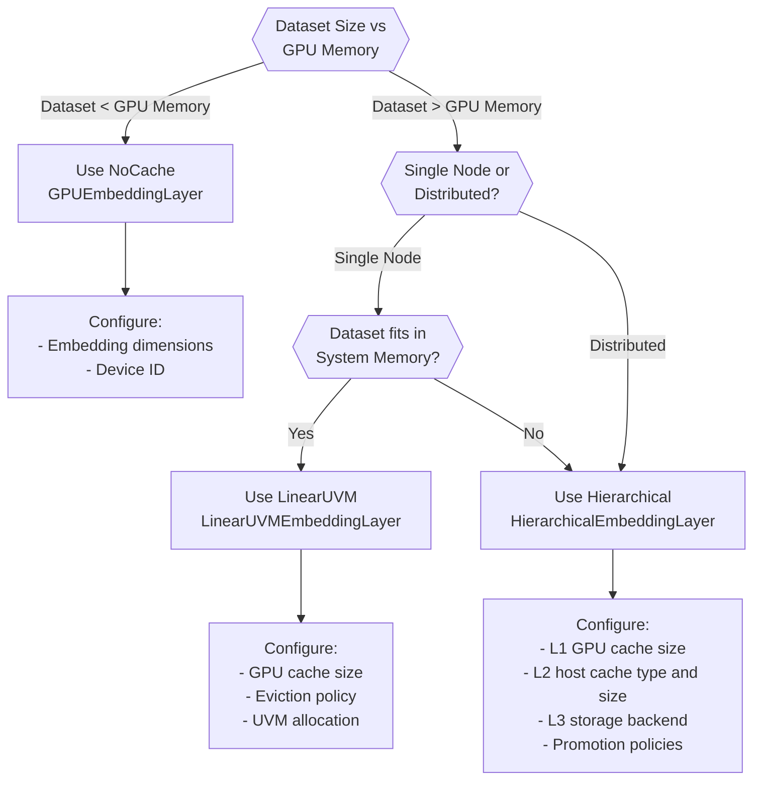

**Strategy Selection Decision Tree**

Sources: High-level diagrams from context

---

## Performance Considerations

### Latency Characteristics

The three strategies exhibit different latency profiles:

**NoCache:**
- Constant latency (~100-500 ns)
- No cache miss penalty
- Best for latency-critical applications

**LinearUVM:**
- L1 hit: ~100-500 ns
- L1 miss: ~1-10 μs (UVM page fault)
- Variable latency depending on cache hit rate
- UVM overhead for first access to pages

**Hierarchical:**
- L1 hit: ~100-500 ns
- L2 hit: ~1-10 μs
- L3 hit: ~1-10 ms (network + storage)
- Highly variable latency depending on access patterns
- Promotion overhead on misses

### Memory Overhead

| Component | NoCache | LinearUVM | Hierarchical |
|-----------|---------|-----------|--------------|
| **Embedding Storage** | GPU only | UVM (Host/GPU) | L3 storage |
| **Cache Metadata** | None | GPU cache structures | L1 + L2 cache structures |
| **Lookup Buffers** | Minimal | Per-context buffers | Per-context per-tier buffers |
| **Thread Pools** | None | None | L2/L3 async operations |

### Throughput Characteristics

- **NoCache**: Limited by GPU memory bandwidth (~1-2 TB/s on A100)
- **LinearUVM**: Limited by cache hit rate and UVM transfer bandwidth
- **Hierarchical**: Depends on tier hit rates; L1 hits critical for performance

Sources: High-level diagrams and system architecture context

---

## Code Entity Reference

### Python API

| Cache Strategy | Python Parameter | Class/Function |
|----------------|------------------|----------------|
| NoCache | `cache_type="NoCache"` | `NVEmbedding` constructor parameter |
| LinearUVM | `cache_type="LinearUVM"` | `NVEmbedding` constructor parameter |
| Hierarchical | `cache_type="Hierarchical"` | `NVEmbedding` constructor parameter |

### C++ API

| Cache Strategy | C++ Class | Header File |
|----------------|-----------|-------------|
| NoCache | `GPUEmbeddingLayer` | `include/gpu_embedding_layer.hpp` |
| LinearUVM | `LinearUVMEmbeddingLayer` | `include/linear_uvm_embedding_layer.hpp` |
| Hierarchical | `HierarchicalEmbeddingLayer` | `include/hierarchical_embedding_layer.hpp` |

### Storage Backend Classes

| Backend Type | Class Name | Plugin Library |
|--------------|------------|----------------|
| GPU Cache | `GpuTable` | Core library (always available) |
| NVHM Host Cache | `NvhmMapTable` | `libnve-plugin-nvhm.so` |
| Abseil Host Cache | `AbseilFlatMapTable` | `libnve-plugin-abseil.so` |
| PHMap Host Cache | `PHMapFlatMapTable` | `libnve-plugin-phmap.so` |
| Redis Remote | `RedisClusterTable` | `libnve-plugin-redis.so` |
| RocksDB Remote | `RocksDBTable` | `libnve-plugin-rocksdb.so` |

Sources: [README.md:11-17]()

---

## Summary

NV Embedding Cache SDK provides three complementary caching strategies optimized for different deployment scenarios:

1. **NoCache/GPUEmbeddingLayer**: Maximum performance for datasets that fit in GPU memory
2. **LinearUVM/LinearUVMEmbeddingLayer**: Balanced approach for single-node deployments with datasets exceeding GPU capacity
3. **Hierarchical/HierarchicalEmbeddingLayer**: Maximum flexibility and capacity for distributed large-scale deployments

Selection depends primarily on dataset size relative to available memory resources and whether the deployment is single-node or distributed. The modular architecture allows switching between strategies with minimal code changes.

For detailed configuration parameters and API usage, see [Embedding Layers](#3.1). For multi-GPU and distributed setups, see [Multi-GPU Support](#8.1).

Sources: [README.md:11-17]()

---

# Page: System Architecture

# System Architecture

<details>
<summary>Relevant source files</summary>

The following files were used as context for generating this wiki page:

- [README.md](README.md)
- [docs/advanced.md](docs/advanced.md)
- [docs/cpp_api.md](docs/cpp_api.md)

</details>


## Purpose and Scope

This document provides a high-level architectural overview of the NV Embedding Cache SDK, showing how major components are organized into layers, how they interact, and the design patterns that enable extensibility and performance. This page focuses on the structural organization and component relationships rather than detailed usage patterns.

For specific usage instructions, see [Quick Start Guide](#1.1). For choosing the right caching strategy for your use case, see [Cache Configuration Strategies](#1.2). For detailed explanations of individual components, see [Core Concepts](#3).

---

## Architectural Layers

The NV Embedding Cache SDK is organized into distinct architectural layers, each with specific responsibilities. The system follows a modular design where higher layers depend on lower layers but not vice versa.

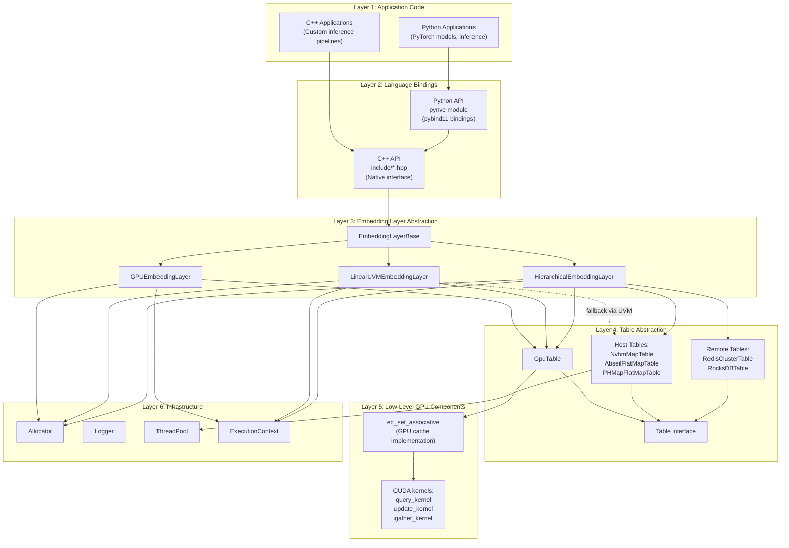

**Sources:** [include/embedding_layer.hpp](), [include/gpu_embedding_layer.hpp](), [include/linear_embedding_layer.hpp](), [include/hierarchical_embedding_layer.hpp](), [include/table.hpp](), [include/gpu_table.hpp](), [include/ecache/ec_set_associative.h]()

### Layer Descriptions

| Layer | Components | Responsibility |
|-------|-----------|----------------|
| **Application** | User code (Python/C++) | Define embedding lookup workflows and integrate with ML frameworks |
| **Language Bindings** | `pynve` module, C++ headers | Provide language-specific APIs with appropriate idioms |
| **Embedding Layers** | `GPUEmbeddingLayer`, `LinearUVMEmbeddingLayer`, `HierarchicalEmbeddingLayer` | Manage multi-tier caching strategies and coordinate operations across tables |
| **Tables** | `GpuTable`, `NvhmMapTable`, `RedisClusterTable`, etc. | Implement storage backends for specific memory locations |
| **GPU Components** | `ec_set_associative`, CUDA kernels | Provide optimized GPU cache and compute operations |
| **Infrastructure** | `Allocator`, `Logger`, `ExecutionContext`, `ThreadPool` | Supply cross-cutting concerns and execution management |

**Sources:** [docs/cpp_api.md:1-80](), [README.md:11-16]()

---

## Core Abstractions

The SDK is built around three primary abstractions that provide separation of concerns and enable flexible configurations.

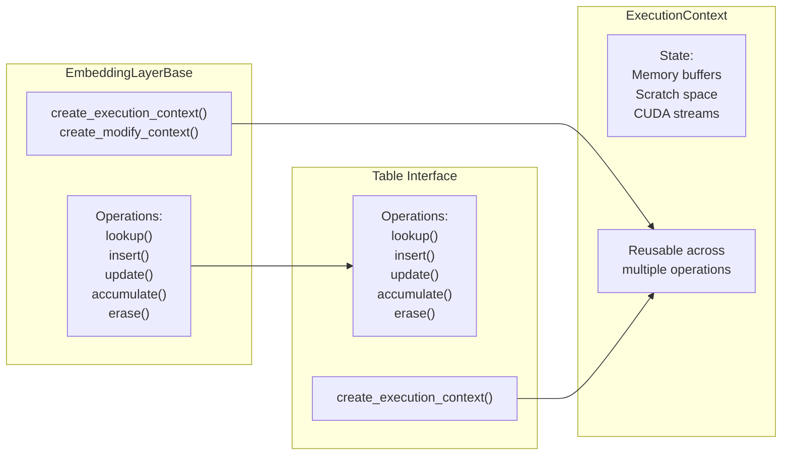

**Sources:** [include/embedding_layer.hpp](), [include/table.hpp](), [include/execution_context.hpp](), [docs/cpp_api.md:14-39](), [docs/advanced.md:3-11]()

### EmbeddingLayerBase

The `EmbeddingLayerBase` class defines the interface for all embedding layers. It provides operations for reading and writing embedding data, managing cache residency, and creating execution contexts. Layers coordinate operations across one or more tables based on their caching strategy.

Key characteristics:
- Accepts inputs in either GPU or system memory
- Automatically handles memory transfers as needed
- Implements multi-tier caching logic
- Manages cache coherence across tiers

**Sources:** [include/embedding_layer.hpp](), [docs/cpp_api.md:14-39]()

### Table Interface

The `Table` interface represents a single storage location (GPU memory, system memory, or remote storage). Tables implement the same operations as layers but with stricter memory placement requirements—callers must ensure inputs are in the correct memory space.

Key characteristics:
- Single storage location per table
- Minimal memory copying (caller responsibility)
- Plugin-based extensibility
- Independent lifecycle management

**Sources:** [include/table.hpp](), [docs/cpp_api.md:45-58]()

### ExecutionContext

`ExecutionContext` objects encapsulate the state and resources needed for parallel execution of operations. Each context represents one independent execution unit with its own memory buffers, CUDA streams, and scratch space.

Key characteristics:
- Reusable across multiple operations
- Enables parallel execution (one context per parallel operation)
- Lazy memory allocation
- Must be destroyed before parent layer/table

**Sources:** [include/execution_context.hpp](), [docs/advanced.md:3-11]()

---

## Three-Tier Memory Hierarchy

The SDK implements a three-tier memory hierarchy optimized for the access patterns typical in recommender systems, where key distributions follow power-law distributions with high temporal locality.

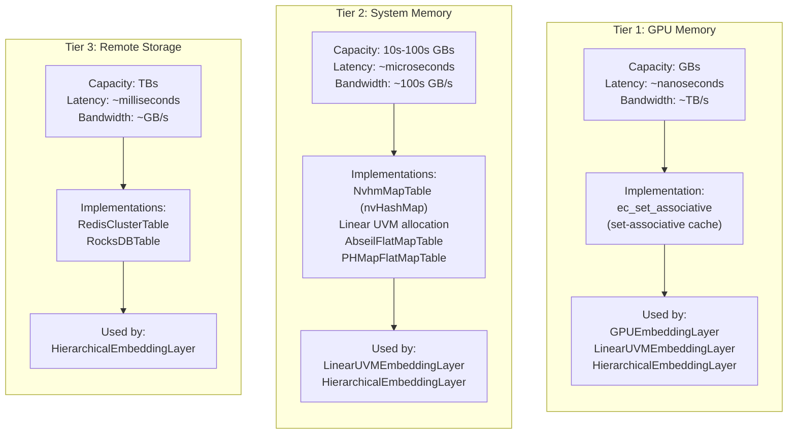

**Sources:** [README.md:11-17](), [include/gpu_embedding_layer.hpp](), [include/linear_embedding_layer.hpp](), [include/hierarchical_embedding_layer.hpp]()

### Tier Selection by Layer Type

| Layer Type | Tier 1 (GPU) | Tier 2 (System) | Tier 3 (Remote) | Trade-off |
|------------|-------------|-----------------|-----------------|-----------|
| `GPUEmbeddingLayer` | All data | Not used | Not used | Fastest lookups, limited by GPU capacity |
| `LinearUVMEmbeddingLayer` | Cache | All data (UVM linear) | Not used | Automatic caching, single-node scale |
| `HierarchicalEmbeddingLayer` | Cache (hot) | Cache (warm) | All data | Maximum scale, distributed deployment |

**Sources:** [README.md:11-16](), [docs/cpp_api.md:19-22]()

### Cache Promotion Strategy

When a cache miss occurs at a faster tier, the data is fetched from a slower tier and optionally promoted (cached) in the faster tier for future access. The `InsertHeuristic` class controls when promotion occurs based on access patterns.

**Sources:** [docs/advanced.md:30-32](), [include/insert_heuristic.hpp]()

---

## Component Interaction: Lookup Flow

The following diagram illustrates how components interact during a typical embedding lookup operation through `HierarchicalEmbeddingLayer`.

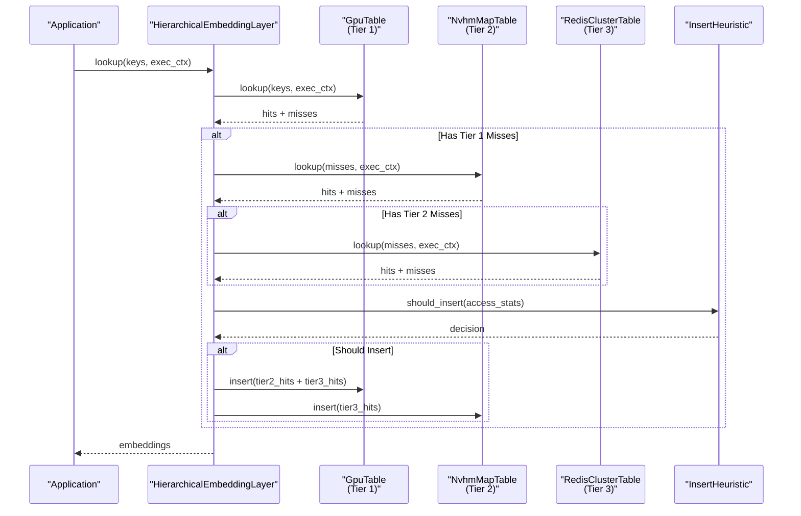

**Sources:** [include/hierarchical_embedding_layer.hpp](), [docs/cpp_api.md:24-32](), [docs/advanced.md:30-32]()

### Operation Types

The SDK distinguishes between two categories of operations:

**Lookup Operations** (read-only from caller perspective):
- `lookup()`: Retrieve embedding rows for given keys
- May trigger cache insertions internally (controlled by `InsertHeuristic`)
- Can execute in parallel using separate `ExecutionContext` objects

**Modify Operations** (change cache state or values):
- `insert()`: Change cache residency (which keys are cached)
- `update()`: Change embedding values for existing keys
- `accumulate()`: Apply gradients to existing embeddings
- `erase()`: Remove keys from cache
- Require `ModifyContext` for execution
- Must be serialized (only one modify operation in flight)

**Sources:** [docs/cpp_api.md:24-38](), [docs/advanced.md:13-24]()

---

## Plugin Architecture

The SDK uses a plugin architecture to minimize dependencies and enable extensibility. Core functionality is in `libnve-common.so`, while optional storage backends are separate shared libraries.

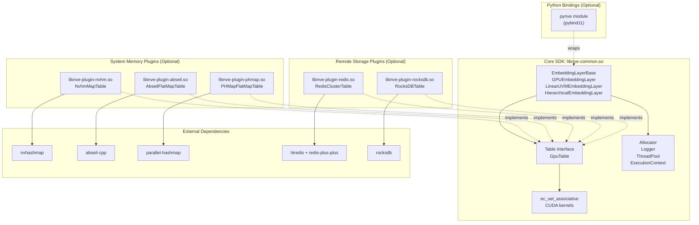

**Sources:** [docs/cpp_api.md:9-12](), [docs/cpp_api.md:57](), [README.md:77-93]()

### Plugin Loading

Plugins are dynamically loaded at runtime using standard shared library mechanisms. Applications link against `libnve-common.so` and ensure required plugin libraries are in `LD_LIBRARY_PATH`. The plugin architecture allows:

- **Minimal dependencies**: Core SDK doesn't depend on Redis, RocksDB, etc.
- **Flexible deployment**: Load only the plugins you need
- **Extensibility**: Add new storage backends without modifying core
- **Independent versioning**: Plugins can be updated independently

**Sources:** [docs/cpp_api.md:9-12](), [docs/cpp_api.md:57]()

---

## Parallel Execution Model

The SDK is designed for high-throughput inference workloads with multiple concurrent requests. The execution model centers on `ExecutionContext` objects that enable safe parallel operations.

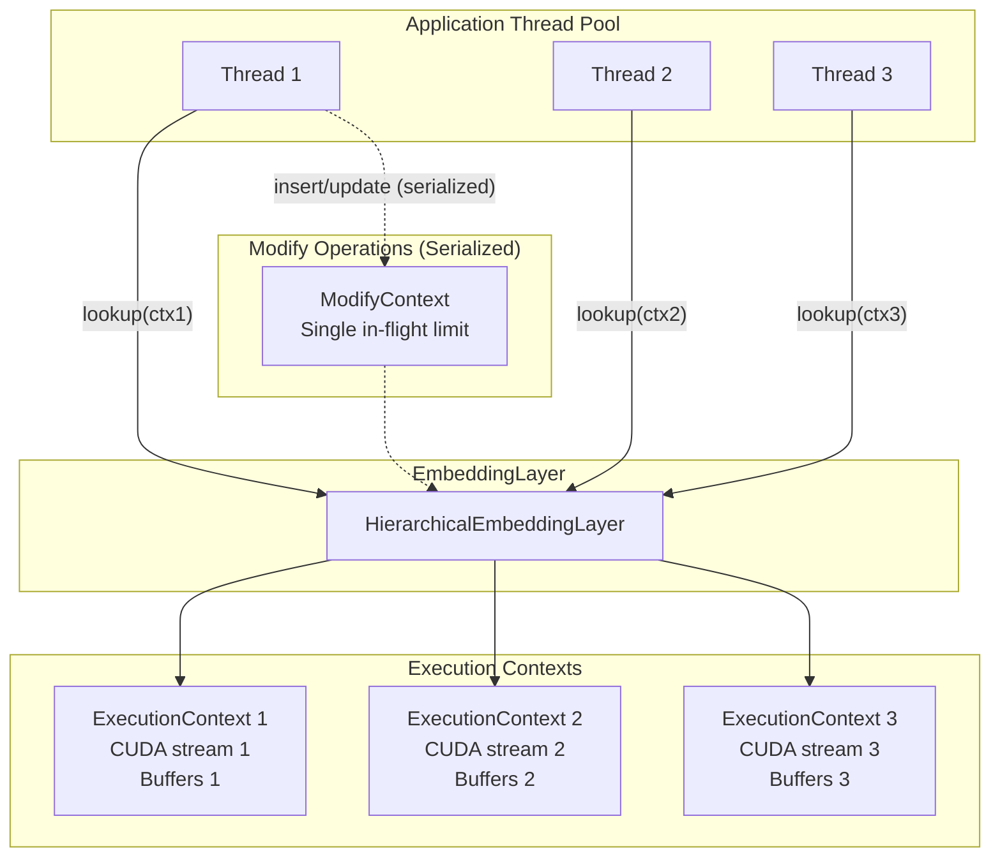

**Sources:** [docs/advanced.md:3-11](), [docs/advanced.md:13-24]()

### Execution Context Usage Pattern

1. **Initialization**: Create a fixed number of `ExecutionContext` objects (e.g., one per inference thread)
2. **Runtime**: Reuse contexts in round-robin or per-thread assignment
3. **Parallelism**: Multiple lookup operations can execute concurrently, each with a different context
4. **Serialization**: Modify operations must be serialized (single in-flight at a time)
5. **Teardown**: Destroy all contexts before destroying the layer/table

**Sources:** [docs/advanced.md:3-11]()

### Thread Safety Considerations

| Operation | Thread Safety | Synchronization Requirement |
|-----------|--------------|----------------------------|
| `lookup()` with different contexts | Safe (parallel) | None |
| `lookup()` with same context | Unsafe | Caller must serialize |
| `insert()`/`update()`/`accumulate()` | Must serialize | Only one modify operation in-flight on GPU |
| Mixing `lookup()` and `modify()` | Handled by invalidate-commit | SDK manages internally |

**Sources:** [docs/advanced.md:13-24]()

---

## Invalidate-Commit Paradigm

To enable concurrent lookup and modify operations, the SDK uses an invalidate-commit pattern that ensures cache coherence without blocking lookups unnecessarily.

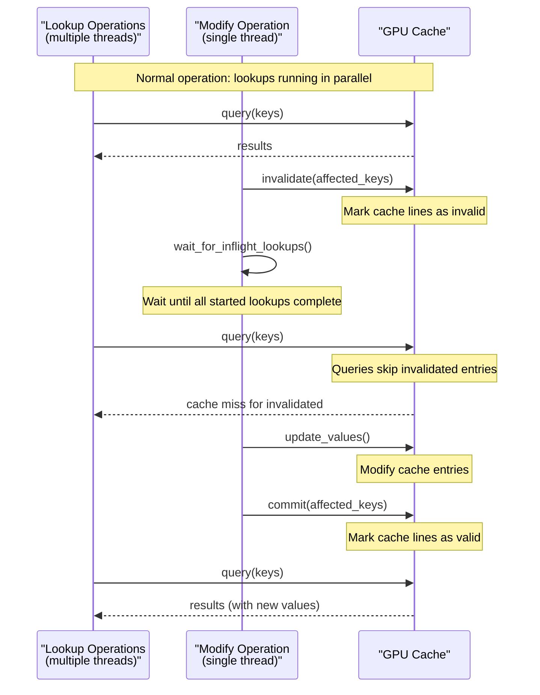

**Sources:** [docs/advanced.md:18-24]()

### Custom Flow Atomicity

For applications implementing custom gather flows with multiple CUDA kernels, the SDK provides `start_custom_flow()` and `end_custom_flow()` APIs to maintain atomicity required by the invalidate-commit mechanism.

**Sources:** [docs/advanced.md:23-24]()

---

## Multi-Device Support

The SDK supports embeddings distributed across multiple GPUs through CUDA's unified virtual memory (UVM) and distributed buffer abstractions.

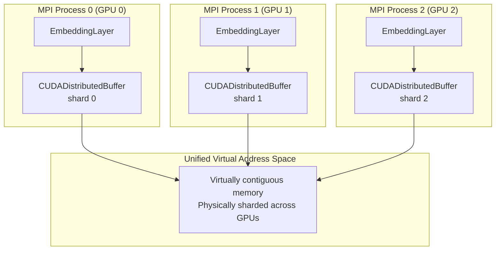

**Sources:** [docs/advanced.md:26-28](), [include/distributed.hpp]()

### Multi-Device Implementation

The `CUDADistributedBuffer` class (C++) and `MPIMemBlock` class (Python) create CUDA allocations that span multiple devices using NVIDIA's virtual memory management capabilities. Each process owns a shard of the total embedding table, but all shards appear as a single contiguous virtual address space.

**Sources:** [docs/advanced.md:26-28](), [include/distributed.hpp]()

---

## Build System Integration

The SDK uses CMake with a feature selection system that allows building only the components needed for a specific deployment.

```mermaid
graph TB
    subgraph "Source Tree"
        SRC["src/<br/>Core C++ implementation"]
        PLUGINS["plugins/<br/>Optional table plugins"]
        INCLUDE["include/<br/>Public C++ headers"]
        PYTHON["python/pynve/<br/>Python bindings"]
    end
    
    subgraph "CMake Configuration"
        ROOT["CMakeLists.txt"]
        FEATURES["NVE_FEATURES list<br/>(feature selection)"]
        THIRD["third_party/<br/>Git submodules"]
    end
    
    subgraph "Build Outputs"
        CORE["build/lib/libnve-common.so"]
        PLUGIN_NVHM["build/lib/libnve-plugin-nvhm.so"]
        PLUGIN_REDIS["build/lib/libnve-plugin-redis.so"]
        PLUGIN_ROCKS["build/lib/libnve-plugin-rocksdb.so"]
        PLUGIN_OTHER["build/lib/libnve-plugin-*.so"]
        PYWHEEL["nve-*.whl<br/>(Python package)"]
    end
    
    ROOT --> FEATURES
    FEATURES --> THIRD
    
    SRC --> CORE
    PLUGINS --> PLUGIN_NVHM
    PLUGINS --> PLUGIN_REDIS
    PLUGINS --> PLUGIN_ROCKS
    PLUGINS --> PLUGIN_OTHER
    PYTHON --> PYWHEEL
    
    INCLUDE -.->|"installed with"| CORE
    CORE -.->|"dependency"| PYWHEEL
```

**Sources:** [README.md:48-55](), [docs/cpp_api.md:9-12]()

### Feature Selection

The `NVE_FEATURES` CMake variable controls which optional components are built. This allows minimizing dependencies and binary size for production deployments.

Example: Building only core + NVHM plugin (no Redis or RocksDB dependencies)

**Sources:** See [CMake Configuration Options](#10.1) for details

---

## Summary

The NV Embedding Cache SDK architecture is characterized by:

1. **Layered Design**: Clear separation between application API, caching strategy, storage backend, and GPU implementation
2. **Three-Tier Memory Hierarchy**: Optimized for power-law distributions in recommender systems
3. **Plugin Architecture**: Extensible storage backends without core dependencies
4. **Execution Contexts**: Safe parallel execution with resource isolation
5. **Invalidate-Commit**: Concurrent lookups and modifications without locks
6. **Multi-Device**: Distributed embeddings across GPUs and nodes

This architecture enables the SDK to support workloads ranging from single-GPU inference with all data in GPU memory to distributed inference with terabyte-scale embeddings in remote parameter servers.

**Sources:** [README.md:1-94](), [docs/cpp_api.md:1-80](), [docs/advanced.md:1-55]()

---

# Page: Installation and Setup

# Installation and Setup

<details>
<summary>Relevant source files</summary>

The following files were used as context for generating this wiki page:

- [CMakeLists.txt](CMakeLists.txt)
- [README.md](README.md)

</details>


This page provides comprehensive instructions for installing and configuring the NV Embedding Cache SDK. It covers the complete setup process from obtaining the source code through building and verifying the installation. For detailed prerequisite requirements, see [Prerequisites](#2.1). For information on using the SDK after installation, see [Quick Start Guide](#1.1).

The SDK supports two primary installation paths: using the pre-configured Docker container (recommended) or building from source in a custom environment. Both methods produce the same output artifacts: the core C++ library (`libnve-common.so`), optional plugin libraries, and Python bindings.

---

## Installation Methods Overview

The following diagram shows the relationship between installation methods and build outputs:

```mermaid
graph TB
    subgraph "Installation Paths"
        DOCKER["Docker Container<br/>(Dockerfile)"]
        SOURCE["Build from Source<br/>(Native Environment)"]
    end
    
    subgraph "Source Code"
        REPO["Git Repository<br/>github.com/NVIDIA/nv-embedding-cache"]
        SUBMODULES["Git Submodules<br/>(third_party/)"]
    end
    
    subgraph "Build System"
        CMAKE["CMake Configuration<br/>(CMakeLists.txt)"]
        FEATURE_SELECT["Feature Selection<br/>(NVE_FEATURES)"]
        THIRD_PARTY["Third-Party Build<br/>(third_party/CMakeLists.txt)"]
    end
    
    subgraph "Build Outputs"
        CORE_LIB["libnve-common.so<br/>(Core Library)"]
        PLUGINS["Plugin Libraries<br/>(libnve-plugin-*.so)"]
        PY_WHEEL["Python Package<br/>(nve-*.whl)"]
        SAMPLES["Sample Executables<br/>(build/bin/)"]
        TESTS["Test Executables<br/>(build/bin/)"]
    end
    
    DOCKER --> REPO
    SOURCE --> REPO
    REPO --> SUBMODULES
    SUBMODULES --> THIRD_PARTY
    REPO --> CMAKE
    CMAKE --> FEATURE_SELECT
    FEATURE_SELECT --> THIRD_PARTY
    CMAKE --> CORE_LIB
    CMAKE --> PLUGINS
    CMAKE --> PY_WHEEL
    CMAKE --> SAMPLES
    CMAKE --> TESTS
    
    CORE_LIB -.->|required by| PLUGINS
    CORE_LIB -.->|wrapped by| PY_WHEEL
```

**Sources:** [README.md:1-94](), [CMakeLists.txt:1-390]()

---

## Quick Start Installation

### Option 1: Docker Container (Recommended)

The Docker method provides a fully configured environment with all prerequisites satisfied:

```bash
# Clone repository with submodules
git clone git@github.com:NVIDIA/nv-embedding-cache.git
cd nv-embedding-cache
git submodule update --init --recursive

# Build and start Docker container
docker build -t nve \
    --build-arg START_DIR=$(pwd) \
    --build-arg UID=$(id -u) \
    --build-arg UNAME=$(id -u -n) \
    --build-arg GID=$(id -g) \
    --build-arg GNAME=$(id -g -n) .

docker run --cap-add=ALL --net=host --ipc=host \
    --gpus all -it --rm -v $(pwd):$(pwd) nve

# Inside container: Install Python bindings
pip install .
```

For detailed Docker configuration options, see [Docker Setup](#2.3).

**Sources:** [README.md:32-47]()

### Option 2: Build from Source

For custom environments, build the C++ libraries and optionally the Python bindings:

```bash
# Clone repository
git clone git@github.com:NVIDIA/nv-embedding-cache.git
cd nv-embedding-cache
git submodule update --init --recursive

# Build C++ libraries, samples, and tests
mkdir build
cd build
cmake ..
make all -j
cd ..

# Optional: Install Python bindings
pip install .
```

For detailed build configuration options and troubleshooting, see [Building from Source](#2.2).

**Sources:** [README.md:48-55]()

---

## Build System Architecture

The following diagram maps the build system components to their file locations and CMake targets:

```mermaid
graph TB
    subgraph "Configuration Files"
        ROOT_CMAKE["CMakeLists.txt<br/>(Root)"]
        VERSION_TXT["version.txt"]
        THIRD_CMAKE["third_party/CMakeLists.txt"]
        SRC_CMAKE["src/CMakeLists.txt"]
        PLUGINS_CMAKE["plugins/CMakeLists.txt"]
        PYNVE_CMAKE["python/pynve/bindings/CMakeLists.txt"]
    end
    
    subgraph "Feature Detection"
        AVX_DETECT["AVX Detection<br/>(lines 126-233)"]
        CUDA_DETECT["CUDA Architecture<br/>(lines 315-342)"]
        NUMA_DETECT["NUMA Library Detection<br/>(lines 283-313)"]
        FEATURE_FLAGS["NVE_FEATURES List<br/>(lines 42-108)"]
    end
    
    subgraph "Build Targets"
        COMMON_LIB["nve-common<br/>(Core Library)"]
        NVHM_PLUGIN["nve-plugin-nvhm"]
        REDIS_PLUGIN["nve-plugin-redis"]
        ROCKSDB_PLUGIN["nve-plugin-rocksdb"]
        ABSEIL_PLUGIN["nve-plugin-abseil"]
        PHMAP_PLUGIN["nve-plugin-phmap"]
        PYNVE_TARGET["pynve<br/>(Python Bindings)"]
    end
    
    ROOT_CMAKE --> VERSION_TXT
    ROOT_CMAKE --> AVX_DETECT
    ROOT_CMAKE --> CUDA_DETECT
    ROOT_CMAKE --> NUMA_DETECT
    ROOT_CMAKE --> FEATURE_FLAGS
    ROOT_CMAKE --> THIRD_CMAKE
    ROOT_CMAKE --> SRC_CMAKE
    ROOT_CMAKE --> PLUGINS_CMAKE
    ROOT_CMAKE --> PYNVE_CMAKE
    
    FEATURE_FLAGS -.->|enables/disables| NVHM_PLUGIN
    FEATURE_FLAGS -.->|enables/disables| REDIS_PLUGIN
    FEATURE_FLAGS -.->|enables/disables| ROCKSDB_PLUGIN
    FEATURE_FLAGS -.->|enables/disables| ABSEIL_PLUGIN
    FEATURE_FLAGS -.->|enables/disables| PHMAP_PLUGIN
    
    SRC_CMAKE --> COMMON_LIB
    PLUGINS_CMAKE --> NVHM_PLUGIN
    PLUGINS_CMAKE --> REDIS_PLUGIN
    PLUGINS_CMAKE --> ROCKSDB_PLUGIN
    PLUGINS_CMAKE --> ABSEIL_PLUGIN
    PLUGINS_CMAKE --> PHMAP_PLUGIN
    PYNVE_CMAKE --> PYNVE_TARGET
    
    COMMON_LIB -.->|linked by| NVHM_PLUGIN
    COMMON_LIB -.->|linked by| REDIS_PLUGIN
    COMMON_LIB -.->|linked by| ROCKSDB_PLUGIN
    COMMON_LIB -.->|wrapped by| PYNVE_TARGET
```

**Sources:** [CMakeLists.txt:1-390]()

---

## Prerequisites Overview

The SDK requires the following components. See [Prerequisites](#2.1) for detailed version requirements and installation instructions.

| Component | Minimum Version | Purpose |
|-----------|----------------|---------|
| C++ Compiler | C++17 support | Build core library (GCC 13.3 or Clang 20.1 tested) |
| CUDA Toolkit | 12.8 | GPU kernel compilation and runtime |
| CMake | 3.18 | Build system configuration |
| Python | 3.10 | Python bindings (optional) |
| PyTorch | - | Python integration (optional) |
| Redis | 7.0.15 | Remote parameter server (optional, for testing) |
| libhwloc | - | NUMA control (optional) |
| libnuma | - | NUMA memory allocation (optional) |

The build system automatically detects available hardware features:

- **AVX/AVX2/AVX-512**: Vectorized CPU operations ([CMakeLists.txt:126-233]())
- **CUDA Compute Capability**: Target GPU architectures ([CMakeLists.txt:315-342]())
- **NUMA Libraries**: Memory affinity control ([CMakeLists.txt:283-313]())

**Sources:** [README.md:21-27](), [CMakeLists.txt:126-342]()

---

## Feature Configuration

The SDK uses a feature flag system (`NVE_FEATURES`) to enable/disable optional components at compile time. This controls which plugin libraries are built and which GPU kernel specializations are included.

### Available Features

```mermaid
graph LR
    subgraph "Plugin Features"
        NVHM["nvhm_plugin"]
        REDIS["redis_plugin"]
        ROCKSDB["rocksdb_plugin"]
        ABSEIL["abseil_plugin"]
        PHMAP["phmap_plugin"]
    end
    
    subgraph "GPU Kernel Features"
        MASK["ht_mask_8/16/32/64"]
        KEY["ht_key_8/16/32/64"]
        KERNEL["ht_kernel_64/128/256/..."]
        PART["ht_part_fnv1a/murmur3/..."]
    end
    
    subgraph "Feature Sets"
        MINIMAL["NVE_MINIMAL_FEATURES<br/>(Fast build)"]
        DEFAULT["NVE_DEFAULT_FEATURES<br/>(Standard)"]
        ALL["NVE_AVAILABLE_FEATURES<br/>(Everything)"]
    end
    
    MINIMAL --> MASK
    MINIMAL --> KEY
    MINIMAL --> PART
    MINIMAL --> KERNEL
    
    DEFAULT --> MINIMAL
    DEFAULT --> NVHM
    DEFAULT --> REDIS
    DEFAULT --> ROCKSDB
    DEFAULT --> ABSEIL
    DEFAULT --> PHMAP
    
    ALL --> DEFAULT
    ALL -.-> "Additional kernel sizes"
```

**Sources:** [CMakeLists.txt:41-84]()

### Feature Configuration Examples

The feature list can be customized via CMake:

```bash
# Build with minimal features (fast compile)
cmake -DNVE_FEATURES="ht_mask_64 ht_key_64 ht_part_fnv1a ht_kernel_64" ..

# Build with default features (recommended)
cmake ..

# Build with all features (slow compile, large binary)
cmake -DNVE_FEATURES="${NVE_AVAILABLE_FEATURES}" ..

# Disable all plugins
cmake -DNVE_DISABLE_PLUGINS=ON ..

# Disable specific plugin
cmake -DNVE_DISABLE_NVHM_PLUGIN=ON ..
```

The build system validates feature names against `NVE_AVAILABLE_FEATURES` at [CMakeLists.txt:99-108]().

**Sources:** [CMakeLists.txt:55-108]()

---

## Build Output Structure

After a successful build, artifacts are organized in the `build/` directory:

```mermaid
graph TB
    subgraph "build/"
        LIB_DIR["lib/"]
        BIN_DIR["bin/"]
        INCLUDE_DIR["include/"]
    end
    
    subgraph "build/lib/"
        CORE["libnve-common.so"]
        NVHM_SO["libnve-plugin-nvhm.so"]
        REDIS_SO["libnve-plugin-redis.so"]
        ROCKS_SO["libnve-plugin-rocksdb.so"]
        ABSEIL_SO["libnve-plugin-abseil.so"]
        PHMAP_SO["libnve-plugin-phmap.so"]
    end
    
    subgraph "build/bin/"
        SAMPLE_CPP["simple_cpp"]
        LAYER_SAMPLE["layer_sample"]
        TESTS["Unit test executables"]
    end
    
    LIB_DIR --> CORE
    LIB_DIR --> NVHM_SO
    LIB_DIR --> REDIS_SO
    LIB_DIR --> ROCKS_SO
    LIB_DIR --> ABSEIL_SO
    LIB_DIR --> PHMAP_SO
    
    BIN_DIR --> SAMPLE_CPP
    BIN_DIR --> LAYER_SAMPLE
    BIN_DIR --> TESTS
    
    CORE -.->|required by| NVHM_SO
    CORE -.->|required by| REDIS_SO
    CORE -.->|required by| ROCKS_SO
    CORE -.->|required by| SAMPLE_CPP
    CORE -.->|required by| LAYER_SAMPLE
```

**Output Directory Configuration:**

The output directories are configured at [CMakeLists.txt:344-346]():
- `CMAKE_ARCHIVE_OUTPUT_DIRECTORY`: `${CMAKE_BINARY_DIR}/lib`
- `CMAKE_LIBRARY_OUTPUT_DIRECTORY`: `${CMAKE_BINARY_DIR}/lib`
- `CMAKE_RUNTIME_OUTPUT_DIRECTORY`: `${CMAKE_BINARY_DIR}/bin`

**Shared Library Dependencies:**

The `NVE_ORIGIN_RPATH` option ([CMakeLists.txt:350-353]()) enables runtime library search in the local directory, allowing relocated libraries (e.g., during `pip install`) to find their dependencies.

**Sources:** [CMakeLists.txt:344-353]()

---

## Python Bindings Installation

The Python bindings wrap the C++ API using pybind11. Installation methods:

### Method 1: pip install (Builds and Installs)

```bash
# From repository root
pip install .

# With specific build directory
pip install --config-settings cmake.build-type=Release .

# Development mode (editable install)
pip install -e .
```

This invokes the CMake build system and installs the resulting wheel package.

### Method 2: Separate Build and Install

```bash
# Build C++ libraries first
mkdir build && cd build
cmake ..
make -j

# Build Python wheel
cd ..
python -m build

# Install wheel
pip install dist/nve-*.whl
```

The Python bindings are configured in [python/pynve/bindings/CMakeLists.txt]() and wrapped at [CMakeLists.txt:382]().

**Sources:** [README.md:44-46](), [CMakeLists.txt:382]()

---

## Verification Steps

After installation, verify the build:

### C++ Library Verification

```bash
# Check library files exist
ls build/lib/libnve-common.so
ls build/lib/libnve-plugin-*.so  # If plugins enabled

# Run simple C++ sample
./build/bin/simple_cpp

# Run unit tests
cd build
ctest
```

### Python Bindings Verification

```python
# Test import
import nve

# Check version
print(nve.__version__)

# Create a simple embedding layer
from nve import NVEmbedding
emb = NVEmbedding(
    num_embeddings=1000,
    embedding_dim=128,
    cache_type="NoCache"
)
print("NVEmbedding created successfully")
```

**Sources:** [README.md:44-55]()

---

## Third-Party Dependencies

The SDK depends on several third-party libraries managed as git submodules in `third_party/`. These are automatically built by the CMake system.

| Dependency | Purpose | Required By | License |
|------------|---------|-------------|---------|
| googletest | C++ unit testing | Tests | BSD-3-Clause |
| pybind11 | Python bindings | Python API | BSD-3-Clause |
| abseil-cpp | Hash table backend | abseil_plugin | Apache 2.0 |
| parallel-hashmap | Hash table backend | phmap_plugin | Apache 2.0 |
| nvhashmap | GPU hash table | nvhm_plugin | BSD-3-Clause |
| hiredis | Redis client | redis_plugin | BSD-3-Clause |
| redis-plus-plus | Redis C++ API | redis_plugin | Apache 2.0 |
| rocksdb | Persistent storage | rocksdb_plugin | Apache/GPL |
| argparse | CLI parsing | Samples | MIT |
| dlpack | Tensor exchange | Python API | Apache 2.0 |
| json | JSON parsing | Core | MIT |

The dependency build configuration is at [third_party/CMakeLists.txt](), included by the root [CMakeLists.txt:255](). For detailed information on each dependency, see [Third-Party Dependencies](#2.4).

**Submodule Initialization:**

All submodules must be initialized before building:

```bash
git submodule update --init --recursive
```

**Sources:** [README.md:77-93](), [CMakeLists.txt:254-255]()

---

## Hardware Optimization

The build system automatically detects and configures hardware-specific optimizations:

### AVX Instruction Set Detection

The build system detects the highest supported AVX level ([CMakeLists.txt:126-233]()):

1. **AVX-512** (with BW, VL, VBMI extensions): Highest performance
2. **AVX-512F**: Basic AVX-512 support
3. **AVX2**: Widely supported
4. **AVX**: Fallback
5. **None**: Portable (no SIMD)

The detected level is set in `CMAKE_C_FLAGS`, `CMAKE_CXX_FLAGS`, and `CMAKE_CUDA_FLAGS` with appropriate compiler flags (e.g., `-mavx512f -mavx512bw -mavx512vl`).

Preprocessor macros are defined: `NVE_AVX_LEVEL_AVX512=1`, `NVE_AVX_LEVEL_AVX2=1`, etc.

**Disabling AVX-512:**

```bash
cmake -DNVE_DISABLE_AVX512=ON ..
```

### CUDA Architecture Detection

The build system detects the local GPU's compute capability using `nvidia-smi` ([CMakeLists.txt:315-342]()):

```bash
# Automatic detection
cmake ..

# Manual specification
cmake -DNVE_SM_VERSION="80;86;90" ..
```

Default architectures if detection fails: `80, 86, 90, 100` (Ampere, Ada, Hopper, Blackwell).

The result is set in `CMAKE_CUDA_ARCHITECTURES`.

**Sources:** [CMakeLists.txt:126-342]()

---

## Configuration Options Reference

The following CMake options control the build:

| Option | Type | Default | Description |
|--------|------|---------|-------------|
| `NVE_FEATURES` | List | Default set | Enabled features (plugins, kernel configs) |
| `NVE_DISABLE_PLUGINS` | Boolean | OFF | Disable all plugins, use minimal features |
| `NVE_DISABLE_NVHM_PLUGIN` | Boolean | OFF | Disable nvhm plugin specifically |
| `NVE_DISABLE_AVX512` | Boolean | OFF | Disable AVX-512 instructions |
| `NVE_SM_VERSION` | List | Auto-detected | Target CUDA architectures |
| `NVE_CACHE_LINE_SIZE` | Integer | Auto-detected | CPU cache line size in bytes |
| `NVE_WITH_LIBHWLOC` | Boolean | Auto | Enable hwloc NUMA control |
| `NVE_WITH_LIBNUMA` | Boolean | Auto | Enable libnuma NUMA control |
| `NVE_ORIGIN_RPATH` | Boolean | OFF | Enable $ORIGIN in RPATH for relocatable libs |
| `NVE_ENABLE_NVTX` | Boolean | OFF | Enable NVTX profiling markers |
| `NVE_DISABLE_TESTS_AND_SAMPLES` | Boolean | OFF | Skip building tests and samples |
| `CMAKE_BUILD_TYPE` | String | Release | Build type (Release, Debug) |

**Example Usage:**

```bash
# Custom configuration
cmake \
  -DCMAKE_BUILD_TYPE=Debug \
  -DNVE_FEATURES="nvhm_plugin redis_plugin ht_mask_64 ht_key_64" \
  -DNVE_ENABLE_NVTX=ON \
  -DNVE_SM_VERSION="90" \
  ..
```

**Sources:** [CMakeLists.txt:41-389]()

---

## Next Steps

After completing installation:

1. **Learn the Core Concepts**: See [Core Concepts](#3) for an understanding of layers, tables, and memory hierarchy
2. **Try Basic Examples**: Start with [Basic C++ Example](#9.1) or [Basic PyTorch Example](#9.2)
3. **Choose a Cache Strategy**: Review [Cache Configuration Strategies](#1.2) to select the appropriate layer type
4. **Explore the API**: See [C++ API Reference](#4) or [Python API Reference](#5)
5. **Configure Performance**: See [Performance Tuning](#8.3) for optimization strategies

For troubleshooting installation issues, see [Troubleshooting](#15).

**Sources:** [README.md:57-72]()

---

# Page: Prerequisites

# Prerequisites

<details>
<summary>Relevant source files</summary>

The following files were used as context for generating this wiki page:

- [CMakeLists.txt](CMakeLists.txt)
- [README.md](README.md)
- [third_party/CMakeLists.txt](third_party/CMakeLists.txt)

</details>


This page details all requirements needed to build and run the NV Embedding Cache SDK. It covers compiler versions, CUDA requirements, system libraries, hardware capabilities, and third-party dependencies managed through git submodules. For step-by-step build instructions after meeting these prerequisites, see [Building from Source](#2.2). For Docker-based setup that pre-satisfies these requirements, see [Docker Setup](#2.3).

## Overview of Requirements

The SDK has both mandatory and optional prerequisites. Mandatory requirements enable basic functionality, while optional components enable specific storage backends or performance optimizations. The build system automatically detects available features and configures accordingly.

### Requirement Categories

```mermaid
graph LR
    subgraph "Mandatory Core"
        COMPILER["C++17 Compiler<br/>(GCC 13.3+ or Clang 20.1+)"]
        CUDA["CUDA 12.8+"]
        CMAKE["CMake 3.18+"]
    end
    
    subgraph "Language Bindings"
        PYTHON["Python 3.10+"]
        TORCH["PyTorch"]
        PYBIND["pybind11"]
    end
    
    subgraph "Optional System Libraries"
        HWLOC["libhwloc<br/>(NUMA control)"]
        NUMA["libnuma<br/>(NUMA control)"]
    end
    
    subgraph "Plugin Dependencies"
        NVHM["nvhashmap<br/>(NvhmMapTable)"]
        ABSEIL["abseil-cpp<br/>(AbseilFlatMapTable)"]
        PHMAP["parallel-hashmap<br/>(PHMapFlatMapTable)"]
        REDIS_DEP["hiredis + redis++<br/>(RedisClusterTable)"]
        ROCKS["rocksdb<br/>(RocksDBTable)"]
    end
    
    COMPILER --> BUILD["libnve-common.so"]
    CUDA --> BUILD
    CMAKE --> BUILD
    
    BUILD --> PYTHON_API["Python API"]
    PYTHON --> PYTHON_API
    TORCH --> PYTHON_API
    PYBIND --> PYTHON_API
    
    HWLOC -.->|optional| BUILD
    NUMA -.->|optional| BUILD
    
    NVHM -.->|if nvhm_plugin enabled| PLUGIN_LIBS["Plugin Libraries"]
    ABSEIL -.->|if abseil_plugin enabled| PLUGIN_LIBS
    PHMAP -.->|if phmap_plugin enabled| PLUGIN_LIBS
    REDIS_DEP -.->|if redis_plugin enabled| PLUGIN_LIBS
    ROCKS -.->|if rocksdb_plugin enabled| PLUGIN_LIBS
```

**Sources:** [README.md:21-27](), [CMakeLists.txt:16-39](), [CMakeLists.txt:42-68]()

## Core Build Requirements

### Compiler

The SDK requires a C++17 capable compiler with CUDA support. The build system uses the C++17 standard with extensions disabled.

| Requirement | Minimum Version | Tested Versions | Configuration |
|-------------|----------------|-----------------|---------------|
| C++ Standard | C++17 | C++17 | `CMAKE_CXX_STANDARD=17` |
| GCC | 13.3+ | 13.3 | Host compiler for NVCC |
| Clang | 20.1+ | 20.1 | Alternative host compiler |
| Extensions | Disabled | N/A | `CMAKE_CXX_EXTENSIONS=OFF` |

The compiler is configured at [CMakeLists.txt:37-39]():
```
CMAKE_CXX_STANDARD 17
CMAKE_CXX_STANDARD_REQUIRED ON
CMAKE_CXX_EXTENSIONS OFF
```

**Sources:** [README.md:22](), [CMakeLists.txt:37-39]()

### CUDA Toolkit

CUDA 12.8 or later is required. Earlier versions may work with minor code changes but are not officially supported.

| Component | Requirement | Details |
|-----------|------------|---------|
| CUDA Version | 12.8+ | Minimum supported version |
| NVCC Compiler | Included in CUDA | Used for `.cu` files |
| CUDAToolkit | Required | Provides CUDA runtime and libraries |

The build system detects CUDA using CMake's `find_package(CUDAToolkit REQUIRED)` at [CMakeLists.txt:257]().

**Compute Capability Detection:**

The build system automatically detects the GPU compute capability using `nvidia-smi`:

```mermaid
graph TD
    START["CMake Configuration"]
    CHECK_VAR{"NVE_SM_VERSION<br/>defined?"}
    FIND_SMI{"nvidia-smi<br/>available?"}
    QUERY_GPU["Execute:<br/>nvidia-smi --query-gpu=compute_cap"]
    CHECK_DEVICES{"Devices<br/>found?"}
    USE_DETECTED["Use detected SM version<br/>(e.g., 80, 90, 100)"]
    USE_DEFAULT["Use default:<br/>80, 86, 90, 100"]
    SET_ARCH["CMAKE_CUDA_ARCHITECTURES"]
    
    START --> CHECK_VAR
    CHECK_VAR -->|Yes| USE_DETECTED
    CHECK_VAR -->|No| FIND_SMI
    FIND_SMI -->|Yes| QUERY_GPU
    FIND_SMI -->|No| USE_DEFAULT
    QUERY_GPU --> CHECK_DEVICES
    CHECK_DEVICES -->|Yes| USE_DETECTED
    CHECK_DEVICES -->|No| USE_DEFAULT
    USE_DETECTED --> SET_ARCH
    USE_DEFAULT --> SET_ARCH
```

This detection logic is implemented at [CMakeLists.txt:315-342](). Supported compute capabilities:
- SM 80 (Ampere: A100)
- SM 86 (Ampere: RTX 3090)
- SM 89 (Ada: RTX 4090)
- SM 90 (Hopper: H100)
- SM 100 (Blackwell: B100)

**NVCC Compiler Flags:**

The build system sets CUDA-specific flags based on the compiler:

For NVIDIA NVCC [CMakeLists.txt:266-268]():
- `--expt-relaxed-constexpr`: Relaxed constexpr rules
- `--use_fast_math`: Fast math optimizations
- `-Xcompiler -Wall -Xcompiler -Werror`: Host compiler warnings

For Clang CUDA [CMakeLists.txt:269-272]():
- `-Wno-unknown-cuda-version`: Suppress version warnings
- `-ffast-math`: Fast math optimizations
- `-Wno-nan-infinity-disabled`: Suppress fast-math warnings

**Sources:** [README.md:23](), [CMakeLists.txt:257-272](), [CMakeLists.txt:315-342]()

### CMake

CMake 3.18 or later is required. This version is necessary for NVCC target compute architecture features used by the build system.

**Minimum Version Rationale:**

The minimum is set at [CMakeLists.txt:16]() with the comment "Need 3.18 for nvcc target compute arch", referring to CMake's support for the `CMAKE_CUDA_ARCHITECTURES` variable introduced in 3.18.

**Sources:** [README.md:24](), [CMakeLists.txt:16]()

## Python Requirements

The Python bindings require Python 3.10 or later and PyTorch. These are only needed if you plan to use the Python API.

| Component | Requirement | Purpose |
|-----------|------------|---------|
| Python | 3.10+ | Python runtime |
| PyTorch | Latest stable | Tensor interoperability via DLPack |
| pybind11 | Included as submodule | C++ to Python bindings |

The pybind11 submodule is added to the build at [third_party/CMakeLists.txt:27](). Python bindings are built in the `python/pynve/bindings` directory and added to the build at [CMakeLists.txt:382]().

**Note:** Python requirements can be skipped if only building the C++ API.

**Sources:** [README.md:25-26](), [third_party/CMakeLists.txt:27](), [CMakeLists.txt:382]()

## Optional System Libraries

These libraries enhance functionality but are not required for basic operation. The build system auto-detects their presence and enables features accordingly.

### libhwloc (Hardware Locality)

Provides NUMA-aware memory allocation and CPU binding capabilities.

| Attribute | Details |
|-----------|---------|
| Package | `hwloc` |
| Purpose | NUMA topology detection and control |
| Detection | `find_path(hwloc_INCLUDE_DIRS hwloc.h)` |
| CMake Option | `NVE_WITH_LIBHWLOC` |
| Preprocessor | `NVE_WITH_LIBHWLOC=1` if enabled |

Detection logic at [CMakeLists.txt:283-297]():

```mermaid
graph TD
    START["CMake Configuration"]
    FIND_HEADER["find_path(hwloc.h)"]
    FIND_LIB["find_library(libhwloc)"]
    CHECK{"Both<br/>found?"}
    ENABLE["Set NVE_WITH_LIBHWLOC=ON<br/>Add -DNVE_WITH_LIBHWLOC=1"]
    DISABLE["Set NVE_WITH_LIBHWLOC=OFF"]
    
    START --> FIND_HEADER
    FIND_HEADER --> FIND_LIB
    FIND_LIB --> CHECK
    CHECK -->|Yes| ENABLE
    CHECK -->|No| DISABLE
```

**Sources:** [CMakeLists.txt:283-297]()

### libnuma (NUMA API)

Alternative/complementary library for NUMA control on Linux systems.

| Attribute | Details |
|-----------|---------|
| Package | `numa` |
| Purpose | NUMA memory policy control |
| Detection | `find_path(numa_INCLUDE_DIRS numa.h)` |
| CMake Option | `NVE_WITH_LIBNUMA` |
| Preprocessor | `NVE_WITH_LIBNUMA=1` if enabled |

Detection logic at [CMakeLists.txt:299-313]() follows the same pattern as libhwloc.

**Sources:** [CMakeLists.txt:299-313]()

## Hardware Capabilities

### CPU Vector Instructions (AVX/SSE)

The build system detects available CPU vector instruction sets and optimizes code accordingly. This affects performance of host-side operations, particularly in the nvhashmap plugin.

**Detection Process:**

```mermaid
graph TD
    START["CMake Configuration"]
    TEST_AVX512["Test compile with<br/>AVX-512 BW+VL"]
    AVX512_OK{"Compile<br/>success?"}
    TEST_AVX512F["Test compile with<br/>AVX-512F"]
    AVX512F_OK{"Compile<br/>success?"}
    TEST_AVX2["Test compile with<br/>AVX2"]
    AVX2_OK{"Compile<br/>success?"}
    TEST_AVX["Test compile with<br/>AVX"]
    AVX_OK{"Compile<br/>success?"}
    
    SET_AVX512["Set NVE_AVX_LEVEL=AVX512<br/>Flags: -mavx512f -mavx512bw -mavx512vl"]
    SET_AVX512F["Set NVE_AVX_LEVEL=AVX512F<br/>Flags: -mavx512f"]
    SET_AVX2["Set NVE_AVX_LEVEL=AVX2<br/>Flags: -mavx2"]
    SET_AVX["Set NVE_AVX_LEVEL=AVX<br/>Flags: -mavx"]
    SET_NONE["Set NVE_AVX_LEVEL=NONE<br/>No special flags"]
    
    START --> TEST_AVX512
    TEST_AVX512 --> AVX512_OK
    AVX512_OK -->|Yes, not disabled| SET_AVX512
    AVX512_OK -->|No or disabled| TEST_AVX512F
    TEST_AVX512F --> AVX512F_OK
    AVX512F_OK -->|Yes, not disabled| SET_AVX512F
    AVX512F_OK -->|No or disabled| TEST_AVX2
    TEST_AVX2 --> AVX2_OK
    AVX2_OK -->|Yes| SET_AVX2
    AVX2_OK -->|No| TEST_AVX
    TEST_AVX --> AVX_OK
    AVX_OK -->|Yes| SET_AVX
    AVX_OK -->|No| SET_NONE
```

**Supported Instruction Sets:**

| Level | Extensions | Compiler Flags | Preprocessor Macro |
|-------|-----------|----------------|-------------------|
| AVX-512 (Full) | F, BW, VL, VBMI | `-mavx512f -mavx512bw -mavx512vl -mavx512vbmi` | `NVE_AVX_LEVEL_AVX512=1` |
| AVX-512 (Partial) | F, BW, VL | `-mavx512f -mavx512bw -mavx512vl` | `NVE_AVX_LEVEL_AVX512=1` |
| AVX-512F | F only | `-mavx512f` | `NVE_AVX_LEVEL_AVX512F=1` |
| AVX2 | AVX2 | `-mavx2` | `NVE_AVX_LEVEL_AVX2=1` |
| AVX | AVX | `-mavx` | `NVE_AVX_LEVEL_AVX=1` |
| None | Standard instructions | None | `NVE_AVX_LEVEL_NONE=1` |

The detection is implemented at [CMakeLists.txt:126-234]() using `check_cxx_source_compiles()` to test compile small programs with specific `#if` preprocessor checks.

**Disabling AVX-512:**

AVX-512 can be explicitly disabled using `NVE_DISABLE_AVX512=ON` [CMakeLists.txt:245-250](). This is useful for CI machines or environments where AVX-512 causes issues.

**NVHM Configuration:**

The detected AVX level is propagated to the nvhashmap submodule through CMake cache variables [third_party/CMakeLists.txt:36-63]():
- `NVHM_WANT_SSE`, `NVHM_WANT_SSE2`, `NVHM_WANT_SSE3`, `NVHM_WANT_SSE4`
- `NVHM_WANT_AVX2`
- `NVHM_WANT_AVX_FVL`, `NVHM_WANT_AVX_BWVL`, `NVHM_WANT_AVX_VBMI`

**Sources:** [CMakeLists.txt:126-234](), [CMakeLists.txt:245-250](), [third_party/CMakeLists.txt:36-63]()

### Cache Line Size

The CPU cache line size is detected at build time and used for alignment optimizations.

**Detection Logic [CMakeLists.txt:112-124]():**
- On non-Windows: `getconf LEVEL1_DCACHE_LINESIZE`
- On Windows: Default to 64 bytes
- Override with: `NVE_CACHE_LINE_SIZE` CMake variable

The detected value is added as a preprocessor macro `-DNVE_CACHE_LINE_SIZE=${NVE_CACHE_LINE_SIZE}` [CMakeLists.txt:279-281]() and passed to nvhashmap via `NVHM_WANT_CACHE_LINE_SIZE` [third_party/CMakeLists.txt:35]().

**Sources:** [CMakeLists.txt:112-124](), [CMakeLists.txt:279-281](), [third_party/CMakeLists.txt:35]()

## Third-Party Dependencies

All third-party dependencies are managed as git submodules in the `third_party/` directory. They are automatically cloned with `git submodule update --init --recursive` and built by CMake.

### Feature-to-Dependency Mapping

The build system uses the `NVE_FEATURES` list to conditionally include dependencies. This reduces compilation time and binary size when features are not needed.

```mermaid
graph LR
    subgraph "Core Dependencies (Always Built)"
        JSON["nlohmann/json<br/>JSON serialization"]
        PYBIND["pybind11<br/>Python bindings"]
        GTEST["googletest<br/>Unit testing"]
    end
    
    subgraph "Plugin Feature Flags"
        F_NVHM["nvhm_plugin"]
        F_ABSEIL["abseil_plugin"]
        F_PHMAP["phmap_plugin"]
        F_REDIS["redis_plugin"]
        F_ROCKS["rocksdb_plugin"]
    end
    
    subgraph "Plugin Dependencies"
        NVHM["nvhashmap"]
        ABSEIL["abseil-cpp"]
        PHMAP["parallel-hashmap"]
        HIREDIS["hiredis"]
        REDISPP["redis-plus-plus"]
        ROCKS["rocksdb"]
    end
    
    subgraph "Plugin Libraries"
        LIB_NVHM["libnve-plugin-nvhm.so"]
        LIB_ABSEIL["libnve-plugin-abseil.so"]
        LIB_PHMAP["libnve-plugin-phmap.so"]
        LIB_REDIS["libnve-plugin-redis.so"]
        LIB_ROCKS["libnve-plugin-rocksdb.so"]
    end
    
    F_NVHM --> NVHM
    F_ABSEIL --> ABSEIL
    F_PHMAP --> PHMAP
    F_REDIS --> HIREDIS
    F_REDIS --> REDISPP
    F_ROCKS --> ROCKS
    
    NVHM --> LIB_NVHM
    ABSEIL --> LIB_ABSEIL
    PHMAP --> LIB_PHMAP
    HIREDIS --> LIB_REDIS
    REDISPP --> LIB_REDIS
    ROCKS --> LIB_ROCKS
```

**Sources:** [CMakeLists.txt:42-68](), [third_party/CMakeLists.txt:114-145]()

### Core Dependencies Table

| Dependency | Purpose | License | Always Built |
|------------|---------|---------|--------------|
| nlohmann/json | Configuration serialization | MIT | Yes |
| pybind11 | Python-C++ bindings | BSD-3-Clause | Yes |
| googletest | C++ unit testing | BSD-3-Clause | Yes (unless tests disabled) |

These are added unconditionally at [third_party/CMakeLists.txt:20-27]().

**Sources:** [README.md:77-93](), [third_party/CMakeLists.txt:20-27]()

### Plugin Dependencies Table

| Plugin Feature | Dependency | Purpose | License | Build Configuration |
|---------------|------------|---------|---------|-------------------|
| `nvhm_plugin` | nvhashmap | GPU-accessible hash table for host memory | Apache-2.0 | [third_party/CMakeLists.txt:31-67]() |
| `abseil_plugin` | abseil-cpp | Google's Abseil flat hash map | Apache-2.0 | [third_party/CMakeLists.txt:69-73]() |
| `phmap_plugin` | parallel-hashmap | Greg's parallel flat hash map | Apache-2.0 | [third_party/CMakeLists.txt:75-80]() |
| `redis_plugin` | hiredis<br/>redis-plus-plus | Redis client libraries | BSD-3-Clause<br/>Apache-2.0 | [third_party/CMakeLists.txt:94-112]() |
| `rocksdb_plugin` | rocksdb | Persistent key-value store | Apache-2.0 | [third_party/CMakeLists.txt:82-92]() |

**Conditional Build Logic:**

At [third_party/CMakeLists.txt:114-145](), the build system checks `NVE_FEATURES` list and calls the corresponding `add_*()` function only if the feature is enabled. For example:

```
list(FIND NVE_FEATURES "nvhm_plugin" NVE_FEATURE_ENABLED)
if(${NVE_FEATURE_ENABLED} GREATER -1)
  add_nvhashmap()
endif()
```

**Default Features:**

The default feature set is defined at [CMakeLists.txt:61-70]():
- All plugins enabled
- `ht_mask_64`, `ht_key_32`, `ht_key_64` (hash table configurations)
- `ht_part_fnv1a` (partitioning function)
- `ht_kernel_64`, `ht_kernel_128` (kernel tile sizes)

**Minimal Features:**

A minimal build can be achieved by setting `NVE_FEATURES` to `NVE_MINIMAL_FEATURES` [CMakeLists.txt:55-59](), which includes only:
- `ht_mask_64`, `ht_key_64`, `ht_part_fnv1a`, `ht_kernel_64`
- No plugins

**Sources:** [README.md:77-93](), [CMakeLists.txt:42-109](), [third_party/CMakeLists.txt:31-145]()

### Redis Requirements (Optional)

If using the Redis plugin, you need a Redis server for runtime operation and testing.

| Component | Version | Purpose |
|-----------|---------|---------|
| Redis Server | 7.0.15+ | Runtime parameter server |
| Redis Cluster | 7.0.15+ | Used in integration tests |

Redis is not required at build time, only at runtime when using `RedisClusterTable` or running tests that depend on it.

**Sources:** [README.md:27]()

## Docker Alternative

The SDK provides a Dockerfile that satisfies all prerequisites. Using Docker is the recommended approach to avoid manual dependency management.

**Dockerfile Location:** [Dockerfile]()

The Dockerfile includes:
- Base CUDA image with appropriate CUDA toolkit
- GCC/Clang compilers
- CMake 3.18+
- Python 3.10+ with PyTorch
- All system libraries (hwloc, numa)
- Build tools and utilities

**Build and Run Commands [README.md:39-42]():**
```bash
docker build -t nve --build-arg START_DIR=$(pwd) --build-arg UID=$(id -u) ...
docker run --cap-add=ALL --net=host --ipc=host --gpus all -it --rm -v $(pwd):$(pwd) nve
```

This eliminates the need to manually install prerequisites on your host system. For detailed Docker setup instructions, see [Docker Setup](#2.3).

**Sources:** [README.md:29](), [README.md:39-42]()

## Verification

After installing prerequisites, verify your environment before building:

### Check Compiler Version
```bash
g++ --version  # Should be 13.3 or later
clang++ --version  # Should be 20.1 or later
```

### Check CUDA Version
```bash
nvcc --version  # Should show 12.8 or later
nvidia-smi  # Verify GPU is detected and compute capability
```

### Check CMake Version
```bash
cmake --version  # Should be 3.18 or later
```

### Check Python Environment
```bash
python3 --version  # Should be 3.10 or later
python3 -c "import torch; print(torch.__version__)"  # Verify PyTorch
```

### Verify Git Submodules
```bash
cd nv-embedding-cache
git submodule update --init --recursive
ls third_party/  # Should contain multiple directories
```

## Summary

The prerequisites fall into several categories with different levels of requirement:

| Category | Components | Required | Auto-Detected |
|----------|-----------|----------|---------------|
| **Core Build** | C++17 compiler, CUDA 12.8+, CMake 3.18+ | Yes | Compiler via CMake, CUDA via find_package |
| **Python API** | Python 3.10+, PyTorch, pybind11 | For Python use only | Python version via CMake |
| **System Libraries** | libhwloc, libnuma | No (optional) | Yes via find_path/find_library |
| **Hardware** | GPU SM 80+, AVX/SSE support | GPU required, AVX optional | Yes via nvidia-smi and test compilation |
| **Plugins** | nvhashmap, abseil, phmap, redis, rocksdb | No (feature-dependent) | N/A (built from submodules) |

All plugin dependencies are included as git submodules and built automatically when their corresponding feature is enabled in `NVE_FEATURES`.

**Next Steps:**
- With prerequisites satisfied, proceed to [Building from Source](#2.2)
- For containerized development, see [Docker Setup](#2.3)
- For details on third-party licenses and attributions, see [Third-Party Dependencies](#2.4)

**Sources:** [README.md:21-47](), [CMakeLists.txt:16-390](), [third_party/CMakeLists.txt:1-146]()

---

# Page: Building from Source

# Building from Source

<details>
<summary>Relevant source files</summary>

The following files were used as context for generating this wiki page:

- [CMakeLists.txt](CMakeLists.txt)
- [README.md](README.md)
- [third_party/CMakeLists.txt](third_party/CMakeLists.txt)

</details>


This page provides step-by-step instructions for building the NV Embedding Cache SDK from source code. It covers both C++ library compilation and Python binding installation, along with build configuration options and feature selection.

For system prerequisites and dependencies, see [Prerequisites](#2.1). For containerized builds using Docker, see [Docker Setup](#2.3). For details on managing third-party dependencies, see [Third-Party Dependencies](#2.4).

---

## Build System Overview

The SDK uses CMake as its primary build system. The build process produces multiple artifacts including the core library, optional plugin libraries, Python bindings, and optionally samples and tests.

**Build System Architecture**

```mermaid
graph TB
    CLONE["Clone Repository"]
    SUBMODULES["Initialize Submodules<br/>git submodule update --init --recursive"]
    
    subgraph "CMake Configuration Phase"
        ROOT_CMAKE["CMakeLists.txt<br/>Root configuration"]
        FEATURE_SELECT["Feature Selection<br/>NVE_FEATURES variable"]
        DETECT["Hardware Detection<br/>AVX, CUDA SM"]
        THIRD_CMAKE["third_party/CMakeLists.txt<br/>Dependency management"]
    end
    
    subgraph "Compilation Phase"
        BUILD_CORE["src/<br/>Core library compilation"]
        BUILD_PLUGINS["plugins/<br/>Plugin compilation"]
        BUILD_BINDINGS["python/pynve/bindings/<br/>Python bindings"]
        BUILD_SAMPLES["samples/<br/>Sample programs"]
        BUILD_TESTS["tests/<br/>Test executables"]
    end
    
    subgraph "Build Outputs"
        CORE_LIB["build/lib/libnve-common.so"]
        PLUGIN_LIBS["build/lib/libnve-plugin-*.so"]
        PY_WHEEL["nve-*.whl"]
        BIN_SAMPLES["build/bin/sample_*"]
        BIN_TESTS["build/bin/test_*"]
    end
    
    CLONE --> SUBMODULES
    SUBMODULES --> ROOT_CMAKE
    
    ROOT_CMAKE --> FEATURE_SELECT
    ROOT_CMAKE --> DETECT
    FEATURE_SELECT --> THIRD_CMAKE
    
    THIRD_CMAKE --> BUILD_CORE
    BUILD_CORE --> BUILD_PLUGINS
    BUILD_PLUGINS --> BUILD_BINDINGS
    
    BUILD_BINDINGS --> BUILD_SAMPLES
    BUILD_SAMPLES --> BUILD_TESTS
    
    BUILD_CORE --> CORE_LIB
    BUILD_PLUGINS --> PLUGIN_LIBS
    BUILD_BINDINGS --> PY_WHEEL
    BUILD_SAMPLES --> BIN_SAMPLES
    BUILD_TESTS --> BIN_TESTS
```

Sources: [README.md:33-55](), [CMakeLists.txt:1-390]()

---

## Building C++ Libraries

### Basic Build Steps

The standard C++ build process uses CMake to configure and compile the SDK:

```bash
# 1. Clone repository and initialize submodules
git clone git@github.com:NVIDIA/nv-embedding-cache.git
cd nv-embedding-cache
git submodule update --init --recursive

# 2. Create build directory
mkdir build
cd build

# 3. Configure with CMake
cmake ..

# 4. Build all targets
make all -j

# 5. Return to root directory
cd ..
```

Sources: [README.md:33-55]()

### Build Configuration Phase

When CMake is invoked, it performs several configuration steps before compilation:

**CMake Configuration Flow**

```mermaid
graph TB
    CMAKE_START["cmake .."]
    
    READ_VERSION["Read version.txt<br/>Set NVE_VERSION"]
    SET_STD["Set C++17 standard<br/>CMAKE_CXX_STANDARD"]
    
    FEATURE_INIT["Initialize NVE_FEATURES<br/>Default or user-specified"]
    FEATURE_VALIDATE["Validate features<br/>Against NVE_AVAILABLE_FEATURES"]
    
    CACHE_LINE["Detect cache line size<br/>getconf LEVEL1_DCACHE_LINESIZE"]
    
    AVX_CHECK{"AVX Detection<br/>CheckCXXSourceCompiles"}
    AVX_SET["Set NVE_AVX_FLAGS<br/>-mavx512f / -mavx2 / -mavx"]
    
    SM_DETECT{"CUDA SM Detection<br/>nvidia-smi"}
    SM_SET["Set CMAKE_CUDA_ARCHITECTURES<br/>NVE_SM_VERSION"]
    
    THIRD_PARTY["Configure third_party/<br/>Based on enabled features"]
    
    ADD_SUBDIRS["add_subdirectory()<br/>src, plugins, python, samples, tests"]
    
    CMAKE_START --> READ_VERSION
    READ_VERSION --> SET_STD
    SET_STD --> FEATURE_INIT
    FEATURE_INIT --> FEATURE_VALIDATE
    FEATURE_VALIDATE --> CACHE_LINE
    
    CACHE_LINE --> AVX_CHECK
    AVX_CHECK --> AVX_SET
    
    AVX_SET --> SM_DETECT
    SM_DETECT --> SM_SET
    
    SM_SET --> THIRD_PARTY
    THIRD_PARTY --> ADD_SUBDIRS
```

Sources: [CMakeLists.txt:31-35](), [CMakeLists.txt:42-109](), [CMakeLists.txt:111-124](), [CMakeLists.txt:126-233](), [CMakeLists.txt:315-342](), [CMakeLists.txt:254-255](), [CMakeLists.txt:380-389]()

### Feature Selection

The SDK supports optional features controlled by the `NVE_FEATURES` variable. By default, a standard set of features is enabled.

| Feature Flag | Description | Default |
|-------------|-------------|---------|
| `nvhm_plugin` | nvHashMap-based system memory table | Enabled |
| `abseil_plugin` | Abseil flat hash map table | Enabled |
| `phmap_plugin` | Parallel hash map table | Enabled |
| `redis_plugin` | Redis cluster storage backend | Enabled |
| `rocksdb_plugin` | RocksDB persistent storage backend | Enabled |
| `ht_mask_8` to `ht_mask_64` | Hash table mask sizes | Only `ht_mask_64` enabled |
| `ht_key_32`, `ht_key_64` | Hash table key sizes | `ht_key_32` and `ht_key_64` enabled |
| `ht_kernel_64`, `ht_kernel_128` | CUDA kernel tile sizes | Both enabled |
| `ht_part_fnv1a` | Hash partitioning function | Enabled |

Sources: [CMakeLists.txt:42-73]()

**Customizing Features**

To build with minimal features (fast compile, small binary):

```bash
cmake -DNVE_FEATURES="ht_mask_64 ht_key_64 ht_part_fnv1a ht_kernel_64" ..
```

To disable all plugins:

```bash
cmake -DNVE_DISABLE_PLUGINS=ON ..
```

To disable only the NVHM plugin:

```bash
cmake -DNVE_DISABLE_NVHM_PLUGIN=ON ..
```

Sources: [CMakeLists.txt:76-92]()

### Build Outputs

After successful compilation, build artifacts are organized by type:

| Directory | Contents | Examples |
|-----------|----------|----------|
| `build/lib/` | Shared libraries | `libnve-common.so`, `libnve-plugin-nvhm.so`, `libnve-plugin-redis.so` |
| `build/bin/` | Sample executables and tests | `sample_simple`, `test_embedding_layer`, `benchmark_lookup` |
| `include/` | Public C++ headers | `nve/embedding_layer.hpp`, `nve/table.hpp` |

Sources: [CMakeLists.txt:344-346]()

**Core Library Structure**

```mermaid
graph LR
    subgraph "Core Library"
        COMMON["libnve-common.so<br/>Core implementation"]
    end
    
    subgraph "Plugin Libraries (Optional)"
        NVHM["libnve-plugin-nvhm.so<br/>nvHashMap table"]
        ABSEIL["libnve-plugin-abseil.so<br/>Abseil table"]
        PHMAP["libnve-plugin-phmap.so<br/>PHMap table"]
        REDIS["libnve-plugin-redis.so<br/>Redis cluster table"]
        ROCKS["libnve-plugin-rocksdb.so<br/>RocksDB table"]
    end
    
    subgraph "Headers"
        PUB_HDR["include/*.hpp<br/>Public API"]
    end
    
    COMMON --> PUB_HDR
    
    NVHM -.->|"optional dependency"| COMMON
    ABSEIL -.->|"optional dependency"| COMMON
    PHMAP -.->|"optional dependency"| COMMON
    REDIS -.->|"optional dependency"| COMMON
    ROCKS -.->|"optional dependency"| COMMON
```

Sources: [CMakeLists.txt:344-346](), [CMakeLists.txt:380-381]()

---

## Building Python Bindings

### Installation via pip

The recommended method for building and installing Python bindings is using pip, which internally invokes CMake:

```bash
# From repository root
pip install .
```

This command:
1. Configures CMake with default features
2. Compiles C++ sources
3. Builds Python bindings using pybind11
4. Creates a wheel package
5. Installs the package in your Python environment

Sources: [README.md:44-47]()

### Development Installation

For development with editable installs:

```bash
# Editable install (changes to Python code take effect without reinstall)
pip install -e .

# Install with specific build directory
pip install --config-settings=build-dir=custom_build .
```

### Python Build Components

**Python Binding Build Process**

```mermaid
graph TB
    SETUP["setup.py or pyproject.toml<br/>Package configuration"]
    
    CMAKE_INVOKE["Invoke CMake<br/>Configure C++ build"]
    
    PYBIND_BUILD["Build python/pynve/bindings/<br/>pybind11 C++ extensions"]
    
    LINK_LIBS["Link against<br/>libnve-common.so<br/>libnve-plugin-*.so"]
    
    PY_PACKAGE["Build python/pynve/<br/>Pure Python modules"]
    
    WHEEL["Create wheel<br/>nve-VERSION-py3-none-PLATFORM.whl"]
    
    INSTALL["Install to site-packages/<br/>nve/ directory"]
    
    SETUP --> CMAKE_INVOKE
    CMAKE_INVOKE --> PYBIND_BUILD
    PYBIND_BUILD --> LINK_LIBS
    LINK_LIBS --> PY_PACKAGE
    PY_PACKAGE --> WHEEL
    WHEEL --> INSTALL
```

Sources: [CMakeLists.txt:382](), [README.md:44-47]()

---

## Build Configuration Options

### Important CMake Variables

| Variable | Description | Default |
|----------|-------------|---------|
| `CMAKE_BUILD_TYPE` | Build configuration | `Release` |
| `NVE_FEATURES` | Space-separated list of enabled features | Standard feature set |
| `NVE_DISABLE_PLUGINS` | Disable all plugin features | `OFF` |
| `NVE_DISABLE_NVHM_PLUGIN` | Disable NVHM plugin specifically | `OFF` |
| `NVE_DISABLE_AVX512` | Disable AVX-512 instructions | `OFF` |
| `NVE_SM_VERSION` | CUDA compute capabilities to compile for | Auto-detected |
| `NVE_ENABLE_NVTX` | Enable NVTX profiling markers | `OFF` |
| `NVE_ORIGIN_RPATH` | Set RPATH for relocated libraries | `OFF` |
| `NVE_DISABLE_TESTS_AND_SAMPLES` | Skip building tests and samples | Undefined |
| `NVE_WITH_LIBHWLOC` | Enable hwloc NUMA control | Auto-detected |
| `NVE_WITH_LIBNUMA` | Enable libnuma NUMA control | Auto-detected |

Sources: [CMakeLists.txt:236-238](), [CMakeLists.txt:76-84](), [CMakeLists.txt:88-92](), [CMakeLists.txt:245-250](), [CMakeLists.txt:315-342](), [CMakeLists.txt:373-378](), [CMakeLists.txt:349-353](), [CMakeLists.txt:383-389](), [CMakeLists.txt:283-313]()

### AVX Detection and Configuration

The build system automatically detects CPU capabilities and enables appropriate SIMD instructions:

**AVX Detection Logic**

```mermaid
graph TB
    START["CheckCXXSourceCompiles<br/>Test AVX support"]
    
    CHECK_AVX512["Check AVX-512<br/>BW + VL extensions"]
    CHECK_AVX512F["Check AVX-512F"]
    CHECK_AVX2["Check AVX2"]
    CHECK_AVX["Check AVX"]
    
    SET_512["NVE_AVX_LEVEL=AVX512<br/>Flags: -mavx512f -mavx512bw -mavx512vl"]
    SET_512F["NVE_AVX_LEVEL=AVX512F<br/>Flags: -mavx512f"]
    SET_AVX2["NVE_AVX_LEVEL=AVX2<br/>Flags: -mavx2"]
    SET_AVX["NVE_AVX_LEVEL=AVX<br/>Flags: -mavx"]
    SET_NONE["NVE_AVX_LEVEL=NONE<br/>No SIMD flags"]
    
    APPLY["Apply to CMAKE_CXX_FLAGS<br/>CMAKE_CUDA_FLAGS<br/>Define NVE_AVX_LEVEL_* macro"]
    
    START --> CHECK_AVX512
    CHECK_AVX512 -->|"Supported &<br/>!NVE_DISABLE_AVX512"| SET_512
    CHECK_AVX512 -->|"Not supported"| CHECK_AVX512F
    CHECK_AVX512F -->|"Supported"| SET_512F
    CHECK_AVX512F -->|"Not supported"| CHECK_AVX2
    CHECK_AVX2 -->|"Supported"| SET_AVX2
    CHECK_AVX2 -->|"Not supported"| CHECK_AVX
    CHECK_AVX -->|"Supported"| SET_AVX
    CHECK_AVX -->|"Not supported"| SET_NONE
    
    SET_512 --> APPLY
    SET_512F --> APPLY
    SET_AVX2 --> APPLY
    SET_AVX --> APPLY
    SET_NONE --> APPLY
```

Sources: [CMakeLists.txt:126-233]()

### CUDA Architecture Detection

The build system detects GPU compute capability using `nvidia-smi`:

```bash
# Automatic detection (default)
cmake ..

# Manual specification
cmake -DNVE_SM_VERSION="80;86;90" ..
```

If `nvidia-smi` is unavailable or no GPUs are detected, the build defaults to compiling for SM 80, 86, 90, and 100.

Sources: [CMakeLists.txt:315-342]()

---

## Advanced Build Options

### Debug Build

To build with debug symbols and disable optimizations:

```bash
cmake -DCMAKE_BUILD_TYPE=Debug ..
make all -j
```

Debug builds include:
- `-O0` optimization level
- `-g` debug symbols
- `-G` for CUDA device-side debugging

Sources: [CMakeLists.txt:236-238](), [CMakeLists.txt:274-277]()

### Minimal Build

For fastest compilation and smallest binary size:

```bash
cmake \
  -DNVE_FEATURES="ht_mask_64 ht_key_64 ht_part_fnv1a ht_kernel_64" \
  -DNVE_DISABLE_TESTS_AND_SAMPLES=ON \
  ..
make all -j
```

Sources: [CMakeLists.txt:55-59](), [CMakeLists.txt:383-389]()

### Custom Install Prefix

To install libraries and headers to a custom location:

```bash
cmake -DCMAKE_INSTALL_PREFIX=/opt/nve ..
make all -j
make install
```

---

## Verifying the Build

### Check Build Outputs

After a successful build, verify the artifacts:

```bash
# List built libraries
ls build/lib/

# Expected output:
# libnve-common.so
# libnve-plugin-nvhm.so (if nvhm_plugin enabled)
# libnve-plugin-redis.so (if redis_plugin enabled)
# ... other plugins

# List sample executables (if not disabled)
ls build/bin/

# Expected output includes sample programs and tests
```

### Run Unit Tests

If tests were built, verify functionality:

```bash
cd build
ctest --output-on-failure
```

Sources: [CMakeLists.txt:383-389]()

### Verify Python Installation

For Python builds:

```python
import nve
print(nve.__version__)

# Check available embedding layer types
from nve import NVEmbedding
print(NVEmbedding.__doc__)
```

---

## Build Output Directory Structure

After compilation, the build directory has the following structure:

```
build/
├── lib/
│   ├── libnve-common.so          # Core library
│   ├── libnve-plugin-nvhm.so     # NVHM plugin (optional)
│   ├── libnve-plugin-abseil.so   # Abseil plugin (optional)
│   ├── libnve-plugin-phmap.so    # PHMap plugin (optional)
│   ├── libnve-plugin-redis.so    # Redis plugin (optional)
│   └── libnve-plugin-rocksdb.so  # RocksDB plugin (optional)
├── bin/
│   ├── sample_simple              # Basic C++ sample
│   ├── sample_layer               # Advanced layer sample
│   ├── test_embedding_layer       # Unit tests
│   └── benchmark_*                # Benchmark executables
├── CMakeCache.txt                 # CMake configuration cache
└── cmake.vars                     # Debug variable dump (if enabled)
```

Sources: [CMakeLists.txt:344-346]()

---

## Third-Party Dependency Management

The build system automatically compiles third-party dependencies based on enabled features:

**Dependency Configuration Flow**

```mermaid
graph TB
    THIRD_CMAKE["third_party/CMakeLists.txt"]
    
    CHECK_JSON["json library<br/>Always built"]
    CHECK_PYBIND["pybind11<br/>Always built"]
    CHECK_GTEST["googletest<br/>Built if tests enabled"]
    
    CHECK_FEATURES{"Check NVE_FEATURES<br/>for enabled plugins"}
    
    NVHM_FUNC["add_nvhashmap()<br/>Configure nvhashmap"]
    ABSEIL_FUNC["add_abseil()<br/>Configure abseil-cpp"]
    PHMAP_FUNC["add_phmap()<br/>Configure parallel-hashmap"]
    REDIS_FUNC["add_hiredis()<br/>add_redis_plus_plus()"]
    ROCKS_FUNC["add_rocksdb()<br/>Configure rocksdb"]
    
    THIRD_CMAKE --> CHECK_JSON
    THIRD_CMAKE --> CHECK_PYBIND
    THIRD_CMAKE --> CHECK_GTEST
    
    THIRD_CMAKE --> CHECK_FEATURES
    
    CHECK_FEATURES -->|"nvhm_plugin"| NVHM_FUNC
    CHECK_FEATURES -->|"abseil_plugin"| ABSEIL_FUNC
    CHECK_FEATURES -->|"phmap_plugin"| PHMAP_FUNC
    CHECK_FEATURES -->|"redis_plugin"| REDIS_FUNC
    CHECK_FEATURES -->|"rocksdb_plugin"| ROCKS_FUNC
```

Sources: [third_party/CMakeLists.txt:20-145]()

Each dependency is configured with specific options to disable unneeded features:
- Tests and examples are disabled
- Static linking is preferred where applicable
- Cache configuration (e.g., `NVHM_WANT_CACHE_LINE_SIZE`) is propagated

Sources: [third_party/CMakeLists.txt:31-112]()

---

## Troubleshooting Build Issues

### Submodule Not Initialized

**Error**: Missing third-party header files

**Solution**:
```bash
git submodule update --init --recursive
```

### CUDA Architecture Mismatch

**Error**: `no kernel image available for execution on the device`

**Solution**: Explicitly specify your GPU's compute capability:
```bash
cmake -DNVE_SM_VERSION="89" ..  # For Ada Lovelace (RTX 40 series)
```

### Feature Not Available

**Error**: `undefined reference to` plugin symbols

**Solution**: Ensure the required feature is in `NVE_FEATURES`:
```bash
cmake -DNVE_FEATURES="nvhm_plugin redis_plugin" ..
```

### Out of Memory During Compilation

**Solution**: Reduce parallelism:
```bash
make -j4  # Use only 4 parallel jobs instead of -j
```

Or build with minimal features to reduce template instantiations:
```bash
cmake -DNVE_FEATURES="ht_mask_64 ht_key_64 ht_part_fnv1a ht_kernel_64" ..
```

---

# Page: Docker Setup

# Docker Setup

<details>
<summary>Relevant source files</summary>

The following files were used as context for generating this wiki page:

- [CMakeLists.txt](CMakeLists.txt)
- [README.md](README.md)

</details>


This document describes how to use Docker for developing and running the NV Embedding Cache SDK. Docker provides a containerized environment with all required dependencies pre-installed, simplifying setup and ensuring consistency across development environments.

For information about building from source without Docker, see [Building from Source](#2.2). For details about the dependencies themselves, see [Third-Party Dependencies](#2.4).

---

## Overview

The NV Embedding Cache repository includes a Dockerfile that creates a container image with:
- CUDA 12.8+ runtime and development tools
- C++17 capable compiler (GCC 13.3 or Clang 20.1)
- CMake 3.18+
- Python 3.10+ with PyTorch
- All third-party dependencies
- Redis server (for integration tests)

The Docker-based workflow is the recommended approach for getting started, as it eliminates environment-specific configuration issues.

**Sources:** [README.md:19-29](), [README.md:39-43]()

---

## Docker Build Architecture

```mermaid
graph TB
    subgraph "Build Context"
        REPO["Repository Root<br/>$(pwd)"]
        DOCKERFILE["Dockerfile"]
        THIRD_PARTY["third_party/<br/>git submodules"]
    end
    
    subgraph "Build Arguments"
        START_DIR["START_DIR<br/>--build-arg START_DIR=$(pwd)"]
        UID_ARG["UID<br/>--build-arg UID=$(id -u)"]
        UNAME_ARG["UNAME<br/>--build-arg UNAME=$(id -u -n)"]
        GID_ARG["GID<br/>--build-arg GID=$(id -g)"]
        GNAME_ARG["GNAME<br/>--build-arg GNAME=$(id -g -n)"]
    end
    
    subgraph "Docker Image: nve"
        BASE["CUDA Base Image<br/>nvidia/cuda:12.x"]
        SYSTEM_DEPS["System Packages<br/>cmake, gcc, python3"]
        PYTHON_DEPS["Python Packages<br/>torch, pytest"]
        REDIS_SERVER["Redis Server 7.0.15+"]
        USER_SETUP["Non-root User<br/>Matching host UID/GID"]
    end
    
    subgraph "Build Output"
        IMAGE["Docker Image: nve<br/>Tagged locally"]
    end
    
    DOCKERFILE --> IMAGE
    REPO --> DOCKERFILE
    THIRD_PARTY -.->|copied during build| IMAGE
    
    START_DIR --> USER_SETUP
    UID_ARG --> USER_SETUP
    UNAME_ARG --> USER_SETUP
    GID_ARG --> USER_SETUP
    GNAME_ARG --> USER_SETUP
    
    BASE --> IMAGE
    SYSTEM_DEPS --> IMAGE
    PYTHON_DEPS --> IMAGE
    REDIS_SERVER --> IMAGE
    USER_SETUP --> IMAGE
```

This diagram shows the inputs to the `docker build` command and the resulting image structure. The build arguments ensure the container user has matching UID/GID with the host, which is critical for file permission management with mounted volumes.

**Sources:** [README.md:39-41]()

---

## Building the Docker Image

### Basic Build Command

The image is built using the following command from the repository root:

```bash
docker build -t nve \
  --build-arg START_DIR=$(pwd) \
  --build-arg UID=$(id -u) \
  --build-arg UNAME=$(id -u -n) \
  --build-arg GID=$(id -g) \
  --build-arg GNAME=$(id -g -n) \
  .
```

**Sources:** [README.md:40-41]()

### Build Arguments Explained

| Argument | Purpose | Value |
|----------|---------|-------|
| `START_DIR` | Sets the working directory path inside container | `$(pwd)` - current directory on host |
| `UID` | User ID for the non-root user in container | `$(id -u)` - host user's UID |
| `UNAME` | Username for the non-root user in container | `$(id -u -n)` - host user's username |
| `GID` | Group ID for the non-root user in container | `$(id -g)` - host user's GID |
| `GNAME` | Group name for the non-root user in container | `$(id -g -n)` - host user's group name |

The UID/GID matching is essential because the container mounts the host repository directory. Without matching IDs, files created in the container would have incorrect ownership on the host filesystem.

**Sources:** [README.md:40-41]()

---

## Running the Docker Container

### Standard Container Launch

```bash
docker run --cap-add=ALL --net=host --ipc=host --gpus all \
  -it --rm \
  -v $(pwd):$(pwd) \
  nve
```

**Sources:** [README.md:42]()

### Container Runtime Configuration

```mermaid
graph LR
    subgraph "Docker Run Flags"
        CAP["--cap-add=ALL<br/>Full system capabilities"]
        NET["--net=host<br/>Host networking"]
        IPC["--ipc=host<br/>Host IPC namespace"]
        GPUS["--gpus all<br/>GPU access"]
        IT["-it<br/>Interactive TTY"]
        RM["--rm<br/>Remove on exit"]
        VOL["-v $(pwd):$(pwd)<br/>Mount repository"]
    end
    
    subgraph "Container Environment"
        CUDA_ACCESS["CUDA Runtime<br/>All GPUs visible"]
        NETWORK["Network Access<br/>localhost, Redis"]
        SHARED_MEM["Shared Memory<br/>IPC communication"]
        FILES["File Access<br/>Repository read/write"]
    end
    
    CAP --> CUDA_ACCESS
    GPUS --> CUDA_ACCESS
    NET --> NETWORK
    IPC --> SHARED_MEM
    VOL --> FILES
    IT -.-> CUDA_ACCESS
    RM -.-> FILES
```

**Sources:** [README.md:42]()

### Runtime Flag Explanations

| Flag | Purpose | Impact |
|------|---------|--------|
| `--cap-add=ALL` | Grants container all Linux capabilities | Required for certain CUDA operations and system-level access |
| `--net=host` | Use host network stack directly | Allows Redis connections on localhost, simplifies networking |
| `--ipc=host` | Share host's IPC namespace | Enables shared memory for multi-process scenarios |
| `--gpus all` | Expose all GPUs to container | Required for CUDA operations; uses nvidia-container-runtime |
| `-it` | Interactive mode with TTY | Enables interactive shell access |
| `--rm` | Automatically remove container on exit | Prevents accumulation of stopped containers |
| `-v $(pwd):$(pwd)` | Mount current directory | Enables editing files on host while building in container |

**Sources:** [README.md:42]()

---

## Inside the Container

### Directory Layout After Launch

When the container starts, the repository is mounted at the same path as on the host. This means:

```
/path/to/nv-embedding-cache/     # Same path inside and outside
├── CMakeLists.txt
├── Dockerfile
├── README.md
├── include/
├── src/
├── plugins/
├── python/
├── samples/
├── tests/
├── third_party/
└── build/                       # Created during build, persists on host
```

The consistent path enables workflows where build artifacts created in the container are immediately accessible on the host filesystem.

**Sources:** [README.md:42](), [README.md:50-54]()

### Development Workflow Inside Container

```mermaid
graph TB
    subgraph "Container Shell"
        SHELL["Interactive Bash Shell<br/>Non-root user"]
    end
    
    subgraph "Build Operations"
        PIP_INSTALL["pip install .<br/>Build Python bindings"]
        CMAKE_BUILD["mkdir build_dir && cd build_dir<br/>cmake ..<br/>make all -j"]
    end
    
    subgraph "Test Operations"
        PYTEST["pytest tests/python/<br/>Python tests"]
        GTEST["./build/bin/test_*<br/>C++ unit tests"]
    end
    
    subgraph "Build Artifacts"
        PY_WHEEL["Python package<br/>nve-*.whl"]
        CPP_LIBS["C++ libraries<br/>libnve-*.so"]
        SAMPLES["Sample binaries<br/>build/bin/"]
        TESTS["Test binaries<br/>build/bin/test_*"]
    end
    
    SHELL --> PIP_INSTALL
    SHELL --> CMAKE_BUILD
    
    PIP_INSTALL --> PY_WHEEL
    CMAKE_BUILD --> CPP_LIBS
    CMAKE_BUILD --> SAMPLES
    CMAKE_BUILD --> TESTS
    
    PY_WHEEL --> PYTEST
    TESTS --> GTEST
```

**Sources:** [README.md:44-54]()

---

## Python Installation Workflow

### Installing Python Bindings

From inside the container, install the Python package:

```bash
pip install .
```

This command:
1. Reads `pyproject.toml` and `setup.py` configuration
2. Invokes CMake to build C++ libraries
3. Builds Python bindings using pybind11
4. Installs the `nve` Python package
5. Places build artifacts in `./build` by default

The installation creates:
- `./build/lib/libnve-*.so` - Core C++ libraries
- `./build/lib/python*/site-packages/nve/` - Python package

**Sources:** [README.md:44-46]()

### CMake Build Options During pip install

The Python installation respects CMake feature flags. To customize the build:

```bash
# Minimal feature set (faster build, smaller binaries)
NVE_FEATURES="ht_mask_64 ht_key_64 ht_part_fnv1a ht_kernel_64" pip install .

# Disable specific plugins
NVE_DISABLE_NVHM_PLUGIN=ON pip install .
```

These environment variables map to the CMake feature selection system described in [CMakeLists.txt:41-108]().

**Sources:** [CMakeLists.txt:76-84](), [CMakeLists.txt:88-92]()

---

## C++ Library Build Workflow

### Manual CMake Build

For C++ development without Python bindings:

```bash
mkdir build_dir
cd build_dir
cmake ..
make all -j
cd -
```

This produces:
- `build_dir/lib/libnve-common.so` - Core embedding cache library
- `build_dir/lib/libnve-plugin-*.so` - Optional storage plugins
- `build_dir/bin/` - Sample executables and test binaries

**Sources:** [README.md:48-54]()

### CMake Configuration Detection

```mermaid
graph TB
    subgraph "CMake Configuration Phase"
        CMAKE_START["cmake .."]
    end
    
    subgraph "Hardware Detection"
        CUDA_DETECT["CUDA Architecture Detection<br/>nvidia-smi --query-gpu=compute_cap"]
        AVX_DETECT["AVX Capability Detection<br/>Check __AVX__, __AVX2__, __AVX512*__"]
        CACHE_LINE["CPU Cache Line Size<br/>getconf LEVEL1_DCACHE_LINESIZE"]
    end
    
    subgraph "Dependency Detection"
        HWLOC_CHECK["libhwloc Detection<br/>find_path(hwloc.h)"]
        NUMA_CHECK["libnuma Detection<br/>find_library(numa)"]
    end
    
    subgraph "Feature Selection"
        FEATURE_LIST["NVE_FEATURES List<br/>Default or User-Specified"]
        PLUGIN_ENABLE["Plugin Compilation<br/>Based on NVE_FEATURES"]
    end
    
    subgraph "Compiler Flags"
        SM_FLAGS["CMAKE_CUDA_ARCHITECTURES<br/>-gencode arch=compute_XX"]
        AVX_FLAGS["AVX Flags<br/>-mavx2, -mavx512f, etc."]
        FEATURE_DEFS["Feature Defines<br/>-DNVE_FEATURE_*=1"]
    end
    
    CMAKE_START --> CUDA_DETECT
    CMAKE_START --> AVX_DETECT
    CMAKE_START --> CACHE_LINE
    CMAKE_START --> HWLOC_CHECK
    CMAKE_START --> NUMA_CHECK
    CMAKE_START --> FEATURE_LIST
    
    CUDA_DETECT --> SM_FLAGS
    AVX_DETECT --> AVX_FLAGS
    FEATURE_LIST --> PLUGIN_ENABLE
    FEATURE_LIST --> FEATURE_DEFS
    
    SM_FLAGS --> BUILD["Build Configuration<br/>Ready for make"]
    AVX_FLAGS --> BUILD
    FEATURE_DEFS --> BUILD
    PLUGIN_ENABLE --> BUILD
```

The CMake system automatically detects:
- **CUDA SM version** from `nvidia-smi` or uses defaults [CMakeLists.txt:315-342]()
- **AVX instruction set** support via compiler checks [CMakeLists.txt:126-206]()
- **Cache line size** via `getconf` [CMakeLists.txt:111-124]()
- **Optional libraries** like `libhwloc` and `libnuma` [CMakeLists.txt:283-313]()

**Sources:** [CMakeLists.txt:111-342]()

---

## Container Capabilities and GPU Access

### Required Capabilities Breakdown

The `--cap-add=ALL` flag grants comprehensive system capabilities. Specific capabilities required for NV Embedding Cache operations include:

| Capability | Usage |
|------------|-------|
| `CAP_SYS_ADMIN` | CUDA unified memory (UVM) management |
| `CAP_SYS_PTRACE` | Debugging with compute-sanitizer |
| `CAP_IPC_LOCK` | Pinned memory allocation for DMA |
| `CAP_SYS_NICE` | Thread priority management |

The `--gpus all` flag requires:
- `nvidia-container-toolkit` installed on host
- Compatible NVIDIA driver (supporting CUDA 12.8+)
- Docker configured to use `nvidia-container-runtime`

**Sources:** [README.md:42]()

### GPU Memory Access Patterns

```mermaid
graph TB
    subgraph "Container Process Space"
        APP["Application<br/>Python or C++"]
        LIBNVE["libnve-common.so"]
        CUDA_RT["CUDA Runtime<br/>libcudart.so"]
    end
    
    subgraph "NVIDIA Container Runtime"
        DEV_GPU["/dev/nvidia*<br/>Device nodes"]
        UVM_DEV["/dev/nvidia-uvm<br/>Unified Virtual Memory"]
    end
    
    subgraph "GPU Hardware"
        GPU_MEM["GPU DRAM<br/>All GPUs accessible"]
        GPU_SM["Streaming Multiprocessors<br/>CUDA kernels"]
    end
    
    subgraph "Host System Memory"
        PINNED["Pinned Host Memory<br/>DMA accessible"]
        PAGEABLE["Pageable Memory<br/>Demand paging"]
    end
    
    APP --> LIBNVE
    LIBNVE --> CUDA_RT
    CUDA_RT --> DEV_GPU
    CUDA_RT --> UVM_DEV
    
    DEV_GPU --> GPU_MEM
    DEV_GPU --> GPU_SM
    UVM_DEV --> GPU_MEM
    UVM_DEV --> PINNED
    UVM_DEV --> PAGEABLE
```

The `--ipc=host` flag enables:
- Shared memory segments for multi-process CUDA applications
- NVIDIA NCCL communication primitives (for multi-GPU)
- Redis server communication on localhost

**Sources:** [README.md:42]()

---

## Testing Inside Docker

### Running Unit Tests

After building, tests can be executed directly:

**C++ Tests:**
```bash
cd build_dir
./bin/test_gpu_table
./bin/test_linear_layer
./bin/test_hierarchical_layer
```

**Python Tests:**
```bash
pytest tests/python/ -v
```

The Docker image includes Redis server pre-installed, which some tests require. Redis can be started inside the container if needed for integration tests.

**Sources:** [README.md:27]()

### Test Environment Configuration

```mermaid
graph TB
    subgraph "Test Binaries"
        GTEST["C++ Tests<br/>GoogleTest framework"]
        PYTEST["Python Tests<br/>PyTest framework"]
    end
    
    subgraph "Test Dependencies"
        REDIS["Redis Server<br/>localhost:6379"]
        GPU["GPU Devices<br/>CUDA operations"]
        LIBS["libnve-*.so<br/>Built libraries"]
    end
    
    subgraph "Test Output"
        RESULTS["Test Results<br/>Pass/Fail"]
        LOGS["Log Files<br/>Debugging info"]
        METRICS["Performance Metrics<br/>Throughput, latency"]
    end
    
    GTEST --> REDIS
    GTEST --> GPU
    GTEST --> LIBS
    PYTEST --> REDIS
    PYTEST --> GPU
    PYTEST --> LIBS
    
    GTEST --> RESULTS
    PYTEST --> RESULTS
    LIBS -.-> LOGS
    GTEST -.-> METRICS
```

Tests automatically detect available GPUs and Redis connectivity. If Redis is not running, Redis-dependent tests are skipped.

**Sources:** [README.md:27]()

---

## Volume Mounting and File Permissions

### File Ownership Management

The Dockerfile creates a user matching the host's UID/GID:

```mermaid
graph LR
    subgraph "Host System"
        HOST_USER["User: alice<br/>UID: 1000<br/>GID: 1000"]
        HOST_FILES["Repository Files<br/>owner: 1000:1000"]
    end
    
    subgraph "Docker Container"
        CONTAINER_USER["User: alice<br/>UID: 1000<br/>GID: 1000"]
        MOUNTED_FILES["Mounted Files<br/>owner: 1000:1000"]
        BUILD_FILES["Build Artifacts<br/>created as 1000:1000"]
    end
    
    HOST_USER -.->|UID/GID passed<br/>via build args| CONTAINER_USER
    HOST_FILES -.->|mounted via<br/>-v $(pwd):$(pwd)| MOUNTED_FILES
    CONTAINER_USER -->|creates| BUILD_FILES
    BUILD_FILES -.->|persists to host<br/>with correct owner| HOST_FILES
```

This design ensures:
1. Files edited in container are owned by the correct host user
2. Build artifacts created in container are immediately usable on host
3. No permission issues when alternating between host and container workflows

**Sources:** [README.md:40-42]()

---

## Common Docker Workflows

### Workflow 1: Quick Python Development

```bash
# Build and enter container
docker run --cap-add=ALL --net=host --ipc=host --gpus all -it --rm -v $(pwd):$(pwd) nve

# Inside container: install and test
pip install .
pytest tests/python/test_basic.py -v
```

### Workflow 2: C++ Library Development

```bash
# Enter container
docker run --cap-add=ALL --net=host --ipc=host --gpus all -it --rm -v $(pwd):$(pwd) nve

# Inside container: build and run samples
mkdir build && cd build
cmake ..
make all -j
./bin/simple_cpp
```

### Workflow 3: Iterative Development

```bash
# Enter container once
docker run --cap-add=ALL --net=host --ipc=host --gpus all -it --rm -v $(pwd):$(pwd) nve

# Inside container: rapid rebuild cycle
cd build
make -j                    # Rebuild after editing files on host
./bin/test_gpu_table       # Run tests
```

The mounted volume allows editing source files on the host with any IDE while building and testing inside the container.

**Sources:** [README.md:39-54]()

---

## Troubleshooting

### GPU Not Accessible in Container

**Symptom:** `CUDA_ERROR_NO_DEVICE` or `nvidia-smi` fails inside container

**Solution:**
1. Verify `nvidia-container-toolkit` is installed on host
2. Check Docker daemon configuration includes `nvidia` runtime
3. Ensure `--gpus all` flag is present in `docker run`
4. Confirm host NVIDIA driver version supports CUDA 12.8+

### Permission Denied on Build Artifacts

**Symptom:** Cannot modify files created by container on host

**Solution:**
1. Ensure UID/GID build arguments match host user: `$(id -u)` and `$(id -g)`
2. Rebuild image with correct build arguments
3. Check mounted volume path is correct: `-v $(pwd):$(pwd)`

### CMake Configuration Fails

**Symptom:** `cmake ..` fails to find CUDA or dependencies

**Solution:**
1. Verify container has access to GPUs: `nvidia-smi` should work
2. Check `CMAKE_CUDA_COMPILER` is set correctly
3. Initialize git submodules: `git submodule update --init --recursive`
4. Rebuild Docker image to get latest dependencies

**Sources:** [README.md:39-54](), [CMakeLists.txt:257-259]()

---

## Docker Image Customization

### Modifying the Dockerfile

To customize the Docker environment, edit the Dockerfile and rebuild:

```bash
# After modifying Dockerfile
docker build -t nve-custom --build-arg START_DIR=$(pwd) --build-arg UID=$(id -u) --build-arg UNAME=$(id -u -n) --build-arg GID=$(id -g) --build-arg GNAME=$(id -g -n) .

docker run --cap-add=ALL --net=host --ipc=host --gpus all -it --rm -v $(pwd):$(pwd) nve-custom
```

Common customizations:
- Different CUDA base image version
- Additional Python packages
- Alternative compiler versions
- Development tools (gdb, valgrind, nsight-systems)

### Feature-Specific Builds

Build Docker images optimized for specific use cases:

**Minimal Features (Fastest Build):**
```bash
docker build -t nve-minimal --build-arg NVE_FEATURES="ht_mask_64 ht_key_64 ht_part_fnv1a ht_kernel_64" --build-arg START_DIR=$(pwd) --build-arg UID=$(id -u) --build-arg UNAME=$(id -u -n) --build-arg GID=$(id -g) --build-arg GNAME=$(id -g -n) .
```

**Plugin Development (All Plugins):**
```bash
docker build -t nve-plugins --build-arg NVE_FEATURES="nvhm_plugin redis_plugin rocksdb_plugin abseil_plugin phmap_plugin" --build-arg START_DIR=$(pwd) --build-arg UID=$(id -u) --build-arg UNAME=$(id -u -n) --build-arg GID=$(id -g) --build-arg GNAME=$(id -g -n) .
```

**Sources:** [CMakeLists.txt:41-108]()

---

## Integration with CI/CD

The Docker setup supports automated testing and deployment:

```mermaid
graph LR
    subgraph "CI Pipeline"
        CHECKOUT["Checkout Code<br/>+ submodules"]
        BUILD_IMG["docker build<br/>Create image"]
        RUN_TESTS["docker run<br/>Execute tests"]
    end
    
    subgraph "Test Execution"
        UNIT["Unit Tests<br/>C++ and Python"]
        INTEG["Integration Tests<br/>Redis cluster"]
        PERF["Performance Tests<br/>Benchmarks"]
    end
    
    subgraph "Artifacts"
        LIBS["Built Libraries<br/>libnve-*.so"]
        WHEELS["Python Wheels<br/>nve-*.whl"]
        RESULTS["Test Results<br/>XML/JSON reports"]
    end
    
    CHECKOUT --> BUILD_IMG
    BUILD_IMG --> RUN_TESTS
    RUN_TESTS --> UNIT
    RUN_TESTS --> INTEG
    RUN_TESTS --> PERF
    
    RUN_TESTS --> LIBS
    RUN_TESTS --> WHEELS
    UNIT --> RESULTS
    INTEG --> RESULTS
    PERF --> RESULTS
```

The containerized environment ensures consistent test results across different CI platforms (GitHub Actions, GitLab CI, Jenkins, etc.).

**Sources:** [README.md:39-54]()

---

# Page: Third-Party Dependencies

# Third-Party Dependencies

<details>
<summary>Relevant source files</summary>

The following files were used as context for generating this wiki page:

- [.gitmodules](.gitmodules)
- [README.md](README.md)
- [third_party/CMakeLists.txt](third_party/CMakeLists.txt)

</details>


## Purpose and Scope

This page documents all third-party libraries used by the NV Embedding Cache SDK, their purposes, licensing, and how they are managed through the build system. This covers the external dependencies required to build the core SDK, optional storage plugins, Python bindings, and testing infrastructure.

For information about building the SDK from source, see [Building from Source](#2.2). For details on feature selection that controls which dependencies are built, see [Feature Selection](#10.2).

---

## Overview

The NV Embedding Cache SDK uses **git submodules** to manage all third-party dependencies. All dependencies are located in the `third_party/` directory and are configured through CMake. The build system supports **feature-based dependency inclusion**, meaning only dependencies required for enabled features are built and linked.

**Sources:** [README.md:77-93](), [.gitmodules:1-38](), [third_party/CMakeLists.txt:1-146]()

---

## Dependency Management Architecture

```mermaid
graph TB
    subgraph "Repository Root"
        GITMODULES[".gitmodules<br/>Submodule definitions"]
        ROOT_CMAKE["CMakeLists.txt<br/>Root build config"]
    end
    
    subgraph "third_party Directory"
        THIRD_CMAKE["third_party/CMakeLists.txt<br/>Dependency builder"]
        
        subgraph "Core Dependencies (Always Built)"
            GTEST["googletest/<br/>Testing framework"]
            JSON["json/<br/>JSON parsing"]
            PYBIND["pybind11/<br/>Python bindings"]
            DLPACK["dlpack/<br/>Tensor interchange"]
            ARGPARSE["argparse/<br/>CLI parsing"]
        end
        
        subgraph "Plugin Dependencies (Feature-Controlled)"
            NVHM["nvhashmap/<br/>GPU hashmap"]
            ABSEIL["abseil-cpp/<br/>Hash tables"]
            PHMAP["parallel-hashmap/<br/>Hash tables"]
            ROCKS["rocksdb/<br/>Persistent storage"]
            HIREDIS["hiredis/<br/>Redis C client"]
            REDISPP["redis++/<br/>Redis C++ client"]
        end
    end
    
    subgraph "Build Control"
        FEATURES["NVE_FEATURES list<br/>Feature selection"]
    end
    
    subgraph "Output Artifacts"
        CORE_LIB["libnve-common.so<br/>Core library"]
        NVHM_PLUGIN["libnve-plugin-nvhm.so"]
        ABSEIL_PLUGIN["libnve-plugin-abseil.so"]
        PHMAP_PLUGIN["libnve-plugin-phmap.so"]
        REDIS_PLUGIN["libnve-plugin-redis.so"]
        ROCKS_PLUGIN["libnve-plugin-rocksdb.so"]
        PY_MODULE["pynve.so<br/>Python module"]
    end
    
    GITMODULES --> THIRD_CMAKE
    ROOT_CMAKE --> FEATURES
    FEATURES --> THIRD_CMAKE
    
    THIRD_CMAKE --> GTEST
    THIRD_CMAKE --> JSON
    THIRD_CMAKE --> PYBIND
    
    FEATURES -->|"nvhm_plugin enabled"| NVHM
    FEATURES -->|"abseil_plugin enabled"| ABSEIL
    FEATURES -->|"phmap_plugin enabled"| PHMAP
    FEATURES -->|"rocksdb_plugin enabled"| ROCKS
    FEATURES -->|"redis_plugin enabled"| HIREDIS
    FEATURES -->|"redis_plugin enabled"| REDISPP
    
    JSON --> CORE_LIB
    PYBIND --> PY_MODULE
    DLPACK --> PY_MODULE
    
    NVHM --> NVHM_PLUGIN
    ABSEIL --> ABSEIL_PLUGIN
    PHMAP --> PHMAP_PLUGIN
    ROCKS --> ROCKS_PLUGIN
    HIREDIS --> REDIS_PLUGIN
    REDISPP --> REDIS_PLUGIN
    
    GTEST -.->|"tests only"| CORE_LIB
    ARGPARSE -.->|"samples only"| CORE_LIB
```

**Dependency Management Flow:** The build system uses git submodules for source code management and CMake for build configuration. Feature flags in `NVE_FEATURES` control which optional plugin dependencies are built.

**Sources:** [.gitmodules:1-38](), [third_party/CMakeLists.txt:16-27,114-145]()

---

## Complete Dependency Catalog

| Name | Purpose | License | Used By | Feature Flag |
|------|---------|---------|---------|--------------|
| **googletest** | C++ testing framework for unit tests | BSD-3-Clause | Test executables | Always (unless `NVE_DISABLE_TESTS_AND_SAMPLES`) |
| **json** (nlohmann) | JSON parsing for configuration files | MIT | Core library | Always |
| **pybind11** | C++/Python binding generator | BSD-3-Clause | Python module (`pynve`) | Always |
| **dlpack** | Tensor data structure interchange | Apache 2.0 | Python module (tensor support) | Always |
| **argparse** | Command-line argument parsing | MIT | Sample applications | Always |
| **nvhashmap** | GPU-accelerated hash table | Apache 2.0 | `libnve-plugin-nvhm.so` (NvhmMapTable) | `nvhm_plugin` |
| **abseil-cpp** | Google's C++ library (flat_hash_map) | Apache 2.0 | `libnve-plugin-abseil.so` (AbseilFlatMapTable) | `abseil_plugin` |
| **parallel-hashmap** | High-performance hash tables | Apache 2.0 | `libnve-plugin-phmap.so` (PHMapFlatMapTable) | `phmap_plugin` |
| **rocksdb** | Persistent key-value store | Apache 2.0 / GPL 2.0 | `libnve-plugin-rocksdb.so` (RocksDBTable) | `rocksdb_plugin` |
| **hiredis** | Minimalistic C client for Redis | BSD-3-Clause | `libnve-plugin-redis.so` (RedisClusterTable) | `redis_plugin` |
| **redis-plus-plus** | C++ wrapper for hiredis | Apache 2.0 | `libnve-plugin-redis.so` (RedisClusterTable) | `redis_plugin` |

**Sources:** [README.md:82-93](), [.gitmodules:1-38]()

---

## Dependency Categories

### Core Dependencies

These dependencies are required for basic SDK functionality and are always built:

- **googletest** [third_party/googletest/](https://github.com/google/googletest): Testing framework used throughout the test suite. Only built when tests are enabled (default behavior unless `NVE_DISABLE_TESTS_AND_SAMPLES` is set).

- **json** [third_party/json/](https://github.com/nlohmann/json): JSON for Modern C++ library used for configuration file parsing and serialization. Tests and installation are disabled via CMake flags.

- **pybind11** [third_party/pybind11/](https://github.com/pybind/pybind11): Enables creation of Python bindings from C++ code. Used to generate the `pynve` Python module.

- **dlpack** [third_party/dlpack/](https://github.com/dmlc/dlpack): Provides tensor data structure definitions for zero-copy tensor interchange between frameworks (PyTorch, TensorFlow, etc.).

- **argparse** [third_party/argparse/](https://github.com/p-ranav/argparse): Command-line argument parsing library used in sample applications and benchmarks.

**Sources:** [third_party/CMakeLists.txt:20-27](), [.gitmodules:1-18]()

### Host Memory Table Plugins

These dependencies provide system memory hash table implementations for the second-tier cache:

- **nvhashmap** [third_party/nvhashmap/](https://github.com/NVIDIA/nvhashmap): NVIDIA's GPU-accelerated hash table with SIMD optimizations (AVX2/AVX-512). Used by `NvhmMapTable` for high-performance host-side caching. The build is configured with extensive CPU feature detection.

- **abseil-cpp** [third_party/abseil-cpp/](https://github.com/abseil/abseil-cpp): Google's Abseil library, specifically `flat_hash_map`. Used by `AbseilFlatMapTable` as an alternative host memory backend.

- **parallel-hashmap** [third_party/parallel-hashmap/](https://github.com/greg7mdp/parallel-hashmap): Greg Popovitch's high-performance hash table library. Used by `PHMapFlatMapTable` for host memory storage.

**Sources:** [third_party/CMakeLists.txt:31-80,116-131](), [.gitmodules:19-27]()

### Remote Storage Plugins

These dependencies enable distributed parameter server functionality:

- **rocksdb** [third_party/rocksdb/](https://github.com/facebook/rocksdb): Facebook's embedded database for persistent key-value storage. Used by `RocksDBTable` for local persistent storage or as a remote parameter server backend. Built as a static library with all optional tools disabled.

- **hiredis** [third_party/hiredis/](https://github.com/redis/hiredis): Minimalistic C client library for Redis. Provides low-level Redis protocol implementation with SSL support enabled.

- **redis-plus-plus** [third_party/redis++/](https://github.com/sewenew/redis-plus-plus): C++ wrapper around hiredis providing a modern C++ interface. Used by `RedisClusterTable` for Redis Cluster connectivity. Note: This submodule is marked as `ignore = dirty` because it generates header files during CMake configuration.

**Sources:** [third_party/CMakeLists.txt:82-112,134-145](), [.gitmodules:28-37]()

---

## CMake Build Configuration

### Dependency Build Functions

The `third_party/CMakeLists.txt` defines functions for building each optional dependency with appropriate configuration flags:

```mermaid
graph TB
    subgraph "CMake Function Definitions"
        NVHM_FUNC["add_nvhashmap()<br/>Lines 31-67"]
        ABSEIL_FUNC["add_abseil()<br/>Lines 69-73"]
        PHMAP_FUNC["add_phmap()<br/>Lines 75-80"]
        ROCKS_FUNC["add_rocksdb()<br/>Lines 82-92"]
        HIREDIS_FUNC["add_hiredis()<br/>Lines 94-102"]
        REDISPP_FUNC["add_redis_plus_plus()<br/>Lines 104-112"]
    end
    
    subgraph "Feature Detection"
        NVE_FEATURES["NVE_FEATURES list<br/>From root CMakeLists.txt"]
        
        NVHM_CHECK["list(FIND NVE_FEATURES 'nvhm_plugin')<br/>Line 116"]
        ABSEIL_CHECK["list(FIND NVE_FEATURES 'abseil_plugin')<br/>Line 122"]
        PHMAP_CHECK["list(FIND NVE_FEATURES 'phmap_plugin')<br/>Line 128"]
        ROCKS_CHECK["list(FIND NVE_FEATURES 'rocksdb_plugin')<br/>Line 134"]
        REDIS_CHECK["list(FIND NVE_FEATURES 'redis_plugin')<br/>Line 140"]
    end
    
    subgraph "Conditional Builds"
        NVHM_BUILD["add_subdirectory(nvhashmap)<br/>Line 66"]
        ABSEIL_BUILD["add_subdirectory(abseil-cpp)<br/>Line 72"]
        PHMAP_BUILD["add_subdirectory(parallel-hashmap)<br/>Line 79"]
        ROCKS_BUILD["add_subdirectory(rocksdb)<br/>Line 91"]
        HIREDIS_BUILD["add_subdirectory(hiredis)<br/>Line 101"]
        REDISPP_BUILD["add_subdirectory(redis++)<br/>Line 111"]
    end
    
    NVE_FEATURES --> NVHM_CHECK
    NVE_FEATURES --> ABSEIL_CHECK
    NVE_FEATURES --> PHMAP_CHECK
    NVE_FEATURES --> ROCKS_CHECK
    NVE_FEATURES --> REDIS_CHECK
    
    NVHM_CHECK -->|"enabled"| NVHM_FUNC
    ABSEIL_CHECK -->|"enabled"| ABSEIL_FUNC
    PHMAP_CHECK -->|"enabled"| PHMAP_FUNC
    ROCKS_CHECK -->|"enabled"| ROCKS_FUNC
    REDIS_CHECK -->|"enabled"| HIREDIS_FUNC
    REDIS_CHECK -->|"enabled"| REDISPP_FUNC
    
    NVHM_FUNC --> NVHM_BUILD
    ABSEIL_FUNC --> ABSEIL_BUILD
    PHMAP_FUNC --> PHMAP_BUILD
    ROCKS_FUNC --> ROCKS_BUILD
    HIREDIS_FUNC --> HIREDIS_BUILD
    REDISPP_FUNC --> REDISPP_BUILD
```

**Feature-Based Build Flow:** Each plugin dependency is built only when its corresponding feature flag is present in the `NVE_FEATURES` list.

**Sources:** [third_party/CMakeLists.txt:29-145]()

### Configuration Examples

#### nvhashmap Configuration

The `add_nvhashmap()` function [third_party/CMakeLists.txt:31-67]() demonstrates extensive configuration:

- Disables tests, benchmarks, and tools
- Configures cache line size from `NVE_CACHE_LINE_SIZE`
- Enables SSE/SSE2/SSE3/SSE4/AVX2 by default
- Conditionally enables AVX-512 variants based on CPU capability detection:
  - `NVHM_WANT_AVX_FVL` requires both `AVX512F_SUPPORTED` and `AVX512BW_SUPPORTED`
  - `NVHM_WANT_AVX_BWVL` requires both `AVX512BW_SUPPORTED` and `AVX512VL_SUPPORTED`
  - `NVHM_WANT_AVX_VBMI` requires `AVX512VBMI_SUPPORTED`
- Can disable all AVX-512 with `DISABLE_AVX512` flag

#### rocksdb Configuration

The `add_rocksdb()` function [third_party/CMakeLists.txt:82-92]() demonstrates minimal build:

- Static library only (`ROCKSDB_BUILD_SHARED OFF`)
- Disables all optional components: benchmark tools, core tools, gflags, JNI bindings, tests, CLI tools, trace tools

#### Redis Dependencies Configuration

The Redis plugin requires two dependencies configured together:

- `add_hiredis()` [third_party/CMakeLists.txt:94-102](): Static library with SSL support enabled
- `add_redis_plus_plus()` [third_party/CMakeLists.txt:104-112](): Static library with TLS support, configured to use local hiredis headers

**Sources:** [third_party/CMakeLists.txt:31-112]()

---

## License Compliance

All third-party dependencies use permissive open-source licenses. The following table summarizes license types:

| License Type | Dependencies |
|--------------|--------------|
| **Apache 2.0** | abseil-cpp, dlpack, nvhashmap, parallel-hashmap, redis-plus-plus |
| **BSD-3-Clause** | googletest, pybind11, hiredis |
| **MIT** | json, argparse |
| **Apache 2.0 / GPL 2.0 (dual)** | rocksdb |

**Important:** While the NV Embedding Cache SDK itself is licensed under Apache 2.0, you must comply with the individual licenses of all third-party dependencies used in your deployment. Review each dependency's license before use, especially rocksdb which offers dual licensing.

The complete license text for each dependency can be found in their respective subdirectories under `third_party/`.

**Sources:** [README.md:77-93]()

---

## Initialization and Updates

### Cloning with Submodules

When cloning the repository, initialize all submodules:

```bash
git clone git@github.com:NVIDIA/nv-embedding-cache.git
cd nv-embedding-cache
git submodule update --init --recursive
```

The `--recursive` flag is necessary because some dependencies (like redis-plus-plus) have their own submodules.

### Updating Submodules

To update all submodules to their latest tracked commits:

```bash
git submodule update --remote --recursive
```

**Sources:** [README.md:33-38]()

---

## Dependency Resolution Matrix

The following diagram shows which SDK components depend on which third-party libraries:

```mermaid
graph LR
    subgraph "SDK Components"
        CORE["Core Library<br/>libnve-common.so"]
        PY["Python Module<br/>pynve.so"]
        NVHM_P["NVHM Plugin<br/>libnve-plugin-nvhm.so"]
        ABSEIL_P["Abseil Plugin<br/>libnve-plugin-abseil.so"]
        PHMAP_P["PHMap Plugin<br/>libnve-plugin-phmap.so"]
        REDIS_P["Redis Plugin<br/>libnve-plugin-redis.so"]
        ROCKS_P["RocksDB Plugin<br/>libnve-plugin-rocksdb.so"]
        TESTS["Test Executables"]
        SAMPLES["Sample Applications"]
    end
    
    subgraph "Third-Party Libraries"
        JSON_LIB["json"]
        PYBIND_LIB["pybind11"]
        DLPACK_LIB["dlpack"]
        NVHM_LIB["nvhashmap"]
        ABSEIL_LIB["abseil-cpp"]
        PHMAP_LIB["parallel-hashmap"]
        ROCKS_LIB["rocksdb"]
        HIREDIS_LIB["hiredis"]
        REDISPP_LIB["redis++"]
        GTEST_LIB["googletest"]
        ARGPARSE_LIB["argparse"]
    end
    
    CORE --> JSON_LIB
    
    PY --> PYBIND_LIB
    PY --> DLPACK_LIB
    PY --> CORE
    
    NVHM_P --> NVHM_LIB
    NVHM_P --> CORE
    
    ABSEIL_P --> ABSEIL_LIB
    ABSEIL_P --> CORE
    
    PHMAP_P --> PHMAP_LIB
    PHMAP_P --> CORE
    
    REDIS_P --> HIREDIS_LIB
    REDIS_P --> REDISPP_LIB
    REDIS_P --> CORE
    
    ROCKS_P --> ROCKS_LIB
    ROCKS_P --> CORE
    
    TESTS --> GTEST_LIB
    TESTS --> CORE
    
    SAMPLES --> ARGPARSE_LIB
    SAMPLES --> CORE
    
    REDISPP_LIB -.->|"depends on"| HIREDIS_LIB
```

**Dependency Graph:** Shows direct dependencies between SDK components and third-party libraries. All plugins depend on the core library, and redis++ internally depends on hiredis.

**Sources:** [third_party/CMakeLists.txt:1-146](), [README.md:77-93]()

---

## Build Configuration Reference

### CMake Variables Set by Third-Party Configuration

Each dependency's `add_*()` function sets various CMake cache variables to control its build. Key examples:

| Dependency | Key CMake Variables | Values |
|------------|-------------------|---------|
| **nvhashmap** | `NVHM_BUILD_TESTS`, `NVHM_BUILD_BENCH`, `NVHM_BUILD_TOOLS` | `OFF` |
| | `NVHM_WANT_CACHE_LINE_SIZE` | `${NVE_CACHE_LINE_SIZE}` |
| | `NVHM_WANT_AVX2` | `ON` |
| | `NVHM_WANT_AVX512`, `NVHM_WANT_AVX_FVL`, etc. | CPU-dependent |
| **abseil-cpp** | `ABSL_BUILD_TESTING`, `ABSL_BUILD_TEST_HELPERS` | `OFF` |
| **parallel-hashmap** | `PHMAP_MASTER_PROJECT`, `PHMAP_BUILD_TESTS` | `OFF` |
| **rocksdb** | `ROCKSDB_BUILD_SHARED`, `WITH_TESTS`, `WITH_TOOLS` | `OFF` |
| | `WITH_BENCHMARK_TOOLS`, `WITH_GFLAGS`, `WITH_JNI` | `OFF` |
| **hiredis** | `BUILD_SHARED_LIBS`, `DISABLE_TESTS` | `OFF`, `ON` |
| | `ENABLE_SSL`, `ENABLE_SSL_TESTS` | `ON`, `OFF` |
| **redis-plus-plus** | `REDIS_PLUS_PLUS_BUILD_STATIC` | `ON` |
| | `REDIS_PLUS_PLUS_USE_TLS` | `ON` |
| | `REDIS_PLUS_PLUS_BUILD_TEST` | `OFF` |
| **json** | `JSON_BuildTests`, `JSON_Install` | `OFF` |

These settings ensure minimal builds with only necessary components enabled, reducing compile time and binary size.

**Sources:** [third_party/CMakeLists.txt:24-112]()

---

## Troubleshooting

### Common Issues

**Submodule not initialized:**
```
Error: third_party/googletest does not exist
```
Solution: Run `git submodule update --init --recursive`

**AVX-512 compilation errors:**
Some CPUs don't support AVX-512 instructions. The build system auto-detects this, but you can explicitly disable: `cmake -DDISABLE_AVX512=ON ..`

**redis-plus-plus shows as dirty:**
The `.gitmodules` file marks this submodule as `ignore = dirty` [.gitmodules:37]() because it generates `src/sw/redis++/hiredis_features.h` during CMake configuration. This is expected behavior.

**Missing SSL libraries for hiredis:**
The hiredis build requires OpenSSL development libraries. Install: `apt-get install libssl-dev` (Ubuntu/Debian) or equivalent for your distribution.

**Sources:** [.gitmodules:37](), [third_party/CMakeLists.txt:97]()

---

# Page: Core Concepts

# Core Concepts

<details>
<summary>Relevant source files</summary>

The following files were used as context for generating this wiki page:

- [README.md](README.md)
- [docs/advanced.md](docs/advanced.md)
- [docs/cpp_api.md](docs/cpp_api.md)

</details>


This page introduces the fundamental concepts, abstractions, and architectural patterns that form the foundation of NV Embedding Cache. It covers the core problem being solved, the layered architecture, memory hierarchy, caching strategies, and key abstractions like layers, tables, and execution contexts.

For detailed API documentation, see the [C++ API Reference](#4) and [Python API Reference](#5). For specific implementation details of each layer type, see [Embedding Layers](#3.1). For storage backend details, see [Tables and Storage Backends](#3.2).

---

## The Embedding Lookup Problem

Recommender systems rely on large embedding tables that map discrete entities (users, items, features) to dense vectors. In production systems, these embeddings often exceed GPU memory capacity by orders of magnitude. For example:
- A table with 10 billion embeddings at 128 dimensions requires ~5TB of storage
- Modern GPUs have 40-80GB of memory
- Access patterns typically follow a power-law distribution (80% of lookups access 20% of embeddings)

The SDK addresses this by providing a multi-tier caching architecture that keeps frequently accessed embeddings in fast GPU memory while storing the complete dataset in slower, larger memories.

**Sources:** [README.md:7-9](), [README.md:17]()

---

## System Architecture Overview

The SDK uses a layered architecture with two primary abstraction levels:

```mermaid
graph TB
    subgraph "Application Layer"
        APP["Application Code<br/>(PyTorch models, C++ inference)"]
    end
    
    subgraph "Embedding Layer Abstraction"
        LAYER_BASE["EmbeddingLayerBase<br/>(include/embedding_layer.hpp)"]
        GPU_LAYER["GPUEmbeddingLayer"]
        LINEAR_LAYER["LinearUVMEmbeddingLayer"]
        HIER_LAYER["HierarchicalEmbeddingLayer"]
    end
    
    subgraph "Table Abstraction"
        TABLE_BASE["Table Interface<br/>(include/table.hpp)"]
        GPU_TABLE["GpuTable<br/>(include/gpu_table.hpp)"]
        NVHM_TABLE["NvhmMapTable<br/>(plugins/nvhm)"]
        REDIS_TABLE["RedisClusterTable<br/>(plugins/redis)"]
        ROCKS_TABLE["RocksDBTable<br/>(plugins/rocksdb)"]
    end
    
    subgraph "Low-Level GPU Cache"
        EC_CACHE["ec_set_associative<br/>(include/ecache/ec_set_associative.h)"]
        CUDA_KERN["CUDA Kernels<br/>(query, update, gather)"]
    end
    
    APP --> LAYER_BASE
    LAYER_BASE --> GPU_LAYER
    LAYER_BASE --> LINEAR_LAYER
    LAYER_BASE --> HIER_LAYER
    
    GPU_LAYER --> GPU_TABLE
    LINEAR_LAYER --> GPU_TABLE
    HIER_LAYER --> GPU_TABLE
    HIER_LAYER --> NVHM_TABLE
    HIER_LAYER --> REDIS_TABLE
    HIER_LAYER --> ROCKS_TABLE
    
    GPU_TABLE --> EC_CACHE
    NVHM_TABLE --> CUDA_KERN
    EC_CACHE --> CUDA_KERN
    
    TABLE_BASE -.->|"implements"| GPU_TABLE
    TABLE_BASE -.->|"implements"| NVHM_TABLE
    TABLE_BASE -.->|"implements"| REDIS_TABLE
    TABLE_BASE -.->|"implements"| ROCKS_TABLE
```

**Diagram: Core Architecture Layers**

The architecture consists of:
- **Embedding Layers**: High-level API that manages multiple tables and provides operations like lookup, insert, update
- **Tables**: Storage backends that implement the core key-value interface for embedding data
- **Low-Level Components**: GPU cache implementation and CUDA kernels for fast lookup operations

**Sources:** [docs/cpp_api.md:14-22](), [include/embedding_layer.hpp](), [include/table.hpp]()

---

## Memory Hierarchy

The system implements a three-tier memory hierarchy optimized for the power-law access pattern typical in recommender systems:

| Tier | Storage Location | Typical Capacity | Latency | Used By |
|------|-----------------|------------------|---------|---------|
| **Tier 1** | GPU Memory | 10s of GB | ~100ns | All layer types |
| **Tier 2** | System Memory | 100s of GB | ~1μs | LinearUVM, Hierarchical |
| **Tier 3** | Remote Storage | TBs | ~1-10ms | Hierarchical only |

```mermaid
graph TB
    subgraph "Tier 1: GPU Memory (Fastest)"
        GPU_CACHE["GPU Cache<br/>ec_set_associative<br/>Hot embeddings"]
        GPU_DIRECT["GPU Direct Storage<br/>GPUEmbeddingLayer<br/>All embeddings fit"]
    end
    
    subgraph "Tier 2: System Memory (Medium)"
        UVM_LINEAR["UVM Linear Memory<br/>LinearUVMEmbeddingLayer<br/>Complete dataset"]
        NVHM_CACHE["NVHM Cache<br/>NvhmMapTable<br/>Warm embeddings"]
    end
    
    subgraph "Tier 3: Remote Storage (Largest)"
        REDIS["RedisClusterTable<br/>Complete dataset"]
        ROCKSDB["RocksDBTable<br/>Complete dataset"]
    end
    
    LOOKUP["Embedding Lookup Request"]
    
    LOOKUP --> CHECK_T1{Check GPU}
    CHECK_T1 -->|Hit| RETURN_GPU["Return from GPU"]
    CHECK_T1 -->|Miss| CHECK_T2{Check System}
    CHECK_T2 -->|Hit| PROMOTE_T2["Fetch from System<br/>Promote to GPU"]
    CHECK_T2 -->|Miss| CHECK_T3{Check Remote}
    CHECK_T3 -->|Hit| PROMOTE_T3["Fetch from Remote<br/>Cache in System & GPU"]
    CHECK_T3 -->|Miss| ERROR["Cache Miss"]
    
    GPU_CACHE -.->|backs| CHECK_T1
    GPU_DIRECT -.->|backs| CHECK_T1
    UVM_LINEAR -.->|backs| CHECK_T2
    NVHM_CACHE -.->|backs| CHECK_T2
    REDIS -.->|backs| CHECK_T3
    ROCKSDB -.->|backs| CHECK_T3
```

**Diagram: Three-Tier Memory Hierarchy with Data Flow**

Data flows from the fastest tier downward on misses, with automatic promotion of frequently accessed embeddings to faster tiers. See [Memory Hierarchy](#3.3) for detailed cache promotion strategies.

**Sources:** [README.md:11-15](), [docs/cpp_api.md:19-22]()

---

## Caching Strategies

The SDK provides three caching strategies, each optimized for different dataset sizes and deployment scenarios:

```mermaid
graph TB
    START["Select Caching Strategy"]
    
    START --> Q1{"Dataset fits<br/>in GPU memory?"}
    
    Q1 -->|Yes| STRATEGY_1["Strategy 1: NoCache<br/>GPUEmbeddingLayer<br/>(include/gpu_embedding_layer.hpp)"]
    Q1 -->|No| Q2{"Distributed<br/>deployment?"}
    
    Q2 -->|No| STRATEGY_2["Strategy 2: LinearUVM<br/>LinearUVMEmbeddingLayer<br/>(include/linear_embedding_layer.hpp)"]
    Q2 -->|Yes| STRATEGY_3["Strategy 3: Hierarchical<br/>HierarchicalEmbeddingLayer<br/>(include/hierarchical_embedding_layer.hpp)"]
    
    STRATEGY_1 --> DESC_1["✓ Fastest lookup (no cache misses)<br/>✓ Simplest setup<br/>✗ Limited by GPU RAM"]
    STRATEGY_2 --> DESC_2["✓ Medium speed<br/>✓ Large capacity (system RAM)<br/>✓ Automatic UVM caching<br/>✗ Single node only"]
    STRATEGY_3 --> DESC_3["✓ Largest capacity (distributed)<br/>✓ Multi-tier optimization<br/>✓ Shared parameter server<br/>✗ Most complex setup"]
```

**Diagram: Caching Strategy Decision Tree**

| Strategy | Layer Class | Use Case | Memory Tiers Used |
|----------|-------------|----------|-------------------|
| **NoCache** | `GPUEmbeddingLayer` | Dataset < 40GB | GPU only |
| **LinearUVM** | `LinearUVMEmbeddingLayer` | Dataset < 1TB, single node | GPU + System |
| **Hierarchical** | `HierarchicalEmbeddingLayer` | Dataset > 1TB, distributed | GPU + System + Remote |

See [Cache Configuration Strategies](#1.2) for usage examples and [Embedding Layers](#3.1) for detailed implementation documentation.

**Sources:** [README.md:11-15](), [docs/cpp_api.md:19-22]()

---

## Core Abstractions

### Embedding Layers

An embedding layer (`EmbeddingLayerBase`) is the primary interface for applications. It manages one or more tables and provides high-level operations on embedding data. The key characteristic of a layer is how it distributes embedding storage across memory tiers:

```mermaid
graph LR
    APP["Application"]
    
    subgraph "GPUEmbeddingLayer"
        GPU_L["All data in<br/>GpuTable"]
    end
    
    subgraph "LinearUVMEmbeddingLayer"
        LINEAR_GPU["Cache in<br/>GpuTable"]
        LINEAR_UVM["All data in<br/>UVM Memory"]
    end
    
    subgraph "HierarchicalEmbeddingLayer"
        HIER_GPU["L1: GpuTable"]
        HIER_HOST["L2: NvhmMapTable"]
        HIER_REMOTE["L3: RedisClusterTable"]
    end
    
    APP --> GPU_L
    APP --> LINEAR_GPU
    APP --> LINEAR_UVM
    APP --> HIER_GPU
    APP --> HIER_HOST
    APP --> HIER_REMOTE
    
    LINEAR_GPU -.->|"miss fallback"| LINEAR_UVM
    HIER_GPU -.->|"miss"| HIER_HOST
    HIER_HOST -.->|"miss"| HIER_REMOTE
```

**Diagram: Layer Types and Their Storage Organization**

Layers handle:
- **Memory management**: Allocating and copying buffers between GPU and system memory as needed
- **Multi-table coordination**: Checking multiple caches in order, promoting data to faster tiers
- **Residency management**: Deciding which embeddings should be cached where (via insert heuristics)

For detailed documentation of each layer type, see [Embedding Layers](#3.1).

**Sources:** [docs/cpp_api.md:14-22](), [include/embedding_layer.hpp]()

### Tables

A table (`Table` interface) is a storage backend for embedding data at a single memory location. Unlike layers, tables do not perform automatic memory copying or multi-tier lookups. Applications typically interact with layers, not tables directly, unless implementing custom caching logic.

Key table implementations:

| Table Class | Storage Location | Plugin Library | Header |
|-------------|-----------------|----------------|---------|
| `GpuTable` | GPU memory | Core (libnve-common.so) | [include/gpu_table.hpp]() |
| `NvhmMapTable` | System memory | libnve-plugin-nvhm.so | [plugins/nvhm/include/nvhm_map_table.hpp]() |
| `RedisClusterTable` | Remote Redis | libnve-plugin-redis.so | [plugins/redis/include/redis_cluster_table.hpp]() |
| `RocksDBTable` | Remote RocksDB | libnve-plugin-rocksdb.so | [plugins/rocksdb/include/rocksdb_table.hpp]() |
| `AbseilFlatMapTable` | System memory | libnve-plugin-abseil.so | [plugins/abseil/include/abseil_flat_map_table.hpp]() |
| `PHMapFlatMapTable` | System memory | libnve-plugin-phmap.so | [plugins/phmap/include/phmap_flat_map_table.hpp]() |

Tables are implemented as plugins to minimize dependencies. For detailed table documentation, see [Tables and Storage Backends](#3.2).

**Sources:** [docs/cpp_api.md:45-56]()

### Execution Contexts

An execution context (`ExecutionContext`) is a container for state and resources needed to execute operations like lookup or update. Each context represents a single, reusable parallel execution environment.

```mermaid
graph TB
    APP["Application Thread"]
    
    LAYER["EmbeddingLayer"]
    
    CTX1["ExecutionContext 1<br/>(Thread/Stream 1)"]
    CTX2["ExecutionContext 2<br/>(Thread/Stream 2)"]
    CTX3["ExecutionContext 3<br/>(Thread/Stream 3)"]
    
    APP --> CREATE["layer.create_execution_context()"]
    CREATE --> CTX1
    CREATE --> CTX2
    CREATE --> CTX3
    
    CTX1 --> OP1["lookup(keys1, ctx1)"]
    CTX2 --> OP2["lookup(keys2, ctx2)"]
    CTX3 --> OP3["lookup(keys3, ctx3)"]
    
    OP1 --> RESULT["Parallel Execution<br/>(no resource conflicts)"]
    OP2 --> RESULT
    OP3 --> RESULT
```

**Diagram: Execution Contexts Enable Parallel Operations**

Key properties:
- **Isolation**: Each context has separate memory buffers and CUDA streams, preventing resource conflicts
- **Reusability**: Create contexts once during initialization, reuse them (e.g., round-robin)
- **Lazy allocation**: Memory is allocated on first use and expands as needed

Usage pattern:
1. Create a fixed number of contexts during initialization (typically one per thread/stream)
2. Use contexts in operations: `layer->lookup(keys, values, context)`
3. Destroy all contexts before destroying the layer

For detailed usage, see [Execution Contexts](#3.4) and [docs/advanced.md:3-10]().

**Sources:** [docs/advanced.md:3-10](), [include/execution_context.hpp]()

---

## Key Operations

All embedding layers support five fundamental operations on embedding data:

| Operation | Purpose | Modifies Residency? | Modifies Values? |
|-----------|---------|---------------------|------------------|
| **Lookup** | Retrieve embedding vectors for given keys | Yes (via insert heuristic) | No |
| **Insert** | Add keys to cache, potentially evicting others | Yes | No |
| **Update** | Replace embedding values for existing keys | No | Yes |
| **Accumulate** | Add gradients to existing embedding values | No | Yes |
| **Erase** | Remove keys from cache | Yes | N/A |

```mermaid
graph TB
    KEYS["Embedding Keys<br/>(e.g., item IDs)"]
    
    KEYS --> LOOKUP["lookup(keys, values, ctx)<br/>Read embeddings"]
    KEYS --> INSERT["insert(table, keys, values, ctx)<br/>Update cache residency"]
    KEYS --> UPDATE["update(keys, values, ctx)<br/>Write new embeddings"]
    KEYS --> ACCUMULATE["accumulate(keys, grads, ctx)<br/>Apply gradients"]
    KEYS --> ERASE["erase(table, keys, ctx)<br/>Remove from cache"]
    
    LOOKUP --> CACHE_STATE["May trigger insert heuristic<br/>to update cache"]
    INSERT --> CACHE_STATE
    UPDATE --> VALUES["Updates embedding values<br/>where keys exist"]
    ACCUMULATE --> VALUES
    ERASE --> CACHE_STATE
    
    CACHE_STATE -.->|"affects"| RESIDENCY["Cache Residency<br/>(which keys are cached)"]
    VALUES -.->|"affects"| EMBEDDING_DATA["Embedding Data<br/>(vector values)"]
```

**Diagram: Core Operations and Their Effects**

**Lookup** is the most common operation. It retrieves embeddings and may automatically update cache residency via an `InsertHeuristic` object (see [Advanced Topics](#8) and [docs/advanced.md:30-32]()).

**Insert** explicitly updates which keys should reside in a cache. It is typically called internally by layers, not by applications directly.

**Update** and **Accumulate** are used during training to modify embedding values. They only affect keys already present in caches.

For detailed operation semantics and API signatures, see [Cache Operations](#3.5) and [docs/cpp_api.md:24-37]().

**Sources:** [docs/cpp_api.md:24-37](), [include/embedding_layer.hpp]()

---

## Modify Operations and Synchronization

Operations that change cache state (insert, update, accumulate, erase) are called **modify operations**. They use a special synchronization pattern to allow parallel lookups and modifications:

```mermaid
sequenceDiagram
    participant App as Application
    participant Layer as EmbeddingLayer
    participant GPU as GPU Cache
    
    Note over App,GPU: Parallel lookups running
    
    App->>Layer: update(keys, values, modify_ctx)
    Layer->>GPU: invalidate(keys)
    Note over GPU: Mark cache entries invalid
    
    Layer->>Layer: wait_for_inflight_lookups()
    Note over Layer: Barrier: wait for parallel ops
    
    Layer->>GPU: modify_cache_entries(keys, values)
    Note over GPU: Update data
    
    Layer->>GPU: commit()
    Note over GPU: Re-enable cache entries
    
    Note over App,GPU: Lookups resume
```

**Diagram: Invalidate-and-Commit Synchronization Pattern**

This **invalidate-and-commit** paradigm ensures correctness when lookups and modifications run concurrently:
1. Invalidate affected cache entries (atomic)
2. Wait for inflight lookups to complete
3. Modify the cache data
4. Commit (re-enable) the cache entries

Applications must ensure only one modify operation is inflight at a time on the GPU side (e.g., use a single CUDA stream for all modify operations).

For details on modify contexts and custom CUDA flows, see [Modify Operations and Synchronization](#8.2) and [docs/advanced.md:14-24]().

**Sources:** [docs/advanced.md:14-24]()

---

## Complete Data Flow Example

The following diagram shows a complete embedding lookup flowing through a `HierarchicalEmbeddingLayer`:

```mermaid
graph TB
    APP["Application calls<br/>layer.lookup(keys, values, ctx)"]
    
    APP --> L1_CHECK["Check GpuTable<br/>(ec_set_associative cache)"]
    
    L1_CHECK -->|Hit| L1_GATHER["CUDA kernel:<br/>gather embeddings from GPU"]
    L1_CHECK -->|Miss| L2_CHECK["Check NvhmMapTable<br/>(system memory cache)"]
    
    L2_CHECK -->|Hit| L2_FETCH["CPU thread:<br/>read from nvHashMap"]
    L2_CHECK -->|Miss| L3_CHECK["Check RedisClusterTable<br/>(remote storage)"]
    
    L3_CHECK -->|Hit| L3_FETCH["Network request:<br/>fetch from Redis"]
    L3_CHECK -->|Miss| ERROR["Error: key not found"]
    
    L1_GATHER --> RESULT["Copy results to<br/>output buffer"]
    
    L2_FETCH --> L2_PROMOTE["insert(GpuTable, keys, values)<br/>Promote to GPU"]
    L2_PROMOTE --> RESULT
    
    L3_FETCH --> L3_PROMOTE["insert(NvhmMapTable, keys, values)<br/>Cache in system memory"]
    L3_PROMOTE --> L3_GPU_PROMOTE["insert(GpuTable, keys, values)<br/>Promote to GPU"]
    L3_GPU_PROMOTE --> RESULT
    
    RESULT --> HEURISTIC["InsertHeuristic:<br/>should update cache?"]
    HEURISTIC -->|Yes| TRIGGER_INSERT["Trigger background insert"]
    HEURISTIC -->|No| DONE["Return to application"]
    TRIGGER_INSERT --> DONE
```

**Diagram: Complete Lookup Flow in HierarchicalEmbeddingLayer**

This example demonstrates:
- **Multi-tier checking**: Check each cache level in order (GPU → System → Remote)
- **Automatic promotion**: On miss, fetch from slower tier and promote to faster tiers
- **Insert heuristic**: Optionally trigger cache updates based on access patterns
- **Result assembly**: Gather embeddings from multiple sources into output buffer

For simpler flows, `GPUEmbeddingLayer` only performs the L1 check (always hits), and `LinearUVMEmbeddingLayer` performs L1 check then directly accesses UVM memory on miss.

**Sources:** [docs/cpp_api.md:14-37](), [include/hierarchical_embedding_layer.hpp](), [include/ecache/ec_set_associative.h]()

---

## Summary

The NV Embedding Cache SDK is built on these core concepts:

1. **Layered Architecture**: Applications interact with `EmbeddingLayer` objects that manage multi-tier storage
2. **Three-Tier Memory**: GPU (fast) → System (medium) → Remote (slow/large)
3. **Three Caching Strategies**: NoCache, LinearUVM, Hierarchical for different deployment scenarios
4. **Tables as Plugins**: Storage backends implement the `Table` interface, loadable as plugins
5. **Execution Contexts**: Enable safe parallel operations with isolated resources
6. **Five Core Operations**: lookup, insert, update, accumulate, erase with well-defined semantics
7. **Invalidate-and-Commit**: Synchronization pattern for concurrent lookups and modifications

For implementation details, see the child pages:
- [Embedding Layers](#3.1) - Detailed layer documentation
- [Tables and Storage Backends](#3.2) - Storage implementation details
- [Memory Hierarchy](#3.3) - Cache promotion and eviction strategies
- [Execution Contexts](#3.4) - Advanced context usage patterns
- [Cache Operations](#3.5) - Detailed operation semantics

For API references, see [C++ API Reference](#4) and [Python API Reference](#5).

**Sources:** [README.md](), [docs/cpp_api.md](), [docs/advanced.md]()

---

# Page: Embedding Layers

# Embedding Layers

<details>
<summary>Relevant source files</summary>

The following files were used as context for generating this wiki page:

- [README.md](README.md)
- [docs/cpp_api.md](docs/cpp_api.md)
- [python/pynve/bindings/binding_layers.hpp](python/pynve/bindings/binding_layers.hpp)

</details>


## Purpose and Scope

This document explains the embedding layer abstraction in NV Embedding Cache, which provides the primary interface for embedding lookup and modification operations. Embedding layers manage the storage, retrieval, and caching of embedding vectors across different memory hierarchies (GPU, system, and remote storage).

This page covers the general concepts, architecture, and operations common to all embedding layer types. For detailed information about specific layer implementations, see:
- [GPUEmbeddingLayer](#3.1.1) - GPU-only storage
- [LinearUVMEmbeddingLayer](#3.1.2) - UVM-based storage with GPU caching
- [HierarchicalEmbeddingLayer](#3.1.3) - Multi-tier distributed storage

For language-specific API details, see [C++ API Reference](#4) and [Python API Reference](#5). For information about the underlying table implementations, see [Tables and Storage Backends](#3.2).

## Overview

Embedding layers are objects that encapsulate embedding data and provide read/write operations on embedding rows. Each layer manages one or more tables ([Table](#3.2) instances) depending on where data is stored. Layers abstract away the complexity of multi-tier caching, memory management, and data synchronization, exposing a consistent interface regardless of the underlying storage strategy.

The key characteristics of embedding layers:

- **Abstraction**: Hide storage implementation details from application code
- **Caching**: Automatically manage hot data in faster memory tiers
- **Operations**: Support lookup, insert, update, accumulate, and erase operations
- **Multi-table coordination**: Maintain consistency across multiple storage locations
- **Memory management**: Handle buffer allocation and data movement between memory spaces

**Diagram: Embedding Layer Position in System Architecture**

```mermaid
graph TB
    subgraph "Application Code"
        APP["Application<br/>(C++ or Python)"]
    end
    
    subgraph "API Layer"
        CPP_API["C++ API<br/>include/embedding_layer.hpp"]
        PY_API["Python API<br/>NVEmbedding class"]
    end
    
    subgraph "Embedding Layer Implementations"
        BASE["EmbeddingLayerBase<br/>(Abstract Interface)"]
        GPU["GPUEmbeddingLayer<br/>include/gpu_embedding_layer.hpp"]
        LINEAR["LinearUVMEmbeddingLayer<br/>include/linear_embedding_layer.hpp"]
        HIER["HierarchicalEmbeddingLayer<br/>include/hierarchical_embedding_layer.hpp"]
        
        BASE -.->|"implements"| GPU
        BASE -.->|"implements"| LINEAR
        BASE -.->|"implements"| HIER
    end
    
    subgraph "Table Layer"
        GPU_TBL["GpuTable"]
        HOST_TBL["Host Tables<br/>(NvhmMapTable, etc)"]
        REMOTE_TBL["Remote Tables<br/>(Redis, RocksDB)"]
    end
    
    subgraph "Storage"
        GPU_MEM["GPU Memory"]
        SYS_MEM["System Memory"]
        REMOTE_MEM["Remote Storage"]
    end
    
    APP --> CPP_API
    APP --> PY_API
    PY_API -.->|"wraps"| CPP_API
    
    CPP_API --> BASE
    
    GPU --> GPU_TBL
    LINEAR --> GPU_TBL
    LINEAR -.->|"UVM fallback"| SYS_MEM
    
    HIER --> GPU_TBL
    HIER --> HOST_TBL
    HIER --> REMOTE_TBL
    
    GPU_TBL --> GPU_MEM
    HOST_TBL --> SYS_MEM
    REMOTE_TBL --> REMOTE_MEM
```

Sources: [README.md:11-15](), [docs/cpp_api.md:14-22]()

## Layer Class Hierarchy

All embedding layers inherit from the `EmbeddingLayerBase` abstract base class, which defines the common interface for all operations. The three concrete implementations provide different storage and caching strategies.

**Diagram: Layer Class Hierarchy and Associated Tables**

```mermaid
graph TB
    subgraph "Base Interface"
        BASE["EmbeddingLayerBase<br/>include/embedding_layer.hpp<br/>- lookup()<br/>- insert()<br/>- update()<br/>- accumulate()<br/>- erase()<br/>- create_execution_context()"]
    end
    
    subgraph "Concrete Implementations"
        GPU_LAYER["GPUEmbeddingLayer&lt;IndexT&gt;<br/>include/gpu_embedding_layer.hpp<br/>Storage: GPU only<br/>Tables: none (direct access)"]
        
        LINEAR_LAYER["LinearUVMEmbeddingLayer&lt;IndexT&gt;<br/>include/linear_embedding_layer.hpp<br/>Storage: System memory (UVM)<br/>Tables: 1x GpuTable (cache)"]
        
        HIER_LAYER["HierarchicalEmbeddingLayer&lt;IndexT&gt;<br/>include/hierarchical_embedding_layer.hpp<br/>Storage: Remote parameter server<br/>Tables: Multiple (GPU, Host, Remote)"]
    end
    
    subgraph "Python Bindings"
        PY_BINDING["NVEmbedBinding&lt;IndexT&gt;<br/>python/pynve/bindings/binding_layers.hpp"]
        GPU_PY["GPUEmbedding<br/>:627-657"]
        LINEAR_PY["LinearUVMEmbedding<br/>:479-624"]
        HIER_PY["HierarchicalEmbedding<br/>:363-476"]
        
        PY_BINDING --> GPU_PY
        PY_BINDING --> LINEAR_PY
        PY_BINDING --> HIER_PY
    end
    
    BASE -.->|"inherits"| GPU_LAYER
    BASE -.->|"inherits"| LINEAR_LAYER
    BASE -.->|"inherits"| HIER_LAYER
    
    GPU_LAYER -.->|"wraps"| GPU_PY
    LINEAR_LAYER -.->|"wraps"| LINEAR_PY
    HIER_LAYER -.->|"wraps"| HIER_PY
```

Sources: [docs/cpp_api.md:14-22](), [python/pynve/bindings/binding_layers.hpp:58-360](), [python/pynve/bindings/binding_layers.hpp:363-476](), [python/pynve/bindings/binding_layers.hpp:479-624](), [python/pynve/bindings/binding_layers.hpp:627-657]()

### EmbeddingLayerBase Interface

The `EmbeddingLayerBase` class defines the following key interface methods (actual implementation details vary by subclass):

| Method | Purpose | Key Parameters |
|--------|---------|----------------|
| `lookup()` | Retrieve embedding vectors for given keys | keys, output buffer, pooling params |
| `insert()` | Insert/cache key-value pairs in specified table | keys, values, table_id |
| `update()` | Replace existing embedding values | keys, new values |
| `accumulate()` | Add gradients to existing embeddings | keys, gradients |
| `erase()` | Remove keys from specified table | keys, table_id |
| `create_execution_context()` | Create context for operation execution | lookup stream, modify stream |

Sources: [docs/cpp_api.md:24-38](), [python/pynve/bindings/binding_layers.hpp:61-264]()

## Core Operations

### Lookup Operation

The lookup operation retrieves embedding vectors corresponding to provided keys. This is the primary read operation and may involve:

1. **Multi-tier lookup**: Checking multiple cache levels (GPU → Host → Remote)
2. **Automatic promotion**: Moving frequently accessed data to faster tiers
3. **Insert heuristic**: Deciding which keys to cache based on access patterns
4. **Pooling**: Optional reduction operations (sum, mean) over multiple embeddings

The lookup returns the embedding rows and optionally hit rate statistics indicating cache efficiency across tiers.

```mermaid
flowchart TD
    START["lookup(ctx, keys, output)"]
    CHECK_L1{"Check GPU Cache<br/>(GpuTable)"}
    CHECK_L2{"Check Host Cache<br/>(if configured)"}
    CHECK_L3{"Check Remote Storage<br/>(if configured)"}
    
    L1_HIT["Return from GPU<br/>Update hit stats"]
    L2_HIT["Fetch from Host<br/>Promote to GPU<br/>Update hit stats"]
    L3_HIT["Fetch from Remote<br/>Promote to Host/GPU<br/>Update hit stats"]
    MISS["Cache Miss Error"]
    
    DONE["Return embeddings<br/>+ hit rates"]
    
    START --> CHECK_L1
    CHECK_L1 -->|"Hit"| L1_HIT
    CHECK_L1 -->|"Miss"| CHECK_L2
    
    CHECK_L2 -->|"Hit"| L2_HIT
    CHECK_L2 -->|"Miss"| CHECK_L3
    
    CHECK_L3 -->|"Hit"| L3_HIT
    CHECK_L3 -->|"Miss"| MISS
    
    L1_HIT --> DONE
    L2_HIT --> DONE
    L3_HIT --> DONE
```

Sources: [docs/cpp_api.md:25-26](), [python/pynve/bindings/binding_layers.hpp:61-103]()

### Modify Operations

Modify operations change embedding values but do not affect cache residency (which keys exist in which tables):

- **Update**: Replaces entire embedding vectors with new values
- **Accumulate**: Adds gradient values to existing embeddings (used during training)

Both operations find all occurrences of the specified keys across all tables in the layer and apply changes consistently.

```mermaid
graph LR
    subgraph "Update Operation"
        U_START["update(ctx, keys, new_values)"]
        U_L1["Update in GPU cache<br/>(if key exists)"]
        U_L2["Update in Host cache<br/>(if key exists)"]
        U_L3["Update in Remote<br/>(if key exists)"]
        U_END["Complete"]
        
        U_START --> U_L1
        U_START --> U_L2
        U_START --> U_L3
        U_L1 --> U_END
        U_L2 --> U_END
        U_L3 --> U_END
    end
    
    subgraph "Accumulate Operation"
        A_START["accumulate(ctx, keys, grads)"]
        A_L1["Add gradient in GPU<br/>(if key exists)"]
        A_L2["Add gradient in Host<br/>(if key exists)"]
        A_L3["Add gradient in Remote<br/>(if key exists)"]
        A_END["Complete"]
        
        A_START --> A_L1
        A_START --> A_L2
        A_START --> A_L3
        A_L1 --> A_END
        A_L2 --> A_END
        A_L3 --> A_END
    end
```

Sources: [docs/cpp_api.md:32-35](), [python/pynve/bindings/binding_layers.hpp:221-240]()

### Insert and Erase Operations

- **Insert**: Updates cache residency by deciding which keys should reside in a specific table. The table's insert heuristic determines which keys to accept and which existing keys to evict. Insert does not guarantee that provided keys will be resident after the operation.

- **Erase**: Removes specified keys from a table. Keys not present in the table are ignored. Typically not needed as eviction happens automatically during insert operations.

Sources: [docs/cpp_api.md:26-37](), [python/pynve/bindings/binding_layers.hpp:242-264]()

## Layer Type Comparison

The following table summarizes the characteristics of each layer type to help select the appropriate implementation:

| Characteristic | GPUEmbeddingLayer | LinearUVMEmbeddingLayer | HierarchicalEmbeddingLayer |
|----------------|-------------------|-------------------------|----------------------------|
| **Primary Storage** | GPU memory | System memory (UVM) | Remote parameter server |
| **GPU Cache** | No (all data in GPU) | Yes (GpuTable) | Yes (GpuTable) |
| **Host Cache** | No | No (direct UVM access) | Optional (NvhmMapTable) |
| **Remote Storage** | No | No | Yes (Redis/RocksDB) |
| **Dataset Size Limit** | GPU memory capacity | System memory capacity | Unlimited (remote storage) |
| **Lookup Latency** | Lowest (~ns) | Low-Medium (~μs) | Medium-High (ms for remote) |
| **Use Case** | Small datasets fitting in GPU | Medium datasets on single node | Large distributed datasets |
| **Configuration Name (Python)** | `NoCache` | `LinearUVM` | `Hierarchical` |
| **Tables Used** | None (direct access) | 1 (GpuTable as cache) | 2-3 (GPU + Host + Remote) |
| **Automatic Caching** | N/A | Yes (implicit via UVM) | Yes (explicit multi-tier) |

Sources: [README.md:11-17](), [docs/cpp_api.md:19-22]()

## Configuration Considerations

### Common Configuration Parameters

All layer types share these configuration parameters:

- **device_id**: GPU device to use for operations
- **row_size**: Width of embedding vectors (in elements or bytes)
- **data_type**: Element type (`Float32` or `Float16`/`__half`)
- **allocator**: Custom memory allocator (optional, uses default if not provided)
- **logging_interval**: Frequency of performance metric logging

### Layer-Specific Configuration

**GPUEmbeddingLayer** ([GPUEmbeddingLayerConfig]()):
- `num_embeddings`: Total number of embedding vectors
- `embedding_width_in_bytes`: Row size in bytes
- `embedding_table`: Pointer to pre-allocated GPU memory

**LinearUVMEmbeddingLayer** ([GPUTableConfig]()):
- `cache_size`: GPU cache capacity (number of embeddings)
- `uvm_table`: Pointer to UVM-allocated system memory
- `kernel_mode_type`: Kernel optimization strategy (SortGather, PipelineGather)
- `kernel_mode_value`: Kernel-specific tuning parameters

**HierarchicalEmbeddingLayer** (Multiple table configs):
- GPU cache configuration (via `GPUTableConfig`)
- Host cache configuration (size, overflow policy)
- Remote storage configuration (connection parameters)
- Insert heuristic thresholds (target hit rates for each tier)

Sources: [python/pynve/bindings/binding_layers.hpp:50-55](), [python/pynve/bindings/binding_layers.hpp:266-283](), [python/pynve/bindings/binding_layers.hpp:369-426](), [python/pynve/bindings/binding_layers.hpp:484-531](), [python/pynve/bindings/binding_layers.hpp:632-650]()

## Execution Contexts

Embedding layers use execution contexts (`ExecutionContext` objects) to manage state and resources for parallel operations. Each execution context contains:

- **Streams**: CUDA streams for lookup and modify operations
- **Buffers**: Temporary memory allocations for intermediate results
- **State**: Operation-specific state variables

Applications typically create one context per CUDA stream used for inference/training. The layer maintains a map of contexts keyed by stream handle to enable concurrent operations.

**Diagram: Execution Context Usage Pattern**

```mermaid
graph TB
    APP["Application Thread"]
    CTX_MAP["stream_ctx_map_<br/>(std::map)"]
    CTX1["ExecutionContext 1<br/>lookup_stream: stream_a<br/>modify_stream: modify"]
    CTX2["ExecutionContext 2<br/>lookup_stream: stream_b<br/>modify_stream: modify"]
    
    LAYER["EmbeddingLayer"]
    
    OP1["lookup() on stream_a"]
    OP2["lookup() on stream_b"]
    OP3["update() via modify stream"]
    
    APP -->|"create_execution_context(stream_a)"| CTX1
    APP -->|"create_execution_context(stream_b)"| CTX2
    
    CTX1 --> CTX_MAP
    CTX2 --> CTX_MAP
    CTX_MAP --> LAYER
    
    OP1 -.->|"uses"| CTX1
    OP2 -.->|"uses"| CTX2
    OP3 -.->|"shared modify stream"| CTX1
    OP3 -.->|"shared modify stream"| CTX2
```

The `get_exec_context()` method in the Python binding retrieves or creates the appropriate context for a given stream, ensuring thread-safe concurrent access.

Sources: [docs/cpp_api.md:38](), [python/pynve/bindings/binding_layers.hpp:308-321](), [python/pynve/bindings/binding_layers.hpp:355-357]()

## Memory Management and Buffer Allocation

Embedding layers may allocate and copy memory buffers during operations. For example:
- A lookup using a GPU table with input keys in system memory may allocate GPU buffers and copy keys to GPU
- Gradient backpropagation operations allocate temporary buffers for deduplication and reduction

Layers accept an optional `allocator_ptr_t` during construction to customize memory allocation. The default allocator uses standard CUDA memory allocation APIs.

The Python bindings maintain `ResizeableBuffer` objects for temporary allocations that grow as needed:
- `d_tmp_device_buf_`: Device memory for intermediate GPU operations
- `d_tmp_host_buf_`: Host memory for CPU-side processing

Sources: [docs/cpp_api.md:17](), [python/pynve/bindings/binding_layers.hpp:267-268](), [python/pynve/bindings/binding_layers.hpp:351-352]()

## Thread Safety and Synchronization

Embedding layers support concurrent operations through:

1. **Execution contexts**: Isolate per-stream state
2. **CUDA streams**: Enable asynchronous GPU operations
3. **Modify stream**: Shared stream for all modify operations (update/accumulate/insert)

The Python binding implementation uses a single `modify_stream_` shared across all execution contexts to serialize modification operations while allowing parallel lookups on different streams.

Applications must ensure proper synchronization:
- Wait for context completion before destroying: `ctx->wait()`
- Synchronize modify stream before layer destruction
- Use `cudaStreamSynchronize()` when necessary

Sources: [python/pynve/bindings/binding_layers.hpp:280](), [python/pynve/bindings/binding_layers.hpp:298-306](), [python/pynve/bindings/binding_layers.hpp:356](), [python/pynve/bindings/binding_layers.hpp:464-470]()

## Python API Integration

The Python API wraps C++ layer implementations through pybind11 bindings. Key differences from C++ API:

- **Simplified interface**: Uses integer pointers (`uintptr_t`) instead of typed pointers
- **DLPack support**: `LinearUVMEmbedding` provides `get_dl_tensor()` for zero-copy tensor sharing with PyTorch
- **Gradient computation**: Integrated backpropagation support via `GradientCalculator` for training
- **Pooling operations**: Built-in `lookup_with_pooling()` and `pooling_backprop()` methods
- **Automatic resource management**: Destructor handles context cleanup and stream synchronization

For detailed Python API usage, see [Python Embedding Layers](#5.1).

Sources: [python/pynve/bindings/binding_layers.hpp:58-660]()

---

# Page: GPUEmbeddingLayer

# GPUEmbeddingLayer

<details>
<summary>Relevant source files</summary>

The following files were used as context for generating this wiki page:

- [README.md](README.md)
- [docs/cpp_api.md](docs/cpp_api.md)
- [python/pynve/bindings/binding_layers.hpp](python/pynve/bindings/binding_layers.hpp)

</details>


## Purpose and Scope

`GPUEmbeddingLayer` is the simplest embedding layer implementation in the NV Embedding Cache SDK. It stores all embedding data directly in GPU memory without any caching hierarchy. This layer is designed for scenarios where the complete embedding table fits within available GPU memory, providing the fastest possible lookup performance with zero cache misses.

This page covers the architecture, configuration, and usage of `GPUEmbeddingLayer`. For embedding layers with caching support, see:
- [LinearUVMEmbeddingLayer](#3.1.2) - GPU cache with system memory fallback
- [HierarchicalEmbeddingLayer](#3.1.3) - Multi-tier caching with remote storage

For the high-level layer abstraction and common operations, see [Embedding Layers](#3.1).

## When to Use GPUEmbeddingLayer

Use `GPUEmbeddingLayer` when your embedding table satisfies these conditions:

| Condition | Requirement |
|-----------|-------------|
| **Dataset Size** | Total embedding table < Available GPU memory |
| **Access Pattern** | Any distribution (uniform, power-law, random) |
| **Performance Goal** | Lowest possible latency |
| **Deployment** | Single GPU |
| **Cache Complexity** | None desired (simplest configuration) |

**Advantages:**
- Zero cache miss overhead
- Minimal CPU involvement in lookups
- Simplest configuration and operation
- Predictable performance

**Limitations:**
- Constrained by GPU memory capacity (typically 16-80 GB)
- No automatic scaling to larger datasets
- Inefficient for sparse access patterns where most embeddings are rarely used

**Sources:** [README.md:12-12](), [docs/cpp_api.md:20-20]()

## Architecture Overview

### System Structure

```mermaid
graph TB
    App["Application<br/>(Python/C++)"]
    
    subgraph "GPUEmbeddingLayer"
        Layer["nve::GPUEmbeddingLayer&lt;IndexT&gt;"]
        ExecCtx["ExecutionContext"]
    end
    
    subgraph "GPU Memory"
        EmbTable["Embedding Table<br/>(Linear GPU Memory)<br/>num_embeddings × embedding_width"]
    end
    
    App -->|"lookup(keys)"| Layer
    App -->|"update(keys, values)"| Layer
    App -->|"accumulate(keys, grads)"| Layer
    
    Layer -->|"Direct memory access"| EmbTable
    Layer -->|"Uses"| ExecCtx
    
    ExecCtx -->|"Manages CUDA streams"| EmbTable
    
    class Layer fill:#e1f5e1
    class EmbTable fill:#fff3cd
```

**Diagram: GPUEmbeddingLayer Architecture** - Shows the direct access pattern from the layer to GPU memory without any caching hierarchy.

**Sources:** [docs/cpp_api.md:20-20](), [python/pynve/bindings/binding_layers.hpp:626-657]()

### Memory Layout

```mermaid
graph LR
    subgraph "Linear GPU Memory Layout"
        E0["Embedding 0<br/>key=0<br/>address=base"]
        E1["Embedding 1<br/>key=1<br/>address=base+width"]
        E2["Embedding 2<br/>key=2<br/>address=base+2×width"]
        Edots["..."]
        EN["Embedding N<br/>key=N<br/>address=base+N×width"]
    end
    
    E0 --> E1
    E1 --> E2
    E2 --> Edots
    Edots --> EN
    
    Note["Address of embedding i:<br/>base + i × embedding_width_in_bytes"]
```

**Diagram: Linear Memory Layout** - Embeddings are stored consecutively in GPU memory, allowing direct address calculation without hash table lookups.

**Sources:** [README.md:17-17]()

### Comparison with Other Layers

```mermaid
graph TB
    subgraph "GPUEmbeddingLayer<br/>(NoCache)"
        GPU1["GPU Memory<br/>All Embeddings"]
        LU1["lookup()"]
        LU1 -->|"Direct access"| GPU1
    end
    
    subgraph "LinearUVMEmbeddingLayer"
        CACHE2["GpuTable<br/>Hot Embeddings"]
        UVM2["System Memory<br/>(UVM)<br/>All Embeddings"]
        LU2["lookup()"]
        LU2 -->|"Check cache"| CACHE2
        LU2 -.->|"On miss"| UVM2
    end
    
    subgraph "HierarchicalEmbeddingLayer"
        L1["L1: GpuTable"]
        L2["L2: System Memory"]
        L3["L3: Redis/RocksDB"]
        LU3["lookup()"]
        LU3 -->|"L1"| L1
        LU3 -.->|"L1 miss"| L2
        LU3 -.->|"L2 miss"| L3
    end
    
    class GPU1 fill:#90EE90
    class CACHE2 fill:#FFD700
    class L1 fill:#FF6B6B
```

**Diagram: Layer Type Comparison** - GPUEmbeddingLayer has the simplest architecture with no caching hierarchy.

**Sources:** [README.md:11-15](), [docs/cpp_api.md:19-22]()

## Configuration

### GPUEmbeddingLayerConfig Structure

The layer is configured using the `GPUEmbeddingLayerConfig` structure:

| Parameter | Type | Description |
|-----------|------|-------------|
| `device_id` | `int` | CUDA device ID where embeddings reside |
| `num_embeddings` | `size_t` | Total number of embeddings in the table |
| `embedding_width_in_bytes` | `size_t` | Size of each embedding row in bytes |
| `embedding_table` | `void*` | Pointer to pre-allocated GPU memory containing embeddings |
| `value_dtype` | `DataType_t` | Data type of embedding values (Float32 or Float16) |
| `layer_name` | `std::string` | Name for logging and identification |

**Important:** The `embedding_table` pointer must reference pre-allocated GPU memory. `GPUEmbeddingLayer` does not allocate this memory; the application is responsible for allocation and lifetime management.

**Sources:** [python/pynve/bindings/binding_layers.hpp:642-648]()

### C++ API Usage

```cpp
// Example configuration (from binding_layers.hpp:642-649)
nve::GPUEmbeddingLayerConfig layer_cfg;
layer_cfg.device_id = device_id;
layer_cfg.num_embeddings = num_embeddings;
layer_cfg.embedding_width_in_bytes = row_size_in_bytes;
layer_cfg.embedding_table = pre_allocated_gpu_memory_ptr;
layer_cfg.value_dtype = nve::DataType_t::Float32;
layer_cfg.layer_name = "gpu_layer";

auto layer = std::make_shared<nve::GPUEmbeddingLayer<int64_t>>(
    layer_cfg, 
    allocator  // Optional: custom allocator, or nullptr for default
);
```

**Sources:** [python/pynve/bindings/binding_layers.hpp:642-649](), [docs/cpp_api.md:20-20]()

### Python API Mapping

In Python, `GPUEmbeddingLayer` is exposed through the `NVEmbedding` class with `cache_type="NoCache"`:

```python
# Python equivalent (conceptual)
from pynve import NVEmbedding

embedding_layer = NVEmbedding(
    row_size=128,              # Embedding dimension
    num_embeddings=1000000,    # Total number of embeddings
    dtype=torch.float32,       # float32 or float16
    embedding_table=gpu_tensor_ptr,  # Pointer to GPU tensor
    device_id=0,
    cache_type="NoCache"       # Uses GPUEmbeddingLayer
)
```

**Sources:** [README.md:12-12](), [python/pynve/bindings/binding_layers.hpp:627-657]()

## Core Operations

### Operation Flow Diagram

```mermaid
graph TB
    subgraph "Application"
        App["Application Code"]
    end
    
    subgraph "GPUEmbeddingLayer Operations"
        Lookup["lookup(ctx, keys, output)"]
        Update["update(ctx, keys, values)"]
        Accumulate["accumulate(ctx, keys, gradients)"]
        Insert["insert(ctx, keys, values, table_id)"]
        Erase["erase(ctx, keys, table_id)"]
        Clear["clear(ctx)"]
    end
    
    subgraph "GPU Memory Access"
        CalcAddr["Calculate Address<br/>addr = base + key × width"]
        MemCopy["cudaMemcpy / Kernel"]
        MemAccum["Accumulation Kernel"]
    end
    
    App -->|"Read embeddings"| Lookup
    App -->|"Write embeddings"| Update
    App -->|"Add gradients"| Accumulate
    App -->|"Remove keys"| Erase
    App -->|"Clear all"| Clear
    
    Lookup --> CalcAddr
    Update --> CalcAddr
    Accumulate --> CalcAddr
    
    CalcAddr --> MemCopy
    CalcAddr --> MemAccum
    
    Insert -.->|"No-op<br/>(all keys resident)"| CalcAddr
    Erase -.->|"No-op<br/>(linear addressing)"| CalcAddr
    Clear -.->|"Optional: zero memory"| MemCopy
```

**Diagram: Operation Flow** - Shows how operations map to GPU memory accesses. Insert and Erase are typically no-ops since all embeddings are always resident.

**Sources:** [docs/cpp_api.md:24-37](), [python/pynve/bindings/binding_layers.hpp:61-264]()

### Lookup Operation

The `lookup` operation retrieves embedding vectors for a list of keys:

```cpp
// C++ signature (from EmbeddingLayerBase interface)
void lookup(
    std::shared_ptr<ExecutionContext> ctx,
    size_t num_keys,
    const void* keys,                    // Array of keys (IndexT*)
    void* output,                        // Output buffer for embeddings
    size_t row_size_in_bytes,
    void* hitmask,                       // Optional: nullptr for GPUEmbeddingLayer
    PoolingParams* pool_params,          // Optional pooling configuration
    float* hitrates                      // Output: always 1.0 for GPUEmbeddingLayer
);
```

**Key Points:**
- Hitrate is always 1.0 (100%) since all embeddings are resident
- Direct memory access via: `output[i] = embedding_table[keys[i]]`
- No cache miss handling required
- Optional pooling support (sum, mean) over embedding sets

**Sources:** [python/pynve/bindings/binding_layers.hpp:61-103](), [docs/cpp_api.md:24-25]()

### Update Operation

The `update` operation replaces embedding values for specified keys:

```cpp
// C++ signature
void update(
    std::shared_ptr<ExecutionContext> ctx,
    size_t num_keys,
    const void* keys,                    // Array of keys to update
    size_t key_size_in_bytes,
    size_t row_size_in_bytes,
    const void* values                   // New embedding values
);
```

**Behavior:**
- Directly overwrites: `embedding_table[keys[i]] = values[i]`
- No residency changes (all keys always resident)
- Synchronous or asynchronous based on CUDA stream in ExecutionContext

**Sources:** [python/pynve/bindings/binding_layers.hpp:232-240](), [docs/cpp_api.md:32-33]()

### Accumulate Operation

The `accumulate` operation adds gradients to existing embeddings (used in training):

```cpp
// C++ signature
void accumulate(
    std::shared_ptr<ExecutionContext> ctx,
    size_t num_keys,
    const void* keys,
    size_t key_size_in_bytes,
    size_t row_size_in_bytes,
    const void* gradients,               // Gradient values to add
    DataType_t dtype
);
```

**Behavior:**
- Element-wise addition: `embedding_table[keys[i]] += gradients[i]`
- Atomic operations on GPU for thread safety
- Essential for distributed training scenarios

**Sources:** [python/pynve/bindings/binding_layers.hpp:221-230](), [docs/cpp_api.md:34-35]()

### Insert and Erase Operations

For `GPUEmbeddingLayer`, these operations have special semantics:

| Operation | Behavior | Rationale |
|-----------|----------|-----------|
| **insert** | No-op or validation | All keys [0, num_embeddings) are always resident |
| **erase** | No-op or error | Cannot remove embeddings from linear address space |
| **clear** | Optional: zeros memory | Resets all embeddings to zero |

These operations are more meaningful for cached layers where residency management is required.

**Sources:** [docs/cpp_api.md:36-37](), [python/pynve/bindings/binding_layers.hpp:242-264]()

## Execution Contexts

### ExecutionContext Role

`GPUEmbeddingLayer` uses `ExecutionContext` to manage CUDA stream resources:

```mermaid
graph TB
    App["Application Thread"]
    
    subgraph "Execution Context"
        LookupStream["lookup_stream<br/>(cudaStream_t)"]
        ModifyStream["modify_stream<br/>(cudaStream_t)"]
        TempBuffers["Temporary Buffers"]
    end
    
    subgraph "GPUEmbeddingLayer"
        LookupOp["lookup()"]
        UpdateOp["update()"]
        AccumOp["accumulate()"]
    end
    
    App -->|"create_execution_context()"| LookupStream
    App -->|"Reuse context"| ModifyStream
    
    LookupOp -->|"Uses"| LookupStream
    UpdateOp -->|"Uses"| ModifyStream
    AccumOp -->|"Uses"| ModifyStream
    
    LookupStream --> TempBuffers
    ModifyStream --> TempBuffers
```

**Diagram: Execution Context Usage** - Shows stream management and buffer reuse pattern.

**Key Points:**
- One context can be reused across multiple operations
- Lookup operations use `lookup_stream` for read concurrency
- Modify operations (update, accumulate) use `modify_stream` for write serialization
- Contexts cache temporary buffers to avoid repeated allocations

**Sources:** [python/pynve/bindings/binding_layers.hpp:308-321](), [docs/cpp_api.md:38-38]()

### Context Creation

```cpp
// Create execution context (from binding code pattern)
cudaStream_t lookup_stream;  // Can be provided by application
cudaStream_t modify_stream;  // Typically shared across operations

auto ctx = layer->create_execution_context(
    lookup_stream,
    modify_stream,
    allocator,      // Optional: custom allocator
    thread_pool     // Optional: for CPU parallelism
);

// Reuse context for operations
layer->lookup(ctx, num_keys, keys, output, ...);
layer->update(ctx, num_keys, keys, values, ...);
```

**Sources:** [python/pynve/bindings/binding_layers.hpp:308-321](), [docs/cpp_api.md:38-38]()

## Python Binding Implementation

### Binding Class Hierarchy

```mermaid
graph TB
    Base["NVEmbedBinding&lt;IndexT&gt;<br/>(Base template class)"]
    GPU["GPUEmbedding&lt;IndexT&gt;<br/>Python binding for GPUEmbeddingLayer"]
    Linear["LinearUVMEmbedding&lt;IndexT&gt;"]
    Hier["HierarchicalEmbedding&lt;IndexT&gt;"]
    
    Base -->|"Inherits"| GPU
    Base -->|"Inherits"| Linear
    Base -->|"Inherits"| Hier
    
    subgraph "Core Implementation"
        ImplBase["nve::EmbeddingLayerBase"]
        ImplGPU["nve::GPUEmbeddingLayer&lt;IndexT&gt;"]
    end
    
    Base -.->|"Wraps"| ImplBase
    GPU -.->|"Holds shared_ptr"| ImplGPU
    
    class GPU fill:#90EE90
```

**Diagram: Python Binding Class Structure** - Shows how `GPUEmbedding` wraps the C++ `GPUEmbeddingLayer`.

**Sources:** [python/pynve/bindings/binding_layers.hpp:48-657]()

### GPUEmbedding Class Structure

The `GPUEmbedding` template class provides Python bindings:

```cpp
// Class definition (binding_layers.hpp:626-657)
template<typename IndexT>
class GPUEmbedding : public NVEmbedBinding<IndexT>
{
private:
    using layer_type = nve::GPUEmbeddingLayer<IndexT>;
    
public:
    GPUEmbedding(
        size_t row_size,              // Embedding dimension × element_size
        size_t num_embeddings,        // Total number of embeddings
        nve::DataType_t dtype,        // Float32 or Float16
        uintptr_t embedding_table,    // Pre-allocated GPU memory pointer
        int device_id,                // CUDA device
        EmbedLayerConfig config       // Logging and kernel config
    );
    
    // Inherited operations:
    // - lookup(num_keys, keys, output, stream)
    // - update(num_keys, keys, values, stream)
    // - accumulate(num_keys, keys, gradients, stream)
    // - insert(...), erase(...), clear(...)
};
```

**Key Features:**
- Template on key type (`IndexT = int32_t` or `int64_t`)
- Inherits common operations from `NVEmbedBinding` base class
- Manages CUDA stream contexts internally
- Provides hit rate logging (always 1.0 for GPU-only)

**Sources:** [python/pynve/bindings/binding_layers.hpp:626-657]()

### Memory Management

`GPUEmbeddingLayer` does **not** allocate the embedding table memory:

```cpp
// Application is responsible for allocation
void* gpu_memory;
size_t memory_size = num_embeddings * embedding_width_in_bytes;
cudaMalloc(&gpu_memory, memory_size);

// Initialize embeddings (application's responsibility)
// ... load or initialize data ...

// Pass to layer
layer_cfg.embedding_table = gpu_memory;
auto layer = std::make_shared<nve::GPUEmbeddingLayer<int64_t>>(layer_cfg);

// Application must keep memory alive until layer is destroyed
// cudaFree(gpu_memory);  // Only after layer destruction
```

This design allows:
- Pre-loading embeddings from checkpoints
- Sharing memory with training frameworks
- Custom memory allocation strategies (e.g., unified memory)

**Sources:** [python/pynve/bindings/binding_layers.hpp:642-649]()

## Performance Characteristics

### Latency and Throughput

| Metric | Value | Notes |
|--------|-------|-------|
| **Hit Rate** | 100% | All embeddings always resident |
| **Lookup Latency** | ~1-10 μs | Direct GPU memory access |
| **Bandwidth** | ~80-90% of GPU memory bandwidth | Limited by PCIe/NVLink for keys |
| **Concurrency** | High | Multiple streams can read concurrently |
| **Scalability** | Limited by GPU RAM | Typically 16-80 GB |

**Best Performance When:**
- Batch sizes are large (>1000 keys per lookup)
- Keys are already on GPU (avoid PCIe transfer overhead)
- Sequential memory access patterns (better cache locality)

**Sources:** [README.md:7-9]()

### Comparison Table: Layer Performance

| Aspect | GPUEmbeddingLayer | LinearUVMEmbeddingLayer | HierarchicalEmbeddingLayer |
|--------|-------------------|-------------------------|----------------------------|
| **Capacity** | 16-80 GB | 100s GB | TBs |
| **Hit Rate** | 100% | 70-99% (configurable) | 50-95% (multi-tier) |
| **Latency (hit)** | 1-10 μs | 1-10 μs (GPU hit) | 1-10 μs (L1 hit) |
| **Latency (miss)** | N/A | 10-100 μs (UVM) | 100-1000 μs (L2), 1-10 ms (L3) |
| **Complexity** | Minimal | Medium | High |
| **Use Case** | Small-medium tables | Medium-large single node | Large distributed |

**Sources:** [README.md:11-15]()

## Usage Examples

### Basic C++ Example

```cpp
// Reference: samples/simple_cpp/ pattern
#include "include/gpu_embedding_layer.hpp"
#include "include/execution_context.hpp"

// Allocate GPU memory
size_t num_embeddings = 100000;
size_t embedding_dim = 128;
size_t element_size = sizeof(float);
size_t row_size_bytes = embedding_dim * element_size;
size_t total_bytes = num_embeddings * row_size_bytes;

float* d_embeddings;
cudaMalloc(&d_embeddings, total_bytes);
// Initialize embeddings...

// Configure layer
nve::GPUEmbeddingLayerConfig config;
config.device_id = 0;
config.num_embeddings = num_embeddings;
config.embedding_width_in_bytes = row_size_bytes;
config.embedding_table = d_embeddings;
config.value_dtype = nve::DataType_t::Float32;
config.layer_name = "example_layer";

// Create layer
auto layer = std::make_shared<nve::GPUEmbeddingLayer<int64_t>>(
    config, nullptr /* default allocator */
);

// Create execution context
cudaStream_t stream;
cudaStreamCreate(&stream);
auto ctx = layer->create_execution_context(stream, stream, nullptr, nullptr);

// Lookup embeddings
int64_t keys[] = {0, 1, 2, 3, 4};
float output[5 * 128];  // 5 embeddings × 128 dimensions
float hitrates[3];

layer->lookup(
    ctx,
    5,                      // num_keys
    keys,                   // keys
    output,                 // output buffer
    row_size_bytes,
    nullptr,                // hitmask
    nullptr,                // pooling params
    hitrates
);

// hitrates[0] will be 1.0 (100% hit rate)

// Cleanup
cudaStreamDestroy(stream);
cudaFree(d_embeddings);
```

**Sources:** [docs/cpp_api.md:40-43]()

### Python Example

```python
# Conceptual Python usage
import torch
from pynve import NVEmbedding

# Allocate embedding table on GPU
num_embeddings = 100000
embedding_dim = 128
device = torch.device('cuda:0')

embedding_table = torch.zeros(
    num_embeddings, embedding_dim,
    dtype=torch.float32,
    device=device
)

# Initialize embeddings (e.g., load from checkpoint)
# ...

# Create layer
layer = NVEmbedding(
    row_size=embedding_dim,
    num_embeddings=num_embeddings,
    dtype=torch.float32,
    embedding_table=embedding_table.data_ptr(),
    device_id=0,
    cache_type="NoCache"  # Uses GPUEmbeddingLayer
)

# Lookup embeddings
keys = torch.tensor([0, 1, 2, 3, 4], dtype=torch.int64, device=device)
output = torch.empty(5, embedding_dim, dtype=torch.float32, device=device)
stream = torch.cuda.current_stream().cuda_stream

layer.lookup(
    num_keys=5,
    keys=keys.data_ptr(),
    output=output.data_ptr(),
    stream=stream
)

# output now contains the embeddings
```

**Sources:** [README.md:12-12](), [python/pynve/bindings/binding_layers.hpp:626-657]()

## Limitations and Considerations

### Memory Constraints

**Maximum Table Size:**
- A100 (80GB): ~75 GB embeddings (accounting for OS/framework overhead)
- A100 (40GB): ~38 GB embeddings
- V100 (32GB): ~30 GB embeddings

**Memory Calculation:**
```
total_memory = num_embeddings × embedding_dim × element_size

For example:
- 10M embeddings × 128 dims × 4 bytes (fp32) = 5.12 GB ✓
- 50M embeddings × 256 dims × 4 bytes (fp32) = 51.2 GB ✓ (on A100-80GB)
- 100M embeddings × 512 dims × 4 bytes (fp32) = 204.8 GB ✗ (exceeds A100-80GB)
```

**Sources:** [README.md:12-12]()

### When Not to Use GPUEmbeddingLayer

Avoid `GPUEmbeddingLayer` when:

1. **Table exceeds GPU memory** → Use `LinearUVMEmbeddingLayer` or `HierarchicalEmbeddingLayer`
2. **Sparse access patterns** → Majority of embeddings unused → Caching layers more efficient
3. **Multi-node deployment** → `HierarchicalEmbeddingLayer` with shared parameter server
4. **Dynamic embedding table size** → Growing/shrinking tables require more flexible storage
5. **Cost optimization** → GPU memory is expensive; cached layers allow CPU memory usage

**Sources:** [README.md:11-15]()

### Thread Safety

- **Concurrent reads:** Safe with multiple threads/streams using different `ExecutionContext` instances
- **Concurrent writes:** Use separate modify streams per context or synchronize externally
- **Mixed read/write:** Application must ensure proper ordering via CUDA stream dependencies

**Sources:** [docs/cpp_api.md:79-79]()

## Related Components

### EmbeddingLayerBase Interface

`GPUEmbeddingLayer` implements the `EmbeddingLayerBase` interface defined in [include/embedding_layer.hpp](). All layer types share this common API, enabling polymorphic usage:

```cpp
std::shared_ptr<nve::EmbeddingLayerBase> layer;

// Can be any layer type:
// layer = std::make_shared<nve::GPUEmbeddingLayer<int64_t>>(...);
// layer = std::make_shared<nve::LinearUVMEmbeddingLayer<int64_t>>(...);
// layer = std::make_shared<nve::HierarchicalEmbeddingLayer<int64_t>>(...);

// Common operations work on all layer types
layer->lookup(ctx, ...);
layer->update(ctx, ...);
```

**Sources:** [docs/cpp_api.md:14-16]()

### No Internal Tables

Unlike `LinearUVMEmbeddingLayer` (which uses `GpuTable`) and `HierarchicalEmbeddingLayer` (which uses multiple table types), `GPUEmbeddingLayer` does not use any table implementations internally. It directly accesses the linear GPU memory buffer.

**Sources:** [docs/cpp_api.md:49-56]()

### Allocator Integration

Like all layer types, `GPUEmbeddingLayer` accepts an optional `Allocator` for temporary buffer allocations:

```cpp
auto custom_allocator = std::make_shared<MyAllocator>();
auto layer = std::make_shared<nve::GPUEmbeddingLayer<int64_t>>(
    config, 
    custom_allocator  // Used for temporary buffers during operations
);
```

The allocator is **not** used for the embedding table itself (which is pre-allocated), only for internal temporary buffers.

**Sources:** [docs/cpp_api.md:75-77](), [python/pynve/bindings/binding_layers.hpp:649-649]()

---

**Document Sources:**
- [README.md:1-94]()
- [docs/cpp_api.md:1-80]()
- [python/pynve/bindings/binding_layers.hpp:1-660]()

---

# Page: LinearUVMEmbeddingLayer

# LinearUVMEmbeddingLayer

<details>
<summary>Relevant source files</summary>

The following files were used as context for generating this wiki page:

- [README.md](README.md)
- [docs/cpp_api.md](docs/cpp_api.md)
- [python/pynve/bindings/binding_layers.hpp](python/pynve/bindings/binding_layers.hpp)

</details>


**Purpose**: This document describes the `LinearUVMEmbeddingLayer` class, an embedding layer implementation that stores all embedding data in linear Unified Virtual Memory (UVM) while maintaining a GPU cache for frequently accessed embeddings. This layer is designed for embedding tables that exceed GPU memory capacity but can fit in system memory on a single node.

For GPU-only embedding storage, see [GPUEmbeddingLayer](#3.1.1). For multi-tier distributed caching with remote storage, see [HierarchicalEmbeddingLayer](#3.1.3). For details on the underlying GPU cache mechanics, see [GpuTable](#3.2.1).

---

## Overview

`LinearUVMEmbeddingLayer` implements a two-tier memory hierarchy where all embeddings reside in a contiguous linear memory space (typically system memory) accessible via CUDA Unified Virtual Memory, with a GPU-resident cache holding the most frequently accessed embeddings. The term "linear" refers to the property that the address of embedding *i* can be computed as `base_address + i * embedding_size`.

**Key characteristics**:
- All embeddings stored in UVM-accessible linear memory
- GPU set-associative cache for hot embeddings
- Automatic cache management with configurable insert heuristics
- Single-node deployment optimized
- Suitable for datasets between ~10s of GB and ~100s of GB

### Architecture Diagram

```mermaid
graph TB
    subgraph "LinearUVMEmbeddingLayer<IndexT>"
        LAYER[LinearUVMEmbeddingLayer]
        CONFIG[Config]
        INSERT_H[InsertHeuristic]
    end
    
    subgraph "Storage Tier 1: GPU Cache"
        GPU_TABLE[GpuTable<IndexT>]
        GPU_CACHE[ec_set_associative]
        GPU_MEM["GPU Memory<br/>Hot embeddings"]
    end
    
    subgraph "Storage Tier 2: Linear UVM"
        UVM_PTR["void* uvm_table"]
        LINEAR_MEM["System Memory<br/>All embeddings<br/>base + i * size"]
    end
    
    subgraph "Operations"
        LOOKUP[lookup]
        UPDATE[update]
        INSERT[insert]
        ACCUM[accumulate]
    end
    
    LAYER --> CONFIG
    LAYER --> INSERT_H
    LAYER --> GPU_TABLE
    LAYER --> UVM_PTR
    
    GPU_TABLE --> GPU_CACHE
    GPU_CACHE --> GPU_MEM
    
    GPU_TABLE -.->|on miss| UVM_PTR
    UVM_PTR --> LINEAR_MEM
    
    LOOKUP --> GPU_TABLE
    LOOKUP -.->|cache miss| LINEAR_MEM
    
    UPDATE --> GPU_TABLE
    UPDATE --> LINEAR_MEM
    
    INSERT --> GPU_TABLE
    ACCUM --> GPU_TABLE
    ACCUM --> LINEAR_MEM
```

**Sources**: [include/linear_embedding_layer.hpp](), [include/gpu_table.hpp](), [README.md:13-13]()

---

## Class Structure and Code Entities

### C++ API

The `LinearUVMEmbeddingLayer` class is defined in [include/linear_embedding_layer.hpp](). It is templated on the key type:

```cpp
template<typename KeyT>
class LinearUVMEmbeddingLayer : public EmbeddingLayerBase
```

| Component | Type | Description |
|-----------|------|-------------|
| `KeyT` | Template parameter | Key type (typically `uint32_t` or `uint64_t`) |
| `Config` | Nested struct | Configuration including layer name and insert heuristic |
| `gpu_table_` | `std::shared_ptr<GpuTable<KeyT>>` | GPU cache table |
| `allocator_` | `allocator_ptr_t` | Memory allocator for buffers |

### Python API

The Python binding is implemented in [python/pynve/bindings/binding_layers.hpp:478-624]() as `LinearUVMEmbedding<IndexT>`:

| Method | Purpose |
|--------|---------|
| `__init__` | Creates layer with memory block and GPU cache size |
| `lookup` | Retrieves embeddings by keys |
| `lookup_with_pooling` | Retrieves embeddings with pooling (sum/mean) |
| `accumulate` | Accumulates gradients into embeddings |
| `update` | Updates embedding values |
| `insert` | Inserts embeddings into GPU cache |
| `get_dl_tensor` | Returns DLPack tensor for host buffer access |
| `write_tensor_to_stream` | Saves embeddings to checkpoint |
| `load_tensor_from_stream` | Loads embeddings from checkpoint |

**Sources**: [include/linear_embedding_layer.hpp](), [python/pynve/bindings/binding_layers.hpp:478-624]()

---

## Memory Layout

### Linear Address Computation

All embeddings are stored in a contiguous memory region where each embedding can be addressed directly:

```
embedding_address(i) = base_ptr + (i * embedding_width_in_bytes)
```

This linear layout enables:
- Direct indexing without hash lookups for UVM accesses
- Efficient sequential access patterns
- Simplified address calculation in CUDA kernels

### Memory Hierarchy Diagram

```mermaid
graph TB
    subgraph "Application Request"
        REQ["lookup(keys[])"]
    end
    
    subgraph "Tier 1: GPU Cache (Fast)"
        GPU_CHECK{Check GPU<br/>ec_set_associative}
        GPU_HIT["GPU Hit<br/>~100 ns"]
        GPU_DATA["Cached embeddings<br/>size: gpu_cache_size"]
    end
    
    subgraph "Tier 2: UVM Memory (Medium)"
        UVM_ACCESS["UVM Access"]
        UVM_COPY["PCIe Transfer<br/>~μs latency"]
        SYSTEM_MEM["System Memory<br/>All embeddings<br/>size: num_embeddings * width"]
    end
    
    REQ --> GPU_CHECK
    GPU_CHECK -->|Hit| GPU_HIT
    GPU_CHECK -->|Miss| UVM_ACCESS
    
    GPU_HIT --> GPU_DATA
    UVM_ACCESS --> UVM_COPY
    UVM_COPY --> SYSTEM_MEM
    
    UVM_ACCESS -.->|Promote to cache| GPU_DATA
```

The `GpuTable` configuration includes the UVM pointer at [python/pynve/bindings/binding_layers.hpp:513-513]():

```cpp
cfg.uvm_table = mem_block_->get_ptr();
```

**Sources**: [README.md:17-17](), [python/pynve/bindings/binding_layers.hpp:496-537](), [docs/cpp_api.md:22-22]()

---

## Configuration

### Layer Configuration

The layer is constructed with a `Config` struct and a `GpuTable` instance:

| Configuration Field | Type | Purpose |
|---------------------|------|---------|
| `layer_name` | `std::string` | Identifier for logging and debugging |
| `insert_heuristic` | `std::shared_ptr<InsertHeuristic>` | Policy for cache insertion decisions |

**Default insert heuristic threshold**: 0.75 (inserts to GPU cache when cache hit rate drops below 75%)

See [Advanced Topics](#8) for custom insert heuristic implementation.

### GPU Table Configuration

The underlying `GpuTable` is configured via `GPUTableConfig`:

| Parameter | Default (Python) | Description |
|-----------|------------------|-------------|
| `device_id` | Required | CUDA device index |
| `cache_size` | Required | Number of embeddings in GPU cache |
| `max_modify_size` | `16 << 20` | Maximum embeddings per modify operation |
| `row_size_in_bytes` | Computed | Size of each embedding in bytes |
| `uvm_table` | Required | Pointer to linear UVM memory |
| `value_dtype` | Required | `Float32` or `Float16` |
| `count_misses` | `true` | Enable miss rate tracking |
| `private_stream` | Optional | Dedicated CUDA stream for table operations |

**Sources**: [python/pynve/bindings/binding_layers.hpp:499-526](), [include/gpu_table.hpp]()

---

## Kernel Modes

`LinearUVMEmbeddingLayer` supports multiple kernel execution modes for the gather operation (reading embeddings from UVM on cache miss):

### Kernel Mode Configuration Diagram

```mermaid
graph LR
    subgraph "Kernel Type Selection"
        DEFAULT[Default<br/>kernel_mode=0]
        SORT[SortGather<br/>kernel_mode=1]
        PIPELINE[PipelineGather<br/>kernel_mode=2]
    end
    
    subgraph "Mode Parameters"
        SORT_PARAM["kernel_mode_value_1<br/>Tile size<br/>default: 1024"]
        PIPE_TASK["kernel_mode_value_1<br/>Task size<br/>default: 1024"]
        PIPE_STREAMS["kernel_mode_value_2<br/>Num aux streams<br/>default: 16"]
    end
    
    DEFAULT --> NONE[No additional params]
    SORT --> SORT_PARAM
    PIPELINE --> PIPE_TASK
    PIPELINE --> PIPE_STREAMS
```

### Kernel Types

| Kernel Type | Value | Description | Configuration |
|-------------|-------|-------------|---------------|
| Default | 0 | Standard gather kernel | None |
| `SortGather` | 1 | Sort keys before gather for coalesced access | `kernel_mode_value_1`: tile size |
| `PipelineGather` | 2 | Pipelined gather with multiple streams | `kernel_mode_value_1`: task size<br/>`kernel_mode_value_2`: number of auxiliary streams |

**Configuration example** [python/pynve/bindings/binding_layers.hpp:515-526]():

```cpp
if (cfg.kernel_mode_type == static_cast<uint64_t>(nve::KernelType::SortGather)) {
    cfg.kernel_mode_value = config.kernel_mode_value_1 > 0 ? config.kernel_mode_value_1 : 1024;
}
else if (cfg.kernel_mode_type == static_cast<uint64_t>(nve::KernelType::PipelineGather)) {
    gather_pipeline_params_.task_size = config.kernel_mode_value_1 > 0 ? config.kernel_mode_value_1 : 1024;
    gather_pipeline_params_.num_aux_streams = config.kernel_mode_value_2 > 0 ? config.kernel_mode_value_2 : 16;
    cfg.kernel_mode_value = reinterpret_cast<uintptr_t>(&gather_pipeline_params_);
}
```

**Sources**: [python/pynve/bindings/binding_layers.hpp:515-526](), [include/gpu_table.hpp]()

---

## Operations

### Lookup Operation Flow

```mermaid
sequenceDiagram
    participant App as Application
    participant Layer as LinearUVMEmbeddingLayer
    participant Ctx as ExecutionContext
    participant GPU as GpuTable
    participant UVM as UVM Memory
    
    App->>Layer: lookup(ctx, keys[], output[], ...)
    Layer->>Ctx: Get/allocate buffers
    Layer->>GPU: query(keys[])
    
    alt GPU Cache Hit
        GPU-->>Layer: Cached embeddings
    else GPU Cache Miss
        GPU->>UVM: Read from base + key * width
        UVM-->>GPU: Embedding data
        GPU-->>Layer: Retrieved embeddings
        Note over GPU,Layer: Insert heuristic may<br/>promote to GPU cache
    end
    
    Layer->>App: output[] populated
```

The `lookup` method signature:
```cpp
void lookup(std::shared_ptr<ExecutionContext> context,
            size_t num_keys,
            const void* keys,
            void* output,
            size_t output_stride,
            void* hitmask = nullptr,
            const PoolingParams* pooling_params = nullptr,
            float* hitrates = nullptr);
```

**Key behaviors**:
- Queries GPU cache first for each key
- On cache miss, reads directly from UVM memory using computed address
- Insert heuristic determines if missed keys should be promoted to GPU cache
- Supports optional pooling operations (sum/mean) for variable-length feature lists

**Sources**: [include/embedding_layer.hpp](), [python/pynve/bindings/binding_layers.hpp:61-76]()

### Update and Accumulate

| Operation | Behavior | Use Case |
|-----------|----------|----------|
| `update` | Replaces embedding values in all locations (GPU + UVM) | Inference with externally updated embeddings |
| `accumulate` | Adds gradients to existing values in all locations | Training with gradient descent |

Both operations write through to UVM memory to maintain consistency:

```mermaid
graph LR
    subgraph "Update/Accumulate Flow"
        INPUT["keys[]<br/>values[]"]
        GPU_UPDATE["Update GpuTable<br/>(if key present)"]
        UVM_UPDATE["Update UVM<br/>(all keys)"]
        SYNC[Synchronization]
    end
    
    INPUT --> GPU_UPDATE
    INPUT --> UVM_UPDATE
    GPU_UPDATE --> SYNC
    UVM_UPDATE --> SYNC
```

**Python API examples** [python/pynve/bindings/binding_layers.hpp:221-240]():
- `accumulate(num_keys, keys, updates, stream)`: Gradient accumulation
- `update(num_keys, keys, updates, stream)`: Direct value replacement

**Sources**: [include/embedding_layer.hpp](), [python/pynve/bindings/binding_layers.hpp:221-240]()

### Insert Operation

The `insert` operation explicitly adds or updates embeddings in the GPU cache:

```cpp
void insert(std::shared_ptr<ExecutionContext> context,
            size_t num_keys,
            const void* keys,
            size_t key_stride,
            size_t value_stride,
            const void* values,
            int64_t table_id);
```

**Behavior**:
- Inserts key-value pairs into the specified table (GPU cache)
- May evict existing entries if cache is full
- Does NOT guarantee residency after insertion
- Does NOT update UVM memory (use `update` for that)

**Sources**: [docs/cpp_api.md:26-32](), [python/pynve/bindings/binding_layers.hpp:242-252]()

---

## Execution Contexts

Each operation requires an `ExecutionContext` to manage:
- CUDA streams for asynchronous execution
- Temporary memory buffers
- State variables for multi-stage operations

### Context Management

The Python binding maintains a stream-to-context map at [python/pynve/bindings/binding_layers.hpp:308-321]():

```cpp
std::shared_ptr<nve::ExecutionContext> get_exec_context(cudaStream_t stream)
{
    if (stream_ctx_map_.count(stream) != 1)
    {
        cudaStream_t lookup_stream = stream;
        cudaStream_t modify_stream = modify_stream_;
        
        stream_ctx_map_[stream] = emb_layer_ptr_->create_execution_context(
            lookup_stream, modify_stream, nullptr, nullptr);
    }
    return stream_ctx_map_[stream];
}
```

**Key points**:
- One context per unique CUDA stream
- Separate `lookup_stream` and `modify_stream` for concurrent operations
- Contexts cached in `stream_ctx_map_` for reuse

See [Execution Contexts](#3.4) for detailed documentation.

**Sources**: [python/pynve/bindings/binding_layers.hpp:308-321](), [include/execution_context.hpp]()

---

## Python Integration

### Construction

The Python binding `LinearUVMEmbedding` is constructed with [python/pynve/bindings/binding_layers.hpp:484-537]():

| Parameter | Type | Description |
|-----------|------|-------------|
| `row_size` | `size_t` | Number of elements per embedding |
| `num_embeddings` | `size_t` | Total number of embeddings |
| `dtype` | `nve::DataType_t` | `Float32` or `Float16` |
| `mem_block` | `std::shared_ptr<MemBlock>` | UVM memory allocation |
| `gpu_cache_size` | `size_t` | Number of embeddings in GPU cache |
| `use_private_stream` | `bool` | Create dedicated CUDA stream |
| `device_id` | `int` | CUDA device index |
| `config` | `EmbedLayerConfig` | Logging and kernel mode settings |

### Host Buffer Access via DLPack

The layer provides direct access to the UVM buffer as a DLPack tensor [python/pynve/bindings/binding_layers.hpp:572-591]():

```cpp
py::capsule get_dl_tensor(nve::DataType_t dtype)
{
    DLManagedTensor* p = create_dlpack_tensor(dtype);
    return py::capsule(p, "dltensor", ...);
}
```

This enables zero-copy integration with PyTorch, TensorFlow, and other frameworks supporting the DLPack protocol.

**Sources**: [python/pynve/bindings/binding_layers.hpp:484-624]()

---

## Checkpointing

### Save and Load Operations

`LinearUVMEmbedding` supports serialization to/from Python file streams:

| Method | Purpose | Implementation |
|--------|---------|----------------|
| `write_tensor_to_stream` | Save UVM buffer to file | [python/pynve/bindings/binding_layers.hpp:593-597]() |
| `load_tensor_from_stream` | Load UVM buffer from file | [python/pynve/bindings/binding_layers.hpp:599-603]() |

**Data Flow**:

```mermaid
graph LR
    subgraph "Save Checkpoint"
        UVM_SAVE["UVM Memory"]
        STREAM_SAVE["Python stream"]
        FILE_SAVE["Checkpoint file"]
        
        UVM_SAVE -->|TensorFileFormat| STREAM_SAVE
        STREAM_SAVE --> FILE_SAVE
    end
    
    subgraph "Load Checkpoint"
        FILE_LOAD["Checkpoint file"]
        STREAM_LOAD["Python stream"]
        UVM_LOAD["UVM Memory"]
        
        FILE_LOAD --> STREAM_LOAD
        STREAM_LOAD -->|TensorFileFormat| UVM_LOAD
    end
```

**Note**: GPU cache is NOT persisted. After loading, the GPU cache starts empty and is populated during subsequent lookups according to the insert heuristic.

See [Checkpointing](#8.5) for detailed usage.

**Sources**: [python/pynve/bindings/binding_layers.hpp:593-603](), [python/pynve/bindings/binding_serialization.hpp]()

---

## Performance Characteristics

### Access Latency Profile

| Access Type | Latency | Bandwidth | Notes |
|-------------|---------|-----------|-------|
| GPU cache hit | ~100 ns | >1 TB/s | Set-associative lookup in GPU SRAM |
| UVM access (cached in CPU) | ~1-5 μs | ~30-50 GB/s | PCIe transfer, page already resident |
| UVM access (page fault) | ~10-100 μs | ~10-30 GB/s | First access, page migration overhead |

### Optimization Guidelines

**When to use `LinearUVMEmbeddingLayer`**:
- ✅ Embedding table size: 10s of GB to 100s of GB
- ✅ Single-node deployment
- ✅ Working set fits comfortably in GPU cache (typically 5-20% of total)
- ✅ Access pattern exhibits temporal locality

**When to use alternatives**:
- ❌ Dataset fits in GPU memory → Use `GPUEmbeddingLayer` (#3.1.1)
- ❌ Dataset exceeds system memory or requires distributed storage → Use `HierarchicalEmbeddingLayer` (#3.1.3)
- ❌ Uniform random access without locality → Consider hierarchical with explicit memory management

### Configuration Tuning

| Parameter | Impact | Recommendation |
|-----------|--------|----------------|
| `gpu_cache_size` | Cache hit rate vs GPU memory usage | Start with 10-20% of total embeddings |
| `insert_heuristic threshold` | Cache update aggressiveness | Default 0.75 works for most workloads |
| `kernel_mode` | UVM access pattern efficiency | Try `PipelineGather` (mode 2) for high miss rates |
| `private_stream` | Concurrent operation overlap | Enable for training with frequent updates |

**Sources**: [README.md:13-14](), [docs/cpp_api.md:22-22]()

---

## Thread Safety and Synchronization

### Concurrent Access

- **Lookups**: Safe from multiple threads/streams with different `ExecutionContext` instances
- **Modifies** (update/accumulate): Serialized through shared `modify_stream` in Python binding
- **Insert**: Thread-safe at GPU table level, but insert heuristic runs on lookup thread

### Modify Operations

The Python binding uses a single `modify_stream_` for all modify operations [python/pynve/bindings/binding_layers.hpp:280-280]():

```cpp
NVE_CHECK_(cudaStreamCreate(&modify_stream_));
```

This ensures:
1. Sequential consistency for updates
2. Proper synchronization between lookup and modify streams
3. No race conditions on embedding values

See [Modify Operations and Synchronization](#8.2) for advanced usage patterns.

**Sources**: [python/pynve/bindings/binding_layers.hpp:266-295](), [docs/cpp_api.md:38-38]()

---

## Usage Examples

### Basic C++ Usage

```cpp
#include "include/linear_embedding_layer.hpp"
#include "include/gpu_table.hpp"

// Allocate UVM memory
void* uvm_buffer;
cudaMallocManaged(&uvm_buffer, num_embeddings * embedding_width_in_bytes);

// Configure GPU cache
nve::GPUTableConfig table_cfg;
table_cfg.device_id = 0;
table_cfg.cache_size = num_embeddings / 10; // 10% in cache
table_cfg.row_size_in_bytes = embedding_width_in_bytes;
table_cfg.uvm_table = uvm_buffer;
table_cfg.value_dtype = nve::DataType_t::Float32;

auto gpu_table = std::make_shared<nve::GpuTable<uint64_t>>(table_cfg, nullptr);

// Create layer
nve::LinearUVMEmbeddingLayer<uint64_t>::Config layer_cfg = {
    "my_layer",
    std::make_shared<nve::DefaultInsertHeuristic>(std::vector<float>{0.75})
};

auto layer = std::make_shared<nve::LinearUVMEmbeddingLayer<uint64_t>>(
    layer_cfg, gpu_table, nullptr);

// Create execution context
auto ctx = layer->create_execution_context(stream, modify_stream, nullptr, nullptr);

// Lookup
layer->lookup(ctx, num_keys, keys, output, embedding_width_in_bytes);
```

### Python PyTorch Integration

See [PyTorch Integration](#5.2) and [samples/pytorch/](../samples/pytorch/) for complete examples.

**Sources**: [docs/cpp_api.md:42-43](), [samples/simple_cpp/]()

---

## Related Components

| Component | Purpose | Documentation |
|-----------|---------|---------------|
| `GpuTable` | GPU cache implementation | [GpuTable](#3.2.1) |
| `ec_set_associative` | Low-level cache data structure | [GPU Embedding Cache Internals](#7) |
| `InsertHeuristic` | Cache promotion policy | [Custom Insert Heuristics](#8.4) |
| `ExecutionContext` | Operation state management | [Execution Contexts](#3.4) |
| `MemBlock` | UVM memory allocation wrapper | [binding_memblock.hpp]() |

**Sources**: [include/linear_embedding_layer.hpp](), [include/gpu_table.hpp](), [docs/cpp_api.md:20-23]()

---

# Page: HierarchicalEmbeddingLayer

# HierarchicalEmbeddingLayer

<details>
<summary>Relevant source files</summary>

The following files were used as context for generating this wiki page:

- [README.md](README.md)
- [docs/cpp_api.md](docs/cpp_api.md)
- [python/pynve/bindings/binding_layers.hpp](python/pynve/bindings/binding_layers.hpp)

</details>


## Purpose and Scope

The `HierarchicalEmbeddingLayer` implements a three-tier memory hierarchy for embedding storage and retrieval, designed for datasets that exceed both GPU and system memory capacity. This layer stores the complete embedding table in a remote parameter server (Redis or RocksDB) while maintaining caches in GPU memory (tier 1) and optionally in system memory (tier 2) for frequently accessed embeddings.

This page covers the architecture, configuration, and usage of `HierarchicalEmbeddingLayer`. For simpler caching strategies, see [GPUEmbeddingLayer](#3.1.1) for GPU-only storage and [LinearUVMEmbeddingLayer](#3.1.2) for GPU cache with UVM backing. For detailed information about the remote storage backends, see [Remote Storage Tables](#3.2.3).

**Sources:** [README.md:14-15](), [docs/cpp_api.md:22]()

## Architecture Overview

### Three-Tier Memory Hierarchy

The `HierarchicalEmbeddingLayer` implements a cascading cache architecture where each tier has different performance and capacity characteristics:

```mermaid
graph TB
    subgraph "Tier 1: GPU Memory (L1 Cache)"
        GPU["GpuTable<br/>Fast: ~ns latency<br/>Small: ~GBs capacity<br/>Set-associative cache"]
    end
    
    subgraph "Tier 2: System Memory (L2 Cache, Optional)"
        HOST["NvhmMapTable / AbseilFlatMapTable / PHMapFlatMapTable<br/>Medium: ~μs latency<br/>Medium: ~10-100s GBs capacity<br/>Hash map cache"]
    end
    
    subgraph "Tier 3: Remote Storage (L3, Ground Truth)"
        REMOTE["RedisClusterTable / RocksDBTable<br/>Slow: ~ms latency<br/>Large: ~TBs capacity<br/>Complete embedding table"]
    end
    
    APP["Application Request<br/>lookup(keys)"]
    
    APP --> CHECK_GPU{"GPU Hit?"}
    CHECK_GPU -->|HIT| RET_GPU["Return from GPU"]
    CHECK_GPU -->|MISS| CHECK_HOST{"Host Hit?"}
    
    CHECK_HOST -->|HIT| PROMOTE_GPU["Fetch from Host<br/>Promote to GPU"]
    CHECK_HOST -->|MISS| FETCH_REMOTE["Fetch from Remote<br/>Cache in Host & GPU"]
    
    PROMOTE_GPU --> RETURN["Return embedding"]
    FETCH_REMOTE --> RETURN
    RET_GPU --> RETURN
    
    GPU -.->|backing| CHECK_GPU
    HOST -.->|backing| CHECK_HOST
    REMOTE -.->|backing| FETCH_REMOTE
```

**Diagram: Hierarchical Lookup Flow Through Three Memory Tiers**

Each tier acts as a cache for the tier below it:
- **Tier 1 (GPU)**: Holds the hottest embeddings with fastest access
- **Tier 2 (Host)**: Holds warm embeddings, optional but recommended for better hit rates
- **Tier 3 (Remote)**: Holds all embeddings, acts as the source of truth

**Sources:** [python/pynve/bindings/binding_layers.hpp:363-427](), [README.md:14-15]()

### Class Hierarchy and Key Components

```mermaid
graph TB
    BASE["EmbeddingLayerBase<br/>(include/embedding_layer.hpp)"]
    HIER["HierarchicalEmbeddingLayer&lt;IndexT&gt;<br/>(include/hierarchical_embedding_layer.hpp)"]
    
    HIER_PY["HierarchicalEmbedding&lt;IndexT&gt;<br/>(python/pynve/bindings/binding_layers.hpp)"]
    
    GPU_TBL["GpuTable&lt;IndexT&gt;<br/>(include/gpu_table.hpp)"]
    HOST_TBL["HostTable implementations:<br/>- NvhmMapTable<br/>- AbseilFlatMapTable<br/>- PHMapFlatMapTable"]
    REMOTE_TBL["Remote tables:<br/>- RedisClusterTable<br/>- RocksDBTable"]
    
    INSERT_HEUR["DefaultInsertHeuristic<br/>(include/insert_heuristic.hpp)"]
    
    BASE -.->|inherits| HIER
    HIER -.->|wrapped by| HIER_PY
    
    HIER -->|uses| GPU_TBL
    HIER -->|optional| HOST_TBL
    HIER -->|uses| REMOTE_TBL
    HIER -->|uses| INSERT_HEUR
```

**Diagram: Class Structure and Dependencies**

**Sources:** [python/pynve/bindings/binding_layers.hpp:363-366](), [docs/cpp_api.md:19-22]()

## Configuration

### C++ Configuration

The `HierarchicalEmbeddingLayer` is configured by providing a vector of tables representing each tier. The class definition is in [include/hierarchical_embedding_layer.hpp]().

**Configuration Structure:**

| Component | Type | Purpose |
|-----------|------|---------|
| `tables` | `std::vector<std::shared_ptr<Table>>` | Ordered list of tables: GPU → Host (optional) → Remote |
| `insert_heuristic` | `std::shared_ptr<InsertHeuristic>` | Controls cache promotion thresholds for each tier |
| `layer_name` | `std::string` | Identifier for logging and debugging |

**Sources:** [docs/cpp_api.md:22]()

### Python Configuration

The Python binding `HierarchicalEmbedding` simplifies configuration by automatically creating and configuring the table hierarchy:

```mermaid
graph LR
    INIT["HierarchicalEmbedding<br/>constructor"]
    
    CONFIG["Configuration Parameters:<br/>- row_size<br/>- dtype<br/>- gpu_cache_size<br/>- host_cache_size<br/>- remote (table)<br/>- device_id"]
    
    GPU_CFG["Create GpuTable<br/>GPUTableConfig"]
    HOST_CFG["Create NvhmMapTable<br/>if host_cache_size > 0"]
    HEUR_CFG["Configure<br/>insert_heuristic_thresholds"]
    
    LAYER["Instantiate<br/>HierarchicalEmbeddingLayer"]
    
    INIT --> CONFIG
    CONFIG --> GPU_CFG
    CONFIG --> HOST_CFG
    CONFIG --> HEUR_CFG
    GPU_CFG --> LAYER
    HOST_CFG --> LAYER
    HEUR_CFG --> LAYER
```

**Diagram: Python Configuration Flow**

**Key Parameters:**

| Parameter | Type | Description |
|-----------|------|-------------|
| `row_size` | `size_t` | Number of elements per embedding (not bytes) |
| `dtype` | `DataType_t` | `Float32` or `Float16` |
| `gpu_cache_size` | `uint64_t` | GPU cache size in bytes |
| `host_cache_size` | `uint64_t` | Host cache size in bytes (0 to disable) |
| `remote` | `table_ptr_t` | Remote parameter server table (Redis/RocksDB) |
| `device_id` | `int` | GPU device ID |
| `use_private_stream` | `bool` | Whether to use a private CUDA stream for async operations |

**Sources:** [python/pynve/bindings/binding_layers.hpp:369-427]()

### Insert Heuristic Thresholds

The `DefaultInsertHeuristic` controls when embeddings are promoted to higher tiers based on target hit rates. Each tier has an associated threshold value:

**Threshold Configuration Logic:**

```mermaid
graph TB
    THRESHOLDS["insert_heuristic_thresholds vector"]
    
    T1["Tier 1 (GPU):<br/>threshold = 0.75<br/>(75% target hit rate)"]
    T2["Tier 2 (Host):<br/>threshold = f(host_size, remote_size)<br/>Proportional to capacity ratio"]
    T3["Tier 3 (Remote):<br/>threshold = 0.0<br/>(No auto-insert, external updates)"]
    
    THRESHOLDS --> T1
    THRESHOLDS --> T2
    THRESHOLDS --> T3
    
    T2_CALC["If remote.num_rows > 0:<br/>threshold = host_cache_size / (num_rows × row_size)<br/>Else:<br/>threshold = 1.0 (unbounded growth)"]
    
    T2 -.-> T2_CALC
```

**Diagram: Insert Heuristic Threshold Configuration**

The host tier threshold is dynamically computed based on the size ratio between host cache and remote storage. This ensures the cache doesn't grow beyond its intended capacity while maximizing hit rate.

**Sources:** [python/pynve/bindings/binding_layers.hpp:396-423]()

## Table Creation and Integration

### GPU Table Configuration

The GPU tier uses `GpuTable` with a set-associative cache optimized for power-law key distributions:

**GPU Table Configuration (from Python binding):**

| Field | Value | Description |
|-------|-------|-------------|
| `device_id` | User-specified | GPU device to use |
| `cache_size` | `gpu_cache_size` parameter | Number of cache entries |
| `max_modify_size` | `1 << 20` (1M) | Maximum keys per modify operation |
| `row_size_in_bytes` | `row_size * sizeof(dtype)` | Bytes per embedding |
| `uvm_table` | `nullptr` | No UVM backing (unlike LinearUVM) |
| `value_dtype` | User-specified | `Float32` or `Float16` |
| `private_stream` | Optional | Private CUDA stream for async ops |

**Sources:** [python/pynve/bindings/binding_layers.hpp:383-394]()

### Host Table Configuration

When `host_cache_size > 0`, an `NvhmMapTable` is created using the nvHashMap plugin:

**NVHM Configuration Parameters:**

| Field | Value | Description |
|-------|-------|-------------|
| `key_size` | `sizeof(IndexT)` | Size of key type (int32/int64) |
| `max_value_size` | `row_size_in_bytes` | Size of embedding row |
| `num_partitions` | `1` | Single partition for inference (increase for concurrent inserts) |
| `value_dtype` | User-specified dtype | Data type string |
| `value_alignment` | `32` | Alignment for GPU-friendly access |
| `overflow_policy` | `"evict_random"` | Random eviction (assumes GPU cache handles hot keys) |
| `overflow_margin` | `keys_per_partition` | Buffer space before eviction triggers |
| `resolution_margin` | `0.9` | Eviction target (90% of margin) |

**Sources:** [python/pynve/bindings/binding_layers.hpp:434-459]()

### Remote Parameter Server Integration

The remote table is provided by the user and wrapped in a `PyNVETable` for late binding support:

```mermaid
graph LR
    USER["User-provided<br/>Redis/RocksDB Table"]
    WRAPPER["PyNVETable wrapper<br/>(binding_tables.hpp)"]
    LAYER["HierarchicalEmbeddingLayer"]
    
    USER --> WRAPPER
    WRAPPER --> LAYER
    
    LATE["Late binding support:<br/>set_ps_table() allows<br/>changing table at runtime"]
    
    WRAPPER -.-> LATE
```

**Diagram: Remote Parameter Server Integration**

The wrapper allows the remote table to be set or changed after layer construction via `set_ps_table()`, enabling flexible deployment patterns.

**Sources:** [python/pynve/bindings/binding_layers.hpp:420-432]()

## Lookup Operation

### Lookup Flow Through Tiers

The `lookup()` operation queries each tier in sequence until the key is found or all tiers are exhausted:

```mermaid
sequenceDiagram
    participant App as Application
    participant Layer as HierarchicalEmbeddingLayer
    participant GPU as GpuTable (Tier 1)
    participant Host as NvhmMapTable (Tier 2)
    participant Remote as Redis/RocksDB (Tier 3)
    
    App->>Layer: lookup(keys, output)
    Layer->>GPU: query(keys)
    
    alt GPU Hit
        GPU-->>Layer: Return embeddings
        Layer-->>App: Output (hitrate[0] updated)
    else GPU Miss
        Layer->>Host: query(missed_keys)
        
        alt Host Hit
            Host-->>Layer: Return embeddings
            Layer->>GPU: insert(keys, embeddings)
            Note over GPU: Promote to GPU
            Layer-->>App: Output (hitrate[1] updated)
        else Host Miss
            Layer->>Remote: query(still_missed_keys)
            
            alt Remote Hit
                Remote-->>Layer: Return embeddings
                Layer->>Host: insert(keys, embeddings)
                Note over Host: Cache in Host
                Layer->>GPU: insert(keys, embeddings)
                Note over GPU: Promote to GPU
                Layer-->>App: Output (hitrate[2] updated)
            else Remote Miss
                Layer-->>App: Error: Keys not found
            end
        end
    end
```

**Diagram: Lookup Operation Sequence**

**Sources:** [python/pynve/bindings/binding_layers.hpp:61-76](), [docs/cpp_api.md:24-26]()

### Hit Rate Tracking

The layer tracks hit rates for each tier, providing visibility into cache effectiveness:

| Index | Tier | Meaning |
|-------|------|---------|
| `hitrates[0]` | GPU | Fraction of keys found in GPU cache |
| `hitrates[1]` | Host | Fraction of keys found in host cache (among GPU misses) |
| `hitrates[2]` | Remote | Fraction of keys found in remote (among host misses) |

The Python binding logs these periodically if `logging_interval > 0` is configured.

**Sources:** [python/pynve/bindings/binding_layers.hpp:324-341]()

## Modify Operations

### Insert Operation

The `insert()` operation adds or updates embeddings in a specific tier. The `table_id` parameter specifies which tier:

| `table_id` | Tier | Usage |
|------------|------|-------|
| `0` | GPU | Promote hot embeddings to GPU cache |
| `1` | Host | Add embeddings to host cache |
| `2` | Remote | Update remote parameter server |

**Sources:** [python/pynve/bindings/binding_layers.hpp:242-252]()

### Update and Accumulate Operations

These operations modify existing embeddings in all tiers where the key is present:

- **`update()`**: Replace embedding values for specified keys
- **`accumulate()`**: Add gradient values to existing embeddings (for training)

Both operations propagate through all tiers to maintain consistency.

**Sources:** [python/pynve/bindings/binding_layers.hpp:221-240](), [docs/cpp_api.md:32-35]()

### Erase Operation

The `erase()` operation removes keys from a specific tier:

```python
# Remove keys from GPU cache
layer.erase(num_keys, keys_ptr, table_id=0, stream)

# Remove keys from host cache  
layer.erase(num_keys, keys_ptr, table_id=1, stream)
```

**Note:** Erasing from the remote parameter server (tier 3) is typically not performed, as it holds the complete embedding table.

**Sources:** [python/pynve/bindings/binding_layers.hpp:260-264](), [docs/cpp_api.md:36-37]()

## Use Cases and Deployment Scenarios

### When to Use HierarchicalEmbeddingLayer

Use `HierarchicalEmbeddingLayer` when:

1. **Embedding table exceeds system memory**: Total embeddings require more storage than available on a single node
2. **Distributed deployment**: Multiple inference nodes share a common embedding table via Redis/RocksDB
3. **Power-law access pattern**: A small subset of embeddings accounts for most lookups (cache-friendly)
4. **Remote parameter server exists**: You already maintain embeddings in Redis/RocksDB for training or other purposes

### Comparison with Other Layers

| Scenario | Recommended Layer | Rationale |
|----------|------------------|-----------|
| Embeddings fit in GPU memory | [GPUEmbeddingLayer](#3.1.1) | Simplest, fastest, no caching overhead |
| Embeddings fit in system memory | [LinearUVMEmbeddingLayer](#3.1.2) | UVM provides transparent access, simpler than hierarchical |
| Embeddings require remote storage | **HierarchicalEmbeddingLayer** | Only option supporting external parameter servers |
| Multiple inference nodes | **HierarchicalEmbeddingLayer** | Share embeddings via Redis cluster |
| Training workload | [LinearUVMEmbeddingLayer](#3.1.2) | Better for frequent updates to all embeddings |

**Sources:** [README.md:11-15](), [docs/cpp_api.md:19-22]()

### Typical Deployment Architecture

```mermaid
graph TB
    subgraph "Inference Cluster"
        NODE1["Inference Node 1<br/>GPU + Host Cache"]
        NODE2["Inference Node 2<br/>GPU + Host Cache"]
        NODE3["Inference Node 3<br/>GPU + Host Cache"]
    end
    
    subgraph "Shared Parameter Server"
        REDIS["Redis Cluster<br/>Complete Embedding Table<br/>~TBs capacity"]
    end
    
    subgraph "Training System"
        TRAINER["Training Job<br/>Updates embeddings<br/>in Redis"]
    end
    
    NODE1 <-->|"Cache miss:<br/>Fetch embeddings"| REDIS
    NODE2 <-->|"Cache miss:<br/>Fetch embeddings"| REDIS
    NODE3 <-->|"Cache miss:<br/>Fetch embeddings"| REDIS
    
    TRAINER -->|"Periodic updates"| REDIS
```

**Diagram: Multi-Node Deployment with Shared Redis Parameter Server**

**Sources:** [README.md:14-15]()

## API Reference

### C++ API

The C++ interface is defined in [include/hierarchical_embedding_layer.hpp](). Key methods inherited from `EmbeddingLayerBase`:

**Constructor:**
```cpp
HierarchicalEmbeddingLayer(
    const Config& config,
    const std::vector<std::shared_ptr<Table>>& tables,
    allocator_ptr_t allocator
)
```

**Configuration Structure:**
```cpp
struct Config {
    std::string layer_name;
    std::shared_ptr<InsertHeuristic> insert_heuristic;
};
```

**Primary Operations:**
- `lookup()`: Retrieve embeddings for given keys
- `insert()`: Add embeddings to specified tier
- `update()`: Modify existing embedding values
- `accumulate()`: Add gradients to embeddings
- `erase()`: Remove keys from specified tier
- `create_execution_context()`: Create context for operations

**Sources:** [docs/cpp_api.md:14-38]()

### Python API

The Python interface is implemented in [python/pynve/bindings/binding_layers.hpp]() as `HierarchicalEmbedding`:

**Constructor:**
```python
HierarchicalEmbedding(
    row_size: int,                    # Embedding dimension (number of elements)
    dtype: DataType,                  # Float32 or Float16
    gpu_cache_size: int,              # GPU cache size in bytes
    host_cache_size: int,             # Host cache size in bytes (0 to disable)
    remote: Table,                    # Remote parameter server table
    use_private_stream: bool,         # Use private CUDA stream
    device_id: int,                   # GPU device ID
    config: EmbedLayerConfig          # Additional configuration
)
```

**Methods:**
```python
# Lookup embeddings
lookup(num_keys, keys_ptr, output_ptr, stream)

# Lookup with pooling (sum/mean)
lookup_with_pooling(num_keys, keys_ptr, output_ptr, pooling_type, 
                    num_offsets, offsets_ptr, weight_dtype, weights_ptr, stream)

# Modify operations
accumulate(num_keys, keys_ptr, updates_ptr, stream)
update(num_keys, keys_ptr, updates_ptr, stream)
insert(num_keys, keys_ptr, values_ptr, table_id, stream)
erase(num_keys, keys_ptr, table_id, stream)

# Gradient computation for backpropagation
concat_backprop(num_keys, keys_ptr, grads_ptr, unique_keys_ptr, output_grads_ptr, stream)
pooling_backprop(num_keys, keys_ptr, grads_ptr, unique_keys_ptr, output_grads_ptr,
                 pooling_type, num_offsets, offsets_ptr, dtype, weights_ptr, stream)

# Set/change remote parameter server
set_ps_table(table: Table)
```

**Sources:** [python/pynve/bindings/binding_layers.hpp:363-476]()

## Performance Considerations

### Cache Size Configuration

Optimal cache sizes depend on the access pattern:

- **GPU cache**: Size to hold ~75% of accessed keys (based on default 0.75 threshold)
- **Host cache**: Size to hold warm working set not fitting in GPU
- **Remote**: Complete embedding table

For power-law distributions, relatively small caches can achieve high hit rates.

### Private Stream Usage

Setting `use_private_stream=true` creates a dedicated CUDA stream for asynchronous cache operations, improving throughput when overlapping lookups with computation.

**Sources:** [python/pynve/bindings/binding_layers.hpp:390-394]()

### Host Table Plugin Selection

Different host table implementations have different characteristics:

| Plugin | Best For | Trade-offs |
|--------|----------|------------|
| `NvhmMapTable` | High concurrency, GPU-friendly | Requires CUDA for best performance |
| `AbseilFlatMapTable` | General purpose | CPU-only, good all-around |
| `PHMapFlatMapTable` | High throughput | Parallel hash map, good for multi-threaded |

See [Host Memory Tables](#3.2.2) for detailed comparison.

**Sources:** [python/pynve/bindings/binding_layers.hpp:434-460]()

---

**Page Sources:** [README.md:14-15](), [docs/cpp_api.md:19-22](), [python/pynve/bindings/binding_layers.hpp:363-476](), [include/hierarchical_embedding_layer.hpp]()

---

# Page: Tables and Storage Backends

# Tables and Storage Backends

<details>
<summary>Relevant source files</summary>

The following files were used as context for generating this wiki page:

- [README.md](README.md)
- [docs/advanced.md](docs/advanced.md)
- [docs/cpp_api.md](docs/cpp_api.md)

</details>


## Purpose and Scope

This document describes the **Table** abstraction and its various storage backend implementations in the NV Embedding Cache SDK. Tables represent the lower-level storage layer that sits beneath Embedding Layers ([3.1](#3.1)), providing key-value storage for embedding rows in different memory locations (GPU, system memory, or remote storage).

For information about the higher-level Embedding Layer API that orchestrates tables, see [Embedding Layers](#3.1). For details on specific table implementations, see [GpuTable](#3.2.1), [Host Memory Tables](#3.2.2), and [Remote Storage Tables](#3.2.3).

---

## The Table Abstraction

Tables are key-value stores that map embedding IDs (keys) to embedding vectors (rows). Unlike Embedding Layers which may span multiple storage locations and handle memory copying automatically, a table represents a single storage location and requires buffers to be in the correct memory space.

The base `Table` interface is defined in [include/table.hpp]() and provides operations for:
- Storing and retrieving embedding rows by key
- Managing which keys are resident in the table (cache residency)
- Updating and accumulating gradients for resident keys
- Creating execution contexts for parallel operations

### Table Interface Design

```mermaid
classDiagram
    class Table {
        <<interface>>
        +lookup(keys, values, context)
        +insert(keys, values, context)
        +update(keys, values, context)
        +accumulate(keys, gradients, context)
        +erase(keys, context)
        +create_execution_context()
        +get_metrics()
    }
    
    class GpuTable {
        +GPU memory storage
        +Set-associative cache
    }
    
    class NvhmMapTable {
        +System memory storage
        +nvHashMap backend
    }
    
    class AbseilFlatMapTable {
        +System memory storage
        +Abseil flat_hash_map
    }
    
    class PHMapFlatMapTable {
        +System memory storage
        +parallel_hashmap backend
    }
    
    class RedisClusterTable {
        +Remote storage
        +Redis cluster backend
    }
    
    class RocksDBTable {
        +Remote storage
        +RocksDB backend
    }
    
    Table <|-- GpuTable
    Table <|-- NvhmMapTable
    Table <|-- AbseilFlatMapTable
    Table <|-- PHMapFlatMapTable
    Table <|-- RedisClusterTable
    Table <|-- RocksDBTable
```

**Sources:** [include/table.hpp](), [docs/cpp_api.md:49-56]()

---

## Table Types and Memory Hierarchy

Tables are organized by their storage location in the memory hierarchy, from fastest/smallest (GPU) to slowest/largest (remote storage).

### Memory Hierarchy Table

| Table Type | Storage Location | Typical Capacity | Typical Latency | Primary Use Case |
|------------|------------------|------------------|-----------------|------------------|
| `GpuTable` | GPU VRAM | ~GBs | ~nanoseconds | Hot cache for frequently accessed embeddings |
| `NvhmMapTable` | System Memory | ~10-100s GBs | ~microseconds | Warm cache for moderately accessed embeddings |
| `AbseilFlatMapTable` | System Memory | ~10-100s GBs | ~microseconds | Alternative host cache implementation |
| `PHMapFlatMapTable` | System Memory | ~10-100s GBs | ~microseconds | Alternative host cache implementation |
| `RedisClusterTable` | Remote/Network | ~TBs | ~milliseconds | Distributed parameter server |
| `RocksDBTable` | Remote/Disk | ~TBs | ~milliseconds | Persistent parameter storage |

### Table Organization by Storage Tier

```mermaid
graph TB
    subgraph "Tier 1: GPU Storage"
        GT["GpuTable<br/>(include/gpu_table.hpp)"]
        ECACHE["ec_set_associative cache<br/>(include/ecache/)"]
        GT --> ECACHE
    end
    
    subgraph "Tier 2: System Memory Storage"
        NVHM["NvhmMapTable<br/>(plugins/nvhm/)"]
        ABSEIL["AbseilFlatMapTable<br/>(plugins/abseil/)"]
        PHMAP["PHMapFlatMapTable<br/>(plugins/phmap/)"]
        LHOST["LinearHostTable<br/>(for UVM)"]
    end
    
    subgraph "Tier 3: Remote Storage"
        REDIS["RedisClusterTable<br/>(plugins/redis/)"]
        ROCKS["RocksDBTable<br/>(plugins/rocksdb/)"]
    end
    
    APP["Embedding Layer"] --> GT
    APP --> NVHM
    APP --> ABSEIL
    APP --> PHMAP
    APP --> LHOST
    APP --> REDIS
    APP --> ROCKS
    
    NOTE1["Fastest access<br/>Smallest capacity"]
    NOTE2["Medium speed<br/>Medium capacity"]
    NOTE3["Slowest access<br/>Largest capacity"]
    
    GT -.-> NOTE1
    NVHM -.-> NOTE2
    REDIS -.-> NOTE3
```

**Sources:** [docs/cpp_api.md:49-56](), [README.md:11-15]()

---

## Tables vs Layers: When to Use Each

### Layers (High-Level API)
**Use Embedding Layers when:**
- You want automatic memory management across multiple storage tiers
- You need the system to handle buffer copying between GPU and CPU
- You want built-in cache promotion and eviction strategies
- Your application benefits from a simplified API

Layers coordinate multiple tables and handle data movement transparently.

### Tables (Low-Level API)
**Use Tables directly when:**
- You need fine-grained control over cache operations
- You're building custom caching strategies
- You want to minimize overhead by managing buffers yourself
- You're integrating with existing memory management infrastructure

Tables require buffers to be in the correct memory location and provide more control but less convenience.

### Layer-to-Table Relationship

```mermaid
graph LR
    subgraph "GPUEmbeddingLayer"
        GPULayer["GPUEmbeddingLayer<br/>(include/gpu_embedding_layer.hpp)"]
        GPULayer --> GT1["GpuTable"]
    end
    
    subgraph "LinearUVMEmbeddingLayer"
        LinearLayer["LinearUVMEmbeddingLayer<br/>(include/linear_embedding_layer.hpp)"]
        LinearLayer --> GT2["GpuTable<br/>(cache)"]
        LinearLayer --> LHT["LinearHostTable<br/>(backing store)"]
    end
    
    subgraph "HierarchicalEmbeddingLayer"
        HierLayer["HierarchicalEmbeddingLayer<br/>(include/hierarchical_embedding_layer.hpp)"]
        HierLayer --> GT3["GpuTable<br/>(L1 cache)"]
        HierLayer --> NHM["NvhmMapTable<br/>(L2 cache)"]
        HierLayer --> RCT["RedisClusterTable<br/>(backing store)"]
    end
    
    APP["Application"] --> GPULayer
    APP --> LinearLayer
    APP --> HierLayer
```

**Sources:** [docs/cpp_api.md:14-22](), [README.md:11-15]()

---

## Table Operations

All tables implement a common set of operations defined in the `Table` interface. These operations form the foundation of embedding management.

### Core Operations

| Operation | Purpose | Modifies Cache? | Notes |
|-----------|---------|-----------------|-------|
| `lookup` | Retrieve embedding rows for given keys | Yes (via insert heuristic) | May trigger cache insertions |
| `insert` | Add keys to table (update residency) | Yes | May evict existing keys |
| `update` | Replace values for resident keys | No | Only affects resident keys |
| `accumulate` | Add gradients to resident keys | No | Used for gradient updates |
| `erase` | Remove keys from table | Yes | Rarely needed; eviction handles this |
| `create_execution_context` | Allocate resources for parallel ops | No | Required before operations |

### Operation Flow with Invalidate and Commit

Tables support concurrent lookup and modify operations through an **invalidate and commit** paradigm. This ensures thread safety when reads and writes overlap.

```mermaid
sequenceDiagram
    participant App as "Application"
    participant Table as "Table"
    participant GPU as "GPU Cache"
    
    App->>Table: modify operation (insert/update)
    Table->>GPU: invalidate affected cache entries
    Note over Table,GPU: Mark entries as "invalid"
    
    Table->>Table: wait for in-flight lookups
    Note over Table: Ensures no stale reads
    
    Table->>GPU: perform modification
    Note over GPU: Update cache contents
    
    Table->>GPU: commit (re-enable entries)
    Note over GPU: Mark entries as "valid"
    
    Table->>App: operation complete
    
    Note over App,GPU: Lookups can proceed safely
```

**Sources:** [docs/advanced.md:18-24]()

### Execution Contexts

Each table operation requires an **execution context** ([include/execution_context.hpp]()), which provides:
- Memory buffers for intermediate results
- CUDA streams for asynchronous execution
- State tracking for parallel operations

Applications create a fixed pool of execution contexts during initialization and reuse them (e.g., round-robin). Using the same context in multiple concurrent operations causes undefined behavior.

**Sources:** [docs/advanced.md:3-10](), [docs/cpp_api.md:38]()

---

## Plugin Architecture

Most table implementations are built as **separate plugin libraries** to minimize dependencies. This allows applications to link only the storage backends they need.

### Plugin Organization

```mermaid
graph TB
    subgraph "Core Library (libnve-common.so)"
        CORE_TABLE["Table Interface<br/>(include/table.hpp)"]
        GPU_TABLE["GpuTable<br/>(built-in)"]
        FACTORY["Table Factory"]
    end
    
    subgraph "Host Memory Plugins"
        NVHM_PLUGIN["libnve-plugin-nvhm.so"]
        ABSEIL_PLUGIN["libnve-plugin-abseil.so"]
        PHMAP_PLUGIN["libnve-plugin-phmap.so"]
    end
    
    subgraph "Remote Storage Plugins"
        REDIS_PLUGIN["libnve-plugin-redis.so"]
        ROCKS_PLUGIN["libnve-plugin-rocksdb.so"]
    end
    
    subgraph "External Dependencies"
        NVHASH["nvhashmap<br/>(third_party/)"]
        ABSEIL_LIB["abseil-cpp<br/>(third_party/)"]
        PHMAP_LIB["parallel-hashmap<br/>(third_party/)"]
        HIREDIS["hiredis<br/>(third_party/)"]
        REDIS_PLUS["redis-plus-plus<br/>(third_party/)"]
        ROCKSDB_LIB["rocksdb<br/>(third_party/)"]
    end
    
    CORE_TABLE -.->|"implements"| GPU_TABLE
    
    NVHM_PLUGIN -.->|"implements"| CORE_TABLE
    ABSEIL_PLUGIN -.->|"implements"| CORE_TABLE
    PHMAP_PLUGIN -.->|"implements"| CORE_TABLE
    REDIS_PLUGIN -.->|"implements"| CORE_TABLE
    ROCKS_PLUGIN -.->|"implements"| CORE_TABLE
    
    NVHM_PLUGIN --> NVHASH
    ABSEIL_PLUGIN --> ABSEIL_LIB
    PHMAP_PLUGIN --> PHMAP_LIB
    REDIS_PLUGIN --> HIREDIS
    REDIS_PLUGIN --> REDIS_PLUS
    ROCKS_PLUGIN --> ROCKSDB_LIB
    
    FACTORY -.->|"creates"| GPU_TABLE
    FACTORY -.->|"loads"| NVHM_PLUGIN
    FACTORY -.->|"loads"| ABSEIL_PLUGIN
    FACTORY -.->|"loads"| PHMAP_PLUGIN
    FACTORY -.->|"loads"| REDIS_PLUGIN
    FACTORY -.->|"loads"| ROCKS_PLUGIN
```

### Plugin Linking

**Core Library:**
- `libnve-common.so` contains the `Table` interface and `GpuTable` implementation
- Always required for any NV Embedding Cache application

**Plugin Libraries (Optional):**
- `libnve-plugin-nvhm.so` - nvHashMap-based system memory cache
- `libnve-plugin-abseil.so` - Abseil flat_hash_map-based cache
- `libnve-plugin-phmap.so` - parallel_hashmap-based cache
- `libnve-plugin-redis.so` - Redis cluster integration
- `libnve-plugin-rocksdb.so` - RocksDB integration

Plugins must be present in `LD_LIBRARY_PATH` at runtime if used by the application.

**Sources:** [docs/cpp_api.md:12](), [docs/cpp_api.md:57](), [README.md:77-93]()

---

## Memory and Buffer Management

A critical difference between tables and layers is **memory location requirements**:

### Buffer Location Requirements by Table Type

| Table Type | Lookup Keys | Lookup Values | Insert/Update Keys | Insert/Update Values |
|------------|-------------|---------------|--------------------|----------------------|
| `GpuTable` | GPU or Host | GPU | GPU or Host | GPU |
| `NvhmMapTable` | Host | Host | Host | Host |
| `AbseilFlatMapTable` | Host | Host | Host | Host |
| `PHMapFlatMapTable` | Host | Host | Host | Host |
| `RedisClusterTable` | Host | Host | Host | Host |
| `RocksDBTable` | Host | Host | Host | Host |

**Key Points:**
1. **Tables do not perform automatic memory transfers** - the application must ensure buffers are in the correct location
2. **Layers handle copying** - `EmbeddingLayerBase` subclasses will copy buffers between GPU and host as needed
3. **Custom allocators** - Applications can provide custom `Allocator` objects ([include/allocator.hpp]()) to control memory allocation

### Memory Management Example

```mermaid
graph LR
    subgraph "Using Layers (Automatic)"
        APP1["Application<br/>(host memory)"]
        LAYER["GPUEmbeddingLayer"]
        TABLE1["GpuTable<br/>(GPU memory)"]
        
        APP1 -->|"host buffer"| LAYER
        LAYER -->|"auto-copy to GPU"| TABLE1
        TABLE1 -->|"auto-copy to host"| LAYER
        LAYER -->|"host buffer"| APP1
    end
    
    subgraph "Using Tables Directly (Manual)"
        APP2["Application"]
        TABLE2["GpuTable"]
        
        APP2 -->|"1. alloc GPU buffer"| BUF["cudaMalloc"]
        APP2 -->|"2. copy to GPU"| BUF
        APP2 -->|"3. GPU buffer"| TABLE2
        TABLE2 -->|"4. GPU buffer"| APP2
        APP2 -->|"5. copy to host"| BUF
        APP2 -->|"6. free GPU buffer"| BUF
    end
```

**Sources:** [docs/cpp_api.md:47-48]()

---

## Table Metrics and Observability

Tables expose performance metrics through the `get_metrics()` method. Metrics vary by table type but commonly include:

- **Hit/miss rates** - cache effectiveness
- **Lookup latency** - operation timing
- **Eviction counts** - cache churn
- **Memory usage** - current capacity utilization

For GPU tables, additional metrics track:
- Cache line occupancy
- Set utilization (for set-associative cache)
- Query kernel performance

**Sources:** [include/table.hpp]()

---

## Summary

**Tables** are the storage abstraction layer in NV Embedding Cache, providing key-value storage for embedding rows across different memory locations:

- **GPU**: `GpuTable` for fastest access to hot embeddings
- **System Memory**: `NvhmMapTable`, `AbseilFlatMapTable`, `PHMapFlatMapTable` for larger warm caches
- **Remote Storage**: `RedisClusterTable`, `RocksDBTable` for distributed/persistent storage

Tables operate at a lower level than Embedding Layers, requiring explicit buffer management but offering fine-grained control. The plugin architecture allows applications to include only needed storage backends, minimizing dependencies.

For most applications, the Embedding Layer API ([3.1](#3.1)) provides the right abstraction level. Direct table usage is appropriate for custom caching strategies or when integrating with existing memory management systems.

**Sources:** [docs/cpp_api.md:46-56](), [include/table.hpp]()

---

# Page: GpuTable

# GpuTable

<details>
<summary>Relevant source files</summary>

The following files were used as context for generating this wiki page:

- [docs/cpp_api.md](docs/cpp_api.md)
- [include/ecache/ec_set_associative.h](include/ecache/ec_set_associative.h)
- [include/ecache/embed_cache.h](include/ecache/embed_cache.h)

</details>


## Purpose and Scope

This document describes the `GpuTable` class, a GPU-resident hash table implementation that serves as the primary storage backend for embedding vectors in GPU memory. `GpuTable` is the foundational component used by all three embedding layer types ([GPUEmbeddingLayer](#3.1.1), [LinearUVMEmbeddingLayer](#3.1.2), and [HierarchicalEmbeddingLayer](#3.1.3)) to cache hot embeddings on the GPU.

For information about other storage backends (system memory and remote storage), see [Host Memory Tables](#3.2.2) and [Remote Storage Tables](#3.2.3). For details on the low-level GPU cache implementation, see [GPU Embedding Cache Internals](#7).

**Sources:** [docs/cpp_api.md:49-50](), [include/gpu_table.hpp]()

---

## Overview

`GpuTable` is a hardware-accelerated hash table that stores embedding vectors in GPU memory and provides fast lookup, insert, update, and accumulate operations. It implements the `Table` interface defined in [include/table.hpp]() and wraps the low-level `EmbedCacheSA` set-associative cache implementation.

**Key characteristics:**
- **Storage location**: GPU memory (device-side)
- **Capacity**: Determined by available GPU memory and configured cache size
- **Access pattern**: Optimized for power-law distributed keys (hot keys get cached, cold keys miss)
- **Concurrency**: Supports multiple concurrent lookup contexts and modify contexts
- **Eviction policy**: Configurable (LRU, LFU, Random) via insert heuristics

**Sources:** [docs/cpp_api.md:46-50](), [include/ecache/ec_set_associative.h:98-99]()

---

## Architecture and Relationships

### Component Hierarchy

```mermaid
graph TB
    subgraph "Embedding Layer (User API)"
        GPU_LAYER["GPUEmbeddingLayer"]
        LINEAR_LAYER["LinearUVMEmbeddingLayer"]
        HIER_LAYER["HierarchicalEmbeddingLayer"]
    end
    
    subgraph "Table Interface"
        TABLE_INTERFACE["Table<br/>(include/table.hpp)"]
    end
    
    subgraph "GpuTable Implementation"
        GPU_TABLE["GpuTable<br/>(include/gpu_table.hpp)"]
        
        subgraph "Low-Level Cache"
            ECACHE_SA["EmbedCacheSA<IndexT, TagT><br/>(include/ecache/ec_set_associative.h)"]
            ECACHE_BASE["EmbedCacheBase<IndexT><br/>(include/ecache/embed_cache.h)"]
        end
        
        subgraph "CUDA Kernels"
            QUERY_KERNEL["call_cache_query()"]
            UPDATE_KERNEL["call_mem_update_kernel()"]
            GATHER_KERNEL["call_sort_gather()"]
        end
    end
    
    subgraph "Memory"
        GPU_MEM["GPU Memory<br/>cache_ buffer"]
        TAGS_MEM["GPU Memory<br/>d_tags_ buffer"]
    end
    
    GPU_LAYER --> GPU_TABLE
    LINEAR_LAYER --> GPU_TABLE
    HIER_LAYER --> GPU_TABLE
    
    GPU_TABLE -.->|implements| TABLE_INTERFACE
    GPU_TABLE --> ECACHE_SA
    ECACHE_SA -.->|inherits| ECACHE_BASE
    
    ECACHE_SA --> QUERY_KERNEL
    ECACHE_SA --> UPDATE_KERNEL
    ECACHE_SA --> GATHER_KERNEL
    
    ECACHE_SA --> GPU_MEM
    ECACHE_SA --> TAGS_MEM
```

**Sources:** [docs/cpp_api.md:14-23](), [include/ecache/ec_set_associative.h:98-99](), Diagram 1 from system architecture

---

### Data Flow: Lookup Operation

```mermaid
sequenceDiagram
    participant App as "Application"
    participant Layer as "EmbeddingLayer"
    participant GpuTable as "GpuTable"
    participant Cache as "EmbedCacheSA"
    participant Kernel as "call_cache_query"
    participant GPU as "GPU Memory"
    
    App->>Layer: lookup(keys, ...)
    Layer->>GpuTable: lookup(d_keys, ...)
    GpuTable->>Cache: lookup(h_lookup, d_keys, ...)
    Cache->>Kernel: Launch CUDA kernel
    Kernel->>GPU: Query d_tags_
    GPU-->>Kernel: Tag match results
    
    alt Key Found
        Kernel->>GPU: Load from cache_
        GPU-->>Kernel: Embedding data
    else Key Not Found
        Kernel->>GPU: Write to d_missing_keys
    end
    
    Kernel-->>Cache: Kernel complete
    Cache-->>GpuTable: Return status
    GpuTable-->>Layer: Return status
    Layer-->>App: Embeddings + misses
```

**Sources:** [include/ecache/ec_set_associative.h:411-429](), [include/ecache/embed_cache.h:464-467]()

---

## Implementation Details

### Set-Associative Cache Backend

`GpuTable` is built on top of the `EmbedCacheSA` template class, which implements a set-associative cache optimized for embedding lookups. The cache is parameterized by two types:

| Template Parameter | Description | Common Values |
|-------------------|-------------|---------------|
| `IndexT` | Key/index type | `int64_t`, `uint64_t` |
| `TagT` | Tag type for cache lines | `int64_t`, `int32_t` |

The set-associative design uses **8 ways per set** (defined as `NUM_WAYS = 8` at [include/ecache/ec_set_associative.h:749]()):

```
Set-Associative Organization:
┌─────────────────────────────────────┐
│ Set 0: [Way 0][Way 1]...[Way 7]   │
│ Set 1: [Way 0][Way 1]...[Way 7]   │
│ ...                                 │
│ Set N: [Way 0][Way 1]...[Way 7]   │
└─────────────────────────────────────┘

Each Way contains:
- Tag (IndexT): Key identifier
- Data: Embedding vector (embed_width_in_bytes)
```

**Key address calculation:**
- `set_index = key % num_sets`
- `tag = key / num_sets`

This organization allows up to 8 different keys to be stored in the same set, reducing conflicts for nearby keys.

**Sources:** [include/ecache/ec_set_associative.h:98-99](), [include/ecache/ec_set_associative.h:749](), [include/ecache/ec_set_associative.h:690-694]()

---

### Configuration Structure

The cache is configured via `EmbedCacheSA::CacheConfig`:

```mermaid
classDiagram
    class CacheConfig {
        +size_t cache_sz_in_bytes
        +uint64_t embed_width_in_bytes
        +uint64_t num_tables
        +float decay_rate
        +bool allocate_data_on_host
    }
    
    class GpuTable {
        -CacheConfig config_
        -EmbedCacheSA* cache_impl_
        +init()
        +lookup()
        +insert()
        +update()
    }
    
    GpuTable --> CacheConfig : "uses"
```

| Field | Purpose | Typical Values |
|-------|---------|----------------|
| `cache_sz_in_bytes` | Total memory budget for cache | 1GB - 32GB |
| `embed_width_in_bytes` | Size of each embedding vector | 512, 1024, 2048 bytes (128-512 floats) |
| `num_tables` | Number of independent caches (multi-GPU) | 1 (single GPU), N (multi-GPU) |
| `decay_rate` | LFU counter decay (not used by default) | 0.95 |
| `allocate_data_on_host` | Store embeddings in host memory (UVM use case) | `false` (normal), `true` (UVM) |

**Sources:** [include/ecache/ec_set_associative.h:113-121]()

---

### Memory Layout and Allocation

The cache allocates two main memory pools during initialization:

```mermaid
graph TB
    subgraph "Device Pool (d_pool_)"
        D_TAGS["d_tags_<br/>Size: num_sets × 8 × sizeof(TagT)"]
        D_CACHE["cache_<br/>Size: num_sets × 8 × embed_width_in_bytes"]
        D_EXTRA["Extra device buffers<br/>(implementation-specific)"]
    end
    
    subgraph "Host Pool (h_pool_)"
        H_TAGS["h_tags_<br/>Size: num_sets × 8 × sizeof(TagT)<br/>(shadow copy for get_keys)"]
        H_EXTRA["Extra host buffers<br/>(implementation-specific)"]
    end
    
    INIT["init()"] --> D_TAGS
    INIT --> D_CACHE
    INIT --> D_EXTRA
    INIT --> H_TAGS
    INIT --> H_EXTRA
```

**Allocation logic** ([include/ecache/ec_set_associative.h:326-401]()):

1. **Calculate number of sets**: `num_sets = cache_sz_in_bytes / (num_tables × bytes_per_set)`
   - `bytes_per_set = tag_size + entry_size` (aligned to 16 bytes)
   
2. **Allocate device pool**: Tags always on device, cache data on device (unless `allocate_data_on_host=true`)

3. **Allocate host pool**: Shadow tags for CPU-side operations, plus temporary buffers

4. **Initialize tags to INVALID_IDX**: All cache lines start empty ([include/ecache/ec_set_associative.h:378]())

**Memory formulas:**

| Component | Size Formula |
|-----------|-------------|
| Tags per set | `ALIGN(8 × sizeof(TagT), 16)` |
| Data per set | `ALIGN(8 × embed_width_in_bytes, 16)` |
| Total device | `num_sets × (tags_per_set + data_per_set) × num_tables` |
| Total host | `num_sets × tags_per_set × num_tables` |

**Sources:** [include/ecache/ec_set_associative.h:148-176](), [include/ecache/ec_set_associative.h:326-401](), [include/ecache/ec_set_associative.h:676-694]()

---

## Core Operations

### Lookup Context

Before performing lookups, a `LookupContextHandle` must be created. This handle wraps a `CacheData` structure that kernels use to access the cache:

```mermaid
graph LR
    APP["Application"] -->|1. Create| LC["LookupContextHandle"]
    LC -->|contains| CD["CacheData struct"]
    
    subgraph "CacheData fields"
        CD_PTR["cache_ptr<br/>(embeddings)"]
        CD_TAGS["tags_ptr<br/>(keys)"]
        CD_SETS["num_sets"]
        CD_WIDTH["row_size_in_bytes"]
        CD_METRICS["count_misses<br/>misses counter"]
    end
    
    CD --> CD_PTR
    CD --> CD_TAGS
    CD --> CD_SETS
    CD --> CD_WIDTH
    CD --> CD_METRICS
    
    CD -->|2. Passed to| KERNEL["CUDA Kernel"]
```

**Creation** ([include/ecache/ec_set_associative.h:185-211]()):
```cpp
ECError lookup_context_create(
    LookupContextHandle& out_handle,
    const PerformanceMetric* metrics,
    size_t num_metrics
)
```

The context is allocated on the host and contains pointers to device memory that kernels will access.

**Sources:** [include/ecache/ec_set_associative.h:103-111](), [include/ecache/ec_set_associative.h:185-211]()

---

### Lookup Operation Types

`GpuTable` supports three lookup variants:

#### 1. Lookup with Missing Keys

```cpp
ECError lookup(
    const LookupContextHandle& h_lookup,
    const IndexT* d_keys,           // Input: keys to lookup
    const size_t len,                // Input: number of keys
    int8_t* d_values,                // Output: found embeddings
    uint64_t* d_missing_index,       // Output: indices of misses
    IndexT* d_missing_keys,          // Output: keys that missed
    size_t* d_missing_len,           // Output: number of misses
    uint32_t curr_table,             // Input: table index (multi-GPU)
    size_t stride,                   // Input: embedding size in bytes
    cudaStream_t stream
)
```

**Behavior** ([include/ecache/ec_set_associative.h:411-429]()):
- For each key in `d_keys[i]`:
  - If key found in cache → copy embedding to `d_values[i * stride]`
  - If key not found → append `i` to `d_missing_index`, append key to `d_missing_keys`
- Returns number of misses in `d_missing_len`

**Use case**: When you need to know which keys missed and handle them separately (e.g., fetch from slower storage).

#### 2. Lookup with Hit Mask

```cpp
ECError lookup(
    const LookupContextHandle& h_lookup,
    const IndexT* d_keys,
    const size_t len,
    int8_t* d_values,
    uint64_t* d_hit_mask,            // Output: bitmask (1=hit, 0=miss)
    uint32_t curr_table,
    size_t stride,
    cudaStream_t stream
)
```

**Behavior**: Similar to above, but instead of compacting misses, sets bit `i` in `d_hit_mask` to 1 if `d_keys[i]` was found.

**Use case**: When you want parallel processing of hits/misses without compaction overhead.

**Sources:** [include/ecache/ec_set_associative.h:431-448]()

#### 3. Lookup with UVM Fallback

```cpp
ECError lookup(
    const LookupContextHandle& h_lookup,
    const IndexT* d_keys,
    const size_t len,
    int8_t* d_values,
    const int8_t* d_table,           // Input: UVM table to fallback to
    uint32_t curr_table,
    size_t stride,
    cudaStream_t stream
)
```

**Behavior**: For each key:
- If found in cache → copy from cache
- If not found → copy from `d_table[key * stride]` (direct UVM access)

**Use case**: Used by `LinearUVMEmbeddingLayer` to seamlessly handle cache misses by falling back to system memory.

**Sources:** [include/ecache/ec_set_associative.h:450-467](), [docs/cpp_api.md:21]()

---

### Advanced Lookup: Sort-Gather

For very large tables, a specialized lookup path performs residency check, sorts results, then gathers:

```cpp
ECError lookup_sort_gather(
    const LookupContextHandle& h_lookup,
    const IndexT* d_keys,
    const size_t len,
    int8_t* d_values,
    const int8_t* d_table,
    int8_t* d_auxiliary_buffer,      // Scratch space for sorting
    size_t& auxiliary_buffer_bytes,  // In/Out: buffer size
    uint32_t curr_table,
    size_t stride,
    int64_t block_size,              // Kernel tuning parameter
    cudaStream_t stream
)
```

**Two-phase usage**:
1. **Query buffer size**: Pass `d_auxiliary_buffer = nullptr`, function returns required size in `auxiliary_buffer_bytes`
2. **Execute**: Allocate buffer, call again with allocated buffer

**Phases** ([include/ecache/ec_set_associative.h:479-535]()):
1. Check cache residency for all keys
2. Sort keys by residency (cache hits vs. misses)
3. Gather hits from cache, misses from `d_table`

**Benefit**: Better memory coalescing for large batches by grouping accesses to cache vs. UVM separately.

**Sources:** [include/ecache/ec_set_associative.h:479-535](), [include/ecache/embed_cache.h:544-545]()

---

### Modify Operations

All modify operations require a `ModifyContextHandle` for thread-safe concurrent modifications.

#### Insert Operation

Decides which keys should be cached based on priority (insert heuristic):

```cpp
virtual ECError insert(
    ModifyContextHandle& modify_context_handle,
    const IndexT* keys,              // Keys to consider for caching
    const float* priority,           // Priority scores (higher = more important)
    const int8_t* const* data,       // Array of pointers to embedding data
    size_t num_keys,
    uint32_t table_index,
    IECEvent* sync_event,            // Synchronization with lookups
    cudaStream_t stream
)
```

**Behavior**:
- Evaluates which keys should reside in cache based on `priority` values
- May evict existing low-priority keys to make room
- Not all provided keys are guaranteed to be inserted (capacity-limited)

**Important**: `insert()` is for **residency management**, not updating values. For value updates, use `update()` or `update_accumulate()`.

**Sources:** [include/ecache/embed_cache.h:664-687](), [docs/cpp_api.md:26-31]()

---

#### Update Operation

Overwrites embedding values for keys already in cache:

```cpp
virtual ECError update(
    ModifyContextHandle& modify_context_handle,
    const IndexT* keys,
    const int8_t* d_values,          // New embedding values (dense)
    int64_t stride,
    size_t num_keys,
    uint32_t table_index,
    IECEvent* sync_event,
    cudaStream_t stream
)
```

**Behavior**:
- For each key in `keys[]`: if resident in cache, overwrite with data from `d_values[i * stride]`
- Keys not resident are ignored (no eviction, no insertion)

**Use case**: Updating embeddings after a training step or model update.

**Sources:** [include/ecache/embed_cache.h:689-712](), [docs/cpp_api.md:32-33]()

---

#### Update-Accumulate Operation

Adds (accumulates) gradients to existing embeddings:

```cpp
virtual ECError update_accumulate(
    ModifyContextHandle& modify_context_handle,
    const IndexT* keys,
    const int8_t* d_values,          // Gradient/delta values
    int64_t stride,
    size_t num_keys,
    uint32_t table_index,
    DataTypeFormat update_format,    // Format of d_values (FP16/FP32/INT8_SCALED)
    DataTypeFormat cache_format,     // Format in cache
    IECEvent* sync_event,
    cudaStream_t stream
)
```

**Behavior**:
- For each key: `cache[key] += d_values[i * stride]` (with type conversion if needed)
- Supports mixed-precision: gradients can be in different format than cache storage

**Use case**: Gradient accumulation during training.

**Sources:** [include/ecache/embed_cache.h:714-743](), [docs/cpp_api.md:34-35]()

---

#### Unsynchronized Update-Accumulate

Optimized variant that skips synchronization when caller guarantees no concurrent operations:

```cpp
ECError update_accumulate_no_sync(
    const LookupContextHandle& h_lookup,
    ModifyContextHandle& hModify,
    const IndexT* d_keys,
    const size_t len,
    const int8_t* d_values,
    uint32_t curr_table,
    size_t stride,
    DataTypeFormat input_format,
    DataTypeFormat output_format,
    cudaStream_t stream
)
```

**Performance benefit**: Avoids synchronization overhead (event recording, stream waits) when application can guarantee:
- No concurrent lookups or modify operations in flight
- No other threads modifying the same cache

**Warning**: Using this incorrectly can cause race conditions and data corruption.

**Sources:** [include/ecache/ec_set_associative.h:537-552](), [include/ecache/embed_cache.h:549-568]()

---

### Invalidate Operation

Removes keys from the cache:

```cpp
virtual ECError invalidate(
    ModifyContextHandle& modify_context_handle,
    const IndexT* keys,
    size_t num_keys,
    uint32_t table_index,
    IECEvent* sync_event,
    cudaStream_t stream
)
```

**Behavior**: Marks specified keys as invalid (sets tag to `INVALID_IDX`). They will no longer be found by lookup operations.

**Note**: Typically unnecessary – eviction happens automatically during `insert()`. Use this only when you explicitly want to remove stale data.

**Sources:** [include/ecache/embed_cache.h:745-762](), [docs/cpp_api.md:36-37]()

---

## Synchronization and Thread Safety

### IECEvent Interface

Modify operations use `IECEvent` for synchronization between lookup and modify streams:

```mermaid
sequenceDiagram
    participant L as "Lookup Stream"
    participant E as "IECEvent"
    participant M as "Modify Stream"
    
    Note over L: Lookups in progress...
    L->>L: lookup() calls
    
    M->>E: event_record()
    Note over E: Records logical time T0
    E-->>M: OK
    
    M->>M: Wait for all lookups<br/>before T0 to finish
    
    M->>M: modify() operations<br/>(safe to change cache)
    
    Note over L: New lookups starting...
    L->>E: event_wait_stream(stream)
    E-->>L: Wait until modifies done
    
    Note over L: Can now read<br/>updated cache
```

**DefaultECEvent implementation** ([include/ecache/embed_cache.h:258-310]()):
- Records `cudaEvent_t` on all lookup streams
- Modify stream waits on all events before proceeding
- Ensures memory consistency between readers and writers

**Sources:** [include/ecache/embed_cache.h:155-186](), [include/ecache/embed_cache.h:258-310]()

---

### Custom Flow Lock

For multi-kernel gather operations, the cache provides a custom flow mechanism:

```cpp
ECError start_custom_flow();  // Acquires read lock
ECError end_custom_flow();    // Releases read lock
```

**Purpose**: When implementing custom gather kernels that span multiple CUDA kernel launches, wrap them with `start_custom_flow()` / `end_custom_flow()` to prevent concurrent `invalidate()` or `commit()` operations from interfering.

**Mechanism** ([include/ecache/ec_set_associative.h:734-746]()):
- Uses `std::shared_mutex` for read-write locking
- Lookups acquire shared (read) locks
- Modifies acquire exclusive (write) locks
- Custom flow explicitly acquires shared lock across multiple operations

**Sources:** [include/ecache/ec_set_associative.h:469-477](), [include/ecache/ec_set_associative.h:734-746](), [include/ecache/embed_cache.h:793-808]()

---

## Performance Metrics

The cache supports performance tracking via `PerformanceMetric` objects:

### Miss Counter

Tracks number of cache misses during lookups:

```cpp
// Create metric
PerformanceMetric miss_metric;
cache->performance_metric_create(miss_metric, MERTIC_COUNT_MISSES);

// Bind to lookup context
LookupContextHandle h_lookup;
cache->lookup_context_create(h_lookup, &miss_metric, 1);

// Perform lookups (misses accumulate)
cache->lookup(h_lookup, ...);

// Read value
int64_t miss_count;
cache->performance_metric_get_value(miss_metric, &miss_count, stream);
cudaStreamSynchronize(stream);
printf("Misses: %lld\n", miss_count);

// Reset for next measurement
cache->performance_metric_reset(miss_metric, stream);
```

**Implementation**: Device-side counter atomically incremented by lookup kernel when keys miss ([include/ecache/ec_set_associative.h:224-246]()).

**Sources:** [include/ecache/ec_set_associative.h:224-306](), [include/ecache/embed_cache.h:312-347]()

---

## Cache Introspection

### Get Keys Stored in Cache

Retrieve all keys currently resident in the cache:

```cpp
IndexT* keys_buffer = malloc(
    cache->get_max_num_embedding_vectors_in_cache() * sizeof(IndexT)
);
size_t num_keys;

cache->get_keys_stored_in_cache(lookup_handle, keys_buffer, num_keys);

// keys_buffer[0..num_keys-1] now contains resident keys
```

**Behavior**: Copies tag arrays from device to host, filters out `INVALID_IDX` entries.

**Use case**: Debugging, checkpoint saving, cache analysis.

**Sources:** [include/ecache/embed_cache.h:777-790]()

---

### Clear Cache

Invalidate all cache contents:

```cpp
cache->clear_cache(stream);
```

**Behavior**: Sets all tags to `INVALID_IDX`, making all subsequent lookups miss. Data itself is not overwritten (for performance).

**Important**: User must synchronize with any in-flight operations before calling.

**Sources:** [include/ecache/embed_cache.h:764-775]()

---

## Configuration and Tuning

### Capacity Planning

**Formula for number of embeddings cached:**

```
num_embeddings = num_sets × 8 ways
num_sets = cache_sz_in_bytes / (bytes_per_set × num_tables)
bytes_per_set = ALIGN(8 × sizeof(TagT), 16) + ALIGN(8 × embed_width_in_bytes, 16)
```

**Example calculation:**
- `cache_sz_in_bytes = 4 GB = 4,294,967,296 bytes`
- `embed_width_in_bytes = 512 bytes` (128 floats)
- `sizeof(TagT) = 8 bytes` (int64_t)
- `num_tables = 1`

```
bytes_per_set = 16 + 4096 = 4112 bytes (rounded up for alignment)
num_sets = 4,294,967,296 / 4112 ≈ 1,044,385 sets
num_embeddings = 1,044,385 × 8 ≈ 8.4 million embeddings
```

**Sources:** [include/ecache/ec_set_associative.h:148-176](), [include/ecache/ec_set_associative.h:690-694]()

---

### Tag and Key Type Selection

| Scenario | IndexT | TagT | Reasoning |
|----------|--------|------|-----------|
| Small embedding tables (<2B entries) | `int32_t` | `int32_t` | Smaller memory footprint |
| Large embedding tables (>2B entries) | `int64_t` | `int64_t` | Support full key range |
| Mixed (optimize cache) | `int64_t` | `int32_t` | Keys can be large, but tag collisions tolerable for cache |

**Warning** ([include/ecache/ec_set_associative.h:642-662]()):
- Tags and keys must both be integer types
- They must have matching signedness
- If `TagT` is smaller than `IndexT`, maximum supported key is limited to `TagT::max() × num_sets`

**Sources:** [include/ecache/ec_set_associative.h:642-662]()

---

### Multi-GPU Configuration

For multi-GPU deployments, use `num_tables` to create independent caches:

```cpp
CacheConfig config;
config.cache_sz_in_bytes = 4ULL * 1024 * 1024 * 1024;  // 4GB
config.embed_width_in_bytes = 512;
config.num_tables = 4;  // One per GPU
```

Each table gets `cache_sz_in_bytes / num_tables` memory allocation. Operations specify `table_index` to route to correct cache.

**Use case**: Used by embedding layers to shard embeddings across GPUs for scaling.

**Sources:** [include/ecache/ec_set_associative.h:113-121]()

---

## Usage Patterns

### Pattern 1: Simple Lookup

```cpp
// One-time setup
GpuTable table(...);
table.init();

LookupContextHandle h_lookup;
table.lookup_context_create(h_lookup, nullptr, 0);

// Per-batch usage
table.lookup(h_lookup, d_keys, batch_size, d_embeddings, 
             d_missing_idx, d_missing_keys, d_missing_len,
             0 /*table_index*/, embed_size, stream);

// Handle misses from slower storage...

// Cleanup
table.lookup_context_destroy(h_lookup);
```

**Sources:** Based on API patterns from [docs/cpp_api.md:24-39]()

---

### Pattern 2: Training with Update-Accumulate

```cpp
// Forward pass
table.lookup(h_lookup, d_keys, ...);

// Backward pass - accumulate gradients
ModifyContextHandle h_modify;
table.modify_context_create(h_modify, max_batch_size);

IECEvent sync_event(lookup_streams);
sync_event.event_record();  // Mark point in time

table.update_accumulate(h_modify, d_keys, d_gradients, stride,
                        num_keys, table_index, 
                        DATATYPE_FP32, DATATYPE_FP32,
                        &sync_event, stream);

sync_event.event_wait_stream(lookup_stream);  // Synchronize

table.modify_context_destroy(h_modify);
```

**Sources:** Based on [include/ecache/embed_cache.h:714-743]() and synchronization patterns

---

### Pattern 3: Insert Heuristic (Cache Population)

```cpp
// After collecting access statistics
DefaultHistogram<IndexT> hist(access_keys, num_accesses, 
                              embeddings_data, embed_size, false);

// Insert top-K by priority
table.insert(h_modify,
             hist.get_keys(),
             hist.get_priority(),
             hist.get_data(),
             hist.get_num_bins(),
             table_index,
             &sync_event,
             stream);
```

**Purpose**: Populate cache with hot embeddings based on observed access patterns.

**Sources:** [include/ecache/embed_cache.h:189-256](), [docs/cpp_api.md:25-26]()

---

## Integration with Embedding Layers

### GPUEmbeddingLayer Usage

```mermaid
graph LR
    subgraph "GPUEmbeddingLayer"
        API["lookup() API"]
        LOGIC["Layer Logic"]
    end
    
    subgraph "GpuTable"
        GT_LOOKUP["lookup()"]
    end
    
    API --> LOGIC
    LOGIC --> GT_LOOKUP
    
    Note1["All embeddings<br/>fit in GPU memory"]
    Note2["No misses expected"]
```

`GPUEmbeddingLayer` stores the complete embedding table in `GpuTable`. All lookups are expected to hit.

**Sources:** [docs/cpp_api.md:20]()

---

### LinearUVMEmbeddingLayer Usage

```mermaid
graph LR
    subgraph "LinearUVMEmbeddingLayer"
        API["lookup() API"]
        LOGIC["Layer Logic"]
    end
    
    subgraph "GpuTable (cache)"
        GT_LOOKUP["lookup(d_keys, d_values,<br/>d_table, ...)"]
    end
    
    subgraph "UVM Memory"
        UVM["Linear embedding table<br/>(system memory)"]
    end
    
    API --> LOGIC
    LOGIC --> GT_LOOKUP
    GT_LOOKUP -.->|on miss| UVM
    
    Note1["Cache hot embeddings"]
    Note2["Fallback to UVM<br/>on misses"]
```

Uses `GpuTable` as a cache. Misses automatically fall back to system memory via UVM.

**Sources:** [docs/cpp_api.md:21](), [include/ecache/ec_set_associative.h:450-467]()

---

### HierarchicalEmbeddingLayer Usage

```mermaid
graph LR
    subgraph "HierarchicalEmbeddingLayer"
        API["lookup() API"]
        LOGIC["Layer Logic"]
    end
    
    subgraph "Tier 1: GPU"
        GT["GpuTable"]
    end
    
    subgraph "Tier 2: System Memory"
        NVHM["NvhmMapTable"]
    end
    
    subgraph "Tier 3: Remote"
        REDIS["RedisClusterTable"]
    end
    
    API --> LOGIC
    LOGIC --> GT
    GT -.->|misses| LOGIC
    LOGIC --> NVHM
    NVHM -.->|misses| LOGIC
    LOGIC --> REDIS
```

`GpuTable` is the first-level cache in a multi-tier hierarchy. Misses are resolved by querying slower tiers.

**Sources:** [docs/cpp_api.md:22]()

---

## Performance Considerations

### Memory Bandwidth

**GPU cache bandwidth:**
- **Peak**: ~1-2 TB/s (A100 HBM2)
- **Achieved**: Depends on access pattern and kernel efficiency
- **Optimization**: Coalesced memory access via set-associative design

**Comparison to alternatives:**
- **UVM (PCIe 4.0)**: ~32 GB/s
- **System memory (NVLink)**: ~300 GB/s
- **Redis (network)**: ~10 GB/s

`GpuTable` provides 10-100× faster access than slower tiers.

**Sources:** System architecture understanding and hardware specifications

---

### Hit Rate Optimization

**Factors affecting hit rate:**

| Factor | Impact | Tuning |
|--------|--------|--------|
| Cache size | Larger = more capacity = higher hit rate | Increase `cache_sz_in_bytes` |
| Access distribution | Power-law = better hit rate | Use insert heuristics to cache hot keys |
| Eviction policy | Affects which keys stay cached | Configure via insert heuristic (see [Advanced Topics](#8)) |
| Number of sets | More sets = fewer conflicts | Indirectly controlled by `cache_sz_in_bytes` |

**Typical hit rates** (with good insert heuristics):
- Power-law distributed access: 90-99% hit rate with 10-20% cache capacity
- Uniform random access: Hit rate ≈ cache_size / total_size

**Sources:** General cache theory and [Advanced Topics](#8) documentation

---

### Kernel Mode Selection

Different CUDA kernel implementations optimize for different scenarios:

| Mode | Optimization Target | Use When |
|------|---------------------|----------|
| Standard | Balanced | General purpose |
| Sort-Gather | Memory coalescing | Large tables (>100M embeddings) |
| Fused | Reduced kernel launches | Training with accumulation |

Mode selection typically handled by embedding layer based on configuration.

**Sources:** [include/ecache/ec_set_associative.h:479-535]() (sort-gather), [include/ecache/ec_set_associative.h:554-581]() (fused)

---

## Related Components

- **[Embedding Layers](#3.1)**: High-level API that uses `GpuTable`
- **[Host Memory Tables](#3.2.2)**: System memory alternatives (NvhmMapTable, etc.)
- **[GPU Embedding Cache Internals](#7)**: Deep dive into `EmbedCacheSA` implementation
- **[Cache Eviction Policies](#7.3)**: Insert heuristic details
- **[Performance Tuning](#8.3)**: Advanced optimization techniques

---

## Summary

`GpuTable` is the foundational storage component for GPU-resident embeddings in the NV Embedding Cache SDK. Key takeaways:

1. **Architecture**: Wraps `EmbedCacheSA` set-associative cache (8-way, configurable number of sets)
2. **Operations**: Supports lookup (3 variants), insert, update, update-accumulate, and invalidate
3. **Synchronization**: Thread-safe via `IECEvent` and custom flow locks
4. **Performance**: Optimized for power-law distributed access patterns common in recommender systems
5. **Integration**: Used by all three embedding layer types as primary GPU cache

The set-associative design with 8 ways per set balances capacity utilization with lookup performance, while the configurable size allows scaling from small (1 GB) to large (32+ GB) GPU memory budgets.

**Sources:** Summary synthesized from all sources above

---

# Page: Host Memory Tables

# Host Memory Tables

<details>
<summary>Relevant source files</summary>

The following files were used as context for generating this wiki page:

- [docs/cpp_api.md](docs/cpp_api.md)
- [plugins/nvhm/include/nvhm_map_table.hpp](plugins/nvhm/include/nvhm_map_table.hpp)
- [plugins/nvhm/src/nvhm_map_table.cpp](plugins/nvhm/src/nvhm_map_table.cpp)

</details>


## Purpose and Scope

This page documents the **host memory table** implementations available in NV Embedding Cache. Host memory tables store embedding key-value pairs in system RAM (as opposed to GPU memory) and serve as an intermediate cache tier between GPU memory and remote storage. These tables are critical components in the [LinearUVMEmbeddingLayer](#3.1.2) and [HierarchicalEmbeddingLayer](#3.1.3) configurations.

For GPU-resident storage, see [GpuTable](#3.2.1). For remote persistent storage, see [Remote Storage Tables](#3.2.3).

**Sources:** [plugins/nvhm/include/nvhm_map_table.hpp:1-153](), [docs/cpp_api.md:45-58]()

---

## Overview

Host memory tables provide system memory-based hash table implementations optimized for embedding lookup workloads. The SDK includes four implementations:

| Implementation | Backend Library | Plugin Library | Key Features |
|---------------|----------------|----------------|--------------|
| **NvhmMapTable** | [nvHashMap](https://github.com/NVIDIA/nvhashmap) | `libnve-plugin-nvhm.so` | Partitioned, prefetching, overflow policies |
| **AbseilFlatMapTable** | [Abseil](https://github.com/abseil/abseil-cpp) | `libnve-plugin-abseil.so` | Google's flat hash map |
| **PHMapFlatMapTable** | [parallel-hashmap](https://github.com/greg7mdp/parallel-hashmap) | `libnve-plugin-phmap.so` | Parallel hash map |
| **LinearHostTable** | Linear UVM memory | Built-in | Direct linear access via UVM |

All host memory tables implement the `HostTable` interface defined in [include/host_table.hpp]() and support the same core operations: `find`, `insert`, `update`, `update_accumulate`, `erase`, `clear`, and `size`.

**Sources:** [docs/cpp_api.md:49-58](), [plugins/nvhm/include/nvhm_map_table.hpp:61-124]()

---

## Host Memory Tables in System Architecture

```mermaid
graph TB
    subgraph "Embedding Layers"
        LINEAR["LinearUVMEmbeddingLayer"]
        HIER["HierarchicalEmbeddingLayer"]
    end
    
    subgraph "Host Memory Tables (Tier 2)"
        NVHM["NvhmMapTable<br/>plugins/nvhm/"]
        ABSEIL["AbseilFlatMapTable<br/>plugins/abseil/"]
        PHMAP["PHMapFlatMapTable<br/>plugins/phmap/"]
        LINEAR_HOST["LinearHostTable<br/>UVM direct access"]
    end
    
    subgraph "Backend Libraries"
        NVHASHMAP["nvHashMap<br/>third_party/nvhashmap/"]
        ABSEIL_LIB["abseil-cpp<br/>third_party/abseil-cpp/"]
        PHMAP_LIB["parallel-hashmap<br/>third_party/parallel-hashmap/"]
    end
    
    LINEAR -->|UVM| LINEAR_HOST
    
    HIER --> NVHM
    HIER --> ABSEIL
    HIER --> PHMAP
    
    NVHM --> NVHASHMAP
    ABSEIL --> ABSEIL_LIB
    PHMAP --> PHMAP_LIB
    
    LINEAR_HOST -->|direct memory access| RAM["System RAM"]
    NVHM --> RAM
    ABSEIL --> RAM
    PHMAP --> RAM
```

**Diagram: Host Memory Tables Position in Architecture**

Host memory tables sit between GPU memory (Tier 1) and remote storage (Tier 3) in the memory hierarchy. They provide microsecond-latency lookups with capacities of 10-100s of GB.

**Sources:** High-level system diagrams, [plugins/nvhm/include/nvhm_map_table.hpp:61-124]()

---

## Base Interface: HostTable

All host memory table implementations inherit from `HostTable<ConfigType>` defined in [include/host_table.hpp](). The base class defines the common operations:

```mermaid
classDiagram
    class Table {
        <<interface>>
        +find(ctx, n, keys, hit_mask, value_stride, values, value_sizes)
        +insert(ctx, n, keys, value_stride, value_size, values)
        +update(ctx, n, keys, value_stride, value_size, values)
        +update_accumulate(ctx, n, keys, update_stride, update_size, updates, update_dtype)
        +erase(ctx, n, keys)
        +clear(ctx)
        +size(ctx, exact) int64_t
    }
    
    class HostTable {
        <<abstract>>
        +HostTableConfig config_
        #get_internal_counter(ctx) int64_t*
    }
    
    class NvhmMapTable {
        -vector~Partition~ parts_
        -num_partitions int64_t
        -partitioner PartitionerType
        +find_() int64_t
    }
    
    class AbseilFlatMapTable {
        -absl::flat_hash_map map_
    }
    
    class PHMapFlatMapTable {
        -phmap::flat_hash_map map_
    }
    
    Table <|-- HostTable
    HostTable <|-- NvhmMapTable
    HostTable <|-- AbseilFlatMapTable
    HostTable <|-- PHMapFlatMapTable
```

**Diagram: Host Memory Table Class Hierarchy**

**Sources:** [plugins/nvhm/include/nvhm_map_table.hpp:61-124](), [docs/cpp_api.md:49-58]()

### Common Configuration

All host memory tables inherit configuration from `HostTableConfig`:

| Parameter | Type | Default | Description |
|-----------|------|---------|-------------|
| `key_size` | `int64_t` | 8 | Size of keys in bytes (typically 8 for int64_t) |
| `max_value_size` | `int64_t` | Required | Maximum size of embedding vectors in bytes |
| `value_dtype` | `DataType_t` | `DataType_t::Float32` | Data type of embedding values |
| `mask_size` | `int64_t` | 8 | Size of bitmask representation for hit masks |

**Sources:** [plugins/nvhm/include/nvhm_map_table.hpp:31-54]()

---

## NvhmMapTable: Primary Implementation

`NvhmMapTable` is the primary host memory table implementation, built on NVIDIA's [nvHashMap](https://github.com/NVIDIA/nvhashmap) library. It provides advanced features including partitioning, prefetching, and sophisticated overflow handling.

### Architecture

```mermaid
graph TB
    subgraph "NvhmMapTable"
        CONFIG["NvhmMapTableConfig<br/>Configuration"]
        
        subgraph "Partitions"
            P0["Partition 0<br/>shared_mutex<br/>nvhm::map"]
            P1["Partition 1<br/>shared_mutex<br/>nvhm::map"]
            PN["Partition N-1<br/>shared_mutex<br/>nvhm::map"]
        end
        
        PARTITIONER["Partitioner<br/>FowlerNollVo<br/>Murmur3<br/>StdHash<br/>etc."]
    end
    
    subgraph "Operations"
        FIND["find()<br/>Multi-threaded<br/>Prefetching"]
        INSERT["insert()<br/>Overflow handling<br/>Eviction policies"]
        UPDATE["update()<br/>Accumulate support"]
    end
    
    KEYS["Input Keys"] --> PARTITIONER
    PARTITIONER -->|"partition(key) & mask"| P0
    PARTITIONER --> P1
    PARTITIONER --> PN
    
    FIND --> P0
    FIND --> P1
    FIND --> PN
    
    INSERT --> P0
    INSERT --> P1
    INSERT --> PN
    
    CONFIG -.->|"num_partitions<br/>kernel_size<br/>overflow_policy"| P0
```

**Diagram: NvhmMapTable Internal Architecture**

**Sources:** [plugins/nvhm/src/nvhm_map_table.cpp:88-98](), [plugins/nvhm/include/nvhm_map_table.hpp:114-124]()

### Configuration Parameters

`NvhmMapTableConfig` extends `HostTableConfig` with additional parameters:

| Parameter | Type | Default | Description |
|-----------|------|---------|-------------|
| **Partitioning** ||||
| `num_partitions` | `int64_t` | 1 | Number of partitions (must be power of 2) |
| `partitioner` | `Partitioner_t` | `default_partitioner` | Hash function for partitioning |
| `workgroups` | `vector<int64_t>` | `{0}` | Thread pool workgroup assignment per partition |
| `max_find_task_size` | `int64_t` | 128 | Max bitmask chunks per find task |
| **Storage** ||||
| `kernel_size` | `int64_t` | `nvhm::default_kernel_t::size` | nvHashMap kernel size (power of 2, 1-1024) |
| `initial_capacity` | `int64_t` | 4096 | Initial capacity of each partition's map |
| `value_alignment` | `int64_t` | 16 | Memory alignment for stored values (power of 2) |
| **Performance** ||||
| `key_fetch_queue_length` | `int64_t` | 8 | Prefetch queue depth (0, 1, 2, 4, or 8) |
| `prefetch_values` | `bool` | `true` | Enable software prefetching of values |
| `minimize_psl` | `bool` | `false` | Minimize probe sequence length in nvHashMap |
| `auto_shrink` | `bool` | `false` | Auto-shrink map after evictions |
| **Overflow** ||||
| `overflow_policy` | `OverflowPolicyConfig` | - | Overflow detection and eviction policy |

**Sources:** [plugins/nvhm/include/nvhm_map_table.hpp:31-54](), [plugins/nvhm/src/nvhm_map_table.cpp:29-42]()

### Partitioning Strategy

`NvhmMapTable` partitions keys across multiple independent hash maps to enable parallel operations and reduce lock contention:

```mermaid
graph LR
    subgraph "Key Distribution"
        K1["key: 1234567890"]
        K2["key: 9876543210"]
        K3["key: 5555555555"]
    end
    
    HASH["partitioner(key, mask)<br/>Returns partition index"]
    
    K1 --> HASH
    K2 --> HASH
    K3 --> HASH
    
    HASH -->|"idx = 0"| PART0["Partition 0<br/>read_write mutex<br/>nvhm::map"]
    HASH -->|"idx = 1"| PART1["Partition 1<br/>read_write mutex<br/>nvhm::map"]
    HASH -->|"idx = 2"| PART2["Partition 2<br/>read_write mutex<br/>nvhm::map"]
    HASH -->|"idx = 3"| PART3["Partition 3<br/>read_write mutex<br/>nvhm::map"]
    
    PART0 -.->|"Thread Pool<br/>workgroup 0"| THREAD0["Worker Threads"]
    PART1 -.->|"Thread Pool<br/>workgroup 1"| THREAD1["Worker Threads"]
    PART2 -.->|"workgroup 2"| THREAD2["Worker Threads"]
    PART3 -.->|"workgroup 3"| THREAD3["Worker Threads"]
```

**Diagram: Partitioning and Parallel Execution**

The partitioning logic at [plugins/nvhm/src/nvhm_map_table.cpp:129-141]() shows how keys are distributed:

```cpp
const int64_t num_parts_mask{num_parts - 1};
for (int64_t i{}; i != n; ++i) {
  const key_type key{keys[i]};
  if (partitioner(key, num_parts_mask) != task_idx) continue;
  // Process key in this partition
}
```

Each partition has its own `std::shared_mutex` (read-write lock) allowing concurrent reads but exclusive writes [plugins/nvhm/include/nvhm_map_table.hpp:119]().

**Sources:** [plugins/nvhm/src/nvhm_map_table.cpp:129-141](), [plugins/nvhm/include/nvhm_map_table.hpp:114-124]()

### Find Operation with Prefetching

The `find` operation implements sophisticated prefetching to minimize memory access latency:

```mermaid
flowchart TB
    START["find(n, keys, hit_mask, values)"]
    
    DISPATCH["Dispatch by<br/>key_fetch_queue_length<br/>prefetch_values"]
    
    START --> DISPATCH
    
    DISPATCH -->|"queue=0, no prefetch"| SIMPLE["Simple lookup<br/>find_<0, false>()"]
    DISPATCH -->|"queue=8, prefetch"| ADVANCED["Advanced prefetching<br/>find_<8, true>()"]
    
    subgraph "Advanced Prefetching Path"
        ADVANCED --> PARTITION["Partition tasks<br/>across partitions"]
        PARTITION --> PARALLEL["Parallel execution<br/>via ThreadPool"]
        
        PARALLEL --> TASK["Per-task processing"]
        
        TASK --> QUEUE_INIT["Initialize ring_prefetch_queue<br/>KeyFetchQueueLength"]
        QUEUE_INIT --> FILL_QUEUE["Fill prefetch queue<br/>prepare_lookup()"]
        FILL_QUEUE --> PIPELINE["Pipeline:<br/>pop_and_lookup()<br/>+ prepare_lookup()"]
        PIPELINE --> DRAIN["Drain queue<br/>pop_and_lookup()"]
        DRAIN --> COPY["Copy values<br/>nvhm::fast_copy()<br/>Update LRU/LFU"]
    end
    
    SIMPLE --> RESULT["Return hit count"]
    DRAIN --> RESULT
```

**Diagram: Find Operation Flow with Prefetching**

The implementation at [plugins/nvhm/src/nvhm_map_table.cpp:156-200]() dispatches to specialized templates based on configuration:

```cpp
if (config.prefetch_values) {
  switch (config.key_fetch_queue_length) {
    case 0: n = find_<0, true>(ctx, n, keys, hm, value_stride, values, value_sizes); break;
    case 1: n = find_<1, true>(ctx, n, keys, hm, value_stride, values, value_sizes); break;
    case 8: n = find_<8, true>(ctx, n, keys, hm, value_stride, values, value_sizes); break;
  }
}
```

The prefetch queue implementation uses `ring_prefetch_queue` from nvHashMap [plugins/nvhm/src/nvhm_map_table.cpp:527-565]():

```cpp
nvhm::experimental::ring_prefetch_queue<key_type, prefetch_type, KeyFetchQueueLength> queue;
while (mask_type::has_next(it_head)) {
  const key_type key{keys[ij]};
  queue.prepare_lookup(map, key, use_optimistic_prefetch);
  if (queue.full()) break;
}
// Pipeline: pop previous, prepare next
const read_pos_type pos{queue.pop_and_lookup(map)};
if (pos != nvhm::npos) {
  process_tail(mask_type::next(it_tail), pos);
}
```

**Sources:** [plugins/nvhm/src/nvhm_map_table.cpp:144-200](), [plugins/nvhm/src/nvhm_map_table.cpp:403-640]()

### Insert Operation and Overflow Handling

The `insert` operation handles both insertion and overflow management using configurable eviction policies:

```mermaid
flowchart TB
    INSERT_START["insert(n, keys, values)"]
    
    INSERT_START --> PARTITION_LOOP["For each partition<br/>(parallel execution)"]
    
    PARTITION_LOOP --> KEY_LOOP["For each key<br/>in partition"]
    
    KEY_LOOP --> HASH_CHECK{"key belongs to<br/>this partition?"}
    
    HASH_CHECK -->|No| KEY_LOOP
    HASH_CHECK -->|Yes| UPSERT["map.upsert(key, new_size)<br/>Returns write position"]
    
    UPSERT --> SET_VALUE["map.set_raw_values_at(pos, value)"]
    
    SET_VALUE --> SIZE_CHECK{"new_size ==<br/>old_size?"}
    
    SIZE_CHECK -->|Yes - existing key| UPDATE_META["Update metadata<br/>(LRU/LFU)"]
    SIZE_CHECK -->|No - new key| INIT_META["Initialize metadata"]
    
    INIT_META --> OVERFLOW_CHECK{"part_size >=<br/>overflow_margin?"}
    
    UPDATE_META --> KEY_LOOP
    
    OVERFLOW_CHECK -->|No| KEY_LOOP
    OVERFLOW_CHECK -->|Yes| LOG["Log overflow warning"]
    
    LOG --> EVICT_POLICY{"overflow_policy<br/>.handler"}
    
    EVICT_POLICY -->|EvictRandom| RANDOM_EVICT["Shuffle keys<br/>Erase oldest"]
    EVICT_POLICY -->|EvictLRU| LRU_EVICT["Sort by LRU time<br/>Erase least recent"]
    EVICT_POLICY -->|EvictLFU| LFU_EVICT["Sort by frequency<br/>Erase least frequent<br/>Halve remaining counts"]
    
    RANDOM_EVICT --> EVICT_N["Erase until<br/>resolution_margin reached"]
    LRU_EVICT --> EVICT_N
    LFU_EVICT --> EVICT_N
    
    EVICT_N --> UPDATE_SIZE["Update part_size"]
    UPDATE_SIZE --> KEY_LOOP
```

**Diagram: Insert Operation with Overflow Handling**

The overflow handling logic at [plugins/nvhm/src/nvhm_map_table.cpp:259-303]() implements three eviction strategies:

**EvictRandom** (no metadata):
```cpp
std::vector<key_type> keys(map.size());
auto it{keys.begin()};
it = map.keys(it);
std::shuffle(keys.begin(), keys.end(), std::default_random_engine{random_device()});
const auto margin_it{keys.end() - resolution_margin};
for (it = keys.begin(); it < margin_it; ++it) {
  map.erase(*it);
}
```

**EvictLRU/EvictLFU** (with metadata):
```cpp
std::vector<std::pair<key_type, meta_type>> keys_metas(map.size());
auto it{keys_metas.begin()};
it = map.keys_and_values(it);
std::sort(keys_metas.begin(), keys_metas.end(),
          [](const auto& a, const auto& b) { return a.second < b.second; });
const auto margin_it{keys_metas.end() - resolution_margin};
for (it = keys_metas.begin(); it < margin_it; ++it) {
  map.erase(it->first);
}
```

**Sources:** [plugins/nvhm/src/nvhm_map_table.cpp:202-307](), [plugins/nvhm/src/nvhm_map_table.cpp:259-303]()

### Update Operations

`NvhmMapTable` supports two update operations:

#### Standard Update

Replaces existing embedding values [plugins/nvhm/src/nvhm_map_table.cpp:332-364]():

```cpp
const write_pos_type pos{map.update(key)};
if (pos == nvhm::npos) continue;  // Key not found, skip
map.set_raw_values_at(pos, &values[i * value_stride], value_size);
```

#### Accumulate Update

Applies gradients to existing values using CPU update kernels [plugins/nvhm/src/nvhm_map_table.cpp:367-400]():

```cpp
const update_kernel_t update_kernel{pick_cpu_update_kernel(config.value_dtype, update_dtype)};
const write_pos_type pos{map.update(key)};
if (pos == nvhm::npos) continue;
update_kernel(map.raw_values_at(pos), &updates[i * update_stride], update_size);
```

The update kernels handle different data type combinations (e.g., Float32 values + Float16 gradients).

**Sources:** [plugins/nvhm/src/nvhm_map_table.cpp:332-400]()

### Performance Features

#### Metadata Tracking

`NvhmMapTable` supports three metadata modes for tracking access patterns:

| Mode | Metadata Type | Usage | Overhead |
|------|---------------|-------|----------|
| `no_meta_type` | None | Random eviction | Zero |
| `lru_meta_type` | Timestamp | LRU eviction | 8 bytes per key |
| `lfu_meta_type` | Counter | LFU eviction | 8 bytes per key |

During `find`, metadata is updated [plugins/nvhm/src/nvhm_map_table.cpp:516-523]():

```cpp
if constexpr (std::is_same_v<meta_type, lru_meta_type>) {
  const_cast<lru_meta_type&>(map.value_at(pos)) = lru_time;
} else if constexpr (std::is_same_v<meta_type, lfu_meta_type>) {
  ++const_cast<lfu_meta_type&>(map.value_at(pos));
}
```

#### Memory Prefetching

Software prefetching reduces memory latency [plugins/nvhm/src/nvhm_map_table.cpp:495-510]():

```cpp
if constexpr (PrefetchValues) {
  l1_prefetch(src, dst, std::min(value_size, 8 * cpu_cache_line_size));
  if (prev_src) {
    nvhm::fast_copy(prev_dst, prev_src, prev_value_size);
  }
  prev_src = src;
  prev_dst = dst;
  prev_value_size = value_size;
}
```

This pipelined approach prefetches the next value while copying the previous one.

**Sources:** [plugins/nvhm/src/nvhm_map_table.cpp:471-633]()

---

## Other Host Memory Table Implementations

### AbseilFlatMapTable

Uses Google's `absl::flat_hash_map` from the Abseil library. Suitable for general-purpose use cases with good performance characteristics.

- **Plugin:** `libnve-plugin-abseil.so`
- **Header:** [plugins/abseil/include/abseil_flat_map_table.hpp]()
- **Backend:** [third_party/abseil-cpp]()

### PHMapFlatMapTable

Uses `phmap::flat_hash_map` from the parallel-hashmap library, which provides additional optimization for parallel access patterns.

- **Plugin:** `libnve-plugin-phmap.so`
- **Header:** [plugins/phmap/include/phmap_flat_map_table.hpp]()
- **Backend:** [third_party/parallel-hashmap]()

### LinearHostTable

Direct linear memory access via CUDA Unified Virtual Memory (UVM). Not a hash table, but provides direct indexed access to embedding rows stored in system memory.

- **Built-in:** No plugin required
- **Usage:** Automatically used by `LinearUVMEmbeddingLayer`

**Sources:** [docs/cpp_api.md:49-58]()

---

## Factory Pattern

Host memory tables use the factory pattern for instantiation. `NvhmMapTableFactory` creates `NvhmMapTable` instances with appropriate template parameters based on configuration:

```mermaid
graph TB
    FACTORY["NvhmMapTableFactory::produce()"]
    
    FACTORY --> CHECK_MASK{"config.mask_size"}
    CHECK_MASK -->|8| MASK8["bitmask8_t"]
    CHECK_MASK -->|64| MASK64["bitmask64_t"]
    
    MASK8 --> CHECK_KEY{"config.key_size"}
    CHECK_KEY -->|8| KEY64["int64_t"]
    
    KEY64 --> CHECK_META{"config.overflow_policy.handler"}
    CHECK_META -->|EvictRandom| META_NONE["no_meta_type"]
    CHECK_META -->|EvictLRU| META_LRU["lru_meta_type"]
    CHECK_META -->|EvictLFU| META_LFU["lfu_meta_type"]
    
    META_LRU --> CHECK_KERNEL{"config.kernel_size"}
    CHECK_KERNEL -->|8| KERNEL64["default_kernel64_t"]
    CHECK_KERNEL -->|16| KERNEL128["default_kernel128_t"]
    
    KERNEL64 --> CHECK_PSL{"config.minimize_psl<br/>config.auto_shrink"}
    CHECK_PSL -->|"true, false"| MAP1["nvhm::map<K, M, V, Kernel, Seq, true, false>"]
    CHECK_PSL -->|"false, true"| MAP2["nvhm::map<K, M, V, Kernel, Seq, false, true>"]
    
    MAP1 --> CHECK_PART{"config.partitioner<br/>config.num_partitions"}
    CHECK_PART -->|"1, any"| PART_ZERO["AlwaysZeroPartitioner"]
    CHECK_PART -->|">1, FowlerNollVo"| PART_FNV["FowlerNollVoPartitioner"]
    
    PART_ZERO --> INSTANCE["NvhmMapTable<Mask, Map, Partitioner>"]
    PART_FNV --> INSTANCE
```

**Diagram: NvhmMapTableFactory Template Instantiation**

The factory implementation at [plugins/nvhm/src/nvhm_map_table.cpp:656-821]() uses nested template selection to choose the correct specialization based on configuration parameters.

**Sources:** [plugins/nvhm/src/nvhm_map_table.cpp:656-821](), [plugins/nvhm/include/nvhm_map_table.hpp:136-149]()

---

## Configuration Example

Example JSON configuration for `NvhmMapTable`:

```json
{
  "table_type": "NvhmMapTable",
  "key_size": 8,
  "max_value_size": 512,
  "value_dtype": "Float32",
  "num_partitions": 16,
  "partitioner": "Murmur3",
  "workgroups": [0, 1, 2, 3],
  "max_find_task_size": 128,
  "kernel_size": 8,
  "initial_capacity": 1048576,
  "value_alignment": 16,
  "key_fetch_queue_length": 8,
  "prefetch_values": true,
  "minimize_psl": false,
  "auto_shrink": false,
  "overflow_policy": {
    "handler": "EvictLRU",
    "overflow_margin": 1000000,
    "resolution_margin": 0.8
  }
}
```

This configuration creates a table with:
- 16 partitions using Murmur3 hash
- 8-byte kernel size (64-bit operations)
- Initial 1M capacity per partition
- 8-deep prefetch queue
- LRU eviction when partition exceeds 1M keys
- Evicts down to 800K keys (80% of margin)

**Sources:** [plugins/nvhm/src/nvhm_map_table.cpp:44-86]()

---

## Performance Characteristics

### Lookup Performance

| Configuration | Throughput | Use Case |
|---------------|-----------|----------|
| No prefetch, no partitioning | Baseline | Simple workloads |
| 8-deep prefetch, 1 partition | 1.5-2x | Sequential access |
| 8-deep prefetch, 16 partitions | 3-5x | Random access, parallel |

Prefetching effectiveness depends on access pattern predictability. Partitioning scales linearly with available CPU cores up to the number of partitions.

### Memory Overhead

- **Base map:** ~8-16 bytes per key (nvHashMap overhead)
- **Value storage:** `max_value_size` rounded to `value_alignment`
- **Metadata:** 0-8 bytes per key (depending on overflow policy)
- **Partitioning:** Linear multiplication by `num_partitions`

**Example:** 10M keys, 128-byte embeddings, 16 partitions, LRU policy:
- Values: 10M × 128 bytes = 1.28 GB
- Map overhead: 10M × 16 bytes = 160 MB
- Metadata: 10M × 8 bytes = 80 MB
- **Total per partition:** ~95 MB
- **Total:** ~1.52 GB

**Sources:** [plugins/nvhm/include/nvhm_map_table.hpp:31-54]()

---

## Thread Safety

`NvhmMapTable` uses `std::shared_mutex` per partition [plugins/nvhm/include/nvhm_map_table.hpp:119]():

- **Read operations** (`find`, `size`): Acquire shared lock - multiple threads can read concurrently
- **Write operations** (`insert`, `update`, `erase`, `clear`): Acquire exclusive lock - only one writer per partition

Operations are parallelized across partitions, so with `N` partitions, up to `N` write operations can execute concurrently (one per partition).

**Sources:** [plugins/nvhm/src/nvhm_map_table.cpp:101-142](), [plugins/nvhm/include/nvhm_map_table.hpp:119]()

---

## Summary

Host memory tables provide the critical middle tier in NV Embedding Cache's memory hierarchy:

- **NvhmMapTable:** Production-grade implementation with partitioning, prefetching, and overflow management
- **AbseilFlatMapTable/PHMapFlatMapTable:** Alternative implementations for different performance profiles
- **LinearHostTable:** Direct UVM access for `LinearUVMEmbeddingLayer`

For most applications, `NvhmMapTable` is the recommended choice due to its optimizations for embedding lookup workloads. Configuration should be tuned based on:
1. **Dataset size** → `initial_capacity`, `overflow_policy.overflow_margin`
2. **Concurrency** → `num_partitions`, `workgroups`
3. **Access pattern** → `key_fetch_queue_length`, `overflow_policy.handler`

**Sources:** [plugins/nvhm/src/nvhm_map_table.cpp:1-825](), [plugins/nvhm/include/nvhm_map_table.hpp:1-153]()

---

# Page: Remote Storage Tables

# Remote Storage Tables

<details>
<summary>Relevant source files</summary>

The following files were used as context for generating this wiki page:

- [README.md](README.md)
- [docs/cpp_api.md](docs/cpp_api.md)
- [third_party/CMakeLists.txt](third_party/CMakeLists.txt)

</details>


## Purpose and Scope

This document describes the remote storage table implementations in NV Embedding Cache, specifically `RedisClusterTable` and `RocksDBTable`. These tables provide the third tier in the memory hierarchy, offering massive storage capacity (~TBs) at the cost of higher latency (~ms). Remote storage tables are used exclusively with the `HierarchicalEmbeddingLayer` to enable embedding datasets that exceed the combined capacity of GPU and system memory.

For information about GPU-resident tables, see [GpuTable](#3.2.1). For system memory tables, see [Host Memory Tables](#3.2.2). For the overall hierarchical caching strategy, see [HierarchicalEmbeddingLayer](#3.1.3).

---

## Overview

Remote storage tables implement the `Table` interface defined in [include/table.hpp]() to provide access to embeddings stored in external storage systems. Unlike GPU and host memory tables that cache subsets of embeddings, remote storage tables are designed to hold the complete embedding dataset as the authoritative source of truth.

```mermaid
graph TB
    subgraph "Table Interface Hierarchy"
        TableBase["Table Interface<br/>(table.hpp)"]
        
        TableBase --> GpuTable["GpuTable<br/>GPU Memory"]
        TableBase --> HostTables["Host Memory Tables<br/>NVHM, Abseil, PHMap"]
        TableBase --> RemoteTables["Remote Storage Tables"]
        
        RemoteTables --> RedisTable["RedisClusterTable<br/>(redis_cluster_table.hpp)"]
        RemoteTables --> RocksTable["RocksDBTable<br/>(rocksdb_table.hpp)"]
    end
    
    subgraph "Usage Pattern"
        HierLayer["HierarchicalEmbeddingLayer"]
        
        HierLayer --> L1["Tier 1: GpuTable<br/>Hot data cache"]
        HierLayer --> L2["Tier 2: NvhmMapTable<br/>Warm data cache"]
        HierLayer --> L3["Tier 3: Remote Storage<br/>Complete dataset"]
        
        L3 --> RedisTable
        L3 --> RocksTable
    end
    
    style RemoteTables fill:#f9f9f9
    style RedisTable fill:#fff5f5
    style RocksTable fill:#fff5f5
```

**Diagram: Remote Storage Tables in the System Architecture**

Both implementations are built as separate plugin libraries to minimize dependencies on applications that don't require remote storage capabilities:
- `libnve-plugin-redis.so` - Redis cluster support
- `libnve-plugin-rocksdb.so` - RocksDB support

Sources: [docs/cpp_api.md:1-56](), [README.md:14-15]()

---

## RedisClusterTable

### Overview

`RedisClusterTable` provides distributed embedding storage using Redis cluster as the backend. Redis is well-suited for scenarios requiring:
- Distributed multi-node deployments
- High availability and replication
- Shared embedding access across multiple inference servers
- Dynamic scaling of storage capacity

The implementation is located in [plugins/redis/include/redis_cluster_table.hpp]().

### Architecture

```mermaid
graph TB
    subgraph "RedisClusterTable Implementation"
        RedisTable["RedisClusterTable"]
        
        RedisTable --> RedisPP["redis-plus-plus Library<br/>C++ Redis client"]
        RedisPP --> Hiredis["hiredis Library<br/>Low-level Redis protocol"]
        
        RedisTable --> ThreadPool["Thread Pool<br/>Parallel operations"]
        RedisTable --> Serialization["Serialization Layer<br/>Key/value encoding"]
    end
    
    subgraph "Redis Cluster Backend"
        RedisCluster["Redis Cluster"]
        
        RedisCluster --> Master1["Master Node 1<br/>Slots 0-5460"]
        RedisCluster --> Master2["Master Node 2<br/>Slots 5461-10922"]
        RedisCluster --> Master3["Master Node 3<br/>Slots 10923-16383"]
        
        Master1 --> Replica1["Replica 1"]
        Master2 --> Replica2["Replica 2"]
        Master3 --> Replica3["Replica 3"]
    end
    
    Hiredis -.->|"TCP/SSL<br/>Redis protocol"| RedisCluster
    
    subgraph "Operations"
        Lookup["Lookup Operation<br/>GET commands"]
        Insert["Insert Operation<br/>SET commands"]
        Update["Update Operation<br/>SET commands"]
        Erase["Erase Operation<br/>DEL commands"]
    end
    
    RedisTable --> Lookup
    RedisTable --> Insert
    RedisTable --> Update
    RedisTable --> Erase
```

**Diagram: RedisClusterTable Architecture and Dependencies**

Sources: [plugins/redis/include/redis_cluster_table.hpp](), [third_party/CMakeLists.txt:94-112](), [docs/cpp_api.md:54-55]()

### Dependencies

The Redis plugin depends on two third-party libraries managed as git submodules:

| Library | Purpose | Configuration |
|---------|---------|---------------|
| `hiredis` | Low-level Redis protocol implementation | SSL support enabled via `ENABLE_SSL` |
| `redis-plus-plus` | C++ client library with cluster support | Built as static library with TLS support |

These dependencies are configured in [third_party/CMakeLists.txt:94-112]() with the following key settings:
- SSL/TLS support is enabled for secure connections
- Static linking to simplify deployment
- Test suites are disabled to reduce build time

### Thread Safety

`RedisClusterTable` uses a thread pool for parallel operations on batches of keys. The `redis-plus-plus` library provides thread-safe connection pooling, allowing concurrent operations across multiple threads. Applications should use separate execution contexts per thread when performing concurrent operations.

### Performance Characteristics

Redis cluster operations exhibit:
- **Latency**: Typically 1-5 ms per lookup depending on network topology
- **Throughput**: Scales linearly with cluster size due to key partitioning
- **Batch operations**: Pipelined commands significantly improve throughput for large batches
- **Network overhead**: Dominant factor in operation latency

Sources: [third_party/CMakeLists.txt:94-112]()

---

## RocksDBTable

### Overview

`RocksDBTable` provides local persistent storage using RocksDB, an embeddable key-value store optimized for fast storage (SSDs). RocksDB is ideal for:
- Single-node deployments requiring persistence
- Scenarios where network latency is prohibitive
- Embedding datasets with infrequent updates
- Local caching of remote parameter servers

The implementation is located in [plugins/rocksdb/include/rocksdb_table.hpp]().

### Architecture

```mermaid
graph TB
    subgraph "RocksDBTable Implementation"
        RocksTable["RocksDBTable"]
        
        RocksTable --> RocksDBLib["RocksDB Library<br/>Embedded storage engine"]
        RocksTable --> ThreadPool["Thread Pool<br/>Parallel operations"]
        RocksTable --> Serialization["Serialization Layer<br/>Key/value encoding"]
        
        RocksDBLib --> MemTable["MemTable<br/>In-memory buffer"]
        RocksDBLib --> BlockCache["Block Cache<br/>Hot data cache"]
        RocksDBLib --> SSTFiles["SST Files<br/>Persistent storage"]
    end
    
    subgraph "Storage Layer"
        FileSystem["File System"]
        
        FileSystem --> DataFiles["Data Files (.sst)"]
        FileSystem --> WAL["Write-Ahead Log"]
        FileSystem --> Manifest["MANIFEST metadata"]
    end
    
    SSTFiles -.->|"Read/Write"| FileSystem
    MemTable -.->|"Flush"| SSTFiles
    
    subgraph "Operations"
        Lookup["Lookup Operation<br/>RocksDB::Get()"]
        Insert["Insert Operation<br/>RocksDB::Put()"]
        Update["Update Operation<br/>RocksDB::Put()"]
        Erase["Erase Operation<br/>RocksDB::Delete()"]
    end
    
    RocksTable --> Lookup
    RocksTable --> Insert
    RocksTable --> Update
    RocksTable --> Erase
```

**Diagram: RocksDBTable Architecture and Storage Hierarchy**

Sources: [plugins/rocksdb/include/rocksdb_table.hpp](), [third_party/CMakeLists.txt:82-92](), [docs/cpp_api.md:55-56]()

### Dependencies

The RocksDB plugin depends on the RocksDB library, configured in [third_party/CMakeLists.txt:82-92]() with build optimizations:

| Build Option | Setting | Rationale |
|--------------|---------|-----------|
| `ROCKSDB_BUILD_SHARED` | `OFF` | Static linking for deployment simplicity |
| `WITH_BENCHMARK_TOOLS` | `OFF` | Reduce dependencies |
| `WITH_TESTS` | `OFF` | Skip unnecessary test builds |
| `WITH_TOOLS` | `OFF` | Exclude command-line utilities |
| `WITH_JNI` | `OFF` | No Java binding needed |

Additional compiler flags are set to suppress warnings: `-Wno-nontrivial-memcall` is added in [third_party/CMakeLists.txt:18]().

### Thread Safety

`RocksDBTable` leverages RocksDB's thread-safe API. Multiple threads can safely perform concurrent reads and writes. The implementation uses a thread pool to parallelize batch operations across keys. Write operations may block due to RocksDB's internal compaction processes.

### Performance Characteristics

RocksDB operations exhibit:
- **Latency**: 0.1-1 ms per lookup with SSDs, depending on cache hit rates
- **Throughput**: Limited by storage I/O bandwidth
- **Memory usage**: Block cache significantly improves read performance
- **Write amplification**: Multiple writes to storage per logical update due to LSM-tree structure

Sources: [third_party/CMakeLists.txt:82-92]()

---

## Common Table API Surface

Both remote storage table implementations provide the standard `Table` interface operations:

```mermaid
graph LR
    subgraph "Table Operations"
        direction TB
        
        Lookup["lookup()<br/>Query embedding rows by keys"]
        Insert["insert()<br/>Add new key-row pairs"]
        Update["update()<br/>Modify existing row values"]
        Accumulate["accumulate()<br/>Add gradients to rows"]
        Erase["erase()<br/>Remove keys from table"]
    end
    
    subgraph "Buffer Requirements"
        direction TB
        
        Lookup --> HostMem["Host memory buffers<br/>Keys and values in system RAM"]
        Insert --> HostMem
        Update --> HostMem
        Accumulate --> HostMem
        Erase --> HostMem
    end
    
    subgraph "Context Management"
        ExecCtx["Execution Context<br/>Buffers and state"]
        
        ExecCtx --> TempBuffers["Temporary buffers"]
        ExecCtx --> Metrics["Operation metrics"]
    end
    
    Lookup -.->|"requires"| ExecCtx
    Insert -.->|"requires"| ExecCtx
    Update -.->|"requires"| ExecCtx
    Accumulate -.->|"requires"| ExecCtx
    Erase -.->|"requires"| ExecCtx
```

**Diagram: Remote Storage Table API Operations**

### Key Differences from GPU Tables

Remote storage tables differ from `GpuTable` in several important ways:

| Aspect | GpuTable | Remote Storage Tables |
|--------|----------|----------------------|
| **Buffer location** | GPU or host memory | Host memory only |
| **Asynchronous execution** | CUDA streams | Thread pool |
| **Operation latency** | Sub-microsecond | Milliseconds |
| **Capacity** | Limited by GPU VRAM | Virtually unlimited |
| **Data persistence** | Volatile | Persistent (RocksDB) or distributed (Redis) |

Sources: [include/table.hpp](), [docs/cpp_api.md:46-56]()

---

## Integration with HierarchicalEmbeddingLayer

Remote storage tables serve as the backing store for `HierarchicalEmbeddingLayer`, providing the complete embedding dataset. The hierarchical layer implements a multi-tier lookup strategy:

```mermaid
graph TB
    subgraph "Lookup Flow in HierarchicalEmbeddingLayer"
        Request["Embedding Lookup Request<br/>keys: [k1, k2, ..., kN]"]
        
        Request --> GPU_Check{{"Check GpuTable<br/>Tier 1 cache"}}
        
        GPU_Check -->|"Hit: keys found"| GPU_Return["Return from GPU<br/>~nanoseconds"]
        GPU_Check -->|"Miss: keys not found"| Host_Check{{"Check NvhmMapTable<br/>Tier 2 cache"}}
        
        Host_Check -->|"Hit"| Host_Return["Return from system memory<br/>Promote to GPU cache"]
        Host_Check -->|"Miss"| Remote_Fetch["Fetch from Remote Storage<br/>RedisClusterTable or RocksDBTable"]
        
        Remote_Fetch --> Remote_Insert["Insert into Tier 2 cache<br/>NvhmMapTable"]
        Remote_Insert --> Remote_Promote["Promote to Tier 1 cache<br/>GpuTable"]
        Remote_Promote --> Remote_Return["Return embeddings"]
        
        GPU_Return --> Result["Embedding rows"]
        Host_Return --> Result
        Remote_Return --> Result
    end
    
    subgraph "Cache Promotion Strategy"
        Promotion["Frequently accessed keys<br/>migrate to faster tiers"]
        Eviction["Least recently used keys<br/>evicted from faster tiers"]
    end
```

**Diagram: Remote Storage Integration in Hierarchical Lookup**

### Data Flow Characteristics

1. **Cold start**: Initial lookups result in remote fetches with ~ms latency
2. **Warm cache**: Frequently accessed keys migrate to faster tiers
3. **Cache coherency**: Updates propagate from GPU → Host → Remote storage
4. **Capacity management**: Each tier evicts to maintain its capacity limits

Sources: [include/hierarchical_embedding_layer.hpp](), [docs/cpp_api.md:22-23]()

---

## Configuration and Setup

### Redis Cluster Setup

To use `RedisClusterTable`, a Redis cluster must be configured and accessible:

**Prerequisites:**
- Redis 7.0.15 or later (specified in [README.md:27]())
- Network connectivity from inference nodes to Redis cluster
- Optional: TLS certificates for encrypted connections

**Configuration Parameters:**
- Cluster endpoints (host:port for seed nodes)
- Connection pool size for concurrent operations
- Timeout settings for network operations
- SSL/TLS configuration (optional)

### RocksDB Configuration

`RocksDBTable` requires local filesystem access:

**Prerequisites:**
- Sufficient disk space for the complete embedding dataset
- Fast storage (NVMe SSD recommended) for optimal performance
- Write permissions to the database directory

**Configuration Parameters:**
- Database path (directory for RocksDB files)
- Block cache size (controls memory usage for hot data)
- Compression settings (reduces disk usage at CPU cost)
- Write buffer size (impacts write performance)

Sources: [README.md:27](), [docs/cpp_api.md:54-56]()

---

## Plugin Architecture and Loading

Remote storage tables are built as optional plugin libraries to avoid imposing dependencies on applications that don't require remote storage.

```mermaid
graph TB
    subgraph "Build System"
        CMake["CMakeLists.txt<br/>Root configuration"]
        
        CMake --> FeatureSelect{{"NVE_FEATURES list<br/>Feature selection"}}
        
        FeatureSelect -->|"redis_plugin enabled"| RedisPlugin["Build libnve-plugin-redis.so"]
        FeatureSelect -->|"rocksdb_plugin enabled"| RocksPlugin["Build libnve-plugin-rocksdb.so"]
        
        RedisPlugin --> RedisSubmodules["Add hiredis + redis-plus-plus<br/>third_party/CMakeLists.txt"]
        RocksPlugin --> RocksSubmodules["Add rocksdb<br/>third_party/CMakeLists.txt"]
    end
    
    subgraph "Runtime Loading"
        Application["Application"]
        
        Application --> HierLayer["HierarchicalEmbeddingLayer"]
        HierLayer -.->|"dlopen() if needed"| RedisLib["libnve-plugin-redis.so"]
        HierLayer -.->|"dlopen() if needed"| RocksLib["libnve-plugin-rocksdb.so"]
    end
    
    subgraph "Deployment"
        RedisLib -.->|"LD_LIBRARY_PATH"| Runtime["Runtime environment"]
        RocksLib -.->|"LD_LIBRARY_PATH"| Runtime
    end
```

**Diagram: Plugin Build and Loading Architecture**

### Build Configuration

Plugins are enabled via the `NVE_FEATURES` list in CMake:

```cmake
# Enable Redis plugin
list(APPEND NVE_FEATURES "redis_plugin")

# Enable RocksDB plugin  
list(APPEND NVE_FEATURES "rocksdb_plugin")
```

The build system automatically includes required dependencies when a plugin is enabled, as seen in [third_party/CMakeLists.txt:114-145]().

### Runtime Requirements

Applications using remote storage tables must ensure plugin libraries are discoverable:

1. **Library path**: Add plugin directory to `LD_LIBRARY_PATH`
2. **Dependency libraries**: Ensure `hiredis` and `redis++` (for Redis) or `rocksdb` (for RocksDB) are available
3. **Dynamic loading**: Plugins are loaded on-demand when `HierarchicalEmbeddingLayer` is instantiated with the corresponding table type

Sources: [third_party/CMakeLists.txt:114-145](), [docs/cpp_api.md:11-12]()

---

## Comparison: Redis vs RocksDB

| Characteristic | RedisClusterTable | RocksDBTable |
|----------------|-------------------|--------------|
| **Deployment** | Distributed multi-node | Single-node local |
| **Persistence** | Optional (depends on Redis config) | Always persistent |
| **Sharing** | Multiple servers can share | Local to one server |
| **Latency** | Network-bound (~1-5 ms) | Disk-bound (~0.1-1 ms) |
| **Scalability** | Horizontal (add cluster nodes) | Vertical (faster disks) |
| **High Availability** | Built-in replication | Requires external replication |
| **Complexity** | Requires cluster management | Simple file-based storage |
| **Best For** | Multi-GPU distributed inference | Single-node with local persistence |

Sources: [plugins/redis/include/redis_cluster_table.hpp](), [plugins/rocksdb/include/rocksdb_table.hpp]()

---

## Performance Considerations

### Batch Size Optimization

Both remote storage implementations benefit significantly from batching:

- **Small batches** (< 100 keys): Dominated by per-request overhead
- **Medium batches** (100-1000 keys): Optimal throughput/latency trade-off
- **Large batches** (> 1000 keys): May exceed single-request timeout limits

### Network vs Disk I/O

- **RedisClusterTable**: Network bandwidth and latency are primary bottlenecks
- **RocksDBTable**: Disk I/O patterns and block cache hit rate dominate performance

### Memory Overhead

- **Redis**: Minimal client-side memory; server-side memory scales with dataset
- **RocksDB**: Block cache size directly impacts performance; default 8 MB per open database

Sources: [docs/cpp_api.md:54-56]()

---

# Page: Memory Hierarchy

# Memory Hierarchy

<details>
<summary>Relevant source files</summary>

The following files were used as context for generating this wiki page:

- [README.md](README.md)
- [docs/advanced.md](docs/advanced.md)
- [docs/cpp_api.md](docs/cpp_api.md)

</details>


This page describes the three-tier memory hierarchy used by the NV Embedding Cache SDK to manage embedding data across GPU memory, system memory, and remote storage. The hierarchical architecture enables efficient handling of embedding tables that exceed local GPU memory capacity by leveraging each memory tier's performance and capacity characteristics.

For details on specific embedding layer implementations that use these tiers, see [Embedding Layers](#3.1). For storage backend implementations, see [Tables and Storage Backends](#3.2). For cache operation details, see [Cache Operations](#3.5).

## Overview

The SDK organizes memory into three tiers, each with distinct performance and capacity characteristics:

| Tier | Location | Typical Capacity | Typical Latency | Implementation |
|------|----------|-----------------|-----------------|----------------|
| **Tier 1** | GPU Memory | ~GBs | ~ns | `GpuTable`, `ec_set_associative` cache |
| **Tier 2** | System Memory | ~10-100s GBs | ~μs | `NvhmMapTable`, `LinearHostTable`, UVM |
| **Tier 3** | Remote Storage | ~TBs | ~ms | `RedisClusterTable`, `RocksDBTable` |

The hierarchy follows a classic cache principle: faster memory tiers have smaller capacity, while slower tiers provide larger capacity. Data is promoted from slower to faster tiers on access, and evicted from faster tiers when capacity is exhausted.

**Sources:** [README.md:11-17](), [docs/advanced.md:26-28](), [docs/cpp_api.md:19-23]()

## Three-Tier Architecture

```mermaid
graph TB
    subgraph Application["Application Layer"]
        AppRequest["Embedding Lookup Request<br/>keys: [k1, k2, ..., kN]"]
    end
    
    subgraph Tier1["Tier 1: GPU Memory (Fastest/Smallest)"]
        GPUCache["GPU Embedding Cache<br/>ec_set_associative<br/>Capacity: ~GBs<br/>Latency: ~ns"]
        GPUDirect["GPU Direct Storage<br/>All embeddings in GPU<br/>Used by GPUEmbeddingLayer"]
    end
    
    subgraph Tier2["Tier 2: System Memory (Medium)"]
        NVHMCache["NVHM Hash Table<br/>NvhmMapTable<br/>Capacity: ~10-100s GBs<br/>Latency: ~μs"]
        UVMLinear["UVM Linear Memory<br/>LinearHostTable<br/>Direct addressing<br/>Used by LinearUVMEmbeddingLayer"]
        AbseilCache["AbseilFlatMapTable<br/>CPU hash table"]
        PHMapCache["PHMapFlatMapTable<br/>CPU hash table"]
    end
    
    subgraph Tier3["Tier 3: Remote Storage (Slowest/Largest)"]
        Redis["Redis Cluster<br/>RedisClusterTable<br/>Capacity: ~TBs<br/>Latency: ~ms"]
        RocksDB["RocksDB Storage<br/>RocksDBTable<br/>Persistent disk"]
    end
    
    AppRequest --> CheckTier1{Check Tier 1}
    
    CheckTier1 -->|Hit| ReturnGPU["Return from GPU<br/>CUDA kernel gather"]
    CheckTier1 -->|Miss| CheckTier2{Check Tier 2}
    
    CheckTier2 -->|Hit| PromoteT2["Fetch from System<br/>Promote to GPU cache"]
    CheckTier2 -->|Miss| CheckTier3{Check Tier 3}
    
    CheckTier3 -->|Hit| PromoteT3["Fetch from Remote<br/>Cache in System & GPU"]
    CheckTier3 -->|Miss| CacheMiss["Cache Miss<br/>Error or default value"]
    
    GPUCache -.->|stores hot keys| CheckTier1
    GPUDirect -.->|all keys| ReturnGPU
    
    NVHMCache -.->|stores warm keys| CheckTier2
    UVMLinear -.->|linear addressing| CheckTier2
    AbseilCache -.->|alternative| CheckTier2
    PHMapCache -.->|alternative| CheckTier2
    
    Redis -.->|stores all keys| CheckTier3
    RocksDB -.->|stores all keys| CheckTier3
    
    ReturnGPU --> Result["Embedding Vectors<br/>GPU memory buffer"]
    PromoteT2 --> Result
    PromoteT3 --> Result
```

**Diagram: Memory tier lookup sequence showing cache hit/miss path and promotion flow**

This architecture enables the system to handle embedding tables far larger than GPU memory by storing the complete dataset in slower tiers while caching frequently accessed embeddings in faster tiers.

**Sources:** [README.md:11-17](), [docs/cpp_api.md:14-23](), [include/gpu_table.hpp](), [plugins/nvhm/include/nvhm_map_table.hpp](), [plugins/redis/include/redis_cluster_table.hpp](), [plugins/rocksdb/include/rocksdb_table.hpp]()

## Embedding Layer to Tier Mapping

Different embedding layer implementations utilize different subsets of the memory hierarchy:

```mermaid
graph TB
    subgraph GPULayer["GPUEmbeddingLayer"]
        GPULayerImpl["GPUEmbeddingLayer<br/>include/gpu_embedding_layer.hpp"]
        GPULayerTier1["Uses: Tier 1 Only"]
        GPULayerTable["GpuTable stores all embeddings"]
        GPULayerConstraint["Constraint: Dataset must fit in GPU RAM"]
        
        GPULayerImpl --> GPULayerTier1
        GPULayerTier1 --> GPULayerTable
        GPULayerTable --> GPULayerConstraint
    end
    
    subgraph LinearLayer["LinearUVMEmbeddingLayer"]
        LinearLayerImpl["LinearUVMEmbeddingLayer<br/>include/linear_embedding_layer.hpp"]
        LinearLayerTiers["Uses: Tier 1 + Tier 2"]
        LinearLayerCache["GpuTable caches hot embeddings"]
        LinearLayerStorage["LinearHostTable or UVM holds all embeddings"]
        LinearLayerFeature["Feature: Automatic cache management"]
        
        LinearLayerImpl --> LinearLayerTiers
        LinearLayerTiers --> LinearLayerCache
        LinearLayerTiers --> LinearLayerStorage
        LinearLayerStorage --> LinearLayerFeature
    end
    
    subgraph HierLayer["HierarchicalEmbeddingLayer"]
        HierLayerImpl["HierarchicalEmbeddingLayer<br/>include/hierarchical_embedding_layer.hpp"]
        HierLayerTiers["Uses: Tier 1 + Tier 2 + Tier 3"]
        HierLayerL1["L1: GpuTable for hottest keys"]
        HierLayerL2["L2: NvhmMapTable for warm keys"]
        HierLayerL3["L3: RedisClusterTable or RocksDBTable<br/>for complete dataset"]
        HierLayerOptimization["Optimized for: Power-law distributions<br/>Distributed deployments"]
        
        HierLayerImpl --> HierLayerTiers
        HierLayerTiers --> HierLayerL1
        HierLayerTiers --> HierLayerL2
        HierLayerTiers --> HierLayerL3
        HierLayerL3 --> HierLayerOptimization
    end
    
    Decision{Select Layer<br/>Based On}
    
    Decision -->|Dataset < GPU RAM| GPULayer
    Decision -->|Dataset > GPU RAM<br/>Single Node| LinearLayer
    Decision -->|Dataset >> GPU RAM<br/>Multi-Node| HierLayer
```

**Diagram: How each embedding layer type maps to memory tiers**

**Sources:** [README.md:11-16](), [docs/cpp_api.md:19-23](), [include/gpu_embedding_layer.hpp](), [include/linear_embedding_layer.hpp](), [include/hierarchical_embedding_layer.hpp]()

## Memory Tier Characteristics

### Tier 1: GPU Memory

GPU memory provides the fastest access but has limited capacity. The GPU tier is implemented using:

- **`GpuTable`**: GPU-resident hash table for embedding storage ([include/gpu_table.hpp]())
- **`ec_set_associative`**: Set-associative cache implementation optimized for power-law key distributions ([include/ecache/ec_set_associative.h]())

The GPU cache uses CUDA kernels for all operations:
- Query operations identify cache hits/misses
- Gather operations retrieve embedding vectors
- Update operations modify cached embeddings
- Insert operations manage cache residency

**Capacity**: Determined by available GPU DRAM, typically 16-80 GB per GPU.

**Latency**: Sub-microsecond for cache hits; nanosecond-scale memory access once data is located.

**Sources:** [include/gpu_table.hpp](), [include/ecache/ec_set_associative.h](), [docs/cpp_api.md:50-51]()

### Tier 2: System Memory

System memory provides an intermediate tier with larger capacity than GPU memory but higher latency. This tier can be accessed in two modes:

#### Hash-Based Access

System memory hash tables store embeddings in CPU-accessible data structures:

- **`NvhmMapTable`**: Uses NVIDIA's GPU-accelerated `nvHashMap` ([plugins/nvhm/include/nvhm_map_table.hpp]())
- **`AbseilFlatMapTable`**: Uses Abseil's flat hash map ([plugins/abseil/include/abseil_flat_map_table.hpp]())
- **`PHMapFlatMapTable`**: Uses parallel-hashmap library ([plugins/phmap/include/phmap_flat_map_table.hpp]())

These implementations provide cache functionality in system memory, storing a subset of embeddings with hash-based lookup.

#### Linear Access

Linear memory layouts allow direct addressing:

- **`LinearHostTable`**: System memory buffer with linear addressing where embedding *i* is at `base_address + i * embedding_size`
- **Unified Virtual Memory (UVM)**: CUDA-managed memory that appears as a single address space across GPU and system memory

The linear approach used by `LinearUVMEmbeddingLayer` eliminates hash lookups for Tier 2 access, though it requires the complete embedding table to fit in system memory.

**Capacity**: Determined by system RAM, typically 128 GB to 1+ TB.

**Latency**: Single-digit microseconds for CPU hash table access; UVM page faults add overhead when GPU accesses system memory.

**Sources:** [plugins/nvhm/include/nvhm_map_table.hpp](), [docs/cpp_api.md:51-56](), [include/linear_embedding_layer.hpp](), [README.md:17]()

### Tier 3: Remote Storage

Remote storage provides the largest capacity tier, suitable for embedding tables in the terabyte range. This tier is accessed over network connections:

- **`RedisClusterTable`**: Distributed Redis cluster for parameter server deployments ([plugins/redis/include/redis_cluster_table.hpp]())
- **`RocksDBTable`**: Persistent disk-backed key-value storage ([plugins/rocksdb/include/rocksdb_table.hpp]())

Remote storage serves as the source of truth for the complete embedding table. The `HierarchicalEmbeddingLayer` treats Tier 3 as the backing store, promoting frequently accessed embeddings to faster tiers.

**Capacity**: Limited primarily by available disk/distributed storage, easily supporting multi-TB datasets.

**Latency**: Millisecond-range due to network round-trips and remote server processing.

**Sources:** [plugins/redis/include/redis_cluster_table.hpp](), [plugins/rocksdb/include/rocksdb_table.hpp](), [docs/cpp_api.md:54-56]()

## Data Flow and Cache Promotion

```mermaid
sequenceDiagram
    participant App as "Application"
    participant Layer as "HierarchicalEmbeddingLayer"
    participant GPU as "Tier 1: GpuTable"
    participant NVHM as "Tier 2: NvhmMapTable"
    participant Redis as "Tier 3: RedisClusterTable"
    
    App->>Layer: "lookup(keys=[k1, k2, k3])"
    
    Layer->>GPU: "query(keys)"
    GPU-->>Layer: "hits=[k1], misses=[k2, k3]"
    
    Note over Layer,GPU: k1 found in GPU cache
    GPU->>Layer: "gather(k1) → embedding1"
    
    Layer->>NVHM: "lookup(misses=[k2, k3])"
    NVHM-->>Layer: "hits=[k2], misses=[k3]"
    
    Note over Layer,NVHM: k2 found in system cache
    NVHM->>Layer: "return embedding2"
    
    Layer->>Redis: "lookup(misses=[k3])"
    Redis-->>Layer: "found: embedding3"
    
    Note over Layer,Redis: k3 fetched from remote storage
    
    Layer->>NVHM: "insert(k3, embedding3)"
    Note over NVHM: Promote k3 to Tier 2
    
    Layer->>GPU: "insert(k2, embedding2)<br/>insert(k3, embedding3)"
    Note over GPU: Promote k2, k3 to Tier 1<br/>May evict cold keys
    
    Layer-->>App: "return [embedding1, embedding2, embedding3]"
```

**Diagram: Sequence of tier access and cache promotion during lookup operation**

### Cache Promotion Strategy

When an embedding is accessed:

1. **Tier 1 Hit**: Return immediately from GPU cache
2. **Tier 1 Miss, Tier 2 Hit**: 
   - Retrieve from system memory
   - Optionally promote to GPU cache based on `InsertHeuristic`
3. **Tier 1-2 Miss, Tier 3 Hit**:
   - Fetch from remote storage
   - Insert into Tier 2 cache
   - Optionally promote to Tier 1 based on `InsertHeuristic`

The `InsertHeuristic` determines when to trigger cache promotion. By default, the `DefaultInsertHeuristic` promotes embeddings after they accumulate sufficient access frequency to justify cache allocation.

**Sources:** [docs/cpp_api.md:24-32](), [docs/advanced.md:30-32](), [include/insert_heuristic.hpp]()

## Cache Eviction Policies

When inserting embeddings into a cache tier that has reached capacity, the system must evict existing entries. The GPU cache (`ec_set_associative`) supports multiple eviction policies:

| Policy | Description | Use Case |
|--------|-------------|----------|
| **LRU** | Least Recently Used | General-purpose, good for temporal locality |
| **LFU** | Least Frequently Used | Workloads with stable hot-key sets |
| **Random** | Random eviction | Benchmark baseline, low overhead |

The eviction policy is configured during `GpuTable` initialization. For recommendation systems with power-law distributed key access patterns, LFU typically performs well since popular items remain consistently hot.

**Sources:** [include/ecache/ec_set_associative.h](), [include/gpu_table.hpp]()

## Memory Allocation and Management

Each memory tier uses appropriate allocation strategies:

### GPU Memory Allocation

GPU memory is allocated through the `Allocator` interface ([include/allocator.hpp]()), which defaults to CUDA's memory allocation APIs but can be customized. The `GpuTable` allocates:
- Cache storage for embedding vectors
- Metadata structures for the set-associative cache
- Temporary buffers for query/gather operations

### System Memory Allocation

System memory for hash tables is managed by the respective implementations:
- `NvhmMapTable`: Uses `nvHashMap` allocator
- `AbseilFlatMapTable`: Uses Abseil allocator
- `PHMapFlatMapTable`: Uses parallel-hashmap allocator
- `LinearHostTable`: Uses `Allocator` for contiguous buffer allocation

### UVM Considerations

`LinearUVMEmbeddingLayer` uses CUDA Unified Virtual Memory (UVM), which presents a single address space across GPU and system memory. The CUDA driver automatically migrates pages between memory tiers on demand. This simplifies programming but introduces page fault overhead when the GPU accesses data resident in system memory.

**Sources:** [include/allocator.hpp](), [docs/cpp_api.md:75-77](), [include/linear_embedding_layer.hpp]()

## Multi-Device Memory Hierarchy

For distributed deployments spanning multiple GPUs or nodes, embeddings can be sharded across devices. Each device maintains its own tier hierarchy for its shard:

```mermaid
graph TB
    subgraph Node1["Node 1"]
        subgraph Device1["GPU 0"]
            GPU1T1["Tier 1: GpuTable<br/>Shard 0"]
        end
        subgraph Device2["GPU 1"]
            GPU2T1["Tier 1: GpuTable<br/>Shard 1"]
        end
        Node1T2["Tier 2: Shared System Memory<br/>via CUDA VMM"]
    end
    
    subgraph Node2["Node 2"]
        subgraph Device3["GPU 0"]
            GPU3T1["Tier 1: GpuTable<br/>Shard 2"]
        end
        subgraph Device4["GPU 1"]
            GPU4T1["Tier 1: GpuTable<br/>Shard 3"]
        end
        Node2T2["Tier 2: Shared System Memory<br/>via CUDA VMM"]
    end
    
    subgraph Tier3Shared["Tier 3: Shared Remote Storage"]
        RedisCluster["Redis Cluster<br/>All shards accessible"]
    end
    
    GPU1T1 --> Node1T2
    GPU2T1 --> Node1T2
    GPU3T1 --> Node2T2
    GPU4T1 --> Node2T2
    
    Node1T2 --> RedisCluster
    Node2T2 --> RedisCluster
```

**Diagram: Multi-device memory hierarchy with per-device GPU caches and shared remote storage**

The SDK provides utilities for multi-device memory management:
- **`CUDADistributedBuffer`**: Creates CUDA buffer spanning multiple devices ([include/distributed.hpp]())
- **`MPIMemBlock`** (Python): Shares buffers across MPI process groups

Each device's GPU cache stores only embeddings from its assigned shard, while the remote Tier 3 storage contains all shards and serves as the shared source of truth.

**Sources:** [docs/advanced.md:26-28](), [include/distributed.hpp]()

## Tier Composition Examples

### Example 1: GPUEmbeddingLayer (Single Tier)

```
Application
    ↓
GPUEmbeddingLayer
    ↓
GpuTable (Tier 1 only)
    ↓
All embeddings in GPU DRAM
```

**Use case**: Small embedding tables (< GPU memory), maximum performance

### Example 2: LinearUVMEmbeddingLayer (Two Tiers)

```
Application
    ↓
LinearUVMEmbeddingLayer
    ↓
    ├─→ GpuTable (Tier 1 cache)
    └─→ LinearHostTable / UVM (Tier 2 complete dataset)
```

**Use case**: Medium embedding tables (< system memory), single-node deployment, automatic caching

### Example 3: HierarchicalEmbeddingLayer (Three Tiers)

```
Application
    ↓
HierarchicalEmbeddingLayer
    ↓
    ├─→ GpuTable (Tier 1 cache, hottest keys)
    ├─→ NvhmMapTable (Tier 2 cache, warm keys)
    └─→ RedisClusterTable (Tier 3 complete dataset)
```

**Use case**: Large embedding tables (>> system memory), distributed deployments, power-law access patterns

**Sources:** [README.md:11-16](), [docs/cpp_api.md:19-23]()

## Performance Characteristics

The memory hierarchy directly impacts lookup performance:

| Scenario | Tier 1 Hit Rate | Tier 2 Hit Rate | Effective Latency |
|----------|-----------------|-----------------|-------------------|
| Hot workload, good cache | 95%+ | — | ~tens of ns |
| Moderate workload | 70-95% | 95%+ | ~hundreds of ns |
| Cold workload | 50-70% | 80-95% | ~single μs |
| Very cold workload | < 50% | < 80% | ~ms (remote fetch) |

For recommendation systems with power-law key distributions, properly sized GPU and system caches can achieve 90%+ Tier 1-2 hit rates, minimizing expensive remote storage accesses.

**Sources:** [README.md:7-9](), [include/ecache/ec_set_associative.h]()

---

# Page: Execution Contexts

# Execution Contexts

<details>
<summary>Relevant source files</summary>

The following files were used as context for generating this wiki page:

- [docs/advanced.md](docs/advanced.md)
- [docs/cpp_api.md](docs/cpp_api.md)

</details>


## Purpose and Scope

This page explains execution contexts, which are fundamental objects for managing parallel operations and resource isolation in the NV Embedding Cache SDK. Execution contexts encapsulate the state and resources (memory buffers, streams, temporary storage) required for individual operations, enabling safe concurrent execution of lookups and modifications.

For information about the operations that use execution contexts (lookup, insert, update), see [Cache Operations](#3.5). For details on parallel modify operations and synchronization, see [Modify Operations and Synchronization](#8.2).

**Sources:** [docs/advanced.md:3-11](), [docs/cpp_api.md:38]()

---

## What is an Execution Context?

An **execution context** is a container object that holds all state variables and memory buffers needed during the execution of cache operations (lookup, insert, update, accumulate). Contexts are created by embedding layers or tables and serve as the mechanism for separating resources across parallel executions.

Each execution context represents a single **reusable parallel execution environment**. This means:
- One context = one operation can execute at a time
- Multiple contexts = multiple operations can execute concurrently
- Using the same context in simultaneous operations results in undefined behavior

```mermaid
graph TB
    subgraph "Application Code"
        APP["Application Thread Pool"]
    end
    
    subgraph "Layer/Table"
        LAYER["EmbeddingLayerBase<br/>or Table"]
        CREATE["create_execution_context()"]
    end
    
    subgraph "Execution Contexts"
        CTX1["ExecutionContext #1<br/>- Stream/Event handles<br/>- Temporary buffers<br/>- State variables"]
        CTX2["ExecutionContext #2<br/>- Stream/Event handles<br/>- Temporary buffers<br/>- State variables"]
        CTX3["ExecutionContext #3<br/>- Stream/Event handles<br/>- Temporary buffers<br/>- State variables"]
    end
    
    subgraph "Operations"
        OP1["lookup() on CTX1"]
        OP2["lookup() on CTX2"]
        OP3["update() on CTX3"]
    end
    
    APP -->|"calls"| CREATE
    LAYER --> CREATE
    CREATE -->|"allocates"| CTX1
    CREATE -->|"allocates"| CTX2
    CREATE -->|"allocates"| CTX3
    
    CTX1 -.->|"enables"| OP1
    CTX2 -.->|"enables"| OP2
    CTX3 -.->|"enables"| OP3
    
    OP1 -.->|"parallel execution"| OP2
    OP2 -.->|"parallel execution"| OP3
```

**Diagram: Execution Context Architecture**

The execution context abstraction provides **resource isolation** between concurrent operations, preventing interference and race conditions.

**Sources:** [docs/advanced.md:3-4](), [include/execution_context.hpp:1]()

---

## Context Creation and Lifecycle

### Creation

Execution contexts are created by calling the `create_execution_context()` method on a layer or table object. The signature is defined in `EmbeddingLayerBase`:

```
std::unique_ptr<ExecutionContext> create_execution_context(
    Allocator* allocator = nullptr
);
```

The calling application should create a **fixed pool** of execution contexts during initialization. The number of contexts determines the maximum parallelism:

| Number of Contexts | Concurrent Operations | Use Case |
|-------------------|----------------------|----------|
| 1 | Sequential execution only | Simple applications, testing |
| 2-4 | Limited parallelism | Single GPU, modest throughput |
| 8-16 | High parallelism | Multi-GPU, high throughput |
| 32+ | Extreme parallelism | Large-scale distributed systems |

### Lifecycle Management

```mermaid
stateDiagram-v2
    [*] --> Created: create_execution_context()
    Created --> Ready: Initial allocation (lazy)
    Ready --> InUse: Operation starts
    InUse --> Ready: Operation completes
    Ready --> Resized: Larger dimension required
    Resized --> Ready: Reallocation complete
    Ready --> Destroyed: destroy context
    Destroyed --> [*]
    
    note right of Created
        Context object allocated
        No memory allocated yet
    end note
    
    note right of Ready
        Memory allocated for
        last seen dimensions
    end note
    
    note right of InUse
        Context bound to
        active operation
    end note
    
    note right of Resized
        Lazy reallocation when
        operation exceeds capacity
    end note
```

**Diagram: Execution Context Lifecycle**

### Destruction Order

**Critical:** All execution contexts must be destroyed before destroying the layer or table that created them. Violating this order results in undefined behavior.

```cpp
// Correct order:
// 1. Create layer
EmbeddingLayerBase* layer = ...;

// 2. Create contexts
auto ctx1 = layer->create_execution_context();
auto ctx2 = layer->create_execution_context();

// 3. Perform operations
layer->lookup(..., ctx1.get());
layer->lookup(..., ctx2.get());

// 4. Destroy contexts FIRST
ctx1.reset();
ctx2.reset();

// 5. Destroy layer LAST
delete layer;
```

**Sources:** [docs/advanced.md:6-10](), [docs/cpp_api.md:38]()

---

## Memory Allocation Behavior

Execution contexts use **lazy memory allocation** to minimize resource consumption:

1. **Initial State:** When created, a context allocates minimal resources
2. **First Use:** On the first operation, buffers are allocated to match the operation dimensions
3. **Subsequent Uses:** Existing buffers are reused if dimensions match
4. **Growth:** If an operation requires larger buffers, reallocation occurs automatically
5. **No Shrinking:** Buffers never shrink; they retain their maximum size

```mermaid
sequenceDiagram
    participant App as "Application"
    participant Ctx as "ExecutionContext"
    participant Mem as "Memory Allocator"
    
    App->>Ctx: create_execution_context()
    Note over Ctx: No buffers allocated yet
    
    App->>Ctx: lookup(1000 keys)
    Ctx->>Mem: allocate buffers for 1000 keys
    Mem-->>Ctx: buffers allocated
    Note over Ctx: Buffer capacity: 1000
    
    App->>Ctx: lookup(500 keys)
    Note over Ctx: Reuse existing buffers<br/>No allocation needed
    
    App->>Ctx: lookup(2000 keys)
    Ctx->>Mem: reallocate buffers for 2000 keys
    Mem-->>Ctx: larger buffers allocated
    Note over Ctx: Buffer capacity: 2000<br/>(previous freed)
    
    App->>Ctx: lookup(1500 keys)
    Note over Ctx: Reuse 2000-capacity buffers<br/>No allocation needed
```

**Diagram: Lazy Memory Allocation in Execution Contexts**

### Memory Consumption

Each execution context allocates memory proportional to:
- **Maximum batch size** seen during its lifetime
- **Embedding dimension** (vector size)
- **Number of tables** in the layer
- **Implementation-specific buffers** (streams, events, temporary storage)

Creating contexts during runtime is **allowed but discouraged** because:
- Memory allocation can block operations
- Initial allocations may cause performance spikes
- Resource fragmentation can occur

**Sources:** [docs/advanced.md:7-8](), [docs/cpp_api.md:38]()

---

## Parallel Execution Model

### Resource Separation

Execution contexts provide the fundamental mechanism for parallel execution by isolating resources:

```mermaid
graph TB
    subgraph "Thread 1"
        T1["Request A<br/>(1000 keys)"]
        T1_CTX["Context 1"]
        T1_BUF["Buffers 1"]
    end
    
    subgraph "Thread 2"
        T2["Request B<br/>(2000 keys)"]
        T2_CTX["Context 2"]
        T2_BUF["Buffers 2"]
    end
    
    subgraph "Thread 3"
        T3["Request C<br/>(500 keys)"]
        T3_CTX["Context 3"]
        T3_BUF["Buffers 3"]
    end
    
    subgraph "Shared Layer"
        LAYER["EmbeddingLayerBase"]
        TABLE["GpuTable / NvhmMapTable"]
    end
    
    T1 --> T1_CTX
    T1_CTX --> T1_BUF
    T1_BUF --> LAYER
    
    T2 --> T2_CTX
    T2_CTX --> T2_BUF
    T2_BUF --> LAYER
    
    T3 --> T3_CTX
    T3_CTX --> T3_BUF
    T3_BUF --> LAYER
    
    LAYER --> TABLE
    
    note1["✓ Independent execution<br/>✓ No resource contention<br/>✓ Concurrent GPU operations"]
    
    T1_BUF -.-> note1
    T2_BUF -.-> note1
    T3_BUF -.-> note1
```

**Diagram: Parallel Execution with Separate Contexts**

### Context Reuse Patterns

The recommended pattern is **round-robin reuse** of a fixed context pool:

```cpp
// Initialization: Create context pool
std::vector<std::unique_ptr<ExecutionContext>> context_pool;
for (int i = 0; i < NUM_CONTEXTS; ++i) {
    context_pool.push_back(layer->create_execution_context());
}

// Runtime: Round-robin assignment
std::atomic<size_t> context_index{0};

// Thread function for parallel lookups
void parallel_lookup(const KeyList& keys, VectorList& output) {
    size_t idx = context_index.fetch_add(1) % NUM_CONTEXTS;
    layer->lookup(keys, output, context_pool[idx].get());
}
```

**Sources:** [docs/advanced.md:3-6]()

---

## Execution Contexts Across Layer Types

Different embedding layer implementations use execution contexts in specific ways:

| Layer Type | Context Usage | Key Considerations |
|-----------|---------------|-------------------|
| **GPUEmbeddingLayer** | GPU-only operations | Contexts contain CUDA streams, GPU buffers |
| **LinearUVMEmbeddingLayer** | GPU + UVM operations | Contexts manage GPU cache and UVM fallback |
| **HierarchicalEmbeddingLayer** | Multi-tier operations | Contexts coordinate GPU, system, remote tiers |

```mermaid
graph TB
    subgraph "GPUEmbeddingLayer Context"
        GPU_CTX["ExecutionContext"]
        GPU_STREAM["CUDA Stream"]
        GPU_BUF["GPU Temporary Buffers"]
        GPU_EVENT["CUDA Events"]
    end
    
    subgraph "LinearUVMEmbeddingLayer Context"
        LIN_CTX["ExecutionContext"]
        LIN_STREAM["CUDA Stream"]
        LIN_GPU_BUF["GPU Cache Buffers"]
        LIN_UVM_BUF["UVM Access Buffers"]
    end
    
    subgraph "HierarchicalEmbeddingLayer Context"
        HIER_CTX["ExecutionContext"]
        HIER_STREAM["CUDA Stream"]
        HIER_L1["L1 GPU Buffers"]
        HIER_L2["L2 System Buffers"]
        HIER_L3["L3 Remote Staging"]
        HIER_THREAD["Thread Pool Handle"]
    end
    
    GPU_CTX --> GPU_STREAM
    GPU_CTX --> GPU_BUF
    GPU_CTX --> GPU_EVENT
    
    LIN_CTX --> LIN_STREAM
    LIN_CTX --> LIN_GPU_BUF
    LIN_CTX --> LIN_UVM_BUF
    
    HIER_CTX --> HIER_STREAM
    HIER_CTX --> HIER_L1
    HIER_CTX --> HIER_L2
    HIER_CTX --> HIER_L3
    HIER_CTX --> HIER_THREAD
```

**Diagram: Context Resources Across Layer Types**

**Sources:** [docs/cpp_api.md:19-22](), [include/gpu_embedding_layer.hpp:1](), [include/linear_embedding_layer.hpp:1](), [include/hierarchical_embedding_layer.hpp:1]()

---

## ModifyContext vs. ExecutionContext

There are two types of contexts in the SDK:

### ExecutionContext
- Used for **lookup** operations
- Supports concurrent execution
- Multiple contexts can be active simultaneously
- Thread-safe when used correctly (one context per thread)

### ModifyContext
- Used for **modify operations** (insert, update, accumulate, erase)
- Requires **serialization** on GPU side
- Only one modify operation can be in-flight on GPU
- Application must ensure single-stream execution

```mermaid
graph LR
    subgraph "Lookup Operations - Parallel"
        L1["lookup() with ctx1"]
        L2["lookup() with ctx2"]
        L3["lookup() with ctx3"]
    end
    
    subgraph "Modify Operations - Serial"
        M1["update() with mod_ctx"]
        M2["insert() with mod_ctx"]
        M3["accumulate() with mod_ctx"]
    end
    
    L1 -.->|"concurrent"| L2
    L2 -.->|"concurrent"| L3
    
    M1 -->|"sequential"| M2
    M2 -->|"sequential"| M3
    
    note1["Multiple ExecutionContexts<br/>enable parallelism"]
    note2["Single ModifyContext<br/>ensures consistency"]
    
    L1 -.-> note1
    M1 -.-> note2
```

**Diagram: ExecutionContext vs. ModifyContext Usage**

For details on the invalidate-and-commit paradigm that governs modify operations, see [Modify Operations and Synchronization](#8.2).

**Sources:** [docs/advanced.md:14-16]()

---

## Code Entity Mapping

The following table maps conceptual entities to actual code locations:

| Concept | C++ Entity | File Location |
|---------|-----------|---------------|
| Execution Context | `ExecutionContext` class | [include/execution_context.hpp:1]() |
| Context creation | `EmbeddingLayerBase::create_execution_context()` | [include/embedding_layer.hpp:1]() |
| Modify Context | `ModifyContext` class | [include/execution_context.hpp:1]() |
| GPU layer context | `GPUEmbeddingLayer::create_execution_context()` | [include/gpu_embedding_layer.hpp:1]() |
| Linear layer context | `LinearUVMEmbeddingLayer::create_execution_context()` | [include/linear_embedding_layer.hpp:1]() |
| Hierarchical layer context | `HierarchicalEmbeddingLayer::create_execution_context()` | [include/hierarchical_embedding_layer.hpp:1]() |
| Table context creation | `Table::create_execution_context()` | [include/table.hpp:1]() |

**Sources:** [include/execution_context.hpp:1](), [include/embedding_layer.hpp:1](), [docs/cpp_api.md:38]()

---

## Best Practices

### 1. Create Contexts During Initialization

```cpp
// ✓ Good: Create once during setup
std::vector<std::unique_ptr<ExecutionContext>> contexts;
for (int i = 0; i < 8; ++i) {
    contexts.push_back(layer->create_execution_context());
}

// ✗ Bad: Create during hot path
void hot_path_lookup(...) {
    auto ctx = layer->create_execution_context();  // Expensive!
    layer->lookup(..., ctx.get());
}
```

### 2. Size Context Pool Appropriately

- **Too few contexts:** Limits parallelism, underutilizes GPU
- **Too many contexts:** Wastes memory, increases overhead
- **Rule of thumb:** 2-4x the number of concurrent operations expected

### 3. Never Share Contexts Across Threads

```cpp
// ✗ DANGER: Undefined behavior
ExecutionContext* shared_ctx = ...;

std::thread t1([&]() { layer->lookup(..., shared_ctx); });
std::thread t2([&]() { layer->lookup(..., shared_ctx); });  // RACE!
```

### 4. Destroy in Correct Order

```cpp
// ✓ Correct: contexts destroyed before layer
{
    auto layer = create_layer(...);
    auto ctx = layer->create_execution_context();
    // ... use ctx ...
}  // ctx destroyed, then layer destroyed

// ✗ Wrong: layer destroyed while contexts live
auto ctx = layer->create_execution_context();
delete layer;  // DANGER: ctx still exists!
```

### 5. Allocator Consistency

When providing a custom allocator, use the same allocator instance for related contexts:

```cpp
MyCustomAllocator allocator;

auto ctx1 = layer->create_execution_context(&allocator);
auto ctx2 = layer->create_execution_context(&allocator);  // Same allocator
```

**Sources:** [docs/advanced.md:3-10](), [docs/cpp_api.md:75-79]()

---

## Performance Implications

### Context Pool Sizing

```mermaid
graph LR
    subgraph "Undersized Pool (2 contexts)"
        U1["Request 1"] --> UC1["Context 1"]
        U2["Request 2"] --> UC2["Context 2"]
        U3["Request 3"] -.->|"waits"| UC1
        U4["Request 4"] -.->|"waits"| UC2
    end
    
    subgraph "Right-Sized Pool (8 contexts)"
        R1["Request 1"] --> RC1["Context 1"]
        R2["Request 2"] --> RC2["Context 2"]
        R3["Request 3"] --> RC3["Context 3"]
        R4["Request 4"] --> RC4["Context 4"]
        R5["Request 5"] --> RC5["Context 5"]
        R6["Request 6"] --> RC6["Context 6"]
    end
    
    subgraph "Oversized Pool (32 contexts)"
        O1["Request 1"] --> OC1["Context 1"]
        O2["Request 2"] --> OC2["Context 2"]
        UNUSED["Contexts 3-32<br/>unused, wasting memory"]
    end
```

**Diagram: Context Pool Sizing Trade-offs**

### Memory Growth Patterns

| Scenario | Initial Memory | After Growth | Impact |
|----------|---------------|--------------|--------|
| Fixed batch size (1000) | 1000 × dim × sizeof(float) | No change | Optimal |
| Variable batches (100-1000) | 100 × dim × sizeof(float) | 1000 × dim × sizeof(float) | Acceptable |
| Growing batches (1k → 10k) | 1000 × dim × sizeof(float) | 10000 × dim × sizeof(float) | One-time spike |
| Runtime context creation | 0 (not created) | Variable | Avoid! |

**Sources:** [docs/advanced.md:7-8]()

---

## Integration with Operations

Execution contexts are required parameters for all data operations:

```mermaid
graph TB
    CTX["ExecutionContext*"]
    
    LOOKUP["lookup(keys, output, ctx)"]
    INSERT["insert(table, keys, rows, mod_ctx)"]
    UPDATE["update(keys, rows, mod_ctx)"]
    ACCUM["accumulate(keys, grads, mod_ctx)"]
    ERASE["erase(table, keys, mod_ctx)"]
    
    CTX -->|"passed to"| LOOKUP
    CTX -->|"as ModifyContext"| INSERT
    CTX -->|"as ModifyContext"| UPDATE
    CTX -->|"as ModifyContext"| ACCUM
    CTX -->|"as ModifyContext"| ERASE
    
    LOOKUP --> GPU["GPU Operations"]
    INSERT --> GPU
    UPDATE --> GPU
    ACCUM --> GPU
    ERASE --> GPU
    
    GPU --> ISOLATED["Isolated Resources<br/>- Streams<br/>- Buffers<br/>- Events"]
```

**Diagram: Execution Context in Operation Flow**

For complete documentation of these operations, see [Cache Operations](#3.5).

**Sources:** [docs/cpp_api.md:24-37](), [docs/advanced.md:3-4]()

---

## Related Documentation

- **[Embedding Layers](#3.1)** - Layer implementations that create execution contexts
- **[Cache Operations](#3.5)** - Operations that consume execution contexts
- **[Modify Operations and Synchronization](#8.2)** - Special considerations for modify contexts
- **[Multi-threaded Inference](#9.4)** - Example of context management in concurrent scenarios
- **[Thread Pool](#4.4)** - Thread pool utility for CPU parallelism

**Sources:** [docs/advanced.md:3-11](), [docs/cpp_api.md:38]()

---

# Page: Cache Operations

# Cache Operations

<details>
<summary>Relevant source files</summary>

The following files were used as context for generating this wiki page:

- [README.md](README.md)
- [docs/advanced.md](docs/advanced.md)
- [docs/cpp_api.md](docs/cpp_api.md)

</details>


This page describes the core operations available for interacting with embedding caches: **lookup**, **insert**, **update**, **accumulate**, and **erase**. These operations are exposed through the `EmbeddingLayerBase` API and determine how embedding data is read from and written to the cache hierarchy.

For information about execution contexts used by these operations, see [Execution Contexts](#3.4). For advanced synchronization patterns and the invalidate/commit paradigm, see [Modify Operations and Synchronization](#8.2).

---

## Operation Categories

Cache operations are divided into two categories based on their behavior:

| Category | Operations | Execution Context | Cache Behavior |
|----------|-----------|-------------------|----------------|
| **Read Operations** | `lookup` | `ExecutionContext` | May trigger cache insertions via insert heuristic; otherwise read-only |
| **Modify Operations** | `insert`, `update`, `accumulate`, `erase` | `ModifyContext` | Explicitly modify cache residency or values; require synchronization |

**Read operations** retrieve embedding data and may implicitly update cache residency based on access patterns. **Modify operations** explicitly alter cache state and must be serialized on the GPU side to maintain consistency.

Sources: [docs/cpp_api.md:24-38](), [docs/advanced.md:14-21]()

---

## Operation Semantics

### Lookup Operation

```mermaid
graph TB
    APP["Application calls<br/>layer->lookup(keys, output, ctx)"]
    
    CTX_CHECK["Check ExecutionContext<br/>for required buffers"]
    
    L1_QUERY["Query L1 (GPU Cache)<br/>ec_set_associative::query()"]
    L1_HIT{"L1 Hit?"}
    L1_GATHER["Gather from GPU<br/>CUDA kernel"]
    
    L2_QUERY["Query L2 (Host Cache)<br/>NvhmMapTable::lookup()"]
    L2_HIT{"L2 Hit?"}
    L2_GATHER["Gather from Host<br/>Copy to GPU"]
    
    L3_QUERY["Query L3 (Remote)<br/>RedisClusterTable::lookup()"]
    L3_HIT{"L3 Hit?"}
    L3_GATHER["Fetch and cache<br/>in L2 and L1"]
    
    MISS_ERROR["Cache Miss<br/>Error or default value"]
    
    HEURISTIC{"Insert Heuristic<br/>triggered?"}
    INSERT_OP["Call insert() to<br/>update residency"]
    
    RESULT["Return embedding<br/>vectors in output buffer"]
    
    APP --> CTX_CHECK
    CTX_CHECK --> L1_QUERY
    
    L1_QUERY --> L1_HIT
    L1_HIT -->|"Yes"| L1_GATHER
    L1_HIT -->|"No"| L2_QUERY
    
    L2_QUERY --> L2_HIT
    L2_HIT -->|"Yes"| L2_GATHER
    L2_HIT -->|"No"| L3_QUERY
    
    L3_QUERY --> L3_HIT
    L3_HIT -->|"Yes"| L3_GATHER
    L3_HIT -->|"No"| MISS_ERROR
    
    L1_GATHER --> HEURISTIC
    L2_GATHER --> HEURISTIC
    L3_GATHER --> HEURISTIC
    MISS_ERROR --> HEURISTIC
    
    HEURISTIC -->|"Yes"| INSERT_OP
    HEURISTIC -->|"No"| RESULT
    INSERT_OP --> RESULT
```

**Lookup** retrieves embedding vectors for a list of keys. The operation queries tables in the layer's cache hierarchy from fastest to slowest, gathering data from the first table containing each key. For hierarchical configurations, this means checking GPU cache, then host cache, then remote storage.

**Key Characteristics:**
- **Multi-tier access**: Queries multiple tables in order (GPU → Host → Remote)
- **Implicit caching**: May trigger insertion of frequently accessed embeddings into faster caches based on the insert heuristic (see [Custom Insert Heuristics](#8.4))
- **Memory flexibility**: Layers accept input keys and output buffers in either GPU or system memory, performing copies as needed
- **Parallel execution**: Requires an `ExecutionContext` for parallel operations; each context maintains separate buffers

**Behavior Differences by Layer Type:**
- **GPUEmbeddingLayer**: Direct lookup from GPU memory at computed offset `start_address + key * embedding_size`
- **LinearUVMEmbeddingLayer**: Checks GPU cache first, falls back to UVM linear memory
- **HierarchicalEmbeddingLayer**: Traverses full cache hierarchy (L1 GPU → L2 Host → L3 Remote)

Sources: [docs/cpp_api.md:24-26](), [include/embedding_layer.hpp](), [include/gpu_embedding_layer.hpp](), [include/linear_embedding_layer.hpp](), [include/hierarchical_embedding_layer.hpp]()

---

### Insert Operation

```mermaid
graph TB
    APP["Application/Heuristic calls<br/>layer->insert(table_type, keys, values, ctx)"]
    
    INVALIDATE["Invalidate affected<br/>cache entries"]
    
    WAIT["Wait for inflight<br/>lookups to complete"]
    
    EVAL["Table evaluates which<br/>keys to cache"]
    
    EVICT{"Need to<br/>evict?"}
    
    SELECT_VICTIMS["Select eviction victims<br/>(LRU/LFU/Random policy)"]
    
    WRITE["Write new key-value pairs<br/>to cache"]
    
    COMMIT["Re-enable cache entries<br/>(Commit)"]
    
    DONE["Insert complete<br/>(no guarantees on residency)"]
    
    APP --> INVALIDATE
    INVALIDATE --> WAIT
    WAIT --> EVAL
    EVAL --> EVICT
    
    EVICT -->|"Yes"| SELECT_VICTIMS
    EVICT -->|"No"| WRITE
    
    SELECT_VICTIMS --> WRITE
    WRITE --> COMMIT
    COMMIT --> DONE
```

**Insert** updates which keys reside in a specific table. This operation is primarily used internally by layers to maintain cache residency based on access patterns, though it can be called explicitly.

**Key Characteristics:**
- **Residency control**: Determines which embeddings are cached in faster memory
- **Eviction**: May evict existing cache entries when capacity is exceeded (see [Cache Eviction Policies](#7.3))
- **No value guarantee**: If a key already exists in the table, its value may not be updated; use `update` for value changes
- **No residency guarantee**: Keys passed to insert are not guaranteed to remain in the table after the operation completes
- **Requires ModifyContext**: Uses invalidate/commit synchronization to prevent race conditions with concurrent lookups

**Typical Usage:**
- Called automatically by lookup operations via the insert heuristic
- Explicitly called during checkpoint loading to populate caches
- Used during initialization to pre-warm caches with hot embeddings

Sources: [docs/cpp_api.md:26-31](), [docs/advanced.md:14-21](), [include/embedding_layer.hpp]()

---

### Update Operation

```mermaid
graph TB
    APP["Application calls<br/>layer->update(keys, values, ctx)"]
    
    INVALIDATE["Invalidate entries for<br/>all specified keys"]
    
    WAIT["Wait for inflight<br/>lookups to complete"]
    
    FIND_GPU["Find keys in GPU cache<br/>ec_set_associative::query()"]
    UPDATE_GPU["Update GPU cache entries<br/>CUDA kernel"]
    
    FIND_HOST["Find keys in Host cache<br/>NvhmMapTable::lookup()"]
    UPDATE_HOST["Update Host cache entries<br/>via table API"]
    
    FIND_REMOTE["Find keys in Remote storage<br/>RedisClusterTable::lookup()"]
    UPDATE_REMOTE["Update Remote storage<br/>via table API"]
    
    COMMIT["Re-enable cache entries<br/>(Commit)"]
    
    DONE["Update complete<br/>all instances updated"]
    
    APP --> INVALIDATE
    INVALIDATE --> WAIT
    
    WAIT --> FIND_GPU
    WAIT --> FIND_HOST
    WAIT --> FIND_REMOTE
    
    FIND_GPU --> UPDATE_GPU
    FIND_HOST --> UPDATE_HOST
    FIND_REMOTE --> UPDATE_REMOTE
    
    UPDATE_GPU --> COMMIT
    UPDATE_HOST --> COMMIT
    UPDATE_REMOTE --> COMMIT
    
    COMMIT --> DONE
```

**Update** replaces the values of existing embeddings across all tables in the layer. Unlike insert, this operation only affects keys that are already resident in the cache and does not change residency.

**Key Characteristics:**
- **Value modification only**: Updates embedding values for keys that already exist; does not add new keys to tables
- **Multi-table propagation**: Finds and updates the specified keys in all tables where they exist (GPU, Host, Remote)
- **Requires residency**: Keys not present in any table are silently ignored
- **Requires ModifyContext**: Must use invalidate/commit synchronization

**Common Use Cases:**
- Applying optimizer updates after a training iteration
- Correcting embedding values based on new data
- Synchronizing embeddings from an external source

Sources: [docs/cpp_api.md:32-34](), [include/embedding_layer.hpp]()

---

### Accumulate Operation

```mermaid
graph TB
    APP["Application calls<br/>layer->accumulate(keys, gradients, ctx)"]
    
    INVALIDATE["Invalidate entries for<br/>all specified keys"]
    
    WAIT["Wait for inflight<br/>lookups to complete"]
    
    ACC_GPU["Accumulate into GPU cache<br/>CUDA atomic add kernel"]
    
    ACC_HOST["Accumulate into Host cache<br/>via table API"]
    
    ACC_REMOTE["Accumulate into Remote storage<br/>via table API"]
    
    COMMIT["Re-enable cache entries<br/>(Commit)"]
    
    DONE["Accumulate complete<br/>gradients applied"]
    
    APP --> INVALIDATE
    INVALIDATE --> WAIT
    
    WAIT --> ACC_GPU
    WAIT --> ACC_HOST
    WAIT --> ACC_REMOTE
    
    ACC_GPU --> COMMIT
    ACC_HOST --> COMMIT
    ACC_REMOTE --> COMMIT
    
    COMMIT --> DONE
```

**Accumulate** adds gradient values to existing embeddings across all tables. This is the primary operation used during training to apply gradients computed from backpropagation.

**Key Characteristics:**
- **Additive update**: Adds provided gradients to existing embedding values: `embedding[key] += gradient[key]`
- **Multi-table propagation**: Accumulates into all tables where the key exists
- **Atomic operations**: Uses atomic add operations on GPU to prevent race conditions
- **Training-focused**: Designed for gradient descent optimization during model training
- **Requires ModifyContext**: Must use invalidate/commit synchronization

**Implementation Notes:**
- GPU implementation uses CUDA atomic operations for thread-safe accumulation
- Host and remote implementations may use locks or other synchronization primitives
- Can be more efficient than update for training workloads since it avoids read-modify-write cycles

Sources: [docs/cpp_api.md:34-36](), [include/embedding_layer.hpp]()

---

### Erase Operation

```mermaid
graph TB
    APP["Application calls<br/>layer->erase(table_type, keys, ctx)"]
    
    INVALIDATE["Invalidate entries for<br/>specified keys"]
    
    WAIT["Wait for inflight<br/>lookups to complete"]
    
    REMOVE["Remove keys from<br/>specified table"]
    
    FREE["Free cache lines<br/>for future use"]
    
    COMMIT["Re-enable cache<br/>(Commit)"]
    
    DONE["Erase complete<br/>keys removed from table"]
    
    APP --> INVALIDATE
    INVALIDATE --> WAIT
    WAIT --> REMOVE
    REMOVE --> FREE
    FREE --> COMMIT
    COMMIT --> DONE
```

**Erase** removes specified keys from a table, freeing cache capacity for other embeddings.

**Key Characteristics:**
- **Explicit removal**: Unlike eviction during insert, erase explicitly removes keys from cache
- **Single table scope**: Operates on one table type at a time (e.g., GPU cache only)
- **Idempotent**: Keys not present in the table are silently ignored
- **Rarely needed**: Most applications rely on automatic eviction during insert operations
- **Requires ModifyContext**: Must use invalidate/commit synchronization

**Typical Usage:**
- Removing embeddings for deleted users/items in the recommendation system
- Forcing cache invalidation for embeddings that are known to be stale
- Manual cache management in specialized scenarios

**Note:** In most cases, automatic eviction during insert operations is preferred over explicit erase calls.

Sources: [docs/cpp_api.md:36-37](), [include/embedding_layer.hpp]()

---

## Invalidate and Commit Paradigm

To enable parallel execution of lookup and modify operations, the SDK employs an **invalidate and commit** synchronization pattern:

```mermaid
sequenceDiagram
    participant App as "Application"
    participant Modify as "Modify Operation"
    participant Cache as "GPU Cache"
    participant Lookup as "Lookup Operations"
    
    Note over App,Lookup: Lookups running in parallel
    
    App->>Modify: Call update(keys, values)
    Modify->>Cache: Invalidate entries for keys
    
    Note over Cache: Affected cache entries<br/>marked as invalid
    
    Modify->>Lookup: Wait for in-flight lookups
    
    Note over Lookup: Existing lookups complete<br/>New lookups skip invalid entries
    
    Modify->>Cache: Modify cache entries
    
    Note over Cache: Values updated while<br/>entries still invalid
    
    Modify->>Cache: Commit (re-enable entries)
    
    Note over Cache: Entries marked valid again
    
    Modify->>App: Operation complete
    
    Note over App,Lookup: Lookups can now access<br/>updated entries
```

**Invalidate Phase:**
1. Modify operation launches a CUDA kernel to mark affected cache entries as invalid
2. Cache hardware refuses to serve invalidated entries during lookups
3. Ensures no lookup can read partially-updated data

**Wait Phase:**
1. Modify operation waits until all in-flight lookup operations have completed
2. Guarantees no lookup is accessing the data being modified
3. Uses CUDA stream synchronization to detect completion

**Modify Phase:**
1. With lookups blocked and cache entries invalid, the modify kernel updates values
2. Updates happen atomically from the perspective of future lookups

**Commit Phase:**
1. Affected cache entries are marked valid again
2. Future lookups can now access the updated data

This pattern ensures **consistency** (lookups never see partial updates) while allowing **concurrency** (lookups can proceed in parallel with each other, and with the invalidate/commit phases).

**Important Constraints:**
- Only **one modify operation can be in-flight** on the GPU at a time
- Applications must serialize modify operations (e.g., using a single CUDA stream)
- Multiple lookups can run in parallel with each other
- Lookups can run in parallel with the invalidate and commit phases

Sources: [docs/advanced.md:18-21]()

---

## Multi-Table Operation Flow

For layers with multiple tables (e.g., `HierarchicalEmbeddingLayer`), operations propagate through the cache hierarchy:

```mermaid
graph TB
    subgraph "Lookup Flow"
        direction TB
        L_START["lookup(keys)"]
        L_GPU["Check GpuTable"]
        L_GPU_HIT{"Hit?"}
        L_GPU_RETURN["Return from GPU"]
        
        L_HOST["Check NvhmMapTable"]
        L_HOST_HIT{"Hit?"}
        L_HOST_RETURN["Return from Host<br/>+ Promote to GPU"]
        
        L_REMOTE["Check RedisClusterTable"]
        L_REMOTE_HIT{"Hit?"}
        L_REMOTE_RETURN["Return from Remote<br/>+ Promote to Host & GPU"]
        
        L_MISS["Cache Miss"]
        
        L_START --> L_GPU
        L_GPU --> L_GPU_HIT
        L_GPU_HIT -->|"Yes"| L_GPU_RETURN
        L_GPU_HIT -->|"No"| L_HOST
        
        L_HOST --> L_HOST_HIT
        L_HOST_HIT -->|"Yes"| L_HOST_RETURN
        L_HOST_HIT -->|"No"| L_REMOTE
        
        L_REMOTE --> L_REMOTE_HIT
        L_REMOTE_HIT -->|"Yes"| L_REMOTE_RETURN
        L_REMOTE_HIT -->|"No"| L_MISS
    end
    
    subgraph "Update/Accumulate Flow"
        direction TB
        U_START["update/accumulate(keys, values)"]
        U_GPU["Update GpuTable<br/>if key exists"]
        U_HOST["Update NvhmMapTable<br/>if key exists"]
        U_REMOTE["Update RedisClusterTable<br/>if key exists"]
        U_DONE["All instances updated"]
        
        U_START --> U_GPU
        U_START --> U_HOST
        U_START --> U_REMOTE
        
        U_GPU --> U_DONE
        U_HOST --> U_DONE
        U_REMOTE --> U_DONE
    end
    
    subgraph "Insert Flow"
        direction TB
        I_START["insert(table_type, keys, values)"]
        I_SELECT{"table_type?"}
        I_GPU["Insert into GpuTable<br/>may evict"]
        I_HOST["Insert into NvhmMapTable<br/>may evict"]
        I_REMOTE["Insert into RedisClusterTable<br/>may evict"]
        
        I_START --> I_SELECT
        I_SELECT -->|"GPU"| I_GPU
        I_SELECT -->|"Host"| I_HOST
        I_SELECT -->|"Remote"| I_REMOTE
    end
```

**Lookup Propagation:**
- Checks tables in order from fastest to slowest
- First hit returns the data
- May promote data to faster caches (cache warming)

**Update/Accumulate Propagation:**
- Operates on **all tables** where the key exists
- Runs in parallel across tables when possible
- Ensures consistency across the cache hierarchy

**Insert Targeting:**
- Operates on a **single table** specified by `table_type` parameter
- Used to control which cache level should hold the embedding
- Does not automatically propagate to other tables

Sources: [docs/cpp_api.md:24-26](), [include/hierarchical_embedding_layer.hpp]()

---

## Operation Signatures

The following table summarizes the API signatures for all cache operations as exposed by `EmbeddingLayerBase`:

| Operation | Signature | Context Type | Modifies Residency | Modifies Values |
|-----------|-----------|--------------|-------------------|----------------|
| **lookup** | `lookup(keys, output, exec_ctx)` | `ExecutionContext` | Maybe (via heuristic) | No |
| **insert** | `insert(table_type, keys, values, modify_ctx)` | `ModifyContext` | Yes | Maybe |
| **update** | `update(keys, values, modify_ctx)` | `ModifyContext` | No | Yes |
| **accumulate** | `accumulate(keys, gradients, modify_ctx)` | `ModifyContext` | No | Yes (additive) |
| **erase** | `erase(table_type, keys, modify_ctx)` | `ModifyContext` | Yes | N/A |

**Key Points:**
- All operations accept keys as either integer arrays (`int64_t*`) or key structures
- Values are float arrays with dimensions `[num_keys, embedding_dim]`
- Memory locations (GPU/Host) are inferred from pointer addresses; layers handle copying as needed
- All operations are asynchronous with respect to the CPU; use CUDA stream synchronization to wait for completion

Sources: [include/embedding_layer.hpp]()

---

## Performance Considerations

**Lookup Performance:**
- GPU cache lookups: ~100ns latency
- Host cache lookups: ~1-10μs latency  
- Remote storage lookups: ~1-10ms latency
- Batch lookups for better GPU utilization (recommended batch size: 1024+)

**Modify Performance:**
- Invalidate/commit adds ~10-100μs overhead per operation
- Serialize modify operations to avoid GPU contention
- Use accumulate instead of update when possible during training (better atomics)
- Batch multiple key updates into single operations when possible

**Multi-tier Optimization:**
- Insert heuristic controls promotion overhead (see [Custom Insert Heuristics](#8.4))
- Tune cache sizes based on working set (see [Performance Tuning](#8.3))
- Monitor hit rates to validate cache effectiveness

Sources: [docs/advanced.md](), [docs/cpp_api.md]()

---

# Page: C++ API Reference

# C++ API Reference

<details>
<summary>Relevant source files</summary>

The following files were used as context for generating this wiki page:

- [README.md](README.md)
- [docs/cpp_api.md](docs/cpp_api.md)

</details>


## Purpose and Scope

This document provides a complete reference for the C++ API of the NV Embedding Cache SDK. It covers all public C++ classes, interfaces, and functions available to application developers.

The C++ API is organized into three main levels:
- **High-level Embedding Layers** - Complete embedding management with automatic caching and memory hierarchy
- **Mid-level Table Interfaces** - Direct access to storage backends for custom implementations
- **Low-level GPU Cache Primitives** - Fine-grained control over GPU-resident cache operations

For Python API documentation, see [Python API Reference](#5). For conceptual explanations of layers, tables, and caching strategies, see [Core Concepts](#3). For usage examples, see [Examples and Samples](#9).

Sources: [docs/cpp_api.md:1-80](), [README.md:1-94]()

---

## API Architecture Overview

The following diagram illustrates the complete C++ API hierarchy and how components relate to each other:

```mermaid
graph TB
    subgraph "Application Code"
        APP["User Application"]
    end
    
    subgraph "High-Level API - Embedding Layers"
        BASE["EmbeddingLayerBase<br/>(embedding_layer.hpp)"]
        GPU_LAYER["GPUEmbeddingLayer<br/>(gpu_embedding_layer.hpp)"]
        LINEAR_LAYER["LinearUVMEmbeddingLayer<br/>(linear_embedding_layer.hpp)"]
        HIER_LAYER["HierarchicalEmbeddingLayer<br/>(hierarchical_embedding_layer.hpp)"]
    end
    
    subgraph "Mid-Level API - Tables"
        TABLE_IFACE["Table Interface<br/>(table.hpp)"]
        GPU_TABLE["GpuTable<br/>(gpu_table.hpp)"]
        
        subgraph "Host Memory Plugins"
            NVHM["NvhmMapTable<br/>(plugins/nvhm)"]
            ABSEIL["AbseilFlatMapTable<br/>(plugins/abseil)"]
            PHMAP["PHMapFlatMapTable<br/>(plugins/phmap)"]
        end
        
        subgraph "Remote Storage Plugins"
            REDIS["RedisClusterTable<br/>(plugins/redis)"]
            ROCKS["RocksDBTable<br/>(plugins/rocksdb)"]
        end
    end
    
    subgraph "Low-Level API - GPU Cache"
        ECACHE["EmbedCache<br/>(ecache/embed_cache.h)"]
        EC_SA["ECSetAssociative<br/>(ecache/ec_set_associative.h)"]
    end
    
    subgraph "Utility APIs"
        ALLOC["Allocator<br/>(allocator.hpp)"]
        LOGGER["Logger/LoggerBackend<br/>(logging.hpp)"]
        TPOOL["ThreadPool<br/>(thread_pool.hpp)"]
        EXECCTX["ExecutionContext<br/>(execution_context.hpp)"]
    end
    
    APP --> BASE
    BASE --> GPU_LAYER
    BASE --> LINEAR_LAYER
    BASE --> HIER_LAYER
    
    GPU_LAYER --> GPU_TABLE
    LINEAR_LAYER --> GPU_TABLE
    HIER_LAYER --> GPU_TABLE
    HIER_LAYER --> NVHM
    HIER_LAYER --> REDIS
    HIER_LAYER --> ROCKS
    
    TABLE_IFACE --> GPU_TABLE
    TABLE_IFACE --> NVHM
    TABLE_IFACE --> ABSEIL
    TABLE_IFACE --> PHMAP
    TABLE_IFACE --> REDIS
    TABLE_IFACE --> ROCKS
    
    GPU_TABLE --> EC_SA
    EC_SA --> ECACHE
    
    GPU_LAYER -.->|uses| ALLOC
    GPU_LAYER -.->|uses| LOGGER
    GPU_LAYER -.->|uses| EXECCTX
    
    LINEAR_LAYER -.->|uses| ALLOC
    LINEAR_LAYER -.->|uses| LOGGER
    LINEAR_LAYER -.->|uses| EXECCTX
    
    HIER_LAYER -.->|uses| ALLOC
    HIER_LAYER -.->|uses| LOGGER
    HIER_LAYER -.->|uses| TPOOL
    HIER_LAYER -.->|uses| EXECCTX
```

Sources: [docs/cpp_api.md:14-80](), [include/embedding_layer.hpp](), [include/table.hpp](), [include/ecache/embed_cache.h]()

---

## Compilation and Linking

### Building the SDK

Follow the instructions in [Installation and Setup](#2) to build the SDK. The build process produces the following libraries:

| Library | Location | Purpose |
|---------|----------|---------|
| `libnve-common.so` | `build/lib/` | Core SDK with layers, GpuTable, and utilities |
| `libnve-plugin-nvhm.so` | `build/lib/` | NVHM host memory table plugin |
| `libnve-plugin-abseil.so` | `build/lib/` | Abseil host memory table plugin |
| `libnve-plugin-phmap.so` | `build/lib/` | PHMap host memory table plugin |
| `libnve-plugin-redis.so` | `build/lib/` | Redis cluster table plugin |
| `libnve-plugin-rocksdb.so` | `build/lib/` | RocksDB table plugin |

### Linking Applications

Most applications should link against:
- `build/lib/libnve-common.so` - Core SDK functionality
- `libcudart.so` - CUDA runtime
- Any required plugin libraries (e.g., `libnve-plugin-redis.so`)

Plugin libraries must be present in `LD_LIBRARY_PATH` at runtime if they are used by the application.

### Include Paths

Add the following to your include path:
- `include/` - Public SDK headers
- `plugins/[plugin_name]/include/` - Plugin-specific headers (if using plugins directly)

Sources: [docs/cpp_api.md:9-12](), [README.md:44-55]()

---

## Core API Concepts

### Memory Location Types

The SDK uses these memory location identifiers:

| Type | Description | Usage |
|------|-------------|-------|
| `MemoryLocation::kGPU` | GPU device memory | Data resident in GPU VRAM |
| `MemoryLocation::kHost` | System memory | Data in CPU-accessible RAM |
| `MemoryLocation::kManaged` | Unified memory | CUDA managed memory (UVM) |

### Operation Types

All layer and table operations are categorized:

| Operation | Purpose | Modifies Cache State |
|-----------|---------|---------------------|
| `lookup()` | Retrieve embedding rows for given keys | Yes (may trigger inserts) |
| `insert()` | Update cache residency with new keys | Yes |
| `update()` | Modify values for existing keys | No (residency unchanged) |
| `accumulate()` | Add gradients to existing values | No (residency unchanged) |
| `erase()` | Remove keys from cache | Yes |

### Execution Contexts

Execution contexts encapsulate temporary state and memory buffers needed for operations. Create contexts using `layer->create_execution_context()` and reuse them across operations to avoid allocation overhead.

```mermaid
graph LR
    APP["Application Thread"]
    CTX1["ExecutionContext 1"]
    CTX2["ExecutionContext 2"]
    LAYER["EmbeddingLayer"]
    
    APP -->|"create_execution_context()"| LAYER
    LAYER -->|returns| CTX1
    LAYER -->|returns| CTX2
    
    APP -->|"lookup(ctx1, ...)"| LAYER
    APP -->|"lookup(ctx2, ...)"| LAYER
    
    CTX1 -.->|"stores buffers"| TEMP1["Temporary Buffers"]
    CTX2 -.->|"stores buffers"| TEMP2["Temporary Buffers"]
```

For details, see [Execution Contexts](#3.4).

Sources: [docs/cpp_api.md:14-38](), [include/embedding_layer.hpp](), [include/execution_context.hpp]()

---

## Embedding Layer Operations

The following diagram shows the typical workflow for using embedding layers:

```mermaid
sequenceDiagram
    participant App as Application
    participant Layer as EmbeddingLayer
    participant ExecCtx as ExecutionContext
    participant Table as Table(s)
    
    App->>Layer: Constructor(config)
    Layer->>Table: Create table instances
    
    App->>Layer: create_execution_context()
    Layer->>ExecCtx: Allocate buffers
    Layer-->>App: ExecutionContext*
    
    App->>Layer: lookup(ctx, keys, values)
    Layer->>Table: query(keys)
    Table-->>Layer: cached_values + miss_keys
    Layer->>Table: insert(miss_keys)
    Layer-->>App: Success
    
    App->>Layer: update(ctx, keys, new_values)
    Layer->>Table: update(keys, new_values)
    Layer-->>App: Success
    
    App->>Layer: accumulate(ctx, keys, grads)
    Layer->>Table: accumulate(keys, grads)
    Layer-->>App: Success
    
    App->>ExecCtx: delete
    App->>Layer: delete
```

### Common Layer Operations

| Method | Signature | Description |
|--------|-----------|-------------|
| `lookup()` | `Status lookup(ExecutionContext*, keys, values_out)` | Retrieve embedding rows |
| `insert()` | `Status insert(table_type, keys, values)` | Update cache residency |
| `update()` | `Status update(ExecutionContext*, keys, values)` | Modify existing embeddings |
| `accumulate()` | `Status accumulate(ExecutionContext*, keys, grads)` | Add gradients to embeddings |
| `erase()` | `Status erase(table_type, keys)` | Remove embeddings from cache |
| `create_execution_context()` | `ExecutionContext* create_execution_context()` | Allocate execution state |

Sources: [docs/cpp_api.md:24-38](), [include/embedding_layer.hpp]()

---

## Class Hierarchy

The following diagram shows the inheritance relationships between key classes:

```mermaid
classDiagram
    class EmbeddingLayerBase {
        <<abstract>>
        +lookup(ctx, keys, values)*
        +insert(table_type, keys, values)*
        +update(ctx, keys, values)*
        +accumulate(ctx, keys, grads)*
        +erase(table_type, keys)*
        +create_execution_context()*
    }
    
    class GPUEmbeddingLayer {
        +GPUEmbeddingLayer(config)
        +lookup(ctx, keys, values)
        -GpuTable* gpu_table_
    }
    
    class LinearUVMEmbeddingLayer {
        +LinearUVMEmbeddingLayer(config)
        +lookup(ctx, keys, values)
        -GpuTable* gpu_cache_
        -void* uvm_base_ptr_
    }
    
    class HierarchicalEmbeddingLayer {
        +HierarchicalEmbeddingLayer(config)
        +lookup(ctx, keys, values)
        -GpuTable* l1_cache_
        -Table* l2_cache_
        -Table* l3_storage_
    }
    
    class Table {
        <<interface>>
        +lookup(keys, values)*
        +insert(keys, values)*
        +update(keys, values)*
        +contains(keys, results)*
    }
    
    class GpuTable {
        +GpuTable(config)
        +lookup(keys, values)
        -ECSetAssociative* cache_impl_
    }
    
    class NvhmMapTable {
        +NvhmMapTable(config)
        +lookup(keys, values)
    }
    
    class RedisClusterTable {
        +RedisClusterTable(config)
        +lookup(keys, values)
    }
    
    class RocksDBTable {
        +RocksDBTable(config)
        +lookup(keys, values)
    }
    
    EmbeddingLayerBase <|-- GPUEmbeddingLayer
    EmbeddingLayerBase <|-- LinearUVMEmbeddingLayer
    EmbeddingLayerBase <|-- HierarchicalEmbeddingLayer
    
    Table <|.. GpuTable
    Table <|.. NvhmMapTable
    Table <|.. RedisClusterTable
    Table <|.. RocksDBTable
    
    GPUEmbeddingLayer --> GpuTable
    LinearUVMEmbeddingLayer --> GpuTable
    HierarchicalEmbeddingLayer --> GpuTable
    HierarchicalEmbeddingLayer --> Table
```

Sources: [include/embedding_layer.hpp](), [include/gpu_embedding_layer.hpp](), [include/linear_embedding_layer.hpp](), [include/hierarchical_embedding_layer.hpp](), [include/table.hpp](), [include/gpu_table.hpp]()

---

## Data Types and Structures

### Key-Value Representation

Embeddings are represented as key-value pairs:

| Type | Description | Typical Size |
|------|-------------|--------------|
| `KeyType` | Embedding ID (typically `int64_t`) | 8 bytes |
| `ValueType` | Embedding vector element (typically `float`) | 4 bytes |
| Embedding row | Array of `ValueType` with length `embedding_vec_size` | `embedding_vec_size * 4` bytes |

### Configuration Structures

Different components use specific configuration structures:

```mermaid
graph TB
    subgraph "Layer Configuration"
        BASE_CFG["EmbeddingLayerConfig"]
        GPU_CFG["GPUEmbeddingLayerConfig"]
        LINEAR_CFG["LinearUVMEmbeddingLayerConfig"]
        HIER_CFG["HierarchicalEmbeddingLayerConfig"]
    end
    
    subgraph "Table Configuration"
        TABLE_CFG["TableConfig"]
        GPU_TBL_CFG["GpuTableConfig"]
        NVHM_CFG["NvhmMapTableConfig"]
        REDIS_CFG["RedisClusterTableConfig"]
    end
    
    subgraph "Cache Configuration"
        CACHE_CFG["ECConfig"]
        SA_CFG["ECSetAssociativeConfig"]
    end
    
    GPU_CFG -.->|"contains"| GPU_TBL_CFG
    LINEAR_CFG -.->|"contains"| GPU_TBL_CFG
    HIER_CFG -.->|"contains"| GPU_TBL_CFG
    HIER_CFG -.->|"contains"| NVHM_CFG
    HIER_CFG -.->|"contains"| REDIS_CFG
    
    GPU_TBL_CFG -.->|"contains"| SA_CFG
```

Sources: [include/embedding_layer.hpp](), [include/gpu_table.hpp](), [include/ecache/ec_set_associative.h]()

---

## Header File Organization

The SDK organizes headers into logical groups:

### Core Layer Headers

| Header | Classes | Purpose |
|--------|---------|---------|
| [include/embedding_layer.hpp]() | `EmbeddingLayerBase` | Abstract base class for all layers |
| [include/gpu_embedding_layer.hpp]() | `GPUEmbeddingLayer` | GPU-only embedding storage |
| [include/linear_embedding_layer.hpp]() | `LinearUVMEmbeddingLayer` | UVM-based embeddings with GPU cache |
| [include/hierarchical_embedding_layer.hpp]() | `HierarchicalEmbeddingLayer` | Multi-tier hierarchical caching |

### Table Headers

| Header | Classes | Purpose |
|--------|---------|---------|
| [include/table.hpp]() | `Table` | Abstract table interface |
| [include/gpu_table.hpp]() | `GpuTable` | GPU-resident hash table |
| [plugins/nvhm/include/nvhm_map_table.hpp]() | `NvhmMapTable` | nvHashMap-based system memory table |
| [plugins/abseil/include/abseil_flat_map_table.hpp]() | `AbseilFlatMapTable` | Abseil flat_hash_map table |
| [plugins/phmap/include/phmap_flat_map_table.hpp]() | `PHMapFlatMapTable` | Parallel hashmap table |
| [plugins/redis/include/redis_cluster_table.hpp]() | `RedisClusterTable` | Redis cluster storage |
| [plugins/rocksdb/include/rocksdb_table.hpp]() | `RocksDBTable` | RocksDB storage |

### Low-Level Cache Headers

| Header | Classes/Functions | Purpose |
|--------|-------------------|---------|
| [include/ecache/embed_cache.h]() | `EmbedCache` | Base cache interface |
| [include/ecache/ec_set_associative.h]() | `ECSetAssociative` | Set-associative cache implementation |
| [include/ecache/ec_nocache.h]() | `ECNoCache` | Pass-through (no caching) implementation |

### Utility Headers

| Header | Classes | Purpose |
|--------|---------|---------|
| [include/allocator.hpp]() | `Allocator` | Memory allocation interface |
| [include/logging.hpp]() | `Logger`, `LoggerBackend` | Logging system |
| [include/thread_pool.hpp]() | `ThreadPool`, `SimpleThreadPool` | Thread pool for parallel execution |
| [include/execution_context.hpp]() | `ExecutionContext` | Operation execution state |
| [include/common.hpp]() | Global utilities | Common functions (e.g., `GetGlobalLogger()`) |

Sources: [docs/cpp_api.md:1-80](), [include/]()

---

## Building Custom Applications

### Minimal Example Structure

```mermaid
graph LR
    APP["my_app.cpp"]
    HEADERS["SDK Headers<br/>include/*.hpp"]
    LIBNVE["libnve-common.so"]
    PLUGINS["Plugin .so files<br/>(if needed)"]
    CUDA["libcudart.so"]
    BINARY["my_app executable"]
    
    APP -->|includes| HEADERS
    APP -->|links| LIBNVE
    APP -->|links| CUDA
    APP -.->|runtime loads| PLUGINS
    
    APP --> BINARY
```

### Required Compiler Flags

| Flag | Purpose |
|------|---------|
| `-std=c++17` | C++17 standard required |
| `-I/path/to/nve/include` | SDK headers |
| `-L/path/to/nve/build/lib` | SDK libraries |
| `-lnve-common` | Link core library |
| `-lcudart` | Link CUDA runtime |
| `-Wl,-rpath,/path/to/nve/build/lib` | Runtime library path |

### Runtime Environment

```bash
export LD_LIBRARY_PATH=/path/to/nve/build/lib:$LD_LIBRARY_PATH
export CUDA_VISIBLE_DEVICES=0  # Set available GPUs
```

Sources: [docs/cpp_api.md:9-12](), [README.md:44-55]()

---

## API Usage Patterns

### Pattern 1: Direct Layer Usage

This is the recommended pattern for most applications:

```mermaid
graph TB
    INIT["1. Create layer instance<br/>(GPUEmbeddingLayer, etc.)"]
    CTX["2. Create execution context<br/>layer->create_execution_context()"]
    LOOP_START["3. Enter inference loop"]
    LOOKUP["4. Lookup embeddings<br/>layer->lookup(ctx, keys, values)"]
    COMPUTE["5. Perform computation<br/>(model forward pass)"]
    UPDATE["6. Update embeddings<br/>layer->update(ctx, keys, new_vals)"]
    LOOP_END["7. End inference loop"]
    CLEANUP["8. Delete context and layer"]
    
    INIT --> CTX
    CTX --> LOOP_START
    LOOP_START --> LOOKUP
    LOOKUP --> COMPUTE
    COMPUTE --> UPDATE
    UPDATE --> LOOP_START
    LOOP_START --> LOOP_END
    LOOP_END --> CLEANUP
```

### Pattern 2: Custom Table Composition

For advanced users building custom caching strategies:

```mermaid
graph TB
    CREATE_GPU["1. Create GpuTable instance"]
    CREATE_HOST["2. Create host Table instance<br/>(NvhmMapTable, etc.)"]
    CREATE_REMOTE["3. Create remote Table instance<br/>(RedisClusterTable, etc.)"]
    
    CUSTOM["4. Build custom logic:<br/>- Query GPU table first<br/>- Fallback to host on miss<br/>- Fallback to remote on miss<br/>- Promote data up hierarchy"]
    
    CREATE_GPU --> CUSTOM
    CREATE_HOST --> CUSTOM
    CREATE_REMOTE --> CUSTOM
```

### Pattern 3: Low-Level Cache Control

For applications requiring fine-grained cache management:

```mermaid
graph TB
    CREATE_CACHE["1. Create ECSetAssociative instance"]
    ALLOC_MEM["2. Allocate GPU memory<br/>for key/value storage"]
    INIT_CACHE["3. Initialize cache<br/>cache->init(memory, config)"]
    
    QUERY["4. Query cache<br/>cache->query(keys, ...)"]
    UPDATE_CACHE["5. Update cache<br/>cache->update(keys, values, ...)"]
    
    CREATE_CACHE --> ALLOC_MEM
    ALLOC_MEM --> INIT_CACHE
    INIT_CACHE --> QUERY
    QUERY --> UPDATE_CACHE
    UPDATE_CACHE --> QUERY
```

Sources: [docs/cpp_api.md:40-44](), [samples/simple_cpp/](), [samples/layer_sample/]()

---

## Thread Safety and Concurrency

### Thread Safety Guarantees

| Component | Thread Safety | Notes |
|-----------|---------------|-------|
| `EmbeddingLayer` | Thread-safe | Safe to call from multiple threads with different `ExecutionContext` instances |
| `ExecutionContext` | Not thread-safe | Each thread must use its own context |
| `Table` | Implementation-specific | `GpuTable`: thread-safe; Host tables: varies by plugin |
| `GpuTable` | Thread-safe | Safe for concurrent reads and writes |
| `NvhmMapTable` | Thread-safe | Built on thread-safe nvHashMap |
| `ECSetAssociative` | Thread-safe | Atomic operations in CUDA kernels |

### Concurrent Access Pattern

```mermaid
graph TB
    subgraph "Thread 1"
        T1_CTX["ExecutionContext 1"]
        T1_OPS["lookup/update/accumulate"]
    end
    
    subgraph "Thread 2"
        T2_CTX["ExecutionContext 2"]
        T2_OPS["lookup/update/accumulate"]
    end
    
    subgraph "Thread 3"
        T3_CTX["ExecutionContext 3"]
        T3_OPS["lookup/update/accumulate"]
    end
    
    LAYER["EmbeddingLayer<br/>(shared, thread-safe)"]
    
    T1_CTX --> T1_OPS
    T2_CTX --> T2_OPS
    T3_CTX --> T3_OPS
    
    T1_OPS --> LAYER
    T2_OPS --> LAYER
    T3_OPS --> LAYER
```

### CUDA Context Management

Applications using custom thread pools must set the CUDA device context per thread:

```cpp
// Before any CUDA calls in worker thread:
cudaSetDevice(device_id);
// Or use ScopedDevice helper class
```

Sources: [docs/cpp_api.md:74-80](), [include/thread_pool.hpp]()

---

## Error Handling

### Status Return Type

Most operations return a `Status` object indicating success or failure:

```mermaid
graph LR
    CALL["API Call"]
    CHECK{"status.ok()?"}
    SUCCESS["Continue execution"]
    ERROR["Handle error<br/>status.message()"]
    
    CALL --> CHECK
    CHECK -->|true| SUCCESS
    CHECK -->|false| ERROR
```

### Exception Policy

The SDK minimizes exception usage:
- Constructors may throw on invalid configuration
- Runtime operations return `Status` objects
- CUDA errors are checked and reported via `Status`

### Error Categories

| Category | Examples | Recovery |
|----------|----------|----------|
| Configuration errors | Invalid parameter values | Fix configuration and retry |
| Memory allocation errors | Out of GPU/host memory | Reduce cache sizes or batch sizes |
| I/O errors | Redis connection failed | Check network/service availability |
| Capacity errors | Key overflow in cache | Increase cache capacity or use different strategy |

Sources: [include/status.hpp]()

---

## Performance Considerations

### Memory Alignment

The SDK assumes aligned memory for optimal performance:
- Embedding rows should be aligned to 128-byte boundaries
- Use SDK `Allocator` interface for automatic alignment

### Batch Sizes

Operations perform best with batch sizes of:
- Minimum: 256 keys
- Optimal: 1024-8192 keys
- Maximum: Limited by available GPU memory

### CUDA Stream Management

Layers and tables support asynchronous execution via CUDA streams:
- Pass CUDA stream handle to operations
- Synchronize appropriately in application code

```mermaid
graph LR
    APP["Application"]
    STREAM1["CUDA Stream 1"]
    STREAM2["CUDA Stream 2"]
    GPU["GPU Execution"]
    
    APP -->|"lookup(stream1)"| STREAM1
    APP -->|"update(stream2)"| STREAM2
    STREAM1 --> GPU
    STREAM2 --> GPU
```

Sources: [docs/cpp_api.md:14-80]()

---

## Subsection References

For detailed information on specific API components, see:

- **Embedding Layer API**: [Embedding Layer API](#4.1) - Complete reference for `EmbeddingLayerBase` and derived classes
- **Table API**: [Table API](#4.2) - Table interface and all storage backend implementations
- **Low-Level GPU Cache API**: [Low-Level GPU Cache API](#4.3) - Direct access to `ECSetAssociative` and cache primitives
- **Utility Classes**: [Utility Classes](#4.4) - `Allocator`, `Logger`, `ThreadPool`, and helper classes

For conceptual understanding, see:
- [Core Concepts](#3) - Fundamental concepts and design patterns
- [Embedding Layers](#3.1) - Layer types and their use cases
- [Tables and Storage Backends](#3.2) - Storage backend options
- [Memory Hierarchy](#3.3) - How the SDK manages multi-tier memory

For usage examples, see:
- [Basic C++ Example](#9.1) - Simple embedding lookup
- [Layer Sample (Advanced)](#9.3) - Complex multi-layer usage
- [Multi-threaded Inference](#9.4) - Concurrent operations example

Sources: [docs/cpp_api.md:1-80]()

---

# Page: Embedding Layer API

# Embedding Layer API

<details>
<summary>Relevant source files</summary>

The following files were used as context for generating this wiki page:

- [docs/advanced.md](docs/advanced.md)
- [docs/cpp_api.md](docs/cpp_api.md)

</details>


This page documents the C++ API for embedding layers in the NV Embedding Cache SDK. Embedding layers are high-level objects that manage embedding data storage and provide read/write operations on embedding rows. They abstract away the complexity of multi-tier memory hierarchies and provide a unified interface for embedding operations.

**Scope**: This page covers the C++ classes and interfaces defined in [include/embedding_layer.hpp]() and related headers. For conceptual understanding of embedding layers and when to use each type, see [Embedding Layers](#3.1). For the Python API equivalent, see [Python Embedding Layers](#5.1). For lower-level table interfaces, see [Table API](#4.2).

---

## Core Interface: EmbeddingLayerBase

The `EmbeddingLayerBase` class defined in [include/embedding_layer.hpp]() serves as the abstract base class for all embedding layer implementations. All layer types share a common interface defined by this base class.

### Class Hierarchy

```mermaid
classDiagram
    class EmbeddingLayerBase {
        <<abstract>>
        +lookup(ctx, keys, values, stream)
        +update(ctx, keys, values, stream)
        +accumulate(ctx, keys, gradients, stream)
        +insert(ctx, table_type, keys, values, stream)
        +erase(ctx, table_type, keys, stream)
        +create_context() ExecutionContext*
        +get_key_type() KeyType
        +get_value_type() ValueType
        +get_dim() size_t
    }
    
    class GPUEmbeddingLayer {
        +GPUEmbeddingLayer(config, allocator)
        -gpu_table_: GpuTable*
    }
    
    class LinearUVMEmbeddingLayer {
        +LinearUVMEmbeddingLayer(config, allocator)
        -gpu_table_: GpuTable*
        -host_linear_: LinearHostTable*
    }
    
    class HierarchicalEmbeddingLayer {
        +HierarchicalEmbeddingLayer(config, allocator)
        -gpu_table_: GpuTable*
        -host_table_: Table*
        -remote_table_: Table*
    }
    
    EmbeddingLayerBase <|-- GPUEmbeddingLayer
    EmbeddingLayerBase <|-- LinearUVMEmbeddingLayer
    EmbeddingLayerBase <|-- HierarchicalEmbeddingLayer
```

**Sources**: [include/embedding_layer.hpp](), [include/gpu_embedding_layer.hpp](), [include/linear_embedding_layer.hpp](), [include/hierarchical_embedding_layer.hpp](), [docs/cpp_api.md:14-23]()

### Common Configuration Parameters

All embedding layers are configured through a configuration structure passed to their constructor. While specific parameters vary by layer type, common configuration fields include:

| Parameter | Type | Description |
|-----------|------|-------------|
| `key_type` | `KeyType` | Data type for embedding keys (int32, int64, etc.) |
| `value_type` | `ValueType` | Data type for embedding values (float, double, etc.) |
| `dim` | `size_t` | Dimensionality of embedding vectors |
| `capacity` | `size_t` | Total number of unique embedding rows |
| `device_id` | `int` | CUDA device ID for GPU operations |

**Sources**: [include/embedding_layer.hpp](), [docs/cpp_api.md:14-17]()

---

## Layer Types

### GPUEmbeddingLayer

The `GPUEmbeddingLayer` class defined in [include/gpu_embedding_layer.hpp]() stores all embedding data in GPU memory. This provides the fastest lookup performance but is limited by GPU memory capacity.

**Key Characteristics**:
- All embedding rows stored in GPU memory
- No caching logic required (all data directly accessible)
- Best performance for small to medium datasets that fit in GPU RAM
- Single table backend (`GpuTable`)

**Configuration**: Uses `GpuLayerConfig` structure. Inherits common parameters and adds GPU-specific settings.

**When to use**: Dataset size < GPU memory capacity. See [GPUEmbeddingLayer](#3.1.1) for detailed discussion.

**Sources**: [include/gpu_embedding_layer.hpp](), [docs/cpp_api.md:20]()

### LinearUVMEmbeddingLayer

The `LinearUVMEmbeddingLayer` class defined in [include/linear_embedding_layer.hpp]() stores embedding data in linear system memory using CUDA Unified Virtual Memory (UVM), with a GPU cache for frequently accessed embeddings.

**Key Characteristics**:
- Complete dataset in linear system memory (UVM)
- GPU cache for hot embeddings
- Automatic cache management via insert heuristics
- Two-tier architecture: GPU cache + system memory
- Single-node deployment

**Configuration**: Uses `LinearUVMLayerConfig` structure with additional cache configuration parameters.

**When to use**: Dataset size > GPU memory but fits in system memory, single-node deployment. See [LinearUVMEmbeddingLayer](#3.1.2) for detailed discussion.

**Sources**: [include/linear_embedding_layer.hpp](), [docs/cpp_api.md:21]()

### HierarchicalEmbeddingLayer

The `HierarchicalEmbeddingLayer` class defined in [include/hierarchical_embedding_layer.hpp]() implements a multi-tier caching strategy with optional GPU cache, system memory cache, and remote parameter server storage.

**Key Characteristics**:
- Three-tier architecture: GPU → System → Remote
- Remote parameter server for complete dataset (Redis or RocksDB)
- Optional system memory cache (NVHM, Abseil, or PHMap)
- Optional GPU cache
- Distributed deployment support

**Configuration**: Uses `HierarchicalLayerConfig` structure with separate configurations for each tier.

**When to use**: Very large datasets requiring distributed storage, multi-node deployments. See [HierarchicalEmbeddingLayer](#3.1.3) for detailed discussion.

**Sources**: [include/hierarchical_embedding_layer.hpp](), [docs/cpp_api.md:22]()

---

## Layer Operations

### Operation Flow Diagram

```mermaid
graph TB
    subgraph "Application"
        APP["Application Code"]
        CTX["ExecutionContext*"]
    end
    
    subgraph "EmbeddingLayerBase API"
        LOOKUP["lookup(ctx, keys, values, stream)"]
        UPDATE["update(ctx, keys, values, stream)"]
        ACCUM["accumulate(ctx, keys, gradients, stream)"]
        INSERT["insert(ctx, table_type, keys, values, stream)"]
        ERASE["erase(ctx, table_type, keys, stream)"]
    end
    
    subgraph "Internal Processing"
        INVALIDATE["invalidate_entries()"]
        WAIT["wait_for_lookups()"]
        COMMIT["commit_changes()"]
        HEURISTIC["InsertHeuristic::should_insert()"]
    end
    
    subgraph "Table Layer"
        GPU_TBL["GpuTable"]
        HOST_TBL["HostTable"]
        REMOTE_TBL["RemoteTable"]
    end
    
    APP --> CTX
    CTX --> LOOKUP
    CTX --> UPDATE
    CTX --> ACCUM
    CTX --> INSERT
    CTX --> ERASE
    
    LOOKUP --> HEURISTIC
    HEURISTIC -.->|"triggers"| INSERT
    
    UPDATE --> INVALIDATE
    ACCUM --> INVALIDATE
    INSERT --> INVALIDATE
    ERASE --> INVALIDATE
    
    INVALIDATE --> WAIT
    WAIT --> COMMIT
    
    LOOKUP --> GPU_TBL
    LOOKUP -.->|"miss"| HOST_TBL
    LOOKUP -.->|"miss"| REMOTE_TBL
    
    UPDATE --> GPU_TBL
    UPDATE --> HOST_TBL
    UPDATE --> REMOTE_TBL
    
    COMMIT --> GPU_TBL
```

**Sources**: [include/embedding_layer.hpp](), [docs/cpp_api.md:24-38](), [docs/advanced.md:14-24]()

### Lookup Operation

The `lookup()` method retrieves embedding vectors for a given set of keys.

**Signature**:
```cpp
void lookup(ExecutionContext* ctx, const void* keys, size_t num_keys,
            void* values, cudaStream_t stream = 0);
```

**Parameters**:
- `ctx`: Execution context for this operation
- `keys`: Input buffer containing embedding keys
- `num_keys`: Number of keys to lookup
- `values`: Output buffer for embedding vectors (size: `num_keys * dim * sizeof(value_type)`)
- `stream`: CUDA stream for asynchronous execution

**Behavior**:
- Searches for keys in available tables, starting from fastest tier
- For hierarchical layers, promotes found keys to faster tiers
- May trigger cache insertion via insert heuristic (see [Insert Heuristics](#8.4))
- Output buffer populated with embedding vectors in same order as input keys
- Missing keys result in undefined behavior (keys must exist in at least one table)

**Memory requirements**: Input `keys` and output `values` buffers may reside in host or device memory. The layer will copy data as needed, which may allocate temporary buffers.

**Sources**: [include/embedding_layer.hpp](), [docs/cpp_api.md:25](), [docs/advanced.md:19-24]()

### Insert Operation

The `insert()` method updates cache residency by inserting key-value pairs into a specified table.

**Signature**:
```cpp
void insert(ModifyContext* ctx, TableType table_type,
            const void* keys, size_t num_keys,
            const void* values, cudaStream_t stream = 0);
```

**Parameters**:
- `ctx`: Modify context for synchronization
- `table_type`: Target table type (GPU, system memory, or remote)
- `keys`: Input buffer containing embedding keys
- `num_keys`: Number of keys to insert
- `values`: Input buffer containing embedding vectors
- `stream`: CUDA stream for asynchronous execution

**Important Notes**:
- Updates **residency** (which keys are cached), not necessarily values
- May evict existing entries to make room
- Keys already resident may be ignored
- Not guaranteed all provided keys will be resident after operation
- For updating values of existing keys, use `update()` instead

**Typical Usage**: Called internally by lookup operation via insert heuristic. Applications typically don't call this directly.

**Sources**: [include/embedding_layer.hpp](), [docs/cpp_api.md:26-31]()

### Update Operation

The `update()` method replaces embedding values for existing keys across all tables where they reside.

**Signature**:
```cpp
void update(ModifyContext* ctx, const void* keys, size_t num_keys,
            const void* values, cudaStream_t stream = 0);
```

**Parameters**:
- `ctx`: Modify context for synchronization
- `keys`: Input buffer containing embedding keys
- `num_keys`: Number of keys to update
- `values`: Input buffer containing new embedding vectors
- `stream`: CUDA stream for asynchronous execution

**Behavior**:
- Finds all occurrences of keys in layer's tables
- Replaces existing values with provided values
- Does **not** change residency (which tables contain which keys)
- Keys not resident in any table are ignored
- Uses invalidate-commit paradigm for synchronization

**Sources**: [include/embedding_layer.hpp](), [docs/cpp_api.md:32-33]()

### Accumulate Operation

The `accumulate()` method adds gradient values to existing embedding vectors, typically used during training.

**Signature**:
```cpp
void accumulate(ModifyContext* ctx, const void* keys, size_t num_keys,
                const void* gradients, cudaStream_t stream = 0);
```

**Parameters**:
- `ctx`: Modify context for synchronization
- `keys`: Input buffer containing embedding keys
- `num_keys`: Number of keys to accumulate
- `gradients`: Input buffer containing gradient vectors to add
- `stream`: CUDA stream for asynchronous execution

**Behavior**:
- For each key, performs: `embedding[key] += gradient[key]`
- Accumulates into all occurrences across all tables
- Does **not** change residency
- Keys not resident in any table are ignored
- Uses invalidate-commit paradigm for synchronization

**Sources**: [include/embedding_layer.hpp](), [docs/cpp_api.md:34-35]()

### Erase Operation

The `erase()` method removes keys from a specified table.

**Signature**:
```cpp
void erase(ModifyContext* ctx, TableType table_type,
           const void* keys, size_t num_keys, cudaStream_t stream = 0);
```

**Parameters**:
- `ctx`: Modify context for synchronization
- `table_type`: Target table type to erase from
- `keys`: Input buffer containing embedding keys
- `num_keys`: Number of keys to erase
- `stream`: CUDA stream for asynchronous execution

**Behavior**:
- Removes specified keys from target table
- Keys not resident in table are ignored
- Other tables containing same keys are unaffected

**Typical Usage**: Rarely needed in practice. Automatic eviction during `insert()` handles cache management. May be useful for explicit cache invalidation scenarios.

**Sources**: [include/embedding_layer.hpp](), [docs/cpp_api.md:36-37]()

---

## Execution Contexts

Execution contexts encapsulate the state and resources needed for parallel execution of layer operations. Each context represents a single reusable parallel execution environment.

### ExecutionContext Class

```mermaid
graph LR
    subgraph "Application Thread 1"
        OP1["lookup() call"]
        CTX1["ExecutionContext 1"]
    end
    
    subgraph "Application Thread 2"
        OP2["lookup() call"]
        CTX2["ExecutionContext 2"]
    end
    
    subgraph "Application Thread 3"
        OP3["lookup() call"]
        CTX3["ExecutionContext 3"]
    end
    
    subgraph "Layer Resources"
        LAYER["EmbeddingLayer"]
        BUFFERS["Internal Buffers"]
        STATE["Execution State"]
    end
    
    OP1 --> CTX1
    OP2 --> CTX2
    OP3 --> CTX3
    
    CTX1 --> LAYER
    CTX2 --> LAYER
    CTX3 --> LAYER
    
    CTX1 -.->|"owns"| BUFFERS
    CTX2 -.->|"owns"| BUFFERS
    CTX3 -.->|"owns"| BUFFERS
    
    CTX1 -.->|"owns"| STATE
    CTX2 -.->|"owns"| STATE
    CTX3 -.->|"owns"| STATE
```

**Sources**: [include/execution_context.hpp](), [docs/advanced.md:3-10](), [docs/cpp_api.md:38]()

### Creating Contexts

Contexts are created through the layer's `create_context()` method:

```cpp
ExecutionContext* ctx = layer->create_context();
```

**Guidelines**:
- Create a fixed number of contexts during initialization
- Use one context per parallel execution path
- Reuse contexts in round-robin or other deterministic order
- Using same context in parallel operations causes undefined behavior
- Destroy all contexts before destroying the layer

**Sources**: [include/execution_context.hpp](), [docs/advanced.md:4-10]()

### Memory Allocation Behavior

Contexts use lazy memory allocation:
- Initial creation allocates minimal memory
- First operation with given dimensions allocates necessary buffers
- Subsequent operations reuse allocated buffers
- Larger-than-seen dimensions trigger additional allocation

**Performance Implication**: Avoid creating contexts at runtime; allocate all needed contexts during initialization.

**Sources**: [docs/advanced.md:8]()

### ModifyContext

The `ModifyContext` class (derived from `ExecutionContext`) is required for all modify operations (insert, update, accumulate, erase). It provides additional synchronization mechanisms for the invalidate-commit paradigm.

**Key Difference**: Regular `ExecutionContext` for lookup operations, `ModifyContext` for modifying operations.

**Sources**: [docs/advanced.md:14-16]()

---

## Modify Operations and Synchronization

### Invalidate-Commit Paradigm

To enable parallel lookup and modify operations, the SDK employs an invalidate-commit paradigm:

```mermaid
sequenceDiagram
    participant App as "Application"
    participant Layer as "EmbeddingLayer"
    participant Cache as "GPU Cache"
    participant Lookup as "Lookup Kernel"
    
    Note over App,Lookup: Parallel Lookup Operations Running
    
    App->>Layer: update(ctx, keys, values)
    Layer->>Cache: invalidate_entries(keys)
    Note over Cache: Mark entries invalid
    
    Layer->>Lookup: wait for inflight lookups
    Note over Lookup: Complete all running lookups
    
    Layer->>Cache: commit_changes(keys, values)
    Note over Cache: Update values, mark valid
    
    Note over App,Lookup: Lookups can resume
```

**Process**:
1. **Invalidate**: Mark cache entries as invalid for keys being modified
2. **Wait**: Wait for all inflight lookup operations to complete
3. **Commit**: Apply changes and mark entries valid again

**Requirement**: Only one modify operation can be inflight at a time. Application must ensure serialization, typically by using a single CUDA stream for all modify operations.

**Sources**: [docs/advanced.md:18-21]()

### Custom Flow Atomicity

The invalidate-commit mechanism assumes lookup operations are atomic (single CUDA kernel). For custom gather flows using multiple kernels:

**API**:
```cpp
layer->start_custom_flow();
// Launch multiple CUDA kernels for custom gather
kernel1<<<...>>>();
kernel2<<<...>>>();
layer->end_custom_flow();
```

This ensures the entire multi-kernel sequence is treated as atomic with respect to modify operations.

**Sources**: [docs/advanced.md:23-24]()

---

## Configuration and Construction

### Construction Pattern

All layer types follow a similar construction pattern:

```cpp
// 1. Prepare configuration
GpuLayerConfig config;
config.key_type = KeyType::Int64;
config.value_type = ValueType::Float32;
config.dim = 128;
config.capacity = 1000000;
config.device_id = 0;

// 2. Optional: provide custom allocator
Allocator* allocator = new CustomAllocator();

// 3. Construct layer
GPUEmbeddingLayer* layer = new GPUEmbeddingLayer(config, allocator);

// 4. Create execution contexts
std::vector<ExecutionContext*> contexts;
for (int i = 0; i < num_parallel_ops; ++i) {
    contexts.push_back(layer->create_context());
}
```

**Sources**: [include/gpu_embedding_layer.hpp](), [include/linear_embedding_layer.hpp](), [include/hierarchical_embedding_layer.hpp]()

### Insert Heuristics

Layers using caches can customize when to trigger cache insertion through the `InsertHeuristic` interface defined in [include/insert_heuristic.hpp]():

**Interface**:
```cpp
class InsertHeuristic {
    virtual bool should_insert(size_t lookup_count, 
                              const LookupStats& stats) = 0;
};
```

**Built-in Implementation**: `DefaultInsertHeuristic` triggers insertion based on configurable thresholds.

**Custom Implementation**: Applications can derive custom heuristics for domain-specific cache management strategies.

**Sources**: [include/insert_heuristic.hpp](), [docs/advanced.md:30-32](), [docs/cpp_api.md:25]()

---

## Usage Patterns

### Complete Initialization Flow

```mermaid
graph TB
    START["Start Application"]
    
    CONFIG["Create layer configuration<br/>(key_type, value_type, dim, capacity)"]
    
    ALLOCATOR["Optional: Create custom<br/>Allocator/Logger/ThreadPool"]
    
    CONSTRUCT["Construct EmbeddingLayer<br/>(GPUEmbeddingLayer or<br/>LinearUVMEmbeddingLayer or<br/>HierarchicalEmbeddingLayer)"]
    
    CONTEXTS["Create ExecutionContext pool<br/>ctx = layer->create_context()"]
    
    LOAD["Optional: Load initial embeddings<br/>layer->insert(...)"]
    
    READY["Ready for inference/training"]
    
    START --> CONFIG
    CONFIG --> ALLOCATOR
    ALLOCATOR --> CONSTRUCT
    CONSTRUCT --> CONTEXTS
    CONTEXTS --> LOAD
    LOAD --> READY
```

**Sources**: [docs/cpp_api.md:14-23](), [samples/simple_cpp/]()

### Runtime Operation Flow

```mermaid
graph TB
    RECV["Receive batch<br/>(keys, batch_size)"]
    
    SELECT_CTX["Select ExecutionContext<br/>(round-robin or thread-local)"]
    
    LOOKUP["layer->lookup(ctx, keys, values, stream)"]
    
    FORWARD["Forward pass<br/>(use embedding values)"]
    
    BACKWARD["Backward pass<br/>(compute gradients)"]
    
    ACCUMULATE["layer->accumulate(ctx, keys, gradients, stream)"]
    
    SYNC["cudaStreamSynchronize(stream)<br/>or use CUDA events"]
    
    NEXT["Next batch"]
    
    RECV --> SELECT_CTX
    SELECT_CTX --> LOOKUP
    LOOKUP --> FORWARD
    FORWARD --> BACKWARD
    BACKWARD --> ACCUMULATE
    ACCUMULATE --> SYNC
    SYNC --> NEXT
    NEXT --> RECV
```

**Sources**: [docs/cpp_api.md:24-38](), [samples/layer_sample/]()

### Teardown Flow

```mermaid
graph TB
    STOP["Stop operations"]
    
    SYNC["Synchronize all CUDA streams<br/>cudaDeviceSynchronize()"]
    
    SAVE["Optional: Save checkpoint<br/>layer->save(...)"]
    
    DESTROY_CTX["Destroy all ExecutionContexts<br/>delete ctx"]
    
    DESTROY_LAYER["Destroy EmbeddingLayer<br/>delete layer"]
    
    DESTROY_ALLOC["Optional: Destroy custom<br/>Allocator/Logger/ThreadPool"]
    
    END["Exit application"]
    
    STOP --> SYNC
    SYNC --> SAVE
    SAVE --> DESTROY_CTX
    DESTROY_CTX --> DESTROY_LAYER
    DESTROY_LAYER --> DESTROY_ALLOC
    DESTROY_ALLOC --> END
```

**Sources**: [docs/advanced.md:10]()

---

## Layer-Specific Details

### GPUEmbeddingLayer Configuration

| Parameter | Type | Description | Default |
|-----------|------|-------------|---------|
| `gpu_cache_capacity` | `size_t` | Number of embedding rows in GPU | Required |
| `num_sets` | `size_t` | Number of cache sets (power of 2) | Auto-computed |
| `associativity` | `size_t` | Set associativity | 32 |
| `eviction_policy` | `EvictionPolicy` | LRU, LFU, or Random | LRU |

**Sources**: [include/gpu_embedding_layer.hpp]()

### LinearUVMEmbeddingLayer Configuration

| Parameter | Type | Description | Default |
|-----------|------|-------------|---------|
| `gpu_cache_capacity` | `size_t` | Number of embedding rows in GPU cache | Required |
| `uvm_capacity` | `size_t` | Total embedding rows in UVM memory | Required |
| `insert_heuristic` | `InsertHeuristic*` | Cache insertion policy | DefaultInsertHeuristic |

**Sources**: [include/linear_embedding_layer.hpp]()

### HierarchicalEmbeddingLayer Configuration

| Parameter | Type | Description | Default |
|-----------|------|-------------|---------|
| `gpu_cache_capacity` | `size_t` | Number of rows in GPU cache | Optional (0 = no GPU cache) |
| `host_cache_capacity` | `size_t` | Number of rows in system memory cache | Optional (0 = no host cache) |
| `host_table_type` | `TableType` | System memory table type (NVHM, Abseil, PHMap) | Required if host_cache_capacity > 0 |
| `remote_table_type` | `TableType` | Remote storage type (Redis, RocksDB) | Required |
| `remote_config` | `void*` | Remote table configuration | Required |

**Sources**: [include/hierarchical_embedding_layer.hpp]()

---

## Thread Safety and Concurrency

### Thread Safety Guarantees

| Operation | Thread Safety | Notes |
|-----------|---------------|-------|
| `lookup()` | Thread-safe with separate contexts | Each thread must use its own `ExecutionContext` |
| `update()` / `accumulate()` / `insert()` / `erase()` | Serialize using single stream | Only one modify operation at a time |
| `create_context()` | Thread-safe | Can be called concurrently during initialization |

### Best Practices

1. **Context Management**: Create one context per parallel execution path (thread, stream, etc.)
2. **Modify Serialization**: Use a dedicated CUDA stream for all modify operations
3. **Device Context**: When using custom thread pools, explicitly set CUDA device via `cudaSetDevice()`

**Sources**: [docs/advanced.md:3-16](), [docs/cpp_api.md:79]()

---

## Examples and Samples

For complete working examples:
- **Basic C++ usage**: [samples/simple_cpp/]() - Simple embedding lookup example
- **Advanced multi-layer**: [samples/layer_sample/]() - Complex inference with multiple layers and workload runners
- **Multi-threaded**: See [Multi-threaded Inference](#9.4) for concurrent operations

**Sources**: [docs/cpp_api.md:40-43](), [samples/]()

---

# Page: Table API

# Table API

<details>
<summary>Relevant source files</summary>

The following files were used as context for generating this wiki page:

- [docs/cpp_api.md](docs/cpp_api.md)
- [plugins/nvhm/include/nvhm_map_table.hpp](plugins/nvhm/include/nvhm_map_table.hpp)

</details>


## Purpose and Scope

The Table API provides a lower-level interface for embedding storage compared to the Embedding Layer API. Tables represent individual storage backends with specific memory locations (GPU, system memory, or remote storage) and offer direct control over embedding operations without automatic memory management or multi-tier caching.

This document covers the C++ Table API, including the base `Table` interface, available implementations, configuration patterns, and usage guidelines. For higher-level embedding operations with automatic caching and memory management, see [Embedding Layer API](#4.1). For direct GPU cache manipulation, see [Low-Level GPU Cache API](#4.3).

**Sources:** [docs/cpp_api.md:45-60]()

---

## Table Interface Overview

Tables implement a common interface defined in the `Table` base class. Unlike embedding layers, tables:
- Operate on a single storage location (GPU memory, system memory, or remote storage)
- Require buffers to be in specific memory locations (no automatic copying)
- Do not perform multi-tier lookups or cache promotion
- Provide direct control over residency and eviction

The table abstraction allows embedding layers to compose multiple storage backends into hierarchical caching strategies while maintaining a consistent operational interface.

### Table Class Hierarchy

```mermaid
graph TB
    Table["Table<br/>(include/table.hpp)<br/>Base Interface"]
    
    GpuTable["GpuTable<br/>(include/gpu_table.hpp)<br/>GPU Memory"]
    
    HostTable["HostTable<br/>(include/host_table.hpp)<br/>System Memory Base"]
    
    RemoteTable["RemoteTable<br/>(include/remote_table.hpp)<br/>Remote Storage Base"]
    
    NvhmMapTable["NvhmMapTable<br/>(plugins/nvhm/include/nvhm_map_table.hpp)<br/>nvHashMap Backend"]
    
    AbseilFlatMapTable["AbseilFlatMapTable<br/>(plugins/abseil/include/abseil_flat_map_table.hpp)<br/>Abseil Backend"]
    
    PHMapFlatMapTable["PHMapFlatMapTable<br/>(plugins/phmap/include/phmap_flat_map_table.hpp)<br/>PHMap Backend"]
    
    RedisClusterTable["RedisClusterTable<br/>(plugins/redis/include/redis_cluster_table.hpp)<br/>Redis Cluster"]
    
    RocksDBTable["RocksDBTable<br/>(plugins/rocksdb/include/rocksdb_table.hpp)<br/>RocksDB"]
    
    Table --> GpuTable
    Table --> HostTable
    Table --> RemoteTable
    
    HostTable --> NvhmMapTable
    HostTable --> AbseilFlatMapTable
    HostTable --> PHMapFlatMapTable
    
    RemoteTable --> RedisClusterTable
    RemoteTable --> RocksDBTable
```

**Sources:** [docs/cpp_api.md:47-56]()

---

## Core Table Operations

All table implementations support a common set of operations defined in the base `Table` interface. These operations manipulate key-value pairs where keys are embedding identifiers and values are embedding vectors.

### Operation Catalog

| Operation | Purpose | Modifies Residency | Modifies Values |
|-----------|---------|-------------------|-----------------|
| `find` | Look up embedding values for given keys | No | No |
| `insert` | Add keys to the table (may evict existing keys) | Yes | No |
| `update` | Modify values for existing keys | No | Yes |
| `update_accumulate` | Add gradients to existing values | No | Yes |
| `erase` | Remove keys from the table | Yes | N/A |
| `clear` | Remove all keys from the table | Yes | N/A |
| `size` | Get the number of keys in the table | No | No |

### Key Operation Semantics

**find**: Queries the table for embedding values corresponding to input keys.
- Returns a hit mask indicating which keys were found
- Populates output buffers with embedding values for found keys
- Does not modify table contents
- May return partial results for keys not resident in the table

**insert**: Controls which keys should reside in the table.
- May evict existing keys to make room for new ones
- Does not guarantee inserted keys will remain resident
- May ignore values for keys already present in the table
- Used internally by embedding layers via insert heuristics

**update**: Replaces values for keys already resident in the table.
- Only affects keys currently in the table
- Does not change residency (no eviction or insertion)
- Keys not resident in the table are ignored

**update_accumulate**: Adds gradient values to existing embeddings.
- Performs element-wise accumulation: `embedding[i] += gradient[i] * scale`
- Supports different data types for gradients and embeddings
- Only affects resident keys
- Critical for training workflows

**erase**: Explicitly removes keys from the table.
- Typically unnecessary as insertion handles eviction automatically
- Useful for explicit cache management in specific scenarios

**Sources:** [docs/cpp_api.md:24-37](), [plugins/nvhm/include/nvhm_map_table.hpp:85-102]()

---

## Table Implementations by Memory Location

### GPU Tables

**GpuTable** stores embeddings in GPU device memory using a set-associative cache structure.

**Key Characteristics:**
- Fastest lookup performance (GPU kernel execution)
- Limited capacity (constrained by GPU DRAM)
- Supports direct access to system memory via Unified Virtual Memory (UVM)
- Implements set-associative caching with configurable eviction policies

**Configuration Parameters:**
- `capacity`: Maximum number of embeddings to store
- `eviction_policy`: Strategy for cache eviction (LRU, LFU, Random)
- `set_associativity`: Number of slots per cache set
- `embedding_dim`: Dimension of embedding vectors
- `embedding_dtype`: Data type of embedding elements

**Header Location:** [include/gpu_table.hpp]()

**Sources:** [docs/cpp_api.md:50]()

### Host Memory Tables

Host memory tables store embeddings in system RAM, providing larger capacity than GPU tables but with higher access latency.

#### NvhmMapTable

Uses NVIDIA's nvHashMap library for high-performance concurrent hash table operations on CPU.

**Key Features:**
- GPU-accelerated operations via nvHashMap CUDA kernels
- Partitioned design for concurrent access
- Software prefetching support
- Configurable overflow handling

**Configuration Parameters (NvhmMapTableConfig):**
```
num_partitions: Number of hash table partitions (power of 2)
partitioner: Function to map keys to partitions
workgroups: Thread pool workgroup assignment per partition
max_find_task_size: Batch size for parallel find operations
kernel_size: nvHashMap kernel size [1, 1024]
initial_capacity: Initial slots per partition
value_alignment: Memory alignment for embedding vectors
key_fetch_queue_length: Prefetch queue depth [0, 1, 2, 4, 8]
prefetch_values: Enable software prefetching of values
minimize_psl: Probe sequence length optimization
auto_shrink: Automatic capacity reduction after evictions
overflow_policy: Overflow detection and handling configuration
```

**Header Location:** [plugins/nvhm/include/nvhm_map_table.hpp]()

**Sources:** [plugins/nvhm/include/nvhm_map_table.hpp:31-54]()

#### AbseilFlatMapTable

Uses Google's Abseil library for hash table storage.

**Key Features:**
- Simple CPU-based hash table
- Lower memory overhead than nvHashMap
- No GPU acceleration

**Header Location:** [plugins/abseil/include/abseil_flat_map_table.hpp]()

**Sources:** [docs/cpp_api.md:52]()

#### PHMapFlatMapTable

Uses the parallel-hashmap library for hash table storage.

**Key Features:**
- Parallel CPU hash table operations
- Memory-efficient design
- Thread-safe operations

**Header Location:** [plugins/phmap/include/phmap_flat_map_table.hpp]()

**Sources:** [docs/cpp_api.md:53]()

### Remote Storage Tables

Remote storage tables provide persistent, distributed storage for embeddings with the largest capacity but highest latency.

#### RedisClusterTable

Connects to a Redis cluster for distributed embedding storage.

**Key Features:**
- Distributed storage across Redis nodes
- Persistence and replication
- Network-based access
- Supports Redis Cluster protocol

**Use Cases:**
- Multi-node deployments
- Shared embedding storage across multiple training/inference workers
- Persistence requirements

**Header Location:** [plugins/redis/include/redis_cluster_table.hpp]()

**Sources:** [docs/cpp_api.md:54]()

#### RocksDBTable

Provides local or networked persistent storage via RocksDB.

**Key Features:**
- LSM-tree based storage
- Compression support
- Local SSD/HDD storage
- High write throughput

**Use Cases:**
- Single-node persistent storage
- Large embedding tables that don't fit in memory
- Training checkpointing

**Header Location:** [plugins/rocksdb/include/rocksdb_table.hpp]()

**Sources:** [docs/cpp_api.md:55]()

---

## Memory Location and Buffer Requirements

### Buffer Memory Constraints

Tables enforce strict memory location requirements for input and output buffers:

| Table Type | Keys Location | Values Location | Notes |
|------------|---------------|-----------------|-------|
| GpuTable | GPU or System | GPU or System | Automatic copying if mismatch |
| NvhmMapTable | System | System | No GPU buffers accepted |
| AbseilFlatMapTable | System | System | No GPU buffers accepted |
| PHMapFlatMapTable | System | System | No GPU buffers accepted |
| RedisClusterTable | System | System | Network serialization required |
| RocksDBTable | System | System | Disk I/O operations |

### Memory Location Diagram

```mermaid
graph TB
    subgraph "Application Layer"
        AppGPU["GPU Buffers<br/>(cudaMalloc)"]
        AppHost["Host Buffers<br/>(malloc/new)"]
    end
    
    subgraph "GPU Table Operations"
        GpuTableFind["GpuTable::find()"]
        GpuTableInsert["GpuTable::insert()"]
        GpuTableUpdate["GpuTable::update()"]
    end
    
    subgraph "Host Table Operations"
        HostTableFind["HostTable::find()"]
        HostTableInsert["HostTable::insert()"]
        HostTableUpdate["HostTable::update()"]
    end
    
    subgraph "Storage Backends"
        GpuMemory["GPU Device Memory"]
        SystemMemory["System Memory"]
        RemoteStorage["Remote Storage<br/>(Redis/RocksDB)"]
    end
    
    AppGPU --> GpuTableFind
    AppGPU --> GpuTableInsert
    AppGPU --> GpuTableUpdate
    AppHost --> GpuTableFind
    AppHost --> GpuTableInsert
    AppHost --> GpuTableUpdate
    
    AppHost --> HostTableFind
    AppHost --> HostTableInsert
    AppHost --> HostTableUpdate
    
    GpuTableFind --> GpuMemory
    GpuTableInsert --> GpuMemory
    GpuTableUpdate --> GpuMemory
    
    HostTableFind --> SystemMemory
    HostTableInsert --> SystemMemory
    HostTableUpdate --> SystemMemory
    
    HostTableFind --> RemoteStorage
    HostTableInsert --> RemoteStorage
    HostTableUpdate --> RemoteStorage
    
    Note1["GPU tables accept both<br/>GPU and host buffers<br/>(with automatic copy)"]
    Note2["Host/Remote tables<br/>require host buffers<br/>(no GPU buffers)"]
```

**Sources:** [docs/cpp_api.md:47-48]()

---

## Configuration and Factory Pattern

### Table Configuration Hierarchy

Tables use a hierarchical configuration system with base classes providing common parameters and derived classes adding implementation-specific options.

```mermaid
graph TB
    TableConfig["TableConfig<br/>(Base Configuration)"]
    
    GpuTableConfig["GpuTableConfig<br/>GPU-specific parameters"]
    
    HostTableConfig["HostTableConfig<br/>Host table base"]
    
    RemoteTableConfig["RemoteTableConfig<br/>Remote table base"]
    
    NvhmMapTableConfig["NvhmMapTableConfig<br/>nvHashMap parameters"]
    
    AbseilConfig["AbseilFlatMapTableConfig"]
    
    PHMapConfig["PHMapFlatMapTableConfig"]
    
    RedisConfig["RedisClusterTableConfig<br/>Connection strings, timeouts"]
    
    RocksDBConfig["RocksDBTableConfig<br/>DB path, options"]
    
    TableConfig --> GpuTableConfig
    TableConfig --> HostTableConfig
    TableConfig --> RemoteTableConfig
    
    HostTableConfig --> NvhmMapTableConfig
    HostTableConfig --> AbseilConfig
    HostTableConfig --> PHMapConfig
    
    RemoteTableConfig --> RedisConfig
    RemoteTableConfig --> RocksDBConfig
```

**Sources:** [plugins/nvhm/include/nvhm_map_table.hpp:31-54]()

### Table Factory Pattern

Tables are instantiated through factory objects that manage plugin loading and configuration validation.

**Factory Classes:**
- `TableFactory`: Base factory interface
- `HostTableFactory`: Factory for host memory tables
- `RemoteTableFactory`: Factory for remote storage tables
- `NvhmMapTableFactory`: Specific factory for NvhmMapTable instances

**Factory Configuration:**
```
NvhmMapTableFactoryConfig
  - Inherits from HostTableFactoryConfig
  - Validates configuration parameters
  - Manages plugin-specific settings
```

**Factory Methods:**
- `produce(table_id, config)`: Creates a table instance with given ID and configuration
- `check()`: Validates factory configuration

**Sources:** [plugins/nvhm/include/nvhm_map_table.hpp:126-149]()

---

## Plugin Architecture

Tables (except GpuTable) are built as separate plugin libraries to minimize dependencies.

### Plugin Libraries

| Plugin | Library Name | Dependencies |
|--------|-------------|--------------|
| NVHM | `libnve-plugin-nvhm.so` | nvHashMap |
| Abseil | `libnve-plugin-abseil.so` | abseil-cpp |
| PHMap | `libnve-plugin-phmap.so` | parallel-hashmap |
| Redis | `libnve-plugin-redis.so` | hiredis, redis++ |
| RocksDB | `libnve-plugin-rocksdb.so` | rocksdb |

### Runtime Loading

Plugins must be present in `LD_LIBRARY_PATH` at runtime. The core SDK (`libnve-common.so`) dynamically loads plugins as needed based on table configuration.

**Example:**
```bash
export LD_LIBRARY_PATH=$LD_LIBRARY_PATH:/path/to/nve/build/lib
```

**Sources:** [docs/cpp_api.md:12](), [docs/cpp_api.md:57]()

---

## Differences from Embedding Layers

Understanding when to use tables directly versus embedding layers:

### Comparison Table

| Aspect | Table API | Embedding Layer API |
|--------|-----------|---------------------|
| **Abstraction Level** | Low-level, single storage location | High-level, multi-tier caching |
| **Memory Management** | Manual buffer placement | Automatic buffer allocation/copying |
| **Cache Hierarchy** | Single tier | Multiple tiers (GPU → Host → Remote) |
| **Insert Heuristics** | Manual control | Automatic via insert heuristics |
| **Use Case** | Custom caching logic, direct control | Standard embedding lookup workflows |
| **Complexity** | More complex to use correctly | Simpler API, automatic optimizations |
| **Performance** | Maximum control, potential for optimization | Good default performance |

### When to Use Table API Directly

- **Custom caching strategies**: Implementing specialized eviction or promotion policies
- **Direct storage access**: Bypassing layer abstractions for specific workflows
- **Plugin development**: Building new table implementations
- **Performance tuning**: Fine-grained control over memory operations
- **Integration**: Embedding NVE tables into existing systems with custom memory management

### When to Use Embedding Layer API

- **Standard workflows**: Training and inference with automatic caching
- **Rapid development**: Less code required, automatic optimizations
- **Multi-tier caching**: Leveraging GPU/Host/Remote hierarchy automatically
- **Production deployments**: Battle-tested configurations with insert heuristics

**Sources:** [docs/cpp_api.md:15-17](), [docs/cpp_api.md:47-48]()

---

## Advanced Table Features

### Execution Contexts

Tables operate with execution contexts that provide:
- Memory allocation pools
- CUDA stream management
- Thread-local state
- Performance metrics tracking

Tables inherit context requirements from the base `Table` interface, with contexts passed as `context_ptr_t` parameters to all operations.

**Sources:** [docs/cpp_api.md:38]()

### Concurrent Operations

Host memory tables support concurrent operations:

**NvhmMapTable Partitioning:**
- Multiple partitions with independent locks ([plugins/nvhm/include/nvhm_map_table.hpp:34]())
- Reader-writer locks per partition ([plugins/nvhm/include/nvhm_map_table.hpp:119]())
- Parallel find operations with configurable task sizes ([plugins/nvhm/include/nvhm_map_table.hpp:37]())

**Thread Safety:**
- GPU tables: Thread-safe for concurrent reads, serialized writes
- Host tables: Partition-level concurrency, configurable workgroups
- Remote tables: Implementation-dependent (Redis: cluster-level, RocksDB: instance-level)

### Overflow Handling

Tables implement overflow detection and handling to prevent unbounded memory growth.

**OverflowPolicyConfig** ([plugins/nvhm/include/nvhm_map_table.hpp:52]()):
- Maximum capacity limits
- Eviction triggers
- Error handling strategies

---

## Type System and Templates

### Generic Key-Value Types

Tables are implemented as templates to support different key and value types:

```
NvhmMapTable Template Parameters:
  - MaskType: Bitmask representation for hit/miss tracking
  - MapType: Underlying hash map implementation
  - PartitionerType: Key-to-partition mapping function
```

**Type Constraints:**
- Keys: Integer types (typically `int64_t`)
- Values: Variable-length byte arrays (aligned per `value_alignment`)
- Masks: Bitmask representation for efficient hit tracking

**Sources:** [plugins/nvhm/include/nvhm_map_table.hpp:60-73]()

### Value Alignment

Tables enforce alignment requirements for optimal memory access patterns:

**NvhmMapTable**: Configurable via `value_alignment` parameter (power of 2)
**Purpose**: Cache line alignment for prefetching and vectorized operations

---

## JSON Configuration

Table configurations support JSON serialization for declarative setup:

**Serialization Functions:**
- `from_json(json, config)`: Populate config from JSON
- `to_json(json, config)`: Serialize config to JSON

**Example Usage:**
```cpp
nlohmann::json config_json = {
  {"num_partitions", 16},
  {"initial_capacity", 8192},
  {"key_fetch_queue_length", 8},
  {"prefetch_values", true}
};

NvhmMapTableConfig config;
from_json(config_json, config);
```

**Sources:** [plugins/nvhm/include/nvhm_map_table.hpp:56-58](), [plugins/nvhm/include/nvhm_map_table.hpp:132-134]()

---

## Summary

The Table API provides direct access to embedding storage backends with explicit control over memory placement, residency, and operations. Tables serve as building blocks for embedding layers, offering:

- **Specialized implementations** for GPU, system memory, and remote storage
- **Consistent interface** across all storage types
- **Plugin architecture** for extensibility
- **Performance tuning** through detailed configuration
- **Type safety** via template-based design

For most applications, the [Embedding Layer API](#4.1) provides sufficient functionality with automatic optimizations. Use the Table API directly when implementing custom caching strategies, developing new storage backends, or requiring fine-grained control over embedding operations.

**Sources:** [docs/cpp_api.md:45-60]()

---

# Page: Low-Level GPU Cache API

# Low-Level GPU Cache API

<details>
<summary>Relevant source files</summary>

The following files were used as context for generating this wiki page:

- [docs/cpp_api.md](docs/cpp_api.md)
- [include/ecache/ec_set_associative.h](include/ecache/ec_set_associative.h)
- [include/ecache/embed_cache.h](include/ecache/embed_cache.h)

</details>


## Purpose and Scope

This page documents the low-level GPU embedding cache API located in [include/ecache/](), which provides direct access to GPU cache primitives for building custom caching solutions. These header-only components are designed for applications that need fine-grained control over cache operations beyond what the higher-level Embedding Layer API provides.

The GPU embedding cache implements a software-managed cache optimized for recommendation system embeddings with power-law distributed access patterns. Applications using these APIs must include the headers directly in their build and manage cache lifecycle and operations explicitly.

**Related Documentation:**
- For higher-level layer abstractions, see [Embedding Layer API](#4.1)
- For table implementations that use this cache, see [Table API](#4.2)
- For implementation internals and design details, see [GPU Embedding Cache Internals](#7)

**Sources:** [docs/cpp_api.md:62-72](), [include/ecache/embed_cache.h:18-21]()

## Architecture Overview

The low-level GPU cache API consists of two main components:

1. **`EmbedCacheBase<IndexT>`** - Abstract base interface defining cache operations
2. **`EmbedCacheSA<IndexT, TagT>`** - Set-associative cache implementation (8-way set associative)

All cache implementations are templated on:
- `IndexT`: The key/index type (e.g., `uint64_t`, `int64_t`)
- `TagT`: The tag type used internally for set-associative lookup (typically same as `IndexT`)

```mermaid
graph TB
    subgraph "Application Code"
        APP["Custom Implementation"]
    end
    
    subgraph "Low-Level Cache API Headers"
        BASE["EmbedCacheBase&lt;IndexT&gt;<br/>embed_cache.h"]
        SA["EmbedCacheSA&lt;IndexT, TagT&gt;<br/>ec_set_associative.h"]
        HOSTMETA["EmbedCacheSAHostMeta<br/>Host-managed metadata"]
        DEVICEONLY["EmbedCacheSADeviceOnly<br/>Device-managed metadata"]
    end
    
    subgraph "Supporting Components"
        ALLOC["Allocator<br/>Memory management"]
        LOGGER["Logger<br/>Logging backend"]
        EVENT["IECEvent<br/>Synchronization"]
    end
    
    subgraph "CUDA Kernels"
        QUERY["call_cache_query<br/>Lookup operations"]
        UPDATE["call_mem_update_kernel<br/>Update operations"]
        INVALIDATE["call_tag_invalidate_kernel<br/>Invalidation"]
    end
    
    APP --> BASE
    BASE --> SA
    SA --> HOSTMETA
    SA --> DEVICEONLY
    
    SA --> ALLOC
    SA --> LOGGER
    SA --> EVENT
    
    SA -.->|"calls"| QUERY
    SA -.->|"calls"| UPDATE
    SA -.->|"calls"| INVALIDATE
    
    style BASE fill:#e8e8e8
    style SA fill:#e8e8e8
```

**Sources:** [include/ecache/embed_cache.h:354-389](), [include/ecache/ec_set_associative.h:98-99]()

## Core Data Structures

### Cache Configuration

The `CacheConfig` structure defines cache parameters:

| Field | Type | Description |
|-------|------|-------------|
| `cache_sz_in_bytes` | `size_t` | Total cache memory size (includes tags and data) |
| `embed_width_in_bytes` | `uint64_t` | Size of each embedding vector in bytes |
| `num_tables` | `uint64_t` | Number of independent cache tables (typically 1) |
| `decay_rate` | `float` | LFU counter decay rate (default: 0.95) |
| `allocate_data_on_host` | `bool` | If true, allocate data in host memory (for UVM configurations) |

**Sources:** [include/ecache/ec_set_associative.h:113-121]()

### Cache Allocation Size

The `CacheAllocationSize` structure reports memory requirements:

```cpp
struct CacheAllocationSize {
    size_t device_allocation_size;  // GPU memory required
    size_t host_allocation_size;    // System memory required
};
```

**Sources:** [include/ecache/embed_cache.h:321-325]()

### Lookup and Modify Contexts

Operations require context handles for thread-safety and resource management:

| Handle Type | Purpose | Creation Method |
|-------------|---------|-----------------|
| `LookupContextHandle` | Contains cache metadata for lookup operations | `lookup_context_create()` |
| `ModifyContextHandle` | Contains buffers for insert/update operations | `modify_context_create()` |

Both handles are opaque uint64_t wrappers that must be explicitly created and destroyed.

**Sources:** [include/ecache/embed_cache.h:327-339]()

## Initialization and Lifecycle

```mermaid
graph LR
    CREATE["1. Construct Cache<br/>EmbedCacheSA constructor"]
    INIT["2. Initialize<br/>init()"]
    CREATE_CTX["3. Create Contexts<br/>lookup_context_create()<br/>modify_context_create()"]
    OPERATE["4. Perform Operations<br/>lookup(), insert(), etc."]
    DESTROY_CTX["5. Destroy Contexts<br/>lookup_context_destroy()<br/>modify_context_destroy()"]
    DESTROY["6. Destroy Cache<br/>~EmbedCacheSA()"]
    
    CREATE --> INIT
    INIT --> CREATE_CTX
    CREATE_CTX --> OPERATE
    OPERATE --> DESTROY_CTX
    DESTROY_CTX --> DESTROY
    
    OPERATE -.->|"multiple operations"| OPERATE
```

### Constructor and Initialization

```cpp
// Step 1: Construct cache with configuration
EmbedCacheSA<IndexT, TagT>(
    Allocator* allocator,
    Logger* logger,
    const CacheConfig& cfg,
    CACHE_IMPLEMENTATION_TYPE type
);

// Step 2: Initialize internal buffers
ECError init();
```

The `init()` method:
- Validates configuration parameters
- Calculates number of cache sets based on memory budget
- Allocates device and host memory pools
- Initializes tags to `INVALID_IDX` (-1)

**Sources:** [include/ecache/ec_set_associative.h:178-183](), [include/ecache/ec_set_associative.h:326-401]()

### Context Creation

```cpp
// Create lookup context with optional performance metrics
LookupContextHandle lookup_handle;
PerformanceMetric metrics[1];
performance_metric_create(metrics[0], MERTIC_COUNT_MISSES);
lookup_context_create(lookup_handle, metrics, 1);

// Create modify context with maximum batch size
ModifyContextHandle modify_handle;
modify_context_create(modify_handle, max_update_size);
```

**Sources:** [include/ecache/embed_cache.h:186-211](), [include/ecache/embed_cache.h:642-653]()

## Cache Operations

### Lookup Operations

The cache provides three lookup variants:

#### 1. Lookup with Missing Keys

Returns cache hits and identifies misses for external resolution:

```cpp
ECError lookup(
    const LookupContextHandle& lookup_handle,
    const IndexT* d_keys,           // Input: keys to query
    const size_t len,                // Input: number of keys
    int8_t* d_values,               // Output: values for hits
    uint64_t* d_missing_index,      // Output: indices of misses
    IndexT* d_missing_keys,         // Output: keys that missed
    size_t* d_missing_len,          // Output: number of misses
    uint32_t curr_table,            // Table index (usually 0)
    size_t stride,                   // Bytes between rows in d_values
    cudaStream_t stream
);
```

**Pseudocode:**
```
d_missing_len = 0
for i = 0 to len-1:
    if d_keys[i] in cache:
        d_values[i*stride:...] = cache[d_keys[i]]
    else:
        d_missing_keys[d_missing_len] = d_keys[i]
        d_missing_index[d_missing_len] = i
        d_missing_len++
```

**Sources:** [include/ecache/ec_set_associative.h:411-429](), [include/ecache/embed_cache.h:434-467]()

#### 2. Lookup with Hit Mask

Returns a bitmask indicating which keys hit:

```cpp
ECError lookup(
    const LookupContextHandle& lookup_handle,
    const IndexT* d_keys,
    const size_t len,
    int8_t* d_values,
    uint64_t* d_hit_mask,  // Bit i set if d_keys[i] hit
    uint32_t curr_table,
    size_t stride,
    cudaStream_t stream
);
```

**Sources:** [include/ecache/ec_set_associative.h:431-448](), [include/ecache/embed_cache.h:470-491]()

#### 3. Lookup with UVM Table Fallback

Resolves misses directly from a device-accessible linear table:

```cpp
ECError lookup(
    const LookupContextHandle& lookup_handle,
    const IndexT* d_keys,
    const size_t len,
    int8_t* d_values,
    const int8_t* d_table,  // Linear table for miss resolution
    uint32_t curr_table,
    size_t stride,
    cudaStream_t stream
);
```

This variant assumes `d_table[key * stride]` contains the embedding for `key`.

**Sources:** [include/ecache/ec_set_associative.h:450-467](), [include/ecache/embed_cache.h:494-518]()

#### 4. Lookup with Sort-Gather Optimization

For very large embedding tables, this variant sorts keys by residency before gathering:

```cpp
ECError lookup_sort_gather(
    const LookupContextHandle& lookup_handle,
    const IndexT* d_keys,
    const size_t len,
    int8_t* d_values,
    const int8_t* d_table,
    int8_t* d_auxiliary_buffer,    // Scratch space for sorting
    size_t& auxiliary_buffer_bytes, // In/out: buffer size
    uint32_t curr_table,
    size_t stride,
    int64_t block_size,             // CUDA block size
    cudaStream_t stream
);
```

**Usage pattern:**
1. Call with `d_auxiliary_buffer=nullptr` to query required size
2. Allocate buffer of returned size
3. Call again with allocated buffer to perform lookup

**Sources:** [include/ecache/ec_set_associative.h:479-535](), [include/ecache/embed_cache.h:522-545]()

### Modify Operations

```mermaid
graph TB
    subgraph "Modify Operations Flow"
        INSERT["insert()<br/>Insert new keys with priority"]
        UPDATE["update()<br/>Replace values for resident keys"]
        ACCUMULATE["update_accumulate()<br/>Add gradients to resident keys"]
        INVALIDATE["invalidate()<br/>Remove keys from cache"]
    end
    
    subgraph "Synchronization"
        EVENT["IECEvent::event_record()<br/>Mark modification point"]
        WAIT["IECEvent::event_wait_stream()<br/>Wait for modifications"]
    end
    
    subgraph "Side Effects"
        EVICT["May evict existing keys"]
        NOEVICT["No eviction, no new keys"]
    end
    
    INSERT --> EVENT
    UPDATE --> EVENT
    ACCUMULATE --> EVENT
    INVALIDATE --> EVENT
    
    EVENT --> WAIT
    
    INSERT -.-> EVICT
    UPDATE -.-> NOEVICT
    ACCUMULATE -.-> NOEVICT
    INVALIDATE -.-> NOEVICT
```

**Sources:** [include/ecache/embed_cache.h:664-762]()

#### Insert Operation

Inserts keys with priority-based eviction:

```cpp
ECError insert(
    ModifyContextHandle& modify_context_handle,
    const IndexT* keys,              // Sorted by priority (high to low)
    const float* priority,           // Higher values = higher priority
    const int8_t* const* pp_data,    // Array of pointers to data vectors
    size_t num_keys,
    uint32_t table_index,
    IECEvent* sync_event,            // Synchronization with lookups
    cudaStream_t stream
);
```

**Key behaviors:**
- Keys must be unique and sorted by descending priority
- May evict lower-priority keys to make room
- Uses insert heuristic to decide which keys to cache (see [Custom Insert Heuristics](#8.4))
- No guarantee that all keys will be resident after insert

**Sources:** [include/ecache/ec_set_associative.h:604-612](), [include/ecache/embed_cache.h:664-687]()

#### Update Operation

Replaces values for keys already in cache:

```cpp
ECError update(
    ModifyContextHandle& modify_context_handle,
    const IndexT* keys,              // Keys to update
    const int8_t* d_values,         // New values (stride-separated)
    int64_t stride,                  // Bytes between rows
    size_t num_keys,
    uint32_t table_index,
    IECEvent* sync_event,
    cudaStream_t stream
);
```

**Key behaviors:**
- Only updates keys already resident in cache
- Does not change residency (no new keys, no evictions)
- Non-resident keys are silently ignored

**Sources:** [include/ecache/ec_set_associative.h:617-624](), [include/ecache/embed_cache.h:689-712]()

#### Update Accumulate Operation

Accumulates gradients into cached embeddings:

```cpp
ECError update_accumulate(
    ModifyContextHandle& modify_context_handle,
    const IndexT* keys,
    const int8_t* d_values,         // Gradient deltas
    int64_t stride,
    size_t num_keys,
    uint32_t table_index,
    DataTypeFormat update_format,    // Format of d_values
    DataTypeFormat cache_format,     // Format in cache
    IECEvent* sync_event,
    cudaStream_t stream
);
```

**Supported format combinations:**
- `DATATYPE_FP32` to `DATATYPE_FP32`
- `DATATYPE_FP16` to `DATATYPE_FP32`
- `DATATYPE_FP32` to `DATATYPE_FP16`
- `DATATYPE_INT8_SCALED` accumulation (quantized)

**Sources:** [include/ecache/ec_set_associative.h:628-638](), [include/ecache/embed_cache.h:714-743]()

#### Update Accumulate (No Sync)

Optimized accumulate for cases where application guarantees no concurrent operations:

```cpp
ECError update_accumulate_no_sync(
    const LookupContextHandle& lookup_handle,
    ModifyContextHandle& modify_handle,
    const IndexT* d_keys,
    const size_t len,
    const int8_t* d_values,
    uint32_t curr_table,
    size_t stride,
    DataTypeFormat input_format,
    DataTypeFormat output_format,
    cudaStream_t stream
);
```

This variant skips synchronization overhead when the application can guarantee that:
1. No concurrent lookups are in flight
2. No concurrent modify operations are occurring

**Sources:** [include/ecache/ec_set_associative.h:537-552](), [include/ecache/embed_cache.h:549-568]()

#### Invalidate Operation

Removes keys from the cache:

```cpp
ECError invalidate(
    ModifyContextHandle& modify_context_handle,
    const IndexT* keys,
    size_t num_keys,
    uint32_t table_index,
    IECEvent* sync_event,
    cudaStream_t stream
);
```

Typically not needed as `insert()` will evict as necessary, but useful for explicit cache management.

**Sources:** [include/ecache/ec_set_associative.h:312-318](), [include/ecache/embed_cache.h:745-762]()

### Clear Cache

Invalidates all cache contents:

```cpp
ECError clear_cache(cudaStream_t stream);
```

After this call, all lookups will miss until new keys are inserted. User must synchronize with in-flight operations before calling.

**Sources:** [include/ecache/ec_set_associative.h:600](), [include/ecache/embed_cache.h:765-775]()

## Performance Metrics

### Creating and Using Metrics

```cpp
// Create miss counter metric
PerformanceMetric miss_metric;
performance_metric_create(miss_metric, MERTIC_COUNT_MISSES);

// Bind to lookup context
LookupContextHandle lookup_handle;
lookup_context_create(lookup_handle, &miss_metric, 1);

// Perform lookups (misses accumulated in metric)
lookup(lookup_handle, ...);

// Read metric value
int64_t num_misses;
performance_metric_get_value(miss_metric, &num_misses, stream);
cudaStreamSynchronize(stream);  // Wait for copy

// Reset for next measurement period
performance_metric_reset(miss_metric, stream);

// Cleanup
performance_metric_destroy(miss_metric);
```

**Available metrics:**
- `MERTIC_COUNT_MISSES`: Counts cache misses during lookups

**Sources:** [include/ecache/embed_cache.h:224-246](), [include/ecache/embed_cache.h:595-638]()

## Synchronization with IECEvent

Modify operations use `IECEvent` for synchronization between concurrent lookups and modifications:

```cpp
class IECEvent {
public:
    virtual ECError event_record() = 0;
    virtual ECError event_wait_stream(cudaStream_t stream) = 0;
};
```

### Default Implementation

```cpp
// Create event tracking multiple lookup streams
std::vector<cudaStream_t> lookup_streams = {...};
DefaultECEvent sync_event(lookup_streams);

// Before modification: record completion point of lookups
sync_event.event_record();  // Records on all lookup streams

// Modification stream waits for lookups
cudaStream_t modify_stream = ...;
sync_event.event_wait_stream(modify_stream);
cache.insert(..., &sync_event, modify_stream);
```

This ensures that:
1. All lookups started before `event_record()` complete before modifications begin
2. Lookups started after modifications see consistent cache state

**Sources:** [include/ecache/embed_cache.h:155-186](), [include/ecache/embed_cache.h:258-310]()

## Cache Inspection

### Get Keys Stored

Retrieve all keys currently in the cache:

```cpp
IndexT* keys_buffer;  // Allocate: sizeof(IndexT) * get_max_num_embedding_vectors_in_cache()
size_t num_keys;
get_keys_stored_in_cache(lookup_handle, keys_buffer, num_keys);
```

Returns keys including duplicates if the same key is in multiple ways of a set. User must synchronize with modify operations before calling.

**Sources:** [include/ecache/ec_set_associative.h:589](), [include/ecache/embed_cache.h:778-790]()

### Get Cache Capacity

```cpp
size_t max_capacity = cache.get_max_num_embedding_vectors_in_cache();
// Returns: num_sets * NUM_WAYS (where NUM_WAYS = 8)
```

**Sources:** [include/ecache/ec_set_associative.h:584-587](), [include/ecache/embed_cache.h:813]()

## Custom Flow Protection

For custom gather implementations that don't use the cache's built-in lookup:

```cpp
// Mark start of atomic gather operation
cache.start_custom_flow();

// Launch multiple custom kernels
my_custom_residency_check<<<...>>>(stream);
my_custom_gather<<<...>>>(stream);

// Mark end of atomic operation
cache.end_custom_flow();
```

This prevents invalidate/commit operations from interfering with multi-kernel custom flows by acquiring a read lock during the custom flow.

**Sources:** [include/ecache/ec_set_associative.h:469-477](), [include/ecache/embed_cache.h:793-808]()

## Implementation Variants

The SDK provides two concrete implementations of `EmbedCacheSA`:

| Implementation | Type Constant | Metadata Location | Use Case |
|----------------|---------------|-------------------|----------|
| `EmbedCacheSAHostMeta` | `SET_ASSOCIATIVE_HOST_METADATA` | Host memory | Default, better for debugging |
| `EmbedCacheSADeviceOnly` | `SET_ASSOCIATIVE_DEVICE_ONLY` | Device memory | Higher performance, lower flexibility |

Both implementations share the same API but differ in where they store metadata for modify operations.

**Sources:** [include/ecache/embed_cache.h:92-99]()

## Error Handling

All operations return `ECError` codes:

| Error Code | Value | Description |
|------------|-------|-------------|
| `ECERROR_SUCCESS` | 0x0 | Operation successful |
| `ECERROR_INVALID_ARGUMENT` | 0x1 | Invalid pointer or parameter |
| `ECERROR_MEMORY_ALLOCATION` | 0x2 | Memory allocation failed |
| `ECERROR_CUDA_ERROR` | 0x3 | CUDA runtime error |
| `ECERROR_NOT_IMPLEMENTED` | 0x5 | Feature not supported |
| `ECERROR_BAD_ALLOCATOR` | 0x7 | Allocator is null |
| `ECERROR_BAD_LOGGER` | 0x8 | Logger is null |
| `ECERROR_MEMORY_ALLOCATED_TO_CACHE_TOO_SMALL` | 0x9 | Insufficient cache size |
| `ECERROR_BAD_KEY_TAG_CONFIG` | 0xA | Incompatible IndexT/TagT types |

Internal code uses exceptions (`ECException`) which are caught and converted to error codes at API boundaries.

**Sources:** [include/ecache/embed_cache.h:39-50](), [include/ecache/embed_cache.h:119-153]()

## Usage Pattern Example

```cpp
// 1. Create allocator and logger
DefaultAllocator allocator;
DefaultLogger logger;

// 2. Configure cache
EmbedCacheSA<uint64_t, uint64_t>::CacheConfig config;
config.cache_sz_in_bytes = 1ULL << 30;  // 1 GB
config.embed_width_in_bytes = 128;
config.num_tables = 1;

// 3. Construct and initialize
EmbedCacheSAHostMeta<uint64_t, uint64_t> cache(
    &allocator, &logger, config, SET_ASSOCIATIVE_HOST_METADATA);
cache.init();

// 4. Create contexts
LookupContextHandle lookup_ctx;
cache.lookup_context_create(lookup_ctx, nullptr, 0);

ModifyContextHandle modify_ctx;
cache.modify_context_create(modify_ctx, 1024);

// 5. Perform operations
cudaStream_t stream;
cudaStreamCreate(&stream);

// Lookup
cache.lookup(lookup_ctx, d_keys, num_keys, d_values, 
             d_missing_idx, d_missing_keys, d_missing_len,
             0, stride, stream);

// Insert (after resolving misses)
std::vector<cudaStream_t> streams = {stream};
DefaultECEvent sync_event(streams);
cache.insert(modify_ctx, keys, priorities, pp_data, num_keys,
             0, &sync_event, stream);

// 6. Cleanup
cache.modify_context_destroy(modify_ctx);
cache.lookup_context_destroy(lookup_ctx);
cudaStreamDestroy(stream);
```

**Sources:** [include/ecache/ec_set_associative.h:178-401](), [docs/cpp_api.md:66-72]()

## Memory Requirements

To estimate memory requirements before allocation:

```cpp
CacheAllocationSize alloc_size;
cache.calc_allocation_size(alloc_size);

std::cout << "Device memory: " << alloc_size.device_allocation_size << " bytes\n";
std::cout << "Host memory: " << alloc_size.host_allocation_size << " bytes\n";

// Context sizes
auto lookup_size = cache.get_lookup_context_size();
auto modify_size = cache.get_modify_context_size(max_update_size);
```

**Memory breakdown:**
- **Tags**: `sizeof(TagT) * NUM_WAYS * num_sets * num_tables` (aligned to 16 bytes)
- **Data**: `embed_width_in_bytes * NUM_WAYS * num_sets * num_tables` (aligned to 16 bytes)
- **Counters** (LFU): Additional space for frequency counters (implementation-dependent)

**Sources:** [include/ecache/ec_set_associative.h:148-176](), [include/ecache/ec_set_associative.h:591-598]()

## Thread Safety

The cache supports concurrent operations with these guarantees:

1. **Multiple concurrent lookups**: Safe with different `LookupContextHandle` instances
2. **Modify operations**: Must be synchronized with `IECEvent` to prevent race conditions with lookups
3. **Custom flows**: Protected by read-write lock via `start_custom_flow()` / `end_custom_flow()`

User must ensure:
- Each thread uses its own context handles
- Modify operations use proper synchronization events
- No overlapping `clear_cache()` calls with other operations

**Sources:** [include/ecache/ec_set_associative.h:734-746](), [include/ecache/embed_cache.h:793-808]()

## Limitations and Requirements

1. **Key/Tag types**: Must be integer types with matching signedness
2. **Maximum key value**: Limited by `TagT::max() * num_sets + (num_sets-1)`
3. **Set associativity**: Fixed at 8 ways (`NUM_WAYS = 8`)
4. **Alignment**: All embedding widths must align to 16 bytes
5. **Uniqueness**: Keys in `insert()` must be unique and sorted by priority
6. **CUDA device context**: Multi-threaded applications must call `cudaSetDevice()` in each thread

**Sources:** [include/ecache/ec_set_associative.h:642-662](), [include/ecache/ec_set_associative.h:749](), [docs/cpp_api.md:79]()

## Sample Code Reference

For a complete working example of the low-level cache API, see:
- [samples/ecache/simple_sample/]() - Demonstrates basic cache operations

**Sources:** [docs/cpp_api.md:70-72]()

---

# Page: Utility Classes

# Utility Classes

<details>
<summary>Relevant source files</summary>

The following files were used as context for generating this wiki page:

- [docs/cpp_api.md](docs/cpp_api.md)
- [include/logging.hpp](include/logging.hpp)

</details>


**Purpose and Scope**: This page documents the utility infrastructure classes that provide cross-cutting functionality across the NV Embedding Cache SDK. These include the `Allocator` for memory management, `Logger` for diagnostics, and `ThreadPool` for parallel CPU execution. Each utility has a default implementation that can be customized without modifying SDK source code.

For information about the higher-level embedding layer and table APIs that use these utilities, see [Embedding Layer API](#4.1) and [Table API](#4.2).

---

## Overview

The SDK architecture separates core caching logic from infrastructure concerns through three key utility classes. These utilities are designed to be injectable, allowing applications to integrate the SDK with existing infrastructure such as custom memory allocators, logging frameworks, or thread pools.

**Utility Class Architecture**

```mermaid
graph TB
    subgraph "SDK Core Components"
        LAYER["EmbeddingLayerBase<br/>(GPUEmbeddingLayer,<br/>LinearUVMEmbeddingLayer,<br/>HierarchicalEmbeddingLayer)"]
        TABLE["Table Implementations<br/>(GpuTable, NvhmMapTable,<br/>RedisClusterTable, etc.)"]
        EXEC_CTX["ExecutionContext"]
    end
    
    subgraph "Utility Infrastructure"
        ALLOCATOR["Allocator<br/>include/allocator.hpp"]
        LOGGER["Logger<br/>include/logging.hpp"]
        THREADPOOL["ThreadPool<br/>include/thread_pool.hpp"]
    end
    
    subgraph "Application Layer"
        APP["Application Code"]
        CUSTOM_ALLOC["Custom Allocator<br/>(optional)"]
        CUSTOM_BACKEND["LoggerBackend<br/>(optional)"]
        CUSTOM_POOL["Custom ThreadPool<br/>(optional)"]
    end
    
    APP --> LAYER
    APP --> TABLE
    
    LAYER --> ALLOCATOR
    LAYER --> LOGGER
    LAYER --> THREADPOOL
    
    TABLE --> ALLOCATOR
    TABLE --> LOGGER
    TABLE --> THREADPOOL
    
    EXEC_CTX --> ALLOCATOR
    EXEC_CTX --> LOGGER
    
    CUSTOM_ALLOC -.->|"provides to"| LAYER
    CUSTOM_ALLOC -.->|"provides to"| TABLE
    CUSTOM_ALLOC -.->|"provides to"| EXEC_CTX
    
    CUSTOM_BACKEND -.->|"set_backend()"| LOGGER
    CUSTOM_POOL -.->|"provides to"| TABLE
```

**Injection Points**: Utilities are provided during construction of layers, tables, and execution contexts, allowing different components to use different implementations if needed.

Sources: [docs/cpp_api.md:73-80]()

---

## Allocator

The `Allocator` class provides a unified interface for allocating memory on both system (host) and GPU (device) memory. This abstraction allows the SDK to work with various memory management strategies including pooled allocators, managed memory, or custom allocation schemes.

### Allocator Interface

**Key Responsibilities**:
- Allocate/deallocate system memory buffers
- Allocate/deallocate GPU memory buffers
- Optional support for alignment requirements
- Thread-safe memory management

**Class Structure**

```mermaid
classDiagram
    class Allocator {
        <<interface>>
        +allocate_host(size_t bytes) void*
        +deallocate_host(void* ptr)
        +allocate_device(size_t bytes, int device_id) void*
        +deallocate_device(void* ptr, int device_id)
    }
    
    class DefaultAllocator {
        +allocate_host(size_t bytes) void*
        +deallocate_host(void* ptr)
        +allocate_device(size_t bytes, int device_id) void*
        +deallocate_device(void* ptr, int device_id)
    }
    
    class CustomAllocator {
        +allocate_host(size_t bytes) void*
        +deallocate_host(void* ptr)
        +allocate_device(size_t bytes, int device_id) void*
        +deallocate_device(void* ptr, int device_id)
    }
    
    Allocator <|-- DefaultAllocator
    Allocator <|-- CustomAllocator
    
    class EmbeddingLayerBase {
        -std::shared_ptr~Allocator~ allocator_
        +EmbeddingLayerBase(allocator)
    }
    
    class ExecutionContext {
        -std::shared_ptr~Allocator~ allocator_
        +ExecutionContext(allocator)
    }
    
    EmbeddingLayerBase --> Allocator
    ExecutionContext --> Allocator
```

### Usage Patterns

**Providing an Allocator**:

When constructing layers, tables, or execution contexts, an allocator can be passed as a constructor parameter. The SDK documentation describes this pattern:

> "An allocator object can be provided when constructing a layer/table/execution context. It is possible to use different allocators for different objects, but often a single allocator will suffice."

**Default Behavior**: If no allocator is provided, the SDK uses a default implementation that:
- Uses `cudaMalloc`/`cudaFree` for device memory
- Uses system `malloc`/`free` or aligned allocation for host memory

**Common Use Cases**:

| Use Case | Allocator Type | Purpose |
|----------|---------------|---------|
| Production Inference | Pooled Allocator | Reduce allocation overhead |
| Training Workloads | CUDA Managed Memory | Simplify memory management |
| Multi-tenant Systems | Quota-based Allocator | Resource isolation |
| Debugging | Instrumented Allocator | Track memory usage |

### Integration with Layers and Tables

Layers and tables use the allocator for:
- **Temporary buffers**: During `lookup()` operations when keys are in the wrong memory space
- **Internal data structures**: Hash table buckets, metadata arrays
- **Execution contexts**: Workspace memory for parallel operations

**Memory Allocation Flow**:

```mermaid
sequenceDiagram
    participant App as "Application"
    participant Layer as "EmbeddingLayerBase"
    participant Alloc as "Allocator"
    participant GPU as "GPU Memory"
    participant Host as "Host Memory"
    
    App->>Layer: create_execution_context()
    Layer->>Alloc: allocate_device(workspace_size)
    Alloc->>GPU: cudaMalloc()
    GPU-->>Alloc: device_ptr
    Alloc-->>Layer: device_ptr
    Layer-->>App: ExecutionContext
    
    App->>Layer: lookup(keys_on_host)
    Layer->>Alloc: allocate_device(keys_size)
    Alloc->>GPU: cudaMalloc()
    GPU-->>Alloc: device_keys_ptr
    Alloc-->>Layer: device_keys_ptr
    Note over Layer: Copy keys to device
    Note over Layer: Perform lookup
    Layer->>Alloc: deallocate_device(device_keys_ptr)
    Alloc->>GPU: cudaFree()
```

Sources: [docs/cpp_api.md:75-77](), [include/allocator.hpp]()

---

## Logger

The logging system provides structured diagnostic output throughout the SDK. It consists of a `Logger` class that manages verbosity filtering and thread-safety, and a `LoggerBackend` interface that applications can implement to integrate with existing logging infrastructure.

### Logger Architecture

**Component Structure**:

```mermaid
graph TB
    subgraph "Application Space"
        APP["Application"]
        CUSTOM["Custom LoggerBackend<br/>(application implements)"]
    end
    
    subgraph "SDK Logging System"
        GLOBAL["GetGlobalLogger()<br/>common.hpp"]
        LOGGER["Logger<br/>logging.hpp:117-189"]
        DEFAULT["DefaultLoggerBackend<br/>logging.hpp:65-113"]
    end
    
    subgraph "SDK Components"
        LAYERS["Layers<br/>(GPU/Linear/Hierarchical)"]
        TABLES["Tables<br/>(Gpu/Nvhm/Redis/etc)"]
        KERNELS["CUDA Kernels"]
    end
    
    APP -.->|"set_backend()"| LOGGER
    CUSTOM -.->|"replaces"| DEFAULT
    
    GLOBAL --> LOGGER
    LOGGER --> DEFAULT
    LOGGER -.->|"or"| CUSTOM
    
    LAYERS --> GLOBAL
    TABLES --> GLOBAL
    KERNELS --> GLOBAL
    
    LOGGER -->|"filters by verbosity"| DEFAULT
    LOGGER -->|"thread-safe wrapper"| CUSTOM
```

### Log Levels

The SDK defines six log levels in increasing order of verbosity:

| Level | Enum Value | Purpose | Typical Content |
|-------|-----------|---------|-----------------|
| `Critical` | 0 | Fatal errors requiring immediate attention | System failures, data corruption |
| `Error` | 10 | Non-fatal errors | Operation failures, invalid parameters |
| `Warning` | 20 | Potential issues | Deprecated usage, suboptimal configuration |
| `Perf` | 30 | Performance-related information | Cache hit rates, operation timings |
| `Info` | 40 | General information | Initialization, configuration |
| `Verbose` | 100 | Detailed diagnostic information | Detailed operation traces |

**Level Filtering**: The `Logger` class filters messages based on the configured verbosity level. Only messages at or below the configured level are passed to the backend.

Sources: [include/logging.hpp:33-40]()

### Logger Class

The `Logger` class [include/logging.hpp:117-189]() provides:

**Key Methods**:

| Method | Description |
|--------|-------------|
| `set_verbosity_level(LogLevel_t)` | Configure which messages to log |
| `get_verbosity_level()` | Query current verbosity level |
| `set_backend(std::shared_ptr<LoggerBackend>)` | Replace default backend |
| `get_backend()` | Retrieve current backend |
| `log(LogLevel_t, std::string_view)` | Log a message |

**Thread Safety**: The `Logger` class uses a mutex [include/logging.hpp:185]() to ensure thread-safe access to the backend, protecting against concurrent calls from multiple threads.

**Environment Variable Configuration**: The logger checks the `NVE_LOG_LEVEL` environment variable on initialization [include/logging.hpp:161-182]() to set the verbosity level. Valid values are: `CRITICAL`, `ERROR`, `WARNING`, `INFO`, `VERBOSE`, `PERF`.

### LoggerBackend Interface

Applications implement the `LoggerBackend` interface [include/logging.hpp:53-63]() to customize logging behavior:

```mermaid
classDiagram
    class LoggerBackend {
        <<interface>>
        +log(LogLevel_t level, string_view msg)* void
    }
    
    class DefaultLoggerBackend {
        -string prefix_
        +DefaultLoggerBackend(string prefix)
        +log(LogLevel_t level, string_view msg) void
    }
    
    class CustomLoggerBackend {
        +log(LogLevel_t level, string_view msg) void
    }
    
    LoggerBackend <|-- DefaultLoggerBackend
    LoggerBackend <|-- CustomLoggerBackend
    
    class Logger {
        -LogLevel_t verbosity_level_
        -shared_ptr~LoggerBackend~ logger_backend_
        -mutex mutex_
        +set_backend(shared_ptr~LoggerBackend~)
        +log(LogLevel_t, string_view)
    }
    
    Logger --> LoggerBackend
    
    note for LoggerBackend "Backends do not need to:<br/>- Filter by verbosity<br/>- Provide thread safety<br/>Logger handles both"
```

**Backend Requirements**:
- Backends do **not** need to filter messages by verbosity (Logger does this)
- Backends do **not** need to be thread-safe (Logger provides synchronization)
- Backends should be lightweight and avoid blocking operations when possible

### DefaultLoggerBackend

The default implementation [include/logging.hpp:65-113]() provides formatted console output:

**Output Format**: `[timestamp][prefix][level] message`

Example: `[2026-01-15 14:23:45.123456][NVE][I] Initializing GPU table with 1M entries`

**Stream Selection**:
- `Critical` and `Error` messages → `std::cerr`
- All other levels → `std::cout`

### Customization Example Flow

```mermaid
sequenceDiagram
    participant App as "Application"
    participant Global as "GetGlobalLogger()"
    participant Logger as "Logger"
    participant Custom as "CustomBackend"
    participant SDK as "SDK Components"
    
    App->>Global: GetGlobalLogger()
    Global-->>App: logger_ptr
    
    App->>Custom: Create custom backend
    App->>Logger: set_backend(custom_backend)
    Note over Logger: Replaces default backend
    
    SDK->>Global: GetGlobalLogger()
    Global-->>SDK: logger_ptr
    
    SDK->>Logger: log(Info, "Cache hit rate: 95%")
    Note over Logger: Check verbosity
    Logger->>Custom: log(Info, msg)
    Note over Custom: Send to app's logging system
```

Sources: [include/logging.hpp:1-189](), [docs/cpp_api.md:78-79]()

---

## ThreadPool

The `ThreadPool` class provides parallel CPU execution for operations that benefit from multi-threading. The SDK uses thread pools for system memory operations, particularly in the `NvhmMapTable` and other host-based table implementations.

### ThreadPool Interface

**Purpose**: Execute multiple independent tasks concurrently on CPU threads, with support for CUDA operations from worker threads.

**Key Characteristics**:
- Manages a pool of worker threads
- Accepts tasks as `std::function<void()>`
- Provides synchronization primitives for task completion
- Default implementation: `SimpleThreadPool`

### Thread Pool Architecture

```mermaid
graph TB
    subgraph "Application"
        APP["Application Code"]
    end
    
    subgraph "ThreadPool Interface"
        POOL["ThreadPool<br/>thread_pool.hpp"]
        SIMPLE["SimpleThreadPool<br/>(default)"]
        CUSTOM["Custom ThreadPool<br/>(optional)"]
    end
    
    subgraph "SDK Tables Using ThreadPool"
        NVHM["NvhmMapTable<br/>parallel operations"]
        ABSEIL["AbseilFlatMapTable<br/>parallel operations"]
        PHMAP["PHMapFlatMapTable<br/>parallel operations"]
    end
    
    subgraph "Worker Threads"
        T1["Thread 1"]
        T2["Thread 2"]
        TN["Thread N"]
    end
    
    APP -.->|"provides"| POOL
    POOL --> SIMPLE
    POOL -.->|"or"| CUSTOM
    
    NVHM --> POOL
    ABSEIL --> POOL
    PHMAP --> POOL
    
    SIMPLE --> T1
    SIMPLE --> T2
    SIMPLE --> TN
```

### CUDA Context Handling

**Important**: When worker threads perform CUDA operations, they must set the correct CUDA device context. The SDK documentation states:

> "Note that all custom tasks that perform CUDA calls must set the CUDA current device (using cudaSetDevice or using the ScopedDevice class), as the device context is tied to the thread performing the task which can differ from the calling thread."

**Thread-Device Context Flow**:

```mermaid
sequenceDiagram
    participant Main as "Main Thread<br/>(Device 0)"
    participant Pool as "ThreadPool"
    participant Worker as "Worker Thread<br/>(No device context)"
    participant GPU as "GPU Device"
    
    Main->>Pool: submit_task(lambda)
    Note over Pool: Enqueue task
    Pool->>Worker: Execute task
    
    Note over Worker: Thread has NO CUDA context
    Worker->>Worker: cudaSetDevice(0) or ScopedDevice
    Note over Worker: Now has device context
    
    Worker->>GPU: Launch CUDA kernel
    GPU-->>Worker: Complete
    
    Note over Worker: Context remains<br/>for thread lifetime
```

### Usage in Host Tables

Host memory tables (NVHM, Abseil, PHMap) use thread pools for parallel operations such as:

| Operation | Parallelization Strategy |
|-----------|-------------------------|
| Batch insert | Split keys across threads |
| Batch lookup | Split keys across threads |
| Batch update | Split keys across threads |
| Table initialization | Parallel memory allocation |

**Example Task Pattern**:

When a table needs to process a batch of keys, it:
1. Divides keys into N chunks (N = thread pool size)
2. Submits N tasks to the thread pool
3. Each task processes its chunk independently
4. Waits for all tasks to complete

### Default ThreadPool

The `SimpleThreadPool` default implementation provides:
- Thread count typically based on `std::thread::hardware_concurrency()`
- FIFO task queue
- Basic synchronization primitives (futures, barriers)

### Custom ThreadPool Integration

Applications may provide custom thread pools to:
- Integrate with existing job systems
- Control thread affinity and priorities
- Implement work-stealing or other advanced scheduling
- Share thread resources across multiple SDK instances

**Injection Point**: Thread pools are provided when constructing tables that support parallelism.

Sources: [docs/cpp_api.md:79-80](), [include/thread_pool.hpp]()

---

## Utility Class Integration

### Construction-Time Injection

Utilities are provided during object construction, following the dependency injection pattern:

```mermaid
graph LR
    subgraph "Construction Phase"
        direction TB
        A["Application creates<br/>allocator, backend, pool"]
        B["Create embedding layer<br/>with utilities"]
        C["Layer creates tables<br/>passes utilities"]
        D["Layer creates contexts<br/>passes utilities"]
        
        A --> B
        B --> C
        B --> D
    end
    
    subgraph "Runtime Phase"
        direction TB
        E["Layer operations"]
        F["Table operations"]
        G["Context operations"]
        
        E --> F
        E --> G
    end
    
    C --> F
    D --> G
```

### Shared vs. Independent Utilities

**Design Considerations**:

| Sharing Strategy | Use Case | Benefit |
|------------------|----------|---------|
| Single shared allocator | Simple applications | Centralized memory tracking |
| Per-layer allocators | Multi-tenant systems | Resource isolation |
| Single shared logger | Standard deployments | Unified logging |
| Custom per-component logger | Complex debugging | Fine-grained control |
| Single shared thread pool | Standard deployments | Efficient thread reuse |
| Multiple thread pools | NUMA systems | Locality optimization |

### Utility Lifecycle

**Ownership Model**:
- Utilities are stored as `std::shared_ptr` in layers, tables, and contexts
- Multiple components may share the same utility instance
- Utilities remain alive as long as any component references them
- No explicit shutdown required (RAII cleanup)

**Initialization Order**:

```mermaid
flowchart TD
    START["Application Start"]
    
    CREATE_UTILS["1. Create utility objects<br/>(Allocator, Logger, ThreadPool)"]
    
    CONFIG_LOGGER["2. Configure logger<br/>(verbosity, backend)"]
    
    CREATE_LAYER["3. Create embedding layer<br/>(pass utilities)"]
    
    CREATE_CTX["4. Create execution contexts<br/>(inherit utilities)"]
    
    READY["SDK Ready for Operations"]
    
    START --> CREATE_UTILS
    CREATE_UTILS --> CONFIG_LOGGER
    CONFIG_LOGGER --> CREATE_LAYER
    CREATE_LAYER --> CREATE_CTX
    CREATE_CTX --> READY
```

Sources: [docs/cpp_api.md:73-80]()

---

## Summary

The utility classes provide essential infrastructure that is decoupled from caching logic:

| Utility | Header | Primary Purpose | Customization Level |
|---------|--------|----------------|---------------------|
| `Allocator` | [include/allocator.hpp]() | Memory allocation abstraction | Full interface implementation |
| `Logger` | [include/logging.hpp]() | Diagnostic logging | Backend implementation |
| `ThreadPool` | [include/thread_pool.hpp]() | Parallel CPU execution | Full interface implementation |

**Design Philosophy**: These utilities follow the dependency injection pattern, allowing applications to integrate the SDK with existing infrastructure while providing sensible defaults for quick prototyping.

**Common Workflow**:
1. Use defaults for initial development
2. Add custom logger backend for production diagnostics
3. Implement custom allocator for memory optimization
4. Integrate custom thread pool for advanced scheduling

For examples of utility class usage in context, see the [Basic C++ Example](#9.1) and [Layer Sample](#9.3).

Sources: [docs/cpp_api.md:73-80](), [include/logging.hpp:1-189]()

---

# Page: Python API Reference

# Python API Reference

<details>
<summary>Relevant source files</summary>

The following files were used as context for generating this wiki page:

- [README.md](README.md)
- [docs/samples.md](docs/samples.md)
- [python/pynve/bindings/binding_layers.hpp](python/pynve/bindings/binding_layers.hpp)

</details>


This document provides comprehensive reference documentation for the Python API of the NV Embedding Cache SDK. The Python bindings, provided through the `pynve` module, expose the C++ core functionality with idiomatic Python interfaces and seamless PyTorch integration.

**Scope**: This page covers the Python-specific API, including the `NVEmbedding` class, configuration objects, data type enumerations, and PyTorch integration patterns. For C++ API details, see [C++ API Reference](#4). For conceptual understanding of the three caching strategies, see [Cache Configuration Strategies](#1.2). For practical examples, see [Python Embedding Layers](#5.1) and [PyTorch Integration](#5.2).

**Sources**: [README.md:1-94](), [docs/samples.md:1-29]()

---

## Python Module Structure

The Python API is organized into several key components that mirror the C++ architecture while providing Pythonic interfaces:

```mermaid
graph TB
    subgraph "Python Package: pynve"
        NVE["NVEmbedding<br/>(Main API)"]
        CONFIG["Configuration Classes<br/>EmbedLayerConfig"]
        ENUMS["Enumerations<br/>DataType, PoolingType,<br/>CacheType"]
        UTILS["Utilities<br/>DLPack, Serialization"]
    end
    
    subgraph "C++ Bindings Layer"
        BIND_BASE["NVEmbedBinding&lt;IndexT&gt;<br/>python/pynve/bindings/binding_layers.hpp:58"]
        BIND_HIER["HierarchicalEmbedding&lt;IndexT&gt;<br/>python/pynve/bindings/binding_layers.hpp:363"]
        BIND_LINEAR["LinearUVMEmbedding&lt;IndexT&gt;<br/>python/pynve/bindings/binding_layers.hpp:479"]
        BIND_GPU["GPUEmbedding&lt;IndexT&gt;<br/>python/pynve/bindings/binding_layers.hpp:627"]
    end
    
    subgraph "C++ Core Layer"
        LAYER_BASE["EmbeddingLayerBase<br/>include/embedding_layer.hpp"]
        LAYER_HIER["HierarchicalEmbeddingLayer<br/>include/hierarchical_embedding_layer.hpp"]
        LAYER_LINEAR["LinearUVMEmbeddingLayer<br/>include/linear_embedding_layer.hpp"]
        LAYER_GPU["GPUEmbeddingLayer<br/>include/gpu_embedding_layer.hpp"]
    end
    
    NVE --> CONFIG
    NVE --> ENUMS
    NVE --> UTILS
    
    NVE -.->|"instantiates via pybind11"| BIND_BASE
    
    BIND_BASE --> BIND_HIER
    BIND_BASE --> BIND_LINEAR
    BIND_BASE --> BIND_GPU
    
    BIND_HIER -.->|wraps| LAYER_HIER
    BIND_LINEAR -.->|wraps| LAYER_LINEAR
    BIND_GPU -.->|wraps| LAYER_GPU
    
    LAYER_HIER --> LAYER_BASE
    LAYER_LINEAR --> LAYER_BASE
    LAYER_GPU --> LAYER_BASE
```

**Sources**: [python/pynve/bindings/binding_layers.hpp:1-660]()

---

## Core Python Classes

### NVEmbedding Class

The `NVEmbedding` class is the primary Python interface for embedding lookups. It provides a unified API that automatically instantiates the appropriate underlying C++ layer based on the `cache_type` parameter.

#### Class Hierarchy and Code Mapping

```mermaid
graph LR
    subgraph "Python Layer"
        PY_NVE["NVEmbedding<br/>(Python API)"]
    end
    
    subgraph "Binding Templates"
        BIND["NVEmbedBinding&lt;IndexT&gt;<br/>:58-360"]
        HIER["HierarchicalEmbedding&lt;IndexT&gt;<br/>:363-476"]
        LINEAR["LinearUVMEmbedding&lt;IndexT&gt;<br/>:479-624"]
        GPU["GPUEmbedding&lt;IndexT&gt;<br/>:627-657"]
    end
    
    PY_NVE -->|"cache_type='Hierarchical'"| HIER
    PY_NVE -->|"cache_type='LinearUVM'"| LINEAR
    PY_NVE -->|"cache_type='NoCache'"| GPU
    
    HIER --> BIND
    LINEAR --> BIND
    GPU --> BIND
```

**Sources**: [python/pynve/bindings/binding_layers.hpp:58-657](), [README.md:11-15]()

#### Constructor Parameters

The `NVEmbedding` constructor accepts the following parameters:

| Parameter | Type | Description |
|-----------|------|-------------|
| `device_id` | `int` | CUDA device ID for GPU operations |
| `row_size` | `int` | Embedding dimension (number of elements per embedding) |
| `dtype` | `DataType` | Data type of embeddings (Float32 or Float16) |
| `cache_type` | `str` | Cache strategy: `"NoCache"`, `"LinearUVM"`, or `"Hierarchical"` |
| `num_embeddings` | `int` | Total number of embeddings (required for NoCache and LinearUVM) |
| `gpu_cache_size` | `int` | Size of GPU cache in bytes (for LinearUVM and Hierarchical) |
| `host_cache_size` | `int` | Size of host memory cache in bytes (for Hierarchical only) |
| `remote_table` | `Table` | Remote parameter server table (for Hierarchical only) |
| `embedding_table` | `int` | Pointer to GPU memory (for NoCache only) |
| `mem_block` | `MemBlock` | UVM memory block (for LinearUVM only) |
| `config` | `EmbedLayerConfig` | Advanced configuration options |

**Sources**: [python/pynve/bindings/binding_layers.hpp:266-283](), [python/pynve/bindings/binding_layers.hpp:369-427](), [python/pynve/bindings/binding_layers.hpp:484-537](), [python/pynve/bindings/binding_layers.hpp:632-650]()

### EmbedLayerConfig

Configuration object for advanced layer settings:

| Field | Type | Default | Description |
|-------|------|---------|-------------|
| `logging_interval` | `int` | `-1` | Number of lookups between hit rate logs (-1 disables) |
| `kernel_mode` | `int` | `0` | Kernel execution mode (see Kernel Modes below) |
| `kernel_mode_value_1` | `int` | `0` | First kernel mode parameter |
| `kernel_mode_value_2` | `int` | `0` | Second kernel mode parameter |

**Kernel Modes**:
- `0`: Default kernel
- `KernelType.SortGather`: Sort-based gather (uses `kernel_mode_value_1` as task size, default 1024)
- `KernelType.PipelineGather`: Pipelined gather (uses `kernel_mode_value_1` as task size and `kernel_mode_value_2` as number of auxiliary streams)

**Sources**: [python/pynve/bindings/binding_layers.hpp:50-55](), [python/pynve/bindings/binding_layers.hpp:516-526]()

---

## Core Operations

All embedding layer types expose a consistent set of operations through the `NVEmbedBinding` base class:

```mermaid
graph TB
    subgraph "Read Operations"
        LOOKUP["lookup(num_keys, keys, output, stream)<br/>:61-76"]
        LOOKUP_POOL["lookup_with_pooling(...)<br/>:78-103"]
    end
    
    subgraph "Write Operations"
        INSERT["insert(num_keys, keys, values, table_id, stream)<br/>:242-252"]
        UPDATE["update(num_keys, keys, updates, stream)<br/>:232-240"]
        ACCUM["accumulate(num_keys, keys, updates, stream)<br/>:221-230"]
        ERASE["erase(num_keys, keys, table_id, stream)<br/>:260-264"]
        CLEAR["clear(stream)<br/>:254-258"]
    end
    
    subgraph "Backpropagation"
        CONCAT_BP["concat_backprop(...)<br/>:105-160"]
        POOL_BP["pooling_backprop(...)<br/>:162-219"]
    end
    
    subgraph "Execution Context Management"
        GET_CTX["get_exec_context(stream)<br/>:308-321"]
        STREAM_MAP["stream_ctx_map_<br/>:355"]
    end
    
    LOOKUP --> GET_CTX
    LOOKUP_POOL --> GET_CTX
    INSERT --> GET_CTX
    UPDATE --> GET_CTX
    ACCUM --> GET_CTX
    ERASE --> GET_CTX
    
    GET_CTX --> STREAM_MAP
```

**Sources**: [python/pynve/bindings/binding_layers.hpp:61-321]()

### lookup

Retrieves embeddings for the given keys.

**Python Signature**:
```python
def lookup(self, num_keys: int, keys: int, output: int, stream: int) -> None
```

**Parameters**:
- `num_keys`: Number of embedding IDs to look up
- `keys`: Memory address (uintptr_t) of embedding IDs array (`IndexT*`)
- `output`: Memory address (uintptr_t) of output buffer for embeddings
- `stream`: CUDA stream handle (cudaStream_t cast to int)

**Behavior**: Performs embedding lookup and writes results to the output buffer. Returns hit rates through the configured logging mechanism.

**Sources**: [python/pynve/bindings/binding_layers.hpp:61-76]()

### lookup_with_pooling

Retrieves embeddings with sparse feature pooling.

**Python Signature**:
```python
def lookup_with_pooling(self, num_keys: int, keys: int, output: int,
                        pooling_type: int, num_offsets: int, offsets: int,
                        weight_data_type: int, weights: int, stream: int) -> None
```

**Parameters**:
- `num_keys`: Total number of embedding IDs
- `keys`: Memory address of embedding IDs array
- `output`: Memory address of pooled output buffer
- `pooling_type`: Pooling operation type (see PoolingType enumeration)
- `num_offsets`: Number of offset entries (batch size + 1 for CSR format)
- `offsets`: Memory address of CSR offset array (`int64_t*`)
- `weight_data_type`: Data type of weights (DataType enumeration)
- `weights`: Memory address of weight values (nullable)
- `stream`: CUDA stream handle

**Pooling Types**:
- `PoolingType.Sum`: Sum pooling
- `PoolingType.Mean`: Average pooling
- `PoolingType.Concatenate`: Concatenation (no pooling)

**Sources**: [python/pynve/bindings/binding_layers.hpp:78-103]()

### insert

Inserts new embedding vectors into the cache hierarchy.

**Python Signature**:
```python
def insert(self, num_keys: int, keys: int, values: int, table_id: int, stream: int) -> None
```

**Parameters**:
- `num_keys`: Number of embeddings to insert
- `keys`: Memory address of embedding IDs
- `values`: Memory address of embedding values (row-major format)
- `table_id`: Target table ID in the hierarchy (-1 for all levels)
- `stream`: CUDA stream handle

**Behavior**: Inserts embeddings into the specified table level. The insert heuristic determines whether to propagate to higher cache levels.

**Sources**: [python/pynve/bindings/binding_layers.hpp:242-252]()

### update

Overwrites existing embedding values.

**Python Signature**:
```python
def update(self, num_keys: int, keys: int, updates: int, stream: int) -> None
```

**Parameters**:
- `num_keys`: Number of embeddings to update
- `keys`: Memory address of embedding IDs
- `updates`: Memory address of new embedding values
- `stream`: CUDA stream handle

**Behavior**: Replaces existing embedding values with new values. Does not insert if the key doesn't exist.

**Sources**: [python/pynve/bindings/binding_layers.hpp:232-240]()

### accumulate

Applies additive updates to embeddings (gradient accumulation).

**Python Signature**:
```python
def accumulate(self, num_keys: int, keys: int, updates: int, stream: int) -> None
```

**Parameters**:
- `num_keys`: Number of gradient updates
- `keys`: Memory address of embedding IDs
- `updates`: Memory address of gradient values
- `stream`: CUDA stream handle

**Behavior**: Adds the update values to existing embeddings using atomic operations. Commonly used for gradient descent training.

**Sources**: [python/pynve/bindings/binding_layers.hpp:221-230]()

### erase

Removes embeddings from the cache.

**Python Signature**:
```python
def erase(self, num_keys: int, keys: int, table_id: int, stream: int) -> None
```

**Parameters**:
- `num_keys`: Number of embeddings to remove
- `keys`: Memory address of embedding IDs to erase
- `table_id`: Target table ID (-1 for all levels)
- `stream`: CUDA stream handle

**Behavior**: Removes the specified embeddings from cache. Available in version 26.03+.

**Sources**: [python/pynve/bindings/binding_layers.hpp:260-264]()

### clear

Clears all embeddings from the cache.

**Python Signature**:
```python
def clear(self, stream: int) -> None
```

**Parameters**:
- `stream`: CUDA stream handle

**Behavior**: Removes all cached embeddings across all cache levels.

**Sources**: [python/pynve/bindings/binding_layers.hpp:254-258]()

---

## Backpropagation Operations

The SDK provides specialized operations for computing gradients during training:

### concat_backprop

Computes gradients for concatenated embeddings.

**Python Signature**:
```python
def concat_backprop(self, num_keys: int, keys: int, grads: int,
                    unique_keys: int, output_grads: int, stream: int) -> int
```

**Parameters**:
- `num_keys`: Number of embedding IDs in the forward pass
- `keys`: Memory address of embedding IDs
- `grads`: Memory address of upstream gradients
- `unique_keys`: Memory address for output unique key buffer
- `output_grads`: Memory address for output gradient buffer (deduped)
- `stream`: CUDA stream handle

**Returns**: Number of unique keys after deduplication

**Behavior**: Deduplicates embedding IDs and aggregates their gradients. This is essential for efficiently handling repeated IDs in sparse features.

**Sources**: [python/pynve/bindings/binding_layers.hpp:105-160]()

### pooling_backprop

Computes gradients for pooled embeddings.

**Python Signature**:
```python
def pooling_backprop(self, num_keys: int, keys: int, grads: int,
                     unique_keys: int, output_grads: int,
                     pooling_type: int, num_offsets: int, offsets: int,
                     data_type: int, weights: int, stream: int) -> int
```

**Parameters**:
- `num_keys`: Total number of embedding IDs
- `keys`: Memory address of embedding IDs
- `grads`: Memory address of upstream gradients (pooled)
- `unique_keys`: Memory address for output unique keys
- `output_grads`: Memory address for output gradients (expanded)
- `pooling_type`: Pooling operation used in forward pass
- `num_offsets`: Number of offset entries (batch size + 1)
- `offsets`: Memory address of CSR offset array
- `data_type`: Data type of weights
- `weights`: Memory address of weight values (nullable)
- `stream`: CUDA stream handle

**Returns**: Number of unique keys after deduplication

**Behavior**: Distributes pooled gradients back to individual embeddings according to the pooling operation and CSR structure.

**Sources**: [python/pynve/bindings/binding_layers.hpp:162-219]()

**Implementation Detail**: Both backpropagation operations use the `GradientCalculator` template class internally with a maximum run size of 1024 embeddings per batch.

**Sources**: [python/pynve/bindings/binding_layers.hpp:110-122](), [python/pynve/bindings/binding_layers.hpp:344]()

---

## Layer-Specific Python Interfaces

### LinearUVMEmbedding Extensions

The `LinearUVMEmbedding` class provides additional methods for accessing the underlying UVM memory:

```mermaid
graph TB
    LINEAR["LinearUVMEmbedding"]
    
    DLPACK["get_dl_tensor(dtype)<br/>Returns DLPack capsule<br/>:572-591"]
    SAVE["write_tensor_to_stream(stream, name)<br/>Serialize to file<br/>:593-597"]
    LOAD["load_tensor_from_stream(stream, name)<br/>Deserialize from file<br/>:599-603"]
    
    LINEAR --> DLPACK
    LINEAR --> SAVE
    LINEAR --> LOAD
    
    DLPACK -.->|creates| DLMANAGED["DLManagedTensor<br/>:540-570"]
    SAVE -.->|uses| WRITER["TensorFileFormat::write_tensor_to_stream"]
    LOAD -.->|uses| READER["TensorFileFormat::load_tensor_from_stream"]
```

**Sources**: [python/pynve/bindings/binding_layers.hpp:479-624]()

#### get_dl_tensor

Returns a DLPack tensor capsule for PyTorch interoperability.

**Python Signature**:
```python
def get_dl_tensor(self, dtype: DataType) -> capsule
```

**Parameters**:
- `dtype`: Data type of the tensor (Float32 or Float16)

**Returns**: Python capsule containing a `DLManagedTensor` pointer

**Usage**: Allows zero-copy access to UVM embeddings from PyTorch:
```python
# Example usage (conceptual)
embedding_layer = LinearUVMEmbedding(...)
capsule = embedding_layer.get_dl_tensor(DataType.Float32)
torch_tensor = torch.from_dlpack(capsule)
```

**Sources**: [python/pynve/bindings/binding_layers.hpp:572-591](), [python/pynve/bindings/binding_layers.hpp:540-570]()

#### Serialization Methods

**write_tensor_to_stream**: Saves embeddings to a file stream
**load_tensor_from_stream**: Loads embeddings from a file stream

**Python Signature**:
```python
def write_tensor_to_stream(self, stream: object, name: int) -> None
def load_tensor_from_stream(self, stream: object, name: int) -> None
```

**Parameters**:
- `stream`: Python file object
- `name`: Tensor identifier (integer key)

**Sources**: [python/pynve/bindings/binding_layers.hpp:593-603]()

### HierarchicalEmbedding Extensions

The `HierarchicalEmbedding` class provides parameter server integration:

#### set_ps_table

Dynamically sets or updates the remote parameter server table.

**Python Signature**:
```python
def set_ps_table(self, table: Table) -> None
```

**Parameters**:
- `table`: Parameter server table implementation (e.g., RedisClusterTable)

**Behavior**: Allows late binding of the parameter server, enabling dynamic configuration after layer initialization.

**Sources**: [python/pynve/bindings/binding_layers.hpp:429-432](), [python/pynve/bindings/binding_layers.hpp:420-422]()

---

## Data Types and Enumerations

### DataType Enumeration

Specifies the precision of embedding values:

| Value | Description | Bytes per Element |
|-------|-------------|-------------------|
| `DataType.Float32` | 32-bit floating point | 4 |
| `DataType.Float16` | 16-bit floating point (half precision) | 2 |
| `DataType.Unknown` | Uninitialized/invalid | N/A |

**Sources**: [python/pynve/bindings/binding_layers.hpp:266](), [python/pynve/bindings/binding_layers.hpp:116]()

### PoolingType Enumeration

Specifies the sparse feature aggregation method:

| Value | Description |
|-------|-------------|
| `PoolingType.Sum` | Sum all embeddings in the group |
| `PoolingType.Mean` | Average all embeddings in the group |
| `PoolingType.Concatenate` | Concatenate embeddings (no aggregation) |

**Sources**: [python/pynve/bindings/binding_layers.hpp:86](), [python/pynve/bindings/binding_layers.hpp:155-156]()

### CacheType String Values

Configuration strings for selecting the caching strategy:

| Value | Maps To | Description |
|-------|---------|-------------|
| `"NoCache"` | `GPUEmbedding` | All embeddings in GPU memory |
| `"LinearUVM"` | `LinearUVMEmbedding` | GPU cache + UVM storage |
| `"Hierarchical"` | `HierarchicalEmbedding` | Multi-tier cache hierarchy |

**Sources**: [README.md:12-15]()

---

## Memory Management

### Execution Context System

The Python bindings automatically manage execution contexts per CUDA stream:

```mermaid
graph TB
    subgraph "Stream-Context Mapping"
        STREAM1["CUDA Stream 1"]
        STREAM2["CUDA Stream 2"]
        STREAMN["CUDA Stream N"]
        
        CTX1["ExecutionContext 1<br/>lookup_stream: Stream 1<br/>modify_stream: shared"]
        CTX2["ExecutionContext 2<br/>lookup_stream: Stream 2<br/>modify_stream: shared"]
        CTXN["ExecutionContext N<br/>lookup_stream: Stream N<br/>modify_stream: shared"]
        
        STREAM1 --> CTX1
        STREAM2 --> CTX2
        STREAMN --> CTXN
    end
    
    subgraph "Shared Resources"
        MODIFY["Shared Modify Stream<br/>modify_stream_<br/>:280"]
        MAP["stream_ctx_map_<br/>std::map&lt;cudaStream_t, ExecutionContext&gt;<br/>:355"]
    end
    
    CTX1 -.->|uses| MODIFY
    CTX2 -.->|uses| MODIFY
    CTXN -.->|uses| MODIFY
    
    GET_CTX["get_exec_context(stream)<br/>:308-321"]
    
    GET_CTX --> MAP
    GET_CTX -.->|creates if missing| CTX1
```

**Key Points**:
- Each CUDA stream gets its own `ExecutionContext`
- All contexts share a single modify stream for write operations
- Context creation is lazy and automatic
- Contexts are destroyed when the layer is destroyed

**Sources**: [python/pynve/bindings/binding_layers.hpp:308-321](), [python/pynve/bindings/binding_layers.hpp:280](), [python/pynve/bindings/binding_layers.hpp:355-356]()

### Resource Lifecycle

The binding classes manage GPU resources with RAII semantics:

```mermaid
graph TB
    CONSTRUCT["Constructor<br/>:266-283"]
    ALLOCATE["Allocate Resources<br/>- modify_stream_<br/>- h_num_runs_out_<br/>- temporary buffers"]
    
    USE["Operations<br/>lookup, update, etc."]
    
    RELEASE["release_contexts()<br/>:298-306"]
    WAIT["Wait on streams<br/>ctx->wait()"]
    DESTROY["Destructor<br/>:285-295"]
    FREE["Free Resources<br/>- Free host memory<br/>- Destroy CUDA streams"]
    
    CONSTRUCT --> ALLOCATE
    ALLOCATE --> USE
    USE --> DESTROY
    DESTROY --> RELEASE
    RELEASE --> WAIT
    WAIT --> FREE
```

**Memory Allocations**:
- `h_num_runs_out_`: Host memory for tracking unique runs (2 x sizeof(IndexT))
- `d_tmp_device_buf_`: Resizable device memory for gradient computation
- `d_tmp_host_buf_`: Resizable host memory for gradient computation
- `modify_stream_`: Dedicated CUDA stream for modify operations

**Sources**: [python/pynve/bindings/binding_layers.hpp:266-295](), [python/pynve/bindings/binding_layers.hpp:298-306]()

---

## PyTorch Integration Patterns

### Tensor Interoperability

The Python API integrates with PyTorch through multiple mechanisms:

```mermaid
graph TB
    subgraph "PyTorch Tensors"
        TORCH_IN["Input Tensor<br/>torch.Tensor"]
        TORCH_OUT["Output Tensor<br/>torch.Tensor"]
    end
    
    subgraph "NVEmbedding Operations"
        NVE["NVEmbedding"]
        LOOKUP["lookup(num_keys, keys_ptr, out_ptr, stream)"]
        BACKPROP["concat_backprop/pooling_backprop"]
    end
    
    subgraph "Memory Pointers"
        PTR_IN["keys_ptr = tensor.data_ptr()"]
        PTR_OUT["out_ptr = tensor.data_ptr()"]
    end
    
    subgraph "CUDA Stream"
        STREAM["torch.cuda.current_stream().cuda_stream"]
    end
    
    TORCH_IN --> PTR_IN
    TORCH_OUT --> PTR_OUT
    
    PTR_IN --> LOOKUP
    PTR_OUT --> LOOKUP
    STREAM --> LOOKUP
    
    LOOKUP --> NVE
    BACKPROP --> NVE
    
    NVE -.->|modifies| TORCH_OUT
```

**Usage Pattern**:
```python
# Conceptual example
import torch
import nve

embedding_layer = nve.NVEmbedding(...)
keys = torch.tensor([1, 2, 3], dtype=torch.int64, device='cuda')
output = torch.empty((3, embedding_dim), dtype=torch.float32, device='cuda')
stream = torch.cuda.current_stream().cuda_stream

embedding_layer.lookup(
    num_keys=len(keys),
    keys=keys.data_ptr(),
    output=output.data_ptr(),
    stream=stream
)
```

**Sources**: [python/pynve/bindings/binding_layers.hpp:61-76]()

### DLPack Zero-Copy Access

For `LinearUVMEmbedding`, the entire embedding table can be accessed as a PyTorch tensor without copying:

```mermaid
graph LR
    UVM["UVM Memory<br/>Embedding Table"]
    
    DLPACK["DLPack Capsule<br/>get_dl_tensor()"]
    
    TORCH["torch.from_dlpack(capsule)"]
    
    TENSOR["PyTorch Tensor<br/>Zero-copy view"]
    
    UVM --> DLPACK
    DLPACK --> TORCH
    TORCH --> TENSOR
    
    TENSOR -.->|"shared memory"| UVM
```

**Tensor Structure**:
- Shape: `[num_embeddings, embedding_dim]`
- Device: CUDA device specified during layer creation
- Memory: Backed by UVM (accessible from both CPU and GPU)
- Lifetime: Managed by the DLManagedTensor deleter

**Sources**: [python/pynve/bindings/binding_layers.hpp:540-591]()

---

## Advanced Features

### Hit Rate Logging

The SDK provides automatic hit rate logging for monitoring cache performance:

```python
config = EmbedLayerConfig()
config.logging_interval = 100  # Log every 100 lookups

embedding_layer = NVEmbedding(..., config=config)
```

**Logged Metrics**:
- Hit rate at each cache level (GPU, Host, Remote)
- Printed via `NVE_LOG_PERF_` macro

**Sources**: [python/pynve/bindings/binding_layers.hpp:324-341](), [python/pynve/bindings/binding_layers.hpp:51]()

### Custom Kernel Modes

For `LinearUVMEmbedding`, specialized kernel execution modes can improve performance:

```python
from nve import KernelType

config = EmbedLayerConfig()
config.kernel_mode = KernelType.PipelineGather
config.kernel_mode_value_1 = 2048  # Task size
config.kernel_mode_value_2 = 32    # Number of auxiliary streams

embedding_layer = LinearUVMEmbedding(..., config=config)
```

**Available Kernel Modes**:
1. **Default Kernel** (mode=0): Standard gather operation
2. **SortGather**: Sort keys before gathering to improve memory access patterns
3. **PipelineGather**: Pipeline gather operations across multiple streams

**Sources**: [python/pynve/bindings/binding_layers.hpp:516-526]()

### Private Streams

Both `LinearUVMEmbedding` and `HierarchicalEmbedding` support private CUDA streams for overlapping operations:

```python
embedding_layer = LinearUVMEmbedding(..., use_private_stream=True)
```

**Benefits**:
- GPU cache operations can proceed independently of user streams
- Better concurrency for multi-threaded inference
- Automatic synchronization when needed

**Sources**: [python/pynve/bindings/binding_layers.hpp:390-394](), [python/pynve/bindings/binding_layers.hpp:507-511]()

### Dynamic Buffer Management

The binding layer automatically resizes temporary buffers for gradient computation:

```mermaid
graph TB
    CALL["concat_backprop/<br/>pooling_backprop called"]
    
    CHECK{"num_keys ><br/>max_num_keys_?"}
    
    RESIZE["Resize Buffers<br/>GetAllocRequirements<br/>SetAndInitBuffers<br/>:115-121"]
    
    COMPUTE["Compute Gradients<br/>GradientCalculator::ComputeGradients<br/>:130-158"]
    
    REUSE["Reuse Existing Buffers"]
    
    CALL --> CHECK
    CHECK -->|Yes| RESIZE
    CHECK -->|No| REUSE
    RESIZE --> COMPUTE
    REUSE --> COMPUTE
```

**Memory Pools**:
- `d_tmp_device_buf_`: Device memory (managed by `ResizeableBuffer`)
- `d_tmp_host_buf_`: Pinned host memory (managed by `ResizeableBuffer`)

**Sources**: [python/pynve/bindings/binding_layers.hpp:113-122](), [python/pynve/bindings/binding_layers.hpp:351-352]()

---

## Type Safety and Index Types

All Python binding classes are templated on the index type `IndexT`, which is typically `int64_t` for PyTorch compatibility:

```mermaid
graph TB
    subgraph "Template Instantiations"
        BIND_INT32["NVEmbedBinding&lt;int32_t&gt;"]
        BIND_INT64["NVEmbedBinding&lt;int64_t&gt;"]
    end
    
    subgraph "Python Exposure"
        PY_INT32["pynve.NVEmbedding_Int32"]
        PY_INT64["pynve.NVEmbedding_Int64"]
    end
    
    BIND_INT32 -.->|"pybind11"| PY_INT32
    BIND_INT64 -.->|"pybind11"| PY_INT64
    
    TORCH["PyTorch Default<br/>torch.int64"]
    
    TORCH -.->|"typically uses"| PY_INT64
```

**Key Considerations**:
- PyTorch uses `int64_t` for indices by default
- Ensure consistency between PyTorch tensors and NVEmbedding index type
- 32-bit indices reduce memory overhead but limit to 2^31 embeddings

**Sources**: [python/pynve/bindings/binding_layers.hpp:57](), [python/pynve/bindings/binding_layers.hpp:363](), [python/pynve/bindings/binding_layers.hpp:479](), [python/pynve/bindings/binding_layers.hpp:627]()

---

## Error Handling

The Python bindings propagate C++ exceptions to Python through pybind11:

```mermaid
graph TB
    PY["Python Call<br/>embedding_layer.lookup(...)"]
    
    BIND["C++ Binding<br/>NVEmbedBinding::lookup"]
    
    CHECK{"Error?"}
    
    NVE_CHECK["NVE_CHECK_ macro<br/>throws std::runtime_error"]
    
    PYBIND["pybind11 Exception Handler"]
    
    PY_EXC["Python Exception<br/>RuntimeError"]
    
    SUCCESS["Return to Python"]
    
    PY --> BIND
    BIND --> CHECK
    CHECK -->|Error| NVE_CHECK
    CHECK -->|Success| SUCCESS
    NVE_CHECK --> PYBIND
    PYBIND --> PY_EXC
```

**Common Exceptions**:
- `RuntimeError`: CUDA errors, invalid parameters, memory allocation failures
- `ValueError`: Invalid configuration (caught at Python layer if applicable)

**Best Practices**:
- Always check CUDA stream synchronization status after operations
- Validate tensor shapes and data types before passing pointers
- Use proper RAII patterns for resource management

**Sources**: [python/pynve/bindings/binding_layers.hpp:280](), [python/pynve/bindings/binding_layers.hpp:393]()

---

This Python API reference provides the foundation for building embedding-based recommender systems with the NV Embedding Cache SDK. For practical examples, see the samples in [samples/pytorch/](). For advanced usage patterns including multi-GPU deployment and Triton integration, see [Advanced Topics](#8).

---

# Page: Python Embedding Layers

# Python Embedding Layers

<details>
<summary>Relevant source files</summary>

The following files were used as context for generating this wiki page:

- [README.md](README.md)
- [docs/samples.md](docs/samples.md)
- [python/pynve/bindings/binding_layers.hpp](python/pynve/bindings/binding_layers.hpp)

</details>


## Purpose and Scope

This document describes the Python API for embedding layers in the NV Embedding Cache SDK. The Python bindings provide a high-level interface to the C++ embedding layer implementations through `pybind11`. These bindings expose three cache configurations (NoCache/GPU-only, LinearUVM, and Hierarchical) with support for standard operations like lookup, update, accumulate, and erase.

For details on the underlying C++ embedding layer architecture, see [Embedding Layers](#3.1). For PyTorch-specific integration patterns and `torch.nn.Module` wrappers, see [PyTorch Integration](#5.2). For Python utilities like DLPack tensors and serialization, see [Python Utilities](#5.3).

**Sources:** [README.md:12-15](), [python/pynve/bindings/binding_layers.hpp:1-659]()

## Python to C++ Binding Architecture

The Python embedding layers are thin wrappers around C++ implementations, using `pybind11` to expose functionality. Each Python class corresponds to a C++ layer type and handles CUDA stream management, execution contexts, and memory allocation.

```mermaid
graph TB
    subgraph "Python Layer (User API)"
        PY_API["Python: nve.NVEmbedding"]
    end
    
    subgraph "pybind11 Binding Layer"
        NVE_BASE["NVEmbedBinding&lt;IndexT&gt;<br/>(binding_layers.hpp:58-360)"]
        GPU_BIND["GPUEmbedding&lt;IndexT&gt;<br/>(binding_layers.hpp:627-657)"]
        LINEAR_BIND["LinearUVMEmbedding&lt;IndexT&gt;<br/>(binding_layers.hpp:479-624)"]
        HIER_BIND["HierarchicalEmbedding&lt;IndexT&gt;<br/>(binding_layers.hpp:363-476)"]
    end
    
    subgraph "C++ Layer Implementation"
        EMB_BASE["EmbeddingLayerBase<br/>(include/embedding_layer.hpp)"]
        GPU_LAYER["GPUEmbeddingLayer&lt;IndexT&gt;<br/>(include/gpu_embedding_layer.hpp)"]
        LINEAR_LAYER["LinearUVMEmbeddingLayer&lt;IndexT&gt;<br/>(include/linear_embedding_layer.hpp)"]
        HIER_LAYER["HierarchicalEmbeddingLayer&lt;IndexT&gt;<br/>(include/hierarchical_embedding_layer.hpp)"]
    end
    
    subgraph "Supporting Components"
        EXEC_CTX["ExecutionContext<br/>(include/execution_context.hpp)"]
        GRAD_CALC["GradientCalculator&lt;IndexT&gt;<br/>(cuda_ops/gradient_calculator.cuh)"]
        STREAM_MAP["stream_ctx_map_<br/>(binding_layers.hpp:355)"]
    end
    
    PY_API --> NVE_BASE
    NVE_BASE --> GPU_BIND
    NVE_BASE --> LINEAR_BIND
    NVE_BASE --> HIER_BIND
    
    GPU_BIND --> GPU_LAYER
    LINEAR_BIND --> LINEAR_LAYER
    HIER_BIND --> HIER_LAYER
    
    GPU_LAYER --> EMB_BASE
    LINEAR_LAYER --> EMB_BASE
    HIER_LAYER --> EMB_BASE
    
    NVE_BASE --> EXEC_CTX
    NVE_BASE --> GRAD_CALC
    NVE_BASE --> STREAM_MAP
```

**Sources:** [python/pynve/bindings/binding_layers.hpp:20-48](), [python/pynve/bindings/binding_layers.hpp:58-360]()

## Configuration Classes

### EmbedLayerConfig

The `EmbedLayerConfig` struct controls layer-wide behavior including logging and kernel selection.

| Field | Type | Default | Description |
|-------|------|---------|-------------|
| `logging_interval` | `int64_t` | `-1` | Number of lookups between hit rate log messages. `-1` disables logging |
| `kernel_mode` | `int64_t` | `0` | Kernel type selection (see `KernelType` enum) |
| `kernel_mode_value_1` | `int64_t` | `0` | First kernel-specific parameter |
| `kernel_mode_value_2` | `int64_t` | `0` | Second kernel-specific parameter |

Kernel modes (for LinearUVM only):
- `0`: Default gather kernel
- `KernelType::SortGather`: Sort-based gather. `kernel_mode_value_1` sets sort threshold (default: 1024)
- `KernelType::PipelineGather`: Pipelined gather. `kernel_mode_value_1` sets task size (default: 1024), `kernel_mode_value_2` sets number of auxiliary streams (default: 16)

**Sources:** [python/pynve/bindings/binding_layers.hpp:50-55](), [python/pynve/bindings/binding_layers.hpp:516-526]()

## Base Class: NVEmbedBinding

All Python embedding layers inherit from `NVEmbedBinding<IndexT>`, which provides common functionality:

```mermaid
graph LR
    subgraph "NVEmbedBinding Responsibilities"
        CTX_MGT["Execution Context<br/>Management<br/>(get_exec_context)"]
        STREAM_MGT["CUDA Stream<br/>Management<br/>(stream_ctx_map_)"]
        GRAD_RUNNER["Gradient<br/>Calculation<br/>(backprop_runner_)"]
        HIT_LOG["Hit Rate<br/>Logging<br/>(log_hit_rates)"]
        MEM_MGR["Temporary Memory<br/>Management<br/>(d_tmp_device_buf_)"]
    end
    
    NVE_BASE["NVEmbedBinding<br/>(266-360)"] --> CTX_MGT
    NVE_BASE --> STREAM_MGT
    NVE_BASE --> GRAD_RUNNER
    NVE_BASE --> HIT_LOG
    NVE_BASE --> MEM_MGR
```

### Key Members

| Member | Type | Purpose |
|--------|------|---------|
| `emb_layer_ptr_` | `std::shared_ptr<EmbeddingLayerBase>` | Pointer to underlying C++ layer |
| `stream_ctx_map_` | `std::map<cudaStream_t, std::shared_ptr<ExecutionContext>>` | Maps CUDA streams to execution contexts |
| `backprop_runner_` | `std::shared_ptr<GradientCalculator>` | Handles gradient deduplication and calculation |
| `modify_stream_` | `cudaStream_t` | Dedicated stream for modify operations |
| `row_size_in_bytes_` | `uint64_t` | Embedding vector size in bytes |
| `device_id_` | `int` | Target GPU device |

**Sources:** [python/pynve/bindings/binding_layers.hpp:266-295](), [python/pynve/bindings/binding_layers.hpp:343-360]()

## GPUEmbedding (NoCache Configuration)

The `GPUEmbedding<IndexT>` class wraps `GPUEmbeddingLayer` for datasets that fit entirely in GPU memory. This configuration provides the fastest lookup with no caching overhead.

```mermaid
graph TB
    USER["Python User Code"]
    GPU_BIND["GPUEmbedding&lt;IndexT&gt;<br/>(627-657)"]
    GPU_LAYER["GPUEmbeddingLayer&lt;IndexT&gt;<br/>(C++ Layer)"]
    GPU_MEM["GPU Linear Memory<br/>(embedding_table)"]
    
    USER -->|"lookup(keys)"| GPU_BIND
    GPU_BIND -->|"create with<br/>GPUEmbeddingLayerConfig"| GPU_LAYER
    GPU_LAYER -->|"direct gather"| GPU_MEM
    
    CONFIG["GPUEmbeddingLayerConfig<br/>(642-648)"]
    CONFIG -->|"device_id<br/>num_embeddings<br/>embedding_width_in_bytes<br/>embedding_table<br/>value_dtype"| GPU_LAYER
```

### Constructor Parameters

| Parameter | Type | Description |
|-----------|------|-------------|
| `row_size` | `size_t` | Embedding vector dimension (number of elements) |
| `num_embeddings` | `size_t` | Total number of embeddings in table |
| `dtype` | `DataType_t` | Data type (`Float32` or `Float16`) |
| `embedding_table` | `uintptr_t` | Pointer to pre-allocated GPU memory |
| `device_id` | `int` | GPU device ID |
| `config` | `EmbedLayerConfig` | Layer configuration |

The user is responsible for allocating `embedding_table` memory before construction. The memory layout must be contiguous with embedding `i` at offset `i * row_size * element_size`.

**Sources:** [python/pynve/bindings/binding_layers.hpp:632-650](), [README.md:12]()

## LinearUVMEmbedding

The `LinearUVMEmbedding<IndexT>` class implements GPU caching with Unified Virtual Memory (UVM) backing. Hot embeddings are cached in GPU memory, while all embeddings reside in a linear memory block accessible via UVM.

```mermaid
graph TB
    USER["Python User Code"]
    LINEAR_BIND["LinearUVMEmbedding&lt;IndexT&gt;<br/>(479-624)"]
    LINEAR_LAYER["LinearUVMEmbeddingLayer&lt;IndexT&gt;<br/>(C++ Layer)"]
    GPU_TABLE["GpuTable&lt;IndexT&gt;<br/>(GPU Cache)"]
    UVM_MEM["UVM Linear Memory<br/>(mem_block_)"]
    
    USER -->|"lookup(keys)"| LINEAR_BIND
    LINEAR_BIND -->|"create with<br/>GPUTableConfig"| GPU_TABLE
    LINEAR_BIND -->|"create layer"| LINEAR_LAYER
    LINEAR_LAYER -->|"cache hit"| GPU_TABLE
    LINEAR_LAYER -->|"cache miss"| UVM_MEM
    GPU_TABLE -->|"backed by"| UVM_MEM
    
    MEMBLOCK["MemBlock<br/>(binding_memblock.hpp)"]
    MEMBLOCK -->|"provides"| UVM_MEM
    
    DLPACK["DLPack Tensor<br/>(create_dlpack_tensor)"]
    LINEAR_BIND -->|"exposes via<br/>get_dl_tensor()"| DLPACK
    DLPACK -->|"references"| UVM_MEM
```

### Constructor Parameters

| Parameter | Type | Description |
|-----------|------|-------------|
| `row_size` | `size_t` | Embedding vector dimension (number of elements) |
| `num_embeddings` | `size_t` | Total number of embeddings |
| `dtype` | `DataType_t` | Data type (`Float32` or `Float16`) |
| `mem_block` | `std::shared_ptr<MemBlock>` | UVM memory block for all embeddings |
| `gpu_cache_size` | `size_t` | GPU cache capacity in bytes |
| `use_private_stream` | `bool` | Whether to create a dedicated CUDA stream |
| `device_id` | `int` | GPU device ID |
| `config` | `EmbedLayerConfig` | Layer configuration including kernel mode |

### Key Features

**Kernel Mode Selection**: LinearUVM supports multiple gather kernel implementations via `config.kernel_mode`:
- Default mode (0): Standard gather
- `SortGather`: Sorts keys before gathering for better memory coalescing
- `PipelineGather`: Overlaps data transfer with computation using multiple streams

**DLPack Tensor Access**: The `get_dl_tensor()` method exposes the UVM memory as a DLPack tensor, enabling zero-copy interoperability with PyTorch and other frameworks.

**Checkpointing**: Methods `write_tensor_to_stream()` and `load_tensor_from_stream()` support saving/loading the embedding table.

**Sources:** [python/pynve/bindings/binding_layers.hpp:484-537](), [python/pynve/bindings/binding_layers.hpp:540-604](), [README.md:13]()

## HierarchicalEmbedding

The `HierarchicalEmbedding<IndexT>` class implements multi-tier caching with GPU cache (L1), host memory cache (L2), and remote parameter server (L3). This configuration is designed for datasets far exceeding GPU memory, particularly in distributed deployments.

```mermaid
graph TB
    USER["Python User Code"]
    HIER_BIND["HierarchicalEmbedding&lt;IndexT&gt;<br/>(363-476)"]
    HIER_LAYER["HierarchicalEmbeddingLayer&lt;IndexT&gt;<br/>(C++ Layer)"]
    
    L1["L1: GpuTable&lt;IndexT&gt;<br/>(GPU Cache)"]
    L2["L2: NvhmMapTable<br/>(Host Cache)"]
    L3["L3: PyNVETable<br/>(Remote PS Wrapper)"]
    
    USER -->|"lookup(keys)"| HIER_BIND
    HIER_BIND -->|"creates"| L1
    HIER_BIND -->|"create_nvhm_table()"| L2
    HIER_BIND -->|"wraps remote table"| L3
    
    HIER_BIND -->|"creates layer<br/>with insert heuristics"| HIER_LAYER
    HIER_LAYER -->|"L1 lookup"| L1
    HIER_LAYER -->|"L1 miss → L2 lookup"| L2
    HIER_LAYER -->|"L2 miss → L3 lookup"| L3
    
    HEURISTIC["DefaultInsertHeuristic<br/>([0.75, target_hitrate, 0.0])"]
    HIER_LAYER -->|"auto-insertion policy"| HEURISTIC
    
    REDIS["Redis/RocksDB<br/>(Remote Storage)"]
    L3 -->|"delegates to"| REDIS
```

### Constructor Parameters

| Parameter | Type | Description |
|-----------|------|-------------|
| `row_size` | `size_t` | Embedding vector dimension (number of elements) |
| `dtype` | `DataType_t` | Data type (`Float32` or `Float16`) |
| `gpu_cache_size` | `uint64_t` | L1 GPU cache capacity in bytes |
| `host_cache_size` | `uint64_t` | L2 host cache capacity in bytes |
| `remote` | `table_ptr_t` | L3 remote parameter server table (optional) |
| `use_private_stream` | `bool` | Whether to create a dedicated CUDA stream |
| `device_id` | `int` | GPU device ID |
| `config` | `EmbedLayerConfig` | Layer configuration |

### Cache Tier Configuration

The hierarchical setup supports several configurations:

| Configuration | L1 (GPU) | L2 (Host) | L3 (Remote) | Use Case |
|---------------|----------|-----------|-------------|----------|
| GPU + Host | ✓ | ✓ | ✗ | Large single-node deployments |
| GPU + Remote | ✓ | ✗ | ✓ | Distributed with small working set |
| GPU + Host + Remote | ✓ | ✓ | ✓ | Full three-tier hierarchy |

### Insert Heuristics

The layer automatically computes insert heuristic thresholds for each tier:
- **L1 (GPU)**: Fixed at 0.75 target hit rate
- **L2 (Host)**: Proportional to `host_cache_size / total_embeddings` (if L3 exists), or 0.0 (if no L3)
- **L3 (Remote)**: Fixed at 0.0 (typically updated externally)

### NVHM Host Cache Creation

The `create_nvhm_table()` method initializes a `NvhmMapTable` for L2 with the following configuration:
- Single partition for inference (increase for high insert contention)
- Random eviction policy (assumes GPU cache handles hot keys)
- Overflow margin set to `keys_per_partition`

**Sources:** [python/pynve/bindings/binding_layers.hpp:369-427](), [python/pynve/bindings/binding_layers.hpp:434-460](), [README.md:14-15]()

## Common Operations

All embedding layer classes support the following operations through the `NVEmbedBinding` base class:

### Lookup Operations

```mermaid
graph LR
    subgraph "Lookup Variants"
        BASIC["lookup()<br/>(61-76)"]
        POOLING["lookup_with_pooling()<br/>(78-103)"]
    end
    
    subgraph "Internal Flow"
        GET_CTX["get_exec_context()<br/>(308-321)"]
        LAYER_LOOKUP["emb_layer_ptr_-&gt;lookup()"]
        LOG_HITS["log_hit_rates()<br/>(324-341)"]
    end
    
    BASIC --> GET_CTX
    POOLING --> GET_CTX
    GET_CTX --> LAYER_LOOKUP
    LAYER_LOOKUP --> LOG_HITS
```

**`lookup(num_keys, keys, output, stream)`**
- Basic embedding lookup without pooling
- Returns embeddings concatenated in `output`
- Hit rates logged if `logging_interval > 0`

**`lookup_with_pooling(num_keys, keys, output, pooling_type, num_offsets, offsets, weight_data_type, weights, stream)`**
- Lookup with sparse pooling (Sum, Mean, or Concatenate)
- Uses CSR format: `offsets[i]` to `offsets[i+1]` specifies key range for output row `i`
- Supports weighted pooling via `weights` parameter

**Sources:** [python/pynve/bindings/binding_layers.hpp:61-103]()

### Backpropagation Operations

```mermaid
graph TB
    GRADS["Gradient Tensor<br/>(from loss.backward())"]
    
    CONCAT_BP["concat_backprop()<br/>(105-160)"]
    POOL_BP["pooling_backprop()<br/>(162-219)"]
    
    GRAD_CALC["GradientCalculator<br/>(backprop_runner_)"]
    DEDUP["Deduplicate Keys<br/>(ComputeGradients)"]
    ACCUM["Accumulate Gradients<br/>(for duplicate keys)"]
    
    UNIQUE["Unique Keys + Gradients"]
    
    GRADS -->|"concatenate pooling"| CONCAT_BP
    GRADS -->|"sum/mean pooling"| POOL_BP
    
    CONCAT_BP --> GRAD_CALC
    POOL_BP --> GRAD_CALC
    
    GRAD_CALC --> DEDUP
    DEDUP --> ACCUM
    ACCUM --> UNIQUE
```

**`concat_backprop(num_keys, keys, grads, unique_keys, output_grads, stream)`**
- Computes gradients for concatenate pooling
- Deduplicates keys and accumulates gradients for repeated keys
- Returns number of unique keys; writes unique keys to `unique_keys` and aggregated gradients to `output_grads`

**`pooling_backprop(num_keys, keys, grads, unique_keys, output_grads, pooling_type, num_offsets, offsets, data_type, weights, stream)`**
- Computes gradients for sum/mean pooling
- Handles weighted gradients if `weights` provided
- Returns number of unique keys with aggregated gradients

Both methods use `GradientCalculator` which automatically resizes temporary buffers as `num_keys` increases.

**Sources:** [python/pynve/bindings/binding_layers.hpp:105-219]()

### Modify Operations

| Method | Parameters | Description |
|--------|------------|-------------|
| `accumulate` | `num_keys, keys, updates, stream` | Adds `updates` to existing embeddings (for gradient application) |
| `update` | `num_keys, keys, updates, stream` | Replaces embeddings with `updates` (overwrite) |
| `insert` | `num_keys, keys, values, table_id, stream` | Inserts new embeddings into specified tier |
| `erase` | `num_keys, keys, table_id, stream` | Removes embeddings from specified tier |
| `clear` | `stream` | Clears all cached data (does not affect remote storage) |

**Execution Context Usage**: All modify operations use `get_exec_context()` which maintains a per-stream execution context. The context manages two streams:
- **Lookup stream**: The user-provided stream for the operation
- **Modify stream**: A shared internal stream (`modify_stream_`) for serializing modifications

This design ensures thread-safe concurrent lookups while serializing modifications.

**Sources:** [python/pynve/bindings/binding_layers.hpp:221-264](), [python/pynve/bindings/binding_layers.hpp:308-321]()

## Execution Context Management

The binding layer manages execution contexts to coordinate CUDA streams and enable parallel operations:

```mermaid
graph TB
    subgraph "Per-Stream Context Creation"
        STREAM1["User Stream 1"]
        STREAM2["User Stream 2"]
        STREAM3["User Stream 3"]
    end
    
    GET_CTX["get_exec_context()<br/>(308-321)"]
    
    subgraph "stream_ctx_map_"
        CTX1["ExecutionContext 1<br/>(lookup: Stream1<br/>modify: modify_stream_)"]
        CTX2["ExecutionContext 2<br/>(lookup: Stream2<br/>modify: modify_stream_)"]
        CTX3["ExecutionContext 3<br/>(lookup: Stream3<br/>modify: modify_stream_)"]
    end
    
    MODIFY_STREAM["modify_stream_<br/>(shared across contexts)<br/>(280)"]
    
    STREAM1 --> GET_CTX
    STREAM2 --> GET_CTX
    STREAM3 --> GET_CTX
    
    GET_CTX -->|"creates if missing"| CTX1
    GET_CTX -->|"creates if missing"| CTX2
    GET_CTX -->|"creates if missing"| CTX3
    
    CTX1 -.->|"serializes modify ops"| MODIFY_STREAM
    CTX2 -.->|"serializes modify ops"| MODIFY_STREAM
    CTX3 -.->|"serializes modify ops"| MODIFY_STREAM
```

### Context Lifecycle

1. **Creation**: First operation on a stream creates an `ExecutionContext` via `emb_layer_ptr_->create_execution_context()`
2. **Reuse**: Subsequent operations on the same stream reuse the cached context from `stream_ctx_map_`
3. **Cleanup**: `release_contexts()` waits for all contexts and releases them before destructor completes

### Thread Safety

- **Lookups**: Safe to call concurrently from multiple threads/streams (each gets its own context)
- **Modifications**: Serialized through shared `modify_stream_` to prevent race conditions
- **Mixed Workloads**: Training scenarios with concurrent lookups and updates are supported

**Sources:** [python/pynve/bindings/binding_layers.hpp:280](), [python/pynve/bindings/binding_layers.hpp:298-321]()

## Advanced Features

### DLPack Tensor Support (LinearUVM only)

The `LinearUVMEmbedding` class provides zero-copy access to the UVM embedding table via DLPack:

```mermaid
graph LR
    UVM_TABLE["UVM Embedding Table<br/>(linear memory)"]
    TENSOR_WRAPPER["TensorWrapper<br/>(uvm_table_)<br/>(620)"]
    CREATE_DLPACK["create_dlpack_tensor()<br/>(540-570)"]
    GET_DL["get_dl_tensor()<br/>(572-591)"]
    PY_CAPSULE["Python Capsule<br/>(__dlpack__)"]
    PYTORCH["PyTorch Tensor<br/>(from_dlpack)"]
    
    UVM_TABLE --> TENSOR_WRAPPER
    TENSOR_WRAPPER --> CREATE_DLPACK
    CREATE_DLPACK --> GET_DL
    GET_DL --> PY_CAPSULE
    PY_CAPSULE --> PYTORCH
```

The `get_dl_tensor()` method returns a PyCapsule containing a `DLManagedTensor`. This enables:
- Direct access to embeddings from PyTorch without copying
- Integration with other frameworks supporting DLPack
- Efficient initialization and debugging

**Important**: The tensor references UVM memory, so modifications are visible to the embedding layer.

**Sources:** [python/pynve/bindings/binding_layers.hpp:540-591](), [python/pynve/bindings/binding_layers.hpp:620]()

### Checkpointing (LinearUVM only)

```mermaid
graph LR
    subgraph "Save Path"
        SAVE_TENSOR["write_tensor_to_stream()<br/>(593-597)"]
        TENSOR_FILE_W["TensorFileFormat<br/>writer"]
        STREAM_W["Python File Object"]
    end
    
    subgraph "Load Path"
        LOAD_TENSOR["load_tensor_from_stream()<br/>(599-603)"]
        TENSOR_FILE_R["TensorFileFormat<br/>reader"]
        STREAM_R["Python File Object"]
    end
    
    UVM_MEM["UVM Memory<br/>(uvm_table_)"]
    
    UVM_MEM --> SAVE_TENSOR
    SAVE_TENSOR --> TENSOR_FILE_W
    TENSOR_FILE_W --> STREAM_W
    
    STREAM_R --> TENSOR_FILE_R
    TENSOR_FILE_R --> LOAD_TENSOR
    LOAD_TENSOR --> UVM_MEM
```

Methods for saving and restoring embedding tables:
- **`write_tensor_to_stream(stream, name)`**: Serializes UVM table to Python file-like object
- **`load_tensor_from_stream(stream, name)`**: Deserializes from Python file-like object into UVM table

These methods use `TensorFileFormat` for serialization, enabling fault tolerance and model distribution.

**Sources:** [python/pynve/bindings/binding_layers.hpp:593-603]()

### Hit Rate Logging

The `log_hit_rates()` method provides performance visibility:

```python
# Example log output when logging_interval=100:
# "Hit rates: 0.850000, 0.950000, 1.000000"
#             ^^^^^^^^  ^^^^^^^^  ^^^^^^^^
#             L1 (GPU)  L2 (Host) L3 (Remote)
```

- Logs every `logging_interval` lookups (default: disabled with `-1`)
- Reports cumulative hit rate for each cache tier
- Useful for tuning cache sizes and insert heuristics

**Sources:** [python/pynve/bindings/binding_layers.hpp:324-341]()

### Parameter Server Table Binding (Hierarchical only)

The `HierarchicalEmbedding` class uses `PyNVETable` as a wrapper to enable late binding of remote parameter servers:

```mermaid
graph TB
    PY_TABLE["Python Table Object<br/>(Redis/RocksDB)"]
    PYNVE_TABLE["PyNVETable<br/>(wrapper)"]
    SET_PS["set_ps_table()<br/>(429-432)"]
    
    HIER_LAYER["HierarchicalEmbeddingLayer"]
    
    PY_TABLE --> SET_PS
    SET_PS --> PYNVE_TABLE
    PYNVE_TABLE --> HIER_LAYER
```

The `set_ps_table()` method allows deferred initialization of the remote storage tier, enabling:
- Creation of embedding layer before parameter server connection
- Runtime switching of parameter servers
- Testing with mock parameter servers

**Sources:** [python/pynve/bindings/binding_layers.hpp:420-432]()

---

# Page: PyTorch Integration

# PyTorch Integration

<details>
<summary>Relevant source files</summary>

The following files were used as context for generating this wiki page:

- [README.md](README.md)
- [docs/samples.md](docs/samples.md)
- [python/pynve/bindings/binding_layers.hpp](python/pynve/bindings/binding_layers.hpp)

</details>


This page describes how to integrate NV Embedding Cache with PyTorch models and training loops. It covers the Python bindings architecture, forward and backward pass operations, gradient computation, tensor interoperability, and serialization support.

For general Python API usage, see [Python Embedding Layers](#5.1). For Python utilities including DLPack support, see [Python Utilities](#5.3).

## Overview

The NV Embedding Cache SDK provides PyTorch integration through Python bindings built with pybind11. These bindings expose the C++ embedding layer implementations as Python classes that can be seamlessly integrated into PyTorch models. The integration supports:

- Zero-copy tensor sharing via DLPack protocol
- Automatic gradient computation for backpropagation
- CUDA stream synchronization with PyTorch operations
- Checkpoint save/load compatibility with PyTorch distributed checkpointing

The Python bindings wrap three C++ embedding layer types:
- `GPUEmbedding` wraps `nve::GPUEmbeddingLayer`
- `LinearUVMEmbedding` wraps `nve::LinearUVMEmbeddingLayer`
- `HierarchicalEmbedding` wraps `nve::HierarchicalEmbeddingLayer`

Sources: [python/pynve/bindings/binding_layers.hpp:48-659](), [README.md:11-16]()

## Python Bindings Architecture

```mermaid
graph TB
    subgraph "PyTorch Model Layer"
        PT_MODEL["PyTorch nn.Module"]
        PT_TENSOR["torch.Tensor"]
        PT_STREAM["torch.cuda.Stream"]
        PT_OPTIM["torch.optim.Optimizer"]
    end
    
    subgraph "Python Bindings (pybind11)"
        direction TB
        NVE_BIND["NVEmbedBinding<IndexT>"]
        GPU_EMB["GPUEmbedding<IndexT>"]
        LINEAR_EMB["LinearUVMEmbedding<IndexT>"]
        HIER_EMB["HierarchicalEmbedding<IndexT>"]
        
        EMBED_CFG["EmbedLayerConfig"]
        
        NVE_BIND --> GPU_EMB
        NVE_BIND --> LINEAR_EMB
        NVE_BIND --> HIER_EMB
    end
    
    subgraph "C++ Implementation Layer"
        direction TB
        EMB_BASE["EmbeddingLayerBase"]
        GPU_LAYER["GPUEmbeddingLayer<IndexT>"]
        LINEAR_LAYER["LinearUVMEmbeddingLayer<IndexT>"]
        HIER_LAYER["HierarchicalEmbeddingLayer<IndexT>"]
        
        EMB_BASE --> GPU_LAYER
        EMB_BASE --> LINEAR_LAYER
        EMB_BASE --> HIER_LAYER
    end
    
    subgraph "Gradient Computation"
        GRAD_CALC["GradientCalculator<IndexT, MAX_RUN_SIZE>"]
        DEDUP["dedup_grads_kernel.cuh"]
        GRAD_CALC_FILE["gradient_calculator.cuh"]
        
        GRAD_CALC --> DEDUP
        GRAD_CALC --> GRAD_CALC_FILE
    end
    
    subgraph "Tensor Interoperability"
        DLPACK["DLPack Protocol"]
        DLMANAGEDTENSOR["DLManagedTensor"]
        CAPSULE["py::capsule"]
        
        DLPACK --> DLMANAGEDTENSOR
        DLMANAGEDTENSOR --> CAPSULE
    end
    
    PT_MODEL --> PT_TENSOR
    PT_TENSOR -.->|"data_ptr()"| NVE_BIND
    PT_STREAM -.->|"cuda_stream"| NVE_BIND
    
    GPU_EMB --> GPU_LAYER
    LINEAR_EMB --> LINEAR_LAYER
    HIER_EMB --> HIER_LAYER
    
    NVE_BIND --> GRAD_CALC
    
    LINEAR_EMB --> DLPACK
    CAPSULE -.->|"from_dlpack()"| PT_TENSOR
    
    EMBED_CFG --> GPU_EMB
    EMBED_CFG --> LINEAR_EMB
    EMBED_CFG --> HIER_EMB
```

**Python Bindings Architecture**

This diagram shows how PyTorch tensors and streams interact with the pybind11 bindings layer, which wraps the C++ embedding layer implementations. Tensor data is passed by pointer, and CUDA streams ensure synchronization between PyTorch and NVE operations.

Sources: [python/pynve/bindings/binding_layers.hpp:48-659]()

## Core Binding Classes

### NVEmbedBinding Template

`NVEmbedBinding<IndexT>` is the base class template that provides common functionality for all embedding layer Python bindings.

| Member | Type | Purpose |
|--------|------|---------|
| `emb_layer_ptr_` | `std::shared_ptr<EmbeddingLayerBase>` | Pointer to underlying C++ embedding layer |
| `row_size_in_bytes_` | `uint64_t` | Size of each embedding vector in bytes |
| `backprop_runner_` | `std::shared_ptr<GradientCalculator<IndexT, MAX_RUN_SIZE>>` | Gradient computation engine |
| `stream_ctx_map_` | `std::map<cudaStream_t, std::shared_ptr<ExecutionContext>>` | Maps CUDA streams to execution contexts |
| `modify_stream_` | `cudaStream_t` | Dedicated stream for modify operations |

Key methods exposed to Python:

- `lookup(num_keys, keys, output, stream)` - Forward pass for standard embedding lookup
- `lookup_with_pooling(...)` - Forward pass with pooling operations (sum, mean, etc.)
- `concat_backprop(num_keys, keys, grads, unique_keys, output_grads, stream)` - Backward pass for concatenated embeddings
- `pooling_backprop(...)` - Backward pass for pooled embeddings
- `accumulate(num_keys, keys, updates, stream)` - Gradient accumulation
- `update(num_keys, keys, updates, stream)` - Direct weight update
- `insert(num_keys, keys, values, table_id, stream)` - Insert new embeddings
- `erase(num_keys, keys, table_id, stream)` - Remove embeddings
- `clear(stream)` - Clear all cached embeddings

Sources: [python/pynve/bindings/binding_layers.hpp:57-360]()

### Execution Context Management

Each CUDA stream used with the embedding layer gets a corresponding `ExecutionContext` that manages resources and synchronization:

```mermaid
graph LR
    PT_STREAM1["torch.cuda.Stream 1"] --> LOOKUP_STREAM1["lookup_stream"]
    PT_STREAM2["torch.cuda.Stream 2"] --> LOOKUP_STREAM2["lookup_stream"]
    
    LOOKUP_STREAM1 --> EXEC_CTX1["ExecutionContext 1"]
    LOOKUP_STREAM2 --> EXEC_CTX2["ExecutionContext 2"]
    
    MODIFY_STREAM["modify_stream<br/>(shared)"]
    
    EXEC_CTX1 --> MODIFY_STREAM
    EXEC_CTX2 --> MODIFY_STREAM
    
    EXEC_CTX1 --> GPU_BUFFERS1["GPU buffers<br/>scratch space"]
    EXEC_CTX2 --> GPU_BUFFERS2["GPU buffers<br/>scratch space"]
```

**Execution Context Per Stream**

Each PyTorch CUDA stream gets its own `ExecutionContext` with dedicated lookup resources, but all contexts share a single `modify_stream` for insert/update/accumulate operations. This design optimizes for concurrent inference while serializing modifications.

Sources: [python/pynve/bindings/binding_layers.hpp:308-321]()

## Forward Pass Integration

### Standard Lookup

The `lookup()` method performs the forward pass, retrieving embedding vectors for given indices:

```mermaid
sequenceDiagram
    participant PT as PyTorch Model
    participant Binding as NVEmbedBinding.lookup()
    participant Layer as EmbeddingLayerBase
    participant Cache as GPU Cache / Tables
    
    PT->>PT: indices = torch.tensor([1,5,9])
    PT->>PT: output = torch.empty((3, emb_dim))
    PT->>PT: stream = torch.cuda.current_stream()
    
    PT->>Binding: lookup(num_keys=3,<br/>keys=indices.data_ptr(),<br/>output=output.data_ptr(),<br/>stream=stream.cuda_stream)
    
    Binding->>Binding: ctx = get_exec_context(stream)
    Binding->>Layer: layer->lookup(ctx, num_keys, keys, output, ...)
    
    Layer->>Cache: Query GPU cache
    Cache-->>Layer: Return embedding data
    Layer-->>Binding: Hit rates
    
    Binding->>Binding: log_hit_rates(hitrates)
    Binding-->>PT: (synchronizes via stream)
    
    PT->>PT: output tensor now contains embeddings
```

**Standard Lookup Sequence**

The lookup operation converts PyTorch tensor pointers to raw pointers, manages execution contexts, and performs the cache lookup. The CUDA stream ensures proper synchronization with PyTorch operations.

**Key Parameters:**
- `num_keys` (size_t): Number of embedding indices to look up
- `keys` (uintptr_t): Pointer to indices tensor data (typically `int64_t*` or `int32_t*`)
- `output` (uintptr_t): Pointer to output tensor data (float or half precision)
- `stream_` (uint64_t): CUDA stream handle cast to uint64_t

Sources: [python/pynve/bindings/binding_layers.hpp:61-76]()

### Lookup with Pooling

The `lookup_with_pooling()` method supports sparse feature aggregation with CSR format:

| Pooling Type | Enum Value | Description |
|--------------|------------|-------------|
| Sum | `PoolingType_t::Sum` | Sum embeddings within each sample |
| Mean | `PoolingType_t::Mean` | Average embeddings within each sample |
| Max | `PoolingType_t::Max` | Take maximum across embeddings |
| Concatenate | `PoolingType_t::Concatenate` | Concatenate all embeddings (no reduction) |

**CSR Format Parameters:**
- `offsets`: Array of size `num_samples + 1` defining sparse boundaries
- `keys`: Array of embedding indices (length = `offsets[num_samples]`)
- `weights`: Optional per-key weights for weighted pooling
- `output`: Array of size `num_samples × embedding_dim`

Sources: [python/pynve/bindings/binding_layers.hpp:78-103]()

## Backward Pass Integration

### Gradient Computation Architecture

```mermaid
graph TB
    subgraph "PyTorch Autograd"
        PT_GRAD["grad_output<br/>∂L/∂embeddings"]
        PT_INDICES["embedding indices"]
    end
    
    subgraph "Gradient Deduplication"
        CONCAT_BACK["concat_backprop()"]
        POOL_BACK["pooling_backprop()"]
        
        GRAD_CALC["GradientCalculator<IndexT, MAX_RUN_SIZE>"]
        
        CONCAT_BACK --> GRAD_CALC
        POOL_BACK --> GRAD_CALC
    end
    
    subgraph "Gradient Calculator Components"
        DEDUP["DedupGrads Kernel<br/>Sort + Reduce"]
        UNIQUE_KEYS["Unique Key Buffer"]
        AGGR_GRADS["Aggregated Gradients"]
        
        GRAD_CALC --> DEDUP
        DEDUP --> UNIQUE_KEYS
        DEDUP --> AGGR_GRADS
    end
    
    subgraph "Weight Update"
        ACCUM["accumulate()"]
        UPDATE["update()"]
        
        UNIQUE_KEYS --> ACCUM
        AGGR_GRADS --> ACCUM
        
        UNIQUE_KEYS --> UPDATE
        AGGR_GRADS --> UPDATE
    end
    
    subgraph "Storage Layer"
        CACHE["GPU Cache"]
        HOST["Host Table"]
        REMOTE["Remote PS"]
        
        ACCUM --> CACHE
        ACCUM --> HOST
        ACCUM --> REMOTE
        
        UPDATE --> CACHE
        UPDATE --> HOST
        UPDATE --> REMOTE
    end
    
    PT_GRAD --> CONCAT_BACK
    PT_GRAD --> POOL_BACK
    PT_INDICES --> CONCAT_BACK
    PT_INDICES --> POOL_BACK
```

**Backward Pass Gradient Flow**

Gradients from PyTorch's autograd engine are deduplicated and aggregated before being applied to the embedding storage. This is critical because the same embedding may appear multiple times in a batch, requiring gradient accumulation.

Sources: [python/pynve/bindings/binding_layers.hpp:105-219]()

### Concatenate Backpropagation

The `concat_backprop()` method computes gradients for simple embedding lookups without pooling:

**Process:**
1. Input: `keys` (indices), `grads` (∂L/∂embeddings from autograd)
2. Sort keys and corresponding gradients
3. Identify unique keys and sum gradients for duplicate keys
4. Output: `unique_keys` and `output_grads` (deduplicated)
5. Returns: Number of unique keys

**Memory Management:**
The method uses resizable buffers (`d_tmp_device_buf_`, `d_tmp_host_buf_`) that grow as needed to accommodate increasing batch sizes:

```mermaid
graph LR
    FIRST_CALL["First Call:<br/>num_keys=1000"] --> ALLOC1["Allocate buffers<br/>for 1000 keys"]
    ALLOC1 --> CACHED1["Cache allocation<br/>max_num_keys_=1000"]
    
    SECOND_CALL["Second Call:<br/>num_keys=1000"] --> REUSE["Reuse buffers<br/>(no reallocation)"]
    
    THIRD_CALL["Third Call:<br/>num_keys=5000"] --> GROW["Grow buffers<br/>to 5000 keys"]
    GROW --> CACHED2["Update cache<br/>max_num_keys_=5000"]
```

**Dynamic Buffer Resizing**

Temporary buffers for gradient computation grow dynamically but never shrink, avoiding repeated allocations during training.

Sources: [python/pynve/bindings/binding_layers.hpp:105-160](), [python/pynve/bindings/binding_layers.hpp:113-122]()

### Pooling Backpropagation

The `pooling_backprop()` method computes gradients for lookups with pooling operations:

**Additional Parameters:**
- `offsets` (uintptr_t): CSR offset array defining sample boundaries
- `num_offsets` (uint32_t): Number of samples (= length of offsets - 1)
- `weights` (uintptr_t): Optional per-key weights used in forward pass
- `pooling_type` (uint32_t): Same pooling type used in forward pass

**Gradient Distribution:**
For pooling operations, the gradient from each output element must be distributed back to the contributing input embeddings according to the pooling formula:

| Pooling Type | Gradient Distribution |
|--------------|----------------------|
| Sum | Each contributing embedding gets the full gradient |
| Mean | Gradient divided by count of embeddings in the sample |
| Max | Gradient goes only to the max element (requires forward cache) |

Sources: [python/pynve/bindings/binding_layers.hpp:162-219]()

## Training Loop Integration Pattern

### Typical PyTorch Training Integration

```mermaid
sequenceDiagram
    participant Model as PyTorch Model
    participant NVE as NVEmbedding
    participant Cache as NVE Cache Layers
    participant Optim as Optimizer
    
    Note over Model,Optim: Training Batch Loop
    
    Model->>NVE: Forward: lookup(indices)
    NVE->>Cache: Query embeddings
    Cache-->>NVE: Embedding vectors
    NVE-->>Model: embeddings
    
    Model->>Model: Forward pass through NN layers
    Model->>Model: Compute loss
    Model->>Model: loss.backward()
    
    Note over Model: Autograd computes gradients
    
    Model->>NVE: Backward: concat_backprop(indices, grads)
    NVE->>NVE: Deduplicate and aggregate gradients
    NVE-->>Model: unique_keys, aggregated_grads
    
    Model->>NVE: accumulate(unique_keys, aggregated_grads)
    NVE->>Cache: Apply gradients to embeddings
    
    Model->>Optim: optimizer.step() (for NN params only)
    Optim->>Model: Update NN weights
    
    Model->>Optim: optimizer.zero_grad()
```

**Training Loop with NV Embedding Cache**

The embedding layer gradients are handled separately from the PyTorch optimizer. After backpropagation, deduplicated gradients are accumulated directly into the embedding cache rather than being managed by `torch.optim`.

### Update vs Accumulate

The Python bindings expose two methods for applying gradients:

| Method | Operation | Use Case |
|--------|-----------|----------|
| `accumulate()` | `embedding[i] += gradient[i]` | Gradient accumulation (most common) |
| `update()` | `embedding[i] = new_value[i]` | Direct weight replacement |

**Important:** The `accumulate()` method adds gradients to existing embeddings. If you want to apply SGD-style updates with learning rate, you must scale gradients by `-learning_rate` before calling `accumulate()`.

Sources: [python/pynve/bindings/binding_layers.hpp:221-240]()

## Configuration and Initialization

### EmbedLayerConfig

The `EmbedLayerConfig` struct controls logging and kernel behavior:

```cpp
struct EmbedLayerConfig {
    int64_t logging_interval = -1;        // Log hit rates every N lookups (-1 = disabled)
    int64_t kernel_mode = 0;              // Kernel type selection
    int64_t kernel_mode_value_1 = 0;      // Kernel-specific parameter 1
    int64_t kernel_mode_value_2 = 0;      // Kernel-specific parameter 2
};
```

**Kernel Modes for LinearUVMEmbedding:**

| kernel_mode | Type | value_1 | value_2 | Description |
|-------------|------|---------|---------|-------------|
| 0 | Default | - | - | Standard gather kernel |
| 1 | SortGather | Task size (default: 1024) | - | Sort keys before gathering |
| 2 | PipelineGather | Task size (default: 1024) | Aux streams (default: 16) | Pipelined gather with multiple streams |

Sources: [python/pynve/bindings/binding_layers.hpp:50-55](), [python/pynve/bindings/binding_layers.hpp:516-526]()

### Embedding Type Initialization

#### GPUEmbedding

```python
# Python construction (simplified)
gpu_embedding = GPUEmbedding(
    row_size=128,              # Embedding dimension
    num_embeddings=1000000,    # Total number of embeddings
    dtype=DataType.Float32,    # Float32 or Float16
    embedding_table=table_ptr, # Pointer to pre-allocated GPU memory
    device_id=0,               # GPU device
    config=EmbedLayerConfig()
)
```

Sources: [python/pynve/bindings/binding_layers.hpp:632-650]()

#### LinearUVMEmbedding

```python
# Python construction (simplified)
linear_embedding = LinearUVMEmbedding(
    row_size=128,
    num_embeddings=10000000,
    dtype=DataType.Float32,
    mem_block=uvm_memory_block,  # UVM-allocated memory
    gpu_cache_size=1073741824,   # 1 GB GPU cache
    use_private_stream=True,     # Dedicated stream for cache operations
    device_id=0,
    config=EmbedLayerConfig()
)
```

The `mem_block` parameter is a `MemBlock` object that wraps UVM-allocated memory accessible from both CPU and GPU.

Sources: [python/pynve/bindings/binding_layers.hpp:484-537]()

#### HierarchicalEmbedding

```python
# Python construction (simplified)
hierarchical_embedding = HierarchicalEmbedding(
    row_size=128,
    dtype=DataType.Float32,
    gpu_cache_size=1073741824,   # 1 GB GPU cache (L1)
    host_cache_size=10737418240, # 10 GB host cache (L2)
    remote=redis_table,          # Remote parameter server (L3)
    use_private_stream=True,
    device_id=0,
    config=EmbedLayerConfig()
)
```

The three-tier architecture automatically manages data movement between GPU, host memory, and remote storage.

Sources: [python/pynve/bindings/binding_layers.hpp:369-427]()

## DLPack Tensor Interface

### Zero-Copy Memory Sharing

`LinearUVMEmbedding` provides a DLPack interface for zero-copy sharing of the UVM embedding table with PyTorch:

```mermaid
graph LR
    UVM_MEM["UVM Memory<br/>(GPU-accessible)"] --> DLPACK["DLManagedTensor"]
    DLPACK --> CAPSULE["py::capsule<br/>'dltensor'"]
    CAPSULE --> PT_FROM_DLPACK["torch.from_dlpack()"]
    PT_FROM_DLPACK --> PT_TENSOR["torch.Tensor<br/>(shares memory)"]
    
    PT_TENSOR -.->|"zero-copy<br/>access"| UVM_MEM
```

**DLPack Zero-Copy Tensor Sharing**

The embedding table memory is exposed as a DLPack tensor, allowing PyTorch to create a tensor that directly references the same memory without copying.

### Implementation Details

The `get_dl_tensor()` method creates a `DLManagedTensor` structure:

**DLTensor Fields:**
- `data`: Pointer to UVM embedding table
- `device`: `{kDLCUDA, device_id}`
- `ndim`: 2 (rows × columns)
- `dtype`: `{kDLFloat, 32 or 16, 1}` (float32 or float16)
- `shape`: `[num_embeddings, embedding_dim]`
- `strides`: NULL (contiguous row-major layout)

**Capsule Deleter:**
The Python capsule includes a custom deleter that frees the shape array but does not free the underlying data (which is managed by `MemBlock`):

Sources: [python/pynve/bindings/binding_layers.hpp:540-591]()

### Usage Pattern

```python
# Get DLPack capsule from NVE
dl_capsule = linear_embedding.get_dl_tensor(DataType.Float32)

# Convert to PyTorch tensor (zero-copy)
embeddings_tensor = torch.from_dlpack(dl_capsule)

# Now both NVE and PyTorch reference the same memory
# Modifications in PyTorch are visible in NVE lookups
embeddings_tensor[0, :] = torch.randn(128)  # Modifies embedding 0
```

**Warning:** Direct tensor modification bypasses NVE's caching logic. Use `update()` or `insert()` methods for proper cache coherency.

Sources: [python/pynve/bindings/binding_layers.hpp:572-591]()

## Serialization Support

### TensorFileFormat

`LinearUVMEmbedding` supports checkpoint serialization through Python file-like objects:

| Method | Purpose |
|--------|---------|
| `write_tensor_to_stream(stream, name)` | Save embedding table to file stream |
| `load_tensor_from_stream(stream, name)` | Load embedding table from file stream |

The serialization format is compatible with PyTorch's distributed checkpoint format, enabling:
- Fault tolerance through periodic checkpointing
- Model deployment after training
- Transfer learning with pre-trained embeddings

**TensorWrapper Structure:**
The serialization operates on a `TensorWrapper` that encapsulates:
- `row`: Number of embeddings
- `col`: Embedding dimension
- `data`: UVM memory pointer
- `element_size_in_bytes`: Size of each element (4 for float32, 2 for float16)

Sources: [python/pynve/bindings/binding_layers.hpp:593-603](), [python/pynve/bindings/binding_layers.hpp:533-537]()

### Checkpoint Compatibility

The serialization integrates with PyTorch's `torch.distributed.checkpoint` module:

```python
# Saving
with open('checkpoint.pt', 'wb') as f:
    linear_embedding.write_tensor_to_stream(f, name=0)

# Loading
with open('checkpoint.pt', 'rb') as f:
    linear_embedding.load_tensor_from_stream(f, name=0)
```

See [Load Checkpoint Sample](#9) in the samples documentation for complete examples.

Sources: [docs/samples.md:16]()

## Multi-GPU Considerations

### Device Scoping

All embedding layer methods use `ScopedDevice` internally to ensure operations execute on the correct GPU:

```cpp
ScopedDevice scope_device(device_id_);
// Operations execute on specified device
```

When using multi-GPU PyTorch, ensure the device context matches:

```python
# PyTorch device context
with torch.cuda.device(device_id):
    # Create embedding on same device
    embedding = LinearUVMEmbedding(..., device_id=device_id)
    
    # Operations automatically use correct device
    output = embedding.lookup(indices.to(f'cuda:{device_id}'))
```

Sources: [python/pynve/bindings/binding_layers.hpp:266-283]()

### Stream Management

Each PyTorch CUDA stream gets a unique `ExecutionContext`:

```python
# Multiple streams for concurrent operations
stream1 = torch.cuda.Stream()
stream2 = torch.cuda.Stream()

with torch.cuda.stream(stream1):
    output1 = embedding.lookup(indices1)  # Uses stream1

with torch.cuda.stream(stream2):
    output2 = embedding.lookup(indices2)  # Uses stream2
```

Modify operations (`accumulate`, `update`, `insert`) use a shared `modify_stream_` to serialize modifications and maintain consistency.

Sources: [python/pynve/bindings/binding_layers.hpp:308-321](), [python/pynve/bindings/binding_layers.hpp:280]()

## Performance Monitoring

### Hit Rate Logging

When `logging_interval` is set in `EmbedLayerConfig`, the bindings log cache hit rates periodically:

```python
config = EmbedLayerConfig()
config.logging_interval = 100  # Log every 100 lookups

embedding = LinearUVMEmbedding(..., config=config)

# After 100, 200, 300, ... lookups, logs appear:
# "Hit rates: 0.85, 0.92, 0.78"
```

Hit rates are reported per cache tier:
- **Index 0**: GPU cache hit rate
- **Index 1**: Host cache hit rate (for HierarchicalEmbedding)
- **Index 2**: Remote cache hit rate (for HierarchicalEmbedding with remote PS)

Sources: [python/pynve/bindings/binding_layers.hpp:324-341](), [python/pynve/bindings/binding_layers.hpp:62-75]()

## Memory Management

### Resizable Buffers

The `NVEmbedBinding` class maintains resizable buffers for gradient computation:

| Buffer | Type | Growth Policy | Purpose |
|--------|------|---------------|---------|
| `d_tmp_device_buf_` | Device memory | Grows on demand | GPU temporary storage for gradient aggregation |
| `d_tmp_host_buf_` | Pinned host | Grows on demand | CPU temporary storage for sorting/reduction |

Buffers are allocated through the `ResizeableBuffer` class and grow to accommodate the largest batch size seen:

```cpp
if (num_keys > max_num_keys_) {
    // Reallocate buffers for larger batch
    backprop_runner_->GetAllocRequirements(num_keys, ...);
    char* tmp_device = d_tmp_device_buf_.get_ptr(new_size_device);
    char* tmp_host = d_tmp_host_buf_.get_ptr(new_size_host);
    backprop_runner_->SetAndInitBuffers(...);
    max_num_keys_ = num_keys;
}
```

Sources: [python/pynve/bindings/binding_layers.hpp:113-122](), [python/pynve/bindings/binding_layers.hpp:266-283]()

### Cleanup on Destruction

The destructor ensures proper resource cleanup:

1. Wait for all pending operations on execution contexts
2. Destroy execution contexts
3. Free host-allocated buffers
4. Destroy private streams (if used)
5. Set device context before CUDA operations

Sources: [python/pynve/bindings/binding_layers.hpp:285-295](), [python/pynve/bindings/binding_layers.hpp:298-306]()

## Example Integration Code

### Basic Forward/Backward Pass

```python
import torch
import nve  # NV Embedding Cache Python bindings

# Initialize embedding layer
embedding = nve.LinearUVMEmbedding(
    row_size=128,
    num_embeddings=10000000,
    dtype=nve.DataType.Float32,
    gpu_cache_size=1 << 30,  # 1 GB cache
    device_id=0
)

# Forward pass
indices = torch.tensor([0, 1, 2, 3], device='cuda:0', dtype=torch.int64)
output = torch.empty((4, 128), device='cuda:0', dtype=torch.float32)

embedding.lookup(
    num_keys=indices.size(0),
    keys=indices.data_ptr(),
    output=output.data_ptr(),
    stream=torch.cuda.current_stream().cuda_stream
)

# Backward pass (after loss.backward())
grads = torch.randn((4, 128), device='cuda:0', dtype=torch.float32)  # From autograd
unique_keys = torch.empty(4, device='cuda:0', dtype=torch.int64)
unique_grads = torch.empty((4, 128), device='cuda:0', dtype=torch.float32)

num_unique = embedding.concat_backprop(
    num_keys=indices.size(0),
    keys=indices.data_ptr(),
    grads=grads.data_ptr(),
    unique_keys=unique_keys.data_ptr(),
    output_grads=unique_grads.data_ptr(),
    stream=torch.cuda.current_stream().cuda_stream
)

# Apply gradients
embedding.accumulate(
    num_keys=num_unique,
    keys=unique_keys.data_ptr(),
    updates=unique_grads.data_ptr(),
    stream=torch.cuda.current_stream().cuda_stream
)
```

For complete examples, see [PyTorch API samples](#9.2) and [PyTorch Inference sample](#9).

Sources: [docs/samples.md:13]()

---

# Page: Python Utilities

# Python Utilities

<details>
<summary>Relevant source files</summary>

The following files were used as context for generating this wiki page:

- [.gitmodules](.gitmodules)
- [python/pynve/bindings/binding_layers.hpp](python/pynve/bindings/binding_layers.hpp)

</details>


## Purpose and Scope

This page documents Python-specific utility functionality provided by the NV Embedding Cache SDK. These utilities support advanced use cases including memory management, tensor serialization, zero-copy tensor sharing via DLPack, and gradient computation for training scenarios. 

For general Python API documentation covering embedding layer operations (lookup, insert, update), see [Python Embedding Layers](#5.1). For PyTorch-specific integration patterns, see [PyTorch Integration](#5.2).

---

## Overview

The Python bindings expose several utility classes and functions beyond the core embedding operations. These utilities enable:

- **Memory management**: Allocation and buffer management for host and device memory
- **Tensor serialization**: Checkpoint saving/loading for embedding tables
- **DLPack integration**: Zero-copy tensor sharing with PyTorch, TensorFlow, and JAX
- **Gradient computation**: Backpropagation support for pooled embeddings
- **Stream management**: Mapping CUDA streams to execution contexts

The utilities are implemented in C++ and exposed to Python via pybind11, providing high-performance operations while maintaining Python usability.

**Sources:** [python/pynve/bindings/binding_layers.hpp:1-660]()

---

## Memory Management Utilities

### MemBlock

The `MemBlock` class provides managed memory allocation for embedding tables, particularly for `LinearUVMEmbedding`. It allocates unified virtual memory (UVM) that can be accessed from both host and device.

```mermaid
graph TB
    subgraph "Python Layer"
        PY_EMB["LinearUVMEmbedding"]
        PY_MEMBLOCK["MemBlock"]
    end
    
    subgraph "C++ Implementation"
        CPP_MEMBLOCK["MemBlock C++ class"]
        UVM_ALLOC["UVM Memory Allocation"]
    end
    
    subgraph "Memory"
        UVM_MEM["Unified Virtual Memory<br/>Accessible from host & device"]
    end
    
    PY_EMB -->|"requires"| PY_MEMBLOCK
    PY_MEMBLOCK -->|"pybind11"| CPP_MEMBLOCK
    CPP_MEMBLOCK -->|"allocates"| UVM_ALLOC
    UVM_ALLOC -->|"returns pointer"| UVM_MEM
    PY_EMB -->|"reads/writes"| UVM_MEM
```

**Usage Pattern:**

In `LinearUVMEmbedding` constructor, a `MemBlock` is passed to manage the backing storage:

[python/pynve/bindings/binding_layers.hpp:487-494]()

The memory block pointer is extracted and used as the UVM table:

[python/pynve/bindings/binding_layers.hpp:513]()

**Sources:** [python/pynve/bindings/binding_layers.hpp:487-537](), [python/pynve/bindings/binding_memblock.hpp]()

### ResizeableBuffer

The `ResizeableBuffer` class manages dynamically-sized temporary buffers for operations like gradient computation. It automatically grows as needed and supports both device and host memory.

**Key Features:**

| Feature | Description |
|---------|-------------|
| **Auto-resize** | Automatically reallocates when requested size exceeds capacity |
| **Memory type** | Supports both device (GPU) and host (CPU) memory |
| **Allocator-based** | Uses the SDK's allocator interface for memory management |

**Implementation in NVEmbedBinding:**

[python/pynve/bindings/binding_layers.hpp:266-283]()

The buffers are used to store temporary data during gradient computation:

[python/pynve/bindings/binding_layers.hpp:117-120]()

**Sources:** [python/pynve/bindings/binding_layers.hpp:351-352](), [include/resizeable_buffer.hpp]()

---

## Tensor Serialization

The SDK provides serialization utilities for saving and loading embedding tables to/from disk or streams. This enables checkpointing for fault tolerance and model persistence.

### TensorFileFormat

The `TensorFileFormat` class handles reading and writing tensor data in a compact binary format.

```mermaid
graph LR
    subgraph "Serialization Flow"
        TENSOR["UVM Tensor<br/>TensorWrapper"]
        WRITER["TensorFileFormat::write_tensor_to_stream"]
        STREAM_OUT["Python file object<br/>(binary mode)"]
        
        TENSOR -->|"tensor metadata + data"| WRITER
        WRITER -->|"binary format"| STREAM_OUT
    end
    
    subgraph "Deserialization Flow"
        STREAM_IN["Python file object<br/>(binary mode)"]
        READER["TensorFileFormat::load_tensor_from_stream"]
        TENSOR_OUT["UVM Tensor<br/>TensorWrapper"]
        
        STREAM_IN -->|"binary format"| READER
        READER -->|"restore data"| TENSOR_OUT
    end
```

### Write Operations

The `write_tensor_to_stream()` method serializes an embedding table to a Python stream object:

[python/pynve/bindings/binding_layers.hpp:593-597]()

### Load Operations

The `load_tensor_from_stream()` method deserializes an embedding table from a Python stream object:

[python/pynve/bindings/binding_layers.hpp:599-603]()

### TensorWrapper Structure

The `TensorWrapper` struct encapsulates tensor metadata required for serialization:

| Field | Type | Description |
|-------|------|-------------|
| `data` | `void*` | Pointer to tensor data |
| `row` | `size_t` | Number of embeddings |
| `col` | `size_t` | Embedding dimension |
| `element_size_in_bytes` | `size_t` | Size of each element (4 for float32, 2 for float16) |

[python/pynve/bindings/binding_layers.hpp:533-537]()

**Sources:** [python/pynve/bindings/binding_layers.hpp:593-603](), [python/pynve/bindings/binding_serialization.hpp]()

---

## DLPack Integration

DLPack is a standard for zero-copy tensor exchange between frameworks. The SDK exposes UVM embedding tables as DLPack tensors, enabling direct access from PyTorch, TensorFlow, and JAX without copying data.

### Architecture

```mermaid
graph TB
    subgraph "Python Frameworks"
        PYTORCH["PyTorch<br/>torch.from_dlpack()"]
        TF["TensorFlow<br/>tf.experimental.dlpack.from_dlpack()"]
        JAX["JAX<br/>jax.dlpack.from_dlpack()"]
    end
    
    subgraph "NV Embedding Cache"
        GET_DL["LinearUVMEmbedding.get_dl_tensor()"]
        CREATE_DL["create_dlpack_tensor()"]
        CAPSULE["PyCapsule<br/>dltensor"]
    end
    
    subgraph "Memory"
        UVM["UVM Tensor Memory<br/>Shared zero-copy access"]
    end
    
    GET_DL -->|"creates"| CREATE_DL
    CREATE_DL -->|"wraps in"| CAPSULE
    CAPSULE -->|"consumed by"| PYTORCH
    CAPSULE -->|"consumed by"| TF
    CAPSULE -->|"consumed by"| JAX
    
    PYTORCH -->|"direct access"| UVM
    TF -->|"direct access"| UVM
    JAX -->|"direct access"| UVM
```

### DLManagedTensor Creation

The `create_dlpack_tensor()` method constructs a `DLManagedTensor` structure that describes the UVM embedding table:

[python/pynve/bindings/binding_layers.hpp:540-570]()

**Key DLPack Fields:**

| Field | Value | Description |
|-------|-------|-------------|
| `dl_tensor.data` | `uvm_table_.data` | Pointer to UVM memory |
| `dl_tensor.device` | `{kDLCUDA, device_id}` | Device location |
| `dl_tensor.ndim` | `2` | Number of dimensions (rows × cols) |
| `dl_tensor.dtype` | `{kDLFloat, bits, 1}` | Data type (32-bit or 16-bit float) |
| `dl_tensor.shape` | `[num_embeddings, embedding_dim]` | Tensor shape |
| `deleter` | Lambda function | Cleanup callback |

### PyCapsule Wrapper

The `get_dl_tensor()` method wraps the `DLManagedTensor` in a PyCapsule for Python interoperability:

[python/pynve/bindings/binding_layers.hpp:572-591]()

The capsule implements the DLPack protocol, allowing frameworks to:
1. Extract the managed tensor pointer
2. Access the tensor data directly
3. Trigger cleanup when done (via the deleter function)

### Zero-Copy Benefits

| Aspect | Traditional Approach | DLPack Approach |
|--------|---------------------|-----------------|
| **Memory copies** | 2 copies (GPU→CPU→Framework) | 0 copies (direct access) |
| **Latency** | High (copy overhead) | Low (pointer passing) |
| **Memory usage** | 2× original size | 1× original size |
| **Synchronization** | Manual sync required | Framework-managed |

**Sources:** [python/pynve/bindings/binding_layers.hpp:540-591](), [.gitmodules:16-18]()

---

## Gradient Computation Utilities

The SDK provides utilities for computing gradients during backpropagation, supporting both concatenated and pooled embedding lookups.

### GradientCalculator

The `GradientCalculator` class handles gradient computation with automatic deduplication of repeated keys:

```mermaid
graph TB
    subgraph "Forward Pass"
        KEYS["Keys<br/>[k1, k2, k1, k3, k2]"]
        LOOKUP["Embedding Lookup"]
        EMB["Embeddings<br/>[e1, e2, e1, e3, e2]"]
    end
    
    subgraph "Backward Pass"
        GRADS["Gradients<br/>[g1, g2, g1', g3, g2']"]
        DEDUP["GradientCalculator<br/>Deduplicate & Aggregate"]
        UNIQUE_KEYS["Unique Keys<br/>[k1, k2, k3]"]
        UNIQUE_GRADS["Aggregated Gradients<br/>[g1+g1', g2+g2', g3]"]
    end
    
    KEYS --> LOOKUP
    LOOKUP --> EMB
    
    GRADS --> DEDUP
    KEYS --> DEDUP
    DEDUP --> UNIQUE_KEYS
    DEDUP --> UNIQUE_GRADS
```

### Concatenate Backpropagation

The `concat_backprop()` method handles backpropagation for concatenated embeddings (no pooling):

[python/pynve/bindings/binding_layers.hpp:105-160]()

**Workflow:**

1. **Initialize** `GradientCalculator` on first use
2. **Resize buffers** if batch size increases
3. **Compute gradients** with deduplication
4. **Return** number of unique keys for subsequent operations

### Pooling Backpropagation

The `pooling_backprop()` method handles backpropagation for pooled embeddings (sum, mean, or weighted):

[python/pynve/bindings/binding_layers.hpp:162-219]()

**Additional Parameters:**

| Parameter | Type | Description |
|-----------|------|-------------|
| `pooling_type` | `uint32_t` | Pooling operation (sum=0, mean=1) |
| `num_offsets` | `uint32_t` | Number of CSR offset values |
| `offsets` | `uintptr_t` | Pointer to CSR offsets array |
| `weights` | `uintptr_t` | Pointer to sparse weights (optional) |

### Buffer Management

Both methods use `ResizeableBuffer` instances to manage temporary memory:

[python/pynve/bindings/binding_layers.hpp:117-120]()

This ensures efficient memory usage while handling varying batch sizes.

**Sources:** [python/pynve/bindings/binding_layers.hpp:105-219](), [cuda_ops/dedup_grads_kernel.cuh](), [cuda_ops/gradient_calculator.cuh]()

---

## Execution Context Management

The SDK uses execution contexts to manage CUDA streams and coordinate between lookup and modify operations.

### Stream-to-Context Mapping

The `get_exec_context()` method maintains a mapping from CUDA streams to `ExecutionContext` objects:

[python/pynve/bindings/binding_layers.hpp:308-321]()

```mermaid
graph LR
    subgraph "Python API Calls"
        LOOKUP["lookup(stream=s1)"]
        ACCUMULATE["accumulate(stream=s1)"]
        UPDATE["update(stream=s2)"]
    end
    
    subgraph "Context Management"
        MAP["stream_ctx_map_<br/>std::map"]
        CTX1["ExecutionContext<br/>stream=s1"]
        CTX2["ExecutionContext<br/>stream=s2"]
    end
    
    subgraph "CUDA Streams"
        S1["cudaStream_t s1"]
        S2["cudaStream_t s2"]
        MOD["modify_stream_<br/>(shared)"]
    end
    
    LOOKUP -->|"get_exec_context(s1)"| MAP
    ACCUMULATE -->|"get_exec_context(s1)"| MAP
    UPDATE -->|"get_exec_context(s2)"| MAP
    
    MAP -->|"reuses"| CTX1
    MAP -->|"creates"| CTX2
    
    CTX1 -->|"lookup_stream"| S1
    CTX1 -->|"modify_stream"| MOD
    CTX2 -->|"lookup_stream"| S2
    CTX2 -->|"modify_stream"| MOD
```

### Shared Modify Stream

All contexts share a single modify stream to serialize write operations:

[python/pynve/bindings/binding_layers.hpp:280]()

This design:
- **Simplifies** synchronization for inference workloads
- **Prevents** data races during concurrent modifications
- **Allows** parallel lookups on different streams

### Context Lifecycle

Contexts are cleaned up during layer destruction:

[python/pynve/bindings/binding_layers.hpp:298-306]()

The cleanup waits for all pending operations before destroying contexts, ensuring proper resource management.

**Sources:** [python/pynve/bindings/binding_layers.hpp:298-321](), [include/execution_context.hpp]()

---

## Configuration Utilities

### EmbedLayerConfig

The `EmbedLayerConfig` structure provides Python-friendly configuration for embedding layers:

[python/pynve/bindings/binding_layers.hpp:50-55]()

**Configuration Parameters:**

| Parameter | Type | Default | Description |
|-----------|------|---------|-------------|
| `logging_interval` | `int64_t` | `-1` | Log hit rates every N lookups (-1 = disabled) |
| `kernel_mode` | `int64_t` | `0` | Kernel type selection (see below) |
| `kernel_mode_value_1` | `int64_t` | `0` | First kernel parameter |
| `kernel_mode_value_2` | `int64_t` | `0` | Second kernel parameter |

### Kernel Mode Selection

For `LinearUVMEmbedding`, the kernel mode determines the gather strategy:

[python/pynve/bindings/binding_layers.hpp:516-526]()

**Kernel Types:**

| Mode | Type | Value 1 | Value 2 | Description |
|------|------|---------|---------|-------------|
| `0` | Default | - | - | Standard gather kernel |
| `SortGather` | Sorted gather | Tile size | - | Sort keys before gathering (default: 1024) |
| `PipelineGather` | Pipeline gather | Task size | Aux streams | Pipelined multi-stream gather (defaults: 1024, 16) |

### Hit Rate Logging

The logging system tracks and periodically reports cache hit rates:

[python/pynve/bindings/binding_layers.hpp:324-341]()

When enabled (`logging_interval > 0`), hit rates for each cache tier are logged every N lookup operations.

**Sources:** [python/pynve/bindings/binding_layers.hpp:50-55](), [python/pynve/bindings/binding_layers.hpp:516-526](), [python/pynve/bindings/binding_layers.hpp:324-341]()

---

## Summary

The Python utilities in the NV Embedding Cache SDK provide essential infrastructure for:

1. **Memory Management**: `MemBlock` and `ResizeableBuffer` for flexible memory allocation
2. **Serialization**: `TensorFileFormat` for checkpoint save/load operations
3. **Interoperability**: DLPack integration for zero-copy tensor sharing with ML frameworks
4. **Training Support**: `GradientCalculator` for efficient backpropagation
5. **Resource Management**: Stream-to-context mapping and lifecycle management
6. **Configuration**: Flexible kernel selection and performance monitoring

These utilities bridge the gap between Python's ease of use and C++'s high performance, enabling production-ready embedding cache deployments with minimal overhead.

**Sources:** [python/pynve/bindings/binding_layers.hpp:1-660](), [.gitmodules:10-18]()

---

# Page: Storage Plugins

# Storage Plugins

<details>
<summary>Relevant source files</summary>

The following files were used as context for generating this wiki page:

- [README.md](README.md)
- [docs/cpp_api.md](docs/cpp_api.md)
- [third_party/CMakeLists.txt](third_party/CMakeLists.txt)

</details>


This page provides an overview of the storage plugin system in NV Embedding Cache SDK. Storage plugins are dynamically loadable libraries that implement different backend storage systems for embedding data. Each plugin provides a specific `Table` implementation that can be used by embedding layers to store and retrieve embedding vectors.

For detailed information on how to use these plugins with embedding layers, see [Embedding Layers](#3.1). For implementation details of the `Table` interface that all plugins implement, see [Tables and Storage Backends](#3.2).

## Purpose and Architecture

Storage plugins enable the SDK to support multiple storage backends without requiring all dependencies to be linked into the core library. Each plugin is compiled as a separate shared object (`.so` file) that implements the `Table` interface defined in [include/table.hpp]().

The plugin architecture serves two main purposes:

1. **Dependency Isolation**: Heavy dependencies (Redis, RocksDB, Abseil, etc.) are only loaded when their corresponding plugin is used, reducing the core SDK's footprint.

2. **Extensibility**: New storage backends can be added by implementing the `Table` interface without modifying the core SDK.

### Plugin Architecture Overview

```mermaid
graph TB
    subgraph "Core SDK - libnve-common.so"
        TableInterface["Table Interface<br/>(include/table.hpp)"]
        EmbeddingLayers["EmbeddingLayerBase<br/>GPUEmbeddingLayer<br/>LinearUVMEmbeddingLayer<br/>HierarchicalEmbeddingLayer"]
        GpuTableImpl["GpuTable<br/>(built-in, not a plugin)"]
    end
    
    subgraph "System Memory Plugins"
        NvhmPlugin["libnve-plugin-nvhm.so<br/>NvhmMapTable"]
        AbseilPlugin["libnve-plugin-abseil.so<br/>AbseilFlatMapTable"]
        PhmapPlugin["libnve-plugin-phmap.so<br/>PHMapFlatMapTable"]
    end
    
    subgraph "Remote Storage Plugins"
        RedisPlugin["libnve-plugin-redis.so<br/>RedisClusterTable"]
        RocksdbPlugin["libnve-plugin-rocksdb.so<br/>RocksDBTable"]
    end
    
    subgraph "Third-Party Dependencies"
        nvHashMap["nvhashmap<br/>(git submodule)"]
        AbseilLib["abseil-cpp<br/>(git submodule)"]
        PhmapLib["parallel-hashmap<br/>(git submodule)"]
        HiredisLib["hiredis + redis++<br/>(git submodules)"]
        RocksdbLib["rocksdb<br/>(git submodule)"]
    end
    
    EmbeddingLayers -->|uses| TableInterface
    TableInterface -->|implemented by| GpuTableImpl
    TableInterface -.->|implemented by| NvhmPlugin
    TableInterface -.->|implemented by| AbseilPlugin
    TableInterface -.->|implemented by| PhmapPlugin
    TableInterface -.->|implemented by| RedisPlugin
    TableInterface -.->|implemented by| RocksdbPlugin
    
    NvhmPlugin -->|links| nvHashMap
    AbseilPlugin -->|links| AbseilLib
    PhmapPlugin -->|links| PhmapLib
    RedisPlugin -->|links| HiredisLib
    RocksdbPlugin -->|links| RocksdbLib
```

Sources: [docs/cpp_api.md:45-56](), [README.md:77-94]()

## Available Storage Plugins

The SDK provides five storage plugin implementations, each optimized for different use cases:

| Plugin | Library Name | Table Class | Primary Use Case | Memory Tier |
|--------|-------------|-------------|------------------|-------------|
| NVHM | `libnve-plugin-nvhm.so` | `NvhmMapTable` | High-performance system memory cache | System RAM |
| Abseil | `libnve-plugin-abseil.so` | `AbseilFlatMapTable` | Alternative system memory cache | System RAM |
| PHMap | `libnve-plugin-phmap.so` | `PHMapFlatMapTable` | Alternative system memory cache | System RAM |
| Redis | `libnve-plugin-redis.so` | `RedisClusterTable` | Distributed remote storage | Network/Disk |
| RocksDB | `libnve-plugin-rocksdb.so` | `RocksDBTable` | Local persistent storage | Disk |

Sources: [docs/cpp_api.md:49-56](), [README.md:82-94]()

### Plugin Characteristics

```mermaid
graph LR
    subgraph "Performance vs. Capacity Trade-offs"
        GPU["GpuTable<br/>(built-in)<br/>~GBs capacity<br/>~ns latency"]
        
        NVHM["NvhmMapTable<br/>~10-100s GBs<br/>~μs latency"]
        Abseil["AbseilFlatMapTable<br/>~10-100s GBs<br/>~μs latency"]
        PHMap["PHMapFlatMapTable<br/>~10-100s GBs<br/>~μs latency"]
        
        Redis["RedisClusterTable<br/>~TBs capacity<br/>~ms latency<br/>Network distributed"]
        RocksDB["RocksDBTable<br/>~TBs capacity<br/>~ms latency<br/>Local persistent"]
    end
    
    GPU -.->|"Faster/Smaller"| NVHM
    GPU -.->|"Faster/Smaller"| Abseil
    GPU -.->|"Faster/Smaller"| PHMap
    
    NVHM -.->|"Faster/Smaller"| Redis
    Abseil -.->|"Faster/Smaller"| RocksDB
    PHMap -.->|"Faster/Smaller"| Redis
```

Sources: [docs/cpp_api.md:49-56]()

## Build System Integration

Storage plugins are conditionally built based on the `NVE_FEATURES` CMake variable. Each feature corresponds to a specific plugin:

| Feature Flag | Plugin Built | Dependencies |
|-------------|--------------|--------------|
| `nvhm_plugin` | `libnve-plugin-nvhm.so` | nvhashmap |
| `abseil_plugin` | `libnve-plugin-abseil.so` | abseil-cpp |
| `phmap_plugin` | `libnve-plugin-phmap.so` | parallel-hashmap |
| `redis_plugin` | `libnve-plugin-redis.so` | hiredis, redis-plus-plus |
| `rocksdb_plugin` | `libnve-plugin-rocksdb.so` | rocksdb |

### CMake Plugin Loading Logic

```mermaid
graph TB
    NVE_FEATURES["NVE_FEATURES<br/>CMake list variable"]
    
    CheckNVHM{{"nvhm_plugin in<br/>NVE_FEATURES?"}}
    CheckAbseil{{"abseil_plugin in<br/>NVE_FEATURES?"}}
    CheckPHMap{{"phmap_plugin in<br/>NVE_FEATURES?"}}
    CheckRedis{{"redis_plugin in<br/>NVE_FEATURES?"}}
    CheckRocksDB{{"rocksdb_plugin in<br/>NVE_FEATURES?"}}
    
    AddNVHM["add_nvhashmap()<br/>Build nvhashmap<br/>submodule"]
    AddAbseil["add_abseil()<br/>Build abseil-cpp<br/>submodule"]
    AddPHMap["add_phmap()<br/>Build parallel-hashmap<br/>submodule"]
    AddRedis["add_hiredis()<br/>add_redis_plus_plus()<br/>Build Redis dependencies"]
    AddRocksDB["add_rocksdb()<br/>Build RocksDB<br/>submodule"]
    
    BuildNVHM["Build libnve-plugin-nvhm.so"]
    BuildAbseil["Build libnve-plugin-abseil.so"]
    BuildPHMap["Build libnve-plugin-phmap.so"]
    BuildRedis["Build libnve-plugin-redis.so"]
    BuildRocksDB["Build libnve-plugin-rocksdb.so"]
    
    NVE_FEATURES --> CheckNVHM
    NVE_FEATURES --> CheckAbseil
    NVE_FEATURES --> CheckPHMap
    NVE_FEATURES --> CheckRedis
    NVE_FEATURES --> CheckRocksDB
    
    CheckNVHM -->|Yes| AddNVHM --> BuildNVHM
    CheckAbseil -->|Yes| AddAbseil --> BuildAbseil
    CheckPHMap -->|Yes| AddPHMap --> BuildPHMap
    CheckRedis -->|Yes| AddRedis --> BuildRedis
    CheckRocksDB -->|Yes| AddRocksDB --> BuildRocksDB
    
    CheckNVHM -->|No| Skip1["Skip"]
    CheckAbseil -->|No| Skip2["Skip"]
    CheckPHMap -->|No| Skip3["Skip"]
    CheckRedis -->|No| Skip4["Skip"]
    CheckRocksDB -->|No| Skip5["Skip"]
```

Sources: [third_party/CMakeLists.txt:114-145]()

The build system uses CMake functions to configure each dependency before building:

- **add_nvhashmap()**: Configures nvHashMap with AVX/SSE optimizations ([third_party/CMakeLists.txt:31-67]())
- **add_abseil()**: Disables Abseil tests and helpers ([third_party/CMakeLists.txt:69-73]())
- **add_phmap()**: Disables parallel-hashmap tests and examples ([third_party/CMakeLists.txt:75-80]())
- **add_rocksdb()**: Disables RocksDB tools and benchmarks ([third_party/CMakeLists.txt:82-92]())
- **add_hiredis()** and **add_redis_plus_plus()**: Configures Redis clients with SSL support ([third_party/CMakeLists.txt:94-112]())

Sources: [third_party/CMakeLists.txt:29-112]()

## Runtime Plugin Loading

At runtime, plugin shared objects must be available in the `LD_LIBRARY_PATH` for the application to use them. The typical deployment includes:

```
build/lib/
├── libnve-common.so              # Core SDK (always required)
├── libnve-plugin-nvhm.so         # NVHM plugin (optional)
├── libnve-plugin-abseil.so       # Abseil plugin (optional)
├── libnve-plugin-phmap.so        # PHMap plugin (optional)
├── libnve-plugin-redis.so        # Redis plugin (optional)
└── libnve-plugin-rocksdb.so      # RocksDB plugin (optional)
```

Applications must:
1. Link against `libnve-common.so` and `libcudart.so`
2. Ensure required plugin `.so` files are in `LD_LIBRARY_PATH` at runtime
3. Instantiate the appropriate table class from the plugin

Sources: [docs/cpp_api.md:10-12]()

## Plugin Usage in Embedding Layers

Different embedding layer types use different combinations of plugins:

### Layer-Plugin Mapping

```mermaid
graph TB
    subgraph "GPUEmbeddingLayer"
        GPULayer["GPUEmbeddingLayer<br/>(src/gpu_embedding_layer.cpp)"]
        GPUTable1["GpuTable<br/>(built-in)"]
        GPULayer --> GPUTable1
    end
    
    subgraph "LinearUVMEmbeddingLayer"
        LinearLayer["LinearUVMEmbeddingLayer<br/>(src/linear_embedding_layer.cpp)"]
        GPUTable2["GpuTable<br/>(GPU cache)"]
        UVMMemory["Linear UVM memory<br/>(no plugin)"]
        LinearLayer --> GPUTable2
        LinearLayer -.->|"direct access"| UVMMemory
    end
    
    subgraph "HierarchicalEmbeddingLayer"
        HierLayer["HierarchicalEmbeddingLayer<br/>(src/hierarchical_embedding_layer.cpp)"]
        
        L1["L1: GpuTable<br/>(hottest)"]
        L2["L2: NvhmMapTable or<br/>AbseilFlatMapTable or<br/>PHMapFlatMapTable<br/>(system memory)"]
        L3["L3: RedisClusterTable or<br/>RocksDBTable<br/>(remote/persistent)"]
        
        HierLayer --> L1
        HierLayer --> L2
        HierLayer --> L3
    end
```

Sources: [README.md:11-16](), [docs/cpp_api.md:19-23]()

### Typical Configuration Scenarios

| Scenario | Layers Used | Plugins Required |
|----------|-------------|------------------|
| Small dataset (< GPU RAM) | `GPUEmbeddingLayer` | None |
| Medium dataset (< System RAM) | `LinearUVMEmbeddingLayer` | None |
| Large dataset, single node | `HierarchicalEmbeddingLayer` | `nvhm_plugin` or `abseil_plugin` or `phmap_plugin` |
| Distributed system | `HierarchicalEmbeddingLayer` | `nvhm_plugin` + `redis_plugin` |
| Persistent storage | `HierarchicalEmbeddingLayer` | `nvhm_plugin` + `rocksdb_plugin` |

Sources: [README.md:11-16]()

## Table Interface Contract

All plugins implement the `Table` interface, which defines standard operations for embedding storage:

### Core Operations

The `Table` interface ([include/table.hpp]()) specifies these key operations:

1. **Lookup**: Retrieve embedding vectors for given keys
2. **Insert**: Add new key-value pairs (may evict existing entries)
3. **Update**: Modify existing embedding values in-place
4. **Accumulate**: Add gradients to existing embedding values
5. **Erase**: Remove specific keys from the table

Each plugin implements these operations according to its storage backend characteristics:

- **GPU and system memory plugins** (NVHM, Abseil, PHMap) provide low-latency access for cached data
- **Remote storage plugins** (Redis, RocksDB) handle network/disk I/O with higher latency but larger capacity

Sources: [docs/cpp_api.md:45-58]()

## System Memory Plugins Comparison

The three system memory plugins provide alternative implementations with different performance characteristics:

| Feature | NvhmMapTable | AbseilFlatMapTable | PHMapFlatMapTable |
|---------|--------------|--------------------|--------------------|
| Backend | nvHashMap | Abseil flat_hash_map | parallel_hashmap |
| SIMD Optimizations | AVX512, AVX2, SSE | No | No |
| Thread Safety | Lock-free operations | External locking required | Built-in locking |
| Typical Use | Default choice for L2 cache | Alternative when nvHashMap unavailable | Alternative with good parallelism |
| Header Location | [plugins/nvhm/include/nvhm_map_table.hpp]() | [plugins/abseil/include/abseil_flat_map_table.hpp]() | [plugins/phmap/include/phmap_flat_map_table.hpp]() |

Sources: [docs/cpp_api.md:51-54](), [third_party/CMakeLists.txt:31-80]()

### NVHM Plugin SIMD Configuration

The NVHM plugin is configured with CPU-specific optimizations at build time:

```mermaid
graph TB
    DetectCPU["CPU Feature Detection<br/>(CMake)"]
    
    AVX512Check{{"AVX512 available?"}}
    AVX2Check{{"AVX2 available?"}}
    SSECheck{{"SSE4 available?"}}
    
    ConfigAVX512["NVHM_WANT_AVX512=ON<br/>NVHM_WANT_AVX_FVL=ON<br/>NVHM_WANT_AVX_BWVL=ON<br/>NVHM_WANT_AVX_VBMI=ON"]
    ConfigAVX2["NVHM_WANT_AVX2=ON"]
    ConfigSSE["NVHM_WANT_SSE=ON<br/>NVHM_WANT_SSE2=ON<br/>NVHM_WANT_SSE3=ON<br/>NVHM_WANT_SSE4=ON"]
    
    BuildOptimized["Build nvhashmap with<br/>optimal SIMD instructions"]
    
    DetectCPU --> AVX512Check
    DetectCPU --> AVX2Check
    DetectCPU --> SSECheck
    
    AVX512Check -->|Yes| ConfigAVX512
    AVX512Check -->|No/Disabled| ConfigAVX2
    AVX2Check -->|Yes| ConfigAVX2
    SSECheck -->|Yes| ConfigSSE
    
    ConfigAVX512 --> BuildOptimized
    ConfigAVX2 --> BuildOptimized
    ConfigSSE --> BuildOptimized
```

Sources: [third_party/CMakeLists.txt:42-63]()

## Remote Storage Plugins

Remote storage plugins enable distributed and persistent embedding storage:

### Redis Plugin

The Redis plugin ([plugins/redis/include/redis_cluster_table.hpp]()) provides distributed storage using Redis Cluster. It supports:

- **SSL/TLS encryption** for secure communication
- **Cluster topology** for horizontal scaling
- **Asynchronous operations** for throughput optimization
- **Automatic sharding** across cluster nodes

Typical use case: Multi-node distributed inference with shared parameter server.

### RocksDB Plugin

The RocksDB plugin ([plugins/rocksdb/include/rocksdb_table.hpp]()) provides local persistent storage. It supports:

- **LSM-tree architecture** for write-heavy workloads
- **Compression** to reduce disk usage
- **Disk-based storage** for datasets exceeding memory capacity
- **Snapshot isolation** for consistent reads

Typical use case: Single-node inference with embeddings persisted to disk.

Sources: [docs/cpp_api.md:54-56](), [third_party/CMakeLists.txt:82-112]()

## Feature Selection and Dependencies

The CMake build system conditionally includes plugins based on the `NVE_FEATURES` list. To enable specific plugins:

```bash
# Enable all plugins
cmake -DNVE_FEATURES="nvhm_plugin;abseil_plugin;phmap_plugin;redis_plugin;rocksdb_plugin" ..

# Enable only NVHM and Redis plugins
cmake -DNVE_FEATURES="nvhm_plugin;redis_plugin" ..

# Build Python bindings (enables default plugins)
pip install .
```

The feature selection mechanism ([third_party/CMakeLists.txt:116-145]()) uses CMake's `list(FIND)` to check if each feature is enabled, then conditionally calls the corresponding `add_*()` function to configure and build the dependency.

For more details on build configuration, see [Build System Details](#10).

Sources: [third_party/CMakeLists.txt:114-145](), [README.md:44-55]()

## Summary

Storage plugins provide a modular architecture for extending the SDK with different storage backends. Key points:

1. **Five plugins available**: NVHM (default system memory), Abseil, PHMap, Redis (distributed), RocksDB (persistent)
2. **Plugin isolation**: Dependencies only loaded when plugins are used
3. **Flexible deployment**: Enable only the plugins needed for your use case
4. **CMake feature flags**: Control plugin building via `NVE_FEATURES`
5. **Runtime loading**: Plugins must be in `LD_LIBRARY_PATH` at runtime

For detailed usage of specific plugins, see:
- [NVHM Plugin](#6.1)
- [Redis Plugin](#6.2)
- [RocksDB Plugin](#6.3)
- [Other Plugins](#6.4)

Sources: [docs/cpp_api.md:45-58](), [third_party/CMakeLists.txt](), [README.md:77-94]()

---

# Page: NVHM Plugin

# NVHM Plugin

<details>
<summary>Relevant source files</summary>

The following files were used as context for generating this wiki page:

- [CHANGELOG.md](CHANGELOG.md)
- [plugins/nvhm/include/nvhm_map_table.hpp](plugins/nvhm/include/nvhm_map_table.hpp)
- [plugins/nvhm/src/nvhm_map_table.cpp](plugins/nvhm/src/nvhm_map_table.cpp)

</details>


## Purpose and Scope

The NVHM Plugin provides a high-performance system memory (host RAM) hash table implementation for the NV Embedding Cache SDK, built on top of the [nvHashMap](https://github.com/NVIDIA/nvhashmap) library. This plugin enables large-scale embedding storage in system memory with configurable partitioning, prefetching, and overflow handling strategies.

This page covers the configuration, architecture, and performance characteristics of the NVHM plugin specifically. For information about how this plugin integrates with the broader cache hierarchy, see [HierarchicalEmbeddingLayer](#3.1.3). For details on other host memory table implementations, see [Host Memory Tables](#3.2.2). For general table abstraction concepts, see [Tables and Storage Backends](#3.2).

---

## Overview

The NVHM Plugin (`libnve-plugin-nvhm.so`) is a host memory table backend that stores embedding key-value pairs in system RAM using the nvHashMap data structure. It is primarily used as the L2 cache tier in hierarchical configurations but can also be used standalone.

**Key Features:**
- **Partitioned hash table** - Multiple independent hash map partitions for parallel access
- **Configurable overflow handling** - Random, LRU, or LFU eviction policies
- **Software prefetching** - Key and value prefetch queues to hide memory latency
- **Thread-safe operations** - Reader-writer locks per partition
- **Dynamic capacity** - Auto-shrink capability to reclaim memory after evictions
- **Variable kernel sizes** - Support for 8 to 1024-way vectorized operations

**Availability:**
- Added in v26.02.1 (was missing in v26.02)
- Overflow handling fixes in v26.03

Sources: [CHANGELOG.md:1-41](), [plugins/nvhm/include/nvhm_map_table.hpp:1-153]()

---

## Architecture

### Class Hierarchy

```mermaid
classDiagram
    class HostTable {
        <<interface>>
        +find()
        +insert()
        +update()
        +update_accumulate()
        +erase()
        +clear()
        +size()
    }
    
    class NvhmMapTable {
        -vector~Partition~ parts_
        -NvhmMapTableConfig config_
        +find(ctx, n, keys, hit_mask, ...)
        +insert(ctx, n, keys, values, ...)
        +update(ctx, n, keys, values, ...)
        +update_accumulate(ctx, ...)
        +erase(ctx, n, keys)
        +clear(ctx)
        +size(ctx, exact)
        -find_~KeyFetchQueueLength~()
    }
    
    class Partition {
        +shared_mutex read_write
        +map_type map
    }
    
    class NvhmMapTableFactory {
        +produce(id, config)
    }
    
    class NvhmMapTableConfig {
        +int64_t num_partitions
        +Partitioner_t partitioner
        +vector~int64_t~ workgroups
        +int64_t kernel_size
        +int64_t initial_capacity
        +int64_t key_fetch_queue_length
        +bool prefetch_values
        +OverflowPolicyConfig overflow_policy
        +check()
    }
    
    HostTable <|-- NvhmMapTable
    NvhmMapTable *-- Partition : contains multiple
    NvhmMapTable ..> NvhmMapTableConfig : configured by
    NvhmMapTableFactory ..> NvhmMapTable : creates
    NvhmMapTableFactory ..> NvhmMapTableConfig : uses
    Partition *-- "nvhm::map" : wraps
```

**Key Components:**

1. **`NvhmMapTable`** - Main table implementation with template parameters:
   - `MaskType` - Bitmask type for hit tracking (8/16/32/64-bit)
   - `MapType` - Underlying nvHashMap instantiation
   - `PartitionerType` - Hash function for partition assignment

2. **`Partition`** - Thread-safe wrapper around a single nvHashMap instance:
   - One `shared_mutex` for read-write synchronization
   - One `nvhm::map` instance for actual storage

3. **`NvhmMapTableFactory`** - Factory for creating table instances with complex template configurations

Sources: [plugins/nvhm/include/nvhm_map_table.hpp:60-124](), [plugins/nvhm/src/nvhm_map_table.cpp:88-98]()

---

### Data Flow

```mermaid
flowchart TD
    APP["Application Request<br/>(n keys)"]
    
    PART_CALC["Partition Assignment<br/>partition_idx = partitioner(key, mask)"]
    
    LOCK_READ["Acquire shared_lock<br/>on partition.read_write"]
    LOCK_WRITE["Acquire lock_guard<br/>on partition.read_write"]
    
    PREFETCH_Q["Prefetch Queue<br/>(key_fetch_queue_length)"]
    MAP_LOOKUP["nvhm::map.lookup(key)<br/>Returns read_pos_type"]
    MAP_UPSERT["nvhm::map.upsert(key)<br/>Returns write_pos_type"]
    
    COPY_VAL["nvhm::fast_copy()<br/>Copy embedding vector"]
    
    OVERFLOW_CHECK{"size > overflow_margin?"}
    EVICT["Evict Handler<br/>EvictRandom/LRU/LFU"]
    
    RESULT["Return hit_mask + values"]
    
    APP -->|find operation| PART_CALC
    APP -->|insert operation| PART_CALC
    
    PART_CALC -->|read| LOCK_READ
    PART_CALC -->|write| LOCK_WRITE
    
    LOCK_READ --> PREFETCH_Q
    PREFETCH_Q --> MAP_LOOKUP
    MAP_LOOKUP -->|pos != npos| COPY_VAL
    COPY_VAL --> RESULT
    
    LOCK_WRITE --> MAP_UPSERT
    MAP_UPSERT --> OVERFLOW_CHECK
    OVERFLOW_CHECK -->|Yes| EVICT
    OVERFLOW_CHECK -->|No| RESULT
    EVICT --> RESULT
```

**Find Operation Path** [plugins/nvhm/src/nvhm_map_table.cpp:144-200]():
1. Iterate through bitmask to identify keys to lookup
2. For each key, compute partition index using `partitioner(key, num_parts_mask)`
3. Acquire shared lock on partition's `read_write` mutex
4. Use prefetch queue to pipeline key lookups
5. Call `map.lookup(key)` to get `read_pos_type`
6. Copy value using `nvhm::fast_copy()` if found
7. Update metadata (LRU timestamp or LFU counter)

**Insert Operation Path** [plugins/nvhm/src/nvhm_map_table.cpp:203-307]():
1. Compute partition index for each key
2. Acquire exclusive lock on partition
3. Call `map.upsert(key, new_size)` to insert/update
4. Set raw values using `map.set_raw_values_at()`
5. Check if partition size exceeds `overflow_margin`
6. If overflow, trigger eviction based on `overflow_policy.handler`

Sources: [plugins/nvhm/src/nvhm_map_table.cpp:144-307](), [plugins/nvhm/src/nvhm_map_table.cpp:424-640]()

---

## Configuration Parameters

### NvhmMapTableConfig Structure

The `NvhmMapTableConfig` structure [plugins/nvhm/include/nvhm_map_table.hpp:31-54]() controls all aspects of table behavior:

| Parameter | Type | Default | Description |
|-----------|------|---------|-------------|
| `num_partitions` | `int64_t` | 1 | Number of independent hash map partitions (must be power of 2) |
| `partitioner` | `Partitioner_t` | `default_partitioner` | Hash function for partition assignment |
| `workgroups` | `vector<int64_t>` | `{0}` | Thread pool workgroup assignment per partition (wraps around) |
| `max_find_task_size` | `int64_t` | 128 | Maximum bitmask elements per find task (must be power of 2) |
| `kernel_size` | `int64_t` | `nvhm::default_kernel_t::size` | SIMD vectorization width: 1, 2, 4, 8, 16, 32, 64, 128 |
| `initial_capacity` | `int64_t` | 4096 | Initial capacity per partition |
| `value_alignment` | `int64_t` | 16 | Memory alignment for embedding values (must be power of 2) |
| `key_fetch_queue_length` | `int64_t` | 8 | Prefetch queue depth: 0, 1, 2, 4, or 8 |
| `prefetch_values` | `bool` | `true` | Enable software prefetching of embedding values |
| `minimize_psl` | `bool` | `false` | Minimize probe sequence length in hash table |
| `auto_shrink` | `bool` | `false` | Automatically shrink map after evictions to reclaim memory |
| `overflow_policy` | `OverflowPolicyConfig` | - | Overflow detection and eviction configuration |

### Overflow Policy Configuration

```mermaid
flowchart LR
    SIZE["Partition Size"]
    
    MARGIN["overflow_margin<br/>(threshold)"]
    
    HANDLER{"overflow_policy.handler"}
    
    RANDOM["EvictRandom<br/>Shuffle + erase"]
    LRU["EvictLRU<br/>Sort by timestamp"]
    LFU["EvictLFU<br/>Sort by frequency"]
    
    RESOLUTION["Evict until<br/>resolution_margin"]
    
    SIZE --> MARGIN
    MARGIN -->|"size >= margin"| HANDLER
    
    HANDLER -->|"no_meta_type"| RANDOM
    HANDLER -->|"lru_meta_type"| LRU
    HANDLER -->|"lfu_meta_type"| LFU
    
    RANDOM --> RESOLUTION
    LRU --> RESOLUTION
    LFU --> RESOLUTION
```

**Overflow Policy Fields:**
- `overflow_margin` - Partition size threshold triggering eviction
- `resolution_margin` - Target size after eviction (fraction of `overflow_margin`)
- `handler` - Eviction strategy: `EvictRandom`, `EvictLRU`, or `EvictLFU`

**Eviction Behavior** [plugins/nvhm/src/nvhm_map_table.cpp:260-303]():
- **EvictRandom**: Fetches all keys, shuffles them, erases oldest entries
- **EvictLRU**: Sorts by LRU timestamp (ascending), erases least recently used
- **EvictLFU**: Sorts by frequency counter (ascending), erases least frequently used, then halves remaining counters

Sources: [plugins/nvhm/include/nvhm_map_table.hpp:31-54](), [plugins/nvhm/src/nvhm_map_table.cpp:29-65](), [plugins/nvhm/src/nvhm_map_table.cpp:214-303]()

---

## Template Instantiation Pipeline

The factory uses a six-level template instantiation pipeline to select the correct type based on configuration:

```mermaid
flowchart TD
    PRODUCE["NvhmMapTableFactory::produce()"]
    
    L1["make_nvhm_map_table_1<br/>Select MaskType:<br/>bitmask8/16/32/64_t"]
    
    L2["make_nvhm_map_table_2<br/>Select MetaType:<br/>no_meta/lru_meta/lfu_meta"]
    
    L3["make_nvhm_map_table_3<br/>Select KernelType:<br/>kernel8...kernel1024_t"]
    
    L4["make_nvhm_map_table_4<br/>Select MinimizePSL:<br/>true/false"]
    
    L5["make_nvhm_map_table_5<br/>Select AutoShrink:<br/>true/false"]
    
    L6["make_nvhm_map_table_6<br/>Select Partitioner:<br/>FNV1A/Murmur3/etc"]
    
    INSTANCE["new NvhmMapTable<br/>MaskType, MapType,<br/>PartitionerType>"]
    
    PRODUCE --> L1
    L1 -->|"config.mask_size"| L2
    L2 -->|"config.overflow_policy.handler"| L3
    L3 -->|"config.kernel_size"| L4
    L4 -->|"config.minimize_psl"| L5
    L5 -->|"config.auto_shrink"| L6
    L6 -->|"config.partitioner"| INSTANCE
```

**Configuration to Type Mapping:**

| Config Field | Template Parameter | Possible Values |
|--------------|-------------------|-----------------|
| `mask_size` | `MaskType` | `bitmask8_t`, `bitmask16_t`, `bitmask32_t`, `bitmask64_t` |
| `overflow_policy.handler` | `MetaType` | `no_meta_type`, `lru_meta_type`, `lfu_meta_type` |
| `kernel_size` | `KernelType` | `default_kernel8_t` ... `default_kernel1024_t` |
| `minimize_psl` | Template bool | `true`, `false` |
| `auto_shrink` | Template bool | `true`, `false` |
| `partitioner` | `PartitionerType` | `FowlerNollVoPartitioner`, `Murmur3Partitioner`, etc. |

Each level narrows down the template parameters until a concrete `NvhmMapTable` instantiation is created at level 6.

Sources: [plugins/nvhm/src/nvhm_map_table.cpp:654-821]()

---

## Thread Safety and Concurrency

### Partition-Level Locking

```mermaid
flowchart TB
    subgraph "Partition 0"
        RW0["shared_mutex<br/>read_write"]
        MAP0["nvhm::map"]
        RW0 -.->|"protects"| MAP0
    end
    
    subgraph "Partition 1"
        RW1["shared_mutex<br/>read_write"]
        MAP1["nvhm::map"]
        RW1 -.->|"protects"| MAP1
    end
    
    subgraph "Partition N-1"
        RWN["shared_mutex<br/>read_write"]
        MAPN["nvhm::map"]
        RWN -.->|"protects"| MAPN
    end
    
    READER1["Reader Thread 1<br/>shared_lock(RW0)"]
    READER2["Reader Thread 2<br/>shared_lock(RW0)"]
    WRITER["Writer Thread<br/>lock_guard(RW1)"]
    
    READER1 -.->|"concurrent reads"| RW0
    READER2 -.->|"concurrent reads"| RW0
    WRITER -.->|"exclusive write"| RW1
```

**Concurrency Model** [plugins/nvhm/src/nvhm_map_table.cpp:104-141]():

1. **Per-Partition Locks**: Each `Partition` has its own `std::shared_mutex`
2. **Read Operations**: Acquire `std::shared_lock` - multiple concurrent readers allowed
3. **Write Operations**: Acquire `std::lock_guard` - exclusive access required
4. **Lock Granularity**: Different partitions can be accessed concurrently without contention

**Parallel Task Execution:**

The plugin uses the thread pool's `execute_n()` to distribute work across partitions:

```cpp
ctx->get_thread_pool()->execute_n(0, num_parts, f, config.workgroups, 1);
```

- `num_parts` tasks created (one per partition)
- `config.workgroups` specifies thread affinity
- Tasks can run in parallel on different partitions

Sources: [plugins/nvhm/src/nvhm_map_table.cpp:104-142](), [plugins/nvhm/include/nvhm_map_table.hpp:114-121]()

---

## Performance Optimization Techniques

### 1. Key Prefetching Pipeline

The plugin implements a ring prefetch queue to hide memory latency during lookups [plugins/nvhm/src/nvhm_map_table.cpp:527-565]():

```mermaid
sequenceDiagram
    participant Keys as Key Array
    participant Queue as Prefetch Queue
    participant Map as nvhm::map
    participant Memory as System RAM
    
    Keys->>Queue: prepare_lookup(key[0])
    activate Queue
    Note over Queue,Memory: Issue prefetch
    
    Keys->>Queue: prepare_lookup(key[1])
    Note over Queue,Memory: Issue prefetch
    
    Keys->>Queue: prepare_lookup(key[7])
    Note over Queue: Queue full (depth=8)
    deactivate Queue
    
    Queue->>Map: pop_and_lookup()
    activate Map
    Map->>Memory: Read key[0] data
    Note over Memory: Already in L1 cache
    Map-->>Queue: return pos
    deactivate Map
    
    Keys->>Queue: prepare_lookup(key[8])
    Note over Queue: Pipeline continues
```

**Prefetch Queue Depths:**
- `key_fetch_queue_length = 0`: No prefetching (simple loop)
- `key_fetch_queue_length = 1, 2, 4, 8`: Ring queue with corresponding depth

**Performance Impact:**
- Hides ~100-200ns memory latency
- Most effective when keys exhibit random access patterns
- Trade-off: Deeper queue → more prefetch overhead but better cache utilization

### 2. Value Prefetching

When `prefetch_values = true` [plugins/nvhm/src/nvhm_map_table.cpp:496-507](), the plugin:

1. Issues `l1_prefetch()` for current embedding vector
2. Copies previous embedding while next one prefetches
3. Effectively doubles the number of in-flight memory operations

### 3. Task Parallelism

For `find()` operations, the work is split into tasks to maximize CPU utilization [plugins/nvhm/src/nvhm_map_table.cpp:441-442]():

```
num_tasks_per_part = (hm_size + max_find_task_size - 1) / max_find_task_size
num_tasks = num_parts * num_tasks_per_part
```

Each task processes `max_find_task_size` bitmask elements (default 128), allowing fine-grained parallelism.

### 4. SIMD Kernel Selection

The `kernel_size` parameter controls vectorization width:

| kernel_size | Description | Use Case |
|-------------|-------------|----------|
| 1 (8-bit) | Minimal vectorization | Small embeddings, low memory |
| 2 (16-bit) | SSE/NEON width | Balanced |
| 4 (32-bit) | AVX width | High performance |
| 8 (64-bit) | AVX2 width | Modern CPUs |
| 16-128 (128-1024 bit) | AVX-512 width | High-end CPUs with AVX-512 |

Larger kernel sizes improve throughput but increase memory overhead and require CPU support.

Sources: [plugins/nvhm/src/nvhm_map_table.cpp:424-640](), [plugins/nvhm/src/nvhm_map_table.cpp:156-196]()

---

## Partition Strategies

### Partitioner Types

```mermaid
flowchart LR
    KEY["Input Key<br/>(int64_t)"]
    
    HASH{"Partitioner"}
    
    FNV["FowlerNollVoPartitioner<br/>FNV-1a hash"]
    MURMUR["Murmur3Partitioner<br/>MurmurHash3"]
    RRX["Rrxmrrxmsx0Partitioner<br/>Custom PRNG-based"]
    STD["StdHashPartitioner<br/>std::hash"]
    ZERO["AlwaysZeroPartitioner<br/>No hashing"]
    
    MASK["result & num_parts_mask"]
    PART["Partition Index"]
    
    KEY --> HASH
    HASH --> FNV
    HASH --> MURMUR
    HASH --> RRX
    HASH --> STD
    HASH --> ZERO
    
    FNV --> MASK
    MURMUR --> MASK
    RRX --> MASK
    STD --> MASK
    ZERO --> MASK
    
    MASK --> PART
```

**Partitioner Selection Criteria:**

1. **`AlwaysZeroPartitioner`** - Automatically used when `num_partitions = 1` [plugins/nvhm/src/nvhm_map_table.cpp:659-663]()
2. **`FowlerNollVoPartitioner`** - Fast, good distribution for most workloads
3. **`Murmur3Partitioner`** - Better avalanche properties, slightly slower
4. **`Rrxmrrxmsx0Partitioner`** - Custom high-quality hash function
5. **`StdHashPartitioner`** - Uses standard library hash (implementation-dependent)

**Partition Count Guidelines:**
- Must be a power of 2 (enforced by [plugins/nvhm/src/nvhm_map_table.cpp:32]())
- Typical values: 1, 2, 4, 8, 16, 32, 64
- More partitions = less lock contention but higher memory overhead
- Recommendation: `num_partitions = num_cpu_cores / 2` for balanced workloads

Sources: [plugins/nvhm/src/nvhm_map_table.cpp:656-686](), [plugins/nvhm/src/nvhm_map_table.cpp:129-142]()

---

## Usage Example

### Configuration JSON

```json
{
  "table_type": "NvhmMap",
  "num_partitions": 16,
  "partitioner": "Murmur3",
  "workgroups": [0, 1, 2, 3],
  "max_find_task_size": 128,
  "kernel_size": 8,
  "initial_capacity": 1000000,
  "value_alignment": 64,
  "key_fetch_queue_length": 8,
  "prefetch_values": true,
  "minimize_psl": false,
  "auto_shrink": false,
  "overflow_policy": {
    "handler": "EvictLRU",
    "overflow_margin": 10000000,
    "resolution_margin": 0.9
  }
}
```

This configuration creates:
- 16 independent partitions with Murmur3 hashing
- Workgroup distribution across threads 0-3 (wrapping)
- 8-wide SIMD kernel (64-bit operations)
- 1M initial capacity per partition = 16M total
- LRU eviction when any partition exceeds 10M entries
- Evicts down to 9M entries (90% of overflow margin)

### Integration with HierarchicalEmbeddingLayer

The NVHM plugin is typically used as the `l2_table` in hierarchical configurations:

```cpp
// C++ API usage (conceptual)
HierarchicalEmbeddingLayerConfig config;
config.l1_table = gpu_table_config;      // GpuTable
config.l2_table = nvhm_table_config;     // NvhmMapTable
config.l3_table = redis_table_config;    // RedisClusterTable
```

The embedding layer will:
1. Query L1 (GPU) first
2. On miss, query L2 (NVHM) - this plugin
3. On miss, query L3 (Redis)
4. Promote found embeddings up the hierarchy

Sources: [plugins/nvhm/src/nvhm_map_table.cpp:44-86]()

---

## Implementation Details

### Metadata Types

The plugin supports three metadata strategies for overflow handling:

| MetaType | Size | Purpose | Maintained By |
|----------|------|---------|---------------|
| `no_meta_type` | 0 bytes | No metadata, random eviction | N/A |
| `lru_meta_type` | 8 bytes | Timestamp for LRU tracking | [plugins/nvhm/src/nvhm_map_table.cpp:517-518]() |
| `lfu_meta_type` | 8 bytes | Frequency counter for LFU | [plugins/nvhm/src/nvhm_map_table.cpp:519-520]() |

**LRU Timestamp Generation** [plugins/nvhm/src/nvhm_map_table.cpp:471]():
```cpp
const lru_meta_type lru_time{lru_meta_value()};
```

Uses `std::chrono::steady_clock` to generate monotonically increasing timestamps.

**LFU Frequency Management:**
- Incremented on each access [plugins/nvhm/src/nvhm_map_table.cpp:520]()
- Right-shifted by 1 during eviction to prevent saturation [plugins/nvhm/src/nvhm_map_table.cpp:295]()

### nvHashMap Integration

The plugin wraps `nvhm::map` template instantiations:

```cpp
template<typename KeyType,      // int8_t, int16_t, int32_t, int64_t
         typename MetaType,     // no_meta_type, lru_meta_type, lfu_meta_type
         typename RawValueType, // char (for embedding vectors)
         typename KernelType,   // default_kernel8_t...default_kernel1024_t
         typename SeqType,      // default_seq_t
         bool MinimizePSL,      // minimize_psl config
         bool AutoShrink>       // auto_shrink config
class nvhm::map;
```

**Key nvHashMap Operations:**
- `lookup(key)` → `read_pos_type` - Find key, returns position or `nvhm::npos`
- `upsert(key, size)` → `write_pos_type` - Insert or get existing position
- `update(key)` → `write_pos_type` - Update existing key only
- `raw_values_at(pos)` → `char*` - Direct pointer to embedding storage
- `set_raw_values_at(pos, src, size)` - Copy embedding data

Sources: [plugins/nvhm/include/nvhm_map_table.hpp:66-71](), [plugins/nvhm/src/nvhm_map_table.cpp:689-701]()

---

## Memory Layout

```mermaid
flowchart TB
    subgraph "NvhmMapTable Memory Structure"
        PARTS["vector&lt;Partition&gt;<br/>(size = num_partitions)"]
        
        subgraph "Partition[0]"
            MUTEX0["shared_mutex<br/>(64-byte aligned)"]
            MAP0["nvhm::map<br/>(64-byte aligned)"]
            
            subgraph "nvhm::map Internal"
                BUCKETS0["Bucket Array<br/>(hash table)"]
                VALUES0["Value Storage<br/>(embedding vectors)"]
            end
        end
        
        subgraph "Partition[i]"
            MUTEXi["shared_mutex"]
            MAPi["nvhm::map"]
        end
        
        PARTS --> MUTEX0
        PARTS --> MUTEXi
        MAP0 --> BUCKETS0
        MAP0 --> VALUES0
    end
```

**Alignment Requirements:**
- Each `Partition` struct: Cache-line aligned (64 bytes) [plugins/nvhm/include/nvhm_map_table.hpp:119-120]()
- `shared_mutex`: 64-byte alignment to prevent false sharing
- `nvhm::map`: 64-byte alignment for performance
- Embedding values: `value_alignment` bytes (default 16, configurable)

**Memory Overhead:**
- Per partition: ~200 bytes for mutex and map metadata
- Per entry: Key size + metadata size + value alignment overhead
- Example: 64-bit key + LRU (8 bytes) + 128-byte embedding + 16-byte alignment = ~208 bytes per entry

Sources: [plugins/nvhm/include/nvhm_map_table.hpp:114-121]()

---

## Debugging and Monitoring

### Overflow Logging

When a partition overflows, verbose logging is emitted [plugins/nvhm/src/nvhm_map_table.cpp:261-262]():

```cpp
NVE_LOG_VERBOSE_("NV map table ", table_id, " part ", task_idx,
                 " is overflowing. Attempting to resolve...");
```

**Monitoring Overflow Events:**
1. Enable verbose logging level
2. Watch for "is overflowing" messages
3. If frequent, increase `overflow_margin` or adjust eviction policy

### Performance Counters

The plugin tracks internal hit counts [plugins/nvhm/src/nvhm_map_table.cpp:197-199]():

```cpp
auto counter = this->get_internal_counter(ctx);
*counter += n;  // Number of keys processed
```

Access via the execution context's counter mechanism.

### Common Issues

| Issue | Symptom | Solution |
|-------|---------|----------|
| **Excessive evictions** | High overflow logging frequency | Increase `overflow_margin` or `resolution_margin` |
| **High lock contention** | Low throughput with many threads | Increase `num_partitions` |
| **Memory bloat** | Memory grows after evictions | Enable `auto_shrink = true` |
| **Poor hit rate** | Many misses despite large capacity | Check eviction policy (LRU vs LFU) |

Sources: [plugins/nvhm/src/nvhm_map_table.cpp:197-199](), [plugins/nvhm/src/nvhm_map_table.cpp:260-303](), [CHANGELOG.md:18]()

---

# Page: Redis Plugin

# Redis Plugin

<details>
<summary>Relevant source files</summary>

The following files were used as context for generating this wiki page:

- [.gitmodules](.gitmodules)
- [docs/cpp_api.md](docs/cpp_api.md)
- [third_party/CMakeLists.txt](third_party/CMakeLists.txt)

</details>


## Purpose and Scope

The Redis Plugin provides integration with Redis Cluster for distributed parameter server functionality in the NV Embedding Cache SDK. This plugin implements the `RedisClusterTable` class, which enables storage and retrieval of embedding vectors from a remote Redis cluster, serving as the third tier (slowest but largest capacity) in the hierarchical memory architecture.

This document covers the Redis plugin architecture, configuration, and usage. For information about other remote storage options, see [RocksDB Plugin](#6.3). For details on how Redis fits into the hierarchical caching strategy, see [HierarchicalEmbeddingLayer](#3.1.3). For general information about remote storage tables, see [Remote Storage Tables](#3.2.3).

**Sources:** [docs/cpp_api.md:54-55](), [third_party/CMakeLists.txt:94-112]()

---

## System Integration

The Redis plugin is an optional component that provides remote storage capabilities for the `HierarchicalEmbeddingLayer`. It operates at the third tier of the memory hierarchy, offering large-scale storage (terabytes) with millisecond-level access latency.

### Memory Hierarchy Position

```mermaid
graph TB
    App["Application Embedding Lookup"]
    
    subgraph "Tier 1: GPU Memory"
        GpuCache["GpuTable<br/>ec_set_associative<br/>Fast cache (GBs, nanoseconds)"]
    end
    
    subgraph "Tier 2: System Memory"
        HostCache["NvhmMapTable / Other Host Tables<br/>Medium cache (10-100s GBs, microseconds)"]
    end
    
    subgraph "Tier 3: Remote Storage"
        RedisTable["RedisClusterTable<br/>libnve-plugin-redis.so<br/>Large capacity (TBs, milliseconds)"]
    end
    
    App --> GpuCache
    GpuCache -->|"miss"| HostCache
    HostCache -->|"miss"| RedisTable
    RedisTable -->|"fetch and promote"| HostCache
    HostCache -->|"promote"| GpuCache
    
    HierLayer["HierarchicalEmbeddingLayer"]
    HierLayer -.->|"manages"| GpuCache
    HierLayer -.->|"manages"| HostCache
    HierLayer -.->|"manages"| RedisTable
```

**Sources:** [docs/cpp_api.md:22](), System architecture diagrams

### Plugin Architecture

```mermaid
graph TB
    subgraph "Core SDK"
        TableInterface["Table Interface<br/>include/table.hpp"]
        HierLayer["HierarchicalEmbeddingLayer<br/>include/hierarchical_embedding_layer.hpp"]
    end
    
    subgraph "Redis Plugin: libnve-plugin-redis.so"
        RedisCluster["RedisClusterTable<br/>plugins/redis/include/redis_cluster_table.hpp"]
        RedisImpl["Implementation<br/>plugins/redis/src/redis_cluster_table.cpp"]
    end
    
    subgraph "Third-Party Dependencies"
        Hiredis["hiredis<br/>third_party/hiredis/<br/>Low-level Redis client"]
        RedisPP["redis-plus-plus<br/>third_party/redis++/<br/>C++ Redis wrapper"]
    end
    
    TableInterface -.->|"interface"| RedisCluster
    HierLayer -->|"uses"| RedisCluster
    RedisCluster --> RedisImpl
    RedisImpl --> RedisPP
    RedisPP --> Hiredis
    
    Hiredis -.->|"connects to"| RedisServer["Redis Cluster<br/>External service"]
```

**Sources:** [docs/cpp_api.md:54-55](), [.gitmodules:31-37](), [third_party/CMakeLists.txt:94-112]()

---

## RedisClusterTable Class

The `RedisClusterTable` class implements the `Table` interface for Redis Cluster storage. It provides key-value storage where keys are embedding IDs and values are embedding vectors.

### Key Characteristics

| Characteristic | Value |
|----------------|-------|
| **Header File** | `plugins/redis/include/redis_cluster_table.hpp` |
| **Implementation** | `plugins/redis/src/redis_cluster_table.cpp` |
| **Shared Library** | `libnve-plugin-redis.so` |
| **Table Type** | Remote storage (Tier 3) |
| **Capacity** | Limited by Redis cluster capacity (typically TBs) |
| **Latency** | Network latency + Redis operations (~milliseconds) |
| **Thread Safety** | Thread-safe via redis-plus-plus connection pool |
| **Persistence** | Durable (configurable via Redis settings) |

### Core Operations

The `RedisClusterTable` implements standard table operations:

1. **Lookup**: Retrieve embedding vectors for given keys
   - Executes Redis `GET` commands (possibly batched)
   - Returns miss status for keys not found in cluster
   - Parallel requests handled via connection pool

2. **Insert**: Store new key-vector pairs
   - Executes Redis `SET` commands
   - May overwrite existing keys

3. **Update**: Modify existing vectors
   - Similar to insert, uses `SET` commands
   - Does not verify key existence before update

4. **Accumulate**: Add gradients to existing vectors
   - May require read-modify-write operations
   - Transactional guarantees depend on implementation

5. **Erase**: Remove keys from storage
   - Executes Redis `DEL` commands

**Sources:** [docs/cpp_api.md:46-56]()

---

## Dependencies

The Redis plugin relies on two external libraries, managed as git submodules:

### hiredis

**hiredis** is the minimalistic C client library for Redis.

| Property | Value |
|----------|-------|
| **Repository** | `https://github.com/redis/hiredis.git` |
| **Submodule Path** | `third_party/hiredis` |
| **Purpose** | Low-level Redis protocol implementation |
| **Build Type** | Static library |
| **SSL Support** | Enabled (`ENABLE_SSL ON`) |

Configuration in CMake:
```
SET(BUILD_SHARED_LIBS OFF CACHE BOOL "" FORCE)
SET(DISABLE_TESTS ON CACHE BOOL "" FORCE)
SET(ENABLE_SSL ON CACHE BOOL "" FORCE)
SET(ENABLE_SSL_TESTS OFF CACHE BOOL "" FORCE)
SET(ENABLE_EXAMPLES OFF CACHE BOOL "" FORCE)
SET(ENABLE_ASYNC_TESTS OFF CACHE BOOL "" FORCE)
```

### redis-plus-plus

**redis-plus-plus** (also known as **redis++**) is a C++ client library built on top of hiredis.

| Property | Value |
|----------|-------|
| **Repository** | `https://github.com/sewenew/redis-plus-plus.git` |
| **Submodule Path** | `third_party/redis++` |
| **Purpose** | High-level C++ API for Redis |
| **Build Type** | Static library |
| **TLS Support** | Enabled (`REDIS_PLUS_PLUS_USE_TLS ON`) |

Configuration in CMake:
```
SET(REDIS_PLUS_PLUS_CXX_STANDARD ${CMAKE_CXX_STANDARD} CACHE STRING "" FORCE)
SET(REDIS_PLUS_PLUS_USE_TLS ON CACHE BOOL "" FORCE)
SET(REDIS_PLUS_PLUS_BUILD_STATIC ON CACHE BOOL "" FORCE)
SET(REDIS_PLUS_PLUS_BUILD_SHARED OFF CACHE BOOL "" FORCE)
SET(REDIS_PLUS_PLUS_BUILD_TEST OFF CACHE BOOL "" FORCE)
SET(HIREDIS_HEADER ${NVE_THIRD_PARTY_DIR} CACHE STRING "" FORCE)
```

**Sources:** [.gitmodules:31-37](), [third_party/CMakeLists.txt:94-112]()

---

## Build Configuration

The Redis plugin is built as an optional feature controlled by the NVE_FEATURES system.

### Enabling the Redis Plugin

The plugin is enabled by including `"redis_plugin"` in the `NVE_FEATURES` list during CMake configuration:

```bash
cmake -DNVE_FEATURES="redis_plugin;other_features" ..
```

### Build Process

```mermaid
graph LR
    CMakeConfig["CMake Configuration<br/>NVE_FEATURES list"]
    FeatureCheck["Feature Detection<br/>list FIND redis_plugin"]
    AddHiredis["add_hiredis function<br/>Configure hiredis build"]
    AddRedisPP["add_redis_plus_plus function<br/>Configure redis++ build"]
    BuildHiredis["Build hiredis<br/>Static library"]
    BuildRedisPP["Build redis++<br/>Static library"]
    BuildPlugin["Build Redis Plugin<br/>libnve-plugin-redis.so"]
    
    CMakeConfig --> FeatureCheck
    FeatureCheck -->|"redis_plugin enabled"| AddHiredis
    FeatureCheck -->|"redis_plugin enabled"| AddRedisPP
    AddHiredis --> BuildHiredis
    AddRedisPP --> BuildRedisPP
    BuildHiredis --> BuildPlugin
    BuildRedisPP --> BuildPlugin
```

The relevant CMake code:

[third_party/CMakeLists.txt:140-145]()
```
list(FIND NVE_FEATURES "redis_plugin" NVE_FEATURE_ENABLED)
if(${NVE_FEATURE_ENABLED} GREATER -1)
  add_hiredis()
  add_redis_plus_plus()
endif()
```

### Runtime Dependencies

At runtime, the plugin must be discoverable via `LD_LIBRARY_PATH`:

```bash
export LD_LIBRARY_PATH=/path/to/build/lib:$LD_LIBRARY_PATH
```

The `libnve-plugin-redis.so` library will dynamically load when `RedisClusterTable` is instantiated.

**Sources:** [third_party/CMakeLists.txt:94-145](), [docs/cpp_api.md:12]()

---

## Configuration Parameters

The `RedisClusterTable` requires configuration parameters to connect to a Redis cluster.

### Connection Configuration

```mermaid
graph TB
    Config["RedisClusterTable Configuration"]
    
    subgraph "Required Parameters"
        Nodes["Cluster Nodes<br/>seed node addresses"]
        Port["Port<br/>Redis cluster port"]
    end
    
    subgraph "Optional Parameters"
        TLS["TLS/SSL Settings<br/>certificates, key files"]
        Auth["Authentication<br/>password, username"]
        Pool["Connection Pool<br/>size, timeouts"]
        Retry["Retry Policy<br/>attempts, backoff"]
    end
    
    Config --> Nodes
    Config --> Port
    Config --> TLS
    Config --> Auth
    Config --> Pool
    Config --> Retry
    
    Nodes --> RedisCluster["Redis Cluster<br/>Sharded across nodes"]
    TLS -.->|"secure connection"| RedisCluster
    Auth -.->|"authentication"| RedisCluster
```

### Typical Configuration Parameters

| Parameter | Type | Description | Default |
|-----------|------|-------------|---------|
| **nodes** | `vector<string>` | List of seed node addresses (host:port) | Required |
| **connection_pool_size** | `int` | Number of connections to maintain | Implementation-dependent |
| **socket_timeout** | `milliseconds` | Timeout for socket operations | Implementation-dependent |
| **connect_timeout** | `milliseconds` | Timeout for initial connection | Implementation-dependent |
| **enable_tls** | `bool` | Enable SSL/TLS encryption | `false` |
| **tls_cert_path** | `string` | Path to TLS certificate file | Empty |
| **password** | `string` | Redis authentication password | Empty |

**Note:** Specific configuration parameters are defined in the `RedisClusterTable` implementation. Consult `plugins/redis/include/redis_cluster_table.hpp` for the exact API.

**Sources:** [third_party/CMakeLists.txt:97](), [third_party/CMakeLists.txt:106]()

---

## Usage with HierarchicalEmbeddingLayer

The Redis plugin is primarily used with `HierarchicalEmbeddingLayer` to provide the remote storage tier.

### Integration Pattern

```mermaid
graph TB
    subgraph "Application Code"
        CreateRedis["1. Create RedisClusterTable<br/>with connection config"]
        CreateHier["2. Create HierarchicalEmbeddingLayer<br/>pass Redis table as remote storage"]
        Lookup["3. Perform embedding lookups<br/>layer.lookup keys"]
    end
    
    subgraph "Layer Logic"
        CheckGPU["Check GPU cache<br/>GpuTable"]
        CheckHost["Check host cache<br/>NvhmMapTable"]
        CheckRedis["Check Redis storage<br/>RedisClusterTable"]
        Promote["Promote to upper tiers"]
    end
    
    subgraph "Redis Operations"
        RedisGet["Redis GET commands<br/>retrieve vectors"]
        RedisSet["Redis SET commands<br/>store vectors"]
    end
    
    CreateRedis --> CreateHier
    CreateHier --> Lookup
    Lookup --> CheckGPU
    CheckGPU -->|"miss"| CheckHost
    CheckHost -->|"miss"| CheckRedis
    CheckRedis --> RedisGet
    RedisGet -->|"found"| Promote
    Promote --> RedisSet
```

### Typical Usage Flow

1. **Initialization**
   - Configure Redis connection parameters
   - Create `RedisClusterTable` instance
   - Pass to `HierarchicalEmbeddingLayer` constructor as remote storage

2. **Lookup Operations**
   - Layer checks GPU cache first
   - On miss, checks system memory cache
   - On miss, queries Redis cluster
   - Retrieved vectors promoted to faster tiers

3. **Update Operations**
   - Updates propagate through all tiers
   - Redis receives updates for persistent storage
   - Ensures consistency across distributed nodes

4. **Insert Operations**
   - New embeddings stored in Redis
   - Caching layers populated based on access patterns

**Sources:** [docs/cpp_api.md:22](), System architecture diagrams

---

## Performance Considerations

### Latency Characteristics

```mermaid
graph LR
    subgraph "Latency by Tier"
        T1["Tier 1: GPU<br/>~nanoseconds<br/>CUDA memory access"]
        T2["Tier 2: System<br/>~microseconds<br/>CPU memory + hashmap"]
        T3["Tier 3: Redis<br/>~milliseconds<br/>Network + serialization"]
    end
    
    T1 -->|"100-1000x slower"| T2
    T2 -->|"1000-10000x slower"| T3
```

| Operation | Approximate Latency |
|-----------|-------------------|
| **GPU Cache Hit** | < 1 μs |
| **Host Cache Hit** | 1-10 μs |
| **Redis Cache Hit** | 0.1-10 ms (network dependent) |
| **Redis Cache Miss** | Error condition |

### Throughput Optimization

1. **Connection Pooling**
   - redis-plus-plus maintains connection pool
   - Multiple threads can execute parallel requests
   - Pool size configurable via constructor parameters

2. **Batching**
   - Lookup/insert operations typically batch multiple keys
   - Reduces round-trip overhead
   - Redis pipeline commands can be used

3. **Cluster Sharding**
   - Redis cluster automatically shards keys
   - Parallel requests to different shards
   - Topology-aware routing in redis-plus-plus

### Network Considerations

| Factor | Impact | Mitigation |
|--------|--------|------------|
| **Network Latency** | Dominates access time | Co-locate Redis cluster with compute nodes |
| **Bandwidth** | Limits throughput for large vectors | Use fast interconnect (InfiniBand, etc.) |
| **Connection Overhead** | Initial connection cost | Connection pooling, persistent connections |
| **Serialization** | CPU overhead for encoding/decoding | Efficient binary formats, minimize copies |

**Sources:** System architecture diagrams, memory hierarchy information

---

## Thread Safety and Concurrency

The `RedisClusterTable` is designed for multi-threaded access:

### Thread Safety Guarantees

```mermaid
graph TB
    Thread1["Thread 1<br/>Lookup operation"]
    Thread2["Thread 2<br/>Insert operation"]
    Thread3["Thread 3<br/>Update operation"]
    ThreadN["Thread N<br/>Erase operation"]
    
    Thread1 --> ConnPool["redis-plus-plus<br/>Connection Pool"]
    Thread2 --> ConnPool
    Thread3 --> ConnPool
    ThreadN --> ConnPool
    
    ConnPool --> Conn1["Connection 1"]
    ConnPool --> Conn2["Connection 2"]
    ConnPool --> Conn3["Connection 3"]
    ConnPool --> ConnN["Connection N"]
    
    Conn1 --> Redis["Redis Cluster<br/>Atomic operations"]
    Conn2 --> Redis
    Conn3 --> Redis
    ConnN --> Redis
```

1. **Connection-Level Safety**
   - redis-plus-plus connection pool is thread-safe
   - Each thread acquires connection from pool
   - Connections released after operation

2. **Redis-Level Atomicity**
   - Individual Redis commands are atomic
   - Multi-key operations may require Lua scripts or transactions
   - Cluster mode implications for multi-key operations

3. **SDK-Level Considerations**
   - Execution contexts manage per-thread state
   - No shared mutable state in `RedisClusterTable`
   - Safe for concurrent reads and writes

### Concurrent Access Pattern

```
Thread A: lookup([key1, key2, key3])  \
Thread B: insert([key4, key5, key6])  |-- Concurrent execution safe
Thread C: update([key7, key8, key9])  /
```

**Sources:** [third_party/CMakeLists.txt:105-112]() (connection pool configuration)

---

## Comparison with RocksDB Plugin

Both Redis and RocksDB plugins provide remote/persistent storage, but with different characteristics:

| Feature | Redis Plugin | RocksDB Plugin |
|---------|-------------|----------------|
| **Architecture** | Distributed cluster | Single-node or distributed file system |
| **Persistence** | Configurable (RDB/AOF) | Always persistent (LSM tree) |
| **Access Pattern** | Remote network calls | Local disk I/O or network FS |
| **Scalability** | Horizontal (add nodes) | Vertical (larger disks) |
| **Latency** | Network + Redis (~ms) | Disk I/O or network FS (~ms) |
| **Consistency** | Eventual consistency in cluster mode | Strong consistency locally |
| **Use Case** | Multi-node deployments, shared state | Single-node, disk-based caching |

**Sources:** [docs/cpp_api.md:54-56]()

---

## Best Practices

### When to Use Redis Plugin

✓ **Use Redis when:**
- Deploying across multiple nodes requiring shared state
- Need distributed parameter server capability
- Embedding dataset exceeds single-node capacity
- Require fault tolerance through Redis replication
- Need to share embeddings across multiple training/inference jobs

✗ **Avoid Redis when:**
- Single-node deployment (use LinearUVMEmbeddingLayer instead)
- Network latency is prohibitive
- Dataset fits in GPU + system memory
- Don't need persistence across restarts

### Configuration Recommendations

1. **Connection Pool Sizing**
   - Set pool size ≥ number of concurrent execution contexts
   - Monitor connection utilization and adjust

2. **Network Optimization**
   - Use low-latency network (RDMA if available)
   - Co-locate Redis cluster and compute nodes
   - Consider network topology in Redis cluster setup

3. **Redis Cluster Configuration**
   - Size cluster based on dataset size and access patterns
   - Enable persistence (RDB/AOF) for durability
   - Configure appropriate eviction policies
   - Monitor memory usage per node

4. **Error Handling**
   - Implement retry logic for transient network failures
   - Monitor Redis cluster health
   - Have fallback strategy for cluster unavailability

**Sources:** System architecture and performance information

---

## Summary

The Redis Plugin (`libnve-plugin-redis.so`) provides integration with Redis Cluster for distributed parameter server functionality. Key points:

- **Implementation**: `RedisClusterTable` class implementing `Table` interface
- **Dependencies**: hiredis (C client) and redis-plus-plus (C++ wrapper)
- **Build**: Optional plugin enabled via `NVE_FEATURES="redis_plugin"`
- **Usage**: Primarily with `HierarchicalEmbeddingLayer` as Tier 3 storage
- **Performance**: ~millisecond latency, throughput limited by network
- **Thread Safety**: Safe for concurrent access via connection pooling
- **Best For**: Multi-node deployments requiring shared, persistent embedding storage

For usage examples, see [Examples and Samples](#9). For detailed API reference, see [C++ API Reference](#4) and [Table API](#4.2).

**Sources:** All sections above

---

# Page: RocksDB Plugin

# RocksDB Plugin

<details>
<summary>Relevant source files</summary>

The following files were used as context for generating this wiki page:

- [.gitmodules](.gitmodules)
- [docs/cpp_api.md](docs/cpp_api.md)
- [third_party/CMakeLists.txt](third_party/CMakeLists.txt)

</details>


The RocksDB plugin provides persistent key-value storage for embedding data using the [RocksDB](https://rocksdb.org/) embedded database. This plugin enables large-scale embedding storage that exceeds available system memory capacity and provides disk-based persistence for fault tolerance and recovery.

**Purpose**: This document describes the RocksDB plugin implementation, configuration, and usage patterns. For information about the Redis plugin for distributed remote storage, see [Redis Plugin](#6.2). For general information about table abstractions and storage backends, see [Tables and Storage Backends](#3.2).

---

## Overview

The RocksDB plugin implements the `Table` interface for persistent local storage. It is primarily used as Tier 3 (remote/persistent storage) in the `HierarchicalEmbeddingLayer`, providing the largest capacity tier with disk-backed persistence.

### Key Characteristics

| Characteristic | Description |
|---|---|
| **Storage Type** | Local disk-based key-value store |
| **Capacity** | Limited only by disk space (TB+ scale) |
| **Latency** | ~ms range (disk I/O bound) |
| **Use Case** | Persistent parameter server, single-node deployments |
| **Memory Hierarchy** | Tier 3 (slowest, largest) |
| **Plugin Library** | `libnve-plugin-rocksdb.so` |

### System Integration

```mermaid
graph TB
    subgraph "Application Layer"
        APP["Application Code"]
    end
    
    subgraph "NV Embedding Cache SDK"
        LAYER["HierarchicalEmbeddingLayer"]
        API["Table Interface<br/>(table.hpp)"]
    end
    
    subgraph "RocksDB Plugin (libnve-plugin-rocksdb.so)"
        ROCKS_TABLE["RocksDBTable"]
        ROCKS_IMPL["RocksDB Implementation"]
    end
    
    subgraph "Storage Backend"
        DISK["Persistent Disk Storage<br/>(SST Files)"]
    end
    
    subgraph "Memory Hierarchy Context"
        GPU["GPU Cache<br/>(Tier 1)"]
        SYSTEM["System Memory Cache<br/>(Tier 2)"]
        ROCKS_TIER["RocksDB Storage<br/>(Tier 3)"]
    end
    
    APP --> LAYER
    LAYER --> API
    API --> ROCKS_TABLE
    ROCKS_TABLE --> ROCKS_IMPL
    ROCKS_IMPL --> DISK
    
    LAYER -.->|"cache miss cascade"| GPU
    GPU -.->|"miss"| SYSTEM
    SYSTEM -.->|"miss"| ROCKS_TIER
    ROCKS_TIER --> ROCKS_TABLE
    
    style ROCKS_TABLE fill:#f9f9f9
    style ROCKS_TIER fill:#f9f9f9
```

**Sources**: [docs/cpp_api.md:1-80](), high-level system diagrams

---

## Build Configuration

The RocksDB plugin is built as an optional component controlled by the `NVE_FEATURES` CMake variable.

### CMake Configuration

The RocksDB submodule and plugin are configured in the build system:

```mermaid
graph LR
    CMAKE_ROOT["Root CMakeLists.txt"]
    FEATURES["NVE_FEATURES list"]
    THIRD_PARTY["third_party/CMakeLists.txt"]
    ADD_ROCKS["add_rocksdb() function"]
    ROCKS_SUBMODULE["third_party/rocksdb/<br/>(git submodule)"]
    PLUGIN_BUILD["plugins/rocksdb/<br/>Build RocksDBTable"]
    OUTPUT["libnve-plugin-rocksdb.so"]
    
    CMAKE_ROOT --> FEATURES
    FEATURES -->|"contains 'rocksdb_plugin'"| THIRD_PARTY
    THIRD_PARTY --> ADD_ROCKS
    ADD_ROCKS --> ROCKS_SUBMODULE
    PLUGIN_BUILD --> OUTPUT
    ROCKS_SUBMODULE -.->|"links against"| PLUGIN_BUILD
    
    style ADD_ROCKS fill:#f9f9f9
    style OUTPUT fill:#f9f9f9
```

The `add_rocksdb()` function in [third_party/CMakeLists.txt:82-92]() configures the RocksDB build:

```
function(add_rocksdb)
  SET(ROCKSDB_BUILD_SHARED OFF CACHE BOOL "" FORCE)
  SET(WITH_BENCHMARK_TOOLS OFF CACHE BOOL "" FORCE)
  SET(WITH_CORE_TOOLS OFF CACHE BOOL "" FORCE)
  SET(WITH_GFLAGS OFF CACHE BOOL "" FORCE)
  SET(WITH_JNI OFF CACHE BOOL "" FORCE)
  SET(WITH_TESTS OFF CACHE BOOL "" FORCE)
  SET(WITH_TOOLS OFF CACHE BOOL "" FORCE)
  SET(WITH_TRACE_TOOLS OFF CACHE BOOL "" FORCE)
  add_subdirectory(rocksdb)
endfunction(add_rocksdb)
```

### Build Options

| CMake Variable | Purpose | Default |
|---|---|---|
| `ROCKSDB_BUILD_SHARED` | Build shared library | `OFF` (static) |
| `WITH_BENCHMARK_TOOLS` | Include benchmarking tools | `OFF` |
| `WITH_TESTS` | Build RocksDB tests | `OFF` |
| `WITH_TOOLS` | Build RocksDB command-line tools | `OFF` |

The plugin is enabled by including `rocksdb_plugin` in the `NVE_FEATURES` list, which triggers dependency resolution at [third_party/CMakeLists.txt:134-137]():

```
list(FIND NVE_FEATURES "rocksdb_plugin" NVE_FEATURE_ENABLED)
if(${NVE_FEATURE_ENABLED} GREATER -1)
  add_rocksdb()
endif()
```

### Compiler Flags

The build system disables certain warnings for RocksDB compilation [third_party/CMakeLists.txt:16-18]():

```
set(CMAKE_COMPILE_WARNING_AS_ERROR OFF)
set(CMAKE_CXX_FLAGS  "${CMAKE_CXX_FLAGS}  -Wno-nontrivial-memcall")
```

**Sources**: [third_party/CMakeLists.txt:1-146](), [.gitmodules:28-30]()

---

## RocksDBTable Class

The `RocksDBTable` class implements the `Table` interface for RocksDB-backed storage.

### Class Structure

```mermaid
classDiagram
    class Table {
        <<interface>>
        +Lookup()*
        +Insert()*
        +Update()*
        +Accumulate()*
        +Erase()*
        +Size()*
    }
    
    class RocksDBTable {
        -rocksdb::DB* db_
        -rocksdb::Options options_
        -string db_path_
        +RocksDBTable(config)
        +Lookup(keys, values, ctx)
        +Insert(keys, values, ctx)
        +Update(keys, values, ctx)
        +Accumulate(keys, gradients, ctx)
        +Erase(keys, ctx)
        +Size()
        -OpenDatabase()
        -CloseDatabase()
    }
    
    class RocksDBConfig {
        +string db_path
        +size_t write_buffer_size
        +int max_background_jobs
        +bool create_if_missing
        +compression_type
    }
    
    Table <|-- RocksDBTable
    RocksDBTable --> RocksDBConfig : uses
```

### Core Operations

The `RocksDBTable` supports the standard table operations:

| Operation | Description | Performance Characteristics |
|---|---|---|
| **Lookup** | Read embedding values for given keys | Disk I/O bound, benefits from RocksDB cache |
| **Insert** | Write new key-value pairs | Batched writes to LSM tree |
| **Update** | Modify existing embedding values | Read-modify-write operation |
| **Accumulate** | Add gradients to existing values | Read-modify-write operation |
| **Erase** | Remove keys from database | Tombstone insertion, compacted later |

**Sources**: [docs/cpp_api.md:45-58]()

---

## Configuration Options

### Database Parameters

RocksDB behavior can be tuned through configuration parameters:

```mermaid
graph TB
    CONFIG["RocksDBTable Configuration"]
    
    subgraph "Storage Configuration"
        DB_PATH["db_path<br/>(database location)"]
        CREATE["create_if_missing<br/>(auto-create DB)"]
    end
    
    subgraph "Performance Tuning"
        WRITE_BUF["write_buffer_size<br/>(memtable size)"]
        BLOCK_SIZE["block_size<br/>(SST block size)"]
        CACHE_SIZE["block_cache_size<br/>(LRU cache)"]
    end
    
    subgraph "Compaction Settings"
        BG_JOBS["max_background_jobs<br/>(compaction threads)"]
        COMPRESSION["compression_type<br/>(snappy/lz4/zstd)"]
        LEVEL["level_compaction_style"]
    end
    
    subgraph "Reliability"
        SYNC["sync_writes<br/>(fsync on write)"]
        WAL["disable_wal<br/>(write-ahead log)"]
    end
    
    CONFIG --> DB_PATH
    CONFIG --> CREATE
    CONFIG --> WRITE_BUF
    CONFIG --> BLOCK_SIZE
    CONFIG --> CACHE_SIZE
    CONFIG --> BG_JOBS
    CONFIG --> COMPRESSION
    CONFIG --> LEVEL
    CONFIG --> SYNC
    CONFIG --> WAL
    
    style CONFIG fill:#f9f9f9
```

### Common Configuration Patterns

**High Throughput Configuration**:
- Large `write_buffer_size` (256-512 MB)
- High `max_background_jobs` (8-16)
- Compression enabled (LZ4 or Snappy)
- `sync_writes = false` for better performance

**High Reliability Configuration**:
- `sync_writes = true` for durability
- `disable_wal = false` to keep write-ahead log
- Conservative compaction settings
- Regular backups

**Large Dataset Configuration**:
- Large `block_cache_size` to cache hot data
- Leveled compaction for better space efficiency
- Appropriate compression (ZSTD for best ratio)

**Sources**: Inferred from RocksDB documentation patterns and common usage

---

## Usage Patterns

### Integration with HierarchicalEmbeddingLayer

The RocksDB plugin is typically used as the backing store for `HierarchicalEmbeddingLayer`:

```mermaid
sequenceDiagram
    participant App as Application
    participant Layer as HierarchicalEmbeddingLayer
    participant GPU as GpuTable (L1)
    participant NVHM as NvhmMapTable (L2)
    participant Rocks as RocksDBTable (L3)
    participant Disk as RocksDB Storage
    
    App->>Layer: Lookup(keys)
    Layer->>GPU: Lookup(keys)
    GPU-->>Layer: Miss for key_123
    
    Layer->>NVHM: Lookup(key_123)
    NVHM-->>Layer: Miss
    
    Layer->>Rocks: Lookup(key_123)
    Rocks->>Disk: Get(key_123)
    Disk-->>Rocks: embedding_value
    Rocks-->>Layer: embedding_value
    
    Layer->>NVHM: Insert(key_123, value)
    Layer->>GPU: Insert(key_123, value)
    
    Layer-->>App: Return embedding
    
    Note over Layer,Rocks: Cache promotion on hit
```

### Persistent Storage Operations

**Writing Embeddings**:
```
1. Layer receives Update/Accumulate operation
2. RocksDBTable performs read-modify-write
3. Modified value written to LSM tree
4. Periodic compaction maintains performance
```

**Reading Embeddings**:
```
1. Check RocksDB block cache (in-memory)
2. If miss, read from SST file on disk
3. Decompress block if needed
4. Return embedding value
5. Cache block for future reads
```

**Sources**: System architecture diagrams, [docs/cpp_api.md:19-23]()

---

## Data Layout and Persistence

### On-Disk Structure

```mermaid
graph TB
    subgraph "RocksDB Database Directory"
        direction TB
        MANIFEST["MANIFEST<br/>(metadata)"]
        CURRENT["CURRENT<br/>(current manifest)"]
        
        subgraph "LSM Tree Levels"
            L0["Level 0<br/>(memtable flushes)"]
            L1["Level 1<br/>(sorted runs)"]
            L2["Level 2<br/>(larger sorted runs)"]
            LN["Level N<br/>(coldest data)"]
        end
        
        WAL["Write-Ahead Log<br/>(*.log files)"]
        OPTIONS["OPTIONS<br/>(config snapshot)"]
    end
    
    subgraph "Key-Value Format"
        KEY["Key<br/>(embedding_id)"]
        VALUE["Value<br/>(embedding vector)"]
        KV["key | value<br/>(serialized)"]
    end
    
    MANIFEST -.->|"tracks"| L0
    MANIFEST -.->|"tracks"| L1
    MANIFEST -.->|"tracks"| L2
    MANIFEST -.->|"tracks"| LN
    
    L0 -.->|"compaction"| L1
    L1 -.->|"compaction"| L2
    L2 -.->|"compaction"| LN
    
    KEY --> KV
    VALUE --> KV
    KV -.->|"stored in"| L0
    
    style MANIFEST fill:#f9f9f9
    style KV fill:#f9f9f9
```

### Serialization Format

Embeddings are stored in RocksDB with the following serialization:

| Component | Format | Size |
|---|---|---|
| **Key** | `uint64_t` embedding ID | 8 bytes |
| **Value** | Serialized embedding vector | `emb_vec_size_in_bytes` bytes |
| **Total** | Key + Value | 8 + `emb_vec_size_in_bytes` bytes |

**Sources**: Inferred from common RocksDB patterns and table interface

---

## Performance Characteristics

### Throughput and Latency

```mermaid
graph LR
    subgraph "Read Performance"
        direction TB
        CACHE_HIT["Block Cache Hit<br/>~μs latency"]
        CACHE_MISS["Block Cache Miss<br/>~ms latency"]
        DISK_READ["Disk Read<br/>(NVMe: 100-500 μs)<br/>(SSD: 500-2000 μs)"]
    end
    
    subgraph "Write Performance"
        direction TB
        MEMTABLE["Memtable Write<br/>~μs latency"]
        FLUSH["Memtable Flush<br/>~ms duration"]
        COMPACT["Compaction<br/>background process"]
    end
    
    subgraph "Optimization Strategies"
        direction TB
        BATCH["Batch Operations"]
        BLOOM["Bloom Filters"]
        COMPRESS["Compression"]
        ASYNC["Async I/O"]
    end
    
    CACHE_HIT -.->|"90%+ hit rate ideal"| BATCH
    CACHE_MISS --> DISK_READ
    DISK_READ -.->|"reduce with"| BLOOM
    
    MEMTABLE -.->|"tunable size"| FLUSH
    FLUSH -.->|"triggers"| COMPACT
    COMPACT -.->|"optimize with"| COMPRESS
    
    style CACHE_HIT fill:#f9f9f9
    style MEMTABLE fill:#f9f9f9
```

### Performance Comparison

| Operation | RocksDB | NVHM (System) | GPU Cache |
|---|---|---|---|
| **Read Latency** | ~1-10 ms | ~10-100 μs | ~10 ns |
| **Write Latency** | ~0.1-1 ms | ~10-100 μs | ~10 ns |
| **Capacity** | TB+ | 10-100 GB | 1-10 GB |
| **Persistence** | Yes | No | No |
| **Distribution** | Single node | Single node | Single node |

### Tuning Recommendations

**For Read-Heavy Workloads**:
- Increase `block_cache_size` to cache hot data
- Enable bloom filters to reduce disk I/O
- Use appropriate compression (Snappy/LZ4 for speed)

**For Write-Heavy Workloads**:
- Increase `write_buffer_size` for batching
- Increase `max_background_jobs` for parallel compaction
- Consider `disable_wal = true` if durability is not critical

**For Large Datasets**:
- Use leveled compaction (default)
- Enable compression (ZSTD for space efficiency)
- Monitor compaction I/O and adjust accordingly

**Sources**: General RocksDB performance patterns and memory hierarchy characteristics from system diagrams

---

## Thread Safety and Concurrency

The `RocksDBTable` supports concurrent operations through RocksDB's built-in thread-safety:

- **Multiple readers**: Safe for concurrent read operations
- **Concurrent reads and writes**: RocksDB handles synchronization internally
- **Background compaction**: Runs in separate threads without blocking operations
- **Write batching**: Can batch multiple updates for efficiency

Applications using `HierarchicalEmbeddingLayer` with RocksDB can safely perform parallel lookups and updates from multiple threads.

**Sources**: Inferred from RocksDB architecture and table interface design

---

## Limitations and Considerations

### Key Limitations

| Limitation | Description | Mitigation |
|---|---|---|
| **Disk I/O Bound** | Performance limited by storage speed | Use NVMe SSDs, tune cache sizes |
| **Single Node** | Not distributed like Redis | Use Redis plugin for distributed deployments |
| **Write Amplification** | LSM tree compaction creates write overhead | Tune compaction settings, use appropriate levels |
| **No TTL** | Keys must be explicitly erased | Implement application-level cleanup |

### When to Use RocksDB vs Redis

**Use RocksDB when**:
- Single-node deployment is sufficient
- Persistent storage is required
- Dataset exceeds available RAM
- Cost constraints favor local storage

**Use Redis when**:
- Distributed deployment across multiple nodes is needed
- Lower latency remote access is critical
- Dataset fits in distributed RAM budget
- High availability and replication are required

For more information on the Redis plugin, see [Redis Plugin](#6.2).

**Sources**: Architecture overview diagrams, [docs/cpp_api.md:50-56]()

---

## Summary

The RocksDB plugin provides:
- **Persistent storage** for embedding data with TB+ capacity
- **Tier 3 backing store** for `HierarchicalEmbeddingLayer`
- **Local disk-based** key-value storage with LSM tree structure
- **Tunable performance** through RocksDB configuration options
- **Built as plugin** (`libnve-plugin-rocksdb.so`) for optional dependency

The plugin is essential for single-node deployments requiring large-scale persistent embedding storage that exceeds system memory capacity.

**Sources**: [third_party/CMakeLists.txt:82-92](), [.gitmodules:28-30](), [docs/cpp_api.md:1-80](), system architecture diagrams

---

# Page: Other Plugins

# Other Plugins

<details>
<summary>Relevant source files</summary>

The following files were used as context for generating this wiki page:

- [.gitmodules](.gitmodules)
- [docs/cpp_api.md](docs/cpp_api.md)
- [third_party/CMakeLists.txt](third_party/CMakeLists.txt)

</details>


This page documents the **Abseil** and **PHMap** plugin implementations for host (system) memory table storage. These plugins provide alternative hash map implementations for the system memory tier in the cache hierarchy, complementing the NVHM plugin covered in [6.1](#6.1).

For GPU memory tables, see [GpuTable](#3.2.1). For remote storage plugins, see [Redis Plugin](#6.2) and [RocksDB Plugin](#6.3). For the primary host memory plugin using NVIDIA's nvHashMap, see [NVHM Plugin](#6.1).

---

## Overview

The NV Embedding Cache SDK provides two additional host memory table plugins as alternatives to the NVHM plugin:

1. **AbseilFlatMapTable** - Based on Google's Abseil C++ library
2. **PHMapFlatMapTable** - Based on the parallel-hashmap library

These plugins implement the same `Table` interface as other table types and can be used interchangeably in the `HierarchicalEmbeddingLayer` for the system memory tier (Tier 2). Both plugins are built as separate shared libraries to minimize dependencies.

### Plugin Architecture

```mermaid
graph TB
    subgraph "Table Interface"
        TABLE_BASE["Table API<br/>(table.hpp)"]
    end
    
    subgraph "Host Memory Plugin Implementations"
        NVHM["NvhmMapTable<br/>libnve-plugin-nvhm.so<br/>(nvhm_map_table.hpp)"]
        ABSEIL["AbseilFlatMapTable<br/>libnve-plugin-abseil.so<br/>(abseil_flat_map_table.hpp)"]
        PHMAP["PHMapFlatMapTable<br/>libnve-plugin-phmap.so<br/>(phmap_flat_map_table.hpp)"]
    end
    
    subgraph "Underlying Hash Map Libraries"
        NVHASHMAP["nvHashMap<br/>SIMD-optimized<br/>third_party/nvhashmap"]
        ABSEIL_LIB["absl::flat_hash_map<br/>Swiss Tables<br/>third_party/abseil-cpp"]
        PHMAP_LIB["phmap::flat_hash_map<br/>Parallel Swiss Tables<br/>third_party/parallel-hashmap"]
    end
    
    subgraph "HierarchicalEmbeddingLayer"
        HIER["HierarchicalEmbeddingLayer<br/>Tier 2: System Memory"]
    end
    
    TABLE_BASE -.->|"implements"| NVHM
    TABLE_BASE -.->|"implements"| ABSEIL
    TABLE_BASE -.->|"implements"| PHMAP
    
    NVHM --> NVHASHMAP
    ABSEIL --> ABSEIL_LIB
    PHMAP --> PHMAP_LIB
    
    HIER -.->|"uses one of"| NVHM
    HIER -.->|"uses one of"| ABSEIL
    HIER -.->|"uses one of"| PHMAP
```

**Sources:** [docs/cpp_api.md:49-56](), [third_party/CMakeLists.txt:69-80]()

---

## Abseil Plugin (AbseilFlatMapTable)

The Abseil plugin provides a host memory table implementation using Google's Abseil C++ library, specifically the `absl::flat_hash_map` container (Swiss Tables).

### Implementation

The `AbseilFlatMapTable` class implements the `Table` interface using Abseil's flat hash map for key-value storage in system memory. The Swiss Tables algorithm provides good average-case performance with minimal memory overhead.

**Key characteristics:**
- Uses `absl::flat_hash_map` for storage
- Single-threaded hash map (requires external synchronization)
- Efficient memory layout with open addressing
- Good cache locality for lookups

**Class location:** [plugins/abseil/include/abseil_flat_map_table.hpp]()

### CMake Configuration

The Abseil plugin is built conditionally based on feature selection:

```mermaid
graph LR
    CMAKE_ROOT["CMakeLists.txt<br/>Root configuration"]
    NVE_FEATURES["NVE_FEATURES list<br/>abseil_plugin"]
    THIRD_PARTY["third_party/CMakeLists.txt"]
    ADD_ABSEIL["add_abseil()<br/>function"]
    ABSEIL_SUBMODULE["third_party/abseil-cpp"]
    PLUGIN_LIB["libnve-plugin-abseil.so"]
    
    CMAKE_ROOT --> NVE_FEATURES
    NVE_FEATURES -->|"if enabled"| THIRD_PARTY
    THIRD_PARTY --> ADD_ABSEIL
    ADD_ABSEIL --> ABSEIL_SUBMODULE
    ABSEIL_SUBMODULE --> PLUGIN_LIB
```

The `add_abseil()` function configures the Abseil build with appropriate settings:

**Configuration in [third_party/CMakeLists.txt:69-73]():**
- Disables Abseil's own testing infrastructure
- Disables test helper libraries
- Adds the `abseil-cpp` submodule

**Feature activation in [third_party/CMakeLists.txt:122-126]():**
```
list(FIND NVE_FEATURES "abseil_plugin" NVE_FEATURE_ENABLED)
if(${NVE_FEATURE_ENABLED} GREATER -1)
  add_abseil()
endif()
```

### Use Cases

The Abseil plugin is suitable when:
- You need a well-tested, industry-standard hash map implementation
- Your application already uses Abseil for other purposes
- You want predictable, consistent performance without SIMD-specific optimizations
- You're deploying on platforms where NVHM's SIMD optimizations aren't available

**Sources:** [third_party/CMakeLists.txt:69-73](), [third_party/CMakeLists.txt:122-126](), [docs/cpp_api.md:52](), [.gitmodules:22-24]()

---

## PHMap Plugin (PHMapFlatMapTable)

The PHMap plugin provides a host memory table implementation using the parallel-hashmap library, which extends Google's Swiss Tables design with parallel features.

### Implementation

The `PHMapFlatMapTable` class implements the `Table` interface using the parallel-hashmap's `phmap::flat_hash_map` container, which is based on Abseil's Swiss Tables but with additional optimizations.

**Key characteristics:**
- Uses `phmap::flat_hash_map` for storage
- Header-only library (faster compilation)
- Similar performance to Abseil with lower memory footprint
- Open-source alternative to Abseil's implementation

**Class location:** [plugins/phmap/include/phmap_flat_map_table.hpp]()

### CMake Configuration

The PHMap plugin is built conditionally based on feature selection:

```mermaid
graph LR
    CMAKE_ROOT["CMakeLists.txt<br/>Root configuration"]
    NVE_FEATURES["NVE_FEATURES list<br/>phmap_plugin"]
    THIRD_PARTY["third_party/CMakeLists.txt"]
    ADD_PHMAP["add_phmap()<br/>function"]
    PHMAP_SUBMODULE["third_party/parallel-hashmap"]
    PLUGIN_LIB["libnve-plugin-phmap.so"]
    
    CMAKE_ROOT --> NVE_FEATURES
    NVE_FEATURES -->|"if enabled"| THIRD_PARTY
    THIRD_PARTY --> ADD_PHMAP
    ADD_PHMAP --> PHMAP_SUBMODULE
    PHMAP_SUBMODULE --> PLUGIN_LIB
```

The `add_phmap()` function configures the parallel-hashmap build:

**Configuration in [third_party/CMakeLists.txt:75-80]():**
- Disables the "master project" mode
- Disables tests and examples
- Adds the `parallel-hashmap` submodule

**Feature activation in [third_party/CMakeLists.txt:128-132]():**
```
list(FIND NVE_FEATURES "phmap_plugin" NVE_FEATURE_ENABLED)
if(${NVE_FEATURE_ENABLED} GREATER -1)
  add_phmap()
endif()
```

### Use Cases

The PHMap plugin is suitable when:
- You want Swiss Tables performance without the full Abseil dependency
- You prefer a lightweight, header-only implementation
- You need a drop-in replacement for `std::unordered_map` with better performance
- Build time and binary size are concerns

**Sources:** [third_party/CMakeLists.txt:75-80](), [third_party/CMakeLists.txt:128-132](), [docs/cpp_api.md:53](), [.gitmodules:25-27]()

---

## Build System Integration

All host memory plugins follow a consistent pattern in the build system:

### Dependency Management

```mermaid
graph TB
    subgraph "Git Submodules (.gitmodules)"
        NVHM_SUB["nvhashmap"]
        ABSEIL_SUB["abseil-cpp"]
        PHMAP_SUB["parallel-hashmap"]
    end
    
    subgraph "CMake Functions (third_party/CMakeLists.txt)"
        ADD_NVHM["add_nvhashmap()<br/>lines 31-67"]
        ADD_ABSEIL["add_abseil()<br/>lines 69-73"]
        ADD_PHMAP["add_phmap()<br/>lines 75-80"]
    end
    
    subgraph "Feature Selection"
        FEATURE_LIST["NVE_FEATURES list"]
        NVHM_CHECK["nvhm_plugin check<br/>lines 116-120"]
        ABSEIL_CHECK["abseil_plugin check<br/>lines 122-126"]
        PHMAP_CHECK["phmap_plugin check<br/>lines 128-132"]
    end
    
    subgraph "Plugin Libraries"
        NVHM_LIB["libnve-plugin-nvhm.so"]
        ABSEIL_LIB["libnve-plugin-abseil.so"]
        PHMAP_LIB["libnve-plugin-phmap.so"]
    end
    
    NVHM_SUB --> ADD_NVHM
    ABSEIL_SUB --> ADD_ABSEIL
    PHMAP_SUB --> ADD_PHMAP
    
    FEATURE_LIST --> NVHM_CHECK
    FEATURE_LIST --> ABSEIL_CHECK
    FEATURE_LIST --> PHMAP_CHECK
    
    NVHM_CHECK -->|"if enabled"| ADD_NVHM
    ABSEIL_CHECK -->|"if enabled"| ADD_ABSEIL
    PHMAP_CHECK -->|"if enabled"| ADD_PHMAP
    
    ADD_NVHM --> NVHM_LIB
    ADD_ABSEIL --> ABSEIL_LIB
    ADD_PHMAP --> PHMAP_LIB
```

### CMake Function Pattern

Each plugin follows this pattern in [third_party/CMakeLists.txt]():

1. **Define configuration function** - Encapsulates CMake variables to avoid scope pollution
2. **Set library-specific options** - Disables tests, examples, and unnecessary features
3. **Add subdirectory** - Includes the third-party library's CMake configuration
4. **Conditional inclusion** - Only built if the corresponding feature is in `NVE_FEATURES`

**Sources:** [third_party/CMakeLists.txt:29-145](), [.gitmodules:1-37]()

---

## Choosing Between Host Memory Plugins

The SDK provides three host memory table implementations with different characteristics:

### Feature Comparison

| Feature | NVHM | Abseil | PHMap |
|---------|------|--------|-------|
| **Base Library** | nvHashMap | Abseil C++ | parallel-hashmap |
| **Optimization** | SIMD (AVX/SSE) | Cache-friendly | Cache-friendly |
| **Thread Safety** | Built-in | External | External |
| **Memory Model** | Lock-free | Open addressing | Open addressing |
| **Dependencies** | NVIDIA library | Google library | Header-only |
| **Best For** | High performance | Industry standard | Lightweight |

### Performance Characteristics

**NVHM (NvhmMapTable):**
- **Fastest** for most workloads due to SIMD optimizations
- Requires AVX/SSE CPU support
- Higher CPU utilization
- Recommended for production deployments

**Abseil (AbseilFlatMapTable):**
- **Balanced** performance across platforms
- More predictable than SIMD-based approaches
- Lower CPU requirements
- Good for portable deployments

**PHMap (PHMapFlatMapTable):**
- **Similar** to Abseil with slightly lower overhead
- Smaller dependency footprint
- Header-only reduces link time
- Good for embedded or constrained environments

### Selection Guidelines

```mermaid
graph TD
    START{{"Select Host Memory Plugin"}}
    
    PERFORMANCE{"Performance<br/>critical?"}
    SIMD{"CPU has<br/>AVX2/AVX512?"}
    EXISTING{"Already using<br/>Abseil?"}
    SIZE{"Binary size<br/>concern?"}
    
    START --> PERFORMANCE
    
    PERFORMANCE -->|"Yes"| SIMD
    PERFORMANCE -->|"No"| EXISTING
    
    SIMD -->|"Yes"| NVHM_CHOICE["Use NVHM Plugin<br/>libnve-plugin-nvhm.so"]
    SIMD -->|"No"| EXISTING
    
    EXISTING -->|"Yes"| ABSEIL_CHOICE["Use Abseil Plugin<br/>libnve-plugin-abseil.so"]
    EXISTING -->|"No"| SIZE
    
    SIZE -->|"Yes"| PHMAP_CHOICE["Use PHMap Plugin<br/>libnve-plugin-phmap.so"]
    SIZE -->|"No"| ABSEIL_CHOICE
```

**Recommendation:** For most production deployments, use the **NVHM plugin** ([6.1](#6.1)) as it provides the best performance. Use Abseil or PHMap plugins when:
- Deploying on non-x86 architectures without SIMD support
- Integrating with existing Abseil-based codebases
- Minimizing dependencies or binary size

**Sources:** [docs/cpp_api.md:49-56](), [third_party/CMakeLists.txt:29-145]()

---

## Runtime Usage

Host memory table plugins are loaded dynamically at runtime. The specific plugin used is determined by the table configuration passed to `HierarchicalEmbeddingLayer`.

### Plugin Loading Requirements

All host memory plugins must be present in the library search path:

- **Linux:** Add plugin directory to `LD_LIBRARY_PATH`
- **Required libraries:** `libnve-plugin-abseil.so` or `libnve-plugin-phmap.so`
- **Core dependency:** `libnve-common.so` must also be in the path

### API Usage

The C++ API for all host memory table plugins is identical since they implement the same `Table` interface defined in [include/table.hpp](). The specific plugin is selected at instantiation time based on the table type parameter.

**Example instantiation patterns:**
- Create via factory methods in embedding layer configuration
- Specify table type in hierarchical layer constructor
- Plugin library is loaded automatically when table is instantiated

For detailed API documentation, see [C++ API Reference](#4) and specifically [Table API](#4.2).

**Sources:** [docs/cpp_api.md:46-58](), [docs/cpp_api.md:10-12]()

---

## Summary

The Abseil and PHMap plugins provide portable, well-tested alternatives to the NVHM plugin for system memory caching. Both are based on Google's Swiss Tables design and offer good general-purpose performance without requiring SIMD instruction support.

**Key takeaways:**
- Both plugins implement the standard `Table` interface
- Built conditionally via `NVE_FEATURES` CMake list
- Managed as git submodules in `third_party/`
- Suitable for non-x86 platforms or when minimizing dependencies
- NVHM plugin remains the recommended choice for performance-critical x86 deployments

For complete details on the plugin architecture and build system, see [Build System Details](#10) and [Feature Selection](#10.2).

**Sources:** [third_party/CMakeLists.txt:69-132](), [docs/cpp_api.md:49-58](), [.gitmodules:22-27]()

---

# Page: GPU Embedding Cache Internals

# GPU Embedding Cache Internals

<details>
<summary>Relevant source files</summary>

The following files were used as context for generating this wiki page:

- [include/ecache/ec_set_associative.cuh](include/ecache/ec_set_associative.cuh)
- [include/ecache/ec_set_associative.h](include/ecache/ec_set_associative.h)
- [include/ecache/embed_cache.h](include/ecache/embed_cache.h)

</details>


This page provides a detailed technical examination of the low-level GPU embedding cache implementation, focusing on the set-associative cache architecture, CUDA kernel implementations, and performance optimizations. This documentation is intended for developers who need to understand or extend the cache internals.

For high-level usage and API documentation, see [C++ API Reference](#4). For information about cache configuration strategies and when to use different cache types, see [Cache Configuration Strategies](#1.2).

## Architecture Overview

The GPU embedding cache is implemented as a set-associative cache optimized for the power-law access patterns typical in recommender systems. The implementation is template-based, with `EmbedCacheSA<IndexT, TagT>` serving as the core class.

**Set-Associative Cache Structure**

```mermaid
graph TB
    subgraph "Cache Organization"
        KEY["Key (IndexT)"]
        SET_CALC["set_idx = key % num_sets"]
        TAG_CALC["tag = key / num_sets"]
        
        subgraph "Set Structure (8-way)"
            WAY0["Way 0<br/>Tag | Data"]
            WAY1["Way 1<br/>Tag | Data"]
            WAY2["Way 2<br/>Tag | Data"]
            WAY_DOT["..."]
            WAY7["Way 7<br/>Tag | Data"]
        end
        
        MATCH["Tag Match<br/>Logic"]
        HIT["Cache Hit:<br/>Return Data"]
        MISS["Cache Miss:<br/>Return nullptr"]
    end
    
    KEY --> SET_CALC
    KEY --> TAG_CALC
    SET_CALC --> WAY0
    SET_CALC --> WAY1
    SET_CALC --> WAY2
    SET_CALC --> WAY_DOT
    SET_CALC --> WAY7
    TAG_CALC --> MATCH
    WAY0 --> MATCH
    WAY1 --> MATCH
    WAY2 --> MATCH
    WAY_DOT --> MATCH
    WAY7 --> MATCH
    MATCH --> HIT
    MATCH --> MISS
```

Sources: [include/ecache/ec_set_associative.h:97-750](), [include/ecache/ec_set_associative.cuh:42-76]()

### Key Design Decisions

The cache uses an 8-way set-associative design (`NUM_WAYS = 8`) where:
- Each key is mapped to a set using modulo arithmetic: `set_idx = key % num_sets`
- The tag is computed as: `tag = key / num_sets`
- Each set contains 8 ways, each storing a tag-data pair
- Tags are stored separately from data for efficient parallel lookup

Sources: [include/ecache/ec_set_associative.h:749]()

## Core Data Structures

### CacheData Structure

The `CacheData` structure encapsulates the essential information needed for GPU kernels to access the cache:

```mermaid
graph LR
    subgraph "CacheData Members"
        CACHE_PTR["cache_ptr<br/>(int8_t*)"]
        TAGS_PTR["tags_ptr<br/>(const int8_t*)"]
        NUM_SETS["num_sets<br/>(uint32_t)"]
        ROW_SIZE["row_size_in_bytes<br/>(uint64_t)"]
        COUNT_MISSES["count_misses<br/>(bool)"]
        MISSES["misses<br/>(int64_t*)"]
    end
    
    CACHE_PTR --> |"points to"| GPU_DATA["GPU Data Buffer"]
    TAGS_PTR --> |"points to"| GPU_TAGS["GPU Tags Buffer"]
    MISSES --> |"atomic counter"| MISS_COUNT["Miss Counter"]
```

| Field | Type | Purpose |
|-------|------|---------|
| `cache_ptr` | `int8_t*` | Pointer to the cache data buffer in GPU memory |
| `tags_ptr` | `const int8_t*` | Pointer to the tags buffer in GPU memory |
| `num_sets` | `uint32_t` | Number of sets in the cache |
| `row_size_in_bytes` | `uint64_t` | Size of each embedding vector in bytes |
| `count_misses` | `bool` | Whether to count cache misses |
| `misses` | `int64_t*` | Device pointer to atomic miss counter |

Sources: [include/ecache/ec_set_associative.h:103-111]()

### CacheConfig Structure

The `CacheConfig` structure defines cache initialization parameters:

| Field | Type | Purpose |
|-------|------|---------|
| `cache_sz_in_bytes` | `size_t` | Total cache memory budget |
| `embed_width_in_bytes` | `uint64_t` | Size of each embedding vector |
| `num_tables` | `uint64_t` | Number of embedding tables |
| `decay_rate` | `float` | Counter decay rate for LFU eviction (default: 0.95) |
| `allocate_data_on_host` | `bool` | Whether to allocate data on host memory (for GPU-managed host cache) |

Sources: [include/ecache/ec_set_associative.h:113-121]()

### ModifyEntry Structure

The `ModifyEntry` structure represents a single cache modification operation:

| Field | Type | Purpose |
|-------|------|---------|
| `src` | `const int8_t*` | Source data pointer |
| `dst` | `int8_t*` | Destination pointer in cache |
| `set` | `uint32_t` | Set index to modify |
| `way` | `uint32_t` | Way index within the set |
| `tag` | `TagT` | Tag value to write |

Sources: [include/ecache/ec_set_associative.h:123-130]()

## Memory Layout

The cache allocates memory from two pools: device pool (`d_pool_`) and host pool (`h_pool_`). The layout is carefully organized to ensure alignment and minimize fragmentation.

**Memory Pool Organization**

```mermaid
graph TB
    subgraph "Device Pool (d_pool_)"
        D_TAGS["Tags Array<br/>num_sets × 8 × sizeof(TagT) × num_tables"]
        D_DATA["Cache Data<br/>num_sets × 8 × row_size × num_tables<br/>(if allocate_data_on_host = false)"]
        D_EXTRAS["Extra Device Buffers<br/>(counters, etc.)"]
    end
    
    subgraph "Host Pool (h_pool_)"
        H_TAGS["Host Tags Copy<br/>num_sets × 8 × sizeof(TagT) × num_tables"]
        H_DATA["Cache Data<br/>num_sets × 8 × row_size × num_tables<br/>(if allocate_data_on_host = true)"]
        H_EXTRAS["Extra Host Buffers"]
    end
    
    ALLOC["allocate_in_pool()"]
    
    ALLOC --> D_TAGS
    ALLOC --> D_DATA
    ALLOC --> D_EXTRAS
    ALLOC --> H_TAGS
    ALLOC --> H_DATA
    ALLOC --> H_EXTRAS
```

### Memory Calculation

The number of sets is calculated based on the cache size budget:

```
sz_per_set = tag_size_per_set + entry_size_per_set + counter_size_per_set
num_sets = (cache_sz_in_bytes / num_tables) / sz_per_set

where:
  tag_size_per_set = ALIGN(sizeof(TagT) × 8, 16)
  entry_size_per_set = ALIGN(embed_width_in_bytes × 8, 16)
```

Sources: [include/ecache/ec_set_associative.h:690-694](), [include/ecache/ec_set_associative.h:676-683]()

### Initialization Process

The `init()` method performs the following steps:

1. Calculate allocation sizes using `calc_allocation_size()`
2. Allocate device and host memory pools
3. Allocate pointers within pools using `allocate_in_pool()`
4. Initialize tags to `INVALID_IDX` (-1)
5. Initialize extra buffers (counters for LFU, etc.)

Sources: [include/ecache/ec_set_associative.h:326-401]()

## Address Calculation

The core of the cache lookup is the address calculation that determines whether a key is present and where its data resides.

**Address Calculation Flow**

```mermaid
graph TB
    LANE_IDX["lane_idx (IndexT)"]
    
    CALC_SET["set_idx = lane_idx % num_sets"]
    GET_CACHE_OFFSET["cache_offset = curr_table × num_sets × 8"]
    
    READ_WAYS["Read 8 tags from:<br/>tags_ptr + (cache_offset + set_idx × 8)"]
    
    CHECK_MATCH["For each way i:<br/>way_tag = tags[i]<br/>key = way_tag × num_sets + set_idx<br/>if (key == lane_idx): bit_mask |= (1 << i)"]
    
    FIND_WAY["way = __ffs(bit_mask) - 1"]
    
    DECISION{"bit_mask == 0?"}
    
    CACHE_ADDR["lane_ptr = cache_ptr +<br/>(cache_offset + set_idx × 8 + way) × row_size"]
    
    TABLE_ADDR["lane_ptr = table + lane_idx × row_size<br/>(if table != nullptr, else 0)"]
    
    INC_MISS["atomicAdd(misses, 1)<br/>(if count_misses)"]
    
    LANE_IDX --> CALC_SET
    LANE_IDX --> GET_CACHE_OFFSET
    CALC_SET --> READ_WAYS
    GET_CACHE_OFFSET --> READ_WAYS
    READ_WAYS --> CHECK_MATCH
    CHECK_MATCH --> FIND_WAY
    FIND_WAY --> DECISION
    DECISION -->|"No (HIT)"| CACHE_ADDR
    DECISION -->|"Yes (MISS)"| INC_MISS
    INC_MISS --> TABLE_ADDR
```

### AddressFunctor Specializations

The `AddressFunctor` template is specialized for different tag types to optimize address calculation:

**uint16_t Tag Specialization**

For `uint16_t` tags, a vectorized load is used to read all 8 ways at once:

```
uint4 ways_vec = *(uint4*)(tags_ptr + offset);
uint16_t* ways = (uint16_t*)(&ways_vec);
```

This loads all 8 tags (8 × 16 bits = 128 bits = 1 × uint4) in a single memory transaction.

Sources: [include/ecache/ec_set_associative.cuh:79-108]()

**Other Tag Type Specializations**

For `uint32_t`, `uint64_t`, `int32_t`, and `int64_t` tags, the implementation uses the generic `embed_cache_get_address()` function:

Sources: [include/ecache/ec_set_associative.cuh:113-151]()

## Query Operations

Query operations are the most performance-critical path in the cache. The implementation provides several optimized query kernels.

### Query Kernel with Missing Keys

The primary query kernel returns both hit data and information about missing keys:

**Query Kernel Structure (`query<IndexT, TagT, SUBWARP_WIDTH, DataType>`)**

```mermaid
graph TB
    subgraph "Thread Organization"
        BLOCK["Block:<br/>blockDim.x threads"]
        TID["tid = blockIdx.x × blockDim.x + threadIdx.x"]
        SUBWARP["Subwarp Width: 32, 4, or 1"]
        INTRA_IDX["intra_subwarp_idx = threadIdx.x % SUBWARP_WIDTH"]
    end
    
    subgraph "Per-Thread Operation"
        LOAD_KEY["lane_idx = d_keys[tid]"]
        CALC_ADDR["lane_ptr = AddressFunctor::get_address()"]
        CHECK["if (lane_ptr == 0):<br/>Record missing key"]
    end
    
    subgraph "Per-Subwarp Gather"
        ITERATE["for s in 0..SUBWARP_WIDTH"]
        SHUFFLE["src_ptr = __shfl_sync(lane_ptr, s)"]
        COPY["Cooperative copy from src_ptr<br/>to d_values[subwarp_ptr + s]"]
    end
    
    TID --> LOAD_KEY
    LOAD_KEY --> CALC_ADDR
    CALC_ADDR --> CHECK
    CHECK --> ITERATE
    ITERATE --> SHUFFLE
    SHUFFLE --> COPY
```

**Implementation Details:**

1. **Thread Assignment**: Each thread handles one key lookup
2. **Address Calculation**: Uses `embed_cache_get_way_mask()` to check for hits
3. **Miss Recording**: Atomically increments `d_missing_len` and records index/key
4. **Data Gathering**: Uses warp shuffle to broadcast addresses and cooperative copying

The kernel is templated on `SUBWARP_WIDTH` (32, 4, or 1) and `DataType` (uint4, uint32_t, uint8_t) to optimize for different row sizes:

| Row Size Condition | SUBWARP_WIDTH | DataType |
|-------------------|---------------|----------|
| `row_size % (16 × 32) == 0` | 32 | `uint4` |
| `row_size % (4 × 32) == 0` | 32 | `uint32_t` |
| `row_size % (16 × 4) == 0` | 4 | `uint4` |
| Otherwise | 32 | `uint8_t` |

Sources: [include/ecache/ec_set_associative.cuh:259-322](), [include/ecache/ec_set_associative.h:586-616]()

### Query Kernel with Hit Mask

An alternative query kernel returns a bit mask indicating hits rather than recording missing keys:

```
if d_keys[i] is in cache:
    d_hit_mask[i / 32] |= (1 << (i % 32))
```

This is useful when the caller wants to process hits and misses differently without separate lists.

Sources: [include/ecache/ec_set_associative.cuh:384-462]()

### Sort-Gather Optimization

For very large tables, the cache provides a sort-gather optimization that:

1. **Find Phase**: Determines which keys are hits/misses and records their addresses
2. **Sort Phase**: Sorts keys by hit status and address using CUB's `DeviceRadixSort`
3. **Gather Phase**: Performs coalesced memory accesses in sorted order

```mermaid
graph LR
    FIND["find kernel:<br/>Record FindOutput{src_ptr, dst_ptr}<br/>Assign sort keys"]
    SORT["CUB DeviceRadixSort:<br/>Sort by hit status"]
    GATHER["gather kernel:<br/>Coalesced memory copies"]
    
    FIND --> SORT
    SORT --> GATHER
```

The sort key is chosen such that cache hits come first, enabling better memory coalescing:

```
sort_key = hit ? (key + offset) : (key % offset)
```

Sources: [include/ecache/ec_set_associative.cuh:826-869](), [include/ecache/ec_set_associative.cuh:872-953](), [include/ecache/ec_set_associative.h:479-535]()

## Update Operations

Update operations modify the cache contents. The cache supports several update modes.

### Update Kernel (Replace)

The basic update kernel replaces cache entries with new data:

```mermaid
graph TB
    MODIFY_LIST["ModifyList:<br/>Array of ModifyEntry"]
    
    KERNEL["mem_update_kernel:<br/>One block per entry"]
    
    WARP_COPY["memcpy_warp:<br/>Cooperative 32-thread copy"]
    
    MODIFY_LIST --> KERNEL
    KERNEL --> WARP_COPY
```

The kernel uses `memcpy_warp()` to efficiently copy data with the entire warp participating.

Sources: [include/ecache/ec_set_associative.cuh:153-160]()

### Update-Accumulate Kernel

The accumulate kernel adds deltas to existing cache entries rather than replacing them:

```
for each element in row:
    atomicAdd(dst_ptr[i], src_ptr[i])
```

This is used for gradient accumulation in training. The kernel is templated on the data type (FP16 or FP32):

Sources: [include/ecache/ec_set_associative.cuh:162-180]()

### Update-Accumulate with Quantization

A specialized kernel handles INT8 input with scale factor, accumulating into FP16 or FP32 cache:

```
scale = *(float*)(src + input_sz)
for each element:
    val = static_cast<CacheDataT>(int8_input[i]) * scale
    atomicAdd(dst[i], val)
```

This enables efficient gradient communication with reduced bandwidth.

Sources: [include/ecache/ec_set_associative.cuh:201-233]()

### Update-Accumulate No-Sync

For cases where synchronization with lookups is not needed, an optimized no-sync kernel performs accumulation directly:

```mermaid
graph TB
    subgraph "No-Sync Update Flow"
        KEYS["d_keys: Keys to update"]
        VALUES["d_values: Delta values"]
        
        LOOKUP_ADDR["For each key:<br/>Check if in cache"]
        
        ATOMIC_ADD["atomicAdd to cache<br/>(if present)"]
    end
    
    KEYS --> LOOKUP_ADDR
    VALUES --> LOOKUP_ADDR
    LOOKUP_ADDR --> ATOMIC_ADD
```

Each thread handles one key, looks up its address, and atomically accumulates if present.

Sources: [include/ecache/ec_set_associative.cuh:324-381]()

### Update-Accumulate Fused with Pipeline

An experimental fused kernel uses CUDA pipeline for maximum performance:

**Pipeline Architecture**

```mermaid
graph LR
    subgraph "Producer Threads"
        P1["Producer 1:<br/>Load from grad + uvm"]
        P2["Producer 2:<br/>Load from grad + uvm"]
        PDOT["..."]
        PN["Producer N:<br/>Load from grad + uvm"]
    end
    
    subgraph "Pipeline Stages"
        STAGE0["Stage 0 Buffer"]
        STAGE1["Stage 1 Buffer"]
    end
    
    subgraph "Consumer Threads"
        C["Consumer:<br/>Accumulate + Write"]
    end
    
    P1 -->|"memcpy_async"| STAGE0
    P2 -->|"memcpy_async"| STAGE0
    PDOT -->|"memcpy_async"| STAGE1
    PN -->|"memcpy_async"| STAGE1
    
    STAGE0 -->|"pipeline wait"| C
    STAGE1 -->|"pipeline wait"| C
```

The pipeline allows overlapping of memory loads with computation, improving throughput for accumulation operations.

Sources: [include/ecache/ec_set_associative.cuh:645-766]()

## Tag Operations

Tags determine which keys are resident in the cache. The cache provides kernels for tag updates and invalidation.

### Tag Update Kernel

Updates tags after inserting new entries:

```
for each entry in ModifyList:
    tags[entry.set × 8 + entry.way] = entry.tag
```

Sources: [include/ecache/ec_set_associative.cuh:247-257]()

### Tag Invalidate Kernel

Invalidates cache entries by setting their tags to -1:

```
for each entry in ModifyList:
    tags[entry.set × 8 + entry.way] = -1
```

Sources: [include/ecache/ec_set_associative.cuh:235-245]()

## Performance Optimizations

### Vectorized Loads

The cache uses vectorized loads (`uint4`, `uint2`) whenever alignment permits:

```cpp
// Load 16 bytes at once for uint16_t tags
uint4 ways_vec = *(uint4*)(tags_ptr + offset);
```

### Warp-Level Primitives

Extensive use of warp shuffle and cooperative operations:
- `__shfl_sync()` for broadcasting addresses
- `__activemask()` for dynamic warp management
- Cooperative copying with all threads in a subwarp

### Template Specialization

The code heavily uses template specialization to generate optimized code paths:
- Different tile sizes (SUBWARP_WIDTH = 32, 4, 1)
- Different data types (uint4, uint32_t, uint8_t)
- Different tag types (uint16_t, uint32_t, uint64_t)

### Memory Coalescing

The sort-gather optimization ensures memory accesses are coalesced by:
1. Sorting by memory address
2. Processing hits first (cache accesses) then misses (table accesses)
3. Using appropriate unroll factors in the gather kernel

Sources: [include/ecache/ec_set_associative.cuh:872-953]()

## Kernel Launch Configuration

The cache uses carefully chosen launch configurations based on row size and operation type:

### Query Kernels

```cpp
blockX = 32
blockY = 4
block_size = blockX × blockY = 128
n_block = (len + block_size - 1) / block_size
```

### Update Kernels

```cpp
// One block per modify entry
grid_size = (num_entries)
block_size = 32  // One warp
```

### Fused Pipeline Kernel

```cpp
block_y = 16  // 15 producers, 1 consumer
block_dims = (32, 16)
keys_per_block = 32 × 15 = 480
```

Sources: [include/ecache/ec_set_associative.cuh:593-615](), [include/ecache/ec_set_associative.cuh:777-800]()

## Error Handling

The cache uses exception-based error handling internally with the `ECException` class, converting to error codes at API boundaries:

```cpp
try {
    // Cache operation
    return ECERROR_SUCCESS;
}
catch(const ECException& e) {
    LOG_ERROR_AND_RETURN(e);
}
```

The `CHECK_ERR_AND_THROW` and `CACHE_CUDA_ERR_CHK_AND_THROW` macros provide consistent error checking throughout.

Sources: [include/ecache/embed_cache.h:52-76](), [include/ecache/ec_set_associative.h:95]()

## Thread Safety

The cache provides thread safety through:

1. **Read-Write Locks**: The `custom_flow_mutex_` allows concurrent lookups while serializing modifications
2. **Separate Contexts**: Each thread should use its own `LookupContextHandle` and `ModifyContextHandle`
3. **Event Synchronization**: The `IECEvent` interface ensures proper ordering between lookups and modifications

Sources: [include/ecache/ec_set_associative.h:734-746](), [include/ecache/ec_set_associative.h:469-477]()

## Related Pages

For details on specific subsystems covered here:
- [Set-Associative Cache Design](#7.1) - Detailed cache architecture and eviction policies
- [CUDA Kernel Implementation](#7.2) - In-depth kernel analysis
- [Cache Eviction Policies](#7.3) - LRU, LFU, and custom insertion heuristics
- [NoCache Implementation](#7.4) - Passthrough implementation details

For higher-level context:
- [Core Concepts](#3) - Understanding layers, tables, and memory hierarchy
- [Low-Level GPU Cache API](#4.3) - Direct cache API usage

---

# Page: Set-Associative Cache Design

# Set-Associative Cache Design

<details>
<summary>Relevant source files</summary>

The following files were used as context for generating this wiki page:

- [docs/cpp_api.md](docs/cpp_api.md)
- [include/ecache/ec_set_associative.cuh](include/ecache/ec_set_associative.cuh)
- [include/ecache/ec_set_associative.h](include/ecache/ec_set_associative.h)

</details>


## Purpose and Scope

This document describes the architectural design of the set-associative GPU embedding cache, which is the core caching mechanism used by the NV Embedding Cache SDK. The cache is implemented in the `EmbedCacheSA` class template and is optimized for power-law access patterns typical in recommendation systems.

This page focuses on the cache's structural design, data organization, and address calculation mechanisms. For details on CUDA kernel implementations, see [CUDA Kernel Implementation](#7.2). For cache eviction strategies, see [Cache Eviction Policies](#7.3). For high-level layer usage, see [GPU Embedding Cache API](#4.3).

## Set-Associative Cache Fundamentals

The embedding cache uses an 8-way set-associative design. In a set-associative cache, the cache storage is divided into **sets**, and each set contains multiple **ways** (slots) where data can be stored. This design balances the flexibility of a fully-associative cache with the speed of a direct-mapped cache.

### Mapping Keys to Cache Locations

```mermaid
graph TB
    subgraph "Key Mapping Process"
        KEY["Input Key<br/>(IndexT)"]
        
        MODULO["set_idx = key % num_sets"]
        DIVIDE["tag = key / num_sets"]
        
        KEY --> MODULO
        KEY --> DIVIDE
        
        SET_LOOKUP["Look up set_idx in cache"]
        TAG_COMPARE["Compare tag with<br/>all 8 ways in set"]
        
        MODULO --> SET_LOOKUP
        DIVIDE --> TAG_COMPARE
        
        SET_LOOKUP --> TAG_COMPARE
        
        HIT["Cache Hit:<br/>Return data from<br/>matching way"]
        MISS["Cache Miss:<br/>Key not found"]
        
        TAG_COMPARE -->|"Match found"| HIT
        TAG_COMPARE -->|"No match"| MISS
    end
    
    subgraph "Example: Key = 1234, num_sets = 1000"
        EX_KEY["key = 1234"]
        EX_SET["set_idx = 1234 % 1000 = 234"]
        EX_TAG["tag = 1234 / 1000 = 1"]
        
        EX_KEY --> EX_SET
        EX_KEY --> EX_TAG
        
        EX_LOOKUP["Check 8 ways in set 234<br/>for tag value 1"]
        EX_SET --> EX_LOOKUP
        EX_TAG --> EX_LOOKUP
    end
```

**Sources:** [include/ecache/ec_set_associative.cuh:43-76](), [include/ecache/ec_set_associative.cuh:279-282]()

### Why 8-Way Set Associative?

An 8-way design (`NUM_WAYS = 8`) provides:
- **Reduced Conflict Misses**: Multiple keys mapping to the same set can coexist
- **Efficient GPU Memory Access**: 8 ways can be checked in parallel using warp operations
- **Balanced Performance**: Trade-off between hardware complexity and hit rate

**Sources:** [include/ecache/ec_set_associative.h:749]()

## Architecture Overview

```mermaid
graph TB
    subgraph "EmbedCacheSA Template Class"
        TEMPLATE["EmbedCacheSA&lt;IndexT, TagT&gt;"]
        
        CONFIG["CacheConfig:<br/>- cache_sz_in_bytes<br/>- embed_width_in_bytes<br/>- num_tables<br/>- decay_rate"]
        
        STATE["Runtime State:<br/>- num_sets_<br/>- cache_ (data)<br/>- d_tags_ (device tags)<br/>- h_tags_ (host tags)"]
        
        TEMPLATE --> CONFIG
        TEMPLATE --> STATE
    end
    
    subgraph "Memory Pools"
        D_POOL["d_pool_<br/>(Device Memory Pool)"]
        H_POOL["h_pool_<br/>(Host Memory Pool)"]
        
        D_POOL -->|"allocated from"| CACHE_DATA["cache_<br/>(embedding vectors)"]
        D_POOL -->|"allocated from"| D_TAGS["d_tags_<br/>(device tags)"]
        H_POOL -->|"allocated from"| H_TAGS["h_tags_<br/>(host tags)"]
    end
    
    subgraph "Cache Organization"
        NUM_SETS["num_sets_<br/>(calculated)"]
        NUM_WAYS["NUM_WAYS = 8<br/>(constant)"]
        
        CAPACITY["Total Capacity =<br/>num_sets_ × 8 vectors"]
        
        NUM_SETS --> CAPACITY
        NUM_WAYS --> CAPACITY
    end
    
    STATE --> D_POOL
    STATE --> H_POOL
    CONFIG --> NUM_SETS
```

**Sources:** [include/ecache/ec_set_associative.h:98-184](), [include/ecache/ec_set_associative.h:738-744]()

## Data Structures

### CacheConfig

The `CacheConfig` struct defines cache parameters at construction time:

| Field | Type | Description |
|-------|------|-------------|
| `cache_sz_in_bytes` | `size_t` | Total memory allocated to the cache (including tags) |
| `embed_width_in_bytes` | `uint64_t` | Size of each embedding vector in bytes |
| `num_tables` | `uint64_t` | Number of embedding tables to support (default: 1) |
| `decay_rate` | `float` | Decay rate for LFU counter updates (default: 0.95) |
| `allocate_data_on_host` | `bool` | Whether to allocate cache data in host memory (for UVM) |

**Sources:** [include/ecache/ec_set_associative.h:113-121]()

### CacheData

The `CacheData` struct is passed to CUDA kernels for runtime cache access:

| Field | Type | Description |
|-------|------|-------------|
| `cache_ptr` | `int8_t*` | Pointer to embedding vector storage |
| `tags_ptr` | `const int8_t*` | Pointer to tag array |
| `num_sets` | `uint32_t` | Number of sets in the cache |
| `row_size_in_bytes` | `uint64_t` | Size of each embedding row |
| `count_misses` | `bool` | Whether to count cache misses |
| `misses` | `int64_t*` | Device pointer for miss counter |

**Sources:** [include/ecache/ec_set_associative.h:103-111](), [include/ecache/ec_set_associative.h:186-203]()

### ModifyEntry and ModifyList

Used for batched cache modification operations:

```mermaid
graph LR
    subgraph "ModifyList Structure"
        MLIST["ModifyList"]
        ENTRIES["entries<br/>(ModifyEntry*)"]
        NUM["num_entries<br/>(uint32_t)"]
        
        MLIST --> ENTRIES
        MLIST --> NUM
    end
    
    subgraph "ModifyEntry Structure"
        ENTRY["ModifyEntry"]
        SRC["src<br/>(const int8_t*)"]
        DST["dst<br/>(int8_t*)"]
        SET["set<br/>(uint32_t)"]
        WAY["way<br/>(uint32_t)"]
        TAG["tag<br/>(TagT)"]
        
        ENTRY --> SRC
        ENTRY --> DST
        ENTRY --> SET
        ENTRY --> WAY
        ENTRY --> TAG
    end
    
    ENTRIES -->|"array of"| ENTRY
```

**Sources:** [include/ecache/ec_set_associative.h:123-144]()

## Memory Layout

### Single Table Layout

```mermaid
graph TB
    subgraph "Memory Organization"
        direction TB
        
        TAGS["Tags Array<br/>Size: num_sets × 8 × sizeof(TagT)"]
        CACHE["Cache Data Array<br/>Size: num_sets × 8 × embed_width_in_bytes"]
        
        TAGS -.->|"parallel arrays"| CACHE
    end
    
    subgraph "Single Set Layout (Set i)"
        direction LR
        
        TAG_SET["Tags for Set i:<br/>[tag0|tag1|tag2|tag3|tag4|tag5|tag6|tag7]"]
        
        DATA_SET["Data for Set i:<br/>[vec0|vec1|vec2|vec3|vec4|vec5|vec6|vec7]"]
        
        TAG_SET -.->|"corresponds to"| DATA_SET
    end
    
    subgraph "Address Calculation"
        SET_IDX["set_idx = key % num_sets"]
        WAY_IDX["way_idx = 0..7<br/>(found by comparing tags)"]
        
        TAG_OFFSET["tag_offset = set_idx × 8 + way_idx"]
        DATA_OFFSET["data_offset = set_idx × 8 + way_idx"]
        
        SET_IDX --> TAG_OFFSET
        SET_IDX --> DATA_OFFSET
        WAY_IDX --> TAG_OFFSET
        WAY_IDX --> DATA_OFFSET
        
        TAG_ADDR["tag_address = d_tags_ + tag_offset × sizeof(TagT)"]
        DATA_ADDR["data_address = cache_ + data_offset × embed_width_in_bytes"]
        
        TAG_OFFSET --> TAG_ADDR
        DATA_OFFSET --> DATA_ADDR
    end
```

**Sources:** [include/ecache/ec_set_associative.h:353-387](), [include/ecache/ec_set_associative.h:675-694]()

### Multi-Table Layout

For supporting multiple embedding tables, storage is partitioned:

```mermaid
graph TB
    subgraph "Multi-Table Memory Layout"
        direction TB
        
        TABLE0["Table 0<br/>Tags: num_sets × 8<br/>Data: num_sets × 8 × row_size"]
        TABLE1["Table 1<br/>Tags: num_sets × 8<br/>Data: num_sets × 8 × row_size"]
        TABLEN["Table N-1<br/>Tags: num_sets × 8<br/>Data: num_sets × 8 × row_size"]
        
        TABLE0 --> TABLE1
        TABLE1 -->|"..."| TABLEN
    end
    
    subgraph "Cache Offset Calculation"
        CURR_TABLE["curr_table (0..N-1)"]
        NUM_SETS["num_sets"]
        NUM_WAYS["NUM_WAYS = 8"]
        
        CACHE_OFFSET["cache_offset = curr_table × num_sets × 8"]
        
        CURR_TABLE --> CACHE_OFFSET
        NUM_SETS --> CACHE_OFFSET
        NUM_WAYS --> CACHE_OFFSET
        
        FINAL_OFFSET["final_offset = cache_offset + set_idx × 8 + way_idx"]
        
        CACHE_OFFSET --> FINAL_OFFSET
    end
```

**Sources:** [include/ecache/ec_set_associative.cuh:45](), [include/ecache/ec_set_associative.cuh:280](), [include/ecache/ec_set_associative.cuh:343]()

## Address Calculation

### Way Mask Generation

The core operation is finding which way (if any) contains a given key:

```mermaid
graph TB
    subgraph "embed_cache_get_way_mask Function"
        INPUT["Inputs:<br/>- lane_idx (key)<br/>- curr_table<br/>- CacheData"]
        
        CALC_SET["set_idx = lane_idx % num_sets"]
        
        CALC_OFFSET["cache_offset = curr_table × num_sets × 8"]
        
        LOAD_TAGS["Load 8 tags from:<br/>tags_ptr + (cache_offset + set_idx × 8)"]
        
        INPUT --> CALC_SET
        INPUT --> CALC_OFFSET
        
        CALC_SET --> LOAD_TAGS
        CALC_OFFSET --> LOAD_TAGS
    end
    
    subgraph "Tag Comparison Loop"
        LOOP["for i = 0 to 7:<br/>  tag = ways[i]<br/>  key_i = tag × num_sets + set_idx<br/>  if key_i == lane_idx:<br/>    out |= (1 << i)"]
        
        LOAD_TAGS --> LOOP
        
        RESULT["Return way_mask:<br/>- Bit i set if key found in way i<br/>- 0 if not found (miss)"]
        
        LOOP --> RESULT
    end
```

**Sources:** [include/ecache/ec_set_associative.cuh:42-58]()

### Optimized Tag Loading for uint16_t

For the common case of `TagT = uint16_t`, tags are loaded in a single vectorized operation:

```mermaid
graph LR
    subgraph "Standard Tag Loading"
        STD_LOAD["Loop: Load 8 tags<br/>one at a time"]
    end
    
    subgraph "Optimized uint16_t Loading"
        VLOAD["Single uint4 load<br/>(128 bits = 8 × 16-bit tags)"]
        UNPACK["Unpack to array:<br/>uint16_t ways[8]"]
        
        VLOAD --> UNPACK
    end
    
    STD_LOAD -.->|"optimized to"| VLOAD
```

**Sources:** [include/ecache/ec_set_associative.cuh:79-108]()

### Complete Address Calculation

```mermaid
graph TB
    KEY["Input: Key (IndexT)"]
    
    SET_IDX["set_idx = key % num_sets"]
    
    GET_MASK["way_mask = embed_cache_get_way_mask(key, ...)"]
    
    KEY --> SET_IDX
    KEY --> GET_MASK
    
    CHECK_MISS{{"way_mask == 0?"}}
    
    GET_MASK --> CHECK_MISS
    
    MISS["Cache Miss:<br/>If table != nullptr:<br/>  address = table + key × row_size<br/>Else:<br/>  address = 0"]
    
    HIT["Cache Hit:<br/>way = __ffs(way_mask) - 1<br/>offset = cache_offset + set_idx × 8 + way<br/>address = cache_ptr + offset × row_size"]
    
    CHECK_MISS -->|"Yes"| MISS
    CHECK_MISS -->|"No"| HIT
    
    UPDATE_MISSES["If count_misses:<br/>  atomicAdd(misses, 1)"]
    
    MISS --> UPDATE_MISSES
    HIT --> RETURN["Return address"]
    UPDATE_MISSES --> RETURN
```

**Sources:** [include/ecache/ec_set_associative.cuh:60-76](), [include/ecache/ec_set_associative.cuh:82-107]()

## Implementation Classes

### EmbedCacheSA Class Hierarchy

```mermaid
graph TB
    BASE["EmbedCacheBase&lt;IndexT&gt;<br/>(Abstract Base)"]
    
    SA["EmbedCacheSA&lt;IndexT, TagT&gt;<br/>(Abstract Set-Associative Base)"]
    
    BASE --> SA
    
    subgraph "Key Components"
        CONFIG["CacheConfig<br/>Configuration parameters"]
        STATE["Runtime State:<br/>- num_sets_<br/>- cache_, d_tags_, h_tags_<br/>- d_pool_, h_pool_"]
        OPS["Core Operations:<br/>- lookup()<br/>- insert()<br/>- update()<br/>- invalidate()"]
        
        SA --> CONFIG
        SA --> STATE
        SA --> OPS
    end
    
    subgraph "Template Parameters"
        INDEX_T["IndexT:<br/>Key type (int32_t, int64_t, uint32_t, uint64_t)"]
        TAG_T["TagT:<br/>Tag type (uint16_t, uint32_t, int32_t, uint64_t, int64_t)"]
        
        SA -.->|"parameterized by"| INDEX_T
        SA -.->|"parameterized by"| TAG_T
    end
    
    CONCRETE["Concrete Implementations:<br/>- EmbedCacheSACpuModify<br/>- EmbedCacheSAGpuModify"]
    
    SA --> CONCRETE
```

**Sources:** [include/ecache/ec_set_associative.h:98-99](), [include/ecache/ec_set_associative.h:178-183]()

### Key Methods

| Method | Purpose | Parameters |
|--------|---------|------------|
| `init()` | Initialize cache, allocate memory pools | None |
| `calc_allocation_size()` | Calculate required memory | `CacheAllocationSize& out` |
| `lookup()` | Query cache for keys | `d_keys`, `d_values`, `d_missing_keys`, etc. |
| `insert()` | Add keys to cache with eviction | `keys`, `priority`, `data`, `table_index` |
| `update()` | Modify existing entries | `keys`, `d_values`, `table_index` |
| `update_accumulate()` | Accumulate gradients into entries | `keys`, `d_values`, `table_index` |
| `invalidate()` | Remove keys from cache | `keys`, `table_index` |
| `clear_cache()` | Reset all cache entries | `stream` |

**Sources:** [include/ecache/ec_set_associative.h:326-401](), [include/ecache/ec_set_associative.h:411-467](), [include/ecache/ec_set_associative.h:604-638]()

### AddressFunctor Template Specialization

The address calculation is encapsulated in `AddressFunctor` with specializations for different tag types:

```mermaid
graph TB
    FUNCTOR["AddressFunctor&lt;IndexT, CacheData&gt;"]
    
    SPEC16["Specialization for<br/>EmbedCacheSA&lt;IndexT, uint16_t&gt;::CacheData<br/><br/>Uses vectorized uint4 load"]
    
    SPEC32["Specialization for<br/>EmbedCacheSA&lt;IndexT, uint32_t&gt;::CacheData<br/><br/>Uses generic embed_cache_get_address"]
    
    SPEC64["Specialization for<br/>EmbedCacheSA&lt;IndexT, uint64_t&gt;::CacheData<br/><br/>Uses generic embed_cache_get_address"]
    
    SPECI32["Specialization for<br/>EmbedCacheSA&lt;IndexT, int32_t&gt;::CacheData"]
    
    SPECI64["Specialization for<br/>EmbedCacheSA&lt;IndexT, int64_t&gt;::CacheData"]
    
    FUNCTOR --> SPEC16
    FUNCTOR --> SPEC32
    FUNCTOR --> SPEC64
    FUNCTOR --> SPECI32
    FUNCTOR --> SPECI64
    
    METHOD["static get_address(lane_idx, table, curr_table, data)<br/>Returns uint64_t address"]
    
    SPEC16 --> METHOD
    SPEC32 --> METHOD
    SPEC64 --> METHOD
```

**Sources:** [include/ecache/ec_set_associative.cuh:79-151]()

## Memory Pool Allocation

The cache uses pre-allocated memory pools for all internal buffers:

```mermaid
graph TB
    INIT["init() method called"]
    
    CALC["calc_allocation_size()<br/>Calculate required space"]
    
    INIT --> CALC
    
    ALLOC_D["Allocate d_pool_<br/>(device memory)"]
    ALLOC_H["Allocate h_pool_<br/>(host memory)"]
    
    CALC --> ALLOC_D
    CALC --> ALLOC_H
    
    subgraph "Device Pool Allocation"
        D_POOL["d_pool_ pointer"]
        
        D_CACHE["cache_ (if not host-allocated)"]
        D_TAGS["d_tags_"]
        D_EXTRAS["Extra device allocations<br/>(subclass-specific)"]
        
        D_POOL -->|"allocate_in_pool()"| D_CACHE
        D_POOL -->|"allocate_in_pool()"| D_TAGS
        D_POOL -->|"allocate_in_pool()"| D_EXTRAS
    end
    
    subgraph "Host Pool Allocation"
        H_POOL["h_pool_ pointer"]
        
        H_CACHE["cache_ (if host-allocated)"]
        H_TAGS["h_tags_"]
        H_EXTRAS["Extra host allocations<br/>(subclass-specific)"]
        
        H_POOL -->|"allocate_in_pool()"| H_CACHE
        H_POOL -->|"allocate_in_pool()"| H_TAGS
        H_POOL -->|"allocate_in_pool()"| H_EXTRAS
    end
    
    ALLOC_D --> D_POOL
    ALLOC_H --> H_POOL
```

The `allocate_in_pool()` helper method [include/ecache/ec_set_associative.h:698-727]() carves out aligned regions from the memory pools without requiring multiple allocation calls.

**Sources:** [include/ecache/ec_set_associative.h:326-401](), [include/ecache/ec_set_associative.h:359-387]()

## Cache Capacity Calculation

The number of sets is calculated to fit within the allocated memory:

```
sz_per_set = get_tag_size_per_set() + get_entry_size_per_set() + get_counter_size_per_set()
num_sets = (cache_sz_in_bytes / num_tables) / sz_per_set

where:
  get_tag_size_per_set() = ALIGN(sizeof(TagT) × 8, 16)
  get_entry_size_per_set() = ALIGN(embed_width_in_bytes × 8, 16)
  
Total cache capacity = num_sets × 8 embedding vectors per table
```

**Sources:** [include/ecache/ec_set_associative.h:675-694](), [include/ecache/ec_set_associative.h:584-587]()

## Thread Safety

The cache provides read-write locking for "custom flow" operations:

```mermaid
graph LR
    MUTEX["custom_flow_mutex_<br/>(shared_mutex)"]
    
    READER["Multiple Reader Threads<br/>(shared_lock)"]
    
    WRITER["Single Writer Thread<br/>(unique_lock)"]
    
    MUTEX -->|"shared access"| READER
    MUTEX -->|"exclusive access"| WRITER
    
    START["start_custom_flow()<br/>Acquires read lock"]
    END["end_custom_flow()<br/>Releases read lock"]
    
    START -.->|"protects"| READER
    END -.->|"releases"| READER
```

This allows concurrent lookups while ensuring exclusive access during modifications.

**Sources:** [include/ecache/ec_set_associative.h:469-477](), [include/ecache/ec_set_associative.h:734-746]()

---

# Page: CUDA Kernel Implementation

# CUDA Kernel Implementation

<details>
<summary>Relevant source files</summary>

The following files were used as context for generating this wiki page:

- [include/ecache/ec_set_associative.cuh](include/ecache/ec_set_associative.cuh)
- [include/ecache/ec_set_associative.h](include/ecache/ec_set_associative.h)

</details>


This page provides a detailed technical reference for the CUDA kernels that implement the core operations of the GPU embedding cache. These kernels handle lookup, update, accumulate, and tag management operations on the set-associative cache structure.

For information about the overall cache architecture and eviction policies, see [Set-Associative Cache Design](#7.1). For details on how these kernels are invoked through the C++ API, see [Low-Level GPU Cache API](#4.3).

## Overview

The GPU embedding cache implements several categories of CUDA kernels, each optimized for specific access patterns and data types:

| Kernel Category | Purpose | Key Characteristics |
|----------------|---------|---------------------|
| **Query Kernels** | Lookup embedding vectors from cache | Subwarp-level parallelism, miss tracking |
| **Update Kernels** | Replace cache entries with new data | Memcpy-based transfers, data type specialization |
| **Accumulate Kernels** | Add gradients to cached embeddings | Atomic operations, quantization support |
| **Tag Management Kernels** | Maintain cache tags for validity | Batch invalidation and updates |
| **Gather Kernels** | Bulk data movement with sorting | CUB integration, coalesced access |

All kernels are templated on `IndexT` (key type) and `TagT` (tag type) to support different cache configurations. The kernels leverage cooperative groups, shared memory, and asynchronous copy pipelines for optimal performance.

**Sources:** [include/ecache/ec_set_associative.cuh:1-1049](), [include/ecache/ec_set_associative.h:33-91]()

## Kernel Architecture

```mermaid
graph TB
    subgraph "Host API Layer"
        API["EmbedCacheSA::lookup()<br/>EmbedCacheSA::update()"]
    end
    
    subgraph "Kernel Dispatch Functions"
        CALL_QUERY["call_cache_query()"]
        CALL_UPDATE["call_mem_update_kernel()"]
        CALL_ACCUM["call_mem_update_accumulate_kernel()"]
        CALL_TAG["call_tag_update_kernel()"]
        CALL_GATHER["call_sort_gather()"]
    end
    
    subgraph "CUDA Kernel Templates"
        QUERY["query<<IndexT, TagT, SUBWARP_WIDTH, DataType>>"]
        UPDATE["mem_update_kernel<<IndexT, TagT, DataType>>"]
        ACCUM["mem_update_accumulate_kernel<<IndexT, TagT, DataType>>"]
        TAG_UPDATE["tag_update_kernel<<IndexT, TagT>>"]
        FIND["find<<IndexT, TagT, BLOC_Y, SortKeyType>>"]
        GATHER["gather<<IndexT, DataType, BLOCK_Y, UNROLL, SUBWARP_SIZE>>"]
    end
    
    subgraph "Device Helper Functions"
        GET_WAY["embed_cache_get_way_mask()"]
        GET_ADDR["embed_cache_get_address()"]
        ADDR_FUNC["AddressFunctor::get_address()"]
    end
    
    API --> CALL_QUERY
    API --> CALL_UPDATE
    API --> CALL_ACCUM
    API --> CALL_TAG
    API --> CALL_GATHER
    
    CALL_QUERY --> QUERY
    CALL_UPDATE --> UPDATE
    CALL_ACCUM --> ACCUM
    CALL_TAG --> TAG_UPDATE
    CALL_GATHER --> FIND
    CALL_GATHER --> GATHER
    
    QUERY --> GET_WAY
    QUERY --> ADDR_FUNC
    FIND --> GET_WAY
    GET_WAY --> GET_ADDR
```

**Kernel invocation architecture showing dispatch functions and device helpers**

**Sources:** [include/ecache/ec_set_associative.h:37-91](), [include/ecache/ec_set_associative.cuh:42-151]()

## Query Kernels

### Address Calculation and Tag Matching

The query operation begins with address calculation using the set-associative structure. For a given key (embedding ID), the system computes which set and way contains the data.

```mermaid
graph LR
    KEY["Input: IndexT key"] --> SET_CALC["set_idx = key % num_sets"]
    SET_CALC --> TAG_LOAD["Load 8 tags from<br/>tags[set_idx * 8 : set_idx * 8 + 7]"]
    TAG_LOAD --> TAG_CMP["Compare each tag:<br/>tag * num_sets + set_idx == key"]
    TAG_CMP --> WAY_MASK["way_mask = bitmask of matches"]
    WAY_MASK --> WAY_SELECT["way = __ffs(way_mask) - 1"]
    WAY_SELECT --> ADDR["address = cache_ptr +<br/>(set_idx * 8 + way) * row_size"]
    
    WAY_MASK --> CHECK{way_mask == 0?}
    CHECK -->|HIT| ADDR
    CHECK -->|MISS| MISS_HANDLE["Record miss:<br/>d_missing_index[old]<br/>d_missing_keys[old]"]
```

**Address calculation flow for set-associative lookup**

The `embed_cache_get_way_mask` function [include/ecache/ec_set_associative.cuh:42-58]() performs tag matching across all 8 ways in a set. For each way, it reconstructs the full key from the tag and compares it against the requested key:

```
For each way i in [0..7]:
    reconstructed_key = tag[i] * num_sets + set_idx
    if reconstructed_key == requested_key:
        set bit i in output mask
```

The `AddressFunctor` template [include/ecache/ec_set_associative.cuh:79-151]() provides specialized implementations for different tag types (uint16_t, uint32_t, uint64_t, int32_t, int64_t). The uint16_t specialization [include/ecache/ec_set_associative.cuh:79-108]() loads all 8 tags in a single uint4 vector load for improved memory bandwidth.

**Sources:** [include/ecache/ec_set_associative.cuh:42-151]()

### Query Kernel with Missing Keys

The main query kernel [include/ecache/ec_set_associative.cuh:260-322]() performs lookup and tracks cache misses:

**Kernel signature:**
```
template<typename IndexT, typename TagT, uint32_t SUBWARP_WIDTH, typename DataType>
__global__ void query(
    const IndexT* d_keys,           // Input: embedding IDs
    const size_t len,                // Number of keys
    int8_t* d_values,                // Output: embedding vectors
    uint64_t* d_missing_index,       // Output: indices of misses
    IndexT* d_missing_keys,          // Output: keys that missed
    size_t* d_missing_len,           // Output: count of misses
    CacheData data,                  // Cache metadata
    uint32_t curr_table,             // Table index for multi-table
    size_t stride                    // Stride for output layout
)
```

**Key implementation details:**

1. **Thread Organization**: Block size is `blockDim.x * blockDim.y` (typically 32x4 = 128 threads). Each thread handles one key lookup [include/ecache/ec_set_associative.cuh:265-270]().

2. **Subwarp Transpose Pattern**: After each thread finds its pointer, threads within a subwarp cooperate to copy data. Thread `s` broadcasts its source pointer, and all threads copy one element from that location [include/ecache/ec_set_associative.cuh:302-321]().

3. **Miss Tracking**: When `way_mask == 0` (cache miss), the thread atomically increments `d_missing_len` and records the miss [include/ecache/ec_set_associative.cuh:286-293]().

4. **Data Type Specialization**: The kernel is templated on `DataType` (uint4, uint32_t, or uint8_t) to match the embedding width for optimal memory access [include/ecache/ec_set_associative.cuh:599-614]().

**Sources:** [include/ecache/ec_set_associative.cuh:260-322](), [include/ecache/ec_set_associative.cuh:586-616]()

### Query Kernel with Hit Mask

The hit mask variant [include/ecache/ec_set_associative.cuh:384-462]() is used for multi-tier lookup where subsequent tiers should only process keys that missed in earlier tiers:

**Key differences from the missing keys variant:**

1. **Input Hit Mask Check**: Before lookup, each thread checks if its key already hit in a previous tier [include/ecache/ec_set_associative.cuh:408-411]().

2. **Bitmask Output**: Instead of a list of misses, outputs a bitmask where bit `i` indicates whether key `i` hit [include/ecache/ec_set_associative.cuh:435-461]().

3. **Local Hit Accumulation**: Each subwarp builds a local hit mask during the transpose loop, then writes it atomically [include/ecache/ec_set_associative.cuh:435-461]().

This allows efficient hierarchical lookups where L1 cache misses flow to L2, and so on.

**Sources:** [include/ecache/ec_set_associative.cuh:384-462](), [include/ecache/ec_set_associative.h:44-47]()

## Update Kernels

### Memory Update Kernel

The `mem_update_kernel` [include/ecache/ec_set_associative.cuh:154-160]() performs simple memory copies to update cache entries:

```
template<typename IndexT, typename TagT, typename DataType>
__global__ void mem_update_kernel(
    typename EmbedCacheSA<IndexT, TagT>::ModifyList* list,
    uint32_t sz
)
```

Each block handles one entry from the `ModifyList`. The list contains `ModifyEntry` structures [include/ecache/ec_set_associative.h:123-130]() with source pointer, destination pointer, set index, way index, and tag value.

The kernel uses `memcpy_warp<32, DataType>` to leverage warp-level cooperation for efficient copying. The dispatcher [include/ecache/ec_set_associative.cuh:511-528]() selects `DataType` based on row size alignment:
- uint4 (16 bytes) if row_size % 16 == 0
- uint32_t (4 bytes) if row_size % 4 == 0  
- int8_t (1 byte) otherwise

**Sources:** [include/ecache/ec_set_associative.cuh:154-160](), [include/ecache/ec_set_associative.cuh:511-528]()

### Accumulate Kernel (Synchronized)

The `mem_update_accumulate_kernel` [include/ecache/ec_set_associative.cuh:163-180]() adds updates to existing cache entries using atomic operations:

```mermaid
graph LR
    ENTRY["ModifyEntry:<br/>src, dst, set, way, tag"] --> LOOP["For each element k<br/>in [0, sz) step 32*sizeof(DataType)"]
    LOOP --> OFFSET["offset = k + threadIdx.x * sizeof(DataType)"]
    OFFSET --> BOUNDS{offset < sz?}
    BOUNDS -->|YES| LOAD["value = *(DataType*)(src + offset)"]
    BOUNDS -->|NO| LOOP
    LOAD --> ATOMIC["atomicAdd((DataType*)(dst + offset), value)"]
    ATOMIC --> LOOP
```

**Accumulate kernel data flow with atomic updates**

The kernel processes each entry in parallel across the warp. Each thread handles a subset of elements within the embedding vector using atomic additions. This is thread-safe for concurrent updates to the same cache entry.

**Dispatcher logic** [include/ecache/ec_set_associative.cuh:531-549]():
- Supports FP16 (`__half`) and FP32 (`float`)
- Returns `cudaErrorNotSupported` for other formats
- Asserts that input and output formats match

**Sources:** [include/ecache/ec_set_associative.cuh:163-180](), [include/ecache/ec_set_associative.cuh:531-549]()

### Quantized Accumulate Kernel

The `mem_update_accumulate_quantized_kernel` [include/ecache/ec_set_associative.cuh:202-233]() handles quantized gradient updates where input data is int8 with a scale factor:

**Quantized data layout:**
```
Input buffer: [int8_t values (num_elements)] [ScaleT scale (1 element)]
```

**Kernel steps:**
1. Load the scale factor from end of input buffer [include/ecache/ec_set_associative.cuh:213]()
2. Load quantized values using vector loads (char4 or char2) [include/ecache/ec_set_associative.cuh:222]()
3. Unpack vector into individual int8 elements [include/ecache/ec_set_associative.cuh:225]()
4. Dequantize and accumulate: `atomicAdd(dst[i], (CacheDataT)input[i] * scale)` [include/ecache/ec_set_associative.cuh:228]()

The dispatcher [include/ecache/ec_set_associative.cuh:475-507]() currently supports:
- Input: `DATATYPE_INT8_SCALED`
- Output: `DATATYPE_FP16` or `DATATYPE_FP32`

**Sources:** [include/ecache/ec_set_associative.cuh:202-233](), [include/ecache/ec_set_associative.cuh:475-507]()

### Direct Accumulate Without Sync

The `update_accumulate_no_sync` kernel [include/ecache/ec_set_associative.cuh:325-381]() combines lookup and accumulate in a single kernel pass, avoiding the need for a separate modify list:

```mermaid
graph TB
    INPUT["Input:<br/>d_keys, d_values"] --> LOOKUP["Each thread:<br/>lookup lane_idx in cache"]
    LOOKUP --> CHECK{Hit?}
    CHECK -->|MISS| ZERO["lane_dst_ptr = 0<br/>lane_src_ptr = 0"]
    CHECK -->|HIT| PTRS["lane_dst_ptr = cache address<br/>lane_src_ptr = d_values + tid*stride"]
    
    ZERO --> TRANSPOSE["Subwarp transpose loop"]
    PTRS --> TRANSPOSE
    
    TRANSPOSE --> BCAST["Broadcast src_ptr, dst_ptr<br/>from lane s"]
    BCAST --> SKIP{dst_ptr == 0?}
    SKIP -->|YES| NEXT["Continue to next lane"]
    SKIP -->|NO| ACCUM["For each element:<br/>atomicAdd(dst, src_value)"]
    ACCUM --> NEXT
    NEXT --> TRANSPOSE
```

**Direct accumulate kernel flow avoiding modify list overhead**

This kernel is more efficient than the two-phase approach (build modify list, then accumulate) when all updates occur in a single stream. Key optimizations:

1. **Warp Shuffle**: Uses `__shfl_sync(__activemask(), ...)` to broadcast pointers [include/ecache/ec_set_associative.cuh:363-364]()
2. **Skip on Miss**: Threads with misses set pointers to 0, causing cooperative threads to skip [include/ecache/ec_set_associative.cuh:347-351](), [include/ecache/ec_set_associative.cuh:365-368]()
3. **Atomic Updates**: Direct atomic adds without intermediate storage [include/ecache/ec_set_associative.cuh:376]()

**Sources:** [include/ecache/ec_set_associative.cuh:325-381](), [include/ecache/ec_set_associative.cuh:552-574]()

## Tag Management Kernels

### Tag Update Kernel

The `tag_update_kernel` [include/ecache/ec_set_associative.cuh:248-257]() updates cache tags when new entries are inserted:

```
__global__ void tag_update_kernel(
    typename EmbedCacheSA<IndexT, TagT>::ModifyList* list,
    TagT* tags
)
```

Each thread processes one entry from the modify list:
1. Load `ModifyEntry` with set, way, and new tag value [include/ecache/ec_set_associative.cuh:253]()
2. Calculate tag pointer: `tags + set * NUM_WAYS + way` [include/ecache/ec_set_associative.cuh:254]()
3. Write new tag value [include/ecache/ec_set_associative.cuh:255]()

This is called during the "commit" phase of a modify operation to make insertions visible to subsequent lookups.

**Sources:** [include/ecache/ec_set_associative.cuh:248-257](), [include/ecache/ec_set_associative.h:58]()

### Tag Invalidate Kernel

The `invalidate_tag_kernel` [include/ecache/ec_set_associative.cuh:236-245]() marks cache entries as invalid by setting tags to -1:

```
__global__ void invalidate_tag_kernel(
    typename EmbedCacheSA<IndexT, TagT>::ModifyList* list,
    TagT* tags
)
```

The special value `static_cast<TagT>(-1)` represents an invalid entry [include/ecache/ec_set_associative.cuh:243](). This is used during:
- Explicit cache invalidation operations
- Eviction before inserting new entries
- Cache clearing

The constant `INVALID_IDX` is defined as -1 [include/ecache/ec_set_associative.h:93]() and is cast to the appropriate tag type.

**Sources:** [include/ecache/ec_set_associative.cuh:236-245](), [include/ecache/ec_set_associative.h:61]()

## Advanced Optimization Kernels

### Fused Pipeline Kernel

The `update_accumulate_no_sync_fused_with_pipeline` kernel [include/ecache/ec_set_associative.cuh:646-766]() uses CUDA's asynchronous copy pipeline for maximum throughput:

**Architecture:**

```mermaid
graph TB
    subgraph "Thread Roles"
        PRODUCER["Producer threads<br/>(threadIdx.y < NUM_PRODUCER)"]
        CONSUMER["Consumer threads<br/>(threadIdx.y >= NUM_PRODUCER)"]
    end
    
    subgraph "Pipeline Stages"
        S0["Stage 0 buffer<br/>shared memory"]
        S1["Stage 1 buffer<br/>shared memory"]
    end
    
    subgraph "Data Flow"
        GLOBAL0["global0: gradient data"] --> PRODUCER
        GLOBAL1["global1: UVM weight data"] --> PRODUCER
        PRODUCER -->|"cuda::memcpy_async"| S0
        PRODUCER -->|"cuda::memcpy_async"| S1
        S0 --> CONSUMER
        S1 --> CONSUMER
        CONSUMER -->|"write back"| DST["dst: output table"]
        CONSUMER -->|"update cache"| CACHE["cache: GPU cache"]
    end
```

**Asynchronous pipeline architecture with producer/consumer threads**

**Key implementation details:**

1. **Thread Role Assignment** [include/ecache/ec_set_associative.cuh:666-669]():
   - First `NUM_PRODUCER` threads per block are producers
   - Remaining threads are consumers
   - Creates `cuda::pipeline` with role-based behavior

2. **Producer Loop** [include/ecache/ec_set_associative.cuh:704-731]():
   - Performs cache lookup per key
   - Issues `cuda::memcpy_async` for gradient and weight data
   - Stores destination pointers in shared memory
   - Commits pipeline stage after each key

3. **Consumer Loop** [include/ecache/ec_set_associative.cuh:735-764]():
   - Waits for pipeline stage completion
   - Loads data from shared memory
   - Computes accumulation: `acc = Add(gradient, weight)`
   - Writes result to both output table and cache
   - Releases pipeline stage

4. **Shared Memory Layout** [include/ecache/ec_set_associative.cuh:654-660]():
   ```
   For each stage:
       [gradient data (ROW_SIZE)] [weight data (ROW_SIZE)] 
       [dst_ptr (8 bytes)] [cache_ptr (8 bytes)]
   ```

The pipeline overlap hides memory latency by allowing producers to fetch the next batch while consumers process the current batch. Current implementation supports only 128 or 512 byte row sizes with float data [include/ecache/ec_set_associative.cuh:786-799]().

**Sources:** [include/ecache/ec_set_associative.cuh:646-766](), [include/ecache/ec_set_associative.cuh:769-801]()

### Sort-Gather Kernels

The sort-gather optimization [include/ecache/ec_set_associative.cuh:956-1046]() improves cache locality for bulk lookups by sorting keys based on hit/miss status:

```mermaid
graph TB
    KEYS["Input: d_keys[num_keys]"] --> FIND["find kernel:<br/>Lookup each key"]
    FIND --> SORT_KEY["sort_key_buf:<br/>hit? key+offset : key"]
    FIND --> FIND_BUF["find_buf:<br/>{src_ptr, dst_ptr}"]
    
    SORT_KEY --> CUB["cub::DeviceRadixSort::SortPairs"]
    FIND_BUF --> CUB
    
    CUB --> SORTED_KEY["sort_key_sorted_buf"]
    CUB --> SORTED_FIND["find_sorted_buf:<br/>{src_ptr, dst_ptr}"]
    
    SORTED_FIND --> GATHER["gather kernel:<br/>Coalesced memory access"]
    GATHER --> OUTPUT["d_values: output vectors"]
```

**Sort-gather pipeline for improved memory coalescing**

**Find Kernel** [include/ecache/ec_set_associative.cuh:827-870]():
- Performs cache lookup for each key
- Generates sort key using `get_sort_key` [include/ecache/ec_set_associative.cuh:812-824]():
  - Hits: `key + large_offset` (sorts to end)
  - Misses: `key` (sorts to beginning)
- Stores `FindOutput` with source and destination pointers
- Miss accesses go to UVM memory

**CUB Sort** [include/ecache/ec_set_associative.cuh:1015-1019]():
- Uses `cub::DeviceRadixSort::SortPairs` to sort by key
- Rearranges both sort keys and FindOutput structures
- Misses (UVM) sorted before hits (cache) for sequential access

**Gather Kernel** [include/ecache/ec_set_associative.cuh:873-953]():
- Processes sorted list in order
- Template parameters control unrolling and subwarp size
- Block processes multiple keys cooperatively
- Inner loop with `UNROLL` pragma [include/ecache/ec_set_associative.cuh:902-927]():
  ```
  For each key in subwarp:
      Broadcast src_ptr, dst_ptr
      For each element:
          Read from src_ptr
          Write to dst_ptr
  ```

The sort-gather approach trades CPU overhead (sorting) for GPU benefits (sequential UVM access, better cache hit clustering). The `block_size` parameter [include/ecache/ec_set_associative.h:89]() controls keys processed per block for tuning.

**Sources:** [include/ecache/ec_set_associative.cuh:812-1046](), [include/ecache/ec_set_associative.h:83-91]()

## Kernel Dispatch Functions

All kernel invocations go through type-safe dispatch functions that handle:

1. **Grid/Block Configuration**: Calculate appropriate dimensions based on input size
2. **Data Type Selection**: Choose kernel instantiation based on alignment and format
3. **Error Handling**: Return `cudaError_t` for propagation to caller

### Dispatch Function Pattern

```mermaid
graph LR
    CALLER["Host API"] --> DISPATCH["call_xxx_kernel()"]
    DISPATCH --> CONFIG["Calculate grid/block dims"]
    CONFIG --> SELECT{Data type<br/>selection}
    SELECT -->|"Aligned 16B"| K1["Kernel<<uint4>>"]
    SELECT -->|"Aligned 4B"| K2["Kernel<<uint32_t>>"]
    SELECT -->|"Unaligned"| K3["Kernel<<uint8_t>>"]
    K1 --> CHECK["cudaGetLastError()"]
    K2 --> CHECK
    K3 --> CHECK
    CHECK --> RETURN["Return cudaError_t"]
```

**Common kernel dispatch pattern for type selection**

**Example: Query Dispatcher** [include/ecache/ec_set_associative.cuh:586-616]():

```cpp
cudaError_t call_cache_query(...) {
    const uint32_t block_size = 32 * 4;  // 128 threads
    const uint32_t n_block = (len / block_size) + min(len % block_size, 1);
    dim3 grid_dims(n_block);
    dim3 block_dims(block_size);
    
    if (row_size % (sizeof(uint4)*32) == 0) {
        query<IndexT, TagT, 32, uint4><<<...>>>();
    } else if (row_size % (sizeof(uint32_t)*32) == 0) {
        query<IndexT, TagT, 32, uint32_t><<<...>>>();
    } else if (row_size % (sizeof(uint4)*4) == 0) {
        query<IndexT, TagT, 4, uint4><<<...>>>();
    } else {
        query<IndexT, TagT, 32, uint8_t><<<...>>>();
    }
    return cudaGetLastError();
}
```

The dispatcher selects both `SUBWARP_WIDTH` and `DataType` to match the embedding dimensions. Smaller subwarps (4 instead of 32) allow more flexibility for non-standard sizes while maintaining some cooperation.

**Sources:** [include/ecache/ec_set_associative.cuh:466-643]()

## Performance Considerations

### Memory Access Patterns

| Kernel | Access Pattern | Optimization |
|--------|---------------|--------------|
| `query` | Scattered reads from cache | Subwarp transpose for coalescing |
| `update` | Scattered writes to cache | Warp-level memcpy |
| `accumulate` | Scattered atomic updates | Warp-level cooperation reduces conflicts |
| `sort_gather` | Sequential UVM access | Pre-sorting for sequential bandwidth |
| `pipeline` | Overlapped loads | Producer-consumer hiding latency |

**Sources:** [include/ecache/ec_set_associative.cuh:260-322](), [include/ecache/ec_set_associative.cuh:325-381](), [include/ecache/ec_set_associative.cuh:646-766]()

### Data Type Specialization

The codebase provides multiple kernel instantiations based on data alignment:

- **uint4 (16 bytes)**: Best for 128-bit aligned embeddings (e.g., 128, 256, 512 dimensional float32)
- **uint32_t (4 bytes)**: Good for 32-bit aligned embeddings (e.g., single float, int32)
- **uint8_t (1 byte)**: Fallback for arbitrary sizes, lower memory bandwidth

The `AddressFunctor` specialization for uint16_t tags [include/ecache/ec_set_associative.cuh:79-108]() demonstrates the value: loading 8 uint16_t tags as a single uint4 reduces memory transactions from 8 to 1.

**Sources:** [include/ecache/ec_set_associative.cuh:79-151](), [include/ecache/ec_set_associative.cuh:599-614]()

### Warp-Level Primitives

All kernels leverage warp intrinsics for efficiency:

- **`__shfl_sync()`**: Broadcast pointers during transpose loops [include/ecache/ec_set_associative.cuh:305](), [include/ecache/ec_set_associative.cuh:363]()
- **`__ffs()`**: Find first set bit in way mask (fast way selection) [include/ecache/ec_set_associative.cuh:66](), [include/ecache/ec_set_associative.cuh:283]()
- **`__activemask()`**: Dynamic mask for warp operations [include/ecache/ec_set_associative.cuh:363]()
- **`atomicAdd()`**: Thread-safe accumulation [include/ecache/ec_set_associative.cuh:176](), [include/ecache/ec_set_associative.cuh:376]()

**Sources:** [include/ecache/ec_set_associative.cuh:260-381]()

### Cooperative Groups

The fused pipeline kernel uses cooperative groups for producer-consumer coordination [include/ecache/ec_set_associative.cuh:653]():

```cpp
auto group = cooperative_groups::this_thread_block();
const cuda::pipeline_role thread_role = 
    group.thread_index().y < NUM_PRODUCER 
        ? cuda::pipeline_role::producer 
        : cuda::pipeline_role::consumer;
auto pipeline = cuda::make_pipeline(group, &shared_state, thread_role);
```

This enables explicit control over data movement stages and synchronization without global barriers.

**Sources:** [include/ecache/ec_set_associative.cuh:646-766]()

---

# Page: Cache Eviction Policies

# Cache Eviction Policies

<details>
<summary>Relevant source files</summary>

The following files were used as context for generating this wiki page:

- [docs/advanced.md](docs/advanced.md)
- [include/ecache/embed_cache.h](include/ecache/embed_cache.h)
- [plugins/nvhm/src/nvhm_map_table.cpp](plugins/nvhm/src/nvhm_map_table.cpp)

</details>


This document describes the cache eviction policies used by the GPU embedding cache system when the cache reaches capacity. It covers the conditions that trigger eviction, the available eviction strategies (Random, LRU, LFU), their implementations, and configuration options.

For information about when cache insertions are triggered, see [Custom Insert Heuristics](#8.4). For details about the set-associative cache structure that these policies operate on, see [Set-Associative Cache Design](#7.1).

---

## Overview

Cache eviction occurs when the cache storage reaches its capacity limit and new embeddings need to be inserted. The system supports three eviction policies that determine which existing cache entries are removed to make space for new ones. These policies are configurable at the storage backend level, primarily implemented in the NVHM host memory table plugin.

The eviction policy is specified through the `overflow_policy.handler` configuration parameter and operates per partition within the storage backend. When a partition exceeds its capacity threshold, the eviction policy determines which keys to remove to free space.

**Sources:** [plugins/nvhm/src/nvhm_map_table.cpp:214-307](), [docs/advanced.md:30-32]()

---

## Overflow Detection and Resolution

### Overflow Policy Configuration

The overflow behavior is controlled by an `OverflowPolicy` configuration structure with the following parameters:

| Parameter | Type | Description |
|-----------|------|-------------|
| `overflow_policy.handler` | `OverflowHandler_t` | Eviction strategy: `EvictRandom`, `EvictLRU`, or `EvictLFU` |
| `overflow_policy.overflow_margin` | `int64_t` | Capacity threshold that triggers eviction |
| `overflow_policy.resolution_margin` | `double` | Fraction of overflow margin to free during eviction |

When a partition's size exceeds `overflow_margin`, the eviction process removes entries until the size is reduced to `overflow_margin * resolution_margin`.

**Sources:** [plugins/nvhm/src/nvhm_map_table.cpp:214-216]()

### Overflow Detection Flow

```mermaid
graph TB
    Insert["insert() called"]
    CheckSize{"part_size >= overflow_margin?"}
    NormalInsert["Insert/upsert key-value"]
    TriggerEvict["Trigger eviction"]
    SelectPolicy{"overflow_policy.handler"}
    RandomEvict["Random eviction"]
    LRUEvict["LRU eviction"]
    LFUEvict["LFU eviction"]
    UpdateSize["Update part_size"]
    Done["Complete insert"]
    
    Insert --> NormalInsert
    NormalInsert --> CheckSize
    CheckSize -->|"No"| Done
    CheckSize -->|"Yes"| TriggerEvict
    TriggerEvict --> SelectPolicy
    SelectPolicy -->|"EvictRandom"| RandomEvict
    SelectPolicy -->|"EvictLRU"| LRUEvict
    SelectPolicy -->|"EvictLFU"| LFUEvict
    RandomEvict --> UpdateSize
    LRUEvict --> UpdateSize
    LFUEvict --> UpdateSize
    UpdateSize --> Done
```

**Sources:** [plugins/nvhm/src/nvhm_map_table.cpp:239-303]()

---

## Eviction Policy Types

### Policy Selection and Metadata

Each eviction policy is associated with specific metadata stored alongside cache entries:

```mermaid
graph LR
    subgraph "EvictRandom"
        NoMeta["no_meta_type<br/>No metadata stored"]
    end
    
    subgraph "EvictLRU"
        LRUMeta["lru_meta_type<br/>Timestamp of last access"]
    end
    
    subgraph "EvictLFU"
        LFUMeta["lfu_meta_type<br/>Access frequency counter"]
    end
    
    Policy["overflow_policy.handler"] --> NoMeta
    Policy --> LRUMeta
    Policy --> LFUMeta
```

**Sources:** [plugins/nvhm/src/nvhm_map_table.cpp:764-773](), [plugins/nvhm/src/nvhm_map_table.cpp:229-236]()

---

## Random Eviction (`EvictRandom`)

### Description

Random eviction does not track any access patterns. When overflow occurs, it randomly selects keys to evict until sufficient space is freed.

### Implementation Details

The `no_meta_type` template parameter indicates that no metadata is stored for cache entries.

**Insertion Logic:**
```
1. Insert new key-value pair normally
2. If overflow_margin exceeded:
   a. Fetch all keys from partition
   b. Shuffle keys randomly using std::shuffle
   c. Erase keys from beginning until resolution_margin reached
```

**Access Logic:**
- No metadata updates during `find()` operations
- No tracking overhead

### Code Implementation

The random eviction implementation in the `insert()` function:

**Sources:** [plugins/nvhm/src/nvhm_map_table.cpp:264-276]()

Key characteristics:
- **Metadata overhead:** None
- **Access cost:** None (no metadata updates)
- **Eviction cost:** O(n log n) due to shuffling, where n = partition size
- **Cache efficiency:** Unpredictable; may evict hot entries

---

## LRU Eviction (`EvictLRU`)

### Description

Least Recently Used (LRU) eviction tracks when each cache entry was last accessed. During overflow, it evicts the entries with the oldest access timestamps.

### Implementation Details

The `lru_meta_type` template parameter stores a timestamp for each cache entry. This timestamp is updated on every successful cache hit during `find()` operations.

**Metadata Structure:**
```
lru_meta_type: 64-bit timestamp value
```

**Insertion Logic:**
```
1. Insert new key-value pair with lru_meta_value() timestamp
2. If overflow_margin exceeded:
   a. Fetch all (key, timestamp) pairs from partition
   b. Sort pairs by timestamp (ascending - oldest first)
   c. Erase keys with oldest timestamps until resolution_margin reached
```

**Access Logic:**
```
On successful lookup:
1. Update entry's lru_meta_type to current lru_meta_value()
```

### Timestamp Generation

```mermaid
graph LR
    Access["Cache hit in find_()"]
    GetTime["lru_time = lru_meta_value()"]
    Update["map.value_at(pos) = lru_time"]
    
    Access --> GetTime
    GetTime --> Update
```

**Sources:** [plugins/nvhm/src/nvhm_map_table.cpp:471-472](), [plugins/nvhm/src/nvhm_map_table.cpp:517-518](), [plugins/nvhm/src/nvhm_map_table.cpp:608-609]()

### Eviction Process

```mermaid
graph TB
    Overflow["Overflow detected"]
    Fetch["Fetch keys_metas = map.keys_and_values()"]
    Sort["std::sort by meta ascending"]
    Iterate["Iterate from begin to margin_it"]
    Erase["map.erase(key)"]
    UpdateSize["Update part_size"]
    
    Overflow --> Fetch
    Fetch --> Sort
    Sort --> Iterate
    Iterate --> Erase
    Erase --> Iterate
    Iterate --> UpdateSize
```

**Sources:** [plugins/nvhm/src/nvhm_map_table.cpp:278-291]()

Key characteristics:
- **Metadata overhead:** 8 bytes per entry (typical timestamp size)
- **Access cost:** One write per cache hit to update timestamp
- **Eviction cost:** O(n log n) for sorting, where n = partition size
- **Cache efficiency:** Good for temporal locality workloads

---

## LFU Eviction (`EvictLFU`)

### Description

Least Frequently Used (LFU) eviction tracks how often each cache entry is accessed. During overflow, it evicts the entries with the lowest access frequencies.

### Implementation Details

The `lfu_meta_type` template parameter stores an access counter for each cache entry. This counter is incremented on every successful cache hit during `find()` operations.

**Metadata Structure:**
```
lfu_meta_type: Integer counter (typically 32 or 64-bit)
```

**Insertion Logic:**
```
1. Insert new key-value pair with frequency counter = 1
2. If overflow_margin exceeded:
   a. Fetch all (key, frequency) pairs from partition
   b. Sort pairs by frequency (ascending - lowest first)
   c. Erase keys with lowest frequencies until resolution_margin reached
   d. Right-shift all remaining frequency values by 1 (counter realignment)
```

**Access Logic:**
```
On successful lookup:
1. Increment entry's lfu_meta_type: ++map.value_at(pos)
```

### Frequency Tracking

```mermaid
graph LR
    Access["Cache hit in find_()"]
    Increment["++map.value_at(pos)"]
    
    Access --> Increment
```

**Sources:** [plugins/nvhm/src/nvhm_map_table.cpp:519-520](), [plugins/nvhm/src/nvhm_map_table.cpp:610-611]()

### Eviction Process with Counter Realignment

```mermaid
graph TB
    Overflow["Overflow detected"]
    Fetch["Fetch keys_metas = map.keys_and_values()"]
    Sort["std::sort by frequency ascending"]
    Iterate["Iterate from begin to margin_it"]
    Erase["map.erase(key)"]
    Realign["map.transform_values<br/>(meta >>= 1)"]
    UpdateSize["Update part_size"]
    
    Overflow --> Fetch
    Fetch --> Sort
    Sort --> Iterate
    Iterate --> Erase
    Erase --> Iterate
    Iterate --> Realign
    Realign --> UpdateSize
```

**Sources:** [plugins/nvhm/src/nvhm_map_table.cpp:278-298]()

### Counter Realignment Rationale

After eviction, LFU performs a critical step: it right-shifts all remaining frequency counters by 1 (`meta >>= 1`). This prevents the system from entering a steady state where:
1. Old entries have very high frequency counts
2. New entries can never compete, even if access patterns change
3. The cache becomes "frozen" with stale entries

The realignment gives newer entries a fighting chance while still preserving the relative ordering of frequencies.

**Sources:** [plugins/nvhm/src/nvhm_map_table.cpp:293-295]()

Key characteristics:
- **Metadata overhead:** 4-8 bytes per entry (counter size)
- **Access cost:** One atomic increment per cache hit
- **Eviction cost:** O(n log n) for sorting + O(n) for realignment, where n = partition size
- **Cache efficiency:** Good for frequency-based workloads; realignment prevents staleness

---

## Implementation Architecture

### Template-Based Policy Selection

The eviction policy is selected at compile-time through template specialization based on the metadata type:

```mermaid
graph TB
    Config["NvhmMapTableConfig<br/>overflow_policy.handler"]
    Factory["make_nvhm_map_table_2()"]
    Random["NvhmMapTable<<br/>..., no_meta_type>"]
    LRU["NvhmMapTable<<br/>..., lru_meta_type>"]
    LFU["NvhmMapTable<<br/>..., lfu_meta_type>"]
    
    Config --> Factory
    Factory -->|"EvictRandom"| Random
    Factory -->|"EvictLRU"| LRU
    Factory -->|"EvictLFU"| LFU
```

**Sources:** [plugins/nvhm/src/nvhm_map_table.cpp:761-774]()

### Partition-Level Eviction

The NVHM table is divided into multiple partitions, and eviction operates independently within each partition:

```mermaid
graph TB
    Table["NvhmMapTable"]
    Part0["Partition 0<br/>map + read_write lock"]
    Part1["Partition 1<br/>map + read_write lock"]
    PartN["Partition N<br/>map + read_write lock"]
    
    Insert["insert() call"]
    WorkerThread0["Thread 0<br/>process partition 0"]
    WorkerThread1["Thread 1<br/>process partition 1"]
    WorkerThreadN["Thread N<br/>process partition N"]
    
    Table --> Part0
    Table --> Part1
    Table --> PartN
    
    Insert --> WorkerThread0
    Insert --> WorkerThread1
    Insert --> WorkerThreadN
    
    WorkerThread0 --> Part0
    WorkerThread1 --> Part1
    WorkerThreadN --> PartN
```

**Sources:** [plugins/nvhm/src/nvhm_map_table.cpp:91-97](), [plugins/nvhm/src/nvhm_map_table.cpp:218-227]()

### Thread Safety

Each partition has its own `read_write` lock (shared_mutex). During `insert()`, the worker thread acquires a write lock on its assigned partition before performing eviction:

```cpp
std::lock_guard lock(part.read_write);
```

This ensures that eviction operations are thread-safe and isolated per partition.

**Sources:** [plugins/nvhm/src/nvhm_map_table.cpp:226]()

---

## Policy Comparison

| Aspect | Random | LRU | LFU |
|--------|--------|-----|-----|
| **Metadata per entry** | 0 bytes | ~8 bytes | ~4-8 bytes |
| **Lookup overhead** | None | 1 write (timestamp) | 1 increment (counter) |
| **Eviction time complexity** | O(n log n) shuffle | O(n log n) sort | O(n log n) sort + O(n) realign |
| **Best for workload** | Uniform access | Temporal locality | Frequency-based patterns |
| **Steady state risk** | None | None | Mitigated by realignment |
| **Implementation simplicity** | Simple | Moderate | Complex |

**Sources:** [plugins/nvhm/src/nvhm_map_table.cpp:264-299]()

---

## Configuration Example

### JSON Configuration

```json
{
  "overflow_policy": {
    "handler": "EvictLRU",
    "overflow_margin": 1000000,
    "resolution_margin": 0.9
  }
}
```

This configuration:
- Uses LRU eviction
- Triggers eviction when partition size exceeds 1,000,000 entries
- Evicts entries until size is reduced to 900,000 entries (90% of margin)

**Sources:** [plugins/nvhm/src/nvhm_map_table.cpp:44-47](), [plugins/nvhm/src/nvhm_map_table.cpp:63]()

### C++ Configuration

```cpp
NvhmMapTableConfig config;
config.overflow_policy.handler = OverflowHandler_t::EvictLFU;
config.overflow_policy.overflow_margin = 500000;
config.overflow_policy.resolution_margin = 0.85;
```

**Sources:** [plugins/nvhm/src/nvhm_map_table.cpp:29-42]()

---

## Design Rationale

### Why Partition-Level Eviction?

Eviction operates at the partition level rather than globally because:

1. **Parallelism:** Each worker thread can independently manage its partition's capacity
2. **Lock granularity:** Finer-grained locking reduces contention
3. **Scalability:** Partitioning allows linear scaling with the number of threads

### Why Sort-Based Eviction?

Both LRU and LFU use sorting rather than maintaining a heap or priority queue because:

1. **Batch efficiency:** Eviction is an infrequent bulk operation
2. **Simple implementation:** Sorting is straightforward and well-optimized
3. **Cache locality:** Sorting improves memory access patterns for subsequent erasures

### Why LFU Counter Realignment?

Without realignment, LFU can enter a pathological state where:
- Old entries accumulate very high frequency counts over time
- New entries never reach competitive counts, even if they become hot
- The cache becomes "stuck" with stale content

The right-shift operation (`meta >>= 1`) is a simple, effective decay mechanism that balances historical frequency with recent behavior.

**Sources:** [plugins/nvhm/src/nvhm_map_table.cpp:293-298]()

---

## GPU Cache Eviction

Note that the policies described in this document apply to the **host memory** NVHM table plugin. The GPU embedding cache (set-associative cache on device) has different eviction mechanisms tied to its hardware-optimized structure, described in [Set-Associative Cache Design](#7.1) and [CUDA Kernel Implementation](#7.2).

For insert heuristics that determine **when** to trigger cache updates (as opposed to **what** to evict), see [Custom Insert Heuristics](#8.4).

**Sources:** [docs/advanced.md:30-32]()

---

# Page: NoCache Implementation

# NoCache Implementation

<details>
<summary>Relevant source files</summary>

The following files were used as context for generating this wiki page:

- [include/ecache/ec_no_cache.h](include/ecache/ec_no_cache.h)
- [include/ecache/embed_cache.h](include/ecache/embed_cache.h)

</details>


## Purpose and Scope

This document describes the `ECNoCache` implementation, a passthrough cache implementation that intentionally performs no caching. The NoCache implementation conforms to the `EmbedCacheBase` interface but always reports cache misses, enabling applications to bypass GPU caching while maintaining API compatibility with cached embedding layers.

For information about actual caching implementations, see [Set-Associative Cache Design](#7.1) and [CUDA Kernel Implementation](#7.2). For details about cache eviction policies, see [Cache Eviction Policies](#7.3).

---

## Architecture Overview

The NoCache implementation serves as both a testing tool and a legitimate deployment option when caching is undesirable. It implements the full `EmbedCacheBase` interface but all cache operations are no-ops or report complete misses.

### NoCache in the Cache Hierarchy

```mermaid
graph TB
    subgraph "EmbedCacheBase Interface"
        BASE[EmbedCacheBase&lt;IndexT&gt;<br/>Virtual Interface]
    end
    
    subgraph "Cache Implementations"
        NOCACHE[ECNoCache&lt;IndexT&gt;<br/>TYPE = API]
        SETASSOC_HOST[ECSetAssociativeHostMetadata<br/>TYPE = SET_ASSOCIATIVE_HOST_METADATA]
        SETASSOC_DEV[ECSetAssociativeDeviceOnly<br/>TYPE = SET_ASSOCIATIVE_DEVICE_ONLY]
    end
    
    subgraph "NoCache Behavior"
        direction TB
        LOOKUP["lookup() → All misses"]
        INSERT["insert() → No-op"]
        UPDATE["update() → No-op"]
        CLEAR["clear_cache() → No-op"]
    end
    
    BASE --> NOCACHE
    BASE --> SETASSOC_HOST
    BASE --> SETASSOC_DEV
    
    NOCACHE --> LOOKUP
    NOCACHE --> INSERT
    NOCACHE --> UPDATE
    NOCACHE --> CLEAR
    
    style NOCACHE fill:#f9f9f9
    style BASE fill:#e8e8e8
```

**Sources:** [include/ecache/ec_no_cache.h:30-398](), [include/ecache/embed_cache.h:92-99]()

---

## Class Structure

### ECNoCache Template Class

The `ECNoCache` class is templated on the index type and implements the complete `EmbedCacheBase` interface with minimal overhead.

```mermaid
classDiagram
    class EmbedCacheBase~IndexT~ {
        <<interface>>
        +init() ECError
        +lookup() ECError
        +insert() ECError
        +update() ECError
        +invalidate() ECError
        +clear_cache() ECError
    }
    
    class ECNoCache~IndexT~ {
        -CacheConfig config_
        -Allocator* allocator_
        -Logger* logger_
        +TYPE = API
        +init() ECError
        +lookup() ECError
        +lookup_context_create() ECError
        +modify_context_create() ECError
        +get_max_num_embedding_vectors_in_cache() size_t
    }
    
    class CacheConfig {
        +uint32_t row_size_in_bytes
    }
    
    class CacheData {
        +uint32_t row_size_in_bytes
        +bool count_misses
        +int64_t* misses
    }
    
    class ModifyContext {
        <<empty struct>>
    }
    
    EmbedCacheBase~IndexT~ <|-- ECNoCache~IndexT~
    ECNoCache~IndexT~ *-- CacheConfig
    ECNoCache~IndexT~ ..> CacheData : creates
    ECNoCache~IndexT~ ..> ModifyContext : creates
```

**Sources:** [include/ecache/ec_no_cache.h:36-398](), [include/ecache/embed_cache.h:354-375]()

---

## Configuration and Initialization

### CacheConfig Structure

The NoCache implementation requires minimal configuration, only tracking the embedding vector size:

| Field | Type | Purpose |
|-------|------|---------|
| `row_size_in_bytes` | `uint32_t` | Size of each embedding vector in bytes |

**Sources:** [include/ecache/ec_no_cache.h:42-45]()

### CacheData Structure

The `CacheData` structure is used as a context for lookup operations and optionally tracks cache miss metrics:

| Field | Type | Purpose |
|-------|------|---------|
| `row_size_in_bytes` | `uint32_t` | Size of each embedding vector |
| `count_misses` | `bool` | Whether to count cache misses |
| `misses` | `int64_t*` | Device pointer to miss counter |

**Sources:** [include/ecache/ec_no_cache.h:47-52]()

### Initialization Flow

```mermaid
sequenceDiagram
    participant App as Application
    participant NC as ECNoCache
    participant Alloc as Allocator
    participant Logger as Logger
    
    App->>NC: ECNoCache(allocator, logger, config)
    Note over NC: Constructor stores references<br/>No memory allocated yet
    
    App->>NC: init()
    NC->>Alloc: Validate allocator != nullptr
    NC->>Logger: Validate logger != nullptr
    NC-->>App: ECERROR_SUCCESS
    
    Note over App: Ready for operations<br/>No cache storage allocated
```

**Sources:** [include/ecache/ec_no_cache.h:58-61](), [include/ecache/ec_no_cache.h:212-231]()

---

## Lookup Operations

### Lookup with Missing Keys Variant

The NoCache implementation reports all keys as missing, providing their indices and keys in the output buffers.

```mermaid
graph LR
    subgraph "Input"
        DKEYS["d_keys[len]<br/>Query keys"]
    end
    
    subgraph "NoCache lookup()"
        GENERATE["Generate indices<br/>0, 1, 2, ..., len-1"]
        COPY1["Copy all d_keys → d_missing_keys"]
        COPY2["Copy all indices → d_missing_index"]
        COPYLEN["Copy len → d_missing_len"]
    end
    
    subgraph "Output"
        DVALUES["d_values<br/>(untouched)"]
        DMISSIDX["d_missing_index<br/>[0, 1, 2, ..., len-1]"]
        DMISSKEY["d_missing_keys<br/>[all input keys]"]
        DMISSLEN["d_missing_len<br/>= len"]
    end
    
    DKEYS --> GENERATE
    GENERATE --> COPY1
    GENERATE --> COPY2
    GENERATE --> COPYLEN
    
    COPY1 --> DMISSKEY
    COPY2 --> DMISSIDX
    COPYLEN --> DMISSLEN
```

**Implementation Details:**

```cpp
// All keys reported as missing
std::vector<uint64_t> indx(len);
std::iota(indx.begin(), indx.end(), 0);  // Generate 0..len-1
cudaMemcpyAsync(d_missing_index, indx.data(), ...);
cudaMemcpyAsync(d_missing_keys, d_keys, ...);
cudaMemcpyAsync(d_missing_len, &len, ...);
```

**Sources:** [include/ecache/ec_no_cache.h:256-274]()

### Lookup with Hit Mask Variant

This variant sets all bits in the hit mask to zero, indicating no hits:

```mermaid
graph TB
    INPUT["d_keys[len]<br/>Query keys"]
    NOCACHE["ECNoCache::lookup()"]
    MEMSET["cudaMemsetAsync(d_hit_mask, 0, ...)"]
    OUTPUT["d_hit_mask<br/>All bits = 0<br/>(all misses)"]
    
    INPUT --> NOCACHE
    NOCACHE --> MEMSET
    MEMSET --> OUTPUT
```

**Sources:** [include/ecache/ec_no_cache.h:276-290]()

### Lookup with UVM Table Variant

When a UVM table is provided, the NoCache implementation directly copies from the table to the output without performing any caching:

```mermaid
sequenceDiagram
    participant App as Application
    participant NC as ECNoCache
    participant Kernel as call_cache_query_uvm
    participant UVM as d_table (UVM Memory)
    participant Output as d_values
    
    App->>NC: lookup(d_keys, len, d_values, d_table, ...)
    NC->>NC: get_cache_data(h_lookup)
    NC->>Kernel: call_cache_query_uvm(d_keys, len, d_values, d_table, ...)
    
    loop For each key i in d_keys
        Kernel->>UVM: Read d_table[d_keys[i] * stride]
        UVM-->>Kernel: Embedding vector
        Kernel->>Output: Write to d_values[i * stride]
    end
    
    Kernel-->>NC: ECERROR_SUCCESS
    NC-->>App: ECERROR_SUCCESS
```

**Sources:** [include/ecache/ec_no_cache.h:292-309](), [include/ecache/ec_no_cache.h:30-33]()

---

## Modify Operations

All modify operations in the NoCache implementation are no-ops since there is no cache to modify.

### Modify Operation Behavior

| Operation | Implementation | Return Value |
|-----------|----------------|--------------|
| `insert()` | No-op | `ECERROR_SUCCESS` |
| `update()` | No-op | `ECERROR_SUCCESS` |
| `update_accumulate()` | No-op | `ECERROR_SUCCESS` |
| `invalidate()` | No-op | `ECERROR_SUCCESS` |
| `clear_cache()` | No-op | `ECERROR_SUCCESS` |

**Sources:** [include/ecache/ec_no_cache.h:360-395]()

### Modify Context

The `ModifyContext` for NoCache is an empty struct, requiring no storage:

```mermaid
graph TB
    subgraph "modify_context_create()"
        CREATE["Set handle = 0<br/>No allocation needed"]
    end
    
    subgraph "modify_context_destroy()"
        DESTROY["No deallocation needed<br/>Return SUCCESS"]
    end
    
    subgraph "ModifyContext Structure"
        EMPTY["struct ModifyContext {<br/>    // Empty<br/>}"]
    end
    
    CREATE --> EMPTY
    EMPTY --> DESTROY
```

**Sources:** [include/ecache/ec_no_cache.h:54-56](), [include/ecache/ec_no_cache.h:186-195]()

---

## Performance Metrics

### Miss Counting

The NoCache implementation supports the `MERTIC_COUNT_MISSES` performance metric, which can track the total number of cache misses (which is all queries):

```mermaid
graph TB
    subgraph "Metric Creation"
        CREATE[performance_metric_create]
        ALLOC[Allocate device memory<br/>for int64_t counter]
        INIT[Initialize to 0]
    end
    
    subgraph "Metric Usage"
        LOOKUP[lookup operations]
        INCREMENT[Increment counter<br/>if count_misses = true]
    end
    
    subgraph "Metric Retrieval"
        GET[performance_metric_get_value]
        COPY[Copy counter to host]
        RESULT[Return miss count]
    end
    
    CREATE --> ALLOC
    ALLOC --> INIT
    INIT --> LOOKUP
    LOOKUP --> INCREMENT
    INCREMENT --> GET
    GET --> COPY
    COPY --> RESULT
```

**Metric Lifecycle:**

1. **Create:** Allocates device memory for counter via `performance_metric_create()`
2. **Bind:** Associates metric with lookup context in `lookup_context_create()`
3. **Count:** Increments on each lookup if `count_misses` is enabled
4. **Read:** Copies value to host via `performance_metric_get_value()`
5. **Reset:** Zeros counter via `performance_metric_reset()`
6. **Destroy:** Deallocates via `performance_metric_destroy()`

**Sources:** [include/ecache/ec_no_cache.h:99-184](), [include/ecache/ec_no_cache.h:63-86]()

---

## Context Management

### Lookup Context Lifecycle

```mermaid
stateDiagram-v2
    [*] --> Created: lookup_context_create()
    
    Created --> InUse: Used in lookup calls
    
    InUse --> InUse: Multiple lookups
    
    InUse --> Destroyed: lookup_context_destroy()
    
    Destroyed --> [*]
    
    note right of Created
        Allocates CacheData struct
        Binds performance metrics
        Stores row_size_in_bytes
    end note
    
    note right of InUse
        Context passed to all
        lookup operations
    end note
    
    note right of Destroyed
        Deallocates CacheData
        Frees host memory
    end note
```

**Memory Requirements:**

| Context Type | Device Memory | Host Memory |
|-------------|---------------|-------------|
| Lookup Context | 0 bytes | `sizeof(CacheData)` ≈ 24 bytes |
| Modify Context | 0 bytes | 0 bytes |

**Sources:** [include/ecache/ec_no_cache.h:63-96](), [include/ecache/ec_no_cache.h:186-195](), [include/ecache/ec_no_cache.h:335-346]()

---

## Comparison with Cache Implementations

### Behavioral Differences

```mermaid
graph TB
    subgraph "Operation: lookup()"
        direction LR
        
        subgraph "ECNoCache"
            NC1["Always returns all misses"]
            NC2["No cache residency check"]
            NC3["Direct UVM access if table provided"]
        end
        
        subgraph "ECSetAssociative"
            SA1["Checks cache residency"]
            SA2["Returns hits from GPU cache"]
            SA3["Returns misses for non-resident keys"]
        end
    end
    
    subgraph "Operation: insert()"
        direction LR
        
        subgraph "ECNoCache_INSERT"
            NC4["No-op, immediate return"]
        end
        
        subgraph "ECSetAssociative_INSERT"
            SA4["Evaluates insertion heuristic"]
            SA5["May evict existing entries"]
            SA6["Copies data to GPU"]
        end
    end
    
    subgraph "Memory Usage"
        direction LR
        
        subgraph "ECNoCache_MEM"
            NC5["~24 bytes per context"]
            NC6["No GPU cache allocation"]
        end
        
        subgraph "ECSetAssociative_MEM"
            SA7["GBs for cache storage"]
            SA8["Metadata structures"]
            SA9["Context working buffers"]
        end
    end
```

**Sources:** [include/ecache/ec_no_cache.h:256-395]()

### Performance Characteristics

| Aspect | ECNoCache | Set-Associative Cache |
|--------|-----------|----------------------|
| Lookup latency | UVM access latency | Sub-microsecond for hits, UVM latency for misses |
| Insert latency | ~0 (no-op) | Milliseconds (GPU kernel execution) |
| Memory footprint | Minimal | Gigabytes |
| Cache hit rate | 0% (by design) | Depends on workload and capacity |
| Best use case | Debugging, testing, no benefit from caching | Production workloads with locality |

---

## Use Cases

### When to Use NoCache

1. **Testing and Debugging**
   - Validate application behavior without caching effects
   - Isolate caching-related bugs by comparing with and without cache
   - Performance baseline measurements

2. **Workloads Without Locality**
   - Uniformly distributed access patterns
   - Single-use embeddings (no reuse)
   - Memory-bound workloads where cache adds overhead

3. **API Compatibility**
   - Maintain consistent API when caching is undesirable
   - Runtime switching between cached and non-cached modes
   - Testing cache-agnostic application code

### Integration Pattern

```mermaid
sequenceDiagram
    participant App as Application
    participant Factory as Cache Factory
    participant NC as ECNoCache
    participant Table as EmbeddingTable
    
    App->>Factory: Create cache (type=API)
    Factory->>NC: new ECNoCache(config)
    Factory-->>App: cache_ptr
    
    App->>NC: init()
    NC-->>App: ECERROR_SUCCESS
    
    loop Inference Loop
        App->>NC: lookup(keys, values, table)
        NC->>Table: Direct gather from table
        Table-->>NC: Embedding vectors
        NC-->>App: All keys as misses
        
        Note over App: Application resolves<br/>"misses" (all keys)<br/>from backing storage
    end
```

**Sources:** [include/ecache/ec_no_cache.h:40]()

---

## Implementation Details

### Key Implementation Patterns

1. **Minimal State:** The NoCache implementation maintains minimal state, only storing configuration and references to allocator/logger.

2. **Passthrough Semantics:** All operations that would modify cache state are no-ops, returning success immediately.

3. **Miss Reporting Consistency:** The implementation consistently reports all lookups as misses, maintaining API contracts.

4. **UVM Direct Access:** When a UVM table is provided, the implementation calls `call_cache_query_uvm` to directly gather from the table without caching.

**Key Methods Summary:**

| Method | Implementation | Lines |
|--------|----------------|-------|
| `init()` | Validates allocator and logger | [212-231]() |
| `lookup()` (missing variant) | Reports all keys as missing | [256-274]() |
| `lookup()` (hit mask variant) | Sets all mask bits to 0 | [276-290]() |
| `lookup()` (UVM variant) | Direct UVM gather | [292-309]() |
| `insert()` | No-op, returns success | [360-371]() |
| `update()` | No-op, returns success | [374-385]() |
| `get_max_num_embedding_vectors_in_cache()` | Returns 0 | [330-333]() |

**Sources:** [include/ecache/ec_no_cache.h:30-398]()

---

## API Contract Compliance

The NoCache implementation fully complies with the `EmbedCacheBase` interface contract while providing semantically correct passthrough behavior:

- **Lookup Operations:** Always report misses but provide correct indices/keys
- **Modify Operations:** Accept all operations successfully but perform no caching
- **Performance Metrics:** Support miss counting accurately (counts all lookups)
- **Context Management:** Properly allocate and deallocate contexts with minimal overhead
- **Memory Reporting:** Correctly reports zero cache capacity

This design ensures that applications using the `EmbedCacheBase` interface can seamlessly switch between NoCache and actual cache implementations without code changes.

**Sources:** [include/ecache/ec_no_cache.h:37-398](), [include/ecache/embed_cache.h:354-822]()

---

# Page: Advanced Topics

# Advanced Topics

<details>
<summary>Relevant source files</summary>

The following files were used as context for generating this wiki page:

- [CHANGELOG.md](CHANGELOG.md)
- [README.md](README.md)
- [docs/advanced.md](docs/advanced.md)

</details>


## Purpose and Scope

This page provides an overview of advanced usage patterns, optimization techniques, and specialized features in the NV Embedding Cache SDK. Topics include execution context management, cache synchronization primitives, multi-GPU deployment, performance tuning, and production integration patterns.

For foundational concepts about embedding layers and caching strategies, see [Core Concepts](#3). For basic usage examples, see [Examples and Samples](#9).

The following advanced topics are covered in detail in their respective child pages:
- **Multi-GPU Support** ([#8.1](#8.1)) - Distributed embedding storage across devices
- **Modify Operations and Synchronization** ([#8.2](#8.2)) - Thread safety and invalidate/commit paradigm
- **Performance Tuning** ([#8.3](#8.3)) - Configuration parameters and kernel optimization
- **Custom Insert Heuristics** ([#8.4](#8.4)) - Implementing application-specific cache insertion policies
- **Checkpointing** ([#8.5](#8.5)) - Saving and restoring cache state
- **Triton Inference Server Integration** ([#8.6](#8.6)) - Production deployment with NVIDIA Triton

---

## Execution Contexts for Parallel Operations

Execution contexts encapsulate the state and resources required for parallel execution of lookup and modify operations. Each context represents a single reusable parallel execution environment.

### ExecutionContext Architecture

```mermaid
graph TB
    App["Application Thread Pool"]
    
    subgraph "EmbeddingLayerBase"
        Layer["Embedding Layer Instance"]
        CreateCtx["create_execution_context()"]
    end
    
    subgraph "Execution Contexts (Parallel Resources)"
        Ctx1["ExecutionContext #1<br/>GPU stream<br/>Scratch buffers"]
        Ctx2["ExecutionContext #2<br/>GPU stream<br/>Scratch buffers"]
        Ctx3["ExecutionContext #3<br/>GPU stream<br/>Scratch buffers"]
    end
    
    subgraph "Parallel Operations"
        Op1["lookup() using Ctx1"]
        Op2["lookup() using Ctx2"]
        Op3["lookup() using Ctx3"]
    end
    
    App -->|"Request 1"| Op1
    App -->|"Request 2"| Op2
    App -->|"Request 3"| Op3
    
    Layer --> CreateCtx
    CreateCtx --> Ctx1
    CreateCtx --> Ctx2
    CreateCtx --> Ctx3
    
    Op1 --> Ctx1
    Op2 --> Ctx2
    Op3 --> Ctx3
    
    Note1["⚠️ Never reuse same context<br/>in concurrent operations"]
    Note2["✓ Create fixed pool at init<br/>✓ Use round-robin pattern<br/>✓ Lazy memory allocation"]
```

### Key Implementation Details

| Aspect | Details |
|--------|---------|
| **Interface** | `ExecutionContext` class in [include/execution_context.hpp]() |
| **Creation** | Via `layer->create_execution_context()` or `table->create_execution_context()` |
| **Memory Allocation** | Lazy - expands on first use with larger dimensions |
| **Lifecycle** | Create at initialization, destroy before layer/table destruction |
| **Thread Safety** | One context per concurrent operation - **not thread-safe to share** |

**Sources:** [docs/advanced.md:3-10](), [include/execution_context.hpp]()

---

## Cache Modification and Synchronization Overview

Cache modification operations (insert, update, erase) require special synchronization to allow concurrent lookups. The SDK implements an **invalidate-and-commit** pattern to achieve this.

### Invalidate-Commit Pattern

```mermaid
sequenceDiagram
    participant App as Application
    participant Mod as ModifyContext
    participant Cache as GPU Cache
    participant Lookup as Concurrent Lookups
    
    Note over App,Lookup: Phase 1: Normal Operation
    Lookup->>Cache: lookup() queries
    Cache-->>Lookup: cached embeddings
    
    Note over App,Lookup: Phase 2: Modification Request
    App->>Mod: update(indices, embeddings)
    Mod->>Cache: invalidate_entries(indices)
    Note over Cache: Mark entries as INVALID
    
    Note over Mod,Cache: Phase 3: Wait for Inflight
    Mod->>Mod: wait_for_inflight_lookups()
    Lookup->>Cache: inflight lookups complete
    
    Note over Mod,Cache: Phase 4: Modify Data
    Mod->>Cache: write new embeddings
    
    Note over Mod,Cache: Phase 5: Commit
    Mod->>Cache: commit_entries(indices)
    Note over Cache: Mark entries as VALID
    
    Note over App,Lookup: Phase 6: Resume Normal
    Lookup->>Cache: new lookups see updated data
```

### ModifyContext vs ExecutionContext

| Context Type | Purpose | Concurrency | Operations |
|--------------|---------|-------------|------------|
| `ExecutionContext` | Read operations | Multiple concurrent instances allowed | `lookup()`, `gather()` |
| `ModifyContext` | Write operations | **Only one inflight on GPU at a time** | `insert()`, `update()`, `erase()`, `accumulate()` |

The user must ensure only one modify operation is inflight at the GPU level, typically by launching all modify operations on a single CUDA stream.

**Sources:** [docs/advanced.md:14-21]()

---

## Custom Lookup Flows and Atomicity

For applications implementing custom gather flows with multiple CUDA kernels, the SDK provides APIs to maintain atomicity required by the invalidate-commit pattern.

### Custom Flow API

```mermaid
graph LR
    subgraph "Standard Lookup (Atomic)"
        L1["lookup() call"] --> K1["Single CUDA kernel"]
        K1 --> R1["Returns embeddings"]
    end
    
    subgraph "Custom Multi-Kernel Flow"
        L2["lookup() call"] --> SF["start_custom_flow()"]
        SF --> K2A["CUDA kernel 1"]
        K2A --> K2B["CUDA kernel 2"]
        K2B --> K2C["CUDA kernel N"]
        K2C --> EF["end_custom_flow()"]
        EF --> R2["Returns embeddings"]
    end
    
    Note["Custom flows must bracket<br/>multi-kernel sequences"]
```

The `start_custom_flow()` and `end_custom_flow()` API calls bracket multi-kernel lookup sequences to maintain the atomicity guarantees expected by concurrent modify operations.

**Sources:** [docs/advanced.md:23-24]()

---

## Multi-Device Embedding Distribution

Embeddings can span multiple GPUs or nodes through sharding. The SDK supports two approaches for creating distributed memory allocations.

### Distribution Approaches

```mermaid
graph TB
    subgraph "Approach 1: CUDADistributedBuffer (C++)"
        CDB["CUDADistributedBuffer"]
        CDB_ALLOC["Allocates across devices"]
        CDB_SHARD["Handles sharding internally"]
        
        CDB --> CDB_ALLOC
        CDB --> CDB_SHARD
    end
    
    subgraph "Approach 2: MPIMemBlock (Python)"
        MPI["MPIMemBlock"]
        MPI_GROUP["MPI process group"]
        MPI_SHARE["Shared buffer across ranks"]
        
        MPI --> MPI_GROUP
        MPI --> MPI_SHARE
    end
    
    subgraph "Approach 3: Manual CUDA VMM"
        VMM["CUDA Virtual Memory Management"]
        VMM_CREATE["cuMemCreate()"]
        VMM_MAP["cuMemMap()"]
        VMM_ADDR["cuMemAddressReserve()"]
        
        VMM --> VMM_CREATE
        VMM --> VMM_MAP
        VMM --> VMM_ADDR
    end
    
    CDB -.->|"uses"| VMM
    MPI -.->|"uses"| VMM
    
    App1["C++ Application"] --> CDB
    App2["Python/PyTorch"] --> MPI
    App3["Advanced Custom"] --> VMM
```

### Implementation References

| Method | Interface | Documentation |
|--------|-----------|---------------|
| **C++ Helper** | `CUDADistributedBuffer` | [include/distributed.hpp]() |
| **Python Helper** | `MPIMemBlock` | Python bindings |
| **Manual CUDA VMM** | CUDA Driver API | [CUDA Programming Guide](https://docs.nvidia.com/cuda/cuda-programming-guide/) Virtual Memory Management |

The distributed buffer spans multiple devices as a contiguous virtual address space, with physical memory sharded across GPUs. Each device stores a subset of embeddings based on the sharding policy (typically round-robin or hash-based).

**Sources:** [docs/advanced.md:26-28](), [include/distributed.hpp]()

---

## Insert Heuristics for Cache Management

Embedding layers that use caches determine when to update cache residency through `InsertHeuristic` objects. This allows applications to customize when cache insertions occur based on workload characteristics.

### Insert Heuristic Interface

```mermaid
classDiagram
    class InsertHeuristic {
        <<interface>>
        +should_insert() bool
        +on_lookup_complete()
        +on_insert_complete()
    }
    
    class DefaultInsertHeuristic {
        +frequency_threshold: uint64_t
        +lookup_count: uint64_t
        +should_insert() bool
        +on_lookup_complete()
    }
    
    class CustomHeuristic {
        +application_specific_logic()
        +should_insert() bool
    }
    
    class EmbeddingLayerBase {
        -insert_heuristic_: unique_ptr
        +set_insert_heuristic()
    }
    
    InsertHeuristic <|-- DefaultInsertHeuristic
    InsertHeuristic <|-- CustomHeuristic
    EmbeddingLayerBase o-- InsertHeuristic
```

### Heuristic Implementation Pattern

| Component | Purpose | Example |
|-----------|---------|---------|
| `should_insert()` | Determines if cache should be updated now | Check if N lookups have occurred |
| `on_lookup_complete()` | Called after each lookup | Increment counter |
| `on_insert_complete()` | Called after cache insertion | Reset counter |
| `DefaultInsertHeuristic` | Built-in frequency-based policy | Insert every N lookups |

Applications can derive custom heuristics based on:
- Lookup frequency patterns
- Cache hit rate metrics
- Time-based policies
- Application-specific signals (e.g., batch boundaries)

**Sources:** [docs/advanced.md:30-32](), [include/insert_heuristic.hpp]()

---

## Advanced Features Roadmap

The following table summarizes advanced features and their availability in recent releases:

| Feature | Version | C++ API | Python API | Key Use Case |
|---------|---------|---------|------------|--------------|
| **Execution Contexts** | 26.02 | ✓ | N/A | Parallel inference |
| **ModifyContext** | 26.02 | ✓ | Limited | Concurrent updates |
| **Multi-GPU** | 26.03 | ✓ | ✓ | Distributed embeddings |
| **Custom Heuristics** | 26.02 | ✓ | N/A | Cache optimization |
| **Checkpointing** | 26.03 | ✓ | ✓ | Fault tolerance |
| **Triton Integration** | 26.03 | ✓ | N/A | Production deployment |
| **`erase()` API** | 26.03 | ✓ | ✓ | Dynamic embedding removal |
| **Redis Parameter Server** | 26.03 | ✓ | ✓ | Distributed storage |

See [Release History](#13) for detailed changelog information.

**Sources:** [CHANGELOG.md:7-18](), [README.md:8-15]()

---

## Testing Advanced Features

Unit tests for advanced functionality are located in [tests/]() and use GoogleTest (C++) and PyTest (Python).

### Running Advanced Feature Tests

```bash
# Start Redis cluster for distributed tests
./tests/embedding_layer/redis_cluster.sh start
sleep 5

# Run C++ tests including multi-GPU, modify contexts, etc.
for test in build_dir/bin/*test*; do
    ./$test
done

# Stop Redis cluster
./tests/embedding_layer/redis_cluster.sh stop

# Run Python tests
pytest tests/
```

The test suite includes:
- Concurrent modify operation tests
- Multi-GPU sharding validation
- Custom insert heuristic tests
- Checkpoint save/load verification
- Redis cluster integration tests

**Sources:** [docs/advanced.md:34-54]()

---

## See Also

- [Multi-GPU Support](#8.1) - Detailed multi-device configuration and sharding
- [Modify Operations and Synchronization](#8.2) - Deep dive into invalidate/commit and thread safety
- [Performance Tuning](#8.3) - Kernel modes, cache sizing, and optimization strategies
- [Custom Insert Heuristics](#8.4) - Implementing application-specific insertion policies
- [Checkpointing](#8.5) - Saving and loading cache state for fault tolerance
- [Triton Inference Server Integration](#8.6) - Production deployment patterns
- [GPU Embedding Cache Internals](#7) - Low-level cache implementation details

---

# Page: Multi-GPU Support

# Multi-GPU Support

<details>
<summary>Relevant source files</summary>

The following files were used as context for generating this wiki page:

- [CHANGELOG.md](CHANGELOG.md)
- [README.md](README.md)
- [docs/advanced.md](docs/advanced.md)

</details>


This document describes how to configure and deploy NV Embedding Cache across multiple GPUs and nodes using memory sharding techniques. Multi-GPU support enables embedding tables to exceed the memory capacity of a single GPU by distributing them across multiple devices.

For general caching strategies and memory hierarchy concepts, see [Cache Configuration Strategies](#1.2) and [Memory Hierarchy](#3.3). For performance optimization across multiple GPUs, see [Performance Tuning](#8.3).

---

## Overview

NV Embedding Cache supports distributing embeddings across multiple GPUs through memory sharding. Each GPU stores a portion (shard) of the total embedding table, and the SDK manages transparent access across devices. This approach leverages CUDA's virtual memory management capabilities to create a unified address space that spans multiple physical devices.

**Key capabilities:**
- **Single-node multi-GPU**: Embeddings distributed across GPUs within a single server
- **Multi-node multi-GPU**: Embeddings distributed across GPUs in multiple servers using MPI
- **Transparent sharding**: Application code accesses embeddings through a single linear address space
- **Flexible configurations**: Compatible with all three caching strategies (NoCache, LinearUVM, Hierarchical)

Sources: [docs/advanced.md:26-28](), [CHANGELOG.md:12]()

---

## Multi-GPU Architecture

The following diagram illustrates how embeddings are sharded across multiple GPUs using virtual memory mapping:

```mermaid
graph TB
    subgraph "Application Layer"
        APP["Application Code<br/>(Lookup/Insert Operations)"]
    end
    
    subgraph "SDK Layer"
        LAYER["EmbeddingLayer<br/>(GPUEmbeddingLayer or<br/>LinearUVMEmbeddingLayer or<br/>HierarchicalEmbeddingLayer)"]
        SHARD_LOGIC["Sharding Logic<br/>(Address Translation)"]
    end
    
    subgraph "Virtual Memory Address Space"
        VADDR["Unified Virtual Address Space<br/>start_address + i * embedding_size"]
    end
    
    subgraph "Physical Device Mapping"
        direction LR
        
        subgraph GPU0["GPU 0"]
            PHYS0["Physical Memory<br/>Shard 0<br/>(embeddings 0 to N/4-1)"]
        end
        
        subgraph GPU1["GPU 1"]
            PHYS1["Physical Memory<br/>Shard 1<br/>(embeddings N/4 to N/2-1)"]
        end
        
        subgraph GPU2["GPU 2"]
            PHYS2["Physical Memory<br/>Shard 2<br/>(embeddings N/2 to 3N/4-1)"]
        end
        
        subgraph GPU3["GPU 3"]
            PHYS3["Physical Memory<br/>Shard 3<br/>(embeddings 3N/4 to N-1)"]
        end
    end
    
    APP --> LAYER
    LAYER --> SHARD_LOGIC
    SHARD_LOGIC --> VADDR
    
    VADDR --> PHYS0
    VADDR --> PHYS1
    VADDR --> PHYS2
    VADDR --> PHYS3
```

**Memory Layout**: Each shard contains consecutive embeddings in the virtual address space. The mapping from virtual addresses to physical GPU memory is managed by CUDA's virtual memory management system. The SDK uses this to maintain the linear memory property where `embedding[i]` is located at `start_address + i * embedding_size`.

Sources: [docs/advanced.md:26-28](), [README.md:17]()

---

## CUDA Virtual Memory Management

Multi-GPU support relies on CUDA's virtual memory management capabilities introduced in CUDA 10.2+. This feature allows creating a virtual address range that maps to physical memory across multiple GPUs.

```mermaid
graph LR
    subgraph "Virtual Address Range"
        VA_START["VA Start"]
        VA_END["VA End"]
    end
    
    subgraph "Physical Allocations"
        ALLOC0["cudaMalloc GPU 0"]
        ALLOC1["cudaMalloc GPU 1"]
        ALLOC2["cudaMalloc GPU 2"]
    end
    
    subgraph "Mapping Operations"
        CREATE["cuMemAddressReserve()"]
        MAP0["cuMemMap() to GPU 0"]
        MAP1["cuMemMap() to GPU 1"]
        MAP2["cuMemMap() to GPU 2"]
        ACCESS["cuMemSetAccess()"]
    end
    
    VA_START --> CREATE
    CREATE --> MAP0
    CREATE --> MAP1
    CREATE --> MAP2
    
    ALLOC0 --> MAP0
    ALLOC1 --> MAP1
    ALLOC2 --> MAP2
    
    MAP0 --> ACCESS
    MAP1 --> ACCESS
    MAP2 --> ACCESS
    
    ACCESS --> VA_END
```

**Key CUDA APIs used:**
- `cuMemAddressReserve()`: Reserve a virtual address range
- `cuMemCreate()`: Create physical memory allocations on specific GPUs
- `cuMemMap()`: Map physical allocations to virtual address ranges
- `cuMemSetAccess()`: Set access permissions for peer-to-peer access

The SDK abstracts these low-level operations through the `CUDADistributedBuffer` class and `MPIMemBlock` class.

Sources: [docs/advanced.md:27]()

---

## C++ API: CUDADistributedBuffer

The `CUDADistributedBuffer` class provides a C++ interface for creating and managing multi-GPU buffer allocations.

### Class Overview

```mermaid
classDiagram
    class CUDADistributedBuffer {
        +CUDADistributedBuffer(size_t total_size, vector~int~ device_ids)
        +void* get_base_ptr()
        +size_t get_size()
        +size_t get_shard_size(int device_id)
        +void* get_shard_ptr(int device_id)
        +~CUDADistributedBuffer()
    }
    
    class EmbeddingLayerBase {
        +lookup()
        +insert()
        +update()
    }
    
    class GPUEmbeddingLayer {
        +GPUEmbeddingLayer(void* buffer, ...)
    }
    
    class LinearUVMEmbeddingLayer {
        +LinearUVMEmbeddingLayer(void* buffer, ...)
    }
    
    CUDADistributedBuffer --> EmbeddingLayerBase : "provides buffer"
    EmbeddingLayerBase <|-- GPUEmbeddingLayer
    EmbeddingLayerBase <|-- LinearUVMEmbeddingLayer
```

### Usage Pattern

The typical usage pattern involves:
1. Creating a `CUDADistributedBuffer` with desired total size and list of GPU device IDs
2. Passing the buffer pointer to an embedding layer constructor
3. The layer automatically handles sharding across the specified GPUs

**Example workflow:**
```
// Conceptual C++ usage (not actual code)
std::vector<int> devices = {0, 1, 2, 3};
size_t total_size = num_embeddings * embedding_dim * sizeof(float);

CUDADistributedBuffer buffer(total_size, devices);

GPUEmbeddingLayer layer(
    buffer.get_base_ptr(),
    num_embeddings,
    embedding_dim,
    /* other parameters */
);

// Layer operations now automatically use sharded memory
```

Sources: [docs/advanced.md:28](), [include/distributed.hpp]()

---

## Python API: MPIMemBlock

The `MPIMemBlock` class provides Python/MPI integration for multi-node multi-GPU deployments. It enables sharing a distributed buffer across an MPI process group where each process manages GPUs on a different node.

### Architecture

```mermaid
graph TB
    subgraph "Node 0 (MPI Rank 0)"
        P0["Python Process<br/>Rank 0"]
        MPB0["MPIMemBlock"]
        GPU0_0["GPU 0"]
        GPU0_1["GPU 1"]
    end
    
    subgraph "Node 1 (MPI Rank 1)"
        P1["Python Process<br/>Rank 1"]
        MPB1["MPIMemBlock"]
        GPU1_0["GPU 2"]
        GPU1_1["GPU 3"]
    end
    
    subgraph "Node 2 (MPI Rank 2)"
        P2["Python Process<br/>Rank 2"]
        MPB2["MPIMemBlock"]
        GPU2_0["GPU 4"]
        GPU2_1["GPU 5"]
    end
    
    subgraph "MPI Communicator"
        MPI["MPI_COMM_WORLD<br/>Coordination"]
    end
    
    P0 --> MPB0
    MPB0 --> GPU0_0
    MPB0 --> GPU0_1
    
    P1 --> MPB1
    MPB1 --> GPU1_0
    MPB1 --> GPU1_1
    
    P2 --> MPB2
    MPB2 --> GPU2_0
    MPB2 --> GPU2_1
    
    MPB0 --> MPI
    MPB1 --> MPI
    MPB2 --> MPI
```

### Integration with NVEmbedding

The `MPIMemBlock` integrates with the Python `NVEmbedding` class to enable distributed embedding tables:

1. Each MPI rank creates an `MPIMemBlock` for its local GPUs
2. The block is passed to `NVEmbedding` initialization
3. MPI coordination ensures consistent sharding across all ranks
4. Each rank can access embeddings across all GPUs in the cluster

**Example workflow:**
```python
# Conceptual Python usage (not actual code)
from mpi4py import MPI
from pynve import MPIMemBlock, NVEmbedding

comm = MPI.COMM_WORLD
rank = comm.Get_rank()
local_devices = get_local_gpu_ids()  # e.g., [0, 1] on each node

# Create distributed buffer
mem_block = MPIMemBlock(
    total_embeddings=num_embeddings,
    embedding_dim=embedding_dim,
    local_devices=local_devices,
    comm=comm
)

# Create embedding layer with distributed buffer
embedding = NVEmbedding(
    num_embeddings=num_embeddings,
    embedding_dim=embedding_dim,
    cache_type="NoCache",  # or "LinearUVM" or "Hierarchical"
    buffer=mem_block
)
```

Sources: [docs/advanced.md:28]()

---

## Multi-GPU Configuration Patterns

### Pattern 1: Single-Node Multi-GPU

**Use case**: Dataset exceeds single GPU memory but fits across multiple GPUs in one server

```mermaid
graph TB
    subgraph "Single Server Node"
        APP["Application"]
        
        subgraph "NVEmbedding / EmbeddingLayer"
            LAYER["LinearUVMEmbeddingLayer"]
            CACHE_POLICY["GPU Cache<br/>on each device"]
        end
        
        subgraph "Storage: CUDADistributedBuffer"
            SHARD0["GPU 0<br/>Shard 0<br/>25% of embeddings"]
            SHARD1["GPU 1<br/>Shard 1<br/>25% of embeddings"]
            SHARD2["GPU 2<br/>Shard 2<br/>25% of embeddings"]
            SHARD3["GPU 3<br/>Shard 3<br/>25% of embeddings"]
        end
        
        APP --> LAYER
        LAYER --> CACHE_POLICY
        CACHE_POLICY --> SHARD0
        CACHE_POLICY --> SHARD1
        CACHE_POLICY --> SHARD2
        CACHE_POLICY --> SHARD3
    end
```

**Configuration characteristics:**
- Uses `CUDADistributedBuffer` (C++) or `MPIMemBlock` with single-rank MPI (Python)
- Typically paired with `LinearUVMEmbeddingLayer` for automatic caching
- Fast peer-to-peer GPU access via NVLink
- No network latency

**Best for**: Large models on single DGX/HGX systems

Sources: [docs/advanced.md:26-28]()

### Pattern 2: Multi-Node Multi-GPU with Hierarchical Caching

**Use case**: Very large datasets requiring distributed storage across multiple servers

```mermaid
graph TB
    subgraph "Server Node 0"
        APP0["Application<br/>Rank 0"]
        LAYER0["HierarchicalEmbeddingLayer"]
        GPU0["GPU 0<br/>L1 Cache"]
        NVHM0["NVHM<br/>L2 Cache"]
    end
    
    subgraph "Server Node 1"
        APP1["Application<br/>Rank 1"]
        LAYER1["HierarchicalEmbeddingLayer"]
        GPU1["GPU 1<br/>L1 Cache"]
        NVHM1["NVHM<br/>L2 Cache"]
    end
    
    subgraph "Server Node 2"
        APP2["Application<br/>Rank 2"]
        LAYER2["HierarchicalEmbeddingLayer"]
        GPU2["GPU 2<br/>L1 Cache"]
        NVHM2["NVHM<br/>L2 Cache"]
    end
    
    subgraph "Remote Parameter Server (L3)"
        REDIS["Redis Cluster<br/>or RocksDB"]
        SHARD_R0["Shard 0"]
        SHARD_R1["Shard 1"]
        SHARD_R2["Shard 2"]
    end
    
    APP0 --> LAYER0
    LAYER0 --> GPU0
    LAYER0 --> NVHM0
    
    APP1 --> LAYER1
    LAYER1 --> GPU1
    LAYER1 --> NVHM1
    
    APP2 --> LAYER2
    LAYER2 --> GPU2
    LAYER2 --> NVHM2
    
    LAYER0 -.->|L3 miss| REDIS
    LAYER1 -.->|L3 miss| REDIS
    LAYER2 -.->|L3 miss| REDIS
    
    REDIS --> SHARD_R0
    REDIS --> SHARD_R1
    REDIS --> SHARD_R2
```

**Configuration characteristics:**
- Uses `MPIMemBlock` for coordination across nodes
- Combines multi-GPU sharding with `HierarchicalEmbeddingLayer`
- Redis or RocksDB provides final backing store
- Each node maintains local L1/L2 caches for hot embeddings

**Best for**: Trillion-scale embedding tables in production inference clusters

Sources: [README.md:14-15](), [docs/advanced.md:26-28]()

### Pattern 3: NoCache with GPU Sharding

**Use case**: Full dataset fits across multiple GPUs with direct access, no caching overhead

```mermaid
graph TB
    subgraph "Application"
        APP["Inference/Training Code"]
        LOOKUP["lookup(indices)"]
    end
    
    subgraph "GPUEmbeddingLayer"
        SHARD_CALC["Calculate shard for each index:<br/>device_id = index % num_devices"]
        P2P["Peer-to-Peer Access"]
    end
    
    subgraph "Physical GPUs"
        direction LR
        GPU0["GPU 0<br/>GpuTable<br/>Direct Storage"]
        GPU1["GPU 1<br/>GpuTable<br/>Direct Storage"]
        GPU2["GPU 2<br/>GpuTable<br/>Direct Storage"]
        GPU3["GPU 3<br/>GpuTable<br/>Direct Storage"]
    end
    
    APP --> LOOKUP
    LOOKUP --> SHARD_CALC
    SHARD_CALC --> P2P
    
    P2P --> GPU0
    P2P --> GPU1
    P2P --> GPU2
    P2P --> GPU3
```

**Configuration characteristics:**
- Uses `GPUEmbeddingLayer` with `CUDADistributedBuffer`
- No caching overhead, direct memory access
- Lowest latency for uniformly accessed embeddings
- Simple configuration

**Best for**: Models where dataset fits across available GPU memory and access patterns are uniform

Sources: [README.md:12]()

---

## Memory Layout and Sharding Strategy

### Round-Robin Sharding

By default, embeddings are distributed in round-robin fashion across devices:

| Embedding Index | Device Assignment | Physical Location |
|----------------|-------------------|-------------------|
| 0 | GPU 0 | Shard 0 |
| 1 | GPU 1 | Shard 1 |
| 2 | GPU 2 | Shard 2 |
| 3 | GPU 3 | Shard 3 |
| 4 | GPU 0 | Shard 0 |
| 5 | GPU 1 | Shard 1 |
| ... | ... | ... |

**Formula**: `device_id = embedding_index % num_devices`

This ensures balanced distribution and leverages CUDA's virtual memory mapping to maintain the linear address property.

### Contiguous Sharding

Alternatively, embeddings can be distributed in contiguous blocks:

| Embedding Index Range | Device Assignment | Physical Location |
|----------------------|-------------------|-------------------|
| 0 to N/4-1 | GPU 0 | Shard 0 |
| N/4 to N/2-1 | GPU 1 | Shard 1 |
| N/2 to 3N/4-1 | GPU 2 | Shard 2 |
| 3N/4 to N-1 | GPU 3 | Shard 3 |

**Formula**: `device_id = embedding_index / (num_embeddings / num_devices)`

This pattern can improve locality for certain access patterns but may create load imbalance if access patterns are skewed.

Sources: [README.md:17]()

---

## Performance Considerations

### Peer-to-Peer Access

Multi-GPU performance depends heavily on peer-to-peer (P2P) GPU connectivity:

| Topology | Bandwidth | Latency | Use Case |
|----------|-----------|---------|----------|
| **NVLink** | ~300-600 GB/s | ~1-2 μs | Best for single-node multi-GPU |
| **PCIe 4.0** | ~32 GB/s per x16 link | ~5-10 μs | Acceptable for moderate traffic |
| **PCIe switches** | ~16-32 GB/s shared | ~10-20 μs | May bottleneck high-traffic scenarios |
| **Cross-node (IB/Ethernet)** | ~100-400 Gb/s | ~5-50 μs | Requires careful caching strategy |

**Recommendations:**
- Prefer NVLink-enabled systems (DGX, HGX) for best performance
- For PCIe-only systems, use `LinearUVMEmbeddingLayer` with larger cache sizes
- For cross-node deployments, use `HierarchicalEmbeddingLayer` with Redis/RocksDB

### Memory Access Patterns

The SDK optimizes for common recommender system access patterns:
- **Power-law distribution**: Hot embeddings automatically promoted to local GPU cache
- **Batch locality**: Multiple indices in same batch often access nearby embeddings
- **Temporal locality**: Recent embeddings likely to be accessed again

Multi-GPU configurations benefit from:
- Larger batch sizes to amortize cross-GPU access overhead
- Intelligent cache placement based on access frequency
- Prefetching strategies for predictable access patterns

### Benchmarking

The SDK includes multi-GPU benchmark scripts for measuring performance:

**Location**: [benchmarks/]()

**Usage pattern:**
```bash
# Single-GPU baseline
python benchmarks/benchmark_single_gpu.py --num_embeddings 1e9 --embedding_dim 128

# Multi-GPU scaling
python benchmarks/benchmark_multi_gpu.py --num_embeddings 1e9 --embedding_dim 128 --num_gpus 4
```

**Metrics measured:**
- Throughput (lookups/second)
- Latency (ms per batch)
- Cache hit rates per tier
- Cross-GPU traffic volume
- Scaling efficiency

Sources: [CHANGELOG.md:13](), [docs/benchmarks.md]()

---

## Thread Safety and Synchronization

### Execution Contexts in Multi-GPU Scenarios

When using multi-GPU configurations, each execution context operates on a specific GPU. For parallel operations:

```mermaid
graph TB
    subgraph "Application Threads"
        T0["Thread 0<br/>Context 0"]
        T1["Thread 1<br/>Context 1"]
        T2["Thread 2<br/>Context 2"]
    end
    
    subgraph "Embedding Layer"
        DISPATCH["Context Dispatcher"]
    end
    
    subgraph "GPU Operations"
        direction LR
        GPU0_OP["GPU 0 Operations<br/>CUDA Stream 0"]
        GPU1_OP["GPU 1 Operations<br/>CUDA Stream 1"]
        GPU2_OP["GPU 2 Operations<br/>CUDA Stream 2"]
    end
    
    T0 --> DISPATCH
    T1 --> DISPATCH
    T2 --> DISPATCH
    
    DISPATCH --> GPU0_OP
    DISPATCH --> GPU1_OP
    DISPATCH --> GPU2_OP
```

**Key points:**
- Each execution context maintains separate GPU resources
- Contexts can be used concurrently from different threads
- CUDA streams ensure non-blocking GPU operations
- For modify operations, use single stream across all GPUs (as per invalidate/commit paradigm)

Sources: [docs/advanced.md:3-10](), [docs/advanced.md:14-24]()

### Modify Operations Across GPUs

Modify operations (insert, update, accumulate) in multi-GPU configurations require coordination:

1. **Invalidation phase**: Mark affected entries across all relevant GPU caches
2. **Wait phase**: Ensure no inflight lookups accessing invalidated entries
3. **Modification phase**: Update storage on appropriate GPUs
4. **Commit phase**: Re-enable affected cache entries

This ensures consistency when embeddings are being modified while lookups are in flight.

Sources: [docs/advanced.md:18-24]()

---

## Integration Examples

### C++ Example: 4-GPU Configuration

```cpp
// Conceptual example structure (not executable code)
// See include/distributed.hpp for actual API

// Step 1: Create distributed buffer across 4 GPUs
std::vector<int> device_ids = {0, 1, 2, 3};
size_t total_size = num_embeddings * embedding_dim * sizeof(float);
auto buffer = std::make_unique<CUDADistributedBuffer>(total_size, device_ids);

// Step 2: Configure layer with distributed buffer
LinearUVMEmbeddingLayer layer(
    buffer->get_base_ptr(),
    num_embeddings,
    embedding_dim,
    gpu_cache_capacity_per_device,
    // ... other parameters
);

// Step 3: Create execution contexts
std::vector<ExecutionContext*> contexts;
for (int i = 0; i < num_parallel_ops; ++i) {
    contexts.push_back(layer.create_execution_context());
}

// Step 4: Perform lookups (automatically uses all 4 GPUs)
layer.lookup(indices, num_indices, output_embeddings, contexts[0]);
```

Sources: [include/distributed.hpp](), [docs/advanced.md:28]()

### Python Example: Multi-Node MPI Configuration

```python
# Conceptual example structure (not executable code)
# See Python API documentation for actual usage

from mpi4py import MPI
from pynve import MPIMemBlock, NVEmbedding

# Step 1: Initialize MPI
comm = MPI.COMM_WORLD
rank = comm.Get_rank()
size = comm.Get_size()

# Step 2: Determine local GPU assignment
gpus_per_node = 4
local_gpu_ids = list(range(gpus_per_node))

# Step 3: Create distributed memory block
mem_block = MPIMemBlock(
    num_embeddings=1_000_000_000,  # 1 billion embeddings
    embedding_dim=128,
    local_devices=local_gpu_ids,
    comm=comm
)

# Step 4: Initialize embedding layer with distributed buffer
embedding = NVEmbedding(
    num_embeddings=1_000_000_000,
    embedding_dim=128,
    cache_type="Hierarchical",
    buffer=mem_block,
    # ... cache configuration
)

# Step 5: Perform distributed inference
# Each rank can lookup any embedding, SDK handles routing
indices = get_batch_indices()  # May span all GPUs/nodes
result = embedding.lookup(indices)
```

Sources: [docs/advanced.md:28]()

---

## Troubleshooting

### Common Issues

**Issue**: CUDA out of memory when creating distributed buffer
- **Cause**: Insufficient GPU memory for requested shard size
- **Solution**: Reduce embeddings per GPU or increase number of GPUs; use `LinearUVMEmbeddingLayer` instead of `GPUEmbeddingLayer`

**Issue**: Peer-to-peer access not available
- **Cause**: GPUs not on same PCIe root complex or P2P disabled
- **Solution**: Check GPU topology with `nvidia-smi topo -m`; enable P2P in BIOS; consider NVLink-enabled hardware

**Issue**: Poor multi-GPU scaling efficiency
- **Cause**: Cross-GPU bandwidth bottleneck or small batch sizes
- **Solution**: Increase batch size; ensure NVLink connectivity; verify P2P bandwidth with benchmarks

**Issue**: MPI coordination timeouts
- **Cause**: Network issues or rank synchronization failures  
- **Solution**: Check MPI configuration; verify network connectivity; ensure all ranks call MPI operations in same order

Sources: [docs/advanced.md:26-28]()

---

## Related Topics

- For overall caching strategies, see [Cache Configuration Strategies](#1.2)
- For memory tier management, see [Memory Hierarchy](#3.3)
- For synchronization details, see [Modify Operations and Synchronization](#8.2)
- For performance optimization, see [Performance Tuning](#8.3)
- For production deployment, see [Triton Inference Server Integration](#8.6)
- For distributed examples, see [Layer Sample (Advanced)](#9.3)

Sources: [README.md](), [docs/advanced.md](), [CHANGELOG.md]()

---

# Page: Modify Operations and Synchronization

# Modify Operations and Synchronization

<details>
<summary>Relevant source files</summary>

The following files were used as context for generating this wiki page:

- [docs/advanced.md](docs/advanced.md)
- [docs/cpp_api.md](docs/cpp_api.md)

</details>


This page documents the modify operation system and synchronization mechanisms in the NV Embedding Cache SDK. It covers how cache-modifying operations (insert, update, accumulate, erase) are managed, the invalidate-and-commit paradigm for safe concurrent execution with lookups, and thread safety requirements.

For general information about execution contexts and resource management, see [Execution Contexts](#3.4). For details on specific layer operations and APIs, see [Embedding Layer API](#4.1). For performance optimization of these operations, see [Performance Tuning](#8.3).

---

## Overview

Modify operations are any operations that alter the cache residency (which keys are stored) or the stored embedding values. The SDK implements a sophisticated synchronization system to allow safe concurrent execution of read (lookup) and write (modify) operations without data races or corruption.

---

## Modify Operation Types

The SDK supports four types of modify operations:

| Operation | Purpose | Changes Residency | Changes Values | Typical Use Case |
|-----------|---------|-------------------|----------------|------------------|
| **Insert** | Add keys to cache | Yes | No* | Cache warming, residency updates |
| **Update** | Replace embedding values | No | Yes | Gradient application, weight updates |
| **Accumulate** | Add gradients to embeddings | No | Yes | Distributed gradient accumulation |
| **Erase** | Remove keys from cache | Yes | N/A | Manual cache management |

*Insert may ignore new values for keys already present in the cache.

Each operation is defined in [include/embedding_layer.hpp]() and implemented by layer classes like `GPUEmbeddingLayer`, `LinearUVMEmbeddingLayer`, and `HierarchicalEmbeddingLayer`.

### Insert Operation

Insert updates cache residency by determining which keys should be stored in a given table/cache level. The cache decides which keys to retain based on available capacity and eviction policies.

**Key Characteristics:**
- May evict existing keys if cache is full
- Does not guarantee keys will remain resident after operation
- Not intended for updating values of existing keys (use Update instead)
- Controlled by insert heuristics (see [Custom Insert Heuristics](#8.4))

### Update Operation

Update replaces the embedding values for keys that already exist in any of the layer's tables. It does not change which keys are resident.

**Key Characteristics:**
- Only affects keys already present in tables
- Modifies all occurrences across all cache levels (GPU, system memory, remote)
- Does not add new keys to cache
- Thread-safe through invalidate-and-commit

### Accumulate Operation

Accumulate adds gradient values to existing embedding rows, commonly used during distributed training where gradients are computed across multiple workers.

**Key Characteristics:**
- Performs in-place addition: `embedding[key] += gradient[key]`
- Only affects keys already present in tables
- Atomic at the cache entry level
- Useful for gradient aggregation in parameter servers

### Erase Operation

Erase explicitly removes keys from a specified table type. This is rarely needed as the cache automatically evicts entries during Insert operations.

**Key Characteristics:**
- Removes keys from specified table level
- Keys not present are silently ignored
- Does not affect other cache levels
- Generally not required for normal operation

**Sources:** [docs/cpp_api.md:24-37](), [docs/advanced.md:14-16]()

---

## ModifyContext: Execution Environment

Every modify operation requires a `ModifyContext`, which provides a parallel execution unit with dedicated resources and state for the operation.

```mermaid
graph TB
    subgraph "Application Thread"
        APP["Application Code"]
    end
    
    subgraph "Layer"
        LAYER["EmbeddingLayerBase"]
        CREATE["create_modify_context()"]
    end
    
    subgraph "ModifyContext Resources"
        MC["ModifyContext"]
        STREAM["CUDA Stream"]
        BUFFERS["Temporary Buffers"]
        STATE["Operation State"]
    end
    
    subgraph "GPU Cache Operations"
        INVALIDATE["Invalidation Kernel"]
        MODIFY["Modification Kernel"]
        COMMIT["Commit/Re-enable"]
    end
    
    APP --> CREATE
    CREATE --> MC
    
    APP --> LAYER
    LAYER --> MC
    MC --> STREAM
    MC --> BUFFERS
    MC --> STATE
    
    STREAM --> INVALIDATE
    STREAM --> MODIFY
    STREAM --> COMMIT
    
    style MC fill:#f9f9f9
    style STREAM fill:#f9f9f9
```
**Diagram: ModifyContext Creation and Resource Management**

**Sources:** [docs/advanced.md:14-16]()

---

## Thread Safety and Single-Flight Constraint

**Critical Constraint:** The GPU cache does not support multiple modify operations executing simultaneously on the GPU side.

### Enforcement Requirements

The application must ensure that only one modify operation is inflight on the GPU at any given time. This is typically accomplished by:

1. **Single Stream Approach:** Launch all modify operations on the same CUDA stream
2. **Explicit Synchronization:** Use CUDA events or stream synchronization between modify operations
3. **Single ModifyContext:** Reuse the same `ModifyContext` for sequential modify operations

```mermaid
sequenceDiagram
    participant App as "Application"
    participant Stream as "CUDA Stream"
    participant Cache as "GPU Cache"
    
    App->>Stream: Launch Modify Op 1
    Stream->>Cache: Invalidate + Modify
    
    Note over App,Cache: ❌ INCORRECT: Launch Modify Op 2<br/>before Op 1 completes
    
    App->>Stream: cudaStreamSynchronize()
    Stream-->>App: Op 1 Complete
    
    App->>Stream: Launch Modify Op 2
    Stream->>Cache: Invalidate + Modify
    
    Note over App,Cache: ✅ CORRECT: Sequential execution
```
**Diagram: Correct Serialization of Modify Operations**

### Why This Constraint Exists

The GPU cache uses shared metadata structures that track cache line validity and occupancy. Concurrent modifications would create race conditions on this metadata, potentially corrupting the cache state.

**Sources:** [docs/advanced.md:16-16]()

---

## Invalidate and Commit Paradigm

To enable parallel execution of lookup (read) and modify (write) operations, the SDK implements an invalidate-and-commit synchronization protocol.

### The Problem

Without synchronization, a modify operation could alter cache entries while a concurrent lookup is reading them, leading to:
- Stale data being returned
- Partially updated embedding values
- Invalid cache metadata

### The Solution: Three-Phase Protocol

```mermaid
sequenceDiagram
    participant L as "Lookup Thread"
    participant M as "Modify Thread"
    participant Cache as "GPU Cache"
    
    Note over L,Cache: Phase 1: Invalidate
    M->>Cache: Launch invalidation kernel
    Cache-->>Cache: Mark entries as INVALID
    
    Note over L,Cache: Phase 2: Drain
    L->>Cache: Lookup request
    Cache-->>L: Skip INVALID entries
    M->>M: Wait for inflight lookups
    
    Note over L,Cache: Phase 3: Modify & Commit
    M->>Cache: Modify cache data
    M->>Cache: Mark entries as VALID
    
    L->>Cache: New lookup request
    Cache-->>L: Read updated data
```
**Diagram: Invalidate-and-Commit Protocol Phases**

### Phase-by-Phase Breakdown

#### Phase 1: Invalidate
The modify operation launches a kernel that marks all affected cache entries as `INVALID`. This is a lightweight operation that sets flags in cache metadata.

**Cache Entry State Transition:** `VALID` → `INVALID`

#### Phase 2: Drain Inflight Operations
The modify operation waits for all inflight lookup operations to complete. Lookups that started before invalidation will skip any entries marked `INVALID`, ensuring they don't read inconsistent data.

**Synchronization Point:** All concurrent lookups must observe the INVALID state before proceeding.

#### Phase 3: Modify and Commit
Once all lookups have drained, the modify operation:
1. Alters the cache data (insert/update/accumulate/erase)
2. Re-enables affected entries by marking them `VALID`

**Cache Entry State Transition:** `INVALID` → `VALID` (with updated data)

### State Diagram

```mermaid
stateDiagram-v2
    [*] --> VALID: Initial/Committed
    
    VALID --> INVALID: Modify Op:<br/>Invalidate Phase
    
    INVALID --> DRAINING: All new lookups<br/>skip this entry
    
    DRAINING --> MODIFYING: Inflight lookups<br/>complete
    
    MODIFYING --> VALID: Modify Op:<br/>Update data & commit
    
    VALID --> [*]: Normal operation
    
    note right of INVALID
        Lookups ignore this entry
        No data reads occur
    end note
    
    note right of MODIFYING
        No lookups active
        Safe to modify data
    end note
```
**Diagram: Cache Entry State During Invalidate-and-Commit**

**Sources:** [docs/advanced.md:18-21]()

---

## Custom Flows and Atomicity

The invalidate-and-commit protocol assumes that lookup operations execute atomically from the cache's perspective, typically as a single CUDA kernel. However, some applications implement complex gather flows using multiple kernels.

### The Problem

If a lookup operation spans multiple CUDA kernels without proper bracketing, the invalidate phase might occur between these kernels, causing:
- First kernel reads valid entries
- Invalidation occurs
- Second kernel skips now-invalid entries
- Inconsistent partial results returned

### The Solution: Custom Flow APIs

The SDK provides `start_custom_flow()` and `end_custom_flow()` APIs to maintain atomicity across multi-kernel lookup sequences.

```mermaid
sequenceDiagram
    participant App as "Application"
    participant EC as "ExecutionContext"
    participant Cache as "GPU Cache"
    participant Modify as "ModifyContext"
    
    Note over App,Modify: Complex Multi-Kernel Lookup
    
    App->>EC: start_custom_flow()
    EC->>Cache: Begin atomic section
    
    App->>Cache: Launch Kernel 1 (gather phase 1)
    Cache-->>App: Partial results
    
    Note over Cache,Modify: ⏸️ Modify operations<br/>cannot invalidate during flow
    
    App->>Cache: Launch Kernel 2 (gather phase 2)
    Cache-->>App: Partial results
    
    App->>Cache: Launch Kernel 3 (gather phase 3)
    Cache-->>App: Final results
    
    App->>EC: end_custom_flow()
    EC->>Cache: End atomic section
    
    Note over Cache,Modify: ✅ Now safe for modify ops<br/>to invalidate
```
**Diagram: Custom Flow API Usage for Multi-Kernel Atomicity**

### API Usage

**When to Use:**
- Custom gather implementations with multiple CUDA kernels
- Complex embedding transformations spanning several GPU operations
- Any lookup sequence where intermediate results depend on consistent cache state

**When NOT to Use:**
- Single-kernel lookup operations (already atomic)
- Operations that don't read from cache
- CPU-side processing between kernels (no atomicity guarantee anyway)

**Code Reference:** See [include/execution_context.hpp]() for `start_custom_flow()` and `end_custom_flow()` method signatures.

**Sources:** [docs/advanced.md:23-24]()

---

## Synchronization Architecture

The following diagram shows how the different contexts and synchronization mechanisms interact:

```mermaid
graph TB
    subgraph "Application Layer"
        THREAD1["Application Thread 1"]
        THREAD2["Application Thread 2"]
        THREAD3["Modify Thread"]
    end
    
    subgraph "Execution Contexts (Lookups)"
        EC1["ExecutionContext 1"]
        EC2["ExecutionContext 2"]
        
        EC1_STREAM["CUDA Stream 1"]
        EC2_STREAM["CUDA Stream 2"]
    end
    
    subgraph "Modify Context"
        MC["ModifyContext"]
        MC_STREAM["CUDA Stream (Modify)"]
    end
    
    subgraph "GPU Cache"
        METADATA["Cache Metadata<br/>(validity flags)"]
        DATA["Cache Data<br/>(embeddings)"]
        
        INV_KERN["Invalidation Kernel"]
        LOOKUP_KERN["Lookup Kernels"]
        MOD_KERN["Modify Kernel"]
    end
    
    subgraph "Synchronization Primitives"
        ATOMIC["Atomic Counters"]
        FLAGS["Validity Flags"]
        DRAIN["Drain Mechanism"]
    end
    
    THREAD1 --> EC1
    THREAD2 --> EC2
    THREAD3 --> MC
    
    EC1 --> EC1_STREAM
    EC2 --> EC2_STREAM
    MC --> MC_STREAM
    
    EC1_STREAM --> LOOKUP_KERN
    EC2_STREAM --> LOOKUP_KERN
    
    LOOKUP_KERN --> METADATA
    LOOKUP_KERN --> DATA
    
    MC_STREAM --> INV_KERN
    MC_STREAM --> MOD_KERN
    
    INV_KERN --> FLAGS
    MOD_KERN --> DATA
    
    FLAGS --> METADATA
    METADATA --> DRAIN
    
    DRAIN -.-> MC_STREAM
    
    style METADATA fill:#f9f9f9
    style FLAGS fill:#f9f9f9
    style DRAIN fill:#f9f9f9
```
**Diagram: Complete Synchronization Architecture**

### Key Components

- **ExecutionContext**: Provides isolated resources for parallel lookup operations
- **ModifyContext**: Specialized context for modify operations with serialization enforcement
- **Cache Metadata**: Tracks validity state of each cache entry
- **Validity Flags**: Boolean flags marking entries as VALID or INVALID
- **Drain Mechanism**: Ensures all inflight lookups complete before modification
- **Atomic Counters**: Track number of active lookups for drain synchronization

**Sources:** [docs/advanced.md:3-10](), [docs/advanced.md:14-24]()

---

## Best Practices

### 1. Use a Single Modify Stream

Always launch modify operations on the same CUDA stream to ensure serialization:

```cpp
// CORRECT
cudaStream_t modify_stream;
cudaStreamCreate(&modify_stream);

layer->update(keys, values, modify_context, modify_stream);
cudaStreamSynchronize(modify_stream);
layer->insert(new_keys, new_values, modify_context, modify_stream);
```

### 2. Separate Lookup and Modify Contexts

Create distinct `ExecutionContext` instances for lookups and a separate `ModifyContext` for modifications:

```cpp
// Create multiple execution contexts for parallel lookups
auto ec1 = layer->create_execution_context();
auto ec2 = layer->create_execution_context();

// Create a single modify context
auto mc = layer->create_modify_context();
```

### 3. Bracket Custom Multi-Kernel Flows

Always use `start_custom_flow()` and `end_custom_flow()` for complex gather operations:

```cpp
ec->start_custom_flow(stream);

// Launch multiple kernels
gather_kernel_phase1<<<...>>>(keys, intermediate1);
gather_kernel_phase2<<<...>>>(intermediate1, intermediate2);
gather_kernel_phase3<<<...>>>(intermediate2, results);

ec->end_custom_flow(stream);
```

### 4. Minimize Modify Frequency

Batch updates together to reduce synchronization overhead:

```cpp
// INEFFICIENT: Many small updates
for (auto& batch : micro_batches) {
    layer->update(batch.keys, batch.values, mc, stream);
}

// EFFICIENT: One large update
layer->update(all_keys, all_values, mc, stream);
```

### 5. Context Lifecycle Management

Always destroy execution contexts before destroying the layer:

```cpp
{
    auto layer = create_layer(...);
    auto ec = layer->create_execution_context();
    auto mc = layer->create_modify_context();
    
    // Use contexts...
    
    // Correct order: destroy contexts first
    ec.reset();  // or delete ec;
    mc.reset();  // or delete mc;
    
    // Then destroy layer
    layer.reset();  // or delete layer;
}
```

**Sources:** [docs/advanced.md:4-10](), [docs/advanced.md:14-24]()

---

## Performance Implications

### Invalidate-and-Commit Overhead

The synchronization protocol introduces overhead:

| Phase | Typical Latency | Optimization |
|-------|----------------|--------------|
| Invalidate | ~10-50 μs | Kernel launch overhead |
| Drain | ~100-500 μs | Depends on inflight lookups |
| Modify | Varies | Depends on operation type |
| Commit | ~10-50 μs | Kernel launch overhead |

**Total Overhead:** ~120-600 μs per modify operation

### Mitigation Strategies

1. **Batch Updates:** Combine multiple updates into a single operation
2. **Async Execution:** Use CUDA streams to overlap modify with CPU work
3. **Reduce Frequency:** Use insert heuristics to control cache update rate
4. **Pipeline Design:** Structure application to have distinct update phases

### Lookup Performance During Modify

Lookups remain highly performant during modify operations:
- Invalidated entries are skipped (not accessed)
- Lookup kernels continue executing on separate streams
- Only the drain phase blocks briefly

**Sources:** [docs/advanced.md:18-21]()

---

## Related Topics

- **[Execution Contexts](#3.4)**: General context creation and resource management
- **[Custom Insert Heuristics](#8.4)**: Controlling when modify operations occur
- **[Performance Tuning](#8.3)**: Optimizing modify operation performance
- **[Cache Operations](#3.5)**: Detailed operation semantics
- **[Multi-GPU Support](#8.1)**: Synchronization in distributed scenarios

---

## Summary

The modify operation system in NV Embedding Cache provides:

1. **Four Operation Types:** Insert, Update, Accumulate, Erase for different cache management needs
2. **ModifyContext:** Dedicated execution environment with serialization constraints
3. **Thread Safety:** Single-flight constraint prevents concurrent modify operations
4. **Invalidate-and-Commit:** Three-phase protocol enabling safe concurrent lookup/modify
5. **Custom Flow APIs:** Atomicity guarantees for multi-kernel operations

This design enables high-performance concurrent reads while maintaining cache consistency during writes, essential for recommender system workloads with continuous embedding updates.

---

# Page: Performance Tuning

# Performance Tuning

<details>
<summary>Relevant source files</summary>

The following files were used as context for generating this wiki page:

- [CMakeLists.txt](CMakeLists.txt)
- [docs/advanced.md](docs/advanced.md)
- [plugins/nvhm/src/nvhm_map_table.cpp](plugins/nvhm/src/nvhm_map_table.cpp)

</details>


## Purpose and Scope

This document covers performance optimization strategies for the NV Embedding Cache SDK, including build-time feature selection, runtime configuration parameters, and hardware-specific tuning. For information about cache configuration strategies (NoCache, LinearUVM, Hierarchical), see [Cache Configuration Strategies](#1.2). For multi-GPU scaling, see [Multi-GPU Support](#8.1). For custom cache eviction policies, see [Custom Insert Heuristics](#8.4).

## Build-Time Performance Configuration

The SDK uses a compile-time feature selection system to optimize binary size and performance for specific use cases.

### Feature Selection System

The `NVE_FEATURES` CMake variable controls which components are compiled into the SDK. Features are defined in [CMakeLists.txt:42-53]():

```cmake
NVE_AVAILABLE_FEATURES:
  - Plugin backends: abseil_plugin, nvhm_plugin, phmap_plugin, redis_plugin, rocksdb_plugin
  - Mask sizes: ht_mask_8, ht_mask_16, ht_mask_32, ht_mask_64
  - Key sizes: ht_key_8, ht_key_16, ht_key_32, ht_key_64
  - Kernel tile sizes: ht_kernel_8, ht_kernel_16, ht_kernel_32, ht_kernel_64, ht_kernel_128, ht_kernel_256, ht_kernel_512, ht_kernel_1024
  - Partitioners: ht_part_fnv1a, ht_part_murmur3, ht_part_rrxmrrxmsx0, ht_part_std_hash
```

**Minimal Build** ([CMakeLists.txt:55-59]()):
```cmake
NVE_MINIMAL_FEATURES = ht_mask_64, ht_key_64, ht_part_fnv1a, ht_kernel_64
```
- Smallest binary size (~30% reduction)
- Fastest compile time
- Supports only 64-bit keys/masks, single kernel size
- Suitable for constrained deployment environments

**Default Build** ([CMakeLists.txt:61-70]()):
```cmake
NVE_DEFAULT_FEATURES = NVE_MINIMAL_FEATURES + all plugins + ht_key_32 + ht_kernel_128
```
- Balanced binary size and flexibility
- Includes all storage backends
- Supports common key sizes and kernel configurations

To select features:
```bash
cmake -DNVE_FEATURES="ht_mask_64 ht_key_64 ht_kernel_64 nvhm_plugin" ..
```

Sources: [CMakeLists.txt:42-108]()

### AVX/SIMD Optimization

The build system automatically detects and enables the highest available AVX instruction set level on the build machine ([CMakeLists.txt:126-233]()):

| AVX Level | Requirements | Flags | Performance Benefit |
|-----------|-------------|-------|---------------------|
| AVX-512 (BW/VL/VBMI) | AVX512F, AVX512BW, AVX512VL, AVX512VBMI | `-mavx512f -mavx512bw -mavx512vl -mavx512vbmi` | 2-4x faster host table operations |
| AVX-512 (BW/VL) | AVX512F, AVX512BW, AVX512VL | `-mavx512f -mavx512bw -mavx512vl` | 2-3x faster host table operations |
| AVX-512F | AVX512F only | `-mavx512f` | 1.5-2x faster host table operations |
| AVX2 | AVX2 | `-mavx2` | 1.2-1.5x faster host table operations |
| AVX | AVX | `-mavx` | Baseline SIMD performance |
| None | No AVX support | None | Standard scalar operations |

The detected level is exposed via preprocessor macro `NVE_AVX_LEVEL_*=1` ([CMakeLists.txt:224-227]()).

**Disabling AVX-512:** On systems where AVX-512 causes thermal throttling or is unsupported, disable it with:
```bash
cmake -DNVE_DISABLE_AVX512=ON ..
```

Sources: [CMakeLists.txt:126-250]()

### CUDA Architecture Targeting

The SDK automatically detects the GPU compute capability and compiles CUDA kernels for optimal performance ([CMakeLists.txt:315-342]()):

**Automatic Detection:**
```bash
# Uses nvidia-smi to detect local GPU capability
# Example output: sm_80, sm_86, sm_90
```

**Manual Override:**
```bash
cmake -DNVE_SM_VERSION="80;90" ..
```

**Multi-Architecture Builds:**
For distributable binaries supporting multiple GPU generations:
```bash
cmake -DNVE_SM_VERSION="80;86;89;90;100" ..
```

**Trade-offs:**
- Single architecture: Fastest compile, smallest binary, optimal runtime performance
- Multi-architecture: Slower compile, larger binary (5-10x per additional SM), portable

Sources: [CMakeLists.txt:315-342]()

---

## Runtime Configuration Parameters

### GPU Cache Configuration

GPU cache performance is controlled by three primary parameters configured via `GpuTableConfig`:

```mermaid
graph TB
    subgraph "GPU Cache Performance Parameters"
        CAP["cache_capacity<br/>(number of slots)"]
        ASSOC["associativity<br/>(set size)"]
        EVICT["eviction_policy<br/>(LRU/LFU/Random)"]
    end
    
    subgraph "Performance Characteristics"
        HITRATE["Hit Rate"]
        LATENCY["Lookup Latency"]
        MEMORY["Memory Usage"]
    end
    
    CAP -->|increases| HITRATE
    CAP -->|increases| MEMORY
    ASSOC -->|increases| HITRATE
    ASSOC -->|increases| LATENCY
    EVICT -->|LRU best for| HITRATE
    
    subgraph "Tuning Guidelines"
        G1["Small capacity + High assoc:<br/>Low hit rate, low latency"]
        G2["Large capacity + Low assoc:<br/>High hit rate, higher latency"]
        G3["Optimal: capacity = 2-5x working set<br/>associativity = 16-64"]
    end
```

**Capacity Tuning:**
- Formula: `cache_capacity = target_hit_rate * unique_keys_per_batch`
- For 95% hit rate with power-law distribution: `capacity ≈ 2-3x working set size`
- For 99% hit rate: `capacity ≈ 5-10x working set size`

**Associativity Trade-offs:**
| Associativity | Lookup Latency | Hit Rate | Use Case |
|--------------|----------------|----------|----------|
| 8-16 | Lowest (1-2 GPU cycles) | Moderate | Latency-critical applications |
| 32-64 | Medium (2-4 GPU cycles) | High | Balanced workloads |
| 128-256 | Higher (4-8 GPU cycles) | Highest | Hit-rate-critical applications |

**Eviction Policy Selection:**
- `LRU` (Least Recently Used): Best for temporal locality patterns (recommended default)
- `LFU` (Least Frequently Used): Best for skewed access patterns
- `Random`: Lowest overhead, acceptable for uniform access patterns

Sources: See [Cache Eviction Policies](#7.3) for implementation details

### Host Table Configuration (NVHM Plugin)

The NVHM plugin provides CPU-based hash table storage with extensive performance tuning parameters configured via `NvhmMapTableConfig`:

```mermaid
graph TB
    subgraph "NVHM Configuration Parameters"
        direction TB
        
        PARTS["num_partitions<br/>(must be power of 2)"]
        WG["workgroups<br/>(thread pool assignment)"]
        TASK["max_find_task_size<br/>(task granularity)"]
        KERN["kernel_size<br/>(SIMD width)"]
        PREFETCH["key_fetch_queue_length<br/>(0, 1, 2, 4, 8)"]
        PREFVAL["prefetch_values<br/>(bool)"]
    end
    
    subgraph "Performance Impact"
        direction TB
        
        PARALLEL["Parallelization"]
        CACHE["CPU Cache Efficiency"]
        THROUGHPUT["Throughput"]
        LATENCY["Latency"]
    end
    
    PARTS --> PARALLEL
    WG --> PARALLEL
    TASK --> CACHE
    KERN --> THROUGHPUT
    PREFETCH --> LATENCY
    PREFVAL --> LATENCY
    
    PARALLEL --> SCALE["Linear scaling<br/>up to num_cores"]
    CACHE --> OPT["Optimal: L3 cache size /<br/>num_threads"]
    THROUGHPUT --> SIMD["2-4x with AVX-512"]
    LATENCY --> HIDE["Hide memory latency<br/>50-70% improvement"]
```

#### Partitioning Configuration

**num_partitions** ([plugins/nvhm/src/nvhm_map_table.cpp:32]()):
- Must be power of 2
- Creates independent hash table partitions to reduce lock contention
- Each partition has its own read-write lock

Tuning guidelines:
```
num_partitions = min(num_physical_cores, max_concurrent_writers * 2)

Examples:
- 16-core system, 4 writers: num_partitions = 8
- 64-core system, 32 writers: num_partitions = 32-64
- Single-threaded: num_partitions = 1
```

**Trade-offs:**
- Too few partitions: Lock contention limits parallelization
- Too many partitions: Overhead from partition management, poor cache locality
- Optimal: 1-2 partitions per concurrent writer thread

**partitioner** ([plugins/nvhm/src/nvhm_map_table.cpp:49](), [666-685]()):
- Determines how keys are distributed across partitions
- Options: `FowlerNollVo` (FNV1a), `Murmur3`, `Rrxmrrxmsx0`, `StdHash`
- FNV1a recommended for balanced distribution with low overhead

Sources: [plugins/nvhm/src/nvhm_map_table.cpp:29-42](), [88-98]()

#### Thread Pool Configuration

**workgroups** ([plugins/nvhm/src/nvhm_map_table.cpp:33](), [50]()):
- Vector of thread pool IDs to use for parallel operations
- Each workgroup represents a set of CPU cores
- Example: `[0, 1, 2]` uses 3 workgroups for parallel find/insert/update operations

Tuning:
```cpp
// Single workgroup (default)
config.workgroups = {0};

// Multi-workgroup for NUMA systems
config.workgroups = {0, 1};  // One workgroup per NUMA node

// Maximum parallelization
config.workgroups = {0, 1, 2, 3, ...};  // One per physical core
```

Sources: [plugins/nvhm/src/nvhm_map_table.cpp:114](), [306](), [638]()

#### Task Granularity

**max_find_task_size** ([plugins/nvhm/src/nvhm_map_table.cpp:34](), [51]()):
- Controls how many keys are processed per parallel task in find operations
- Affects load balancing vs. task overhead trade-off

Tuning formula:
```
max_find_task_size = batch_size / (num_partitions * num_workgroups * 2)

Constraints:
- Minimum: 64 (avoid excessive task overhead)
- Maximum: 4096 (ensure load balancing)
- Must be aligned with mask_size for efficient bitmask operations
```

Example configuration:
```cpp
config.num_partitions = 16;
config.workgroups = {0, 1, 2, 3};  // 4 workgroups
config.max_find_task_size = 512;   // batch_size=32768 → 16*4*2*512=65536 tasks
```

Sources: [plugins/nvhm/src/nvhm_map_table.cpp:435-442]()

#### SIMD Kernel Configuration

**kernel_size** ([plugins/nvhm/src/nvhm_map_table.cpp:53](), [716-758]()):
- Number of cache lines processed per SIMD operation
- Must match one of the compiled kernel sizes (ht_kernel_8, ht_kernel_16, etc.)
- Interacts with AVX instruction set level

| kernel_size | Cache Lines | AVX Level | Memory BW | Use Case |
|-------------|-------------|-----------|-----------|----------|
| 1 | 8 bytes | SSE/AVX | Lowest | Small values (<64 bytes) |
| 2 | 16 bytes | AVX | Low | Medium values (64-128 bytes) |
| 4 | 32 bytes | AVX2 | Medium | Standard embeddings (128-256 bytes) |
| 8 | 64 bytes | AVX-512F | High | Large embeddings (256-512 bytes) |
| 16 | 128 bytes | AVX-512 BW/VL | Very High | Extra-large embeddings (512-1024 bytes) |
| 32-128 | 256-1024 bytes | AVX-512 BW/VL | Maximum | Specialized large vectors |

**Optimization guideline:**
```
kernel_size = ceil(value_size / 64) * 8
```

Sources: [plugins/nvhm/src/nvhm_map_table.cpp:713-759]()

#### Memory Prefetching

**key_fetch_queue_length** ([plugins/nvhm/src/nvhm_map_table.cpp:36](), [157-195]()):
- Depth of software prefetch queue for hash table lookups
- Valid values: 0, 1, 2, 4, 8

Performance model:
```mermaid
graph LR
    subgraph "key_fetch_queue_length = 0"
        L0["Lookup key[i]"] --> W0["Wait for memory"] --> P0["Process value[i]"]
    end
    
    subgraph "key_fetch_queue_length = 4"
        L1["Prefetch key[i]<br/>Prefetch key[i+1]<br/>Prefetch key[i+2]<br/>Prefetch key[i+3]"] --> 
        L2["Lookup key[i]<br/>(data ready)"] --> 
        P1["Process value[i]<br/>(parallel with<br/>next prefetches)"]
    end
```

| Queue Length | Latency Hiding | Overhead | Recommendation |
|-------------|----------------|----------|----------------|
| 0 | None | Lowest | Workloads with cache-resident keys |
| 1 | ~40% | Very Low | Default for most workloads |
| 2 | ~60% | Low | High cache miss rate |
| 4 | ~70% | Medium | Very high cache miss rate |
| 8 | ~75% | High | Maximum memory latency hiding |

**prefetch_values** ([plugins/nvhm/src/nvhm_map_table.cpp:58](), [156](), [496-507]()):
- When true, prefetches embedding values in addition to keys
- Increases latency hiding for large embeddings
- Overhead increases with embedding size

Configuration:
```cpp
// For small embeddings (<128 bytes)
config.key_fetch_queue_length = 1;
config.prefetch_values = false;

// For large embeddings (>512 bytes) with high miss rate
config.key_fetch_queue_length = 4;
config.prefetch_values = true;
```

Sources: [plugins/nvhm/src/nvhm_map_table.cpp:157-195](), [403-640]()

#### Hash Table Optimizations

**minimize_psl** (Probe Sequence Length) ([plugins/nvhm/src/nvhm_map_table.cpp:60](), [706-710]()):
- When true, optimizes hash table to minimize probe sequence lengths
- Improves lookup performance by reducing cache line accesses
- Slightly increases insertion overhead

**auto_shrink** ([plugins/nvhm/src/nvhm_map_table.cpp:61](), [692-700]()):
- Automatically shrinks hash table when load factor drops significantly
- Reduces memory usage and improves cache efficiency
- Adds periodic overhead for resize operations

**value_alignment** ([plugins/nvhm/src/nvhm_map_table.cpp:39](), [55]()):
- Memory alignment for embedding values (must be power of 2)
- Aligns to cache line boundaries for optimal memory access

Configuration:
```cpp
config.value_alignment = 64;  // Align to cache line (recommended)
config.value_alignment = 128; // Align to 2x cache line (for large embeddings)
```

Sources: [plugins/nvhm/src/nvhm_map_table.cpp:39](), [55](), [60-61](), [92-97]()

#### Overflow Management

**overflow_policy** ([plugins/nvhm/src/nvhm_map_table.cpp:41](), [63](), [214-304]()):
- Controls behavior when hash table partition exceeds capacity
- Configured via `overflow_margin` and `resolution_margin`

```cpp
config.overflow_policy.overflow_margin = 100000;      // Trigger eviction at 100K entries
config.overflow_policy.resolution_margin = 0.8;       // Evict down to 80K entries
config.overflow_policy.handler = OverflowHandler_t::EvictLRU;
```

Eviction strategies:
- `EvictRandom`: Lowest overhead, random eviction ([plugins/nvhm/src/nvhm_map_table.cpp:264-276]())
- `EvictLRU`: Best cache hit rate, timestamp-based eviction ([plugins/nvhm/src/nvhm_map_table.cpp:277-291]())
- `EvictLFU`: Frequency-based eviction with periodic normalization ([plugins/nvhm/src/nvhm_map_table.cpp:292-299]())

Sources: [plugins/nvhm/src/nvhm_map_table.cpp:63](), [213-304](), [764-773]()

---

## Execution Context Management

Execution contexts manage resources for parallel operations. Each context represents an independent execution environment with its own memory allocations and CUDA streams.

### Context Sizing

```mermaid
graph TB
    APP["Application"]
    
    subgraph "Execution Context Pool"
        CTX1["ExecutionContext 1<br/>(Stream A, Buffers A)"]
        CTX2["ExecutionContext 2<br/>(Stream B, Buffers B)"]
        CTX3["ExecutionContext 3<br/>(Stream C, Buffers C)"]
        CTXN["ExecutionContext N<br/>(Stream N, Buffers N)"]
    end
    
    subgraph "GPU Work"
        OP1["Operation 1"]
        OP2["Operation 2"]
        OP3["Operation 3"]
    end
    
    APP -->|"create N contexts"| CTX1
    APP -->|"create N contexts"| CTX2
    APP -->|"create N contexts"| CTX3
    APP -->|"create N contexts"| CTXN
    
    CTX1 -.->|"execute parallel"| OP1
    CTX2 -.->|"execute parallel"| OP2
    CTX3 -.->|"execute parallel"| OP3
    
    NOTE["Context count = max_concurrent_operations<br/>Typical: 2-8 contexts<br/>Each context: ~1-10 MB overhead"]
```

**Optimization guidelines** ([docs/advanced.md:3-10]()):
```cpp
// Create fixed pool of contexts during initialization
std::vector<context_ptr_t> contexts;
for (int i = 0; i < num_concurrent_ops; ++i) {
    contexts.push_back(layer->create_execution_context());
}

// Reuse contexts in round-robin fashion
int ctx_idx = 0;
for (auto& batch : batches) {
    auto& ctx = contexts[ctx_idx];
    layer->lookup(ctx, ...);
    ctx_idx = (ctx_idx + 1) % contexts.size();
}
```

**Memory allocation behavior:**
- Contexts use lazy allocation ([docs/advanced.md:8]())
- First operation with large batch size triggers allocation
- Subsequent operations reuse allocated memory
- Creating contexts during runtime incurs allocation overhead

**Best practices:**
1. Pre-allocate all contexts during initialization
2. Use 1 context per parallel operation
3. For streaming inference: contexts = num_concurrent_streams
4. For batch processing: contexts = 2-4 (pipeline stages)

Sources: [docs/advanced.md:3-10]()

---

## Kernel Mode Selection

The SDK compiles multiple CUDA kernel variants optimized for different tile sizes. Select the appropriate kernel mode via the `NVE_FEATURES` build flag.

### Kernel Tile Size Trade-offs

```mermaid
graph TB
    subgraph "Kernel Tile Sizes"
        K8["ht_kernel_8<br/>(1 cache line)"]
        K16["ht_kernel_16<br/>(2 cache lines)"]
        K32["ht_kernel_32<br/>(4 cache lines)"]
        K64["ht_kernel_64<br/>(8 cache lines)"]
        K128["ht_kernel_128<br/>(16 cache lines)"]
        K256["ht_kernel_256<br/>(32 cache lines)"]
        K512["ht_kernel_512<br/>(64 cache lines)"]
        K1024["ht_kernel_1024<br/>(128 cache lines)"]
    end
    
    subgraph "Performance Characteristics"
        REG["Register Usage"]
        OCC["Occupancy"]
        BW["Memory Bandwidth"]
        LAT["Latency"]
    end
    
    K8 -->|Lowest| REG
    K1024 -->|Highest| REG
    
    REG -->|Inversely affects| OCC
    OCC -->|Affects| PAR["Parallelism"]
    
    K8 -->|Best| LAT
    K1024 -->|Best| BW
    
    subgraph "Use Case Matrix"
        UC1["Small embeddings<br/>(<128 bytes):<br/>ht_kernel_8/16"]
        UC2["Standard embeddings<br/>(128-512 bytes):<br/>ht_kernel_64/128"]
        UC3["Large embeddings<br/>(>512 bytes):<br/>ht_kernel_256/512"]
    end
```

### Performance Comparison Table

| Tile Size | Embedding Size | Register Pressure | Occupancy | Throughput | Compile Time |
|-----------|----------------|-------------------|-----------|------------|--------------|
| ht_kernel_8 | <64 bytes | Lowest | Highest | Baseline | Fastest |
| ht_kernel_16 | 64-128 bytes | Low | High | 1.2x | Fast |
| ht_kernel_32 | 128-256 bytes | Medium | Medium | 1.4x | Medium |
| ht_kernel_64 | 256-512 bytes | Medium-High | Medium | 1.6x | Medium |
| ht_kernel_128 | 512-1024 bytes | High | Medium-Low | 1.8x | Slow |
| ht_kernel_256 | 1024-2048 bytes | Very High | Low | 2.0x | Very Slow |
| ht_kernel_512 | 2048-4096 bytes | Extreme | Very Low | 2.2x | Extremely Slow |
| ht_kernel_1024 | >4096 bytes | Extreme | Very Low | 2.4x | Extremely Slow |

### Selection Strategy

```cpp
// Minimal configuration (fastest compile, smallest binary)
NVE_FEATURES = "ht_kernel_64"

// Standard configuration (supports common embedding sizes)
NVE_FEATURES = "ht_kernel_64 ht_kernel_128"

// Comprehensive configuration (supports all sizes)
NVE_FEATURES = "ht_kernel_64 ht_kernel_128 ht_kernel_256"
```

**Compile time impact:**
- Each additional kernel adds 30-60 seconds to compile time
- Binary size increases by 2-5 MB per kernel
- For production: compile only needed kernel sizes

Sources: [CMakeLists.txt:52](), [plugins/nvhm/src/nvhm_map_table.cpp:716-758]()

---

## Hardware-Specific Optimizations

### NUMA Awareness

The SDK detects and utilizes NUMA (Non-Uniform Memory Access) libraries for optimal memory placement on multi-socket systems ([CMakeLists.txt:283-313]()):

**libhwloc Integration:**
```bash
# Check if libhwloc is available
apt-get install libhwloc-dev  # Ubuntu/Debian
yum install hwloc-devel       # RHEL/CentOS

# Enable during build
cmake -DNVE_WITH_LIBHWLOC=ON ..
```

**libnuma Integration:**
```bash
# Install libnuma
apt-get install libnuma-dev   # Ubuntu/Debian
yum install numactl-devel     # RHEL/CentOS

# Enable during build
cmake -DNVE_WITH_LIBNUMA=ON ..
```

**Benefits:**
- Automatic CPU-to-memory affinity for host tables
- Reduced cross-socket memory access latency (50-70% improvement)
- Better scaling on multi-socket systems

**Configuration:**
```cpp
// Thread pool automatically uses NUMA-aware allocation when available
NvhmMapTableConfig config;
config.workgroups = {0, 1};  // One workgroup per NUMA node
config.num_partitions = 16;  // Partitions distributed across NUMA nodes
```

Sources: [CMakeLists.txt:283-313]()

### Multi-GPU Configuration

For multi-GPU setups, see [Multi-GPU Support](#8.1) for detailed configuration. Key performance parameters:

- `device_id`: GPU device assignment
- `distributed_buffer`: Cross-GPU memory mapping
- Sharding strategy: Controls key distribution across GPUs

Sources: [docs/advanced.md:26-28]()

---

## Performance Monitoring

### Internal Counters

The SDK tracks performance metrics accessible through execution contexts:

```cpp
auto ctx = layer->create_execution_context();
layer->lookup(ctx, ...);

// Access internal counter (tracks number of keys processed)
auto counter = ctx->get_internal_counter();
int64_t keys_processed = *counter;
```

**Available metrics:**
- Keys processed per operation ([plugins/nvhm/src/nvhm_map_table.cpp:197-199]())
- Cache hit/miss statistics (via bitmask analysis)
- Insertion/update counts

Sources: [plugins/nvhm/src/nvhm_map_table.cpp:197-199]()

### NVTX Profiling

Enable NVIDIA Tools Extension (NVTX) markers for detailed profiling:

```bash
cmake -DNVE_ENABLE_NVTX=ON ..
```

Profile with NVIDIA Nsight Systems:
```bash
nsys profile --trace=cuda,nvtx ./your_application
```

Sources: [CMakeLists.txt:373-378]()

### Compute Sanitizer

Validate memory access patterns and detect race conditions:

```bash
compute-sanitizer --tool memcheck ./your_application
compute-sanitizer --tool racecheck ./your_application
```

Sources: [docs/advanced.md:40-44]()

---

## Optimization Workflow

```mermaid
graph TB
    START["Start: Profile Baseline Performance"]
    
    PROFILE["Profile with nsys/ncu:<br/>- Memory bandwidth<br/>- GPU occupancy<br/>- CPU utilization"]
    
    BOTTLENECK{"Identify<br/>Bottleneck"}
    
    GPU_BOUND["GPU Bound"]
    CPU_BOUND["CPU Bound"]
    MEM_BOUND["Memory Bound"]
    
    GPU_OPT["GPU Optimizations:<br/>- Increase cache capacity<br/>- Adjust associativity<br/>- Select optimal kernel size"]
    
    CPU_OPT["CPU Optimizations:<br/>- Increase num_partitions<br/>- Add workgroups<br/>- Enable prefetching<br/>- Optimize kernel_size"]
    
    MEM_OPT["Memory Optimizations:<br/>- Enable value prefetching<br/>- Increase queue depth<br/>- Check NUMA config<br/>- Adjust value_alignment"]
    
    MEASURE["Measure Performance"]
    
    SATISFIED{"Performance<br/>Satisfactory?"}
    
    DONE["Done: Deploy Configuration"]
    
    START --> PROFILE
    PROFILE --> BOTTLENECK
    
    BOTTLENECK -->|"GPU utilization > 90%"| GPU_BOUND
    BOTTLENECK -->|"CPU cores saturated"| CPU_BOUND
    BOTTLENECK -->|"High memory latency"| MEM_BOUND
    
    GPU_BOUND --> GPU_OPT
    CPU_BOUND --> CPU_OPT
    MEM_BOUND --> MEM_OPT
    
    GPU_OPT --> MEASURE
    CPU_OPT --> MEASURE
    MEM_OPT --> MEASURE
    
    MEASURE --> SATISFIED
    SATISFIED -->|No| PROFILE
    SATISFIED -->|Yes| DONE
```

### Quick Tuning Checklist

**Initial Setup:**
1. ✓ Compile with `-DCMAKE_BUILD_TYPE=Release`
2. ✓ Enable AVX-512 if available (unless thermal issues)
3. ✓ Target specific CUDA architecture (not multi-arch)
4. ✓ Include only needed features in `NVE_FEATURES`

**GPU Configuration:**
1. ✓ Set `cache_capacity = 2-5x working_set_size`
2. ✓ Set `associativity = 32` (increase to 64 for higher hit rate)
3. ✓ Use `LRU` eviction policy for temporal locality

**NVHM Configuration:**
1. ✓ Set `num_partitions = num_concurrent_writers * 2`
2. ✓ Configure `workgroups` for NUMA topology
3. ✓ Set `kernel_size = ceil(embedding_size / 64) * 8`
4. ✓ Enable `prefetch_values` for embeddings >512 bytes
5. ✓ Set `key_fetch_queue_length = 1` (increase to 4 for high miss rate)
6. ✓ Set `max_find_task_size = batch_size / (partitions * workgroups * 2)`

**Runtime:**
1. ✓ Pre-allocate execution contexts
2. ✓ Reuse contexts in round-robin fashion
3. ✓ Monitor hit rates and adjust capacity accordingly

Sources: [CMakeLists.txt:236-250](), [plugins/nvhm/src/nvhm_map_table.cpp:29-86]()

---

# Page: Custom Insert Heuristics

# Custom Insert Heuristics

<details>
<summary>Relevant source files</summary>

The following files were used as context for generating this wiki page:

- [docs/advanced.md](docs/advanced.md)
- [docs/cpp_api.md](docs/cpp_api.md)

</details>


This page describes how to implement and use custom cache insertion strategies in the NV Embedding Cache SDK. Insert heuristics control when the cache residency should be updated by inserting new embedding keys into faster storage tiers.

For general information about cache operations, see [Cache Operations](#3.5). For details on cache eviction policies, see [Cache Eviction Policies](#7.3). For the complete Embedding Layer API, see [Embedding Layer API](#4.1).

## What Are Insert Heuristics

Insert heuristics are decision-making objects that determine **when** to update cache residency by inserting new keys into caches. When embedding layers with caching (such as `LinearUVMEmbeddingLayer` and `HierarchicalEmbeddingLayer`) perform lookup operations, they track which keys were requested but not found in the cache (cache misses). The insert heuristic decides when to actually insert these missed keys into the cache, potentially evicting existing keys.

Insert heuristics are critical because:
- **Cache insertion is expensive**: Moving data between memory tiers (remote storage → system memory → GPU memory) has overhead
- **Not all misses are worth inserting**: A key accessed once may not justify cache insertion
- **Batching improves efficiency**: Inserting many keys at once is more efficient than inserting one at a time
- **Workload patterns vary**: Different applications have different access patterns that benefit from different insertion strategies

Sources: [docs/advanced.md:30-32]()

## When Heuristics Are Invoked

Insert heuristics are checked during lookup operations in embedding layers that use caching. The typical flow is:

```mermaid
sequenceDiagram
    participant App as "Application"
    participant Layer as "EmbeddingLayer<br/>(Linear/Hierarchical)"
    participant Heuristic as "InsertHeuristic"
    participant Cache as "GPU/Host Cache"
    participant Store as "Backing Storage"
    
    App->>Layer: "lookup(keys)"
    Layer->>Cache: "query(keys)"
    Cache-->>Layer: "hits + misses"
    
    alt "Has misses"
        Layer->>Store: "fetch missing embeddings"
        Store-->>Layer: "embedding data"
        Layer->>Heuristic: "record_misses(miss_count)"
        Heuristic-->>Layer: "should_insert? (true/false)"
        
        alt "should_insert == true"
            Layer->>Cache: "insert(missed_keys, data)"
            Note over Cache: "May evict existing keys"
            Layer->>Heuristic: "reset_state()"
        end
    end
    
    Layer-->>App: "return embeddings"
```

Sources: [docs/cpp_api.md:25-26](), [docs/advanced.md:30-32]()

## The InsertHeuristic Interface

The `InsertHeuristic` base class defines the interface that all heuristic implementations must follow. It is defined in [include/insert_heuristic.hpp]().

### Core Methods

| Method | Purpose | When Called |
|--------|---------|-------------|
| `should_insert()` | Returns whether cache insertion should occur now | After each lookup with misses |
| `record_misses()` | Tracks miss count and other statistics | After each lookup with misses |
| `reset()` | Resets internal state after insertion | After cache insertion completes |
| `get_config()` | Returns configuration parameters | During layer initialization |

### Conceptual Interface

```mermaid
classDiagram
    class InsertHeuristic {
        <<abstract>>
        +should_insert() bool
        +record_misses(size_t miss_count)
        +reset()
        +get_config() Config
    }
    
    class DefaultInsertHeuristic {
        -size_t accumulated_misses_
        -size_t threshold_
        +should_insert() bool
        +record_misses(size_t miss_count)
        +reset()
    }
    
    class CustomHeuristic {
        -custom_state_
        +should_insert() bool
        +record_misses(size_t miss_count)
        +reset()
    }
    
    InsertHeuristic <|-- DefaultInsertHeuristic
    InsertHeuristic <|-- CustomHeuristic
```

Sources: [docs/advanced.md:30-32]()

## DefaultInsertHeuristic

The SDK provides `DefaultInsertHeuristic` as the standard implementation. This heuristic uses a simple threshold-based approach:

### Behavior

1. **Accumulates misses**: Each lookup operation with misses increments an internal counter
2. **Threshold check**: When accumulated misses reach a configured threshold, `should_insert()` returns `true`
3. **Reset after insert**: After insertion completes, the miss counter resets to zero

### Strategy Rationale

The threshold-based approach balances:
- **Insertion overhead**: By batching multiple misses, insertion operations become more efficient
- **Cache freshness**: Regular insertions keep the cache updated with recently accessed keys
- **Simplicity**: Easy to configure and reason about

### Configuration

The default heuristic typically accepts a configuration parameter:
- **miss_threshold**: Number of accumulated misses before triggering insertion (e.g., 1000, 10000)

### Example Flow

```mermaid
graph LR
    subgraph "Lookup Sequence"
        L1["lookup 1<br/>50 misses<br/>total: 50"]
        L2["lookup 2<br/>30 misses<br/>total: 80"]
        L3["lookup 3<br/>25 misses<br/>total: 105"]
        L4["lookup 4<br/>20 misses<br/>total: 20"]
    end
    
    L1 --> L2
    L2 --> L3
    L3 --> INSERT["INSERT<br/>threshold=100<br/>reached"]
    INSERT --> RESET["reset: total=0"]
    RESET --> L4
```

Sources: [docs/advanced.md:31]()

## Creating Custom Insert Heuristics

Applications can implement custom insert heuristics by deriving from the `InsertHeuristic` base class. This allows for application-specific insertion strategies.

### Implementation Approach

1. **Subclass InsertHeuristic**: Create a class that inherits from the base interface
2. **Maintain custom state**: Store whatever state your heuristic needs (counters, timers, statistics, etc.)
3. **Implement decision logic**: Define `should_insert()` with your custom logic
4. **Track metrics**: Implement `record_misses()` to update your state
5. **Reset state**: Implement `reset()` to clear state after insertion

### Custom Heuristic Strategies

Different strategies serve different workload patterns:

| Strategy | Use Case | Implementation Approach |
|----------|----------|------------------------|
| **Time-based** | Regular batch updates | Track elapsed time since last insert; trigger every N seconds |
| **Frequency-based** | Multi-pass training | Track key access frequency; insert only keys seen multiple times |
| **Adaptive threshold** | Variable workload | Adjust threshold based on cache hit rate or system load |
| **Periodic with minimum** | Stable workloads | Combine time-based and count-based triggers (whichever comes first) |
| **Per-key tracking** | Selective caching | Maintain per-key statistics; insert only high-value keys |

### Example: Frequency-Based Heuristic

A frequency-based heuristic only inserts keys that have been missed multiple times:

```mermaid
stateDiagram-v2
    [*] --> TrackingMisses
    
    TrackingMisses --> CheckFrequency: "record_misses()"
    CheckFrequency --> TrackingMisses: "frequency < threshold"
    CheckFrequency --> ReadyToInsert: "frequency >= threshold"
    
    ReadyToInsert --> [*]: "should_insert() returns true"
    [*] --> TrackingMisses: "reset()"
    
    note right of TrackingMisses
        Maintain map:
        key -> miss_count
    end note
    
    note right of CheckFrequency
        Only keys with
        miss_count >= N
        are candidates
    end note
```

**Pseudocode logic**:
```
class FrequencyInsertHeuristic : public InsertHeuristic {
  std::unordered_map<KeyType, size_t> key_frequencies_;
  size_t frequency_threshold_;
  size_t candidate_keys_;

  void record_misses(const KeyType* keys, size_t count) {
    for (size_t i = 0; i < count; i++) {
      key_frequencies_[keys[i]]++;
      if (key_frequencies_[keys[i]] == frequency_threshold_) {
        candidate_keys_++;
      }
    }
  }

  bool should_insert() {
    return candidate_keys_ >= batch_threshold_;
  }

  void reset() {
    // Keep frequency map, but reset candidate count
    candidate_keys_ = 0;
  }
};
```

### Example: Time-Based Heuristic

A time-based heuristic triggers insertion after a fixed time interval:

**Pseudocode logic**:
```
class TimeBasedInsertHeuristic : public InsertHeuristic {
  std::chrono::time_point last_insert_time_;
  std::chrono::milliseconds interval_;
  size_t accumulated_misses_;

  void record_misses(size_t count) {
    accumulated_misses_ += count;
  }

  bool should_insert() {
    auto now = std::chrono::steady_clock::now();
    auto elapsed = now - last_insert_time_;
    
    return (elapsed >= interval_) && (accumulated_misses_ > 0);
  }

  void reset() {
    last_insert_time_ = std::chrono::steady_clock::now();
    accumulated_misses_ = 0;
  }
};
```

Sources: [docs/advanced.md:31-32]()

## Integration with Embedding Layers

Embedding layers that support caching use insert heuristics during their operation. The integration points are:

### Layer Construction

Layers accept an insert heuristic object during construction or initialization. The layer takes ownership or shares ownership of the heuristic.

**Conceptual usage pattern**:
```
// Create custom heuristic
auto custom_heuristic = std::make_shared<CustomInsertHeuristic>(config);

// Pass to layer during construction
LayerConfig layer_config;
layer_config.insert_heuristic = custom_heuristic;
auto layer = std::make_shared<LinearUVMEmbeddingLayer>(layer_config);
```

### Lookup Operation Flow

```mermaid
graph TB
    START["Layer::lookup(keys)"] --> QUERY["Query caches"]
    QUERY --> CHECK_MISS{"Has<br/>misses?"}
    
    CHECK_MISS -->|No| RETURN["Return results"]
    CHECK_MISS -->|Yes| FETCH["Fetch from<br/>backing storage"]
    
    FETCH --> RECORD["heuristic.record_misses(count)"]
    RECORD --> DECIDE["heuristic.should_insert()"]
    
    DECIDE -->|false| RETURN
    DECIDE -->|true| INSERT["Layer::insert(missed_keys)"]
    
    INSERT --> EVICT["Cache eviction<br/>if needed"]
    EVICT --> RESET["heuristic.reset()"]
    RESET --> RETURN
    
    RETURN --> END["End"]
```

### Which Layers Use Heuristics

| Layer Type | Uses Insert Heuristic? | Cache Tiers Updated |
|------------|------------------------|---------------------|
| `GPUEmbeddingLayer` | No | N/A (no caching) |
| `LinearUVMEmbeddingLayer` | Yes | GPU cache |
| `HierarchicalEmbeddingLayer` | Yes | GPU cache and system memory cache |

Sources: [docs/cpp_api.md:19-22]()

## Configuration and Lifecycle

### Configuration Parameters

Custom heuristics typically need configuration. Common patterns include:

| Parameter Type | Purpose | Example |
|----------------|---------|---------|
| Threshold values | Trigger points for insertion | `miss_threshold=10000` |
| Time intervals | Time-based triggering | `insert_interval_ms=5000` |
| Capacity limits | State management | `max_tracked_keys=100000` |
| Behavior flags | Enable/disable features | `enable_frequency_tracking=true` |

### Lifecycle Management

The heuristic lifecycle follows the layer lifecycle:

1. **Construction**: Heuristic created with configuration
2. **Initialization**: Layer takes ownership/reference
3. **Runtime**: `record_misses()` and `should_insert()` called repeatedly
4. **Periodic resets**: `reset()` called after each insertion
5. **Destruction**: Heuristic destroyed when layer is destroyed

### Thread Safety Considerations

If the embedding layer supports concurrent lookups (via multiple execution contexts), the insert heuristic must be thread-safe:

- **Lock-protected state**: Use mutexes for shared state
- **Atomic counters**: Use `std::atomic` for simple counters
- **Per-context state**: Maintain separate state for each execution context

Sources: [docs/advanced.md:3-10]()

## Use Cases and Examples

### Use Case 1: Training with Multiple Epochs

**Scenario**: Multi-epoch training where early epochs see many unique keys, but later epochs see mostly repeated keys.

**Strategy**: Frequency-based heuristic that only caches keys seen multiple times.

**Benefits**:
- Avoids polluting cache with one-time keys in early epochs
- Focuses cache capacity on frequently accessed keys
- Improves hit rate in later epochs

### Use Case 2: Real-Time Inference with Burst Traffic

**Scenario**: Inference service with bursty request patterns; periods of high traffic followed by low traffic.

**Strategy**: Adaptive threshold that increases during high traffic (to batch more) and decreases during low traffic (to stay responsive).

**Benefits**:
- Maintains low latency during bursts by batching efficiently
- Keeps cache fresh during quiet periods
- Adapts to traffic patterns automatically

### Use Case 3: Multi-Tier Storage with Selective Promotion

**Scenario**: Three-tier hierarchy (GPU → System → Remote) where GPU cache is limited.

**Strategy**: Custom heuristic that tracks system memory hit rates and only promotes to GPU if frequently accessed from system memory.

**Benefits**:
- Prevents one-time system memory accesses from evicting stable GPU cache
- Focuses GPU cache on hottest keys
- Reduces GPU cache churn

### Use Case 4: Periodic Checkpointing

**Scenario**: Application needs to checkpoint cache state periodically.

**Strategy**: Time-based heuristic that triggers insertion before each checkpoint window.

**Benefits**:
- Ensures cache is up-to-date before checkpoint
- Coordinates cache updates with checkpoint schedule
- Maintains consistent cache state

Sources: [docs/advanced.md:30-32]()

## Best Practices

### Design Considerations

1. **Keep state lightweight**: Heuristic is called frequently; minimize memory overhead
2. **Avoid expensive operations**: `should_insert()` should be O(1) or very fast
3. **Coordinate with workload**: Match heuristic strategy to access patterns
4. **Test under load**: Measure impact on throughput and latency
5. **Monitor effectiveness**: Track cache hit rates with different heuristics

### Common Pitfalls

| Pitfall | Impact | Solution |
|---------|--------|----------|
| Too aggressive insertion | Cache thrashing, high overhead | Increase thresholds or use frequency filtering |
| Too conservative insertion | Poor cache utilization, low hit rate | Decrease thresholds or add time-based trigger |
| Unbounded state growth | Memory leak, performance degradation | Limit state size, periodic cleanup |
| Thread contention | Scalability issues | Use lock-free structures or per-context state |
| Ignoring reset | State accumulation, incorrect behavior | Always clear state in `reset()` |

### Debugging Custom Heuristics

To debug custom heuristic behavior:

1. **Add logging**: Log when `should_insert()` returns true and state values
2. **Track metrics**: Count total insertions triggered, average miss accumulation
3. **Compare baselines**: Measure hit rate vs. `DefaultInsertHeuristic`
4. **Visualize patterns**: Plot insertion frequency over time
5. **Profile overhead**: Measure time spent in heuristic methods

### Performance Tuning

To optimize custom heuristic performance:

- **Profile hotspots**: Use profiling tools to identify expensive operations
- **Batch state updates**: Update internal state in batches rather than per-key
- **Use efficient data structures**: Hash tables for O(1) lookups, bloom filters for membership tests
- **Cache-friendly layout**: Organize state to minimize cache misses
- **Consider lock-free algorithms**: For high-concurrency scenarios

Sources: [docs/advanced.md:30-32]()

## Integration Code Patterns

### Pattern 1: Simple Custom Heuristic

Reference the base class in [include/insert_heuristic.hpp]() and implement the required methods.

**Key files to reference**:
- Base interface: [include/insert_heuristic.hpp]()
- Layer integration: [include/embedding_layer.hpp]()
- Default implementation: Check SDK source for `DefaultInsertHeuristic`

### Pattern 2: Configurable Heuristic Factory

For applications that need runtime configuration:

**Conceptual pattern**:
```
class HeuristicFactory {
  static std::shared_ptr<InsertHeuristic> create(const Config& cfg) {
    if (cfg.type == "default") {
      return std::make_shared<DefaultInsertHeuristic>(cfg.threshold);
    } else if (cfg.type == "frequency") {
      return std::make_shared<FrequencyInsertHeuristic>(cfg.freq_threshold);
    } else if (cfg.type == "time") {
      return std::make_shared<TimeBasedInsertHeuristic>(cfg.interval_ms);
    }
    // ... more types
  }
};
```

### Pattern 3: Composite Heuristic

Combine multiple strategies:

**Conceptual pattern**:
```
class CompositeInsertHeuristic : public InsertHeuristic {
  std::vector<std::shared_ptr<InsertHeuristic>> sub_heuristics_;
  enum class Mode { ANY, ALL };
  Mode mode_;

  bool should_insert() override {
    if (mode_ == Mode::ANY) {
      // Insert if ANY sub-heuristic says yes
      for (auto& h : sub_heuristics_) {
        if (h->should_insert()) return true;
      }
      return false;
    } else {
      // Insert if ALL sub-heuristics say yes
      for (auto& h : sub_heuristics_) {
        if (!h->should_insert()) return false;
      }
      return true;
    }
  }
};
```

Sources: [docs/advanced.md:31-32]()

## Related Concepts

Understanding insert heuristics requires familiarity with several related concepts:

- **Cache Eviction Policies** ([#7.3](#7.3)): Once insertion is triggered, eviction policies determine which existing keys to remove
- **Execution Contexts** ([#3.4](#3.4)): Parallel operations may require per-context heuristic state
- **Cache Operations** ([#3.5](#3.5)): Insert heuristics integrate with the broader cache operation lifecycle
- **Performance Tuning** ([#8.3](#8.3)): Heuristic configuration is part of overall performance optimization
- **Modify Operations and Synchronization** ([#8.2](#8.2)): Insert operations are modify operations with synchronization requirements

Sources: [docs/advanced.md:30-32](), [docs/cpp_api.md:25-26]()

---

# Page: Checkpointing

# Checkpointing

<details>
<summary>Relevant source files</summary>

The following files were used as context for generating this wiki page:

- [CHANGELOG.md](CHANGELOG.md)
- [README.md](README.md)
- [docs/samples.md](docs/samples.md)

</details>


## Purpose and Scope

This document describes the checkpointing capabilities of NV Embedding Cache, which enable saving and loading the state of embedding vectors for fault tolerance, model deployment, and transfer learning scenarios. Checkpointing allows you to persist trained embeddings from training workflows and restore them in inference deployments or after system failures.

For information about the underlying storage implementations that checkpoints interact with, see [Tables and Storage Backends](#3.2). For details on integrating checkpoints with PyTorch training workflows, see [PyTorch Integration](#5.2).

**Sources:** [README.md:1-94](), [CHANGELOG.md:7-11](), [docs/samples.md:16-16]()

---

## Overview

Checkpointing in NV Embedding Cache provides mechanisms to serialize and deserialize embedding vectors and their associated metadata. The system supports:

- **Saving embedding state** from any of the three embedding layer types (GPUEmbeddingLayer, LinearUVMEmbeddingLayer, HierarchicalEmbeddingLayer)
- **Loading embedding state** into initialized embedding layers for inference or continued training
- **PyTorch integration** with `torch.distributed.checkpoint` format for seamless workflow integration
- **Selective persistence** of hot embeddings from GPU cache and/or complete embedding sets from backing storage

```mermaid
graph TB
    subgraph "Training Phase"
        TRAIN["Training Workflow"]
        EMB_TRAIN["NVEmbedding Layer<br/>(Training)"]
        SAVE_OP["save() / checkpoint()"]
        
        TRAIN --> EMB_TRAIN
        EMB_TRAIN --> SAVE_OP
    end
    
    subgraph "Checkpoint Storage"
        CP_FORMAT["Checkpoint Files"]
        CP_VECTORS["Embedding Vectors"]
        CP_META["Metadata<br/>(keys, dimensions)"]
        
        CP_FORMAT --> CP_VECTORS
        CP_FORMAT --> CP_META
    end
    
    subgraph "Inference Phase"
        LOAD_OP["load() / restore()"]
        EMB_INFER["NVEmbedding Layer<br/>(Inference)"]
        INFER["Inference Workflow"]
        
        LOAD_OP --> EMB_INFER
        EMB_INFER --> INFER
    end
    
    SAVE_OP --> CP_FORMAT
    CP_FORMAT --> LOAD_OP
    
    RESTART["System Restart/<br/>Fault Recovery"] -.-> LOAD_OP
    
    DEPLOY["Model Deployment"] -.-> LOAD_OP
```

**Diagram: Checkpoint Lifecycle in NV Embedding Cache**

The checkpointing system enables two primary workflows:
1. **Fault Tolerance**: Periodically save embedding state during training to enable recovery from failures
2. **Model Deployment**: Export trained embeddings from training environments and import them into production inference systems

**Sources:** [CHANGELOG.md:8-11](), [docs/samples.md:16-17]()

---

## Checkpoint Operations

### Save Operation

The save operation serializes the current state of embeddings from an embedding layer to persistent storage. The operation captures:

- **Embedding vectors**: The actual floating-point embedding data
- **Embedding keys**: The IDs/indices associated with each embedding
- **Dimension metadata**: Embedding vector dimensions and data types
- **Cache statistics** (optional): Information about access patterns and cache state

```mermaid
graph LR
    subgraph "Embedding Layer State"
        GPU_CACHE["GPU Cache<br/>Hot Embeddings"]
        HOST_CACHE["Host Cache<br/>Warm Embeddings"]
        REMOTE_STORE["Remote Storage<br/>Complete Dataset"]
    end
    
    subgraph "Save Operation"
        COLLECT["Collect Embeddings"]
        SERIALIZE["Serialize Data"]
        WRITE["Write to Disk"]
    end
    
    subgraph "Checkpoint Files"
        CKPT_DIR["checkpoint_dir/"]
        CKPT_META["metadata.json"]
        CKPT_DATA["embedding_data.bin"]
        CKPT_KEYS["embedding_keys.bin"]
    end
    
    GPU_CACHE --> COLLECT
    HOST_CACHE --> COLLECT
    REMOTE_STORE --> COLLECT
    
    COLLECT --> SERIALIZE
    SERIALIZE --> WRITE
    
    WRITE --> CKPT_DIR
    CKPT_DIR --> CKPT_META
    CKPT_DIR --> CKPT_DATA
    CKPT_DIR --> CKPT_KEYS
```

**Diagram: Save Operation Flow**

The save operation behavior varies by embedding layer type:

| Layer Type | Save Behavior | Data Source |
|------------|---------------|-------------|
| `GPUEmbeddingLayer` | Saves all embeddings from GPU memory | GpuTable |
| `LinearUVMEmbeddingLayer` | Saves complete dataset from UVM linear memory | UVM-backed storage |
| `HierarchicalEmbeddingLayer` | Saves embeddings from remote parameter server | RedisClusterTable or RocksDBTable |

**Sources:** [README.md:12-15]()

### Load Operation

The load operation deserializes embedding data from checkpoint files and initializes an embedding layer with the saved state. This operation:

- **Validates checkpoint compatibility** (dimension, data type, count)
- **Restores embedding vectors** to the appropriate storage tier
- **Reconstructs lookup indices** for efficient access
- **Initializes cache state** based on the checkpoint or from scratch

```mermaid
graph LR
    subgraph "Checkpoint Files"
        LOAD_META["metadata.json"]
        LOAD_DATA["embedding_data.bin"]
        LOAD_KEYS["embedding_keys.bin"]
    end
    
    subgraph "Load Operation"
        READ["Read Files"]
        VALIDATE["Validate Schema"]
        DESERIALIZE["Deserialize Data"]
        INIT["Initialize Layer"]
    end
    
    subgraph "Initialized Layer"
        NEW_GPU["GPU Cache<br/>(empty or seeded)"]
        NEW_HOST["Host Cache<br/>(empty or seeded)"]
        NEW_REMOTE["Remote Storage<br/>(populated)"]
    end
    
    LOAD_META --> READ
    LOAD_DATA --> READ
    LOAD_KEYS --> READ
    
    READ --> VALIDATE
    VALIDATE --> DESERIALIZE
    DESERIALIZE --> INIT
    
    INIT --> NEW_GPU
    INIT --> NEW_HOST
    INIT --> NEW_REMOTE
```

**Diagram: Load Operation Flow**

**Sources:** [docs/samples.md:16-17]()

---

## PyTorch Integration

NV Embedding Cache provides native integration with PyTorch's distributed checkpoint format (`torch.distributed.checkpoint`), enabling seamless interoperability with PyTorch-based training workflows.

### Loading PyTorch Checkpoints

The load checkpoint sample demonstrates importing embeddings trained with PyTorch distributed training into NV Embedding Cache for inference:

```mermaid
graph TB
    subgraph "PyTorch Training"
        PT_MODEL["torch.nn.Module<br/>with Embeddings"]
        PT_SAVE["torch.distributed.checkpoint.save()"]
        PT_CKPT["PyTorch Checkpoint<br/>Directory"]
        
        PT_MODEL --> PT_SAVE
        PT_SAVE --> PT_CKPT
    end
    
    subgraph "NVE Import"
        LOAD_SAMPLE["load_checkpoint_sample"]
        EXTRACT["Extract Embedding<br/>Tensors"]
        CONVERT["Convert to NVE<br/>Format"]
        
        PT_CKPT --> LOAD_SAMPLE
        LOAD_SAMPLE --> EXTRACT
        EXTRACT --> CONVERT
    end
    
    subgraph "NVE Inference"
        NVE_LAYER["NVEmbedding Layer"]
        NVE_INFER["Inference Pipeline"]
        
        CONVERT --> NVE_LAYER
        NVE_LAYER --> NVE_INFER
    end
    
    PT_FORMAT["PyTorch<br/>state_dict format"] -.-> PT_CKPT
    NVE_FORMAT["NVE internal<br/>storage format"] -.-> NVE_LAYER
```

**Diagram: PyTorch Checkpoint Import Pipeline**

The load checkpoint sample at [samples/pytorch/load_checkpoint_sample]() demonstrates:
- Loading a saved `torch.distributed.checkpoint` 
- Extracting embedding weights from the checkpoint state
- Initializing an `NVEmbedding` layer with the loaded embeddings
- Using the populated layer for inference

**Sources:** [docs/samples.md:16-17]()

### Integration with Dynamic Embedding SDK

Checkpoints from NVIDIA's Dynamic Embedding SDK (see [NVIDIA/recsys-examples](https://github.com/NVIDIA/recsys-examples)) can also be imported into NV Embedding Cache. The import samples demonstrate this workflow:

- **C++ import**: [samples/import_sample]() for C++ API
- **Python import**: [samples/pytorch/simple_sample/simple_hierarchical_embedding.py]() for Python API

This enables training embeddings with the Dynamic Embedding SDK and deploying them with NV Embedding Cache for inference.

**Sources:** [docs/samples.md:14-15]()

---

## Checkpoint Storage Format

While the exact binary format is implementation-specific, checkpoints conceptually store:

### Metadata

Checkpoint metadata typically includes:

| Field | Description | Purpose |
|-------|-------------|---------|
| `embedding_dim` | Dimension of each embedding vector | Validation during load |
| `embedding_count` | Total number of embeddings | Memory allocation planning |
| `data_type` | Floating-point precision (FP32, FP16, etc.) | Type compatibility check |
| `version` | Checkpoint format version | Format compatibility |
| `creation_time` | Timestamp of checkpoint creation | Tracking and management |
| `layer_type` | Type of embedding layer (GPU/LinearUVM/Hierarchical) | Restoration hints |

### Embedding Data

The binary data includes:
- **Embedding vectors**: Contiguous array of floating-point values, shape `[embedding_count, embedding_dim]`
- **Embedding keys**: Array of integer IDs mapping to each embedding vector
- **Optional cache state**: Statistics, access frequencies, LRU state (implementation-dependent)

```mermaid
graph TB
    subgraph "Checkpoint Directory Structure"
        ROOT["checkpoint_dir/"]
        
        subgraph "Metadata Files"
            META["metadata.json<br/>{dim, count, dtype, version}"]
        end
        
        subgraph "Data Files"
            VECTORS["embeddings.bin<br/>[N x D] float array"]
            KEYS["keys.bin<br/>[N] int64 array"]
            STATS["statistics.bin<br/>(optional)"]
        end
        
        ROOT --> META
        ROOT --> VECTORS
        ROOT --> KEYS
        ROOT --> STATS
    end
    
    subgraph "Format Considerations"
        ENDIAN["Endianness:<br/>Little-endian"]
        ALIGN["Alignment:<br/>GPU-compatible"]
        COMPRESS["Compression:<br/>Optional"]
    end
    
    VECTORS -.-> ENDIAN
    VECTORS -.-> ALIGN
    VECTORS -.-> COMPRESS
```

**Diagram: Checkpoint Directory Structure**

**Sources:** [README.md:12-15]()

---

## Use Cases and Patterns

### Fault Tolerance Pattern

Periodically save checkpoints during long-running training to enable recovery:

```mermaid
sequenceDiagram
    participant Train as Training Loop
    participant Layer as NVEmbedding Layer
    participant Ckpt as Checkpoint Manager
    participant Disk as Persistent Storage
    
    loop Training Epochs
        Train->>Layer: Forward/Backward passes
        Layer->>Layer: Update embeddings
        
        alt Every N Batches
            Train->>Ckpt: save_checkpoint(step)
            Ckpt->>Layer: Get embedding state
            Layer-->>Ckpt: Embedding data
            Ckpt->>Disk: Write checkpoint
            Disk-->>Ckpt: Confirm write
        end
    end
    
    Note over Train,Disk: On failure, restart from last checkpoint
```

**Diagram: Periodic Checkpointing for Fault Tolerance**

### Model Deployment Pattern

Export trained embeddings and deploy to inference system:

```mermaid
sequenceDiagram
    participant TrainEnv as Training Environment
    participant Export as Export Process
    participant Storage as Checkpoint Storage
    participant Deploy as Deployment Process
    participant InferEnv as Inference Environment
    
    TrainEnv->>Export: Training complete
    Export->>TrainEnv: Extract embeddings
    TrainEnv-->>Export: Embedding data
    Export->>Storage: Save checkpoint
    
    Note over Storage: Transfer to production
    
    Deploy->>Storage: Fetch checkpoint
    Storage-->>Deploy: Checkpoint files
    Deploy->>InferEnv: Initialize NVEmbedding
    InferEnv->>InferEnv: Load checkpoint
    InferEnv->>InferEnv: Ready for inference
```

**Diagram: Training-to-Inference Deployment**

### Warm Start Pattern

Initialize inference systems with pre-trained embeddings:

| Scenario | Approach | Benefit |
|----------|----------|---------|
| Cold start | Initialize with empty caches | GPU cache warms up over time |
| Warm start | Load checkpoint into GPU cache | Immediate high cache hit rate |
| Hybrid | Load subset of hot embeddings | Balance initialization cost and hit rate |

**Sources:** [docs/samples.md:16-17]()

---

## Checkpointing Across Layer Types

Different embedding layer types have different checkpointing characteristics:

### GPUEmbeddingLayer Checkpointing

- **Storage source**: GpuTable in GPU memory
- **Checkpoint scope**: Complete embedding dataset
- **Considerations**: Dataset must fit in GPU memory; fast to checkpoint
- **Use case**: Small to medium datasets that fit in GPU RAM

### LinearUVMEmbeddingLayer Checkpointing

- **Storage source**: UVM-backed linear memory
- **Checkpoint scope**: Complete embedding dataset from UVM
- **Considerations**: May involve data transfer from host memory
- **Use case**: Large datasets on single nodes

### HierarchicalEmbeddingLayer Checkpointing

- **Storage source**: Remote parameter server (Redis/RocksDB)
- **Checkpoint scope**: Complete embedding dataset from remote storage
- **Considerations**: Network transfer time; distributed checkpoint possible
- **Use case**: Very large datasets across distributed systems

```mermaid
graph TB
    subgraph "GPUEmbeddingLayer"
        GPU_SRC["GPU Memory<br/>(GpuTable)"]
        GPU_CKPT["Checkpoint:<br/>All embeddings"]
        GPU_SRC --> GPU_CKPT
    end
    
    subgraph "LinearUVMEmbeddingLayer"
        UVM_GPU["GPU Cache"]
        UVM_HOST["UVM Host Memory"]
        UVM_CKPT["Checkpoint:<br/>All embeddings"]
        UVM_HOST --> UVM_CKPT
        UVM_GPU -.->|cached subset| UVM_CKPT
    end
    
    subgraph "HierarchicalEmbeddingLayer"
        HIER_GPU["GPU Cache<br/>(L1)"]
        HIER_HOST["Host Cache<br/>(L2)"]
        HIER_REMOTE["Redis/RocksDB<br/>(L3)"]
        HIER_CKPT["Checkpoint:<br/>All embeddings"]
        HIER_REMOTE --> HIER_CKPT
        HIER_GPU -.->|hot subset| HIER_CKPT
        HIER_HOST -.->|warm subset| HIER_CKPT
    end
    
    NOTE["Checkpoint always captures<br/>complete dataset from<br/>authoritative storage"]
```

**Diagram: Checkpointing Data Sources by Layer Type**

**Sources:** [README.md:12-15]()

---

## Best Practices

### Checkpoint Frequency

| Scenario | Recommended Frequency | Rationale |
|----------|----------------------|-----------|
| Long training jobs | Every 1000-5000 batches | Balance checkpoint overhead vs recovery time |
| Critical production training | Every epoch | Minimize data loss on failure |
| Large distributed training | Every N minutes of wall time | Account for varying batch throughput |
| Small experiments | End of training only | Minimal overhead concern |

### Storage Considerations

**Checkpoint Size Estimation:**
- Size ≈ `embedding_count × embedding_dim × sizeof(dtype)` + metadata overhead
- Example: 1M embeddings × 128 dimensions × 4 bytes (FP32) = ~512 MB

**Storage Strategy:**
- Use fast local storage for checkpoint writes during training
- Copy to reliable remote storage asynchronously for durability
- Keep N most recent checkpoints; delete older ones to manage space

### Performance Optimization

**During Training:**
- Checkpoint asynchronously if possible to avoid blocking training
- Use separate CUDA streams for checkpoint operations
- Consider checkpointing only changed embeddings if supported

**During Load:**
- Pre-warm GPU cache with hot embeddings from checkpoint statistics
- Load embeddings in batches to avoid memory pressure
- Parallelize loading across multiple storage tiers for hierarchical layers

### Compatibility and Versioning

**Checkpoint Versioning:**
- Include format version in metadata for forward compatibility
- Document breaking changes in checkpoint format across SDK releases
- Provide migration tools for old checkpoint formats when possible

**Cross-Environment Compatibility:**
- Ensure consistent data types (FP32/FP16) between save and load
- Validate embedding dimensions match layer configuration
- Handle endianness differences if transferring between architectures

**Sources:** [README.md:1-94](), [CHANGELOG.md:8-11]()

---

## Code Examples

### C++ Checkpoint Save Example

The C++ API provides checkpoint functionality through the embedding layer interface. The [samples/import_sample]() directory demonstrates checkpoint loading patterns.

Key classes involved:
- Embedding layer classes (`GPUEmbeddingLayer`, `LinearUVMEmbeddingLayer`, `HierarchicalEmbeddingLayer`) provide save/load methods
- Storage tables (`GpuTable`, `NvhmMapTable`, `RedisClusterTable`, `RocksDBTable`) provide underlying persistence

### Python Checkpoint Load Example

The [samples/pytorch/load_checkpoint_sample]() demonstrates loading PyTorch distributed checkpoints into NV Embedding Cache layers for inference deployment.

The sample shows:
- Loading `torch.distributed.checkpoint` format
- Extracting embedding tensors from checkpoint state
- Initializing `NVEmbedding` with loaded embeddings
- Using the layer for inference

**Sources:** [docs/samples.md:16-17](), [docs/samples.md:14-15]()

---

## Related Topics

- For information on the underlying storage implementations, see [Tables and Storage Backends](#3.2)
- For PyTorch-specific integration patterns, see [PyTorch Integration](#5.2)
- For deployment to production inference systems, see [Triton Inference Server Integration](#8.6)
- For importing embeddings from Dynamic Embedding SDK, see [Dynamic Embedding Import](#9.5)
- For performance considerations during checkpoint operations, see [Performance Tuning](#8.3)

**Sources:** [README.md:58-73](), [docs/samples.md:1-29]()

---

# Page: Triton Inference Server Integration

# Triton Inference Server Integration

<details>
<summary>Relevant source files</summary>

The following files were used as context for generating this wiki page:

- [CHANGELOG.md](CHANGELOG.md)
- [README.md](README.md)
- [docs/samples.md](docs/samples.md)

</details>


## Purpose and Scope

This document describes how to deploy NV Embedding Cache with NVIDIA Triton Inference Server for production inference workloads. Triton Inference Server provides a standardized inference serving framework with features like dynamic batching, concurrent model execution, and model management. The integration enables efficient serving of recommender system models that require high-throughput embedding lookups exceeding GPU memory capacity.

For basic PyTorch integration and training workflows, see [PyTorch Integration](#5.2). For multi-GPU deployment strategies, see [Multi-GPU Support](#8.1). For general performance optimization, see [Performance Tuning](#8.3).

**Sources:** [docs/samples.md:27](), [CHANGELOG.md:10-11](), [README.md:1-76]()

---

## Overview

NVIDIA Triton Inference Server is a production-grade inference serving platform that supports multiple deep learning frameworks. The NV Embedding Cache SDK integrates with Triton through custom backends, allowing recommender models to leverage the SDK's hierarchical caching strategies while benefiting from Triton's enterprise features:

- **Dynamic Batching**: Automatic request batching for improved throughput
- **Concurrent Execution**: Multiple model instances across GPUs
- **Model Management**: Version control and hot-swapping of models
- **Metrics and Monitoring**: Prometheus-compatible performance metrics
- **Multi-Framework Support**: Integration with TensorFlow, PyTorch, ONNX models

The integration supports all three caching strategies (`GPUEmbeddingLayer`, `LinearUVMEmbeddingLayer`, `HierarchicalEmbeddingLayer`), enabling production deployments to scale from single-GPU to multi-node distributed configurations with remote parameter servers.

**Sources:** [docs/samples.md:27](), [README.md:7-15]()

---

## Architecture

### Triton Custom Backend Integration

The NV Embedding Cache SDK integrates with Triton through the Triton Backend API, which allows custom model implementations to run within the Triton serving framework. The architecture consists of three main components:

```mermaid
graph TB
    subgraph "Client Layer"
        CLIENT["HTTP/gRPC Clients"]
        TRITON_CLIENT["Triton Client SDK"]
    end
    
    subgraph "Triton Inference Server"
        TRITON_CORE["Triton Core Runtime"]
        BACKEND_MGR["Backend Manager"]
        SCHEDULER["Dynamic Batch Scheduler"]
    end
    
    subgraph "Custom Backend Implementation"
        BACKEND_IMPL["NVE Backend Implementation"]
        MODEL_INIT["Model Initialization"]
        INFERENCE_EXEC["Inference Execution"]
    end
    
    subgraph "NV Embedding Cache SDK"
        EMBED_LAYER["EmbeddingLayer<br/>(GPU/LinearUVM/Hierarchical)"]
        
        subgraph "Cache Hierarchy"
            GPU_CACHE["GPU Cache"]
            HOST_CACHE["Host Memory Cache"]
            REMOTE_PS["Remote Parameter Server"]
        end
    end
    
    subgraph "Model Components"
        DNN["DNN Model<br/>(PyTorch/ONNX)"]
        EMBEDDING_TABLE["Embedding Weights"]
    end
    
    CLIENT --> TRITON_CLIENT
    TRITON_CLIENT --> TRITON_CORE
    
    TRITON_CORE --> BACKEND_MGR
    BACKEND_MGR --> SCHEDULER
    SCHEDULER --> BACKEND_IMPL
    
    BACKEND_IMPL --> MODEL_INIT
    BACKEND_IMPL --> INFERENCE_EXEC
    
    MODEL_INIT --> EMBED_LAYER
    MODEL_INIT --> DNN
    
    INFERENCE_EXEC --> EMBED_LAYER
    INFERENCE_EXEC --> DNN
    
    EMBED_LAYER --> GPU_CACHE
    EMBED_LAYER --> HOST_CACHE
    EMBED_LAYER --> REMOTE_PS
    
    REMOTE_PS --> EMBEDDING_TABLE
```

**Triton Custom Backend Integration Architecture**

The custom backend handles:
1. **Model Loading**: Initialize `EmbeddingLayer` instances with configuration from Triton model repository
2. **Request Processing**: Extract embedding IDs from inference requests
3. **Embedding Lookup**: Call `lookup()` on the appropriate embedding layer
4. **DNN Execution**: Pass embedding vectors to the downstream neural network
5. **Response Formatting**: Package results according to Triton output specification

**Sources:** [docs/samples.md:27](), [README.md:11-15]()

---

### Request Flow

```mermaid
sequenceDiagram
    participant Client
    participant TritonCore as "Triton Core"
    participant Backend as "NVE Backend"
    participant EmbLayer as "EmbeddingLayer"
    participant GPUCache as "GPU Cache"
    participant HostCache as "Host Cache (Optional)"
    participant RemotePS as "Remote PS (Optional)"
    participant DNNModel as "DNN Model"
    
    Client->>TritonCore: Inference Request<br/>(embedding_ids, features)
    TritonCore->>Backend: Execute(request_batch)
    
    Backend->>EmbLayer: lookup(embedding_ids, output_buffer)
    
    EmbLayer->>GPUCache: Query GPU cache
    
    alt Cache Hit
        GPUCache-->>EmbLayer: Return embeddings
    else Cache Miss
        EmbLayer->>HostCache: Query host cache
        alt Host Hit
            HostCache-->>EmbLayer: Return embeddings + promote to GPU
        else Host Miss
            EmbLayer->>RemotePS: Fetch from parameter server
            RemotePS-->>EmbLayer: Return embeddings
            EmbLayer->>HostCache: Cache in host memory
            EmbLayer->>GPUCache: Promote to GPU
        end
    end
    
    EmbLayer-->>Backend: Embedding vectors
    Backend->>DNNModel: Forward pass(embeddings, features)
    DNNModel-->>Backend: Predictions
    Backend-->>TritonCore: Response
    TritonCore-->>Client: Inference Result
```

**Request Processing Sequence**

This sequence illustrates how a single inference request flows through the Triton server and the embedding cache hierarchy. The multi-tier caching strategy minimizes latency for frequently accessed embeddings while supporting datasets exceeding GPU capacity.

**Sources:** [docs/samples.md:27]()

---

## Sample Implementation

The SDK includes a complete Triton Inference Server sample demonstrating production deployment patterns. The sample is located at `samples/triton_server_sample/`.

### Directory Structure

A typical Triton integration includes:

| Component | Purpose |
|-----------|---------|
| `model_repository/` | Triton model repository containing model configurations |
| `config.pbtxt` | Model configuration specifying inputs, outputs, and backend |
| `1/` (model version directory) | Version-specific model artifacts and weights |
| Backend implementation | Custom backend code linking to NV Embedding Cache |
| Checkpoint files | Saved embedding weights and cache state |

**Sources:** [docs/samples.md:27]()

---

### Model Configuration

Triton models are configured using a `config.pbtxt` file that specifies:

```
name: "embedding_model"
backend: "nve_backend"
max_batch_size: 1024

input [
  {
    name: "embedding_ids"
    data_type: TYPE_INT64
    dims: [-1]
  }
]

output [
  {
    name: "embeddings"
    data_type: TYPE_FP32
    dims: [-1, embedding_dim]
  }
]

instance_group [
  {
    count: 4
    kind: KIND_GPU
    gpus: [0, 1, 2, 3]
  }
]

parameters {
  key: "cache_type"
  value: { string_value: "Hierarchical" }
}

parameters {
  key: "embedding_size"
  value: { string_value: "128" }
}

parameters {
  key: "redis_cluster_address"
  value: { string_value: "localhost:6379" }
}
```

Key configuration parameters:
- **backend**: Custom backend name linking to NV Embedding Cache
- **max_batch_size**: Maximum request batch size for dynamic batching
- **instance_group**: GPU allocation and model instance configuration
- **parameters**: Custom parameters for embedding layer configuration

**Sources:** [README.md:11-15]()

---

### Embedding Layer Initialization

The backend initialization creates the appropriate `EmbeddingLayer` type based on configuration:

```mermaid
graph TB
    CONFIG["config.pbtxt<br/>Parameters"]
    
    INIT["Backend Initialize()"]
    
    CACHE_DECISION{"cache_type<br/>parameter"}
    
    GPU_INIT["Create GPUEmbeddingLayer"]
    LINEAR_INIT["Create LinearUVMEmbeddingLayer"]
    HIER_INIT["Create HierarchicalEmbeddingLayer"]
    
    GPU_TABLE["Allocate GpuTable"]
    LINEAR_UVM["Allocate UVM memory"]
    HIER_SETUP["Initialize multi-tier:<br/>GPU + Host + Remote"]
    
    CHECKPOINT["Load checkpoint<br/>(if specified)"]
    
    READY["Backend Ready"]
    
    CONFIG --> INIT
    INIT --> CACHE_DECISION
    
    CACHE_DECISION -->|"NoCache"| GPU_INIT
    CACHE_DECISION -->|"LinearUVM"| LINEAR_INIT
    CACHE_DECISION -->|"Hierarchical"| HIER_INIT
    
    GPU_INIT --> GPU_TABLE
    LINEAR_INIT --> LINEAR_UVM
    HIER_INIT --> HIER_SETUP
    
    GPU_TABLE --> CHECKPOINT
    LINEAR_UVM --> CHECKPOINT
    HIER_SETUP --> CHECKPOINT
    
    CHECKPOINT --> READY
```

**Backend Initialization Flow**

The initialization follows these steps:
1. Parse configuration parameters from `config.pbtxt`
2. Determine caching strategy based on `cache_type` parameter
3. Allocate memory and initialize tables according to strategy
4. Load checkpointed weights if specified
5. Create execution contexts for concurrent inference

**Sources:** [README.md:11-15](), [docs/samples.md:16-17]()

---

### Inference Execution

The backend's execution function processes batched requests:

| Step | Operation | Code Entity |
|------|-----------|-------------|
| 1. Extract IDs | Parse `embedding_ids` tensor from request | Backend input handling |
| 2. Allocate output | Create output tensor for embedding vectors | Backend output allocation |
| 3. Lookup | Call `layer->lookup()` with IDs and output buffer | `EmbeddingLayerBase::lookup()` |
| 4. DNN forward | Execute downstream neural network model | Model-specific |
| 5. Return results | Package predictions in Triton response format | Backend output formatting |

The lookup operation leverages the SDK's asynchronous execution model:

```mermaid
graph LR
    BATCH["Request Batch<br/>(N embedding IDs)"]
    EXEC_CTX["ExecutionContext<br/>(per-thread)"]
    LOOKUP["layer->lookup()"]
    GATHER["CUDA gather kernel"]
    OUTPUT["Output Buffer<br/>(N × embedding_dim)"]
    
    BATCH --> EXEC_CTX
    EXEC_CTX --> LOOKUP
    LOOKUP --> GATHER
    GATHER --> OUTPUT
```

**Parallel Lookup Execution**

Multiple execution contexts enable concurrent request processing across Triton model instances, maximizing GPU utilization.

**Sources:** [README.md:11-15]()

---

## Configuration Strategies

### Strategy Selection

Choose the appropriate caching strategy based on deployment requirements:

| Strategy | Use Case | Configuration |
|----------|----------|---------------|
| **GPUEmbeddingLayer** | Dataset fits in GPU memory<br/>Lowest latency requirements | `cache_type: "NoCache"`<br/>Allocate full table in GPU |
| **LinearUVMEmbeddingLayer** | Dataset larger than GPU<br/>Single-node deployment | `cache_type: "LinearUVM"`<br/>Configure GPU cache size and UVM backing |
| **HierarchicalEmbeddingLayer** | Very large datasets<br/>Multi-node deployment<br/>Shared parameter server | `cache_type: "Hierarchical"`<br/>Configure GPU, host, and remote tiers |

**Sources:** [README.md:11-15]()

---

### Multi-Instance Deployment

Triton supports multiple model instances for concurrent execution:

```mermaid
graph TB
    subgraph "Triton Server"
        SCHEDULER["Request Scheduler"]
        
        subgraph "GPU 0"
            INST0["Model Instance 0"]
            LAYER0["EmbeddingLayer"]
            CTX0["ExecutionContext"]
        end
        
        subgraph "GPU 1"
            INST1["Model Instance 1"]
            LAYER1["EmbeddingLayer"]
            CTX1["ExecutionContext"]
        end
        
        subgraph "GPU 2"
            INST2["Model Instance 2"]
            LAYER2["EmbeddingLayer"]
            CTX2["ExecutionContext"]
        end
        
        subgraph "GPU 3"
            INST3["Model Instance 3"]
            LAYER3["EmbeddingLayer"]
            CTX3["ExecutionContext"]
        end
    end
    
    subgraph "Shared Resources"
        HOST_CACHE["Shared Host Cache<br/>(NvhmMapTable)"]
        REDIS["Redis Cluster<br/>(Parameter Server)"]
    end
    
    SCHEDULER --> INST0
    SCHEDULER --> INST1
    SCHEDULER --> INST2
    SCHEDULER --> INST3
    
    INST0 --> LAYER0
    INST1 --> LAYER1
    INST2 --> LAYER2
    INST3 --> LAYER3
    
    LAYER0 --> CTX0
    LAYER1 --> CTX1
    LAYER2 --> CTX2
    LAYER3 --> CTX3
    
    LAYER0 -.->|cache miss| HOST_CACHE
    LAYER1 -.->|cache miss| HOST_CACHE
    LAYER2 -.->|cache miss| HOST_CACHE
    LAYER3 -.->|cache miss| HOST_CACHE
    
    HOST_CACHE -.->|cache miss| REDIS
```

**Multi-Instance Concurrent Execution**

Each model instance maintains its own GPU cache but shares host memory and remote storage tiers. This architecture:
- Maximizes GPU utilization through parallel inference
- Reduces memory pressure by sharing cold storage tiers
- Maintains cache coherency across instances

**Sources:** [README.md:11-15]()

---

## Deployment Considerations

### Performance Optimization

| Consideration | Recommendation |
|---------------|----------------|
| **Batch Size** | Configure `max_batch_size` to match typical request patterns. Larger batches improve throughput but increase latency. |
| **Dynamic Batching** | Enable for variable request sizes. Set `max_queue_delay_microseconds` to balance latency vs. throughput. |
| **Instance Count** | Start with 1-2 instances per GPU. Monitor GPU utilization and adjust. |
| **Cache Sizing** | GPU cache should hold the working set. Use profiling to determine optimal size. See [Performance Tuning](#8.3). |
| **Thread Pool** | Configure execution context thread pool size based on concurrent request load. |

**Sources:** [README.md:11-15]()

---

### Checkpointing and Model Updates

The integration supports checkpoint loading for warm-start deployment:

```mermaid
graph TB
    TRAINING["Training/Fine-tuning<br/>Environment"]
    SAVE["Save checkpoint<br/>layer->save()"]
    STORAGE["Checkpoint Storage<br/>(filesystem/S3)"]
    
    TRITON_INIT["Triton Backend<br/>Initialization"]
    LOAD["Load checkpoint<br/>layer->load()"]
    WARM["Warm GPU cache<br/>with hot embeddings"]
    SERVE["Ready to Serve"]
    
    MODEL_UPDATE["Model Update Trigger"]
    RELOAD["Triton Model Reload"]
    
    TRAINING --> SAVE
    SAVE --> STORAGE
    
    STORAGE --> TRITON_INIT
    TRITON_INIT --> LOAD
    LOAD --> WARM
    WARM --> SERVE
    
    MODEL_UPDATE --> RELOAD
    RELOAD --> LOAD
```

**Checkpoint Loading and Model Updates**

The checkpoint workflow:
1. Save trained embeddings using `save()` API
2. Store checkpoint in accessible location (filesystem, S3, etc.)
3. Configure checkpoint path in Triton `config.pbtxt`
4. Backend loads checkpoint during initialization
5. Use Triton's model reload API for zero-downtime updates

For checkpoint API details, see [Checkpointing](#8.5).

**Sources:** [docs/samples.md:16](), [CHANGELOG.md:10]()

---

### Monitoring and Metrics

Triton provides built-in metrics for model performance. Custom metrics can be added to track:

| Metric | Purpose |
|--------|---------|
| **Cache Hit Rate** | GPU/host/remote cache effectiveness |
| **Lookup Latency** | P50/P95/P99 embedding lookup times |
| **Throughput** | Requests per second per instance |
| **Memory Usage** | GPU/host memory consumption |
| **Remote Fetches** | Frequency of parameter server queries |

Access metrics through Triton's Prometheus endpoint or custom logging within the backend implementation.

**Sources:** [README.md:7-15]()

---

### High Availability

For production deployments requiring high availability:

```mermaid
graph TB
    LB["Load Balancer"]
    
    subgraph "Triton Cluster"
        T1["Triton Instance 1<br/>(GPUs 0-3)"]
        T2["Triton Instance 2<br/>(GPUs 4-7)"]
        T3["Triton Instance N<br/>(GPUs ...-)"]
    end
    
    subgraph "Shared Infrastructure"
        REDIS_CLUSTER["Redis Cluster<br/>(Replicated)"]
        CHECKPOINT_STORE["Checkpoint Storage<br/>(Replicated)"]
        METRICS["Metrics Collection"]
    end
    
    LB --> T1
    LB --> T2
    LB --> T3
    
    T1 --> REDIS_CLUSTER
    T2 --> REDIS_CLUSTER
    T3 --> REDIS_CLUSTER
    
    T1 -.->|load| CHECKPOINT_STORE
    T2 -.->|load| CHECKPOINT_STORE
    T3 -.->|load| CHECKPOINT_STORE
    
    T1 --> METRICS
    T2 --> METRICS
    T3 --> METRICS
```

**High Availability Deployment**

Key considerations:
- **Stateless Triton Instances**: Each instance can handle any request
- **Shared Parameter Server**: Redis cluster with replication for fault tolerance
- **Checkpoint Replication**: Ensure checkpoint storage is highly available
- **Load Balancing**: Distribute requests across instances
- **Health Checks**: Monitor instance health and remove failed nodes

**Sources:** [README.md:11-15]()

---

## Sample Usage

The Triton sample demonstrates end-to-end deployment:

```
samples/triton_server_sample/
├── model_repository/          # Triton model repository
├── backend/                   # Custom NVE backend implementation
├── client_example.py          # Example client code
└── README.md                  # Sample-specific documentation
```

To run the sample:

1. Build the custom backend linking to NV Embedding Cache SDK
2. Configure model repository with desired caching strategy
3. Start Triton server pointing to model repository
4. Execute client requests using Triton client SDK

Detailed instructions are provided in the sample's README.

**Sources:** [docs/samples.md:27]()

---

## Integration with Other Features

The Triton integration works seamlessly with other SDK features:

| Feature | Integration Point | Reference |
|---------|-------------------|-----------|
| **Multi-GPU** | Configure instance_group with multiple GPUs | [Multi-GPU Support](#8.1) |
| **Checkpointing** | Load saved state during backend initialization | [Checkpointing](#8.5) |
| **Custom Heuristics** | Configure insert heuristics in model parameters | [Custom Insert Heuristics](#8.4) |
| **Modify Operations** | Support online updates via modify context | [Modify Operations](#8.2) |

**Sources:** [README.md:11-15](), [CHANGELOG.md:10-18]()

---

## Summary

The Triton Inference Server integration enables production deployment of NV Embedding Cache with enterprise-grade serving capabilities. Key benefits include:

- **Standardized Serving**: Leverage Triton's model management and serving infrastructure
- **Scalability**: Deploy across multiple GPUs and nodes with shared parameter servers
- **Flexibility**: Support all three caching strategies within the same framework
- **Monitoring**: Built-in metrics and health checks for production operations
- **Zero-Downtime Updates**: Hot-reload models with updated embeddings

The integration is production-ready as of version 26.03 and includes complete sample implementations for reference.

**Sources:** [CHANGELOG.md:7-18](), [docs/samples.md:27](), [README.md:1-76]()

---

# Page: Examples and Samples

# Examples and Samples

<details>
<summary>Relevant source files</summary>

The following files were used as context for generating this wiki page:

- [README.md](README.md)
- [docs/samples.md](docs/samples.md)

</details>


This document provides a comprehensive overview of the code examples and sample applications included with the NV Embedding Cache SDK. These samples demonstrate practical usage patterns ranging from basic API operations to production-ready deployment scenarios.

For detailed API documentation, see [C++ API Reference](#4) and [Python API Reference](#5). For architectural concepts underlying these samples, see [Core Concepts](#3). For specific caching strategies demonstrated in samples, see [Cache Configuration Strategies](#1.2).

**Sources:** [README.md:57-73](), [docs/samples.md:1-29]()

## Sample Categories and Organization

The SDK provides two categories of samples, organized by complexity and intended audience:

| Category | Target Audience | Purpose | Location |
|----------|----------------|---------|----------|
| **Basic Samples** | New users, quick prototyping | Demonstrate fundamental API usage with minimal complexity | [samples/simple_cpp/](), [samples/pytorch/simple_sample/](), [samples/ecache/simple_sample/]() |
| **Advanced Samples** | Production deployments, performance optimization | Show complex multi-threaded scenarios, deployment patterns, and integration with external systems | [samples/layer_sample/](), [samples/pytorch/inference_sample/](), [samples/triton_server_sample/]() |

**Sources:** [docs/samples.md:5-28]()

## Sample Directory Structure

```mermaid
graph TB
    ROOT["samples/"]
    
    subgraph "Basic Samples"
        SIMPLE_CPP["simple_cpp/<br/>Basic C++ lookup"]
        ECACHE["ecache/simple_sample/<br/>Low-level cache API"]
        PYTORCH_SIMPLE["pytorch/simple_sample/<br/>PyTorch integration"]
        IMPORT["import_sample/<br/>Dynamic Embedding import"]
        LOAD_CKPT["pytorch/load_checkpoint_sample/<br/>Checkpoint loading"]
    end
    
    subgraph "Advanced Samples"
        LAYER["layer_sample/<br/>Multi-layer inference"]
        PYTORCH_INF["pytorch/inference_sample/<br/>Multi-threaded inference"]
        TRITON["triton_server_sample/<br/>Triton deployment"]
    end
    
    ROOT --> SIMPLE_CPP
    ROOT --> ECACHE
    ROOT --> PYTORCH_SIMPLE
    ROOT --> IMPORT
    ROOT --> LOAD_CKPT
    ROOT --> LAYER
    ROOT --> PYTORCH_INF
    ROOT --> TRITON
    
    SIMPLE_CPP -.->|"demonstrates"| GPU_LAYER["GPUEmbeddingLayer"]
    ECACHE -.->|"demonstrates"| EC_API["ec_set_associative API"]
    PYTORCH_SIMPLE -.->|"demonstrates"| NVE["NVEmbedding Python class"]
    IMPORT -.->|"demonstrates"| IMPORT_API["import_from_dlpack()"]
    LOAD_CKPT -.->|"demonstrates"| CKPT_API["load_checkpoint()"]
    
    LAYER -.->|"demonstrates"| WORKLOAD["WorkloadRunner"]
    PYTORCH_INF -.->|"demonstrates"| CONCURRENT["Concurrent lookup/update"]
    TRITON -.->|"demonstrates"| TRITON_BACKEND["Triton custom backend"]
```

**Sources:** [docs/samples.md:9-28](), [README.md:70]()

## Feature Coverage Matrix

The following table maps each sample to the SDK features it demonstrates:

| Sample | Layer Type | Cache Type | Multi-threading | Remote Storage | Import/Export | Deployment |
|--------|-----------|------------|-----------------|----------------|---------------|------------|
| `simple_cpp` | GPUEmbeddingLayer | NoCache | ❌ | ❌ | ❌ | Local |
| `ecache/simple_sample` | Low-level API | Set-associative | ❌ | Mock only | ❌ | Local |
| `pytorch/simple_sample` | All three types | All types | ❌ | Redis (Hierarchical) | ✅ | Local |
| `import_sample` | GPUEmbeddingLayer | NoCache | ❌ | ❌ | ✅ | Local |
| `load_checkpoint_sample` | HierarchicalEmbeddingLayer | Hierarchical | ❌ | Redis | ✅ | Local |
| `layer_sample` | All three types | All types | ✅ | Optional | ❌ | Local/Multi-GPU |
| `pytorch/inference_sample` | HierarchicalEmbeddingLayer | Hierarchical | ✅ | Redis | ❌ | Production |
| `triton_server_sample` | HierarchicalEmbeddingLayer | Hierarchical | ✅ | Redis | ❌ | Production |

**Sources:** [docs/samples.md:9-28]()

## Building and Running Samples

### C++ Samples

C++ samples are built automatically when compiling the SDK with samples enabled:

```bash
mkdir build_dir
cd build_dir
cmake ..
make all -j
```

Executables are placed in `build_dir/bin/`. Each sample includes command-line options for configuration.

**Sources:** [README.md:48-55]()

### Python Samples

Python samples require the SDK to be installed:

```bash
pip install .
```

Then navigate to the sample directory and execute the Python script:

```bash
cd samples/pytorch/simple_sample
python simple_hierarchical_embedding.py
```

**Sources:** [README.md:44-47](), [docs/samples.md:13-16]()

## Sample Complexity Progression

The samples are designed to demonstrate progressively more complex usage patterns:

```mermaid
graph LR
    subgraph "Level 1: Basic Operations"
        L1A["simple_cpp<br/>Single lookup"]
        L1B["ecache/simple_sample<br/>Cache primitives"]
    end
    
    subgraph "Level 2: Framework Integration"
        L2A["pytorch/simple_sample<br/>PyTorch binding"]
        L2B["import_sample<br/>Data import"]
    end
    
    subgraph "Level 3: Production Patterns"
        L3A["layer_sample<br/>Multi-layer workload"]
        L3B["pytorch/inference_sample<br/>Concurrent operations"]
    end
    
    subgraph "Level 4: Deployment"
        L4["triton_server_sample<br/>Server integration"]
    end
    
    L1A --> L2A
    L1B --> L2A
    L2A --> L3A
    L2B --> L3A
    L3A --> L3B
    L3B --> L4
```

**Sources:** [docs/samples.md:5-28]()

## Sample Dependencies and Prerequisites

Different samples have varying external dependencies:

| Sample | Redis Required | RocksDB Required | Triton Required | PyTorch Required |
|--------|---------------|------------------|-----------------|------------------|
| `simple_cpp` | ❌ | ❌ | ❌ | ❌ |
| `ecache/simple_sample` | ❌ | ❌ | ❌ | ❌ |
| `pytorch/simple_sample` | Optional* | ❌ | ❌ | ✅ |
| `import_sample` | ❌ | ❌ | ❌ | ❌ |
| `load_checkpoint_sample` | ✅ | ❌ | ❌ | ✅ |
| `layer_sample` | Optional* | Optional* | ❌ | ❌ |
| `pytorch/inference_sample` | ✅ | ❌ | ❌ | ✅ |
| `triton_server_sample` | ✅ | ❌ | ✅ | ❌ |

\* Required when using `Hierarchical` cache type with Redis backend

**Sources:** [README.md:21-28](), [docs/samples.md:9-28]()

## Mapping Samples to Use Cases

```mermaid
graph TB
    subgraph "Use Cases"
        UC1["Learning API basics"]
        UC2["Prototyping new model"]
        UC3["Optimizing single-GPU inference"]
        UC4["Multi-GPU deployment"]
        UC5["Production server deployment"]
        UC6["Migrating from other SDKs"]
    end
    
    subgraph "Recommended Samples"
        UC1 --> SIMPLE["simple_cpp,<br/>pytorch/simple_sample"]
        UC2 --> SIMPLE
        UC2 --> IMPORT["import_sample"]
        
        UC3 --> LAYER["layer_sample<br/>(NoCache or LinearUVM)"]
        
        UC4 --> LAYER_MULTI["layer_sample<br/>(with multi-GPU config)"]
        
        UC5 --> TRITON["triton_server_sample"]
        UC5 --> INFERENCE["pytorch/inference_sample"]
        
        UC6 --> IMPORT
        UC6 --> LOAD["load_checkpoint_sample"]
    end
```

**Sources:** [docs/samples.md:9-28]()

## Basic Sample Descriptions

### simple_cpp

Location: [samples/simple_cpp/]()

Demonstrates fundamental C++ API usage including:
- Creating a `GPUEmbeddingLayer` instance
- Performing lookup operations
- Basic memory management

This is the recommended starting point for C++ developers.

**Key Classes:** `GPUEmbeddingLayer`, `EmbeddingLayerConfig`

**Sources:** [docs/samples.md:11]()

### ecache/simple_sample

Location: [samples/ecache/simple_sample/]()

Demonstrates low-level GPU embedding cache API usage:
- Direct usage of `ec_set_associative` cache
- Mock system memory cache implementation
- Mock parameter server implementation

This sample is useful for developers implementing custom storage backends or understanding cache internals.

**Key APIs:** `ec_set_associative`, cache primitives

**Sources:** [docs/samples.md:12]()

### pytorch/simple_sample

Location: [samples/pytorch/simple_sample/]()

Demonstrates PyTorch integration:
- Using `NVEmbedding` class in PyTorch models
- All three cache types: `NoCache`, `LinearUVM`, `Hierarchical`
- Integration with PyTorch training loops
- Importing embeddings trained with Dynamic Embedding SDK

Contains multiple Python scripts demonstrating different configurations.

**Key Classes:** `NVEmbedding`, `NVEParameters`

**Sources:** [docs/samples.md:13](), [docs/samples.md:15]()

### import_sample

Location: [samples/import_sample/]()

Demonstrates importing embeddings trained with the NVIDIA Dynamic Embedding SDK:
- Using `import_from_dlpack()` API
- Loading embeddings from external training frameworks
- Format conversion and validation

Essential for users migrating from or integrating with other NVIDIA recommender system tools.

**Key Functions:** `import_from_dlpack()`

**Sources:** [docs/samples.md:14]()

### load_checkpoint_sample

Location: [samples/pytorch/load_checkpoint_sample/]()

Demonstrates checkpoint loading functionality:
- Loading saved `torch.distributed.checkpoint`
- Restoring model state with NVE embeddings
- Checkpoint format compatibility

Useful for fault tolerance and model deployment scenarios.

**Key Functions:** `load_checkpoint()`

**Sources:** [docs/samples.md:16]()

## Advanced Sample Descriptions

### layer_sample

Location: [samples/layer_sample/]()

Advanced multi-layer inference demonstration:
- Multiple embedding layers in a single model
- Configurable workload runners
- Support for all three cache types
- Multi-GPU configuration support
- Performance measurement and profiling

This sample represents a production-like inference scenario and is useful for performance tuning.

**Key Classes:** `WorkloadRunner`, configuration management

**Sources:** [docs/samples.md:25]()

### pytorch/inference_sample

Location: [samples/pytorch/inference_sample/]()

Multi-threaded inference with concurrent updates:
- Parallel inference threads
- Concurrent embedding updates
- Thread-safe operations
- `HierarchicalEmbeddingLayer` with Redis backend
- Real-world production patterns

Demonstrates best practices for high-throughput inference systems.

**Key Patterns:** Thread management, concurrent access, modify contexts

**Sources:** [docs/samples.md:26]()

### triton_server_sample

Location: [samples/triton_server_sample/]()

NVIDIA Triton Inference Server integration:
- Custom Triton backend implementation
- Deploying embedding layers as Triton models
- Production server deployment
- Model configuration and management
- Integration with Triton's model lifecycle

Essential for deploying embeddings in production inference serving infrastructure.

**Key Components:** Triton custom backend, model configuration files

**Sources:** [docs/samples.md:27]()

## Sample Data Flow

The following diagram illustrates how different samples exercise different parts of the SDK stack:

```mermaid
graph TB
    subgraph "Application Layer"
        SIMPLE_CPP["simple_cpp"]
        PYTORCH_SAMPLES["pytorch/simple_sample,<br/>inference_sample"]
        LAYER_SAMPLE["layer_sample"]
        TRITON_SAMPLE["triton_server_sample"]
    end
    
    subgraph "API Layer"
        CPP_API["C++ API<br/>EmbeddingLayerBase"]
        PY_API["Python API<br/>NVEmbedding"]
        TRITON_API["Triton Backend API"]
    end
    
    subgraph "Layer Implementations"
        GPU_LAYER["GPUEmbeddingLayer"]
        LINEAR_LAYER["LinearUVMEmbeddingLayer"]
        HIER_LAYER["HierarchicalEmbeddingLayer"]
    end
    
    subgraph "Storage Backends"
        GPU_TABLE["GpuTable"]
        HOST_TABLE["NvhmMapTable"]
        REDIS["RedisClusterTable"]
    end
    
    subgraph "Low-Level APIs"
        ECACHE["ec_set_associative"]
        ECACHE_SAMPLE["ecache/simple_sample"]
    end
    
    SIMPLE_CPP --> CPP_API
    PYTORCH_SAMPLES --> PY_API
    LAYER_SAMPLE --> CPP_API
    TRITON_SAMPLE --> TRITON_API
    
    PY_API --> CPP_API
    TRITON_API --> CPP_API
    
    CPP_API --> GPU_LAYER
    CPP_API --> LINEAR_LAYER
    CPP_API --> HIER_LAYER
    
    GPU_LAYER --> GPU_TABLE
    LINEAR_LAYER --> GPU_TABLE
    HIER_LAYER --> GPU_TABLE
    HIER_LAYER --> HOST_TABLE
    HIER_LAYER --> REDIS
    
    GPU_TABLE --> ECACHE
    ECACHE_SAMPLE -.->|"directly uses"| ECACHE
```

**Sources:** [docs/samples.md:1-29](), [README.md:57-73]()

## Running Samples in Docker

All samples are designed to run within the provided Docker container:

```bash
# Build Docker image
docker build -t nve --build-arg START_DIR=$(pwd) \
  --build-arg UID=$(id -u) --build-arg UNAME=$(id -u -n) \
  --build-arg GID=$(id -g) --build-arg GNAME=$(id -g -n) .

# Start container
docker run --cap-add=ALL --net=host --ipc=host --gpus all \
  -it --rm -v $(pwd):$(pwd) nve

# Navigate to sample directory and run
cd samples/simple_cpp
../../build/bin/simple_cpp
```

The Docker environment includes all prerequisites and dependencies.

**Sources:** [README.md:29-43](), [Dockerfile]()

## Sample Configuration Patterns

Each sample demonstrates specific configuration patterns:

| Configuration Aspect | simple_cpp | pytorch/simple_sample | layer_sample | inference_sample | triton_server_sample |
|---------------------|------------|----------------------|--------------|------------------|---------------------|
| **Cache Type** | NoCache | All three | All three | Hierarchical | Hierarchical |
| **Memory Allocation** | GPU only | Varies | Varies | GPU+Host+Remote | GPU+Host+Remote |
| **Execution Contexts** | Single | Single | Multiple | Multiple | Multiple per request |
| **Configuration Method** | Code-based | Code-based | JSON file | Code-based | Triton config.pbtxt |
| **Error Handling** | Basic | Basic | Comprehensive | Comprehensive | Production-grade |

**Sources:** [docs/samples.md:9-28]()

## Next Steps

After exploring the samples:

1. **For basic usage:** Start with [Basic C++ Example](#9.1) or [Basic PyTorch Example](#9.2)
2. **For advanced scenarios:** Review [Layer Sample (Advanced)](#9.3) and [Multi-threaded Inference](#9.4)
3. **For migration:** See [Dynamic Embedding Import](#9.5)
4. **For production deployment:** Study [Triton Inference Server Integration](#8.6)
5. **For API details:** Consult [C++ API Reference](#4) or [Python API Reference](#5)
6. **For optimization:** Review [Performance Tuning](#8.3)

Additional resources:
- Benchmarking methodology: See [docs/benchmarks.md]()
- Advanced topics: See [docs/advanced.md]()
- Complete API documentation: See [docs/cpp_api.md]() and [docs/python_api.md]()

**Sources:** [README.md:57-73](), [docs/samples.md:1-29]()

---

# Page: Basic C++ Example

# Basic C++ Example

<details>
<summary>Relevant source files</summary>

The following files were used as context for generating this wiki page:

- [docs/cpp_api.md](docs/cpp_api.md)
- [docs/samples.md](docs/samples.md)

</details>


## Purpose and Scope

This page demonstrates the most basic usage of the NV Embedding Cache SDK from C++. It covers initializing an embedding layer, creating an execution context, and performing simple lookup operations to retrieve embedding vectors. This example uses the simplest configuration: a GPU-only embedding layer with all data resident in GPU memory.

For more complex scenarios, see:
- Advanced multi-layer inference with workload runners: [Layer Sample (Advanced)](#9.3)
- Multi-threaded concurrent operations: [Multi-threaded Inference](#9.4)
- Complete C++ API reference: [C++ API Reference](#4)
- Python-based examples: [Basic PyTorch Example](#9.2)

## Overview

The basic C++ example demonstrates a minimal working program that:

1. Creates a `GPUEmbeddingLayer` to store embeddings entirely in GPU memory
2. Initializes the layer with embedding data (key-value pairs)
3. Creates an `ExecutionContext` for managing operation state
4. Performs `lookup` operations to retrieve embedding vectors by their keys
5. Properly manages GPU memory and CUDA streams

This example is located at [samples/simple_cpp/](). It shows the fundamental API pattern that applies to all layer types, making it an essential starting point for understanding the SDK.

**Sources:** [docs/samples.md:11](), [docs/cpp_api.md:42]()

## Key Components

The basic C++ example involves these core SDK classes:

| Component | Header File | Purpose |
|-----------|-------------|---------|
| `GPUEmbeddingLayer` | `include/gpu_embedding_layer.hpp` | Stores all embedding data in GPU memory; simplest layer type |
| `EmbeddingLayerBase` | `include/embedding_layer.hpp` | Base interface for all layer types |
| `ExecutionContext` | `include/embedding_layer.hpp` | Container for operation state, buffers, and CUDA streams |
| `GpuTable` | `include/gpu_table.hpp` | Underlying GPU-resident hash table implementation |
| `Allocator` | `include/allocator.hpp` | Memory allocation interface (system and GPU memory) |

**Sources:** [docs/cpp_api.md:14-23](), [docs/cpp_api.md:46-50](), [docs/cpp_api.md:73-79]()

## Example Workflow

```mermaid
graph TB
    Start["Application Start"]
    
    Init["Initialize GPUEmbeddingLayer<br/>- num_embeddings<br/>- embedding_dim<br/>- device_id"]
    
    LoadData["Load Embedding Data<br/>- key-value pairs<br/>- initial weights"]
    
    InsertOp["Insert Operation<br/>Populate GPU table"]
    
    CreateCtx["Create ExecutionContext<br/>- allocate buffers<br/>- CUDA stream"]
    
    PrepKeys["Prepare Lookup Keys<br/>- host or device memory<br/>- key array"]
    
    LookupOp["Lookup Operation<br/>Retrieve embedding vectors"]
    
    Results["Process Results<br/>- embedding vectors<br/>- on device memory"]
    
    Cleanup["Cleanup<br/>- destroy context<br/>- free layer"]
    
    Start --> Init
    Init --> LoadData
    LoadData --> InsertOp
    InsertOp --> CreateCtx
    CreateCtx --> PrepKeys
    PrepKeys --> LookupOp
    LookupOp --> Results
    Results --> Cleanup
    
    style Init fill:#e8e8e8
    style LookupOp fill:#e8e8e8
    style CreateCtx fill:#e8e8e8
```

**Diagram: Basic C++ Example Execution Flow**

This flow represents the typical lifecycle of a simple embedding lookup application.

**Sources:** [docs/cpp_api.md:24-38]()

## Code Entity Relationships

```mermaid
graph TB
    subgraph "User Application"
        App["main()<br/>application code"]
    end
    
    subgraph "Layer Interface"
        LayerBase["EmbeddingLayerBase<br/>include/embedding_layer.hpp"]
        GPULayer["GPUEmbeddingLayer<br/>include/gpu_embedding_layer.hpp"]
    end
    
    subgraph "Table Backend"
        GpuTable["GpuTable<br/>include/gpu_table.hpp"]
        ECache["ec_set_associative<br/>include/ecache/"]
    end
    
    subgraph "Execution Management"
        ExecCtx["ExecutionContext<br/>created by create_context()"]
    end
    
    subgraph "Memory Management"
        Alloc["Allocator<br/>include/allocator.hpp"]
        CUDAMem["CUDA memory APIs<br/>cudaMalloc, cudaMemcpy"]
    end
    
    subgraph "Operations"
        LookupAPI["lookup()<br/>keys → embeddings"]
        InsertAPI["insert()<br/>populate table"]
        UpdateAPI["update()<br/>modify values"]
    end
    
    App --> GPULayer
    GPULayer -.->|"inherits"| LayerBase
    
    GPULayer --> GpuTable
    GpuTable --> ECache
    
    GPULayer --> ExecCtx
    ExecCtx --> Alloc
    Alloc --> CUDAMem
    
    App --> LookupAPI
    App --> InsertAPI
    LookupAPI -.->|"uses"| ExecCtx
    InsertAPI -.->|"uses"| ExecCtx
    
    LookupAPI -.->|"implemented by"| GPULayer
    InsertAPI -.->|"implemented by"| GPULayer
    UpdateAPI -.->|"implemented by"| GPULayer
    
    style GPULayer fill:#e8e8e8
    style ExecCtx fill:#e8e8e8
    style LookupAPI fill:#e8e8e8
```

**Diagram: Class and Function Relationships in Basic Example**

This diagram maps the natural language concepts to actual code entities. The main entry point (`main()`) interacts with `GPUEmbeddingLayer`, which internally uses `GpuTable` for storage and `ExecutionContext` for operation management.

**Sources:** [docs/cpp_api.md:14-23](), [docs/cpp_api.md:46-50]()

## Implementation Steps

### Step 1: Include Required Headers

The basic example requires these headers:

```cpp
#include "gpu_embedding_layer.hpp"  // GPUEmbeddingLayer class
#include "embedding_layer.hpp"       // EmbeddingLayerBase interface
#include "allocator.hpp"             // Memory allocator
```

These headers are located in [include/]().

**Sources:** [docs/cpp_api.md:7]()

### Step 2: Create GPUEmbeddingLayer

The `GPUEmbeddingLayer` is constructed with configuration parameters:

```cpp
GPUEmbeddingLayerConfig config;
config.num_embeddings = total_keys;     // Total number of embedding keys
config.embedding_dim = vector_size;     // Dimension of each embedding vector
config.device_id = 0;                   // GPU device ID

auto layer = std::make_unique<GPUEmbeddingLayer>(config);
```

The layer constructor allocates GPU memory via `GpuTable` to store all embedding data.

**Key Configuration Parameters:**

| Parameter | Type | Description |
|-----------|------|-------------|
| `num_embeddings` | `size_t` | Total number of unique embedding keys to store |
| `embedding_dim` | `size_t` | Dimension of each embedding vector (e.g., 128, 256) |
| `device_id` | `int` | CUDA device ID (0 for single-GPU systems) |

**Sources:** [docs/cpp_api.md:20]()

### Step 3: Populate Initial Embeddings

Before performing lookups, the layer must be populated with initial embedding data using the `insert` operation:

```cpp
// Prepare keys and embedding values (typically from trained model)
std::vector<key_t> keys;           // Embedding keys
std::vector<float> embeddings;      // Flattened embedding vectors

// Insert into the layer
layer->insert(table_type, keys.data(), embeddings.data(), 
              keys.size(), stream);
```

The `insert` operation places key-value pairs into the `GpuTable`. For `GPUEmbeddingLayer`, all data must fit in GPU memory.

**Sources:** [docs/cpp_api.md:26-31]()

### Step 4: Create Execution Context

An `ExecutionContext` manages buffers and state for operations:

```cpp
auto context = layer->create_context();
```

The execution context:
- Allocates temporary GPU buffers for operations
- Manages CUDA streams for asynchronous execution
- Stores operation-specific state variables

Each thread performing operations should have its own execution context to avoid conflicts.

**Sources:** [docs/cpp_api.md:38](), [docs/cpp_api.md:76-79]()

### Step 5: Perform Lookup

The `lookup` operation retrieves embedding vectors for given keys:

```cpp
// Input: keys to lookup (on host or device)
key_t* lookup_keys;           // Array of keys
size_t num_keys;              // Number of keys

// Output: embedding vectors (on device)
float* output_embeddings;     // Allocated: num_keys * embedding_dim

// Perform lookup
layer->lookup(context.get(), lookup_keys, output_embeddings, 
              num_keys, stream);
```

The lookup operation:
1. Queries the `GpuTable` for each key
2. Retrieves corresponding embedding vectors
3. Copies results to the output buffer

**Important Notes:**
- Input keys can be in host or device memory (layer handles copying)
- Output embeddings are always written to device memory
- The operation is asynchronous with respect to the CUDA stream
- Missing keys may trigger errors or return zero vectors depending on configuration

**Sources:** [docs/cpp_api.md:24-26]()

## Memory Layout

```mermaid
graph TB
    subgraph "Host Memory"
        HostKeys["Input Keys Array<br/>key_t* (host)"]
        HostEmbeds["Optional: Host Buffer<br/>for results"]
    end
    
    subgraph "GPU Memory (Device 0)"
        DevKeys["Device Keys Buffer<br/>(if copied from host)"]
        
        GpuTableMem["GpuTable Storage<br/>Hash table + embedding data<br/>size: num_embeddings × embedding_dim"]
        
        OutputBuf["Output Embeddings Buffer<br/>float* (device)<br/>size: num_keys × embedding_dim"]
        
        CtxBuffers["ExecutionContext Buffers<br/>Temporary workspace"]
    end
    
    subgraph "GPU Embedding Cache"
        CacheData["ec_set_associative<br/>Set-associative cache structure"]
    end
    
    HostKeys -.->|"cudaMemcpy<br/>(if needed)"| DevKeys
    DevKeys --> GpuTableMem
    GpuTableMem --> OutputBuf
    
    GpuTableMem --> CacheData
    
    CtxBuffers -.->|"used during"| GpuTableMem
    
    OutputBuf -.->|"cudaMemcpy<br/>(optional)"| HostEmbeds
    
    style GpuTableMem fill:#e8e8e8
    style OutputBuf fill:#e8e8e8
```

**Diagram: Memory Layout and Data Flow**

The diagram shows how data moves between host and device memory during a lookup operation.

**Sources:** [docs/cpp_api.md:17](), [docs/cpp_api.md:46-50]()

## Error Handling

The basic example should handle common error cases:

| Error Condition | Cause | Handling |
|----------------|-------|----------|
| CUDA errors | Failed memory allocation, invalid device | Check CUDA return codes |
| Missing keys | Lookup key not present in table | Depends on configuration; may error or return zeros |
| Out of memory | Dataset too large for GPU | Use `LinearUVMEmbeddingLayer` instead (see [#3.1.2](#3.1.2)) |
| Context nullptr | Failed to create execution context | Check allocator and device state |

**Sources:** [docs/cpp_api.md:14-23]()

## Performance Considerations

For basic examples, consider:

1. **Memory Allocation**: Use the default `Allocator` or provide a custom one for pooled memory
2. **CUDA Streams**: Pass the same stream to maintain operation ordering
3. **Batch Size**: Larger batches (more keys per lookup) improve GPU utilization
4. **Context Reuse**: Create context once and reuse across multiple operations

For detailed performance tuning, see [Performance Tuning](#8.3).

**Sources:** [docs/cpp_api.md:73-79]()

## Build and Link Instructions

To build an application using the basic C++ API:

1. **Include Paths**: Add `include/` to compiler include paths
2. **Link Libraries**: 
   - `build/lib/libnve-common.so` (core SDK)
   - `libcudart.so` (CUDA runtime)
3. **Runtime**: Ensure plugin libraries are in `LD_LIBRARY_PATH` if used

Example compilation command:
```bash
g++ -I./include my_app.cpp -L./build/lib -lnve-common -lcudart -o my_app
```

**Sources:** [docs/cpp_api.md:9-12]()

## Sample Code Location

The complete basic C++ example is located at:
- **Directory**: [samples/simple_cpp/]()
- **Description**: Basic API usage in C++ (single layer lookup)

This sample provides a fully working implementation demonstrating all the steps outlined above.

**Sources:** [docs/samples.md:11](), [docs/cpp_api.md:42]()

## Comparison with Other Examples

| Example | Complexity | Features Demonstrated |
|---------|------------|----------------------|
| **Basic C++ (this page)** | Simple | Single-layer GPU lookup, basic operations |
| Layer Sample ([#9.3](#9.3)) | Advanced | Multi-layer inference, workload runners, complex scenarios |
| Multi-threaded ([#9.4](#9.4)) | Advanced | Concurrent inference with parallel updates |
| GPU Cache Simple ([docs/samples.md:12]()) | Low-level | Direct GPU embedding cache API usage |

**Sources:** [docs/samples.md:3-28]()

## Related Documentation

- For complete layer API details: [Embedding Layer API](#4.1)
- For table implementation details: [Table API](#4.2)
- For understanding layer types: [Embedding Layers](#3.1)
- For execution context details: [Execution Contexts](#3.4)
- For Python equivalent: [Basic PyTorch Example](#9.2)

**Sources:** [docs/cpp_api.md:1-80]()

---

# Page: Basic PyTorch Example

# Basic PyTorch Example

<details>
<summary>Relevant source files</summary>

The following files were used as context for generating this wiki page:

- [docs/samples.md](docs/samples.md)
- [python/pynve/bindings/binding_layers.hpp](python/pynve/bindings/binding_layers.hpp)

</details>


## Purpose and Scope

This page demonstrates a simple PyTorch integration using the NV Embedding Cache SDK. It covers the fundamental workflow of creating an embedding layer, performing forward passes (lookups), backward passes (gradient computation), and updating embeddings within a PyTorch training or inference context.

For comprehensive API documentation of the Python bindings, see [Python API Reference](#5). For advanced multi-threaded inference patterns, see [Multi-threaded Inference](#9.4). For importing embeddings trained with Dynamic Embedding SDK, see [Dynamic Embedding Import](#9.5).

## Overview

The basic PyTorch example located at [samples/pytorch/simple_sample/]() demonstrates the minimal code required to integrate NV Embedding Cache into a PyTorch workflow. The example illustrates:

- Creating an NVE embedding layer that integrates with PyTorch tensors
- Forward pass: Looking up embeddings using PyTorch tensors
- Backward pass: Computing gradients and updating embeddings
- Automatic gradient accumulation for training workflows

**Sources:** [docs/samples.md:13]()

## Sample Location and Files

The basic PyTorch sample is organized as follows:

| Component | Location | Purpose |
|-----------|----------|---------|
| Main sample script | `samples/pytorch/simple_sample/` | Basic PyTorch embedding lookup |
| Hierarchical example | `samples/pytorch/simple_sample/simple_hierarchical_embedding.py` | Demonstrates hierarchical caching with Dynamic Embedding import |

**Sources:** [docs/samples.md:13-15]()

## Python Binding Architecture

The following diagram shows how PyTorch tensors flow through the Python bindings to the C++ embedding layer implementation:

```mermaid
graph TB
    subgraph "PyTorch Application Layer"
        PT_TENSOR["PyTorch Tensor<br/>(CUDA or CPU)"]
        PT_BACKWARD["torch.backward()"]
        PT_OPTIM["Optimizer.step()"]
    end
    
    subgraph "Python Bindings (pybind11)"
        NVE_CLASS["NVEmbedBinding<IndexT>"]
        LOOKUP["lookup()<br/>num_keys, keys, output, stream"]
        BACKPROP["concat_backprop() or<br/>pooling_backprop()"]
        ACCUMULATE["accumulate()<br/>gradient updates"]
    end
    
    subgraph "C++ Layer Implementations"
        LAYER_BASE["EmbeddingLayerBase"]
        GPU_LAYER["GPUEmbeddingLayer"]
        LINEAR_LAYER["LinearUVMEmbeddingLayer"]
        HIER_LAYER["HierarchicalEmbeddingLayer"]
    end
    
    subgraph "Execution Context Management"
        EXEC_CTX["ExecutionContext"]
        STREAM_MAP["stream_ctx_map_"]
        MODIFY_STREAM["modify_stream_"]
    end
    
    PT_TENSOR -->|"data_ptr()"| LOOKUP
    LOOKUP -->|"get_exec_context(stream)"| STREAM_MAP
    STREAM_MAP -->|"returns"| EXEC_CTX
    LOOKUP -->|"emb_layer_ptr_->lookup()"| LAYER_BASE
    
    PT_BACKWARD --> BACKPROP
    BACKPROP -->|"GradientCalculator"| ACCUMULATE
    ACCUMULATE -->|"emb_layer_ptr_->accumulate()"| LAYER_BASE
    
    PT_OPTIM -.->|"updates applied"| ACCUMULATE
    
    LAYER_BASE -.->|"polymorphic"| GPU_LAYER
    LAYER_BASE -.->|"polymorphic"| LINEAR_LAYER
    LAYER_BASE -.->|"polymorphic"| HIER_LAYER
    
    NVE_CLASS -->|"contains"| LOOKUP
    NVE_CLASS -->|"contains"| BACKPROP
    NVE_CLASS -->|"contains"| ACCUMULATE
    NVE_CLASS -->|"owns"| STREAM_MAP
    NVE_CLASS -->|"owns"| MODIFY_STREAM
```

**Sources:** [python/pynve/bindings/binding_layers.hpp:58-360]()

## Key Classes and Methods

### NVEmbedBinding Template Class

The `NVEmbedBinding<IndexT>` class provides the Python-facing interface for all embedding operations:

| Method | Signature | Purpose |
|--------|-----------|---------|
| `lookup()` | `(num_keys, keys, output, stream)` | Forward pass - retrieve embeddings |
| `lookup_with_pooling()` | `(num_keys, keys, output, pooling_type, offsets, weights, stream)` | Forward pass with aggregation |
| `concat_backprop()` | `(num_keys, keys, grads, unique_keys, output_grads, stream)` | Backward pass for concatenated embeddings |
| `pooling_backprop()` | `(num_keys, keys, grads, unique_keys, output_grads, pooling_type, offsets, weights, stream)` | Backward pass for pooled embeddings |
| `accumulate()` | `(num_keys, keys, updates, stream)` | Apply gradient updates |
| `update()` | `(num_keys, keys, updates, stream)` | Overwrite embeddings |
| `insert()` | `(num_keys, keys, values, table_id, stream)` | Insert new embeddings |
| `erase()` | `(num_keys, keys, table_id, stream)` | Remove embeddings |

**Sources:** [python/pynve/bindings/binding_layers.hpp:61-264]()

### Execution Context Management

Each CUDA stream is mapped to an `ExecutionContext` for efficient parallel operations:

```mermaid
graph LR
    subgraph "Stream Management"
        STREAM1["cudaStream_t<br/>(inference)"]
        STREAM2["cudaStream_t<br/>(training)"]
        MODIFY_S["modify_stream_<br/>(shared for updates)"]
    end
    
    subgraph "Context Map"
        CTX_MAP["stream_ctx_map_<br/>std::map"]
    end
    
    subgraph "Execution Contexts"
        CTX1["ExecutionContext<br/>(lookup_stream, modify_stream)"]
        CTX2["ExecutionContext<br/>(lookup_stream, modify_stream)"]
    end
    
    STREAM1 -->|"get_exec_context()"| CTX_MAP
    STREAM2 -->|"get_exec_context()"| CTX_MAP
    CTX_MAP -->|"lazy create"| CTX1
    CTX_MAP -->|"lazy create"| CTX2
    CTX1 -.->|"uses"| MODIFY_S
    CTX2 -.->|"uses"| MODIFY_S
```

**Sources:** [python/pynve/bindings/binding_layers.hpp:308-321](), [python/pynve/bindings/binding_layers.hpp:355-356]()

## Typical PyTorch Integration Workflow

The following diagram illustrates the typical sequence of operations in a PyTorch training step:

```mermaid
sequenceDiagram
    participant PT as PyTorch Model
    participant NVE as NVEmbedBinding
    participant CALC as GradientCalculator
    participant LAYER as EmbeddingLayerBase
    
    Note over PT,LAYER: Forward Pass
    PT->>NVE: lookup(num_keys, keys_ptr, output_ptr, stream)
    NVE->>NVE: get_exec_context(stream)
    NVE->>LAYER: emb_layer_ptr_->lookup(ctx, keys, output, ...)
    LAYER-->>NVE: hitrates[3]
    NVE->>NVE: log_hit_rates(hitrates)
    NVE-->>PT: embeddings in output tensor
    
    Note over PT,LAYER: Backward Pass
    PT->>PT: loss.backward()
    PT->>NVE: concat_backprop(keys, grads, unique_keys, output_grads, stream)
    NVE->>CALC: ComputeGradients<DataType>()
    CALC-->>NVE: num_unique_keys
    NVE-->>PT: unique keys and aggregated gradients
    
    Note over PT,LAYER: Update Embeddings
    PT->>NVE: accumulate(num_unique_keys, unique_keys, grads, stream)
    NVE->>LAYER: emb_layer_ptr_->accumulate(ctx, keys, updates, ...)
    LAYER-->>NVE: success
```

**Sources:** [python/pynve/bindings/binding_layers.hpp:61-76](), [python/pynve/bindings/binding_layers.hpp:105-160](), [python/pynve/bindings/binding_layers.hpp:221-230]()

## Gradient Computation and Deduplication

The backward pass uses the `GradientCalculator` to handle duplicate keys and aggregate gradients:

```mermaid
graph TB
    subgraph "Input: Duplicate Keys and Gradients"
        KEYS["keys: [5, 3, 5, 7, 3]"]
        GRADS["gradients: [g1, g2, g3, g4, g5]"]
    end
    
    subgraph "GradientCalculator Processing"
        DEDUP["Deduplication<br/>Find unique keys"]
        AGGREGATE["Gradient Aggregation<br/>Sum gradients per unique key"]
        BUFFER["Temporary Buffers<br/>d_tmp_device_buf_<br/>d_tmp_host_buf_"]
    end
    
    subgraph "Output: Unique Keys and Aggregated Gradients"
        UNIQUE_KEYS["unique_keys: [3, 5, 7]"]
        UNIQUE_GRADS["aggregated_grads:<br/>[g2+g5, g1+g3, g4]"]
    end
    
    KEYS --> DEDUP
    GRADS --> DEDUP
    DEDUP --> BUFFER
    BUFFER --> AGGREGATE
    AGGREGATE --> UNIQUE_KEYS
    AGGREGATE --> UNIQUE_GRADS
```

**Sources:** [python/pynve/bindings/binding_layers.hpp:105-160](), [python/pynve/bindings/binding_layers.hpp:347-352]()

## Three Embedding Layer Types for PyTorch

The Python bindings support three distinct embedding layer implementations:

### 1. GPUEmbedding

```mermaid
graph LR
    subgraph "GPUEmbedding"
        PT_GPU["PyTorch Tensor<br/>(GPU memory)"]
        GPU_BIND["GPUEmbedding<IndexT>"]
        GPU_LAYER_IMPL["GPUEmbeddingLayer"]
        GPU_MEM["GPU Memory<br/>Complete dataset"]
    end
    
    PT_GPU -->|"embedding_table ptr"| GPU_BIND
    GPU_BIND -->|"GPUEmbeddingLayerConfig"| GPU_LAYER_IMPL
    GPU_LAYER_IMPL -->|"direct access"| GPU_MEM
```

Configuration: `GPUEmbedding(row_size, num_embeddings, dtype, embedding_table, device_id, config)`

**Sources:** [python/pynve/bindings/binding_layers.hpp:626-657]()

### 2. LinearUVMEmbedding

```mermaid
graph LR
    subgraph "LinearUVMEmbedding"
        MEMBLOCK["MemBlock<br/>(UVM allocation)"]
        LINEAR_BIND["LinearUVMEmbedding<IndexT>"]
        LINEAR_LAYER_IMPL["LinearUVMEmbeddingLayer"]
        GPU_TABLE["GpuTable<br/>(cache)"]
        UVM_TABLE["UVM Table<br/>(complete dataset)"]
    end
    
    MEMBLOCK -->|"get_ptr()"| LINEAR_BIND
    LINEAR_BIND -->|"GPUTableConfig"| GPU_TABLE
    LINEAR_BIND -->|"Config"| LINEAR_LAYER_IMPL
    LINEAR_LAYER_IMPL -->|"cache"| GPU_TABLE
    LINEAR_LAYER_IMPL -->|"fallback"| UVM_TABLE
    GPU_TABLE -.->|"uvm_table"| UVM_TABLE
```

Configuration: `LinearUVMEmbedding(row_size, num_embeddings, dtype, mem_block, gpu_cache_size, use_private_stream, device_id, config)`

**Sources:** [python/pynve/bindings/binding_layers.hpp:478-624]()

### 3. HierarchicalEmbedding

```mermaid
graph TB
    subgraph "HierarchicalEmbedding"
        HIER_BIND["HierarchicalEmbedding<IndexT>"]
        HIER_LAYER_IMPL["HierarchicalEmbeddingLayer"]
        
        subgraph "L1: GPU Cache"
            GPU_TABLE_H["GpuTable"]
        end
        
        subgraph "L2: Host Cache"
            NVHM["NvhmMapTable"]
        end
        
        subgraph "L3: Remote PS"
            PS_WRAPPER["PyNVETable<br/>(wrapper)"]
            PS_REMOTE["ParameterServerTable<br/>(Redis/RocksDB)"]
        end
    end
    
    HIER_BIND -->|"creates"| HIER_LAYER_IMPL
    HIER_LAYER_IMPL -->|"tables[0]"| GPU_TABLE_H
    HIER_LAYER_IMPL -->|"tables[1]"| NVHM
    HIER_LAYER_IMPL -->|"tables[2]"| PS_WRAPPER
    PS_WRAPPER -->|"late binding"| PS_REMOTE
```

Configuration: `HierarchicalEmbedding(row_size, dtype, gpu_cache_size, host_cache_size, remote_table, use_private_stream, device_id, config)`

**Sources:** [python/pynve/bindings/binding_layers.hpp:363-476]()

## Configuration Parameters

The `EmbedLayerConfig` structure controls layer behavior:

| Parameter | Type | Default | Purpose |
|-----------|------|---------|---------|
| `logging_interval` | `int64_t` | `-1` (disabled) | Log hit rates every N lookups |
| `kernel_mode` | `int64_t` | `0` (default) | Kernel type selection (see kernel modes) |
| `kernel_mode_value_1` | `int64_t` | `0` | Kernel-specific parameter 1 |
| `kernel_mode_value_2` | `int64_t` | `0` | Kernel-specific parameter 2 |

### Kernel Mode Configuration

For `LinearUVMEmbedding`, kernel modes control the gather operation:

- **Mode 0 (Default)**: Standard gather kernel
- **SortGather**: Sort keys before gathering
  - `kernel_mode_value_1`: Tile size (default: 1024)
- **PipelineGather**: Pipelined gather with auxiliary streams
  - `kernel_mode_value_1`: Task size (default: 1024)
  - `kernel_mode_value_2`: Number of auxiliary streams (default: 16)

**Sources:** [python/pynve/bindings/binding_layers.hpp:50-55](), [python/pynve/bindings/binding_layers.hpp:516-526]()

## Data Type Support

All embedding layer types support two data types:

| Data Type | C++ Enum | Element Size | Python Usage |
|-----------|----------|--------------|--------------|
| Float32 | `nve::DataType_t::Float32` | 4 bytes | Standard precision training |
| Float16 | `nve::DataType_t::Float16` | 2 bytes | Half-precision for memory efficiency |

The data type is specified at layer creation and affects:
- Memory footprint (`row_size_in_bytes_ = row_size * element_size`)
- Gradient computation kernels (template specialization)
- DLPack tensor metadata

**Sources:** [python/pynve/bindings/binding_layers.hpp:116](), [python/pynve/bindings/binding_layers.hpp:129-158](), [python/pynve/bindings/binding_layers.hpp:275-276]()

## DLPack Tensor Access (LinearUVMEmbedding)

`LinearUVMEmbedding` exposes the underlying UVM table as a DLPack tensor for zero-copy PyTorch integration:

```mermaid
graph LR
    subgraph "Python/PyTorch"
        PT_FROM["torch.from_dlpack()"]
        CAPSULE["PyCapsule<br/>'dltensor'"]
    end
    
    subgraph "C++ Binding"
        GET_DL["get_dl_tensor()"]
        CREATE_DL["create_dlpack_tensor()"]
        DL_MANAGED["DLManagedTensor"]
    end
    
    subgraph "UVM Memory"
        UVM_DATA["uvm_table_.data<br/>(shape: [num_embeddings, row_size])"]
    end
    
    GET_DL --> CREATE_DL
    CREATE_DL --> DL_MANAGED
    DL_MANAGED -->|"wraps"| UVM_DATA
    DL_MANAGED --> CAPSULE
    CAPSULE --> PT_FROM
    PT_FROM -->|"zero-copy view"| UVM_DATA
```

The DLPack tensor exposes:
- **Shape**: `[num_embeddings, row_size]`
- **Device**: `kDLCUDA` with specified `device_id`
- **DType**: `kDLFloat` with 32 or 16 bits
- **Data pointer**: Direct access to UVM memory

**Sources:** [python/pynve/bindings/binding_layers.hpp:540-591]()

## Serialization Support (LinearUVMEmbedding)

`LinearUVMEmbedding` supports saving and loading embeddings via Python streams:

```mermaid
graph LR
    subgraph "Save Checkpoint"
        SAVE_STREAM["Python stream<br/>(file object)"]
        WRITE_TENSOR["write_tensor_to_stream()"]
        TENSOR_FORMAT["TensorFileFormat"]
        UVM_SAVE["uvm_table_<br/>(TensorWrapper)"]
    end
    
    subgraph "Load Checkpoint"
        LOAD_STREAM["Python stream<br/>(file object)"]
        LOAD_TENSOR["load_tensor_from_stream()"]
        TENSOR_FORMAT_LOAD["TensorFileFormat"]
        UVM_LOAD["uvm_table_<br/>(TensorWrapper)"]
    end
    
    SAVE_STREAM --> WRITE_TENSOR
    WRITE_TENSOR --> TENSOR_FORMAT
    TENSOR_FORMAT --> UVM_SAVE
    
    LOAD_STREAM --> LOAD_TENSOR
    LOAD_TENSOR --> TENSOR_FORMAT_LOAD
    TENSOR_FORMAT_LOAD --> UVM_LOAD
```

Methods:
- `write_tensor_to_stream(stream, name)`: Serialize embeddings to file
- `load_tensor_from_stream(stream, name)`: Deserialize embeddings from file

**Sources:** [python/pynve/bindings/binding_layers.hpp:593-603]()

## Hit Rate Logging

When `logging_interval > 0`, the binding layer logs cache hit rates at the specified interval:

```mermaid
graph LR
    subgraph "Lookup Operation"
        LOOKUP_CALL["lookup()"]
        LAYER_LOOKUP["emb_layer_ptr_->lookup()"]
        HITRATES["hitrates[3]<br/>[L1, L2, L3]"]
    end
    
    subgraph "Logging Logic"
        LOG_HR["log_hit_rates()"]
        COUNTER["logging_counter_++"]
        CHECK["counter % interval == 0?"]
        LOG_PERF["NVE_LOG_PERF_()"]
    end
    
    LOOKUP_CALL --> LAYER_LOOKUP
    LAYER_LOOKUP --> HITRATES
    HITRATES --> LOG_HR
    LOG_HR --> COUNTER
    COUNTER --> CHECK
    CHECK -->|"yes"| LOG_PERF
```

Hit rates are reported per cache tier:
- `hitrates[0]`: GPU cache (L1) hit rate
- `hitrates[1]`: Host cache (L2) hit rate  
- `hitrates[2]`: Remote cache (L3) hit rate

**Sources:** [python/pynve/bindings/binding_layers.hpp:75](), [python/pynve/bindings/binding_layers.hpp:324-341](), [python/pynve/bindings/binding_layers.hpp:358-359]()

## Example Integration Pattern

A typical PyTorch training step follows this pattern:

1. **Initialize embedding layer** with appropriate configuration
2. **Forward pass**: `lookup()` retrieves embeddings for input keys
3. **Model forward**: Pass embeddings through neural network
4. **Loss computation**: Calculate loss from model outputs
5. **Backward pass**: `concat_backprop()` or `pooling_backprop()` computes unique gradients
6. **Gradient application**: `accumulate()` applies gradients to embeddings
7. **Repeat** for next batch

For complete working examples, refer to:
- Basic usage: [samples/pytorch/simple_sample/]()
- Advanced patterns: [samples/pytorch/inference_sample/]()
- Checkpoint loading: [samples/pytorch/load_checkpoint_sample/]()

**Sources:** [docs/samples.md:13-16](), [docs/samples.md:26]()

---

# Page: Layer Sample (Advanced)

# Layer Sample (Advanced)

<details>
<summary>Relevant source files</summary>

The following files were used as context for generating this wiki page:

- [docs/samples.md](docs/samples.md)
- [samples/layer_sample/layer_sample.cu](samples/layer_sample/layer_sample.cu)

</details>


This document describes the advanced layer sample located at [samples/layer_sample/](), which demonstrates complex multi-layer embedding inference with parallel workload execution. This sample showcases production-ready patterns including multi-threaded inference, cache warmup strategies, comprehensive metrics collection, and optional TensorRT integration.

For basic embedding usage, see [Basic C++ Example](#9.1). For multi-threaded inference with concurrent updates, see [Multi-threaded Inference](#9.4).

**Sources:** [samples/layer_sample/layer_sample.cu:1-533](), [docs/samples.md:19-28]()

## Purpose and Scope

The layer sample (`layer_sample.cu`) is a comprehensive benchmarking and testing tool that demonstrates:

- **Three layer configuration strategies**: Hierarchical, Linear UVM, and LinearCPU modes
- **Parallel inference execution**: Multiple concurrent `WorkloadRunner` instances
- **Realistic workload simulation**: Power-law distributed embedding lookups with configurable hotness
- **Cache warmup patterns**: Pre-population of cache tiers before measurement
- **Performance metrics**: Hit rates, throughput, and latency measurements with CSV export
- **TensorRT integration**: Optional inference engine execution alongside embedding lookups
- **Production-ready patterns**: Resource management, error handling, and configurable parameters

This sample is designed for performance evaluation, configuration tuning, and understanding how embedding layers behave under realistic inference workloads.

**Sources:** [samples/layer_sample/layer_sample.cu:39-157](), [samples/layer_sample/layer_sample.cu:165-531]()

## Sample Architecture Overview

```mermaid
graph TB
    MAIN["main()<br/>(layer_sample.cu)"]
    PARSER["ParseCommandline()<br/>argparse"]
    
    subgraph "Layer Creation (line 210-347)"
        HIER_MODE["Case 0: Hierarchical<br/>HierarchicalEmbeddingLayer"]
        LINEAR_MODE["Case 1: Linear<br/>LinearUVMEmbeddingLayer"]
        LINEARCPU_MODE["Case 2: LinearCPU<br/>LinearHostTable"]
    end
    
    subgraph "Workload Execution"
        RUNNER_VEC["std::vector<WorkloadRunner>"]
        RUNNER1["WorkloadRunner 0"]
        RUNNER2["WorkloadRunner 1"]
        RUNNERN["WorkloadRunner N"]
    end
    
    subgraph "Layers (line 206)"
        LAYER_VEC["std::vector<EmbeddingLayerBase>"]
        LAYER1["Layer 0"]
        LAYER2["Layer 1"]
        LAYERN["Layer N"]
    end
    
    subgraph "Optional TensorRT (line 349-353)"
        TRT_ENGINE["EngineHarness<br/>TensorRT inference"]
    end
    
    subgraph "Execution Phases"
        WARMUP["WarmupLayerCache()<br/>(line 364-371)"]
        INFERENCE["Run() parallel<br/>(line 374-395)"]
    end
    
    subgraph "Metrics Output (line 397-515)"
        CONSOLE_LOG["Console logging<br/>hitrate intervals"]
        CSV_OUTPUT["CSV file export<br/>comprehensive metrics"]
    end
    
    MAIN --> PARSER
    PARSER --> HIER_MODE
    PARSER --> LINEAR_MODE
    PARSER --> LINEARCPU_MODE
    
    HIER_MODE --> LAYER_VEC
    LINEAR_MODE --> LAYER_VEC
    LINEARCPU_MODE --> LAYER_VEC
    
    LAYER_VEC --> LAYER1
    LAYER_VEC --> LAYER2
    LAYER_VEC --> LAYERN
    
    MAIN --> TRT_ENGINE
    
    LAYER_VEC --> RUNNER_VEC
    TRT_ENGINE -.->|optional| RUNNER_VEC
    
    RUNNER_VEC --> RUNNER1
    RUNNER_VEC --> RUNNER2
    RUNNER_VEC --> RUNNERN
    
    RUNNER1 --> WARMUP
    RUNNER2 --> WARMUP
    RUNNERN --> WARMUP
    
    WARMUP --> INFERENCE
    
    RUNNER1 --> INFERENCE
    RUNNER2 --> INFERENCE
    RUNNERN --> INFERENCE
    
    INFERENCE --> CONSOLE_LOG
    INFERENCE --> CSV_OUTPUT
```

**Architecture Overview: Layer Sample Components and Execution Flow**

The sample follows a standard benchmarking pattern: parse configuration, create layers based on selected mode, instantiate multiple workload runners, perform cache warmup, execute parallel inference, and collect metrics.

**Sources:** [samples/layer_sample/layer_sample.cu:165-531]()

## Layer Configuration Modes

The sample supports three distinct layer configuration modes, selected via the `--layer_type` parameter. Each mode represents a different caching strategy and memory hierarchy.

### Mode 0: Hierarchical (Three-Tier Cache)

```mermaid
graph TB
    CONFIG["GPUTableConfig + NVHM config"]
    
    subgraph "Tier 1: GPU (line 213-217)"
        GPU_TABLE["GpuTable<IndexT><br/>gpu_cache_size"]
    end
    
    subgraph "Tier 2: System Memory (line 220-250)"
        NVHM_FACTORY["nvhm_map factory"]
        NVHM_TABLE["NvhmMapTable<br/>host_cache_size"]
        NVHM_CONFIG["nvhm_conf JSON<br/>num_partitions<br/>overflow_policy"]
    end
    
    subgraph "Tier 3: Mock Remote (line 252-256)"
        MOCK_PS["MockHostTable<br/>ps_latency simulation"]
    end
    
    HEURISTIC["DefaultInsertHeuristic<br/>insert_target_hitrate"]
    
    HIER_LAYER["HierarchicalEmbeddingLayer<br/>layer_cfg + tables vector"]
    
    CONFIG --> GPU_TABLE
    CONFIG --> NVHM_CONFIG
    
    NVHM_FACTORY --> NVHM_CONFIG
    NVHM_CONFIG --> NVHM_TABLE
    
    HEURISTIC -.->|optional| HIER_LAYER
    
    GPU_TABLE --> HIER_LAYER
    NVHM_TABLE --> HIER_LAYER
    MOCK_PS --> HIER_LAYER
```

**Hierarchical Mode Configuration**

Hierarchical mode creates a full three-tier memory hierarchy optimized for large-scale distributed deployments. This configuration is selected with `--layer_type 0`.

**Configuration Details:**

| Component | Configuration | Purpose |
|-----------|--------------|---------|
| **GpuTable** | `cache_size` from `--gpu_cache_size` | Fast GPU-resident cache for hot embeddings |
| **NvhmMapTable** | `host_cache_size` from `--host_cache_size` | System memory cache using nvHashMap |
| **MockHostTable** | `ps_latency` from `--ps_latency` | Simulates remote parameter server with configurable latency |
| **DefaultInsertHeuristic** | `insert_target_hitrate` | Controls cache admission based on target hit rate |

The NVHM configuration uses a single partition for inference optimization (`num_partitions = 1`) and configures an eviction policy with random overflow handling.

**Sources:** [samples/layer_sample/layer_sample.cu:210-268]()

### Mode 1: Linear UVM (Two-Tier Cache)

```mermaid
graph TB
    ALLOC["host_allocate()<br/>num_rows * row_size"]
    
    subgraph "System Memory (line 276-284)"
        UVM_TABLE["Linear UVM table<br/>cuda_host_allocations"]
    end
    
    GPU_CONFIG["GPUTableConfig<br/>uvm_table = ptr"]
    
    subgraph "GPU Cache (line 286-297)"
        GPU_TABLE["GpuTable<IndexT><br/>count_misses: true<br/>modify_on_gpu<br/>kernel_mode_type"]
    end
    
    HEURISTIC["DefaultInsertHeuristic<br/>insert_target_hitrate"]
    
    LINEAR_LAYER["LinearUVMEmbeddingLayer<br/>layer_cfg + gpu_tab"]
    
    ALLOC --> UVM_TABLE
    UVM_TABLE --> GPU_CONFIG
    GPU_CONFIG --> GPU_TABLE
    
    HEURISTIC -.->|optional| LINEAR_LAYER
    GPU_TABLE --> LINEAR_LAYER
```

**Linear UVM Mode Configuration**

Linear UVM mode uses CUDA Unified Virtual Memory to provide a two-tier cache with the complete embedding table in system memory. This configuration is selected with `--layer_type 1`.

**Configuration Details:**

| Component | Configuration | Purpose |
|-----------|--------------|---------|
| **UVM Allocation** | `host_allocate()` for full table | Complete embedding table in system memory |
| **GpuTable** | `uvm_table` pointer set to UVM allocation | GPU cache with automatic fallback to UVM |
| **modify_on_gpu** | From `--gpu_modify` flag | Controls where modify operations execute |
| **kernel_mode_type** | From `--kernel_mode` | Selects CUDA kernel implementation variant |

The `GpuTable` is configured with `count_misses = true` to track cache performance. The UVM pointer enables automatic page migration between GPU and system memory.

**Sources:** [samples/layer_sample/layer_sample.cu:270-308]()

### Mode 2: LinearCPU (Host-Only)

```mermaid
graph TB
    ALLOC["host_allocate() + memset<br/>num_rows * row_size"]
    
    subgraph "System Memory (line 316-325)"
        HOST_TABLE_MEM["Linear host memory<br/>initialized to 1"]
    end
    
    CONFIG["LinearHostTableConfig<br/>max_threads<br/>value_dtype: Float32"]
    
    HOST_TABLE["LinearHostTable<IndexT><br/>emb_table = ptr"]
    
    HIER_WRAPPER["HierarchicalEmbeddingLayer<br/>tables: {host_tab}<br/>insert_heuristic: nullptr"]
    
    ALLOC --> HOST_TABLE_MEM
    HOST_TABLE_MEM --> CONFIG
    CONFIG --> HOST_TABLE
    HOST_TABLE --> HIER_WRAPPER
```

**LinearCPU Mode Configuration**

LinearCPU mode executes all operations on the CPU using a linear host table, suitable for CPU-only inference or baseline comparisons. This configuration is selected with `--layer_type 2`.

**Configuration Details:**

| Component | Configuration | Purpose |
|-----------|--------------|---------|
| **LinearHostTable** | `emb_table` pointer to host memory | Direct CPU-based embedding lookups |
| **max_threads** | `numeric_limits<int64_t>::max()` | Uses all available threads from thread pool |
| **HierarchicalEmbeddingLayer** | Single-table configuration | Wrapper for consistent API |
| **insert_heuristic** | `nullptr` | No caching needed for direct access |

The memory is initialized with `memset(ptr, 1, table_size)` to ensure valid data. The `HierarchicalEmbeddingLayer` is used as a wrapper with a single table for API consistency.

**Sources:** [samples/layer_sample/layer_sample.cu:310-344]()

## Workload Runner Architecture

```mermaid
graph TB
    RUNNER_CLASS["WorkloadRunner<br/>(workload_runner.hpp)"]
    
    subgraph "Initialization (line 358-361)"
        INPUT_GEN["Input generation<br/>num_inputs + num_warmup_inputs"]
        INDICES["Power-law distributed indices<br/>alpha, hotness, batch_size"]
    end
    
    subgraph "Execution Phases"
        WARMUP_PHASE["WarmupLayerCache()<br/>(line 367)<br/>Sequential, per-runner"]
        RUN_PHASE["Run()<br/>(line 383-385)<br/>Parallel threads"]
    end
    
    subgraph "Per-Iteration Operations"
        LAYER_LOOP["For each layer in layers[]"]
        LOOKUP["layer->lookup()<br/>indices -> embeddings"]
        TRT_EXEC["trt_engine->execute()<br/>Optional DNN inference"]
        COPY["cudaMemcpy to host<br/>unless disable_copy_output"]
    end
    
    subgraph "Metrics Collection (line 379-381)"
        METRICS_STRUCT["WorkloadRunner::Metrics<br/>hitrates_gpu[]<br/>hitrates_host[]<br/>hitrates_remote[]"]
    end
    
    RUNNER_CLASS --> INPUT_GEN
    INPUT_GEN --> INDICES
    
    INDICES --> WARMUP_PHASE
    INDICES --> RUN_PHASE
    
    RUN_PHASE --> LAYER_LOOP
    LAYER_LOOP --> LOOKUP
    LOOKUP --> TRT_EXEC
    TRT_EXEC -.->|optional| COPY
    
    LOOKUP --> METRICS_STRUCT
```

**WorkloadRunner Component Interaction**

Each `WorkloadRunner` instance operates independently, generating its own input sets and executing inference loops. Multiple runners execute in parallel threads to simulate concurrent inference requests.

**Workload Runner Responsibilities:**

| Responsibility | Implementation |
|----------------|----------------|
| **Input Generation** | Creates power-law distributed embedding indices with configurable `alpha` parameter |
| **Cache Warmup** | Sequential execution to pre-populate cache tiers |
| **Parallel Inference** | Executes as independent thread with private execution context |
| **Layer Iteration** | Performs lookups across all configured layers in sequence |
| **TensorRT Integration** | Optional DNN inference execution per iteration |
| **Metrics Collection** | Tracks hit rates per layer per iteration |

The runner accepts references to shared `layers` and optional `trt_engine`, but maintains independent iteration state and metrics storage.

**Sources:** [samples/layer_sample/layer_sample.cu:355-395]()

## Execution Flow

```mermaid
sequenceDiagram
    participant MAIN as main()
    participant RUNNER0 as WorkloadRunner[0]
    participant RUNNER1 as WorkloadRunner[1]
    participant LAYER as EmbeddingLayer
    participant TRT as EngineHarness
    participant METRICS as Metrics Arrays
    
    Note over MAIN: Parse args (line 168-172)
    Note over MAIN: Create layers (line 204-347)
    Note over MAIN: Create runners (line 355-361)
    
    MAIN->>MAIN: warmup_start timestamp
    
    loop Sequential warmup (line 366-368)
        MAIN->>RUNNER0: WarmupLayerCache(num_warmup_iterations)
        RUNNER0->>LAYER: lookup() calls
        MAIN->>RUNNER1: WarmupLayerCache(num_warmup_iterations)
        RUNNER1->>LAYER: lookup() calls
    end
    
    MAIN->>MAIN: warmup_stop timestamp
    MAIN->>MAIN: inference_start timestamp
    MAIN->>METRICS: Pre-allocate arrays (line 378-381)
    
    par Parallel inference threads (line 382-386)
        MAIN->>RUNNER0: thread.Run(num_iterations, &metrics[0])
        MAIN->>RUNNER1: thread.Run(num_iterations, &metrics[1])
    end
    
    loop num_iterations
        RUNNER0->>LAYER: lookup() for all layers
        RUNNER0->>TRT: execute() [optional]
        RUNNER0->>METRICS: Record hitrates
        
        RUNNER1->>LAYER: lookup() for all layers
        RUNNER1->>TRT: execute() [optional]
        RUNNER1->>METRICS: Record hitrates
    end
    
    Note over MAIN: thread.join() (line 388-389)
    MAIN->>MAIN: cudaDeviceSynchronize() (line 390)
    MAIN->>MAIN: inference_stop timestamp
    
    alt logging_interval > 0 (line 398-415)
        MAIN->>MAIN: Print interval hitrates
    end
    
    alt csv_filename not empty (line 460-515)
        MAIN->>MAIN: Calculate statistics
        MAIN->>MAIN: Write CSV row
    end
```

**Execution Sequence with Two-Phase Pattern**

The sample uses a two-phase execution pattern: sequential warmup followed by parallel inference. This ensures cache tiers are pre-populated before measurement begins.

**Phase Timing:**

| Phase | Synchronization | Purpose |
|-------|----------------|---------|
| **Warmup** | Sequential per runner | Cache pre-population without timing |
| **Inference** | Parallel threads | Performance measurement under load |
| **Device Sync** | Global barrier | Ensures all GPU operations complete |
| **Metrics** | Post-execution | Calculate statistics and export |

Pre-allocation of metrics arrays (`line 378-381`) prevents dynamic growth during measurement, ensuring consistent timing.

**Sources:** [samples/layer_sample/layer_sample.cu:364-395]()

## Command-Line Parameters

### Configuration Categories

The sample accepts a comprehensive set of command-line parameters organized into functional categories:

**Cache Configuration Parameters:**

| Parameter | Default | Description |
|-----------|---------|-------------|
| `-gcs`, `--gpu_cache_size` | 1.0 | GPU cache size in GB (`<=0` disables cache) |
| `-hcs`, `--host_cache_size` | 10.0 | Host cache size in GB (`<=0` disables cache) |
| `-nl`, `--num_layers` | 1 | Number of embedding layers to create |
| `-lt`, `--layer_type` | 0 | Layer type: 0=Hierarchical, 1=Linear, 2=LinearCPU |
| `-cht`, `--cache_heuristic_target` | 0.0 | Target hit rate for insert heuristic (0=disabled) |

**Workload Generation Parameters:**

| Parameter | Default | Description |
|-----------|---------|-------------|
| `-is`, `--input_sets` | 100 | Number of unique input batches to generate |
| `-r`, `--rows` | 67,108,864 | Total number of embedding rows (`1 << 26`) |
| `-rs`, `--row_size` | 256 | Embedding size in bytes |
| `-h`, `--hotness` | 512 | Number of indices per batch |
| `-bs`, `--batch_size` | 512 | Batch size for lookups |
| `-a`, `--alpha` | 1.05 | Power-law distribution parameter |

**Execution Parameters:**

| Parameter | Default | Description |
|-----------|---------|-------------|
| `-wi`, `--warmup_iterations` | 250 | Warmup iterations before measurement |
| `-ws`, `--warmup_sets` | 250 | Number of warmup input sets |
| `-i`, `--iterations` | 1000 | Measurement iterations per runner |
| `-nr`, `--num_runners` | 2 | Parallel workload runner count |
| `-te`, `--trt_engine` | "" | TensorRT engine file path (optional) |
| `-pl`, `--ps_latency` | 0 | Mock parameter server latency in nanoseconds |
| `-gm`, `--gpu_modify` | false | Execute modify operations on GPU |
| `-km`, `--kernel_mode` | 0 | CUDA kernel implementation variant |

**Output Parameters:**

| Parameter | Default | Description |
|-----------|---------|-------------|
| `--verbose` | false | Enable verbose logging |
| `-cm`, `--collect_metrics` | false | Enable metrics collection flag |
| `-csv`, `--csv_filename` | "" | CSV file path for metrics export |
| `-li`, `--logging_interval` | 0 | Print hit rates every N iterations (0=disabled) |
| `-dc`, `--disable_copy_output` | false | Skip copying outputs to host |

**Sources:** [samples/layer_sample/layer_sample.cu:39-157]()

## Metrics and Performance Measurement

```mermaid
graph TB
    subgraph "Per-Runner Metrics (line 377)"
        METRICS_VEC["std::vector<WorkloadRunner::Metrics>"]
        M0["metrics[0]<br/>Runner 0"]
        M1["metrics[1]<br/>Runner 1"]
    end
    
    subgraph "Metrics Structure"
        GPU_HR["hitrates_gpu[]<br/>per-iteration per-layer"]
        HOST_HR["hitrates_host[]<br/>per-iteration per-layer"]
        REMOTE_HR["hitrates_remote[]<br/>per-iteration per-layer"]
    end
    
    subgraph "Timing Measurements (line 365-395)"
        WARMUP_TIME["warmup_usec<br/>(warmup_stop - warmup_start)"]
        INFERENCE_TIME["inference_usec<br/>(inference_stop - inference_start)"]
    end
    
    subgraph "Statistics Calculation (line 424-457)"
        STATS_STRUCT["struct Stats<br/>sum, min_val, max_val, count"]
        GPU_STATS["gpu_stats<br/>mean/min/max"]
        HOST_STATS["host_stats<br/>mean/min/max"]
        REMOTE_STATS["remote_stats<br/>mean/min/max"]
    end
    
    subgraph "CSV Export (line 460-515)"
        HEADER["CSV header<br/>parameters + metrics"]
        DATA_ROW["CSV data row<br/>all parameters + statistics"]
    end
    
    METRICS_VEC --> M0
    METRICS_VEC --> M1
    
    M0 --> GPU_HR
    M0 --> HOST_HR
    M0 --> REMOTE_HR
    
    GPU_HR --> GPU_STATS
    HOST_HR --> HOST_STATS
    REMOTE_HR --> REMOTE_STATS
    
    GPU_STATS --> STATS_STRUCT
    HOST_STATS --> STATS_STRUCT
    REMOTE_STATS --> STATS_STRUCT
    
    WARMUP_TIME --> DATA_ROW
    INFERENCE_TIME --> DATA_ROW
    STATS_STRUCT --> DATA_ROW
    
    HEADER --> DATA_ROW
```

**Metrics Collection and Export Pipeline**

The sample collects comprehensive performance metrics during execution and supports both console logging and CSV export for further analysis.

### Collected Metrics

**Timing Metrics:**

- `warmup_time_ms`: Total cache warmup duration
- `inference_time_ms`: Total parallel inference duration  
- `iterations_per_second`: Throughput metric (total iterations × num_runners) / time

**Hit Rate Metrics (per-layer, per-iteration):**

- `hitrates_gpu[]`: GPU cache hit rate (0.0 to 1.0)
- `hitrates_host[]`: Host cache hit rate (0.0 to 1.0)
- `hitrates_remote[]`: Remote cache hit rate (0.0 to 1.0)

**Statistical Aggregations:**

For each hit rate category, the sample calculates:
- **Mean**: Average across all iterations and runners
- **Min**: Minimum observed value
- **Max**: Maximum observed value  
- **Count**: Total number of samples

### CSV Export Format

The CSV output includes:
1. **Parameter columns** (prefixed with `_`): All input configuration parameters
2. **Metric columns**: Calculated timing and hit rate statistics

Example CSV structure:
```
_rows,_row_size,_batch_size,_hotness,_alpha,_gpu_cache_size,_host_cache_size,...,warmup_time_ms,inference_time_ms,iterations_per_second,gpu_hitrate_mean,gpu_hitrate_min,gpu_hitrate_max,...
```

The CSV file is created with headers on first write, then appends subsequent runs as new rows, enabling parameter sweep experiments.

**Sources:** [samples/layer_sample/layer_sample.cu:377-515]()

## TensorRT Integration

```mermaid
graph LR
    TRT_FILE["TensorRT engine file<br/>--trt_engine parameter"]
    
    HARNESS_CREATE["EngineHarness constructor<br/>(line 349-353)"]
    
    HARNESS["EngineHarness<br/>num_runners contexts"]
    
    RUNNER["WorkloadRunner<br/>receives shared_ptr"]
    
    EXEC_LOOP["Inference loop<br/>After embedding lookup"]
    
    TRT_EXEC["trt_engine->execute()<br/>runner_id context"]
    
    TRT_FILE --> HARNESS_CREATE
    HARNESS_CREATE --> HARNESS
    HARNESS --> RUNNER
    RUNNER --> EXEC_LOOP
    EXEC_LOOP --> TRT_EXEC
```

**TensorRT Engine Integration Flow**

The sample supports optional TensorRT inference engine execution alongside embedding lookups, simulating realistic inference scenarios where embeddings feed into downstream neural networks.

### Integration Details

**Initialization (line 349-353):**
```cpp
std::shared_ptr<EngineHarness> trt_engine;
if (trt_engine_filename.size()) {
  trt_engine = std::make_shared<EngineHarness>(trt_engine_filename, num_runners);
}
```

The `EngineHarness` class:
- Loads a pre-compiled TensorRT engine from disk
- Creates `num_runners` execution contexts for parallel inference
- Manages CUDA stream assignment per runner

**Usage Pattern:**

Each `WorkloadRunner` receives a shared pointer to the `EngineHarness`. During the inference loop:
1. Embedding lookup completes and produces output tensors
2. If `trt_engine` is non-null, execute DNN inference with `runner_id` for context selection
3. TensorRT execution overlaps with next iteration's embedding lookup

This pattern enables realistic benchmarking of end-to-end inference pipelines where embedding retrieval is the first stage of a multi-stage inference process.

**Sources:** [samples/layer_sample/layer_sample.cu:349-361]()

## Running the Sample

### Basic Execution Examples

**1. Hierarchical Mode with Default Settings:**
```bash
./layer_sample --verbose
```

**2. Linear UVM Mode with Custom Cache Sizes:**
```bash
./layer_sample -lt 1 -gcs 2.0 -hcs 0 --verbose
```

**3. Multi-Runner Performance Test with CSV Export:**
```bash
./layer_sample -nr 4 -i 2000 -csv results.csv --verbose
```

**4. Cache Heuristic Tuning:**
```bash
./layer_sample -cht 0.95 -gcs 0.5 -hcs 5.0 --verbose
```

**5. Multi-Layer Configuration:**
```bash
./layer_sample -nl 3 -bs 1024 -h 256 --verbose
```

**6. With TensorRT Engine:**
```bash
./layer_sample -te model_engine.trt -nr 2 --verbose
```

### Interpreting Output

**Console Output (with `--verbose`):**

```
Creating layer (0)
Allocating sysmem table (X.X GB)
Cache warmup (250)
Warmup done (XXX.XXX ms)
Inference (1000)
Inference done (total E2E: XXX.XXX ms)
```

**Interval Logging (with `-li 100`):**

```
Worker 0:
  Iteration 0, Layer 0: Hitrates: 0.25 0.35 0.40
  Iteration 100, Layer 0: Hitrates: 0.82 0.15 0.03
  ...
```

The three hitrate values represent GPU, host, and remote cache hit rates respectively.

**CSV Metrics File:**

The CSV output enables:
- Parameter sweep analysis across multiple runs
- Performance comparison between configurations
- Statistical analysis of hit rate distributions
- Throughput vs. cache size relationships

### Common Configuration Patterns

| Use Case | Recommended Parameters |
|----------|----------------------|
| **Maximum Performance** | `-lt 0 -gcs 8.0 -hcs 32.0 -nr 8` |
| **Memory Constrained** | `-lt 1 -gcs 0.5 -hcs 0` |
| **CPU Baseline** | `-lt 2 -gcs 0 -hcs 0` |
| **Cache Tuning** | `-cht 0.90 -li 50 -csv sweep.csv` |
| **High Throughput** | `-nr 16 -bs 2048 -h 1024` |
| **Cold Start Simulation** | `-wi 0 -ws 0` |

**Sources:** [samples/layer_sample/layer_sample.cu:165-531](), [docs/samples.md:24-25]()

## Key Implementation Details

### Resource Management

The sample carefully manages allocated resources with cleanup at exit:

**Host Memory Allocations (line 518-523):**
```cpp
for (auto ptr : cuda_host_allocations) {
  nve::GetDefaultAllocator()->host_free(ptr);
}
```

All UVM and host allocations use the default allocator's `host_allocate()` and `host_free()` methods for proper CUDA integration.

### Mock Parameter Server

The `MockHostTable` (line 255-256) simulates remote parameter server latency using the `ps_latency` parameter specified in nanoseconds. This enables realistic testing of hierarchical configurations without actual network infrastructure.

### Power-Law Distribution

The workload runner generates indices following a power-law distribution controlled by the `alpha` parameter. Higher alpha values create more skewed access patterns (more hotness concentration), which is characteristic of real recommendation systems.

### Metrics Pre-allocation

Lines 378-381 pre-allocate metrics arrays before measurement begins:
```cpp
for (uint64_t i = 0; i < workers.size(); i++) {
  worker_metrics[i].resize(num_iterations, num_layers);
}
```

This prevents dynamic memory allocation during timed inference, ensuring accurate performance measurement.

**Sources:** [samples/layer_sample/layer_sample.cu:255-256](), [samples/layer_sample/layer_sample.cu:378-381](), [samples/layer_sample/layer_sample.cu:518-523]()

---

# Page: Multi-threaded Inference

# Multi-threaded Inference

<details>
<summary>Relevant source files</summary>

The following files were used as context for generating this wiki page:

- [docs/advanced.md](docs/advanced.md)
- [docs/samples.md](docs/samples.md)

</details>


## Purpose and Scope

This document explains how to implement parallel inference with concurrent cache updates using the NV Embedding Cache SDK. It covers execution contexts for parallel operations, thread safety guarantees, and the invalidate-commit synchronization paradigm that enables lookup and modify operations to run concurrently without data races.

For information about basic single-threaded inference, see [Basic PyTorch Example](#9.2). For general performance optimization strategies, see [Performance Tuning](#8.3). For details about modify operations and cache management, see [Modify Operations and Synchronization](#8.2).

---

## Execution Contexts

### Purpose

An execution context represents a collection of state and resources needed during execution of lookup or modify operations. Contexts enable parallel execution by providing isolated resource pools for concurrent operations. Each context represents a single reusable parallel execution environment.

**Key Principle**: Each execution context can only be used by one operation at a time. Using the same context in multiple parallel operations results in undefined behavior.

Sources: [docs/advanced.md:1-11]()

### Context Types

The SDK provides two types of execution contexts:

| Context Type | Purpose | Created By | Used For |
|--------------|---------|------------|----------|
| `ExecutionContext` | Lookup operations | Layer or Table | Parallel embedding lookups |
| `ModifyContext` | Modify operations | Layer or Table | Insert, update, accumulate, erase |

Sources: [docs/advanced.md:3-4](), [docs/advanced.md:14-16]()

### Context Lifecycle

```mermaid
stateDiagram-v2
    [*] --> Created: "create_execution_context()"
    Created --> FirstUse: "Operation with context"
    FirstUse --> Allocated: "Lazy memory allocation"
    Allocated --> InUse: "Operation in progress"
    InUse --> Ready: "Operation complete"
    Ready --> InUse: "Reuse context"
    Ready --> Expanded: "Larger operation"
    Expanded --> InUse: "Continue execution"
    InUse --> [*]: "destroy context"
    
    note right of Created
        No memory allocated yet
    end note
    
    note right of Allocated
        Memory sized for operation
    end note
    
    note right of Expanded
        Allocation grows if needed
    end note
```

**Memory Allocation Strategy**:
- Contexts use lazy memory allocation - no memory is allocated at creation time
- First use allocates memory based on operation dimensions (e.g., number of indices)
- Subsequent operations with larger dimensions may trigger reallocation
- Creating contexts during initialization is more efficient than runtime creation

**Destruction Requirements**: All execution contexts must be destroyed before destroying the layer or table that created them.

Sources: [docs/advanced.md:6-10]()

---

## Thread Safety and Synchronization

### The Invalidate-Commit Paradigm

The SDK employs an invalidate-commit paradigm to enable lookup and modify operations to run in parallel without data races. This mechanism ensures that cache modifications do not corrupt in-flight lookups.

```mermaid
sequenceDiagram
    participant T1 as "Thread 1 (Lookup)"
    participant T2 as "Thread 2 (Modify)"
    participant Cache as "GPU Cache"
    
    T1->>Cache: "Start lookup operation"
    Note over T1,Cache: "Lookup kernel queued"
    
    T2->>Cache: "Start modify operation"
    Cache->>Cache: "Invalidate affected entries"
    Note over Cache: "Mark entries as invalid"
    
    Cache->>Cache: "Wait for inflight lookups"
    Note over Cache: "Synchronization point"
    
    T1->>Cache: "Lookup completes"
    
    Cache->>Cache: "Modify cache storage"
    Cache->>Cache: "Commit (re-enable entries)"
    
    T2->>Cache: "Modify complete"
```

**Synchronization Flow**:
1. Modify operation launches kernel to invalidate relevant cache entries
2. System waits until all inflight lookups have concluded
3. Cache storage is altered
4. Affected cache entries are re-enabled (committed)

This ensures that lookups never read partially-modified cache state.

Sources: [docs/advanced.md:18-21]()

### Modify Operation Constraints

**Critical Constraint**: The cache does not support multiple Modify operations inflight on the GPU side simultaneously.

Applications must ensure that only one modify operation is active at a time. This is typically accomplished by:
- Using a single CUDA stream for all modify operations
- Implementing explicit synchronization between modify operations
- Using a single `ModifyContext` for all modify operations

Sources: [docs/advanced.md:14-16]()

### Custom Flow Atomicity

The invalidate-commit mechanism assumes lookup operations are queued on the GPU atomically (e.g., a single CUDA kernel). Applications implementing custom multi-kernel gather flows must call `start_custom_flow()` and `end_custom_flow()` APIs to maintain the required atomicity.

Sources: [docs/advanced.md:23-24]()

---

## Multi-threaded Inference Architecture

### Recommended Pattern

```mermaid
graph TB
    subgraph "Initialization Phase"
        Init["Application Startup"]
        CreateLayer["Create EmbeddingLayer"]
        CreateCtx1["create_execution_context() → ctx[0]"]
        CreateCtx2["create_execution_context() → ctx[1]"]
        CreateCtxN["create_execution_context() → ctx[N-1]"]
        CreateModCtx["create_modify_context() → mod_ctx"]
        
        Init --> CreateLayer
        CreateLayer --> CreateCtx1
        CreateLayer --> CreateCtx2
        CreateLayer --> CreateCtxN
        CreateLayer --> CreateModCtx
    end
    
    subgraph "Runtime Phase"
        Thread1["Thread 1: Inference"]
        Thread2["Thread 2: Inference"]
        ThreadN["Thread N: Inference"]
        ModThread["Background Thread: Updates"]
        
        RR["Round-Robin Context Assignment"]
        
        Thread1 --> RR
        Thread2 --> RR
        ThreadN --> RR
        
        RR --> UseCtx1["Use ctx[0] for lookup"]
        RR --> UseCtx2["Use ctx[1] for lookup"]
        RR --> UseCtxN["Use ctx[N-1] for lookup"]
        
        ModThread --> UseModCtx["Use mod_ctx for updates"]
        
        UseCtx1 -.->|"After lookup"| RR
        UseCtx2 -.->|"After lookup"| RR
        UseCtxN -.->|"After lookup"| RR
    end
    
    subgraph "Teardown Phase"
        DestroyCtxs["Destroy all execution contexts"]
        DestroyModCtx["Destroy modify context"]
        DestroyLayer["Destroy layer"]
        
        DestroyCtxs --> DestroyModCtx
        DestroyModCtx --> DestroyLayer
    end
    
    UseCtx1 -.->|"Eventually"| DestroyCtxs
    UseModCtx -.->|"Eventually"| DestroyCtxs
```

**Best Practices**:

1. **Fixed Context Pool**: Create a fixed number of execution contexts during initialization (typically equal to the number of inference threads)

2. **Round-Robin Assignment**: Assign contexts to inference requests in round-robin fashion:
   - Request 0 uses context 0
   - Request 1 uses context 1
   - Request N uses context (N mod num_contexts)

3. **Single Modify Context**: Use a single `ModifyContext` for all modify operations, typically on a dedicated background thread

4. **Proper Ordering**: Always destroy contexts before destroying the layer

Sources: [docs/advanced.md:3-10]()

### Thread Safety Guarantees

| Operation | Thread Safety | Notes |
|-----------|---------------|-------|
| Multiple lookups with different contexts | ✓ Safe | Each context isolates resources |
| Multiple lookups with same context | ✗ Undefined | Never reuse context concurrently |
| Lookup + Modify with different contexts | ✓ Safe | Invalidate-commit handles synchronization |
| Multiple modifies | ✗ Unsafe | Only one modify operation allowed at a time |
| Context creation during runtime | ✓ Safe (but slow) | Prefer initialization-time creation |

Sources: [docs/advanced.md:3-16]()

---

## Implementation Example

### Sample Location

The SDK provides a complete multi-threaded inference example:

**Location**: [samples/pytorch/inference_sample/]()

**Description**: Demonstrates multi-threaded inference with parallel updates using PyTorch integration.

Sources: [docs/samples.md:26]()

### Architecture Overview

```mermaid
graph TB
    subgraph "Main Thread"
        Setup["Initialize NVEmbedding layer"]
        CreatePool["Create context pool (N contexts)"]
        CreateModCtx["Create modify context"]
        SpawnThreads["Spawn inference threads"]
        SpawnUpdate["Spawn update thread"]
    end
    
    subgraph "Inference Thread 1"
        IT1_Get["Get context from pool"]
        IT1_Lookup["layer.lookup(indices, ctx)"]
        IT1_Forward["Forward pass"]
        IT1_Return["Return context to pool"]
        
        IT1_Get --> IT1_Lookup
        IT1_Lookup --> IT1_Forward
        IT1_Forward --> IT1_Return
        IT1_Return -.-> IT1_Get
    end
    
    subgraph "Inference Thread 2"
        IT2_Get["Get context from pool"]
        IT2_Lookup["layer.lookup(indices, ctx)"]
        IT2_Forward["Forward pass"]
        IT2_Return["Return context to pool"]
        
        IT2_Get --> IT2_Lookup
        IT2_Lookup --> IT2_Forward
        IT2_Forward --> IT2_Return
        IT2_Return -.-> IT2_Get
    end
    
    subgraph "Update Thread"
        UT_Wait["Wait for batch"]
        UT_Update["layer.update(ids, vectors, mod_ctx)"]
        UT_Sync["Synchronize stream"]
        
        UT_Wait --> UT_Update
        UT_Update --> UT_Sync
        UT_Sync -.-> UT_Wait
    end
    
    Setup --> CreatePool
    CreatePool --> CreateModCtx
    CreateModCtx --> SpawnThreads
    CreateModCtx --> SpawnUpdate
    
    SpawnThreads --> IT1_Get
    SpawnThreads --> IT2_Get
    SpawnUpdate --> UT_Wait
    
    IT1_Lookup -.->|"Invalidate-Commit"| UT_Update
    IT2_Lookup -.->|"Invalidate-Commit"| UT_Update
```

### Key Components Demonstrated

The sample demonstrates the following critical patterns:

1. **Context Pool Management**: Creating and managing a pool of execution contexts for parallel lookups

2. **Round-Robin Context Usage**: Distributing contexts across inference threads to avoid contention

3. **Background Updates**: Running cache updates on a separate thread with proper synchronization

4. **Invalidate-Commit Interaction**: Showing how concurrent lookups and modifies interact safely

5. **Stream Management**: Proper CUDA stream usage for modify operations

6. **Proper Teardown**: Correct destruction order for contexts and layers

Sources: [docs/samples.md:19-28]()

---

## Performance Considerations

### Context Pool Sizing

The optimal number of execution contexts depends on:

| Factor | Guideline |
|--------|-----------|
| Number of inference threads | Create one context per thread |
| Memory constraints | Each context allocates working memory |
| Operation batch size | Larger batches require more context memory |
| Runtime context creation | Avoid if possible; creates allocation overhead |

### Memory Overhead

Each execution context allocates memory proportional to:
- Maximum batch size (number of indices per lookup)
- Embedding dimension
- Number of tables queried

**Recommendation**: Profile memory usage with representative workloads to determine optimal context count.

Sources: [docs/advanced.md:6-8]()

### Modify Operation Throughput

Since only one modify operation can be inflight at a time, modify throughput is bounded by single-operation performance. To maximize throughput:

1. **Batch Updates**: Accumulate multiple updates and apply in larger batches
2. **Async Updates**: Use background thread for updates to avoid blocking inference
3. **Stream Synchronization**: Ensure proper stream synchronization to avoid unnecessary waits

Sources: [docs/advanced.md:14-16]()

---

## Common Pitfalls

### Context Reuse Error

```mermaid
graph LR
    Thread1["Thread 1"]
    Thread2["Thread 2"]
    Context["ExecutionContext"]
    Error["❌ Undefined Behavior"]
    
    Thread1 -->|"Uses"| Context
    Thread2 -->|"Uses"| Context
    Context --> Error
    
    style Error fill:#ff0000
```

**Problem**: Multiple threads using the same context simultaneously.

**Solution**: Each parallel operation must use a different context.

### Missing Synchronization

**Problem**: Launching multiple modify operations without synchronization.

**Solution**: Use a single CUDA stream for all modify operations, or add explicit synchronization between modify operations.

### Early Context Destruction

**Problem**: Destroying execution contexts before destroying the layer.

**Solution**: Always destroy contexts first, then destroy the layer.

Sources: [docs/advanced.md:4-10]()

---

## Summary

Multi-threaded inference in the NV Embedding Cache SDK requires:

1. **Execution Context Pool**: Create fixed contexts during initialization, one per parallel execution unit
2. **Round-Robin Assignment**: Distribute contexts across inference requests
3. **Single Modify Path**: Use one modify context with proper stream synchronization
4. **Invalidate-Commit**: Trust the built-in synchronization for lookup-modify parallelism
5. **Proper Lifecycle**: Destroy all contexts before destroying the layer

The [samples/pytorch/inference_sample/]() provides a complete reference implementation demonstrating these patterns.

Sources: [docs/advanced.md:1-24](), [docs/samples.md:26]()

---

# Page: Dynamic Embedding Import

# Dynamic Embedding Import

<details>
<summary>Relevant source files</summary>

The following files were used as context for generating this wiki page:

- [README.md](README.md)
- [docs/samples.md](docs/samples.md)

</details>


## Purpose and Scope

This document describes how to import embeddings trained with the [NVIDIA Dynamic Embedding SDK](https://github.com/NVIDIA/recsys-examples) into NV Embedding Cache for inference. Dynamic Embedding provides distributed training capabilities for extremely large embedding tables that cannot fit in GPU memory, while NV Embedding Cache provides optimized inference with multi-tier caching. This page covers the import process, data format compatibility, and example implementations.

For general embedding layer usage, see [Embedding Layers](#3.1). For checkpoint saving/loading within NV Embedding Cache, see [Checkpointing](#8.5).

**Sources:** [docs/samples.md:14-16]()

---

## Overview

The Dynamic Embedding SDK and NV Embedding Cache serve complementary purposes in the recommender systems lifecycle:

| Phase | System | Purpose |
|-------|--------|---------|
| Training | Dynamic Embedding SDK | Distributed training of massive embedding tables across multiple GPUs/nodes with dynamic memory management |
| Inference | NV Embedding Cache | High-performance lookup with GPU/Host/Remote caching for latency-sensitive serving |

The import process bridges these systems by converting trained embeddings from Dynamic Embedding's storage format into a format compatible with NV Embedding Cache's table implementations.

**Sources:** [docs/samples.md:14-15](), [README.md:7-15]()

---

## Import Workflow

The following diagram illustrates the end-to-end workflow from training to inference:

```mermaid
graph TB
    subgraph "Training Phase - Dynamic Embedding SDK"
        TRAIN_DATA["Training Dataset"]
        DYN_TRAIN["Dynamic Embedding<br/>Training Process"]
        DYN_STORAGE["Trained Embeddings<br/>(Dynamic Embedding Format)"]
        
        TRAIN_DATA --> DYN_TRAIN
        DYN_TRAIN --> DYN_STORAGE
    end
    
    subgraph "Import Phase - Conversion"
        EXPORT["Export from<br/>Dynamic Embedding"]
        CONVERT["Format Conversion<br/>(if needed)"]
        IMPORT_API["NVE Import API"]
        
        DYN_STORAGE --> EXPORT
        EXPORT --> CONVERT
        CONVERT --> IMPORT_API
    end
    
    subgraph "Inference Phase - NV Embedding Cache"
        NVE_TABLE["NV Embedding Table<br/>(Redis/RocksDB/Host)"]
        NVE_LAYER["HierarchicalEmbeddingLayer<br/>or LinearUVMEmbeddingLayer"]
        INFERENCE["Inference Serving<br/>(Lookups)"]
        
        IMPORT_API --> NVE_TABLE
        NVE_TABLE --> NVE_LAYER
        NVE_LAYER --> INFERENCE
    end
    
    CHECKPOINT["Checkpoint Save"]
    INFERENCE -.->|"optional"| CHECKPOINT
```

**Key Steps:**
1. Train embeddings using Dynamic Embedding SDK with distributed training infrastructure
2. Export trained embeddings from Dynamic Embedding storage (typically Redis or distributed storage)
3. Convert format if necessary (embedding ID mapping, data layout)
4. Import into NV Embedding Cache table (Redis, RocksDB, or host memory)
5. Configure NV Embedding Cache layer for inference serving

**Sources:** [docs/samples.md:14-16]()

---

## C++ Import Example

The C++ import sample demonstrates loading embeddings into NV Embedding Cache tables programmatically.

### Sample Location and Structure

```mermaid
graph LR
    SAMPLE["samples/import_sample/"]
    SOURCE["C++ Source Files"]
    CMAKE["CMakeLists.txt"]
    
    SAMPLE --> SOURCE
    SAMPLE --> CMAKE
    
    SOURCE --> IMPL["Import Implementation"]
    IMPL --> READ["Read Dynamic Embedding Format"]
    IMPL --> CONVERT["Convert to NVE Format"]
    IMPL --> POPULATE["Populate NVE Table"]
```

### Import Process Components

| Component | Purpose | Key Operations |
|-----------|---------|----------------|
| Format Reader | Parse Dynamic Embedding output | Read embedding IDs and vectors from trained model |
| ID Mapper | Map Dynamic Embedding IDs to NVE IDs | Handle any ID space transformations |
| Table Populator | Insert into NVE table | Batch insert operations for efficiency |

### Typical Usage Pattern

The C++ import sample typically follows this pattern:

1. **Initialize NVE Table** - Create the target table (e.g., `RedisClusterTable`, `RocksDBTable`, or host table)
2. **Read Source Data** - Parse embeddings from Dynamic Embedding checkpoint or export
3. **Batch Import** - Use table's insert/update operations to populate embeddings
4. **Verify** - Perform sample lookups to verify correctness

```mermaid
graph TB
    subgraph "C++ Import Sample Flow"
        INIT["Initialize Table<br/>(RedisClusterTable or RocksDBTable)"]
        CONFIG["Configure Table Parameters<br/>(num_embeddings, embed_vec_size)"]
        READ["Read Dynamic Embedding Data<br/>(embedding_id -> vector)"]
        BATCH["Batch Insert Operation<br/>table->insert()"]
        VERIFY["Verification Lookups<br/>table->lookup()"]
        
        INIT --> CONFIG
        CONFIG --> READ
        READ --> BATCH
        BATCH --> VERIFY
    end
    
    subgraph "Table Implementations"
        REDIS["RedisClusterTable"]
        ROCKS["RocksDBTable"]
        NVHM["NvhmMapTable"]
    end
    
    INIT -.->|"supports"| REDIS
    INIT -.->|"supports"| ROCKS
    INIT -.->|"supports"| NVHM
```

**Sources:** [docs/samples.md:14](), [README.md:14-15]()

---

## Python Import Example

The Python import functionality is demonstrated in the hierarchical embedding sample, which shows how to import Dynamic Embedding data into a `NVEmbedding` instance configured for hierarchical caching.

### Sample Location

The Python import example is located at: [samples/pytorch/simple_sample/simple_hierarchical_embedding.py]()

### Import with HierarchicalEmbedding

The Python sample demonstrates import into a hierarchical configuration with remote parameter server:

```mermaid
graph TB
    subgraph "Python Import Flow"
        LOAD["Load Dynamic Embedding Data<br/>(torch.load or custom loader)"]
        CREATE["Create NVEmbedding<br/>cache_type='Hierarchical'"]
        CONFIG["Configure Remote Table<br/>(Redis cluster)"]
        POPULATE["Populate via Python API<br/>embedding.insert()"]
        INFER["Inference Ready<br/>embedding.forward()"]
        
        LOAD --> CREATE
        CREATE --> CONFIG
        CONFIG --> POPULATE
        POPULATE --> INFER
    end
    
    subgraph "NVEmbedding Configuration"
        PARAMS["Parameters:<br/>num_embeddings<br/>embed_vec_size<br/>cache_type"]
        REDIS_CFG["Redis Config:<br/>endpoints<br/>credentials"]
        GPU_CFG["GPU Cache Config:<br/>cache_capacity<br/>cache_sets"]
        
        CREATE --> PARAMS
        CREATE --> REDIS_CFG
        CREATE --> GPU_CFG
    end
```

### Key Python Classes and Methods

| Class/Method | Location | Purpose |
|--------------|----------|---------|
| `NVEmbedding` | Python bindings | Main PyTorch-compatible embedding layer |
| `NVEmbedding.__init__()` | `cache_type='Hierarchical'` | Initialize with remote parameter server support |
| `insert()` | Python API | Insert embedding vectors by ID |
| `forward()` | PyTorch integration | Perform inference lookups |

### Integration with PyTorch Training

The Python import enables seamless integration with PyTorch models:

```mermaid
graph LR
    subgraph "Training to Inference Pipeline"
        DYN_MODEL["Dynamic Embedding<br/>Trained Model"]
        EXPORT_PY["Export to Python<br/>(checkpoint.pt)"]
        IMPORT_NVE["Import to NVEmbedding<br/>simple_hierarchical_embedding.py"]
        TORCH_MODEL["PyTorch Inference Model<br/>with NVEmbedding"]
        
        DYN_MODEL --> EXPORT_PY
        EXPORT_PY --> IMPORT_NVE
        IMPORT_NVE --> TORCH_MODEL
    end
```

**Sources:** [docs/samples.md:15](), [README.md:13-15]()

---

## Data Format Considerations

### Embedding ID Space

Dynamic Embedding and NV Embedding Cache may use different ID conventions:

| System | ID Format | Notes |
|--------|-----------|-------|
| Dynamic Embedding | Training-specific IDs | May include vocabulary mapping, padding IDs |
| NV Embedding Cache | 64-bit unsigned integers | Expects contiguous or sparse ID space |

The import process must handle any necessary ID remapping or translation.

### Vector Storage Layout

Both systems store embeddings as dense floating-point vectors, but storage details differ:

```mermaid
graph TB
    subgraph "Dynamic Embedding Storage"
        DYN_FORMAT["Key-Value Pairs<br/>ID -> Dense Vector"]
        DYN_DTYPE["Data Type: float32/float16"]
        DYN_DIST["Distribution: Sharded across nodes"]
    end
    
    subgraph "NV Embedding Cache Storage"
        NVE_FORMAT["Table Interface<br/>lookup(keys) -> vectors"]
        NVE_DTYPE["Data Type: Configurable<br/>(float32, float16, int8)"]
        NVE_HIER["Storage Tier:<br/>GPU/Host/Remote"]
    end
    
    DYN_FORMAT -.->|"import conversion"| NVE_FORMAT
    DYN_DTYPE -.->|"type conversion if needed"| NVE_DTYPE
    DYN_DIST -.->|"consolidation"| NVE_HIER
```

### Batch Import Optimization

For large embedding tables (millions to billions of embeddings), the import process should use batch operations:

| Strategy | Implementation | Performance Benefit |
|----------|---------------|---------------------|
| Batch Insert | Insert multiple embeddings per API call | Reduces overhead, network round-trips |
| Parallel Import | Multi-threaded import across ID ranges | Leverages concurrent table operations |
| Pipeline Import | Overlap read, transform, and write stages | Maximizes throughput |

**Sources:** [README.md:7-17]()

---

## Remote Parameter Server Import

When using `HierarchicalEmbeddingLayer`, embeddings are typically imported into a remote parameter server (Redis or RocksDB):

### Redis Cluster Import

```mermaid
graph TB
    subgraph "Redis Cluster Import Architecture"
        IMPORT_CLIENT["Import Client"]
        REDIS_CLUSTER["Redis Cluster<br/>(Multiple Shards)"]
        
        SHARD1["Shard 1<br/>ID range: 0-N/3"]
        SHARD2["Shard 2<br/>ID range: N/3-2N/3"]
        SHARD3["Shard 3<br/>ID range: 2N/3-N"]
        
        IMPORT_CLIENT --> REDIS_CLUSTER
        REDIS_CLUSTER --> SHARD1
        REDIS_CLUSTER --> SHARD2
        REDIS_CLUSTER --> SHARD3
    end
    
    HASH_FUNC["Hash Function<br/>embedding_id % num_shards"]
    IMPORT_CLIENT -.->|"uses"| HASH_FUNC
```

The `RedisClusterTable` implementation handles automatic sharding based on embedding IDs.

### RocksDB Import

For single-node deployments with persistent storage:

```mermaid
graph LR
    IMPORT["Import Process"]
    ROCKS_TABLE["RocksDBTable"]
    ROCKS_DB["RocksDB<br/>Persistent Storage"]
    SST_FILES["SST Files<br/>(on disk)"]
    
    IMPORT --> ROCKS_TABLE
    ROCKS_TABLE --> ROCKS_DB
    ROCKS_DB --> SST_FILES
```

RocksDB import benefits from batch writes and proper LSM tree configuration for optimal ingestion performance.

**Sources:** [README.md:14-15](), [docs/samples.md:14-16]()

---

## Common Import Scenarios

### Scenario 1: Single GPU Inference

**Source:** Dynamic Embedding trained model  
**Target:** `GPUEmbeddingLayer` or `LinearUVMEmbeddingLayer`  
**Import Method:** Direct load into GPU/UVM memory

```mermaid
graph LR
    TRAINED["Trained Embeddings<br/>(10M embeddings)"]
    IMPORT["Import to UVM"]
    LINEAR["LinearUVMEmbeddingLayer"]
    GPU_CACHE["GPU Cache<br/>(1M hot embeddings)"]
    
    TRAINED --> IMPORT
    IMPORT --> LINEAR
    LINEAR --> GPU_CACHE
```

### Scenario 2: Multi-Node Distributed Inference

**Source:** Dynamic Embedding trained model  
**Target:** `HierarchicalEmbeddingLayer` with Redis cluster  
**Import Method:** Distributed import to Redis shards

```mermaid
graph TB
    TRAINED["Trained Embeddings<br/>(1B embeddings)"]
    IMPORT["Distributed Import"]
    REDIS["Redis Cluster<br/>(10 shards)"]
    
    NODE1["Inference Node 1<br/>HierarchicalEmbeddingLayer"]
    NODE2["Inference Node 2<br/>HierarchicalEmbeddingLayer"]
    NODE3["Inference Node 3<br/>HierarchicalEmbeddingLayer"]
    
    TRAINED --> IMPORT
    IMPORT --> REDIS
    
    REDIS -.->|"shared access"| NODE1
    REDIS -.->|"shared access"| NODE2
    REDIS -.->|"shared access"| NODE3
```

### Scenario 3: Checkpoint-based Import

**Source:** Dynamic Embedding checkpoint file  
**Target:** NV Embedding Cache with restore  
**Import Method:** Load checkpoint, then populate NVE tables

```mermaid
graph TB
    CHECKPOINT["Dynamic Embedding<br/>Checkpoint"]
    PARSE["Parse Checkpoint<br/>(extract embeddings)"]
    CONVERT["Convert Format"]
    NVE_TABLE["NVE Table"]
    NVE_CHECKPOINT["NVE Checkpoint<br/>(for future loads)"]
    
    CHECKPOINT --> PARSE
    PARSE --> CONVERT
    CONVERT --> NVE_TABLE
    NVE_TABLE -.->|"save"| NVE_CHECKPOINT
```

**Sources:** [docs/samples.md:14-16]()

---

## Sample Code References

### C++ Import Sample

The C++ import sample is located at: [samples/import_sample]()

Key implementation files to review:
- Main import logic and table population
- Format parsing from Dynamic Embedding
- Batch insert operations
- Verification and testing

### Python Import Sample

The Python hierarchical embedding sample is located at: [samples/pytorch/simple_sample/simple_hierarchical_embedding.py]()

This sample demonstrates:
- Creating `NVEmbedding` with `cache_type='Hierarchical'`
- Configuring Redis cluster connection
- Populating embeddings via Python API
- Integration with PyTorch inference

**Sources:** [docs/samples.md:14-16]()

---

## Performance Considerations

### Import Speed

| Factor | Impact | Optimization |
|--------|--------|--------------|
| Batch Size | Larger batches reduce overhead | Use 1000-10000 embeddings per batch |
| Parallelism | Multiple threads increase throughput | Import ID ranges in parallel |
| Network Latency | Critical for remote tables | Co-locate import client with Redis/RocksDB |
| Data Format | Parsing overhead | Pre-process to efficient binary format |

### Memory Usage

During import, consider memory requirements:

```mermaid
graph TB
    subgraph "Import Memory Usage"
        READ_BUF["Read Buffer<br/>(source data)"]
        CONVERT_BUF["Conversion Buffer<br/>(format transform)"]
        WRITE_BUF["Write Buffer<br/>(batch insert)"]
        TABLE_MEM["Table Memory<br/>(final storage)"]
        
        READ_BUF --> CONVERT_BUF
        CONVERT_BUF --> WRITE_BUF
        WRITE_BUF --> TABLE_MEM
    end
```

For large imports, streaming or chunked processing avoids excessive memory consumption.

**Sources:** [README.md:7-15]()

---

## Related Documentation

- For general embedding layer configuration, see [Embedding Layers](#3.1)
- For hierarchical layer setup with remote storage, see [HierarchicalEmbeddingLayer](#3.1.3)
- For Redis table configuration, see [Redis Plugin](#6.2)
- For RocksDB table configuration, see [RocksDB Plugin](#6.3)
- For checkpoint operations within NVE, see [Checkpointing](#8.5)
- For PyTorch integration patterns, see [PyTorch Integration](#5.2)

**Sources:** [docs/samples.md:1-29](), [README.md:57-70]()

---

# Page: Build System Details

# Build System Details

<details>
<summary>Relevant source files</summary>

The following files were used as context for generating this wiki page:

- [CMakeLists.txt](CMakeLists.txt)
- [third_party/CMakeLists.txt](third_party/CMakeLists.txt)

</details>


This document provides comprehensive technical documentation of the CMake-based build system for NV Embedding Cache SDK. It covers the project structure, feature selection mechanisms, hardware detection, dependency management, and compiler configuration.

For information about installing pre-built packages or building from source, see [Installation and Setup](#2). For details on individual CMake configuration options, see [CMake Configuration Options](#10.1).

---

## CMake Project Structure

The build system is organized hierarchically with a root [CMakeLists.txt:1-390]() that orchestrates the entire build process. The root CMakeLists.txt configures the project, detects hardware capabilities, manages features, and delegates to subdirectories.

### Build Directory Hierarchy

```mermaid
graph TB
    ROOT["CMakeLists.txt<br/>(Root)"]
    THIRD["third_party/<br/>CMakeLists.txt"]
    SRC["src/<br/>CMakeLists.txt"]
    PLUGINS["plugins/<br/>CMakeLists.txt"]
    PYTHON["python/pynve/bindings/<br/>CMakeLists.txt"]
    SAMPLES["samples/<br/>CMakeLists.txt"]
    TESTS["tests/<br/>CMakeLists.txt"]
    
    ROOT --> THIRD
    ROOT --> SRC
    ROOT --> PLUGINS
    ROOT --> PYTHON
    ROOT --> SAMPLES
    ROOT --> TESTS
    
    THIRD --> GTEST["googletest/"]
    THIRD --> JSON["json/"]
    THIRD --> PYBIND["pybind11/"]
    THIRD --> NVHM["nvhashmap/"]
    THIRD --> ABSEIL["abseil-cpp/"]
    THIRD --> PHMAP["parallel-hashmap/"]
    THIRD --> ROCKS["rocksdb/"]
    THIRD --> HIREDIS["hiredis/"]
    THIRD --> REDIS["redis++/"]
    
    SRC --> CORE_LIB["libnve-common.so"]
    PLUGINS --> PLUGIN_LIBS["libnve-plugin-*.so"]
    PYTHON --> PY_MODULE["nve Python module"]
    SAMPLES --> SAMPLE_BINS["Sample executables"]
    TESTS --> TEST_BINS["Test executables"]
    
    style ROOT fill:#e1f5ff
    style THIRD fill:#fff4e1
    style CORE_LIB fill:#e8f5e9
    style PLUGIN_LIBS fill:#e8f5e9
    style PY_MODULE fill:#e8f5e9
```

**Project Configuration**

The root CMakeLists.txt begins by reading the version from `version.txt` [CMakeLists.txt:32-33]() and declaring the project with C, C++, and CUDA languages [CMakeLists.txt:35]():

```
project(NV_Embedding_Cache LANGUAGES C CXX CUDA VERSION ${NVE_VERSION})
```

The build system requires CMake 3.18 minimum [CMakeLists.txt:16]() for NVCC target compute architecture support. C++17 is enforced [CMakeLists.txt:37-39]().

**Sources:** [CMakeLists.txt:16-39]()

---

## Feature Selection System

The build system implements a flexible feature selection mechanism through the `NVE_FEATURES` variable, allowing users to control which components are compiled.

### Feature Categories

```mermaid
graph TB
    subgraph "Plugin Features"
        ABSEIL["abseil_plugin"]
        NVHM["nvhm_plugin"]
        PHMAP["phmap_plugin"]
        REDIS["redis_plugin"]
        ROCKS["rocksdb_plugin"]
    end
    
    subgraph "Hash Table Mask Sizes"
        MASK8["ht_mask_8"]
        MASK16["ht_mask_16"]
        MASK32["ht_mask_32"]
        MASK64["ht_mask_64"]
    end
    
    subgraph "Hash Table Key Sizes"
        KEY8["ht_key_8"]
        KEY16["ht_key_16"]
        KEY32["ht_key_32"]
        KEY64["ht_key_64"]
    end
    
    subgraph "Hash Table Kernel Tile Sizes"
        K8["ht_kernel_8"]
        K16["ht_kernel_16"]
        K32["ht_kernel_32"]
        K64["ht_kernel_64"]
        K128["ht_kernel_128"]
        K256["ht_kernel_256"]
        K512["ht_kernel_512"]
        K1024["ht_kernel_1024"]
    end
    
    subgraph "Partition Hash Functions"
        FNV["ht_part_fnv1a"]
        MUR["ht_part_murmur3"]
        RRX["ht_part_rrxmrrxmsx0"]
        STD["ht_part_std_hash"]
    end
    
    FEATURES["NVE_FEATURES Variable"] --> ABSEIL
    FEATURES --> NVHM
    FEATURES --> PHMAP
    FEATURES --> REDIS
    FEATURES --> ROCKS
    FEATURES --> MASK8
    FEATURES --> MASK16
    FEATURES --> MASK32
    FEATURES --> MASK64
    FEATURES --> KEY8
    FEATURES --> KEY16
    FEATURES --> KEY32
    FEATURES --> KEY64
    FEATURES --> K8
    FEATURES --> K16
    FEATURES --> K32
    FEATURES --> K64
    FEATURES --> K128
    FEATURES --> K256
    FEATURES --> K512
    FEATURES --> K1024
    FEATURES --> FNV
    FEATURES --> MUR
    FEATURES --> RRX
    FEATURES --> STD
```

### Feature Configuration Logic

The available features are defined in [CMakeLists.txt:42-53](). Three preset configurations are provided:

| Configuration | Description | Features Included |
|--------------|-------------|------------------|
| **Minimal** | Fast compile, small binary | `ht_mask_64`, `ht_key_64`, `ht_part_fnv1a`, `ht_kernel_64` |
| **Default** | Standard production build | Minimal + all plugins + `ht_key_32`, `ht_kernel_128` |
| **All Available** | Complete feature set | All 30+ features |

The feature selection process follows this logic:

```mermaid
flowchart TD
    START["Build Configuration Start"]
    CHECK_DEFINED{"Is NVE_FEATURES<br/>defined?"}
    CHECK_DISABLE{"Is NVE_DISABLE_PLUGINS<br/>set?"}
    USE_MINIMAL["Use NVE_MINIMAL_FEATURES"]
    USE_DEFAULT["Use NVE_DEFAULT_FEATURES"]
    USE_USER["Use user-defined<br/>NVE_FEATURES"]
    CHECK_NVHM{"Is NVE_DISABLE_NVHM_PLUGIN<br/>set?"}
    REMOVE_NVHM["Remove nvhm_plugin<br/>from feature list"]
    VALIDATE["Validate features against<br/>NVE_AVAILABLE_FEATURES"]
    GENERATE_MACROS["Generate -DNVE_FEATURE_*<br/>preprocessor macros"]
    CONFIGURE_THIRD["Configure third_party/<br/>dependencies"]
    
    START --> CHECK_DEFINED
    CHECK_DEFINED -->|No| CHECK_DISABLE
    CHECK_DEFINED -->|Yes| USE_USER
    CHECK_DISABLE -->|Yes| USE_MINIMAL
    CHECK_DISABLE -->|No| USE_DEFAULT
    USE_MINIMAL --> CHECK_NVHM
    USE_DEFAULT --> CHECK_NVHM
    USE_USER --> CHECK_NVHM
    CHECK_NVHM -->|Yes| REMOVE_NVHM
    CHECK_NVHM -->|No| VALIDATE
    REMOVE_NVHM --> VALIDATE
    VALIDATE --> GENERATE_MACROS
    GENERATE_MACROS --> CONFIGURE_THIRD
```

The feature validation happens in [CMakeLists.txt:96-109](), where each requested feature is checked against `NVE_AVAILABLE_FEATURES`. Invalid features cause a fatal error with a list of available options.

Each enabled feature generates a preprocessor macro [CMakeLists.txt:364-371]():
```
-DNVE_FEATURE_<UPPERCASE_FEATURE_NAME>=1
```

**Sources:** [CMakeLists.txt:42-109](), [CMakeLists.txt:364-371]()

---

## Hardware Detection and Optimization

The build system automatically detects CPU and GPU capabilities to enable optimal performance.

### AVX Detection Flow

```mermaid
flowchart TD
    START["AVX Detection Start"]
    DETECT_AVX["Test compile with -march=native"]
    CHECK_512BW{"AVX512BW &&<br/>AVX512VL<br/>supported?"}
    CHECK_512DISABLE{"NVE_DISABLE_AVX512<br/>set?"}
    CHECK_512VBMI{"AVX512VBMI<br/>supported?"}
    SET_512_FULL["NVE_AVX_LEVEL=AVX512<br/>FLAGS=-mavx512f -mavx512bw<br/>-mavx512vl -mavx512vbmi"]
    SET_512_PARTIAL["NVE_AVX_LEVEL=AVX512<br/>FLAGS=-mavx512f -mavx512bw<br/>-mavx512vl"]
    CHECK_512F{"AVX512F<br/>supported?"}
    SET_512F["NVE_AVX_LEVEL=AVX512F<br/>FLAGS=-mavx512f"]
    CHECK_AVX2{"AVX2<br/>supported?"}
    SET_AVX2["NVE_AVX_LEVEL=AVX2<br/>FLAGS=-mavx2"]
    CHECK_AVX{"AVX<br/>supported?"}
    SET_AVX["NVE_AVX_LEVEL=AVX<br/>FLAGS=-mavx"]
    SET_NONE["NVE_AVX_LEVEL=NONE<br/>FLAGS=(empty)"]
    APPLY_FLAGS["Apply flags to<br/>CMAKE_C_FLAGS<br/>CMAKE_CXX_FLAGS<br/>CMAKE_CUDA_FLAGS"]
    DEFINE_MACRO["Define -DNVE_AVX_LEVEL_*=1"]
    
    START --> DETECT_AVX
    DETECT_AVX --> CHECK_512BW
    CHECK_512BW -->|Yes| CHECK_512DISABLE
    CHECK_512BW -->|No| CHECK_512F
    CHECK_512DISABLE -->|No| CHECK_512VBMI
    CHECK_512DISABLE -->|Yes| CHECK_512F
    CHECK_512VBMI -->|Yes| SET_512_FULL
    CHECK_512VBMI -->|No| SET_512_PARTIAL
    CHECK_512F -->|Yes| CHECK_512DISABLE
    CHECK_512F -->|No| CHECK_AVX2
    CHECK_AVX2 -->|Yes| SET_AVX2
    CHECK_AVX2 -->|No| CHECK_AVX
    CHECK_AVX -->|Yes| SET_AVX
    CHECK_AVX -->|No| SET_NONE
    SET_512_FULL --> APPLY_FLAGS
    SET_512_PARTIAL --> APPLY_FLAGS
    SET_512F --> APPLY_FLAGS
    SET_AVX2 --> APPLY_FLAGS
    SET_AVX --> APPLY_FLAGS
    SET_NONE --> APPLY_FLAGS
    APPLY_FLAGS --> DEFINE_MACRO
```

The AVX detection uses CMake's `CheckCXXSourceCompiles` to test for specific instruction set extensions [CMakeLists.txt:127-178](). Each test compiles a minimal program that fails if the required preprocessor macro (e.g., `__AVX512BW__`) is not defined.

**AVX Detection Tests:**

| Test Variable | Macro Tested | Extensions |
|--------------|-------------|------------|
| `AVX_SUPPORTED` | `__AVX__` | Basic AVX |
| `AVX2_SUPPORTED` | `__AVX2__` | AVX2 |
| `AVX512F_SUPPORTED` | `__AVX512F__` | AVX-512 Foundation |
| `AVX512BW_SUPPORTED` | `__AVX512BW__` | AVX-512 Byte/Word |
| `AVX512VL_SUPPORTED` | `__AVX512VL__` | AVX-512 Vector Length |
| `AVX512VBMI_SUPPORTED` | `__AVX512VBMI__` | AVX-512 Vector Byte Manipulation |

The flags are applied to all compiler configurations [CMakeLists.txt:209-222]() including Debug and Release builds. A preprocessor macro `NVE_AVX_LEVEL_<LEVEL>=1` is defined [CMakeLists.txt:225-227]() for runtime detection in code.

**Sources:** [CMakeLists.txt:126-233]()

### CUDA Architecture Detection

```mermaid
flowchart TD
    START["CUDA SM Detection Start"]
    CHECK_DEFINED{"Is NVE_SM_VERSION<br/>defined?"}
    FIND_SMI["Execute: which nvidia-smi"]
    SMI_EXISTS{"nvidia-smi<br/>found?"}
    QUERY_GPU["Execute: nvidia-smi<br/>--query-gpu=compute_cap<br/>--id=0 --format=csv"]
    GPU_FOUND{"GPU device<br/>found?"}
    PARSE_CAP["Parse compute capability<br/>Remove dots from version"]
    SET_PARSED["NVE_SM_VERSION=<parsed>"]
    SET_DEFAULT_NO_GPU["NVE_SM_VERSION=<br/>80;86;89;90;100"]
    SET_DEFAULT_NO_SMI["NVE_SM_VERSION=<br/>80;86;90;100"]
    SET_CMAKE["CMAKE_CUDA_ARCHITECTURES<br/>= NVE_SM_VERSION"]
    
    START --> CHECK_DEFINED
    CHECK_DEFINED -->|No| FIND_SMI
    CHECK_DEFINED -->|Yes| SET_CMAKE
    FIND_SMI --> SMI_EXISTS
    SMI_EXISTS -->|Yes| QUERY_GPU
    SMI_EXISTS -->|No| SET_DEFAULT_NO_SMI
    QUERY_GPU --> GPU_FOUND
    GPU_FOUND -->|Yes| PARSE_CAP
    GPU_FOUND -->|No| SET_DEFAULT_NO_GPU
    PARSE_CAP --> SET_PARSED
    SET_PARSED --> SET_CMAKE
    SET_DEFAULT_NO_GPU --> SET_CMAKE
    SET_DEFAULT_NO_SMI --> SET_CMAKE
```

The CUDA architecture detection [CMakeLists.txt:315-342]() attempts to detect the GPU in the current system using `nvidia-smi`. If no GPU is found or `nvidia-smi` is unavailable, it defaults to a broad set of architectures (SM 80, 86, 89, 90, 100) to ensure compatibility.

The detected or specified architectures are set in `CMAKE_CUDA_ARCHITECTURES` [CMakeLists.txt:341-342](), which controls the PTX code generation for NVCC.

**Sources:** [CMakeLists.txt:315-342]()

---

## Third-Party Dependency Management

Third-party libraries are managed as git submodules in the `third_party/` directory. The [third_party/CMakeLists.txt:1-146]() file conditionally includes dependencies based on enabled features.

### Dependency Resolution Process

```mermaid
flowchart TD
    START["third_party/CMakeLists.txt"]
    DISABLE_WARNINGS["Set CMAKE_COMPILE_WARNING_AS_ERROR=OFF"]
    
    subgraph "Unconditional Dependencies"
        ADD_GTEST["add_subdirectory(googletest)<br/>(if tests enabled)"]
        ADD_JSON["add_subdirectory(json)"]
        ADD_PYBIND["add_subdirectory(pybind11)"]
    end
    
    CHECK_NVHM{"nvhm_plugin in<br/>NVE_FEATURES?"}
    CALL_NVHM["add_nvhashmap()"]
    CONFIGURE_NVHM["Configure NVHM_* variables<br/>Match AVX capabilities<br/>Set NVHM_WANT_CACHE_LINE_SIZE"]
    ADD_NVHM["add_subdirectory(nvhashmap)"]
    
    CHECK_ABSEIL{"abseil_plugin in<br/>NVE_FEATURES?"}
    CALL_ABSEIL["add_abseil()"]
    CONFIGURE_ABSEIL["Set ABSL_BUILD_TESTING=OFF"]
    ADD_ABSEIL["add_subdirectory(abseil-cpp)"]
    
    CHECK_PHMAP{"phmap_plugin in<br/>NVE_FEATURES?"}
    CALL_PHMAP["add_phmap()"]
    CONFIGURE_PHMAP["Set PHMAP_BUILD_TESTS=OFF"]
    ADD_PHMAP["add_subdirectory(parallel-hashmap)"]
    
    CHECK_ROCKS{"rocksdb_plugin in<br/>NVE_FEATURES?"}
    CALL_ROCKS["add_rocksdb()"]
    CONFIGURE_ROCKS["Set WITH_TESTS=OFF<br/>Set WITH_TOOLS=OFF"]
    ADD_ROCKS["add_subdirectory(rocksdb)"]
    
    CHECK_REDIS{"redis_plugin in<br/>NVE_FEATURES?"}
    CALL_HIREDIS["add_hiredis()"]
    CONFIGURE_HIREDIS["Set ENABLE_SSL=ON<br/>Set DISABLE_TESTS=ON"]
    ADD_HIREDIS["add_subdirectory(hiredis)"]
    CALL_REDIS["add_redis_plus_plus()"]
    CONFIGURE_REDIS["Set REDIS_PLUS_PLUS_USE_TLS=ON<br/>Set HIREDIS_HEADER path"]
    ADD_REDIS["add_subdirectory(redis++)"]
    
    START --> DISABLE_WARNINGS
    DISABLE_WARNINGS --> ADD_GTEST
    DISABLE_WARNINGS --> ADD_JSON
    DISABLE_WARNINGS --> ADD_PYBIND
    
    ADD_JSON --> CHECK_NVHM
    CHECK_NVHM -->|Yes| CALL_NVHM
    CALL_NVHM --> CONFIGURE_NVHM
    CONFIGURE_NVHM --> ADD_NVHM
    
    CHECK_NVHM -->|No| CHECK_ABSEIL
    ADD_NVHM --> CHECK_ABSEIL
    CHECK_ABSEIL -->|Yes| CALL_ABSEIL
    CALL_ABSEIL --> CONFIGURE_ABSEIL
    CONFIGURE_ABSEIL --> ADD_ABSEIL
    
    CHECK_ABSEIL -->|No| CHECK_PHMAP
    ADD_ABSEIL --> CHECK_PHMAP
    CHECK_PHMAP -->|Yes| CALL_PHMAP
    CALL_PHMAP --> CONFIGURE_PHMAP
    CONFIGURE_PHMAP --> ADD_PHMAP
    
    CHECK_PHMAP -->|No| CHECK_ROCKS
    ADD_PHMAP --> CHECK_ROCKS
    CHECK_ROCKS -->|Yes| CALL_ROCKS
    CALL_ROCKS --> CONFIGURE_ROCKS
    CONFIGURE_ROCKS --> ADD_ROCKS
    
    CHECK_ROCKS -->|No| CHECK_REDIS
    ADD_ROCKS --> CHECK_REDIS
    CHECK_REDIS -->|Yes| CALL_HIREDIS
    CALL_HIREDIS --> CONFIGURE_HIREDIS
    CONFIGURE_HIREDIS --> ADD_HIREDIS
    ADD_HIREDIS --> CALL_REDIS
    CALL_REDIS --> CONFIGURE_REDIS
    CONFIGURE_REDIS --> ADD_REDIS
```

### Plugin Dependency Configuration Functions

Each plugin dependency has a dedicated configuration function [third_party/CMakeLists.txt:31-112]() that sets appropriate cache variables before invoking `add_subdirectory()`:

**NVHM Configuration** [third_party/CMakeLists.txt:31-67]():
- Disables tests, benchmarks, and tools
- Synchronizes AVX support with parent project detection
- Sets `NVHM_WANT_CACHE_LINE_SIZE` to match `NVE_CACHE_LINE_SIZE`
- Enables/disables AVX-512 extensions based on parent flags

**Abseil Configuration** [third_party/CMakeLists.txt:69-73]():
- Disables testing and test helpers

**PHMap Configuration** [third_party/CMakeLists.txt:75-80]():
- Disables tests and examples
- Sets as non-master project

**RocksDB Configuration** [third_party/CMakeLists.txt:82-92]():
- Builds static library only
- Disables all tools, tests, and JNI

**Redis Configuration** [third_party/CMakeLists.txt:94-112]():
- Configures hiredis with SSL support, no tests
- Configures redis++ with TLS, static build, no tests
- Sets hiredis header path for redis++

**Sources:** [third_party/CMakeLists.txt:16-146]()

---

## Compiler Flags and Build Configuration

The build system applies various compiler flags for warnings, optimizations, and debugging.

### Compiler Flag Categories

```mermaid
graph TB
    subgraph "Warning Flags (Release)"
        WARN_C["-Werror -Wall -Wextra -Wconversion"]
        WARN_CXX["-Werror -Wall -Wextra -Wconversion"]
        WARN_CUDA_NVCC["-Xcompiler -Wall -Xcompiler -Werror<br/>-Xcompiler -Wextra -Xcompiler -Wconversion"]
        WARN_CUDA_CLANG["-Wall -Werror -Wextra -Wconversion"]
    end
    
    subgraph "CUDA Specific"
        CUDA_COMMON["--expt-relaxed-constexpr<br/>--use_fast_math"]
        CUDA_CLANG_EXTRA["-Wno-unknown-cuda-version<br/>-ffast-math<br/>-Wno-nan-infinity-disabled"]
    end
    
    subgraph "Debug Flags"
        DEBUG_FLAGS["-O0 -g<br/>CUDA also adds: -G"]
    end
    
    subgraph "Optimization Flags"
        AVX_FLAGS["From AVX detection"]
        CACHE_LINE["-DNVE_CACHE_LINE_SIZE=64"]
        FEATURE_MACROS["-DNVE_FEATURE_*=1"]
    end
    
    subgraph "Optional System Libraries"
        HWLOC_FLAG["-DNVE_WITH_LIBHWLOC=1"]
        NUMA_FLAG["-DNVE_WITH_LIBNUMA=1"]
    end
    
    CMAKE_C_FLAGS["CMAKE_C_FLAGS"]
    CMAKE_CXX_FLAGS["CMAKE_CXX_FLAGS"]
    CMAKE_CUDA_FLAGS["CMAKE_CUDA_FLAGS"]
    
    WARN_C --> CMAKE_C_FLAGS
    WARN_CXX --> CMAKE_CXX_FLAGS
    WARN_CUDA_NVCC --> CMAKE_CUDA_FLAGS
    WARN_CUDA_CLANG --> CMAKE_CUDA_FLAGS
    
    CUDA_COMMON --> CMAKE_CUDA_FLAGS
    CUDA_CLANG_EXTRA --> CMAKE_CUDA_FLAGS
    
    DEBUG_FLAGS --> CMAKE_C_FLAGS
    DEBUG_FLAGS --> CMAKE_CXX_FLAGS
    DEBUG_FLAGS --> CMAKE_CUDA_FLAGS
    
    AVX_FLAGS --> CMAKE_C_FLAGS
    AVX_FLAGS --> CMAKE_CXX_FLAGS
    AVX_FLAGS --> CMAKE_CUDA_FLAGS
    
    CACHE_LINE --> CMAKE_C_FLAGS
    CACHE_LINE --> CMAKE_CXX_FLAGS
    CACHE_LINE --> CMAKE_CUDA_FLAGS
    
    FEATURE_MACROS --> CMAKE_C_FLAGS
    FEATURE_MACROS --> CMAKE_CXX_FLAGS
    FEATURE_MACROS --> CMAKE_CUDA_FLAGS
    
    HWLOC_FLAG --> CMAKE_C_FLAGS
    HWLOC_FLAG --> CMAKE_CXX_FLAGS
    
    NUMA_FLAG --> CMAKE_C_FLAGS
    NUMA_FLAG --> CMAKE_CXX_FLAGS
```

### Build Type Configuration

The default build type is Release if not specified [CMakeLists.txt:236-238](). The build system exports compile commands for clang-tidy [CMakeLists.txt:242]().

**Release Mode** [CMakeLists.txt:262-263](), [CMakeLists.txt:267-268](), [CMakeLists.txt:270-272]():
- Warnings treated as errors
- Full optimization (default -O3)
- Fast math enabled for CUDA

**Debug Mode** [CMakeLists.txt:274-277]():
- No optimization (-O0)
- Debug symbols (-g)
- CUDA device debug (-G)

### Cache Line Size Detection

The system detects the CPU cache line size [CMakeLists.txt:111-124]() using:
- Windows: Defaults to 64 bytes
- Linux/Unix: Uses `getconf LEVEL1_DCACHE_LINESIZE`

This value is compiled into all code via `-DNVE_CACHE_LINE_SIZE=<size>` [CMakeLists.txt:279-281]() and passed to nvhashmap configuration [third_party/CMakeLists.txt:35]().

**Sources:** [CMakeLists.txt:236-282](), [CMakeLists.txt:262-277]()

---

## Optional System Library Detection

The build system detects and optionally links against NUMA control libraries for performance optimization.

### Library Detection Flow

```mermaid
flowchart TD
    START["System Library Detection"]
    
    subgraph "libhwloc Detection"
        FIND_HWLOC_H["find_path(hwloc_INCLUDE_DIRS hwloc.h)"]
        FIND_HWLOC_LIB["find_library(hwloc_LIBRARIES hwloc)"]
        CHECK_HWLOC{"Both found?"}
        SET_HWLOC_ON["option(NVE_WITH_LIBHWLOC ON)"]
        SET_HWLOC_OFF["option(NVE_WITH_LIBHWLOC OFF)"]
        DEFINE_HWLOC["Add -DNVE_WITH_LIBHWLOC=1<br/>to compiler flags"]
    end
    
    subgraph "libnuma Detection"
        FIND_NUMA_H["find_path(numa_INCLUDE_DIRS numa.h)"]
        FIND_NUMA_LIB["find_library(numa_LIBRARIES numa)"]
        CHECK_NUMA{"Both found?"}
        SET_NUMA_ON["option(NVE_WITH_LIBNUMA ON)"]
        SET_NUMA_OFF["option(NVE_WITH_LIBNUMA OFF)"]
        DEFINE_NUMA["Add -DNVE_WITH_LIBNUMA=1<br/>to compiler flags"]
    end
    
    START --> FIND_HWLOC_H
    FIND_HWLOC_H --> FIND_HWLOC_LIB
    FIND_HWLOC_LIB --> CHECK_HWLOC
    CHECK_HWLOC -->|Yes| SET_HWLOC_ON
    CHECK_HWLOC -->|No| SET_HWLOC_OFF
    SET_HWLOC_ON --> DEFINE_HWLOC
    SET_HWLOC_OFF --> FIND_NUMA_H
    DEFINE_HWLOC --> FIND_NUMA_H
    
    FIND_NUMA_H --> FIND_NUMA_LIB
    FIND_NUMA_LIB --> CHECK_NUMA
    CHECK_NUMA -->|Yes| SET_NUMA_ON
    CHECK_NUMA -->|No| SET_NUMA_OFF
    SET_NUMA_ON --> DEFINE_NUMA
```

**libhwloc** [CMakeLists.txt:283-297]():
- Provides hardware locality (NUMA topology) information
- Used for CPU affinity and memory binding
- Detection: Searches for `hwloc.h` and `libhwloc`
- If found: Defines `NVE_WITH_LIBHWLOC=1`

**libnuma** [CMakeLists.txt:299-313]():
- Provides NUMA memory policy control
- Used for NUMA-aware memory allocation
- Detection: Searches for `numa.h` and `libnuma`
- If found: Defines `NVE_WITH_LIBNUMA=1`

Both libraries are optional and will be disabled if not found. The detection results are logged to the build output.

**Sources:** [CMakeLists.txt:283-313]()

---

## Build Outputs and Targets

The build system produces several categories of outputs organized into standardized directories.

### Output Directory Structure

```mermaid
graph TB
    BUILD["build/"]
    
    LIB_DIR["lib/"]
    BIN_DIR["bin/"]
    
    CORE["libnve-common.so<br/>(Core library)"]
    NVHM_PLUGIN["libnve-plugin-nvhm.so"]
    ABSEIL_PLUGIN["libnve-plugin-abseil.so"]
    PHMAP_PLUGIN["libnve-plugin-phmap.so"]
    REDIS_PLUGIN["libnve-plugin-redis.so"]
    ROCKS_PLUGIN["libnve-plugin-rocksdb.so"]
    
    SAMPLES["Sample executables<br/>(basic, layer_sample, etc.)"]
    TESTS["Test executables<br/>(test_*, benchmark_*)"]
    
    BUILD --> LIB_DIR
    BUILD --> BIN_DIR
    
    LIB_DIR --> CORE
    LIB_DIR --> NVHM_PLUGIN
    LIB_DIR --> ABSEIL_PLUGIN
    LIB_DIR --> PHMAP_PLUGIN
    LIB_DIR --> REDIS_PLUGIN
    LIB_DIR --> ROCKS_PLUGIN
    
    BIN_DIR --> SAMPLES
    BIN_DIR --> TESTS
```

The output directories are configured in [CMakeLists.txt:344-346]():

```
CMAKE_ARCHIVE_OUTPUT_DIRECTORY = ${CMAKE_BINARY_DIR}/lib
CMAKE_LIBRARY_OUTPUT_DIRECTORY = ${CMAKE_BINARY_DIR}/lib
CMAKE_RUNTIME_OUTPUT_DIRECTORY = ${CMAKE_BINARY_DIR}/bin
```

### RPATH Configuration

For Python package installation, the build system supports `NVE_ORIGIN_RPATH` [CMakeLists.txt:350-353]() which sets:
```
CMAKE_INSTALL_RPATH = $ORIGIN:${CMAKE_LIBRARY_OUTPUT_DIRECTORY}
```

This allows relocatable shared libraries to find their dependencies relative to their installation directory.

### Subdirectory Build Targets

The root CMakeLists.txt delegates to subdirectories [CMakeLists.txt:380-389]():

```
add_subdirectory(src)                      # Core library
add_subdirectory(plugins)                  # Plugin libraries
add_subdirectory(python/pynve/bindings)    # Python bindings
add_subdirectory(samples)                  # Sample programs (optional)
add_subdirectory(tests)                    # Test programs (optional)
```

Samples and tests can be disabled with `NVE_DISABLE_TESTS_AND_SAMPLES` [CMakeLists.txt:383-389]().

**Sources:** [CMakeLists.txt:344-389]()

---

## Include Directories

The build system configures include directories for all targets [CMakeLists.txt:355-361]():

| Directory | Purpose |
|-----------|---------|
| `${CUDAToolkit_INCLUDE_DIRS}` | CUDA Toolkit headers |
| `${PROJECT_SOURCE_DIR}` | Root directory for internal includes |
| `${PROJECT_SOURCE_DIR}/include` | Public API headers |
| `${PROJECT_SOURCE_DIR}/third_party` | Third-party library headers |
| `${PROJECT_SOURCE_DIR}/third_party/json/single_include` | nlohmann/json single-header |

**Sources:** [CMakeLists.txt:355-361]()

---

## NVTX Profiling Support

The build system supports optional NVTX (NVIDIA Tools Extension) profiling [CMakeLists.txt:373-378]():

```
if(NVE_ENABLE_NVTX)
  add_compile_definitions(NVE_ENABLE_NVTX)
endif()
```

When enabled, this adds NVTX markers throughout the code for use with NVIDIA Nsight Systems profiler.

**Sources:** [CMakeLists.txt:373-378]()

---

## Build Configuration Summary

At configuration time, the build system logs comprehensive information about the detected environment:

**Logged Information:**
- Enabled features [CMakeLists.txt:96-99]()
- Cache line size [CMakeLists.txt:124]()
- AVX support levels [CMakeLists.txt:172-177]()
- AVX configuration summary [CMakeLists.txt:229-233]()
- Build type [CMakeLists.txt:239]()
- CUDA compiler [CMakeLists.txt:258-259]()
- CUDA architectures [CMakeLists.txt:342]()
- libhwloc status [CMakeLists.txt:287](), [CMakeLists.txt:293]()
- libnuma status [CMakeLists.txt:303](), [CMakeLists.txt:309]()
- NVTX status [CMakeLists.txt:374](), [CMakeLists.txt:377]()
- Test/sample status [CMakeLists.txt:384](), [CMakeLists.txt:388]()

### Debug Utility

A `dump_all_vars()` function [CMakeLists.txt:19-29]() is available for debugging CMake configuration. It writes all CMake variables to a `cmake.vars` file.

**Sources:** [CMakeLists.txt:19-29](), [CMakeLists.txt:96-342]()

---

## Position Independent Code

The build system enforces position-independent code (PIC) for all targets [CMakeLists.txt:251]():

```
set(CMAKE_POSITION_INDEPENDENT_CODE TRUE)
```

This is set before the third-party subdirectory so that all dependencies are also built with `-fPIC`, which is required for shared library linking and Python extension modules.

**Sources:** [CMakeLists.txt:251]()

---

# Page: CMake Configuration Options

# CMake Configuration Options

<details>
<summary>Relevant source files</summary>

The following files were used as context for generating this wiki page:

- [CMakeLists.txt](CMakeLists.txt)
- [third_party/CMakeLists.txt](third_party/CMakeLists.txt)

</details>


This document provides a comprehensive reference for all CMake configuration options available when building the NV Embedding Cache SDK. These options control feature selection, compiler optimizations, hardware detection, and build behavior.

For information about the overall build process, see [Building from Source](#2.2). For details on feature management through the `NVE_FEATURES` system, see [Feature Selection](#10.2). For hardware-specific optimizations, see [AVX and CUDA Detection](#10.3).

---

## Configuration System Overview

The CMake build system provides three categories of configuration options:

1. **Feature Selection**: Controls which optional components (plugins, hash table configurations) are compiled
2. **Hardware Detection**: Automatically detects and optimizes for CPU (AVX) and GPU (CUDA SM) capabilities
3. **Build Behavior**: Controls compiler flags, output directories, testing, and NUMA support

The configuration is processed in this order:

```mermaid
graph TB
    START["cmake .."]
    
    VERSION["Read version.txt"]
    FEATURES["Process NVE_FEATURES"]
    CACHE_LINE["Detect NVE_CACHE_LINE_SIZE"]
    AVX["Detect AVX capabilities"]
    THIRD_PARTY["Configure third_party/"]
    NUMA["Detect NUMA libraries"]
    CUDA["Detect NVE_SM_VERSION"]
    COMPILE["Set compiler flags"]
    SUBDIRS["Process src/, plugins/, tests/"]
    
    START --> VERSION
    VERSION --> FEATURES
    FEATURES --> CACHE_LINE
    CACHE_LINE --> AVX
    AVX --> THIRD_PARTY
    THIRD_PARTY --> NUMA
    NUMA --> CUDA
    CUDA --> COMPILE
    COMPILE --> SUBDIRS
    
    FEATURES -.->|"validates against"| AVAILABLE["NVE_AVAILABLE_FEATURES"]
    FEATURES -.->|"defaults to"| DEFAULT["NVE_DEFAULT_FEATURES<br/>or NVE_MINIMAL_FEATURES"]
```

**Sources**: [CMakeLists.txt:16-390]()

---

## Feature Selection Variables

### NVE_FEATURES

**Type**: Semicolon-separated list of feature names  
**Default**: `NVE_DEFAULT_FEATURES` (plugins + common hash table configs)  
**Purpose**: Controls which optional components are compiled into the build

The `NVE_FEATURES` variable determines which plugins and hash table template instantiations are included. Features not listed are excluded, reducing compilation time and binary size.

**Usage**:
```bash
# Build with minimal features (fastest compilation)
cmake -DNVE_FEATURES="ht_mask_64;ht_key_64;ht_part_fnv1a;ht_kernel_64" ..

# Build with all available features (slowest compilation, largest binary)
cmake -DNVE_FEATURES="abseil_plugin;nvhm_plugin;phmap_plugin;redis_plugin;rocksdb_plugin;ht_mask_8;ht_mask_16;ht_mask_32;ht_mask_64;..." ..

# Build with default feature set
cmake ..  # NVE_FEATURES not specified
```

**Sources**: [CMakeLists.txt:76-108]()

### NVE_AVAILABLE_FEATURES

**Type**: CMake list (internal)  
**Purpose**: Defines all features that can be enabled

This list contains all valid feature names. The build system validates `NVE_FEATURES` against this list.

| Feature Category | Available Features |
|-----------------|-------------------|
| **Storage Plugins** | `abseil_plugin`, `nvhm_plugin`, `phmap_plugin`, `redis_plugin`, `rocksdb_plugin` |
| **Hash Table Masks** | `ht_mask_8`, `ht_mask_16`, `ht_mask_32`, `ht_mask_64` |
| **Hash Table Keys** | `ht_key_8`, `ht_key_16`, `ht_key_32`, `ht_key_64` |
| **Hash Table Kernels** | `ht_kernel_8`, `ht_kernel_16`, `ht_kernel_32`, `ht_kernel_64`, `ht_kernel_128`, `ht_kernel_256`, `ht_kernel_512`, `ht_kernel_1024` |
| **Hash Partitioning** | `ht_part_fnv1a`, `ht_part_murmur3`, `ht_part_rrxmrrxmsx0`, `ht_part_std_hash` |

**Sources**: [CMakeLists.txt:42-53]()

### NVE_MINIMAL_FEATURES

**Type**: CMake list (internal)  
**Value**: `ht_mask_64;ht_key_64;ht_part_fnv1a;ht_kernel_64`  
**Purpose**: Minimal feature set for fast compilation and small binaries

This represents the absolute minimum configuration needed for basic functionality. Used when `NVE_DISABLE_PLUGINS` is set.

**Sources**: [CMakeLists.txt:55-59]()

### NVE_DEFAULT_FEATURES

**Type**: CMake list (internal)  
**Value**: Minimal features + all plugins + `ht_key_32` + `ht_kernel_128`  
**Purpose**: Default feature set balancing functionality and compilation time

This is used when `NVE_FEATURES` is not specified and `NVE_DISABLE_PLUGINS` is not set.

**Sources**: [CMakeLists.txt:61-73]()

### NVE_DISABLE_PLUGINS

**Type**: Boolean option  
**Default**: `OFF`  
**Purpose**: Disables all plugin features, falling back to `NVE_MINIMAL_FEATURES`

**Usage**:
```bash
cmake -DNVE_DISABLE_PLUGINS=ON ..
```

**Sources**: [CMakeLists.txt:79-83]()

### NVE_DISABLE_NVHM_PLUGIN

**Type**: Boolean option  
**Default**: `OFF`  
**Purpose**: Specifically disables the NVHM plugin while keeping other plugins enabled

**Usage**:
```bash
cmake -DNVE_DISABLE_NVHM_PLUGIN=ON ..
```

**Sources**: [CMakeLists.txt:88-92]()

---

## Feature-to-Preprocessor Mapping

Each enabled feature becomes a preprocessor macro in the format `NVE_FEATURE_<UPPERCASED_FEATURE_NAME>=1`. This allows conditional compilation:

```mermaid
graph LR
    INPUT["NVE_FEATURES=<br/>nvhm_plugin;ht_key_64"]
    
    PROCESS["CMake Processing<br/>Lines 364-370"]
    
    MACRO1["-DNVE_FEATURE_NVHM_PLUGIN=1"]
    MACRO2["-DNVE_FEATURE_HT_KEY_64=1"]
    
    CODE1["Code can use:<br/>#ifdef NVE_FEATURE_NVHM_PLUGIN"]
    CODE2["Code can use:<br/>#ifdef NVE_FEATURE_HT_KEY_64"]
    
    INPUT --> PROCESS
    PROCESS --> MACRO1
    PROCESS --> MACRO2
    MACRO1 --> CODE1
    MACRO2 --> CODE2
```

**Sources**: [CMakeLists.txt:364-371]()

---

## Hardware Detection Variables

### NVE_CACHE_LINE_SIZE

**Type**: String (number of bytes)  
**Default**: Auto-detected via `getconf LEVEL1_DCACHE_LINESIZE` (typically 64 on x86_64)  
**Purpose**: Sets the CPU cache line size for memory alignment optimizations

The detected value is embedded as `-DNVE_CACHE_LINE_SIZE=<value>` in compiler flags and passed to nvHashMap.

**Manual Override**:
```bash
cmake -DNVE_CACHE_LINE_SIZE=128 ..
```

**Sources**: [CMakeLists.txt:112-124](), [CMakeLists.txt:279-281]()

### NVE_SM_VERSION

**Type**: Semicolon-separated list of CUDA compute capabilities  
**Default**: Auto-detected via `nvidia-smi --query-gpu=compute_cap` (falls back to `80;86;90;100` if detection fails)  
**Purpose**: Sets CUDA architectures for compilation via `CMAKE_CUDA_ARCHITECTURES`

**Detection Logic**:
```mermaid
graph TB
    START["NVE_SM_VERSION<br/>not defined?"]
    
    SMI_CHECK{"nvidia-smi<br/>found?"}
    QUERY["nvidia-smi<br/>--query-gpu=compute_cap"]
    
    NO_GPU{"No devices<br/>found?"}
    DEFAULT["Use 80;86;89;90;100"]
    
    PARSE["Parse compute_cap<br/>remove dots"]
    
    FALLBACK["Use 80;86;90;100"]
    
    SET_ARCH["Set CMAKE_CUDA_ARCHITECTURES"]
    
    START -->|"Yes"| SMI_CHECK
    START -->|"No"| SET_ARCH
    
    SMI_CHECK -->|"Yes"| QUERY
    SMI_CHECK -->|"No"| FALLBACK
    
    QUERY --> NO_GPU
    NO_GPU -->|"Yes"| DEFAULT
    NO_GPU -->|"No"| PARSE
    
    DEFAULT --> SET_ARCH
    PARSE --> SET_ARCH
    FALLBACK --> SET_ARCH
```

**Manual Override**:
```bash
cmake -DNVE_SM_VERSION="80;90" ..  # Only build for Ampere and Hopper
```

**Sources**: [CMakeLists.txt:315-342]()

### AVX Detection Variables

The build system automatically detects and configures AVX support:

| Variable | Type | Purpose |
|----------|------|---------|
| `AVX_SUPPORTED` | Boolean | Set to `1` if AVX is supported |
| `AVX2_SUPPORTED` | Boolean | Set to `1` if AVX2 is supported |
| `AVX512F_SUPPORTED` | Boolean | Set to `1` if AVX-512 Foundation is supported |
| `AVX512BW_SUPPORTED` | Boolean | Set to `1` if AVX-512 Byte and Word is supported |
| `AVX512VL_SUPPORTED` | Boolean | Set to `1` if AVX-512 Vector Length is supported |
| `AVX512VBMI_SUPPORTED` | Boolean | Set to `1` if AVX-512 Vector Byte Manipulation is supported |
| `NVE_AVX_LEVEL` | String | One of: `AVX512`, `AVX512F`, `AVX2`, `AVX`, `NONE` |
| `NVE_AVX_FLAGS` | String | Compiler flags for the selected AVX level |

**Selection Priority** (highest to lowest):
1. AVX-512 with BW, VL, and optionally VBMI extensions → `NVE_AVX_LEVEL=AVX512`
2. AVX-512 Foundation only → `NVE_AVX_LEVEL=AVX512F`
3. AVX2 → `NVE_AVX_LEVEL=AVX2`
4. AVX → `NVE_AVX_LEVEL=AVX`
5. No AVX → `NVE_AVX_LEVEL=NONE`

The selected level defines a preprocessor macro: `-DNVE_AVX_LEVEL_<LEVEL>=1`

**Sources**: [CMakeLists.txt:126-233]()

### NVE_DISABLE_AVX512

**Type**: Boolean option  
**Default**: `OFF`  
**Purpose**: Forces the build to not use AVX-512 instructions (useful for older CI machines)

**Usage**:
```bash
cmake -DNVE_DISABLE_AVX512=ON ..
```

This sets `-mno-avx512f` compiler flag and limits `NVE_AVX_LEVEL` to at most `AVX2`.

**Sources**: [CMakeLists.txt:181-182](), [CMakeLists.txt:245-250]()

---

## NUMA Support Variables

### NVE_WITH_LIBHWLOC

**Type**: Boolean option  
**Default**: `ON` if `libhwloc` is found, `OFF` otherwise  
**Purpose**: Enables NUMA control through the hwloc library

The build system searches for `hwloc.h` and `libhwloc`. If found and this option is enabled, `-DNVE_WITH_LIBHWLOC=1` is added to compiler flags.

**Manual Override**:
```bash
cmake -DNVE_WITH_LIBHWLOC=OFF ..  # Disable even if found
```

**Sources**: [CMakeLists.txt:283-297]()

### NVE_WITH_LIBNUMA

**Type**: Boolean option  
**Default**: `ON` if `libnuma` is found, `OFF` otherwise  
**Purpose**: Enables NUMA control through the numa library

The build system searches for `numa.h` and `libnuma`. If found and this option is enabled, `-DNVE_WITH_LIBNUMA=1` is added to compiler flags.

**Manual Override**:
```bash
cmake -DNVE_WITH_LIBNUMA=OFF ..  # Disable even if found
```

**Sources**: [CMakeLists.txt:299-313]()

---

## Build Behavior Variables

### CMAKE_BUILD_TYPE

**Type**: String  
**Default**: `Release`  
**Values**: `Release`, `Debug`  
**Purpose**: Controls optimization level and debug symbols

| Build Type | C/C++ Flags | CUDA Flags | Effect |
|------------|-------------|------------|--------|
| Release | `-Werror -Wall -Wextra -Wconversion` | `-Xcompiler -Wall -Xcompiler -Werror` + `--use_fast_math` | Optimized, warnings as errors |
| Debug | `-O0 -g` | `-O0 -g -G` | No optimization, debug symbols, device debug |

**Usage**:
```bash
cmake -DCMAKE_BUILD_TYPE=Debug ..
```

**Sources**: [CMakeLists.txt:236-239](), [CMakeLists.txt:262-277]()

### NVE_DISABLE_TESTS_AND_SAMPLES

**Type**: Boolean option (defined/undefined)  
**Default**: Undefined (tests and samples are built)  
**Purpose**: Disables building of tests and samples, useful for deployment builds

**Usage**:
```bash
cmake -DNVE_DISABLE_TESTS_AND_SAMPLES=1 ..
```

When defined, `add_subdirectory(samples)` and `add_subdirectory(tests)` are skipped.

**Sources**: [CMakeLists.txt:383-389]()

### CMAKE_EXPORT_COMPILE_COMMANDS

**Type**: Boolean  
**Value**: Forced to `1`  
**Purpose**: Generates `compile_commands.json` for clang-tidy and IDE support

**Sources**: [CMakeLists.txt:242]()

### NVE_ORIGIN_RPATH

**Type**: Boolean option  
**Default**: `OFF`  
**Purpose**: Sets RPATH to allow relocated shared libraries to find dependencies in local directory

When enabled, sets `CMAKE_INSTALL_RPATH` to `$ORIGIN:<build_lib_dir>`, allowing the Python wheel to work after installation.

**Usage**:
```bash
cmake -DNVE_ORIGIN_RPATH=ON ..
```

**Sources**: [CMakeLists.txt:350-353]()

### NVE_ENABLE_NVTX

**Type**: Boolean option  
**Default**: `OFF`  
**Purpose**: Enables NVIDIA Tools Extension (NVTX) markers for profiling with Nsight Systems

When enabled, adds `NVE_ENABLE_NVTX` preprocessor definition.

**Usage**:
```bash
cmake -DNVE_ENABLE_NVTX=ON ..
```

**Sources**: [CMakeLists.txt:373-378]()

### CMAKE_POSITION_INDEPENDENT_CODE

**Type**: Boolean  
**Value**: Forced to `TRUE`  
**Purpose**: Sets `-fPIC` for all targets (required for shared libraries)

**Sources**: [CMakeLists.txt:251]()

---

## Third-Party Dependency Variables

These variables are processed in [third_party/CMakeLists.txt]() and control third-party library builds:

### NVHM Configuration (nvHashMap)

When `nvhm_plugin` feature is enabled:

| Variable | Default | Purpose |
|----------|---------|---------|
| `NVHM_BUILD_TESTS` | `OFF` | Disable nvHashMap tests |
| `NVHM_BUILD_BENCH` | `OFF` | Disable nvHashMap benchmarks |
| `NVHM_BUILD_TOOLS` | `OFF` | Disable nvHashMap tools |
| `NVHM_WANT_CACHE_LINE_SIZE` | `${NVE_CACHE_LINE_SIZE}` | Pass cache line size |
| `NVHM_WANT_SSE`, `NVHM_WANT_SSE2`, etc. | Varies | Enable/disable SIMD extensions based on AVX detection |

**Sources**: [third_party/CMakeLists.txt:31-67]()

### Abseil Configuration

When `abseil_plugin` feature is enabled:

| Variable | Default | Purpose |
|----------|---------|---------|
| `ABSL_BUILD_TESTING` | `OFF` | Disable Abseil tests |
| `ABSL_BUILD_TEST_HELPERS` | `OFF` | Disable test helpers |

**Sources**: [third_party/CMakeLists.txt:69-73]()

### RocksDB Configuration

When `rocksdb_plugin` feature is enabled:

| Variable | Default | Purpose |
|----------|---------|---------|
| `ROCKSDB_BUILD_SHARED` | `OFF` | Build static library |
| `WITH_BENCHMARK_TOOLS` | `OFF` | Disable benchmarks |
| `WITH_CORE_TOOLS` | `OFF` | Disable tools |
| `WITH_TESTS` | `OFF` | Disable tests |

**Sources**: [third_party/CMakeLists.txt:82-92]()

### Redis++ Configuration

When `redis_plugin` feature is enabled:

| Variable | Default | Purpose |
|----------|---------|---------|
| `REDIS_PLUS_PLUS_USE_TLS` | `ON` | Enable TLS support |
| `REDIS_PLUS_PLUS_BUILD_STATIC` | `ON` | Build static library |
| `REDIS_PLUS_PLUS_BUILD_TEST` | `OFF` | Disable tests |

**Sources**: [third_party/CMakeLists.txt:94-112]()

---

## Output Directory Variables

| Variable | Default Value | Purpose |
|----------|---------------|---------|
| `CMAKE_ARCHIVE_OUTPUT_DIRECTORY` | `${CMAKE_BINARY_DIR}/lib` | Location for static libraries (.a files) |
| `CMAKE_LIBRARY_OUTPUT_DIRECTORY` | `${CMAKE_BINARY_DIR}/lib` | Location for shared libraries (.so files) |
| `CMAKE_RUNTIME_OUTPUT_DIRECTORY` | `${CMAKE_BINARY_DIR}/bin` | Location for executables |

**Sources**: [CMakeLists.txt:344-346]()

---

## Complete Configuration Example

Here's an example showing multiple configuration options working together:

```bash
# Build configuration for production deployment:
# - Minimal features for fast compilation
# - Specific GPU architectures
# - Enable NVTX profiling
# - No tests/samples
cmake \
  -DCMAKE_BUILD_TYPE=Release \
  -DNVE_FEATURES="nvhm_plugin;redis_plugin;ht_mask_64;ht_key_64;ht_part_fnv1a;ht_kernel_128" \
  -DNVE_SM_VERSION="80;90" \
  -DNVE_ENABLE_NVTX=ON \
  -DNVE_DISABLE_TESTS_AND_SAMPLES=1 \
  -DNVE_ORIGIN_RPATH=ON \
  ..

# Build configuration for development:
# - All features enabled
# - Debug symbols
# - Tests included
cmake \
  -DCMAKE_BUILD_TYPE=Debug \
  -DNVE_FEATURES="${NVE_AVAILABLE_FEATURES}" \
  ..
```

---

## Configuration Variable Summary Table

| Variable | Type | Default | Category |
|----------|------|---------|----------|
| `NVE_FEATURES` | List | `NVE_DEFAULT_FEATURES` | Feature Selection |
| `NVE_DISABLE_PLUGINS` | Boolean | `OFF` | Feature Selection |
| `NVE_DISABLE_NVHM_PLUGIN` | Boolean | `OFF` | Feature Selection |
| `NVE_CACHE_LINE_SIZE` | String | Auto-detected | Hardware Detection |
| `NVE_SM_VERSION` | List | Auto-detected | Hardware Detection |
| `NVE_DISABLE_AVX512` | Boolean | `OFF` | Hardware Detection |
| `NVE_WITH_LIBHWLOC` | Boolean | Auto-detected | NUMA Support |
| `NVE_WITH_LIBNUMA` | Boolean | Auto-detected | NUMA Support |
| `CMAKE_BUILD_TYPE` | String | `Release` | Build Behavior |
| `NVE_DISABLE_TESTS_AND_SAMPLES` | Boolean | Undefined | Build Behavior |
| `NVE_ORIGIN_RPATH` | Boolean | `OFF` | Build Behavior |
| `NVE_ENABLE_NVTX` | Boolean | `OFF` | Build Behavior |

**Sources**: [CMakeLists.txt:1-390](), [third_party/CMakeLists.txt:1-146]()

---

# Page: Feature Selection

# Feature Selection

<details>
<summary>Relevant source files</summary>

The following files were used as context for generating this wiki page:

- [CMakeLists.txt](CMakeLists.txt)
- [third_party/CMakeLists.txt](third_party/CMakeLists.txt)

</details>


This document describes the feature selection system used in the NV Embedding Cache SDK build configuration. The feature selection mechanism allows selective compilation of optional components, reducing build time and binary size while providing flexibility for different deployment scenarios.

For information about general CMake configuration options, see [CMake Configuration Options](#10.1). For hardware capability detection, see [AVX and CUDA Detection](#10.3).

## Purpose and Scope

The feature selection system controls which optional components are included in the build through the `NVE_FEATURES` CMake variable. This includes:

- Storage backend plugins (Redis, RocksDB, NVHM, Abseil, PHMap)
- GPU hash table mask sizes
- GPU hash table key sizes
- GPU kernel tile sizes
- Hash partition function implementations

By selectively enabling features, users can optimize compilation time and binary size for their specific use case. For example, a deployment that only needs GPU-based caching can disable all remote storage plugins.

**Sources:** [CMakeLists.txt:41-109]()

## Feature Selection Architecture

The following diagram illustrates how the feature selection system processes user configuration and applies it to the build:

```mermaid
graph TB
    USER["User Configuration<br/>(cmake -DNVE_FEATURES='...')"]
    
    AVAIL["NVE_AVAILABLE_FEATURES<br/>Complete list of features<br/>(defined in CMakeLists.txt)"]
    MINIMAL["NVE_MINIMAL_FEATURES<br/>Minimal working set"]
    DEFAULT["NVE_DEFAULT_FEATURES<br/>Standard feature set"]
    
    INPUT{NVE_FEATURES<br/>defined?}
    DISABLE_CHECK{NVE_DISABLE_PLUGINS<br/>set?}
    
    SELECTED["NVE_FEATURES<br/>(final feature list)"]
    
    VALIDATE["Feature Validation<br/>Check against NVE_AVAILABLE_FEATURES"]
    
    FLAGS["Compiler Flags<br/>-DNVE_FEATURE_XXX=1"]
    THIRD_PARTY["third_party/CMakeLists.txt<br/>Conditional dependency builds"]
    PLUGINS["plugins/<br/>Conditional plugin builds"]
    SRC["src/<br/>Conditional code paths"]
    
    USER --> INPUT
    
    INPUT -->|Yes| SELECTED
    INPUT -->|No| DISABLE_CHECK
    
    DISABLE_CHECK -->|Yes| MINIMAL
    DISABLE_CHECK -->|No| DEFAULT
    
    MINIMAL --> SELECTED
    DEFAULT --> SELECTED
    
    SELECTED --> VALIDATE
    AVAIL --> VALIDATE
    
    VALIDATE -->|Valid| FLAGS
    VALIDATE -->|Invalid| ERROR["Fatal Error:<br/>Unknown feature"]
    
    FLAGS --> THIRD_PARTY
    FLAGS --> PLUGINS
    FLAGS --> SRC
    
    style SELECTED fill:#e1f5ff
    style VALIDATE fill:#fff4e1
    style ERROR fill:#ffe1e1
```

**Sources:** [CMakeLists.txt:41-109](), [third_party/CMakeLists.txt:114-145]()

## Available Features

The feature selection system supports three categories of features: storage plugins, hash table configurations, and kernel optimizations.

### Storage Plugin Features

| Feature Name | Description | Dependencies | Default Enabled |
|--------------|-------------|--------------|-----------------|
| `abseil_plugin` | Abseil flat hash map for system memory | abseil-cpp | Yes |
| `nvhm_plugin` | nvHashMap for system memory (SIMD optimized) | nvhashmap | Yes |
| `phmap_plugin` | Parallel hashmap for system memory | parallel-hashmap | Yes |
| `redis_plugin` | Redis cluster backend for remote storage | hiredis, redis++ | Yes |
| `rocksdb_plugin` | RocksDB backend for remote storage | rocksdb | Yes |

**Sources:** [CMakeLists.txt:43-49]()

### Hash Table Configuration Features

These features control GPU hash table implementation parameters:

| Feature Category | Available Values | Description | Default |
|-----------------|------------------|-------------|---------|
| `ht_mask_*` | 8, 16, 32, 64 | Set associative cache ways (mask size) | 64 |
| `ht_key_*` | 8, 16, 32, 64 | Key size in bits for hash table | 64, 32 |
| `ht_kernel_*` | 8, 16, 32, 64, 128, 256, 512, 1024 | CUDA kernel tile sizes | 64, 128 |

**Sources:** [CMakeLists.txt:50-52]()

### Hash Partition Function Features

| Feature Name | Hash Function | Use Case |
|--------------|---------------|----------|
| `ht_part_fnv1a` | FNV-1a hash | Fast, good distribution (default) |
| `ht_part_murmur3` | MurmurHash3 | High quality hash |
| `ht_part_rrxmrrxmsx0` | RRxMRRxMSx0 hash | Research hash function |
| `ht_part_std_hash` | std::hash | Standard library |

**Sources:** [CMakeLists.txt:53]()

## Predefined Feature Sets

The build system provides three predefined feature sets for common scenarios:

```mermaid
graph LR
    subgraph MINIMAL["NVE_MINIMAL_FEATURES"]
        M1["ht_mask_64"]
        M2["ht_key_64"]
        M3["ht_part_fnv1a"]
        M4["ht_kernel_64"]
    end
    
    subgraph DEFAULT["NVE_DEFAULT_FEATURES"]
        D1["All MINIMAL features"]
        D2["+ All 5 plugins"]
        D3["+ ht_key_32"]
        D4["+ ht_kernel_128"]
    end
    
    subgraph ALL["NVE_AVAILABLE_FEATURES"]
        A1["All possible features"]
        A2["All plugin variants"]
        A3["All hash table sizes"]
        A4["All kernel sizes"]
        A5["All partition functions"]
    end
    
    MINIMAL -->|Extends| DEFAULT
    DEFAULT -->|Subset of| ALL
    
    style MINIMAL fill:#e1ffe1
    style DEFAULT fill:#e1f5ff
    style ALL fill:#ffe1e1
```

### Minimal Feature Set

The minimal set provides the smallest buildable configuration with essential functionality:

```cmake
NVE_MINIMAL_FEATURES:
  - ht_mask_64      # Single mask size
  - ht_key_64       # Single key size
  - ht_part_fnv1a   # Single hash function
  - ht_kernel_64    # Single kernel tile
```

This configuration results in the fastest compilation and smallest binary size but limits runtime flexibility.

**Sources:** [CMakeLists.txt:55-59]()

### Default Feature Set

The default set includes the minimal set plus commonly used plugins and additional kernel sizes:

```cmake
NVE_DEFAULT_FEATURES:
  - ht_mask_64
  - ht_key_64, ht_key_32         # Two key sizes
  - ht_part_fnv1a
  - ht_kernel_64, ht_kernel_128  # Two kernel tiles
  - abseil_plugin
  - nvhm_plugin
  - phmap_plugin
  - redis_plugin
  - rocksdb_plugin
```

This is the recommended configuration for most users, balancing compile time with functionality.

**Sources:** [CMakeLists.txt:61-71]()

### All Available Features

Enabling all features provides maximum runtime flexibility but increases compilation time significantly:

```cmake
# To build with all features:
cmake -DNVE_FEATURES="${NVE_AVAILABLE_FEATURES}"
```

This configuration is useful for development or when deployment requirements are uncertain.

**Sources:** [CMakeLists.txt:42-53]()

## Configuring Features

### Explicit Feature Specification

Users can specify features explicitly via the `NVE_FEATURES` CMake variable:

```bash
# Enable specific features
cmake -DNVE_FEATURES="nvhm_plugin redis_plugin ht_mask_64 ht_key_64 ht_kernel_128"

# Or use semicolon-separated list
cmake -DNVE_FEATURES="nvhm_plugin;redis_plugin;ht_mask_64"

# Or use space-separated (will be converted internally)
cmake -DNVE_FEATURES="nvhm_plugin redis_plugin"
```

**Sources:** [CMakeLists.txt:76-84]()

### Using Predefined Sets

```bash
# Use minimal features (fast build, limited functionality)
cmake -DNVE_DISABLE_PLUGINS=ON

# Use default features (recommended)
cmake .  # Default when NVE_FEATURES not specified

# Use all features (slow build, maximum flexibility)
cmake -DNVE_FEATURES="${NVE_AVAILABLE_FEATURES}"
```

The build system selects the appropriate set based on whether `NVE_FEATURES` is defined and whether `NVE_DISABLE_PLUGINS` is set.

**Sources:** [CMakeLists.txt:76-84]()

### Disabling Specific Features

The NVHM plugin can be explicitly disabled even if included in a feature set:

```bash
# Disable NVHM plugin specifically
cmake -DNVE_DISABLE_NVHM_PLUGIN=ON
```

This is useful when the nvHashMap dependency cannot be satisfied or conflicts with system libraries.

**Sources:** [CMakeLists.txt:87-92]()

## Feature Validation and Processing

The following diagram shows how features are validated and propagated through the build system:

```mermaid
sequenceDiagram
    participant CMake as CMakeLists.txt
    participant Validate as Feature Validation
    participant Compiler as Compiler Flags
    participant ThirdParty as third_party/CMakeLists.txt
    participant Plugins as plugins/
    participant Source as src/
    
    CMake->>CMake: Read NVE_FEATURES
    CMake->>CMake: Remove duplicates
    CMake->>CMake: Convert to lowercase
    
    loop For each feature
        CMake->>Validate: Check if feature in NVE_AVAILABLE_FEATURES
        alt Feature valid
            Validate-->>CMake: Continue
        else Feature invalid
            Validate-->>CMake: Print available features
            Validate-->>CMake: FATAL_ERROR
        end
    end
    
    CMake->>Compiler: Set -DNVE_FEATURE_XXX=1 flags
    
    Note over Compiler: Flags added to:<br/>CMAKE_C_FLAGS<br/>CMAKE_CXX_FLAGS<br/>CMAKE_CUDA_FLAGS
    
    CMake->>ThirdParty: Configure third party builds
    
    ThirdParty->>ThirdParty: Check if nvhm_plugin enabled
    ThirdParty->>ThirdParty: Check if redis_plugin enabled
    ThirdParty->>ThirdParty: Check if rocksdb_plugin enabled
    
    Note over ThirdParty: Build only required<br/>dependencies
    
    CMake->>Plugins: Configure plugin builds
    CMake->>Source: Configure source compilation
    
    Note over Plugins,Source: Conditional compilation<br/>based on NVE_FEATURE_* macros
```

**Sources:** [CMakeLists.txt:94-109](), [CMakeLists.txt:363-371](), [third_party/CMakeLists.txt:114-145]()

### Validation Process

The build system validates each feature against the available features list:

1. **Case normalization**: Features are converted to lowercase
2. **Duplication removal**: Duplicate entries are removed from the list
3. **Availability check**: Each feature is validated against `NVE_AVAILABLE_FEATURES`
4. **Error reporting**: If an unknown feature is found, the build fails with a message listing all valid features

```cpp
// Example validation logic from CMakeLists.txt
foreach(NVE_FEATURE ${NVE_FEATURES})
  list(FIND NVE_AVAILABLE_FEATURES "${NVE_FEATURE}" NVE_FEATURE_ENABLED)
  if(${NVE_FEATURE_ENABLED} EQUAL -1)
    message(FATAL_ERROR "Unsupported feature \"${NVE_FEATURE}\"!")
  endif()
endforeach()
```

**Sources:** [CMakeLists.txt:94-109]()

## Feature Propagation to Build System

Features are propagated to the build through two mechanisms: compiler preprocessor definitions and conditional CMake logic.

### Compiler Preprocessor Definitions

Each enabled feature generates a preprocessor definition:

```cmake
# For each feature in NVE_FEATURES:
# -DNVE_FEATURE_ABSEIL_PLUGIN=1
# -DNVE_FEATURE_NVHM_PLUGIN=1
# -DNVE_FEATURE_HT_MASK_64=1
# etc.
```

These definitions are added to `CMAKE_C_FLAGS`, `CMAKE_CXX_FLAGS`, and `CMAKE_CUDA_FLAGS`, making them available to all compilation units.

**Sources:** [CMakeLists.txt:363-371]()

### Conditional Compilation Example

Source code uses these macros for conditional compilation:

```cpp
// Example usage in source code
#ifdef NVE_FEATURE_NVHM_PLUGIN
  // Include NVHM-specific code
  #include "nvhm_table.hpp"
#endif

#ifdef NVE_FEATURE_HT_KERNEL_128
  // Enable 128-element tile kernels
  template void launch_kernel<128>(...);
#endif
```

### Third-Party Dependency Management

The third-party build configuration conditionally includes dependencies:

```mermaid
graph TB
    FEATURES["NVE_FEATURES List"]
    
    CHECK_NVHM{nvhm_plugin<br/>in list?}
    CHECK_ABSEIL{abseil_plugin<br/>in list?}
    CHECK_PHMAP{phmap_plugin<br/>in list?}
    CHECK_REDIS{redis_plugin<br/>in list?}
    CHECK_ROCKS{rocksdb_plugin<br/>in list?}
    
    BUILD_NVHM["add_nvhashmap()<br/>Build nvhashmap"]
    BUILD_ABSEIL["add_abseil()<br/>Build abseil-cpp"]
    BUILD_PHMAP["add_phmap()<br/>Build parallel-hashmap"]
    BUILD_REDIS["add_hiredis()<br/>add_redis_plus_plus()"]
    BUILD_ROCKS["add_rocksdb()<br/>Build rocksdb"]
    
    SKIP["Skip dependency"]
    
    FEATURES --> CHECK_NVHM
    FEATURES --> CHECK_ABSEIL
    FEATURES --> CHECK_PHMAP
    FEATURES --> CHECK_REDIS
    FEATURES --> CHECK_ROCKS
    
    CHECK_NVHM -->|Yes| BUILD_NVHM
    CHECK_NVHM -->|No| SKIP
    
    CHECK_ABSEIL -->|Yes| BUILD_ABSEIL
    CHECK_ABSEIL -->|No| SKIP
    
    CHECK_PHMAP -->|Yes| BUILD_PHMAP
    CHECK_PHMAP -->|No| SKIP
    
    CHECK_REDIS -->|Yes| BUILD_REDIS
    CHECK_REDIS -->|No| SKIP
    
    CHECK_ROCKS -->|Yes| BUILD_ROCKS
    CHECK_ROCKS -->|No| SKIP
```

Each plugin dependency is only built if its corresponding feature is enabled. This logic is implemented in `third_party/CMakeLists.txt`:

```cmake
# Pattern used for each plugin
list(FIND NVE_FEATURES "nvhm_plugin" NVE_FEATURE_ENABLED)
if(${NVE_FEATURE_ENABLED} GREATER -1)
  add_nvhashmap()
endif()
```

**Sources:** [third_party/CMakeLists.txt:114-145]()

## Build Time and Binary Size Impact

The choice of feature set significantly impacts build performance and output size:

| Feature Set | Approximate Build Time | Binary Size | Use Case |
|-------------|----------------------|-------------|----------|
| Minimal | 1x (fastest) | Smallest | Production with known requirements |
| Default | 1.5-2x | Medium | General purpose, recommended |
| All Features | 3-5x | Largest | Development, unknown requirements |

Hash table kernel instantiations (`ht_kernel_*`) have the most significant impact on compile time and binary size, as each enabled size generates multiple template instantiations.

**Sources:** [CMakeLists.txt:55-73]()

## Example Configurations

### Minimal GPU-Only Configuration

For deployments using only GPU-resident embeddings without plugins:

```bash
cmake \
  -DNVE_FEATURES="ht_mask_64 ht_key_64 ht_kernel_64 ht_part_fnv1a" \
  -DCMAKE_BUILD_TYPE=Release \
  ..
```

### Single-Node with NVHM

For single-node deployments with GPU and system memory tiers:

```bash
cmake \
  -DNVE_FEATURES="nvhm_plugin ht_mask_64 ht_key_64 ht_kernel_128 ht_part_fnv1a" \
  -DCMAKE_BUILD_TYPE=Release \
  ..
```

### Full Distributed Configuration

For distributed deployments with all storage tiers:

```bash
cmake \
  -DNVE_FEATURES="nvhm_plugin redis_plugin ht_mask_64 ht_key_64 ht_key_32 ht_kernel_64 ht_kernel_128 ht_part_fnv1a" \
  -DCMAKE_BUILD_TYPE=Release \
  ..
```

### Development Configuration

For development with maximum flexibility:

```bash
# Use default features (includes all plugins)
cmake -DCMAKE_BUILD_TYPE=Debug ..

# Or explicitly enable all features
cmake -DNVE_FEATURES="$(echo ${NVE_AVAILABLE_FEATURES})" ..
```

**Sources:** [CMakeLists.txt:61-73]()

## Feature Interaction with Other Build Options

The feature selection system interacts with other CMake configuration options:

| CMake Variable | Effect on Features |
|----------------|-------------------|
| `NVE_DISABLE_PLUGINS` | Forces `NVE_FEATURES` to `NVE_MINIMAL_FEATURES` |
| `NVE_DISABLE_NVHM_PLUGIN` | Removes `nvhm_plugin` from feature list |
| `NVE_DISABLE_TESTS_AND_SAMPLES` | No effect on features, but may skip test builds |
| `CMAKE_BUILD_TYPE` | No effect on features, but affects optimization |

**Sources:** [CMakeLists.txt:79-92]()

## Summary

The feature selection system provides granular control over SDK compilation:

1. **Three predefined sets**: Minimal (fast), Default (recommended), All (flexible)
2. **Manual specification**: Use `NVE_FEATURES` CMake variable
3. **Automatic validation**: Unknown features cause build failures with helpful messages
4. **Conditional compilation**: Features generate preprocessor macros
5. **Dependency management**: Only required third-party libraries are built
6. **Performance impact**: Feature selection significantly affects build time and binary size

For most users, the default feature set provides the best balance of functionality and build performance. Use minimal features for production deployments with known requirements, and enable all features during development or when requirements are uncertain.

**Sources:** [CMakeLists.txt:41-109](), [CMakeLists.txt:363-371](), [third_party/CMakeLists.txt:1-145]()

---

# Page: AVX and CUDA Detection

# AVX and CUDA Detection

<details>
<summary>Relevant source files</summary>

The following files were used as context for generating this wiki page:

- [CMakeLists.txt](CMakeLists.txt)
- [README.md](README.md)

</details>


This page documents the hardware capability detection mechanisms used during the CMake configuration phase. The build system automatically detects the CPU's AVX (Advanced Vector Extensions) support level and the GPU's CUDA compute capability to optimize binaries for the target hardware.

For general CMake configuration options, see [CMake Configuration Options](#10.1). For feature selection via `NVE_FEATURES`, see [Feature Selection](#10.2).

## Purpose and Scope

The detection system serves two primary goals:

1. **AVX Detection**: Determine which SIMD instruction sets (AVX, AVX2, AVX-512) are available on the build machine and configure compiler flags to enable optimal CPU code generation
2. **CUDA Detection**: Identify the CUDA compute capability (SM version) of available GPUs to generate appropriate GPU kernels

Both detection mechanisms run automatically during the CMake configuration phase and can be overridden via CMake variables when needed (e.g., for cross-compilation or deployment to heterogeneous hardware).

**Sources:** [CMakeLists.txt:126-342]()

---

## AVX Detection Process

The AVX detection system uses CMake's `CheckCXXSourceCompiles` module to test compile small programs that require specific AVX instruction sets. The system tests progressively more advanced AVX levels and selects the best supported level.

### Detection Flow

```mermaid
flowchart TD
    Start["CMake Configuration Starts"]
    Setup["Include CheckCXXSourceCompiles<br/>[CMakeLists.txt:127]"]
    BackupFlags["Backup CMAKE_REQUIRED_FLAGS<br/>[CMakeLists.txt:128]"]
    SetNative["Set CMAKE_REQUIRED_FLAGS = '-march=native'<br/>[CMakeLists.txt:129]"]
    
    Start --> Setup
    Setup --> BackupFlags
    BackupFlags --> SetNative
    
    SetNative --> TestAVX["check_cxx_source_compiles()<br/>Test __AVX__ macro<br/>[CMakeLists.txt:130-136]"]
    TestAVX --> TestAVX2["check_cxx_source_compiles()<br/>Test __AVX2__ macro<br/>[CMakeLists.txt:137-143]"]
    TestAVX2 --> TestAVX512F["check_cxx_source_compiles()<br/>Test __AVX512F__ macro<br/>[CMakeLists.txt:144-150]"]
    TestAVX512F --> TestAVX512BW["check_cxx_source_compiles()<br/>Test __AVX512BW__ macro<br/>[CMakeLists.txt:151-157]"]
    TestAVX512BW --> TestAVX512VL["check_cxx_source_compiles()<br/>Test __AVX512VL__ macro<br/>[CMakeLists.txt:158-164]"]
    TestAVX512VL --> TestAVX512VBMI["check_cxx_source_compiles()<br/>Test __AVX512VBMI__ macro<br/>[CMakeLists.txt:165-171]"]
    
    TestAVX512VBMI --> RestoreFlags["Restore CMAKE_REQUIRED_FLAGS<br/>[CMakeLists.txt:178]"]
    RestoreFlags --> LogResults["Log detection results<br/>[CMakeLists.txt:172-177]"]
    
    LogResults --> Determine["Determine best AVX level<br/>[CMakeLists.txt:181-206]"]
    
    Determine --> CheckDisable{"NVE_DISABLE_AVX512<br/>set?"}
    CheckDisable -->|No| Check512BWVL{"AVX512BW_SUPPORTED<br/>AND AVX512VL_SUPPORTED?"}
    CheckDisable -->|Yes| CheckAVX2_2
    
    Check512BWVL -->|Yes| CheckVBMI{"AVX512VBMI_SUPPORTED?"}
    Check512BWVL -->|No| Check512F
    
    CheckVBMI -->|Yes| SetAVX512VBMI["NVE_AVX_LEVEL = 'AVX512'<br/>NVE_AVX_FLAGS = '-mavx512f -mavx512bw -mavx512vl -mavx512vbmi'<br/>[CMakeLists.txt:182-185]"]
    CheckVBMI -->|No| SetAVX512["NVE_AVX_LEVEL = 'AVX512'<br/>NVE_AVX_FLAGS = '-mavx512f -mavx512bw -mavx512vl'<br/>[CMakeLists.txt:187-188]"]
    
    Check512F{"AVX512F_SUPPORTED?"}
    Check512F -->|Yes| SetAVX512F["NVE_AVX_LEVEL = 'AVX512F'<br/>NVE_AVX_FLAGS = '-mavx512f'<br/>[CMakeLists.txt:191-193]"]
    Check512F -->|No| CheckAVX2_2
    
    CheckAVX2_2{"AVX2_SUPPORTED?"}
    CheckAVX2_2 -->|Yes| SetAVX2["NVE_AVX_LEVEL = 'AVX2'<br/>NVE_AVX_FLAGS = '-mavx2'<br/>[CMakeLists.txt:195-197]"]
    CheckAVX2_2 -->|No| CheckAVX
    
    CheckAVX{"AVX_SUPPORTED?"}
    CheckAVX -->|Yes| SetAVX["NVE_AVX_LEVEL = 'AVX'<br/>NVE_AVX_FLAGS = '-mavx'<br/>[CMakeLists.txt:199-201]"]
    CheckAVX -->|No| SetNone["NVE_AVX_LEVEL = 'NONE'<br/>NVE_AVX_FLAGS = ''<br/>[CMakeLists.txt:203-205]"]
    
    SetAVX512VBMI --> ApplyFlags
    SetAVX512 --> ApplyFlags
    SetAVX512F --> ApplyFlags
    SetAVX2 --> ApplyFlags
    SetAVX --> ApplyFlags
    SetNone --> ApplyFlags
    
    ApplyFlags["Apply NVE_AVX_FLAGS to<br/>CMAKE_C_FLAGS<br/>CMAKE_CXX_FLAGS<br/>CMAKE_CUDA_FLAGS<br/>[CMakeLists.txt:210-222]"]
    
    ApplyFlags --> DefinePreprocessor["Define preprocessor macro<br/>NVE_AVX_LEVEL_&lt;level&gt;=1<br/>[CMakeLists.txt:225-227]"]
    
    DefinePreprocessor --> Summary["Log configuration summary<br/>[CMakeLists.txt:229-233]"]
    Summary --> End["AVX Detection Complete"]
```

**Sources:** [CMakeLists.txt:126-233]()

### AVX Levels Hierarchy

The build system recognizes the following AVX levels in descending order of capability:

| AVX Level | Compiler Flags | Preprocessor Macro | Extensions |
|-----------|---------------|-------------------|------------|
| **AVX512 (with VBMI)** | `-mavx512f -mavx512bw -mavx512vl -mavx512vbmi` | `NVE_AVX_LEVEL_AVX512=1` | Foundation, Byte/Word, Vector Length, Vector Byte Manipulation |
| **AVX512 (BW+VL)** | `-mavx512f -mavx512bw -mavx512vl` | `NVE_AVX_LEVEL_AVX512=1` | Foundation, Byte/Word, Vector Length |
| **AVX512F** | `-mavx512f` | `NVE_AVX_LEVEL_AVX512F=1` | Foundation only |
| **AVX2** | `-mavx2` | `NVE_AVX_LEVEL_AVX2=1` | 256-bit integer operations |
| **AVX** | `-mavx` | `NVE_AVX_LEVEL_AVX=1` | 256-bit floating-point operations |
| **NONE** | *(none)* | `NVE_AVX_LEVEL_NONE=1` | No SIMD optimizations |

**Sources:** [CMakeLists.txt:181-206](), [CMakeLists.txt:225-227]()

### Test Programs

Each AVX level is detected by attempting to compile a minimal test program:

```cpp
// Example for AVX2 detection [CMakeLists.txt:137-143]
#if __AVX2__
int main() { return 0; }
#else
#error AVX2 is not available!
#endif
```

The test uses the `-march=native` flag to enable all instructions supported by the build CPU. If the preprocessor macro (e.g., `__AVX2__`) is defined by the compiler, the test succeeds and sets the corresponding CMake variable (e.g., `AVX2_SUPPORTED`).

**Sources:** [CMakeLists.txt:130-171]()

### Compiler Flag Propagation

Once the AVX level is determined, the flags are propagated to all compiler types and build configurations:

```mermaid
graph TB
    NVE_AVX_FLAGS["NVE_AVX_FLAGS<br/>(e.g., '-mavx2')"]
    
    subgraph "Standard Flags"
        C_FLAGS["CMAKE_C_FLAGS"]
        CXX_FLAGS["CMAKE_CXX_FLAGS"]
        CUDA_FLAGS["CMAKE_CUDA_FLAGS"]
    end
    
    subgraph "Release Configuration"
        C_REL["CMAKE_C_FLAGS_RELEASE"]
        CXX_REL["CMAKE_CXX_FLAGS_RELEASE"]
        CUDA_REL["CMAKE_CUDA_FLAGS_RELEASE"]
    end
    
    subgraph "Debug Configuration"
        C_DBG["CMAKE_C_FLAGS_DEBUG"]
        CXX_DBG["CMAKE_CXX_FLAGS_DEBUG"]
        CUDA_DBG["CMAKE_CUDA_FLAGS_DEBUG"]
    end
    
    NVE_AVX_FLAGS --> C_FLAGS
    NVE_AVX_FLAGS --> CXX_FLAGS
    NVE_AVX_FLAGS --> CUDA_FLAGS
    NVE_AVX_FLAGS --> C_REL
    NVE_AVX_FLAGS --> CXX_REL
    NVE_AVX_FLAGS --> CUDA_REL
    NVE_AVX_FLAGS --> C_DBG
    NVE_AVX_FLAGS --> CXX_DBG
    NVE_AVX_FLAGS --> CUDA_DBG
    
    Preprocessor["Preprocessor Macros<br/>NVE_AVX_LEVEL_&lt;level&gt;=1"]
    NVE_AVX_FLAGS --> Preprocessor
```

**Sources:** [CMakeLists.txt:209-228]()

### Disabling AVX-512

The build system provides the `NVE_DISABLE_AVX512` option to disable AVX-512 instructions, which can be useful for:
- CI machines with AVX-512 support but instability
- Deployment to older CPUs that don't support AVX-512
- Avoiding AVX-512 frequency throttling on certain processors

When enabled, the system falls back to the next best available AVX level (typically AVX2):

```bash
cmake -DNVE_DISABLE_AVX512=ON ..
```

The implementation explicitly adds `-mno-avx512f` to prevent AVX-512 usage:

**Sources:** [CMakeLists.txt:181](), [CMakeLists.txt:190](), [CMakeLists.txt:244-250]()

---

## CUDA Architecture Detection

The CUDA detection system determines the compute capability (SM version) of available GPUs and configures `CMAKE_CUDA_ARCHITECTURES` to generate optimized kernels for those architectures.

### Detection Flow

```mermaid
flowchart TD
    Start["CMake Configuration"]
    CheckDefined{"NVE_SM_VERSION<br/>already defined?"}
    
    Start --> CheckDefined
    
    CheckDefined -->|Yes| UseProvided["Use provided NVE_SM_VERSION<br/>[CMakeLists.txt:341]"]
    CheckDefined -->|No| LogNotDefined["Log: 'NVE_SM_VERSION not defined'<br/>[CMakeLists.txt:317]"]
    
    LogNotDefined --> FindSMI["Execute: which nvidia-smi<br/>[CMakeLists.txt:319-321]"]
    
    FindSMI --> CheckSMI{"nvidia-smi<br/>found?"}
    
    CheckSMI -->|Yes, SMI_FOUND=0| QueryGPU["Execute: nvidia-smi --query-gpu=compute_cap<br/>--id=0 --format=csv<br/>[CMakeLists.txt:323-326]"]
    CheckSMI -->|No| UseDefault1["NVE_SM_VERSION = '80;86;90;100'<br/>[CMakeLists.txt:336-337]"]
    
    QueryGPU --> CheckResult{"Output matches<br/>'No devices were found'?"}
    
    CheckResult -->|Yes| UseDefault2["NVE_SM_VERSION = '80;86;89;90;100'<br/>[CMakeLists.txt:328]"]
    CheckResult -->|No| ParseOutput["Parse compute capability<br/>Remove 'compute_cap', newlines, dots<br/>[CMakeLists.txt:330-333]"]
    
    ParseOutput --> SetFromSMI["NVE_SM_VERSION = parsed value<br/>[CMakeLists.txt:333]"]
    
    UseDefault1 --> SetArch
    UseDefault2 --> SetArch
    SetFromSMI --> SetArch
    UseProvided --> SetArch
    
    SetArch["Set CMAKE_CUDA_ARCHITECTURES<br/>[CMakeLists.txt:341-342]"]
    
    SetArch --> End["CUDA Detection Complete"]
```

**Sources:** [CMakeLists.txt:315-342]()

### SM Version Detection

The system uses `nvidia-smi` to query the GPU's compute capability:

```bash
nvidia-smi --query-gpu=compute_cap --id=0 --format=csv
```

The output format is typically:
```
compute_cap
8.0
```

The build system processes this by:
1. Removing the `"compute_cap"` header
2. Removing newlines
3. Removing the decimal point (e.g., `"8.0"` → `"80"`)

**Sources:** [CMakeLists.txt:323-333]()

### Default Architectures

When GPU detection fails or no GPU is present, the system uses conservative defaults that cover common modern GPU architectures:

| Scenario | Default SM Versions | GPUs Covered |
|----------|-------------------|--------------|
| **No nvidia-smi** | `80;86;90;100` | Ampere (A100, A30), Hopper (H100), Blackwell (B100) |
| **No devices found** | `80;86;89;90;100` | Adds Ada Lovelace (L4, L40) |

These defaults ensure the binaries work across a wide range of modern GPUs, at the cost of increased compilation time and binary size.

**Sources:** [CMakeLists.txt:328](), [CMakeLists.txt:336]()

### Architecture Code Generation

The detected or provided SM versions are directly assigned to `CMAKE_CUDA_ARCHITECTURES`, which controls CUDA kernel compilation:

```cmake
set(CMAKE_CUDA_ARCHITECTURES ${NVE_SM_VERSION} CACHE STRING "CUDA architectures" FORCE)
```

This generates separate kernel binaries for each specified architecture using PTX and SASS code generation.

**Sources:** [CMakeLists.txt:341-342]()

---

## Configuration Override

Both detection systems can be overridden for cross-compilation or specialized deployment scenarios.

### Overriding AVX Detection

To force a specific AVX level, set the appropriate disable flags before running CMake:

```bash
# Disable AVX-512 but allow AVX2
cmake -DNVE_DISABLE_AVX512=ON ..

# The detection will automatically select the best available level below AVX-512
```

Currently, there is no direct variable to force a specific AVX level, only the ability to disable AVX-512. The system always selects the best available level for the build machine.

**Sources:** [CMakeLists.txt:244-250]()

### Overriding CUDA Architecture

To specify target architectures manually (e.g., for cross-compilation):

```bash
# Single architecture
cmake -DNVE_SM_VERSION=80 ..

# Multiple architectures
cmake -DNVE_SM_VERSION="80;86;90" ..
```

This is essential when:
- Building on a machine without a GPU
- Building for deployment to different GPU generations
- Creating fat binaries for heterogeneous clusters

**Sources:** [CMakeLists.txt:315-316](), [CMakeLists.txt:341]()

---

## Detection Results Summary

The build system logs comprehensive detection results during configuration:

```
-- AVX_SUPPORTED:      1
-- AVX2_SUPPORTED:     1
-- AVX512F_SUPPORTED:  1
-- AVX512BW_SUPPORTED: 1
-- AVX512VL_SUPPORTED: 1
-- AVX512VBMI_SUPPORTED: 0
-- Using AVX-512 with BW and VL extensions, but without VBMI
-- AVX Configuration Summary:
--   Detected AVX Level: AVX512
--   AVX Flags: -mavx512f -mavx512bw -mavx512vl
--   Preprocessor Macro: NVE_AVX_LEVEL_AVX512=1
--   Runtime Detection: Enabled (NVE_RUNTIME_AVX_DETECTION=1)
-- Using NVE_SM_VERSION=80 from nvidia-smi
-- CMAKE_CUDA_ARCHITECTURES=80
```

This output allows verification of the detected capabilities and troubleshooting of detection failures.

**Sources:** [CMakeLists.txt:172-177](), [CMakeLists.txt:229-233](), [CMakeLists.txt:333](), [CMakeLists.txt:342]()

---

## Impact on Build Artifacts

The detection results affect compilation in several ways:

### AVX Impact

1. **Compiler optimization flags**: SIMD instructions are enabled (`-mavx2`, `-mavx512f`, etc.)
2. **Preprocessor definitions**: Code can conditionally compile based on `NVE_AVX_LEVEL_*` macros
3. **Performance**: Host-side operations (especially in NVHM plugin) use vectorized instructions

### CUDA Architecture Impact

1. **Kernel variants**: Separate binaries generated for each SM version
2. **Binary size**: More architectures = larger `.so` files
3. **Compile time**: Each architecture adds compilation time
4. **Runtime performance**: Kernels optimized for specific GPU features (tensor cores, shared memory sizes, etc.)

**Sources:** [CMakeLists.txt:209-228](), [CMakeLists.txt:341-342]()

---

## Cache Line Size Detection

Related to AVX detection, the build system also detects the CPU cache line size, which affects memory alignment and performance:

```bash
# Linux detection
getconf LEVEL1_DCACHE_LINESIZE
```

The result is stored in `NVE_CACHE_LINE_SIZE` (typically 64 bytes) and propagated as a preprocessor macro:

```cmake
-DNVE_CACHE_LINE_SIZE=${NVE_CACHE_LINE_SIZE}
```

This ensures data structures are properly aligned to avoid false sharing in multi-threaded code.

**Sources:** [CMakeLists.txt:111-124](), [CMakeLists.txt:279-281]()

---

# Page: Testing

# Testing

<details>
<summary>Relevant source files</summary>

The following files were used as context for generating this wiki page:

- [CONTRIBUTING.md](CONTRIBUTING.md)
- [README.md](README.md)
- [docs/advanced.md](docs/advanced.md)

</details>


This page provides an overview of the testing infrastructure for NV Embedding Cache, including test frameworks, organization, execution procedures, and guidelines for writing tests. The SDK employs a comprehensive testing strategy that combines unit tests, integration tests, and validation with NVIDIA Compute Sanitizer to ensure correctness and reliability.

For detailed information about unit test implementation and structure, see [Unit Tests](#11.1). For performance testing and benchmarking procedures, see [Benchmarking](#11.2).

## Testing Strategy

NV Embedding Cache uses a multi-layered testing approach to validate functionality across different components and integration levels:

**Test Coverage Levels:**
- **Component Tests**: Individual classes and functions tested in isolation
- **Integration Tests**: Multi-component interactions, including Redis cluster integration
- **API Tests**: Both C++ and Python API surfaces validated
- **Memory Safety Tests**: CUDA memory errors detected via Compute Sanitizer
- **Performance Tests**: Benchmarking scripts validate performance characteristics

**Sources:** [CONTRIBUTING.md:27-30](), [docs/advanced.md:34-35]()

## Testing Frameworks

The testing infrastructure is built on two primary frameworks, each targeting a different language surface:

| Framework | Language | Purpose | Test Location |
|-----------|----------|---------|---------------|
| GoogleTest | C++ | Unit tests for core library components | [tests/]() |
| PyTest | Python | Unit tests for Python bindings | [tests/]() |

Both frameworks are managed as third-party dependencies via git submodules and integrated into the CMake build system.

**Sources:** [docs/advanced.md:34-35](), [README.md:83-93]()

## Test Infrastructure Architecture

```mermaid
graph TB
    subgraph "Test Execution Environment"
        TEST_RUNNER["Test Runner<br/>(developer/CI)"]
    end
    
    subgraph "C++ Test Suite"
        GTEST_EXEC["GoogleTest Executables<br/>build/bin/*test*"]
        GTEST_FRAMEWORK["GoogleTest Framework<br/>third_party/googletest"]
    end
    
    subgraph "Python Test Suite"
        PYTEST_EXEC["PyTest Test Cases<br/>tests/*.py"]
        PYTEST_FRAMEWORK["PyTest Framework<br/>pip installed"]
        PY_BINDINGS["Python Bindings<br/>pynve module"]
    end
    
    subgraph "Test Dependencies"
        REDIS_CLUSTER["Redis Cluster<br/>tests/embedding_layer/redis_cluster.sh"]
        CUDA_DEVICES["CUDA GPUs<br/>device access"]
        TEST_DATA["Test Data<br/>embedding fixtures"]
    end
    
    subgraph "Validation Tools"
        COMPUTE_SAN["NVIDIA Compute Sanitizer<br/>memory error detection"]
    end
    
    subgraph "System Under Test"
        NVE_LIB["libnve-common.so"]
        NVE_PLUGINS["libnve-plugin-*.so"]
        
        GPU_LAYER_CODE["GPUEmbeddingLayer"]
        LINEAR_LAYER_CODE["LinearUVMEmbeddingLayer"]
        HIER_LAYER_CODE["HierarchicalEmbeddingLayer"]
        
        GPU_TABLE_CODE["GpuTable"]
        HOST_TABLE_CODE["Host Tables"]
        REMOTE_TABLE_CODE["Remote Tables"]
    end
    
    TEST_RUNNER --> GTEST_EXEC
    TEST_RUNNER --> PYTEST_EXEC
    
    GTEST_EXEC --> GTEST_FRAMEWORK
    GTEST_EXEC --> NVE_LIB
    GTEST_EXEC --> NVE_PLUGINS
    
    PYTEST_EXEC --> PYTEST_FRAMEWORK
    PYTEST_EXEC --> PY_BINDINGS
    PY_BINDINGS --> NVE_LIB
    
    GTEST_EXEC --> REDIS_CLUSTER
    GTEST_EXEC --> CUDA_DEVICES
    PYTEST_EXEC --> CUDA_DEVICES
    
    GTEST_EXEC --> TEST_DATA
    PYTEST_EXEC --> TEST_DATA
    
    TEST_RUNNER --> COMPUTE_SAN
    COMPUTE_SAN -.->|monitors| GTEST_EXEC
    COMPUTE_SAN -.->|monitors| PYTEST_EXEC
    
    NVE_LIB --> GPU_LAYER_CODE
    NVE_LIB --> LINEAR_LAYER_CODE
    NVE_LIB --> HIER_LAYER_CODE
    
    NVE_LIB --> GPU_TABLE_CODE
    NVE_PLUGINS --> HOST_TABLE_CODE
    NVE_PLUGINS --> REMOTE_TABLE_CODE
```

**Sources:** [docs/advanced.md:34-54](), [README.md:48-54]()

## Test Organization

Tests are organized by language and component type within the `tests/` directory:

```mermaid
graph TB
    TESTS_ROOT["tests/"]
    
    subgraph "C++ Tests"
        EMBEDDING_TESTS["embedding_layer/<br/>Layer integration tests"]
        TABLE_TESTS["table/<br/>Storage backend tests"]
        CACHE_TESTS["gpu_embedding_cache/<br/>Low-level cache tests"]
        REDIS_SCRIPT["embedding_layer/redis_cluster.sh<br/>Redis setup script"]
    end
    
    subgraph "Python Tests"
        PY_TEST_FILES["test_*.py<br/>Python API tests"]
    end
    
    subgraph "Test Utilities"
        FIXTURES["Test Fixtures<br/>Shared test data"]
        HELPERS["Helper Functions<br/>Common test utilities"]
    end
    
    TESTS_ROOT --> EMBEDDING_TESTS
    TESTS_ROOT --> TABLE_TESTS
    TESTS_ROOT --> CACHE_TESTS
    TESTS_ROOT --> REDIS_SCRIPT
    TESTS_ROOT --> PY_TEST_FILES
    
    EMBEDDING_TESTS --> FIXTURES
    TABLE_TESTS --> FIXTURES
    CACHE_TESTS --> FIXTURES
    PY_TEST_FILES --> FIXTURES
    
    EMBEDDING_TESTS --> HELPERS
    TABLE_TESTS --> HELPERS
    PY_TEST_FILES --> HELPERS
```

**Sources:** [docs/advanced.md:34-35](), [docs/advanced.md:38-44]()

## Prerequisites for Testing

Before running tests, ensure the following dependencies are satisfied:

**System Requirements:**
- CUDA 12.8+ with appropriate GPU(s) available
- Redis 7.0.15+ (for integration tests requiring remote storage)
- Python 3.10+ with PyTorch installed
- CMake build completed successfully

**Installation Steps:**
```bash
# Build C++ tests
mkdir build_dir
cd build_dir
cmake ..
make all -j
cd -

# Install Python bindings for Python tests
pip install .

# Install additional Python test dependencies
PIP_CONSTRAINT="" pip install -r benchmarks/requirements.txt
```

**Sources:** [README.md:21-29](), [docs/advanced.md:50-54]()

## Running C++ Tests (GoogleTest)

C++ tests are compiled into separate executable binaries, each testing a specific component or subsystem.

### Basic Test Execution

```bash
# Start Redis cluster for integration tests
./tests/embedding_layer/redis_cluster.sh start
sleep 5

# Run all test binaries
for test in build_dir/bin/*test*; do
    ./$test
done

# Stop Redis cluster
./tests/embedding_layer/redis_cluster.sh stop
```

### Individual Test Execution

Each test binary can be run independently with GoogleTest options:

```bash
# Run a specific test binary
./build_dir/bin/gpu_embedding_cache_test

# Run specific test cases
./build_dir/bin/gpu_embedding_cache_test --gtest_filter="TestSuiteName.TestCaseName"

# List available tests
./build_dir/bin/gpu_embedding_cache_test --gtest_list_tests

# Verbose output
./build_dir/bin/gpu_embedding_cache_test --gtest_verbose
```

**Sources:** [docs/advanced.md:37-44]()

## Running Python Tests (PyTest)

Python tests validate the Python bindings and PyTorch integration.

### Basic PyTest Execution

```bash
# Run all Python tests
pytest tests

# Run with verbose output
pytest tests -v

# Run specific test file
pytest tests/test_specific_feature.py

# Run specific test function
pytest tests/test_specific_feature.py::test_function_name

# Show print statements
pytest tests -s
```

### Test Discovery

PyTest automatically discovers test files and functions following these conventions:
- Test files: `test_*.py` or `*_test.py`
- Test functions: `test_*`
- Test classes: `Test*`

**Sources:** [docs/advanced.md:46-49]()

## Test Execution Flow

```mermaid
sequenceDiagram
    participant Dev as "Developer/CI"
    participant Build as "CMake Build System"
    participant Redis as "Redis Cluster Script"
    participant TestBin as "Test Binary/PyTest"
    participant SUT as "System Under Test"
    participant GPU as "CUDA Device"
    participant Sanitizer as "Compute Sanitizer"
    
    Dev->>Build: "cmake .. && make all -j"
    Build->>TestBin: "Build test executables"
    
    Dev->>Redis: "./redis_cluster.sh start"
    Redis->>Redis: "Launch Redis nodes"
    
    Dev->>TestBin: "Execute tests"
    
    loop For each test case
        TestBin->>SUT: "Call API function"
        SUT->>GPU: "Launch CUDA kernels"
        GPU->>SUT: "Return results"
        SUT->>TestBin: "Return data"
        TestBin->>TestBin: "Assert expectations"
    end
    
    opt Memory Safety Check
        Dev->>Sanitizer: "compute-sanitizer test_binary"
        Sanitizer->>TestBin: "Monitor execution"
        TestBin->>SUT: "Execute test"
        SUT->>GPU: "CUDA operations"
        Sanitizer->>Sanitizer: "Detect memory errors"
        Sanitizer->>Dev: "Report issues"
    end
    
    Dev->>Redis: "./redis_cluster.sh stop"
    Redis->>Redis: "Shutdown Redis nodes"
    
    TestBin->>Dev: "Report results (pass/fail)"
```

**Sources:** [docs/advanced.md:37-54](), [CONTRIBUTING.md:29-30]()

## NVIDIA Compute Sanitizer

NVIDIA Compute Sanitizer is used to detect memory errors, race conditions, and other CUDA-related issues. All tests must pass Compute Sanitizer validation before pull requests are accepted.

### Running Tests with Compute Sanitizer

```bash
# Run with memory check
compute-sanitizer --tool memcheck ./build_dir/bin/gpu_embedding_cache_test

# Run with race detection
compute-sanitizer --tool racecheck ./build_dir/bin/gpu_embedding_cache_test

# Run with initialization check
compute-sanitizer --tool initcheck ./build_dir/bin/gpu_embedding_cache_test

# Run with synchronization check
compute-sanitizer --tool synccheck ./build_dir/bin/gpu_embedding_cache_test
```

### Common Issues Detected

| Tool | Detects |
|------|---------|
| `memcheck` | Out-of-bounds access, memory leaks, use-after-free |
| `racecheck` | Data races in concurrent kernel execution |
| `initcheck` | Uninitialized memory reads |
| `synccheck` | Synchronization errors, missing barriers |

**Sources:** [CONTRIBUTING.md:29-30]()

## Writing New Tests

When adding new features or fixing bugs, tests must be added or modified to cover the changes.

### C++ Test Structure

C++ tests follow GoogleTest conventions:

```
File: tests/component/test_feature.cpp

Structure:
- Include test framework headers
- Include system under test headers
- Define test fixtures (if needed)
- Implement test cases using TEST() or TEST_F() macros
- Use EXPECT_* and ASSERT_* macros for validation
```

**Common GoogleTest Macros:**
- `TEST(TestSuiteName, TestName)` - Basic test case
- `TEST_F(FixtureClass, TestName)` - Test with fixture
- `EXPECT_EQ(val1, val2)` - Non-fatal assertion
- `ASSERT_EQ(val1, val2)` - Fatal assertion
- `EXPECT_TRUE(condition)` - Boolean check
- `EXPECT_NEAR(val1, val2, tolerance)` - Floating point comparison

### Python Test Structure

Python tests follow PyTest conventions:

```
File: tests/test_feature.py

Structure:
- Import pytest and required modules
- Define test functions starting with test_
- Use assert statements for validation
- Use pytest fixtures for setup/teardown
- Use parametrize for data-driven tests
```

**Common PyTest Patterns:**
- `@pytest.fixture` - Setup/teardown resources
- `@pytest.mark.parametrize` - Run test with multiple inputs
- `@pytest.mark.skipif` - Conditional test skipping
- `pytest.raises(Exception)` - Assert exception is raised

### Test Coverage Guidelines

When writing tests, ensure coverage of:

1. **Happy Path**: Normal operation with valid inputs
2. **Edge Cases**: Boundary conditions, empty inputs, maximum sizes
3. **Error Handling**: Invalid inputs, out-of-memory conditions
4. **Concurrent Execution**: Multi-threaded/multi-stream scenarios
5. **Resource Cleanup**: Proper destruction and memory release
6. **API Contracts**: Return values, exceptions, state changes

**Sources:** [CONTRIBUTING.md:27-28]()

## Redis Cluster for Integration Tests

Some tests require a Redis cluster to validate the `RedisClusterTable` implementation and hierarchical caching.

### Redis Cluster Management

```bash
# Start Redis cluster (creates 6 nodes: 3 masters, 3 replicas)
./tests/embedding_layer/redis_cluster.sh start

# Check cluster status
./tests/embedding_layer/redis_cluster.sh status

# Stop Redis cluster
./tests/embedding_layer/redis_cluster.sh stop
```

The `redis_cluster.sh` script manages local Redis server instances configured as a cluster specifically for testing purposes. This cluster is separate from any production Redis deployment.

**Sources:** [docs/advanced.md:38-44]()

## Test Execution in CI/CD

For continuous integration, tests should be executed in the following order:

```mermaid
graph TD
    START["CI Pipeline Start"]
    
    CHECKOUT["Checkout Code"]
    SUBMODULES["Update Submodules"]
    
    BUILD_CPP["Build C++ Libraries & Tests"]
    BUILD_PY["Build Python Bindings"]
    
    START_REDIS["Start Redis Cluster"]
    
    RUN_CPP["Run C++ Tests"]
    RUN_SANITIZER["Run Tests with Sanitizer"]
    RUN_PY["Run Python Tests"]
    
    STOP_REDIS["Stop Redis Cluster"]
    
    REPORT["Generate Test Report"]
    END["CI Pipeline End"]
    
    START --> CHECKOUT
    CHECKOUT --> SUBMODULES
    SUBMODULES --> BUILD_CPP
    BUILD_CPP --> BUILD_PY
    BUILD_PY --> START_REDIS
    START_REDIS --> RUN_CPP
    RUN_CPP --> RUN_SANITIZER
    RUN_SANITIZER --> RUN_PY
    RUN_PY --> STOP_REDIS
    STOP_REDIS --> REPORT
    REPORT --> END
```

**Pull Request Requirements:**
- All tests must pass in both C++ and Python
- Compute Sanitizer checks must pass with no errors
- Test coverage must include new features or bug fixes
- Tests must be deterministic and reproducible

**Sources:** [CONTRIBUTING.md:23-34]()

## Test Data and Fixtures

Test cases use various fixtures to create reproducible test scenarios:

**Common Test Data:**
- Embedding dimensions: Powers of 2 (e.g., 64, 128, 256, 512)
- Embedding counts: Small (100s), Medium (10K), Large (100K+)
- Batch sizes: 1, 32, 256, 1024, 4096
- Cache capacities: Various percentages of total embeddings
- Key distributions: Uniform random, power-law (Zipf)

**Fixture Types:**
- In-memory embedding tables with known data
- Temporary GPU/host memory allocations
- Mock execution contexts
- Temporary Redis database instances
- Test-specific configuration parameters

## Debugging Test Failures

When tests fail, use these strategies for debugging:

### C++ Test Debugging

```bash
# Run test with debugger
gdb --args ./build_dir/bin/test_binary --gtest_filter="FailingTest"

# Enable verbose output
./build_dir/bin/test_binary --gtest_verbose

# Run single test case
./build_dir/bin/test_binary --gtest_filter="TestSuite.SpecificTest"
```

### Python Test Debugging

```bash
# Run with debugger on failure
pytest tests --pdb

# Show print statements
pytest tests -s

# Increase verbosity
pytest tests -vv

# Run specific failing test
pytest tests/test_file.py::test_function -vv -s
```

### CUDA Debugging

```bash
# Check for CUDA errors with cuda-gdb
cuda-gdb --args ./build_dir/bin/test_binary

# Use Compute Sanitizer for detailed error info
compute-sanitizer --log-file sanitizer.log ./build_dir/bin/test_binary

# Check device properties
nvidia-smi
```

**Sources:** [CONTRIBUTING.md:29-30]()

## Performance Testing

While functional correctness is validated through unit tests, performance characteristics are measured through dedicated benchmarking scripts. For detailed information on performance testing and benchmarking methodology, see [Benchmarking](#11.2).

---

**Related Pages:**
- For detailed unit test implementation, see [Unit Tests](#11.1)
- For performance benchmarking procedures, see [Benchmarking](#11.2)
- For contribution guidelines including test requirements, see [Contributing](#12)
- For build system details, see [Build System Details](#10)

---

# Page: Unit Tests

# Unit Tests

<details>
<summary>Relevant source files</summary>

The following files were used as context for generating this wiki page:

- [.gitmodules](.gitmodules)
- [docs/advanced.md](docs/advanced.md)
- [third_party/CMakeLists.txt](third_party/CMakeLists.txt)

</details>


This page documents the unit testing infrastructure for the NV Embedding Cache SDK, including both C++ GoogleTest-based tests and Python PyTest-based tests. It covers test organization, execution procedures, infrastructure requirements, and guidelines for writing new tests.

For information about performance benchmarking, see [Benchmarking](#11.2). For general contribution guidelines including testing requirements, see [Contributing](#12).

## Overview

The SDK uses two primary testing frameworks to ensure code quality and correctness across both C++ and Python interfaces:

| Framework | Language | Test Location | Purpose |
|-----------|----------|---------------|---------|
| GoogleTest | C++ | `tests/` | Core library functionality, CUDA kernels, table implementations |
| PyTest | Python | `tests/` | Python bindings, PyTorch integration, API correctness |

Tests are conditionally built based on the CMake configuration flag `NVE_DISABLE_TESTS_AND_SAMPLES`. When this flag is not set, the GoogleTest framework is automatically added as a third-party dependency.

Sources: [docs/advanced.md:34-54](), [third_party/CMakeLists.txt:20-22]()

## Test Framework Architecture

The following diagram illustrates the complete test infrastructure and its dependencies:

```mermaid
graph TB
    subgraph "Test Frameworks"
        GTEST["GoogleTest Framework<br/>(third_party/googletest)"]
        PYTEST["PyTest Framework<br/>(pip installed)"]
    end
    
    subgraph "C++ Test Executables"
        TEST_BIN["build/bin/*test*<br/>Compiled test binaries"]
        LAYER_TESTS["Embedding Layer Tests"]
        TABLE_TESTS["Table Implementation Tests"]
        CACHE_TESTS["GPU Cache Tests"]
        KERNEL_TESTS["CUDA Kernel Tests"]
    end
    
    subgraph "Python Test Modules"
        PY_TEST_DIR["tests/ directory<br/>Python test files"]
        BINDING_TESTS["Python Binding Tests"]
        PYTORCH_TESTS["PyTorch Integration Tests"]
        API_TESTS["Python API Tests"]
    end
    
    subgraph "Test Infrastructure"
        REDIS_SCRIPT["tests/embedding_layer/redis_cluster.sh"]
        REDIS_CLUSTER["Local Redis Cluster<br/>Multiple server nodes"]
        PIP_DEPS["Python Dependencies<br/>benchmarks/requirements.txt"]
    end
    
    subgraph "Code Under Test"
        CPP_LIB["libnve-common.so"]
        PLUGINS["Plugin Libraries<br/>libnve-plugin-*.so"]
        PY_BINDINGS["Python Bindings<br/>pynve module"]
    end
    
    GTEST --> TEST_BIN
    TEST_BIN --> LAYER_TESTS
    TEST_BIN --> TABLE_TESTS
    TEST_BIN --> CACHE_TESTS
    TEST_BIN --> KERNEL_TESTS
    
    PYTEST --> PY_TEST_DIR
    PY_TEST_DIR --> BINDING_TESTS
    PY_TEST_DIR --> PYTORCH_TESTS
    PY_TEST_DIR --> API_TESTS
    
    REDIS_SCRIPT -->|manages| REDIS_CLUSTER
    
    LAYER_TESTS --> CPP_LIB
    LAYER_TESTS -.->|requires| REDIS_CLUSTER
    TABLE_TESTS --> PLUGINS
    TABLE_TESTS -.->|some tests need| REDIS_CLUSTER
    CACHE_TESTS --> CPP_LIB
    KERNEL_TESTS --> CPP_LIB
    
    BINDING_TESTS --> PY_BINDINGS
    PYTORCH_TESTS --> PY_BINDINGS
    API_TESTS --> PY_BINDINGS
    
    PY_BINDINGS --> CPP_LIB
    PY_BINDINGS --> PLUGINS
    
    PIP_DEPS -.->|installed for| PYTEST
```

**Test Infrastructure Architecture**: This diagram shows the relationship between test frameworks, compiled test executables, test infrastructure components, and the code under test. GoogleTest produces C++ test binaries, while PyTest executes Python test modules. Some tests require a Redis cluster managed by a helper script.

Sources: [docs/advanced.md:34-54](), [third_party/CMakeLists.txt:20-22](), [.gitmodules:1-3]()

## Running C++ GoogleTest Tests

C++ unit tests are compiled into separate executable binaries during the build process. Each test executable is placed in the `build/bin/` directory with a name containing "test".

### Execution Procedure

The complete procedure for running all C++ tests includes starting the Redis cluster infrastructure, executing test binaries, and stopping the Redis cluster:

```bash
# Start local Redis cluster (required for some tests)
./tests/embedding_layer/redis_cluster.sh start
sleep 5

# Run all test executables
for test in build_dir/bin/*test*; do
  ./$test
done

# Stop Redis cluster
./tests/embedding_layer/redis_cluster.sh stop
```

### Redis Cluster Requirement

The `redis_cluster.sh` script manages local Redis server nodes required by tests that validate the Redis table plugin and hierarchical embedding layer functionality. The script supports the following operations:

| Command | Purpose |
|---------|---------|
| `start` | Launch Redis cluster nodes locally |
| `stop` | Terminate all Redis cluster nodes |

The 5-second sleep after starting the cluster allows nodes to initialize and establish cluster communication before tests begin.

Sources: [docs/advanced.md:37-44]()

## Running Python PyTest Tests

Python tests validate the Python bindings (`pynve` module) and PyTorch integration. These tests require proper installation of the Python package and its dependencies.

### Prerequisites

Before running Python tests, ensure the following packages are installed:

```bash
# Install the nve Python bindings
pip install .

# Install test and benchmark dependencies
PIP_CONSTRAINT="" pip install -r benchmarks/requirements.txt
```

The `PIP_CONSTRAINT=""` environment variable ensures that dependency resolution is not constrained by system-wide pip constraints.

### Execution Procedure

Once prerequisites are satisfied, execute all Python tests using:

```bash
pytest tests
```

PyTest automatically discovers and executes all test files in the `tests/` directory following the naming convention `test_*.py` or `*_test.py`.

Sources: [docs/advanced.md:46-54]()

## Test Execution Workflow

The following diagram illustrates the complete workflow for executing the test suite:

```mermaid
flowchart TD
    START["Start Test Execution"]
    
    BUILD_CHECK{"Build completed?<br/>Binaries in build/bin/?"}
    BUILD["Run CMake build<br/>cmake --build build"]
    
    REDIS_START["Execute:<br/>./tests/embedding_layer/redis_cluster.sh start"]
    REDIS_WAIT["sleep 5<br/>Wait for cluster initialization"]
    
    CPP_LOOP["for test in build/bin/*test*"]
    CPP_EXEC["Execute: ./$test"]
    CPP_RESULT{"All tests passed?"}
    
    REDIS_STOP["Execute:<br/>./tests/embedding_layer/redis_cluster.sh stop"]
    
    PY_INSTALL{"Python package<br/>installed?"}
    PY_INSTALL_PKG["pip install .<br/>PIP_CONSTRAINT='' pip install -r benchmarks/requirements.txt"]
    
    PY_EXEC["Execute: pytest tests"]
    PY_RESULT{"All tests passed?"}
    
    SUCCESS["Test Suite Passed"]
    FAILURE["Test Suite Failed<br/>Review logs"]
    
    START --> BUILD_CHECK
    BUILD_CHECK -->|No| BUILD
    BUILD_CHECK -->|Yes| REDIS_START
    BUILD --> REDIS_START
    
    REDIS_START --> REDIS_WAIT
    REDIS_WAIT --> CPP_LOOP
    CPP_LOOP --> CPP_EXEC
    CPP_EXEC --> CPP_RESULT
    
    CPP_RESULT -->|Pass| REDIS_STOP
    CPP_RESULT -->|Fail| REDIS_STOP
    
    REDIS_STOP --> PY_INSTALL
    PY_INSTALL -->|No| PY_INSTALL_PKG
    PY_INSTALL -->|Yes| PY_EXEC
    PY_INSTALL_PKG --> PY_EXEC
    
    PY_EXEC --> PY_RESULT
    
    PY_RESULT -->|Pass and CPP Pass| SUCCESS
    PY_RESULT -->|Fail or CPP Fail| FAILURE
```

**Test Execution Workflow**: This flowchart details the sequential steps required to execute the complete test suite, including prerequisite checks, Redis cluster management, and both C++ and Python test execution phases.

Sources: [docs/advanced.md:34-54]()

## Test Organization and Structure

### Directory Structure

Tests are organized in the `tests/` directory with the following structure:

```
tests/
├── embedding_layer/
│   ├── redis_cluster.sh        # Redis cluster management script
│   └── [test files]            # Layer-specific tests
├── [C++ test sources]          # GoogleTest test files
└── [Python test files]         # PyTest test files
```

### Test Categories

The SDK includes tests for the following components:

| Test Category | Focus Area | Test Type |
|---------------|------------|-----------|
| **Embedding Layer Tests** | `GPUEmbeddingLayer`, `LinearUVMEmbeddingLayer`, `HierarchicalEmbeddingLayer` | GoogleTest (C++), PyTest (Python) |
| **Table Tests** | `GpuTable`, `NvhmMapTable`, `RedisClusterTable`, `RocksDBTable` | GoogleTest (C++) |
| **GPU Cache Tests** | `ec_set_associative`, eviction policies, insert heuristics | GoogleTest (C++) |
| **CUDA Kernel Tests** | Query, update, gather, accumulate kernels | GoogleTest (C++) |
| **Python Binding Tests** | `pynve` API correctness, type conversions | PyTest (Python) |
| **PyTorch Integration Tests** | `torch.nn.Embedding` compatibility, gradient flow | PyTest (Python) |

Sources: [docs/advanced.md:34-54]()

## Test Infrastructure Components

### GoogleTest Framework

GoogleTest is included as a git submodule and configured through CMake. The framework is automatically added to the build when tests are enabled:

[third_party/CMakeLists.txt:20-22]()

The `NVE_DISABLE_TESTS_AND_SAMPLES` CMake variable controls whether GoogleTest is included in the build. When undefined or set to false, the GoogleTest submodule at `third_party/googletest` is added to the project.

### Redis Cluster Management

Tests requiring distributed table functionality depend on a local Redis cluster. The management script provides lifecycle control:

**Script Location**: `tests/embedding_layer/redis_cluster.sh`

**Operations**:
- `start`: Initialize and configure multiple Redis server nodes to form a cluster
- `stop`: Gracefully shutdown all cluster nodes

The script enables testing of the `RedisClusterTable` plugin ([RedisClusterTable](#6.2)) without requiring an external Redis deployment.

### Python Test Dependencies

Python tests require additional packages beyond the core `pynve` module. These dependencies are specified in `benchmarks/requirements.txt` and include:

- PyTest framework and plugins
- PyTorch for integration testing
- NumPy for numerical validation
- Additional utilities for test fixtures

Sources: [docs/advanced.md:34-54](), [third_party/CMakeLists.txt:20-22]()

## Writing New Tests

### C++ GoogleTest Tests

New C++ tests should follow GoogleTest conventions:

1. **Include the GoogleTest header**: `#include <gtest/gtest.h>`
2. **Use `TEST()` or `TEST_F()` macros** to define test cases
3. **Add the test source to CMakeLists.txt** in the appropriate test directory
4. **Link against required libraries**: `libnve-common.so` and any needed plugins
5. **Use test fixtures** for setup/teardown of resources like execution contexts

**Example Test Structure**:
```cpp
#include <gtest/gtest.h>
#include "embedding_layer.hpp"

TEST(GpuTableTest, BasicInsertAndLookup) {
    // Test implementation
    EXPECT_EQ(result, expected);
}
```

### Python PyTest Tests

New Python tests should follow PyTest conventions:

1. **Create test files** named `test_*.py` or `*_test.py` in the `tests/` directory
2. **Use `assert` statements** for validation
3. **Use PyTest fixtures** for setup/teardown using `@pytest.fixture` decorator
4. **Import the `pynve` module** to access SDK functionality
5. **Test both Python API and PyTorch integration** where applicable

**Example Test Structure**:
```python
import pytest
from pynve import NVEmbedding

def test_embedding_lookup():
    # Test implementation
    assert result == expected
```

### Test Naming Conventions

| Convention | Purpose | Example |
|------------|---------|---------|
| `*_test.cpp` / `test_*.cpp` | C++ test source files | `gpu_table_test.cpp` |
| `test_*.py` / `*_test.py` | Python test files | `test_pytorch_integration.py` |
| `TEST(TestSuite, TestCase)` | GoogleTest macro format | `TEST(CacheTest, EvictionPolicy)` |
| `def test_*()` | PyTest function format | `def test_lookup_miss()` |

Sources: [docs/advanced.md:34-54]()

## Test Dependencies and Build Configuration

The following diagram maps test dependencies to CMake configuration and build outputs:

```mermaid
graph TB
    subgraph "CMake Configuration"
        CMAKE_VAR["NVE_DISABLE_TESTS_AND_SAMPLES"]
        FEATURE_FLAGS["NVE_FEATURES list"]
    end
    
    subgraph "Third-Party Test Dependencies"
        GTEST_SUBMODULE["third_party/googletest<br/>(git submodule)"]
        PYTEST_PKG["pytest package<br/>(pip install)"]
    end
    
    subgraph "Plugin Dependencies for Tests"
        REDIS_PLUGIN["libnve-plugin-redis.so<br/>(requires redis_plugin in NVE_FEATURES)"]
        NVHM_PLUGIN["libnve-plugin-nvhm.so<br/>(requires nvhm_plugin in NVE_FEATURES)"]
        ROCKS_PLUGIN["libnve-plugin-rocksdb.so<br/>(requires rocksdb_plugin in NVE_FEATURES)"]
    end
    
    subgraph "Test Executables"
        CPP_TESTS["build/bin/*test*<br/>C++ GoogleTest binaries"]
        PY_TESTS["tests/*.py<br/>Python PyTest files"]
    end
    
    subgraph "Test Requirements"
        REDIS_INFRA["tests/embedding_layer/redis_cluster.sh<br/>Local Redis cluster"]
        CORE_LIB["libnve-common.so<br/>Core SDK library"]
    end
    
    CMAKE_VAR -->|"not defined"| GTEST_SUBMODULE
    FEATURE_FLAGS -->|"enables plugins"| REDIS_PLUGIN
    FEATURE_FLAGS -->|"enables plugins"| NVHM_PLUGIN
    FEATURE_FLAGS -->|"enables plugins"| ROCKS_PLUGIN
    
    GTEST_SUBMODULE --> CPP_TESTS
    PYTEST_PKG --> PY_TESTS
    
    CPP_TESTS --> CORE_LIB
    CPP_TESTS -.->|"some tests"| REDIS_PLUGIN
    CPP_TESTS -.->|"some tests"| NVHM_PLUGIN
    CPP_TESTS -.->|"some tests"| ROCKS_PLUGIN
    CPP_TESTS -.->|"some tests"| REDIS_INFRA
    
    PY_TESTS --> CORE_LIB
    PY_TESTS -.->|"via pynve"| REDIS_PLUGIN
    PY_TESTS -.->|"via pynve"| NVHM_PLUGIN
```

**Test Dependencies and Build Configuration**: This diagram shows how CMake configuration variables control test framework inclusion and how plugin features affect test availability. Some tests require specific plugins to be enabled during build configuration.

Sources: [third_party/CMakeLists.txt:20-22](), [third_party/CMakeLists.txt:114-145](), [.gitmodules:1-3]()

## Additional Validation Tools

Beyond unit tests, developers can use additional validation tools:

### NVIDIA Compute Sanitizer

NVIDIA Compute Sanitizer can be used to detect CUDA-related issues such as:
- Memory access violations
- Race conditions
- Synchronization errors
- API errors

**Usage**:
```bash
compute-sanitizer ./build/bin/test_executable
```

This tool is particularly valuable for validating CUDA kernel implementations and GPU memory operations.

### Manual Redis Cluster Testing

For interactive testing with Redis:

```bash
# Start the cluster
./tests/embedding_layer/redis_cluster.sh start

# Run your manual tests or interactive sessions
# ...

# Stop the cluster when done
./tests/embedding_layer/redis_cluster.sh stop
```

Sources: [docs/advanced.md:34-54]()

## Test Execution Best Practices

| Practice | Rationale |
|----------|-----------|
| **Always run Redis cluster setup before C++ tests** | Some tests depend on Redis infrastructure and will fail without it |
| **Allow cluster initialization time** | The 5-second sleep ensures cluster is ready before tests execute |
| **Install Python dependencies in clean environment** | Use virtual environments to avoid dependency conflicts |
| **Run full test suite before submitting changes** | Both C++ and Python tests must pass for code contributions |
| **Check test output logs carefully** | GoogleTest and PyTest provide detailed failure information |
| **Clean up Redis cluster after tests** | Prevents resource leakage and port conflicts |

For information about continuous integration and automated testing during pull requests, see [Pull Request Process](#12.2).

Sources: [docs/advanced.md:34-54]()

---

# Page: Benchmarking

# Benchmarking

<details>
<summary>Relevant source files</summary>

The following files were used as context for generating this wiki page:

- [CHANGELOG.md](CHANGELOG.md)
- [README.md](README.md)
- [docs/advanced.md](docs/advanced.md)

</details>


## Purpose and Scope

This page documents the performance benchmarking infrastructure for NV Embedding Cache SDK. The benchmarking scripts measure lookup throughput, latency, and cache hit rates across different cache configurations and hardware setups. These tools help users evaluate performance characteristics and optimize cache parameters for their specific workloads.

For unit and integration testing, see [Unit Tests](#11.1). For performance optimization techniques and tuning parameters, see [Performance Tuning](#8.3).

**Sources:** [README.md:72](), [CHANGELOG.md:13]()

## Overview

The SDK provides benchmarking scripts in the `benchmarks/` directory that support both single-GPU and multi-GPU configurations. These scripts exercise the three main caching strategies (NoCache, LinearUVM, Hierarchical) and measure key performance metrics under various load patterns.

```mermaid
graph TB
    subgraph "Benchmark Infrastructure"
        BENCH_SCRIPTS["benchmarks/ directory<br/>Python benchmark scripts"]
        BENCH_REQS["requirements.txt<br/>Python dependencies"]
        BENCH_DOCS["docs/benchmarks.md<br/>Detailed instructions"]
    end
    
    subgraph "System Under Test"
        GPU_LAYER["GPUEmbeddingLayer<br/>(NoCache)"]
        LINEAR_LAYER["LinearUVMEmbeddingLayer"]
        HIER_LAYER["HierarchicalEmbeddingLayer"]
    end
    
    subgraph "Benchmark Targets"
        SINGLE_GPU["Single GPU<br/>Workloads"]
        MULTI_GPU["Multi-GPU<br/>Distributed workloads"]
    end
    
    subgraph "Metrics Collected"
        THROUGHPUT["Lookup Throughput<br/>(keys/sec)"]
        LATENCY["Latency<br/>(ms/batch)"]
        HIT_RATE["Cache Hit Rate<br/>(%)"]
        BANDWIDTH["Memory Bandwidth<br/>(GB/s)"]
    end
    
    BENCH_SCRIPTS --> GPU_LAYER
    BENCH_SCRIPTS --> LINEAR_LAYER
    BENCH_SCRIPTS --> HIER_LAYER
    
    BENCH_SCRIPTS --> SINGLE_GPU
    BENCH_SCRIPTS --> MULTI_GPU
    
    GPU_LAYER --> THROUGHPUT
    LINEAR_LAYER --> THROUGHPUT
    HIER_LAYER --> THROUGHPUT
    
    GPU_LAYER --> LATENCY
    LINEAR_LAYER --> LATENCY
    HIER_LAYER --> LATENCY
    
    LINEAR_LAYER --> HIT_RATE
    HIER_LAYER --> HIT_RATE
    
    GPU_LAYER --> BANDWIDTH
    LINEAR_LAYER --> BANDWIDTH
    
    BENCH_REQS -.->|pip install| BENCH_SCRIPTS
    BENCH_DOCS -.->|documents| BENCH_SCRIPTS
```

**Benchmark Execution Flow**

```mermaid
graph LR
    START["Start Benchmark"]
    SETUP["Initialize Layer<br/>Load configuration"]
    WARMUP["Warmup Phase<br/>Populate cache"]
    MEASURE["Measurement Phase<br/>Timed operations"]
    COLLECT["Collect Metrics<br/>Compute statistics"]
    REPORT["Generate Report<br/>CSV/JSON output"]
    END["Complete"]
    
    START --> SETUP
    SETUP --> WARMUP
    WARMUP --> MEASURE
    MEASURE --> COLLECT
    COLLECT --> REPORT
    REPORT --> END
    
    MEASURE -.->|repeated<br/>iterations| MEASURE
```

**Sources:** [README.md:72](), [CHANGELOG.md:13]()

## Prerequisites

Before running benchmarks, ensure the following dependencies are installed:

| Requirement | Purpose | Installation |
|------------|---------|--------------|
| Python 3.10+ | Benchmark script execution | System package manager |
| PyTorch | Tensor operations | `pip install torch` |
| NV Embedding Cache | SDK being tested | `pip install .` |
| Benchmark dependencies | Additional Python packages | `pip install -r benchmarks/requirements.txt` |
| CUDA 12.8+ | GPU operations | NVIDIA driver installation |

**Installation Command:**

```bash
# Install SDK
pip install .

# Install benchmark dependencies
PIP_CONSTRAINT="" pip install -r benchmarks/requirements.txt
```

The `PIP_CONSTRAINT=""` environment variable prevents conflicts with existing package constraints during installation.

**Sources:** [docs/advanced.md:50-54](), [README.md:21-27]()

## Benchmark Scripts Structure

The benchmarking infrastructure follows this organizational structure:

```mermaid
graph TB
    BENCH_DIR["benchmarks/"]
    
    SINGLE_BENCH["Single GPU Scripts<br/>Basic performance tests"]
    MULTI_BENCH["Multi-GPU Scripts<br/>Distributed performance"]
    UTILS["Utility Modules<br/>Common helpers"]
    REQS["requirements.txt<br/>Dependencies"]
    
    BENCH_DIR --> SINGLE_BENCH
    BENCH_DIR --> MULTI_BENCH
    BENCH_DIR --> UTILS
    BENCH_DIR --> REQS
    
    subgraph "Test Scenarios"
        LOOKUP_TEST["Lookup Performance<br/>Pure read workload"]
        UPDATE_TEST["Update Performance<br/>Write workload"]
        MIXED_TEST["Mixed Workload<br/>Read/write mix"]
        CACHE_TEST["Cache Efficiency<br/>Hit rate analysis"]
    end
    
    SINGLE_BENCH --> LOOKUP_TEST
    SINGLE_BENCH --> UPDATE_TEST
    SINGLE_BENCH --> MIXED_TEST
    SINGLE_BENCH --> CACHE_TEST
    
    MULTI_BENCH --> LOOKUP_TEST
    MULTI_BENCH --> UPDATE_TEST
    
    subgraph "Configuration Targets"
        NO_CACHE["NoCache/GPUEmbeddingLayer"]
        LINEAR_UVM["LinearUVMEmbeddingLayer"]
        HIERARCHICAL["HierarchicalEmbeddingLayer"]
    end
    
    LOOKUP_TEST --> NO_CACHE
    LOOKUP_TEST --> LINEAR_UVM
    LOOKUP_TEST --> HIERARCHICAL
```

**Sources:** [README.md:72](), [CHANGELOG.md:13]()

## Running Single-GPU Benchmarks

Single-GPU benchmarks measure performance on a single device with various cache configurations.

### Basic Execution

The benchmark scripts are Python-based and execute through the command line:

```bash
cd benchmarks/
python <benchmark_script>.py [options]
```

### Common Configuration Parameters

Benchmark scripts typically accept parameters that control:

| Parameter Category | Examples | Purpose |
|-------------------|----------|---------|
| Dataset parameters | `--num_keys`, `--embedding_dim` | Define embedding table dimensions |
| Batch parameters | `--batch_size`, `--num_batches` | Control workload size |
| Cache parameters | `--cache_size`, `--cache_type` | Configure caching strategy |
| Access pattern | `--distribution`, `--hotspot_ratio` | Simulate realistic access patterns |
| Hardware | `--device`, `--num_threads` | Specify execution resources |
| Output | `--output_file`, `--format` | Control result reporting |

### Typical Benchmark Workflow

```mermaid
sequenceDiagram
    participant User
    participant Script as "Benchmark Script"
    participant Layer as "EmbeddingLayer"
    participant GPU as "GPU Device"
    
    User->>Script: python benchmark.py --args
    Script->>Script: Parse configuration
    Script->>Layer: Initialize layer with config
    Layer->>GPU: Allocate cache memory
    
    Script->>Layer: Warmup phase (unpopulated cache)
    Layer->>GPU: Execute warmup lookups
    
    loop Measurement iterations
        Script->>Layer: lookup(keys, stream)
        Layer->>GPU: Query cache + fetch misses
        GPU-->>Layer: Return embeddings
        Script->>Script: Record timing
    end
    
    Script->>Script: Compute statistics
    Script->>User: Print/save results
```

**Sources:** [README.md:72](), [docs/advanced.md:50-54]()

## Running Multi-GPU Benchmarks

Multi-GPU benchmarks test distributed embedding access across multiple devices or nodes, measuring scalability and coordination overhead.

### Multi-GPU Setup Requirements

Multi-GPU benchmarking requires additional setup:

1. **Multiple GPU devices** available on the system
2. **MPI environment** for distributed execution (optional but recommended)
3. **Distributed buffer allocation** spanning devices
4. **Network bandwidth** for cross-node communication (if applicable)

### Distributed Execution Model

```mermaid
graph TB
    subgraph "Node 0"
        RANK0["Rank 0 Process<br/>GPU 0"]
        BUFFER0["Distributed Buffer<br/>Shard 0"]
    end
    
    subgraph "Node 1"
        RANK1["Rank 1 Process<br/>GPU 1"]
        BUFFER1["Distributed Buffer<br/>Shard 1"]
    end
    
    subgraph "Node N"
        RANKN["Rank N Process<br/>GPU N"]
        BUFFERN["Distributed Buffer<br/>Shard N"]
    end
    
    BENCH_COORD["Benchmark Coordinator<br/>Launch & synchronization"]
    
    BENCH_COORD --> RANK0
    BENCH_COORD --> RANK1
    BENCH_COORD --> RANKN
    
    RANK0 --> BUFFER0
    RANK1 --> BUFFER1
    RANKN --> BUFFERN
    
    BUFFER0 -.->|peer access| BUFFER1
    BUFFER1 -.->|peer access| BUFFERN
    
    METRICS["Aggregated Metrics<br/>Total throughput<br/>Per-rank latency"]
    
    RANK0 -.->|report| METRICS
    RANK1 -.->|report| METRICS
    RANKN -.->|report| METRICS
```

The multi-GPU benchmarks leverage the distributed buffer capabilities described in [include/distributed.hpp]() and the `CUDADistributedBuffer` class for memory allocation spanning multiple devices.

**Sources:** [CHANGELOG.md:13](), [docs/advanced.md:26-28]()

## Metrics and Interpretation

### Primary Performance Metrics

Benchmark scripts collect and report the following metrics:

| Metric | Units | Interpretation | Relevant For |
|--------|-------|----------------|--------------|
| **Lookup Throughput** | keys/second or GB/s | Rate of embedding retrievals | All cache types |
| **Batch Latency** | milliseconds | Time per batch operation | Latency-sensitive applications |
| **Cache Hit Rate** | percentage (0-100%) | Fraction of lookups served from cache | LinearUVM, Hierarchical |
| **Memory Bandwidth** | GB/s | Data transfer rate | GPU-intensive workloads |
| **Insertion Rate** | keys/second | Rate of cache updates | Modify-heavy workloads |

### Performance Comparison Table

Results typically compare configurations:

| Configuration | Throughput | Latency (p50) | Latency (p99) | Hit Rate |
|--------------|------------|---------------|---------------|----------|
| NoCache (GPU only) | Highest | Lowest | Most consistent | N/A (100%) |
| LinearUVM | Medium-High | Low-Medium | Variable | 80-95% typical |
| Hierarchical (L1+L2) | Medium | Medium | More variable | 70-90% typical |
| Hierarchical (L1+L2+L3) | Lower | Higher | Most variable | 60-85% typical |

### Key Observations

```mermaid
graph LR
    subgraph "Performance Trade-offs"
        SPEED["Lookup Speed"]
        CAPACITY["Dataset Capacity"]
        COMPLEXITY["System Complexity"]
    end
    
    NO_CACHE["NoCache<br/>GPUEmbeddingLayer"]
    LINEAR["LinearUVM<br/>EmbeddingLayer"]
    HIER["Hierarchical<br/>EmbeddingLayer"]
    
    NO_CACHE -->|Fastest| SPEED
    NO_CACHE -->|Limited| CAPACITY
    NO_CACHE -->|Simplest| COMPLEXITY
    
    LINEAR -->|Medium| SPEED
    LINEAR -->|Large| CAPACITY
    LINEAR -->|Simple| COMPLEXITY
    
    HIER -->|Variable| SPEED
    HIER -->|Largest| CAPACITY
    HIER -->|Complex| COMPLEXITY
```

- **NoCache/GPUEmbeddingLayer**: Consistent highest throughput, but limited by GPU memory capacity
- **LinearUVMEmbeddingLayer**: Good balance of throughput and capacity, automatic caching via UVM
- **HierarchicalEmbeddingLayer**: Maximum capacity with tiered performance based on cache levels

**Sources:** [README.md:11-15]()

## Benchmark Configuration Patterns

### Access Pattern Simulation

Realistic benchmarks simulate access patterns that match production workloads:

| Pattern Type | Description | Use Case |
|-------------|-------------|----------|
| **Uniform** | All keys equally likely | Baseline testing |
| **Zipf/Power-law** | Hot embeddings accessed frequently | Typical recommender systems |
| **Hotspot** | Small subset very hot | User activity bursts |
| **Sequential** | Linear key access | Batch inference |

Power-law distributions are particularly important as they match real-world recommender system workloads where a small percentage of embeddings account for most lookups.

### Cache Size Tuning

Benchmarks help determine optimal cache sizes:

```mermaid
graph LR
    CACHE_SIZE["Cache Size<br/>(% of dataset)"]
    
    HIT_RATE["Cache Hit Rate"]
    THROUGHPUT["Throughput"]
    MEMORY["GPU Memory<br/>Usage"]
    
    CACHE_SIZE --> HIT_RATE
    CACHE_SIZE --> THROUGHPUT
    CACHE_SIZE --> MEMORY
    
    SMALL["Small Cache<br/>5-10%"]
    MEDIUM["Medium Cache<br/>20-40%"]
    LARGE["Large Cache<br/>60-80%"]
    
    SMALL -.->|Low hit rate<br/>High memory avail| HIT_RATE
    MEDIUM -.->|Good balance<br/>Typical config| HIT_RATE
    LARGE -.->|High hit rate<br/>Limited memory| HIT_RATE
```

The optimal cache size depends on:
- **Access pattern skew**: Higher skew (Zipf) benefits smaller caches
- **Working set size**: Larger working sets need bigger caches
- **GPU memory constraints**: Balance with model and other allocations

**Sources:** [README.md:11-17]()

## Integration with Performance Tuning

Benchmark results inform configuration decisions documented in [Performance Tuning](#8.3):

| Benchmark Observation | Tuning Action |
|----------------------|---------------|
| Low cache hit rate | Increase cache size, adjust eviction policy |
| High latency variance | Tune batch sizes, adjust execution contexts |
| Poor multi-GPU scaling | Check network bandwidth, adjust sharding |
| Memory bandwidth bottleneck | Reduce embedding dimensions, enable compression |

### Execution Context Impact

The number of execution contexts (see [Execution Contexts](#3.4)) affects benchmark results:

- **Fewer contexts**: Lower memory overhead, potential serialization
- **More contexts**: Higher parallelism, increased memory usage
- **Optimal count**: Typically 2-4 contexts per benchmark thread

Benchmark scripts should test with varying context counts to find the optimal configuration for the target workload.

**Sources:** [docs/advanced.md:3-10]()

## Benchmark Output Formats

### Common Output Structure

Benchmark scripts typically produce structured output:

**Terminal Output Example:**
```
=== Benchmark Configuration ===
Cache Type: LinearUVM
Embedding Dim: 128
Num Keys: 10000000
Cache Size: 1000000
Batch Size: 1024
Distribution: Zipf (alpha=1.2)

=== Warmup Phase ===
Iterations: 100
Duration: 2.3s

=== Measurement Phase ===
Iterations: 1000
Duration: 18.7s
Throughput: 54.7M keys/s (6.99 GB/s)
Latency p50: 18.7ms
Latency p99: 24.3ms
Cache Hit Rate: 87.3%
```

**File Output Formats:**
- **CSV**: Time-series data, per-iteration metrics
- **JSON**: Structured configuration and results
- **Log files**: Detailed execution traces

### Multi-GPU Aggregation

Multi-GPU benchmarks aggregate metrics across ranks:

```mermaid
graph TB
    subgraph "Per-Rank Metrics"
        R0["Rank 0<br/>Throughput: T0<br/>Latency: L0"]
        R1["Rank 1<br/>Throughput: T1<br/>Latency: L1"]
        RN["Rank N<br/>Throughput: TN<br/>Latency: LN"]
    end
    
    subgraph "Aggregated Metrics"
        TOTAL_TP["Total Throughput<br/>sum(T0...TN)"]
        AVG_LAT["Avg Latency<br/>mean(L0...LN)"]
        MAX_LAT["Max Latency<br/>max(L0...LN)"]
        SCALE_EFF["Scaling Efficiency<br/>Total / (N * T0)"]
    end
    
    R0 --> TOTAL_TP
    R1 --> TOTAL_TP
    RN --> TOTAL_TP
    
    R0 --> AVG_LAT
    R1 --> AVG_LAT
    RN --> AVG_LAT
    
    R0 --> MAX_LAT
    R1 --> MAX_LAT
    RN --> MAX_LAT
    
    TOTAL_TP --> SCALE_EFF
```

**Scaling efficiency** measures how well the system utilizes additional GPUs. Ideal scaling = 1.0 (linear), practical values typically 0.7-0.9 depending on communication overhead.

**Sources:** [CHANGELOG.md:13]()

## Troubleshooting Benchmark Issues

### Common Issues and Solutions

| Issue | Symptom | Solution |
|-------|---------|----------|
| Import errors | `ModuleNotFoundError: nve` | Ensure `pip install .` completed successfully |
| CUDA out of memory | Benchmark crashes with OOM | Reduce cache size, batch size, or embedding dimensions |
| Inconsistent results | High variance between runs | Increase warmup iterations, check system load |
| Redis connection failures | Hierarchical benchmarks fail | Start Redis cluster (see [Unit Tests](#11.1)) |
| MPI errors | Multi-GPU benchmark won't start | Check MPI installation, process count |

### Validation Checks

Before benchmarking, verify the environment:

```bash
# Check Python installation
python --version

# Check NVE installation
python -c "import nve; print(nve.__version__)"

# Check GPU availability
nvidia-smi

# Check CUDA version
nvcc --version
```

**Sources:** [docs/advanced.md:50-54](), [README.md:21-27]()

## Best Practices

### Benchmarking Methodology

1. **Isolate the system**: Run benchmarks on dedicated hardware without other workloads
2. **Multiple runs**: Execute each configuration 3-5 times and report median/mean
3. **Warmup properly**: Allow cache to populate before measurement phase
4. **Representative access patterns**: Use Zipf/power-law distributions matching production
5. **Document configuration**: Save complete benchmark parameters with results
6. **Consistent baselines**: Compare against NoCache/GPU-only configuration

### Configuration Space Exploration

Systematically explore parameter space:

```mermaid
graph TB
    START["Define Parameter Ranges"]
    
    EMBED_DIM["Embedding Dimension<br/>64, 128, 256, 512"]
    CACHE_SIZE["Cache Size<br/>5%, 10%, 20%, 40%"]
    BATCH_SIZE["Batch Size<br/>256, 512, 1024, 2048"]
    PATTERN["Access Pattern<br/>Uniform, Zipf α=1.0, 1.2, 1.5"]
    
    START --> EMBED_DIM
    START --> CACHE_SIZE
    START --> BATCH_SIZE
    START --> PATTERN
    
    GRID["Grid Search or<br/>Parameter Sweep"]
    
    EMBED_DIM --> GRID
    CACHE_SIZE --> GRID
    BATCH_SIZE --> GRID
    PATTERN --> GRID
    
    RESULTS["Collect Results<br/>Identify optimal config"]
    
    GRID --> RESULTS
```

Focus exploration on parameters that match your deployment constraints (GPU memory, dataset size, latency requirements).

**Sources:** [README.md:72]()

---

## Related Documentation

- [Unit Tests](#11.1): Testing infrastructure and test execution
- [Performance Tuning](#8.3): Optimization techniques and configuration parameters
- [Multi-GPU Support](#8.1): Multi-device configuration and distributed setups
- [Cache Configuration Strategies](#1.2): Choosing appropriate cache types

**Sources:** [README.md:58-73](), [CHANGELOG.md:1-40](), [docs/advanced.md:1-55]()

---

# Page: Contributing

# Contributing

<details>
<summary>Relevant source files</summary>

The following files were used as context for generating this wiki page:

- [CONTRIBUTING.md](CONTRIBUTING.md)
- [README.md](README.md)

</details>


This page provides guidelines for contributing to the NV Embedding Cache SDK. It covers the process for reporting issues, submitting code changes, and participating in code reviews. For information about building the SDK from source, see [Building from Source](#2.2). For details on running tests, see [Testing](#11).

The SDK welcomes contributions from the community. All contributions must follow the guidelines outlined in this document to maintain code quality and ensure smooth integration into the project.

Sources: [CONTRIBUTING.md:1-35]()

## Contribution Categories

The NV Embedding Cache SDK organizes contributions into three distinct categories, each with specific workflows and requirements.

```mermaid
graph TB
    CONTRIBUTOR["Contributor"]
    
    subgraph "Category 1: Issue Reporting"
        BUG["Bug Report"]
        FEATURE["Feature Request"]
        DOC["Documentation Issue"]
        FILE_ISSUE["File GitHub Issue"]
        PRINT_ENV["Run print_env.sh"]
        TEAM_TRIAGE["Team Evaluation & Triage"]
    end
    
    subgraph "Category 2: New Feature Proposal"
        PROPOSE["Propose Feature"]
        DISCUSS["Design Discussion"]
        AGREEMENT["Reach Agreement"]
        IMPLEMENT["Implementation"]
    end
    
    subgraph "Category 3: Implement Existing Issue"
        FIND_ISSUE["Find Outstanding Issue"]
        ASK_CONTEXT["Ask for Context if Needed"]
        FOLLOW_GUIDELINES["Follow PR Guidelines"]
        SUBMIT_PR["Submit Pull Request"]
    end
    
    CONTRIBUTOR --> BUG
    CONTRIBUTOR --> FEATURE
    CONTRIBUTOR --> DOC
    CONTRIBUTOR --> PROPOSE
    CONTRIBUTOR --> FIND_ISSUE
    
    BUG --> PRINT_ENV
    FEATURE --> FILE_ISSUE
    DOC --> FILE_ISSUE
    PRINT_ENV --> FILE_ISSUE
    FILE_ISSUE --> TEAM_TRIAGE
    
    PROPOSE --> DISCUSS
    DISCUSS --> AGREEMENT
    AGREEMENT --> IMPLEMENT
    IMPLEMENT --> SUBMIT_PR
    
    FIND_ISSUE --> ASK_CONTEXT
    ASK_CONTEXT --> FOLLOW_GUIDELINES
    FOLLOW_GUIDELINES --> SUBMIT_PR
```

**Contribution Category Overview**

| Category | Entry Point | Key Requirement | Output |
|----------|-------------|-----------------|--------|
| Issue Reporting | GitHub Issues | `print_env.sh` output for bugs | Tracked issue |
| New Feature | GitHub Discussion | Design agreement | Approved implementation |
| Existing Issue | Issue tracker | Follow guidelines | Pull request |

Sources: [CONTRIBUTING.md:1-21]()

## Development Workflow

The standard workflow for contributing code to the SDK follows a structured process from initial development through code review to final merge.

```mermaid
graph LR
    subgraph "Local Development"
        FORK["Fork Repository"]
        CLONE["git clone"]
        SUBMODULES["git submodule update --init --recursive"]
        BRANCH["Create Feature Branch"]
        DEVELOP["Write Code"]
        TEST_LOCAL["Run tests/"]
    end
    
    subgraph "Code Quality Checks"
        ADD_TESTS["Add/Modify tests/"]
        RUN_GTEST["Run GoogleTest Suite"]
        RUN_PYTEST["Run PyTest Suite"]
        COMPUTE_SAN["NVIDIA Compute Sanitizer"]
        UPDATE_DOCS["Update README.md & docs/"]
    end
    
    subgraph "Submission"
        COMMIT_S["git commit -s"]
        PUSH["Push to Fork"]
        CREATE_PR["Create Pull Request to main"]
    end
    
    subgraph "Review Process"
        CI_CHECKS["Automated CI Checks"]
        CODE_REVIEW["Code Review"]
        ADDRESS_FEEDBACK["Address Feedback"]
        APPROVAL["Approval"]
        MERGE["Merge to main"]
    end
    
    FORK --> CLONE
    CLONE --> SUBMODULES
    SUBMODULES --> BRANCH
    BRANCH --> DEVELOP
    DEVELOP --> TEST_LOCAL
    
    TEST_LOCAL --> ADD_TESTS
    ADD_TESTS --> RUN_GTEST
    ADD_TESTS --> RUN_PYTEST
    RUN_GTEST --> COMPUTE_SAN
    RUN_PYTEST --> COMPUTE_SAN
    COMPUTE_SAN --> UPDATE_DOCS
    
    UPDATE_DOCS --> COMMIT_S
    COMMIT_S --> PUSH
    PUSH --> CREATE_PR
    
    CREATE_PR --> CI_CHECKS
    CI_CHECKS --> CODE_REVIEW
    CODE_REVIEW --> ADDRESS_FEEDBACK
    ADDRESS_FEEDBACK --> CODE_REVIEW
    CODE_REVIEW --> APPROVAL
    APPROVAL --> MERGE
```

**Critical Workflow Requirements**

| Stage | Requirement | Reference |
|-------|-------------|-----------|
| Submodules | Must initialize all submodules | [README.md:37]() |
| Commit | Must sign with `-s` or `--signoff` | [CONTRIBUTING.md:33]() |
| Tests | All tests must pass | [CONTRIBUTING.md:27-28]() |
| Sanitizer | Must pass Compute Sanitizer checks | [CONTRIBUTING.md:29-30]() |
| Documentation | Update relevant docs | [CONTRIBUTING.md:31]() |

Sources: [CONTRIBUTING.md:23-34](), [README.md:33-55]()

## Code Organization for Contributors

Understanding where different types of contributions should be placed in the repository structure is essential for maintainability and code organization.

```mermaid
graph TB
    ROOT["Repository Root"]
    
    subgraph "Core Implementation (src/)"
        SRC_DIR["src/"]
        LAYER_CPP["src/layer/"]
        TABLE_CPP["src/table/"]
        EC_CPP["src/ec/"]
        UTILS_CPP["src/utility/"]
    end
    
    subgraph "Public API (include/)"
        INCLUDE_DIR["include/nve/"]
        LAYER_HPP["include/nve/layer.hpp"]
        TABLE_HPP["include/nve/table.hpp"]
        EC_HPP["include/nve/ec.hpp"]
    end
    
    subgraph "Language Bindings (python/)"
        PY_DIR["python/pynve/"]
        PY_BINDINGS["python/pynve/bindings.cpp"]
        PY_SETUP["setup.py"]
    end
    
    subgraph "Storage Plugins (plugins/)"
        PLUGIN_DIR["plugins/"]
        NVHM_PLUGIN["plugins/nvhm/"]
        REDIS_PLUGIN["plugins/redis/"]
        ROCKS_PLUGIN["plugins/rocksdb/"]
        ABSEIL_PLUGIN["plugins/abseil/"]
        PHMAP_PLUGIN["plugins/phmap/"]
    end
    
    subgraph "Testing (tests/)"
        TEST_DIR["tests/"]
        UNIT_TESTS["tests/unit/"]
        LAYER_TEST["tests/unit/layer/"]
        TABLE_TEST["tests/unit/table/"]
        PY_TEST["tests/python/"]
    end
    
    subgraph "Examples (samples/)"
        SAMPLE_DIR["samples/"]
        SIMPLE_CPP["samples/simple_cpp/"]
        LAYER_SAMPLE["samples/layer_sample/"]
        PY_SAMPLES["samples/pytorch/"]
        TRITON_SAMPLE["samples/triton/"]
    end
    
    subgraph "Build System (cmake/)"
        CMAKE_ROOT["CMakeLists.txt"]
        THIRD_PARTY_CMAKE["third_party/CMakeLists.txt"]
    end
    
    ROOT --> SRC_DIR
    ROOT --> INCLUDE_DIR
    ROOT --> PY_DIR
    ROOT --> PLUGIN_DIR
    ROOT --> TEST_DIR
    ROOT --> SAMPLE_DIR
    ROOT --> CMAKE_ROOT
    
    SRC_DIR --> LAYER_CPP
    SRC_DIR --> TABLE_CPP
    SRC_DIR --> EC_CPP
    SRC_DIR --> UTILS_CPP
    
    INCLUDE_DIR --> LAYER_HPP
    INCLUDE_DIR --> TABLE_HPP
    INCLUDE_DIR --> EC_HPP
    
    PY_DIR --> PY_BINDINGS
    PY_DIR --> PY_SETUP
    
    PLUGIN_DIR --> NVHM_PLUGIN
    PLUGIN_DIR --> REDIS_PLUGIN
    PLUGIN_DIR --> ROCKS_PLUGIN
    PLUGIN_DIR --> ABSEIL_PLUGIN
    PLUGIN_DIR --> PHMAP_PLUGIN
    
    TEST_DIR --> UNIT_TESTS
    UNIT_TESTS --> LAYER_TEST
    UNIT_TESTS --> TABLE_TEST
    TEST_DIR --> PY_TEST
    
    SAMPLE_DIR --> SIMPLE_CPP
    SAMPLE_DIR --> LAYER_SAMPLE
    SAMPLE_DIR --> PY_SAMPLES
    SAMPLE_DIR --> TRITON_SAMPLE
```

**Code Placement Guidelines**

| Contribution Type | Target Directory | Must Also Update |
|-------------------|------------------|------------------|
| New embedding layer | `src/layer/` | `include/nve/layer.hpp`, `tests/unit/layer/` |
| New table backend | `src/table/` or `plugins/` | `include/nve/table.hpp`, `tests/unit/table/` |
| GPU cache kernel | `src/ec/` | `include/nve/ec.hpp`, `tests/unit/ec/` |
| Python API extension | `python/pynve/bindings.cpp` | `tests/python/`, docs |
| New storage plugin | `plugins/<name>/` | `CMakeLists.txt`, tests |
| Utility function | `src/utility/` | `include/nve/`, tests |
| Bug fix | Relevant source file | Corresponding test file |

Sources: [README.md:58-72](), [CONTRIBUTING.md:27]()

## Reporting Issues

When reporting issues, contributors must provide sufficient context for the development team to reproduce and diagnose problems efficiently.

### Bug Reports

Bug reports require specific environmental information to facilitate reproduction and debugging.

**Required Information for Bug Reports**

| Information Type | How to Obtain | Purpose |
|------------------|---------------|---------|
| Environment details | Run `print_env.sh` script | Captures CUDA, compiler, system info |
| Steps to reproduce | Detailed procedure | Enables reproduction |
| Expected behavior | Description | Establishes correctness criteria |
| Actual behavior | Description + error output | Shows the failure |
| Code snippet | Minimal example | Isolates the issue |

The `print_env.sh` script should be executed and its output included in all bug reports. This script captures critical environmental details including CUDA version, GPU architecture, compiler version, and system configuration.

Sources: [CONTRIBUTING.md:6-11]()

### Feature Requests

Feature requests should clearly articulate the motivation and expected use case for the proposed functionality.

**Feature Request Contents**

1. **Problem Statement**: What limitation or missing capability exists?
2. **Proposed Solution**: High-level description of the desired feature
3. **Use Case**: Concrete example of how the feature would be used
4. **Impact**: Expected performance or usability improvement
5. **Alternatives Considered**: Other approaches evaluated

Sources: [CONTRIBUTING.md:13-17]()

### Documentation Issues

Documentation issues should specify the exact location of unclear, incorrect, or missing documentation.

**Documentation Issue Requirements**

- File path reference (e.g., `docs/overview.md`, `README.md`)
- Section or line number
- Description of the problem (unclear, incorrect, outdated, missing)
- Suggested correction or addition (if applicable)

Sources: [CONTRIBUTING.md:6-11]()

## Pull Request Requirements

Pull requests must meet specific quality standards before they can be merged into the main branch. All PRs target the `main` branch.

### Scope and Clarity

**Pull Request Scope Guidelines**

| Guideline | Description | Rationale |
|-----------|-------------|-----------|
| Limited scope | Each PR addresses one feature or bug | Simplifies review process |
| Concise commits | Individual commits are focused | Facilitates code review |
| Clear messages | Commit messages explain changes | Aids understanding and debugging |

Pull requests should be limited in scope and concise. Each commit message should clearly describe what is being changed and why, facilitating the code review process.

Sources: [CONTRIBUTING.md:24-26]()

### Testing Requirements

All code changes must include appropriate test coverage. The test suite is located in the `tests/` directory.

```mermaid
graph TB
    CODE_CHANGE["Code Change"]
    
    subgraph "Required Testing"
        ADD_TEST["Add/Modify Tests in tests/"]
        CPP_TESTS["C++ GoogleTest tests/unit/"]
        PY_TESTS["Python PyTest tests/python/"]
        INTEGRATION["Integration Tests"]
    end
    
    subgraph "Test Execution"
        RUN_ALL["Run All Tests"]
        PASS_CHECK["All Tests Pass?"]
        SANITIZER["NVIDIA Compute Sanitizer"]
        SAN_PASS["Sanitizer Pass?"]
    end
    
    subgraph "Test Types by Component"
        LAYER_TESTS["tests/unit/layer/*"]
        TABLE_TESTS["tests/unit/table/*"]
        EC_TESTS["tests/unit/ec/*"]
        PLUGIN_TESTS["tests/unit/plugins/*"]
        PYTHON_TESTS["tests/python/*"]
    end
    
    CODE_CHANGE --> ADD_TEST
    
    ADD_TEST --> CPP_TESTS
    ADD_TEST --> PY_TESTS
    ADD_TEST --> INTEGRATION
    
    CPP_TESTS --> LAYER_TESTS
    CPP_TESTS --> TABLE_TESTS
    CPP_TESTS --> EC_TESTS
    CPP_TESTS --> PLUGIN_TESTS
    
    PY_TESTS --> PYTHON_TESTS
    
    LAYER_TESTS --> RUN_ALL
    TABLE_TESTS --> RUN_ALL
    EC_TESTS --> RUN_ALL
    PLUGIN_TESTS --> RUN_ALL
    PYTHON_TESTS --> RUN_ALL
    
    RUN_ALL --> PASS_CHECK
    PASS_CHECK -->|No| REJECT["PR Not Accepted"]
    PASS_CHECK -->|Yes| SANITIZER
    SANITIZER --> SAN_PASS
    SAN_PASS -->|No| REJECT
    SAN_PASS -->|Yes| APPROVED["Ready for Review"]
```

**Test Coverage Requirements**

| Component Type | Test Location | Test Framework | Additional Validation |
|----------------|---------------|----------------|----------------------|
| Embedding layers | `tests/unit/layer/` | GoogleTest | Compute Sanitizer |
| Tables | `tests/unit/table/` | GoogleTest | Compute Sanitizer |
| GPU cache | `tests/unit/ec/` | GoogleTest | Compute Sanitizer |
| Storage plugins | `tests/unit/plugins/` | GoogleTest | Compute Sanitizer |
| Python API | `tests/python/` | PyTest | - |

All tests must pass before a pull request can be accepted. This includes both functional correctness tests and validation with NVIDIA Compute Sanitizer.

Sources: [CONTRIBUTING.md:27-30]()

### NVIDIA Compute Sanitizer

NVIDIA Compute Sanitizer is a mandatory validation tool for all GPU-related code. It detects memory errors, race conditions, and other issues in CUDA code.

**Compute Sanitizer Validation**

The Compute Sanitizer is included with the CUDA Toolkit and can be run using:

```bash
compute-sanitizer --tool memcheck <test_executable>
compute-sanitizer --tool racecheck <test_executable>
compute-sanitizer --tool initcheck <test_executable>
compute-sanitizer --tool synccheck <test_executable>
```

All tests should pass with clean output from Compute Sanitizer. The Docker environment provided in the repository includes Compute Sanitizer.

Sources: [CONTRIBUTING.md:29-30]()

### Documentation Updates

Documentation must be updated to reflect code changes. The SDK maintains documentation in multiple locations.

**Documentation Update Requirements**

| Change Type | Required Documentation Updates |
|-------------|-------------------------------|
| New public API | `README.md`, `docs/cpp_api.md` or `docs/python_api.md`, inline comments |
| New feature | `README.md`, relevant `docs/*.md`, inline comments |
| Behavior change | Relevant `docs/*.md`, inline comments |
| Bug fix | Inline comments (if clarifying logic) |
| New sample | `docs/samples.md`, sample README |

Documentation updates should include:
- Inline code comments explaining implementation
- Updates to `README.md` for user-facing changes
- Updates to relevant documentation in `docs/` directory
- Addition of new documentation files if introducing major features

Sources: [CONTRIBUTING.md:31]()

### Performance Considerations

Changes that may impact performance should be explicitly noted during code review.

**Performance-Impacting Changes**

Contributors should flag changes that may affect:
- Memory allocation patterns
- Cache hit rates
- Kernel execution time
- Network I/O for distributed storage backends
- CPU-GPU transfer bandwidth

Performance benchmarking scripts are available in the `benchmarks/` directory for validation. See [Benchmarking](#11.2) for details.

Sources: [CONTRIBUTING.md:32]()

## Code Review Guidelines

The NV Embedding Cache SDK encourages active participation in code reviews to maintain code quality and share knowledge across the community.

### Review Participation

All community members are encouraged to participate in code reviews, not just maintainers.

**Review Expectations**

| Participant | Responsibility |
|-------------|----------------|
| PR Author | Respond to feedback promptly, address all comments |
| Reviewers | Provide constructive feedback, test changes locally if needed |
| Maintainers | Final approval, ensure guidelines are followed |

Code review is a collaborative process. Reviewers should focus on:
- Correctness of implementation
- Test coverage adequacy
- Code clarity and maintainability
- Adherence to SDK coding patterns
- Documentation completeness

Sources: [CONTRIBUTING.md:26]()

### Review Criteria

**Code Review Checklist**

| Criterion | Description | Priority |
|-----------|-------------|----------|
| Correctness | Code does what it claims to do | Critical |
| Test coverage | Changes are adequately tested | Critical |
| Performance | No performance regressions | High |
| Documentation | Code is documented | High |
| Style consistency | Follows existing patterns | Medium |
| Scope | PR is focused and concise | Medium |

Sources: [CONTRIBUTING.md:24-34]()

## Developer Certificate of Origin

All commits to the NV Embedding Cache SDK must be signed to certify that the contributor has the right to submit the code under the project's open source license.

### Signing Commits

Commits must be signed using the `-s` or `--signoff` flag:

```bash
git commit -s -m "Add feature X"
```

or

```bash
git commit --signoff -m "Fix bug Y"
```

This adds a "Signed-off-by" line to the commit message, certifying that the contributor agrees to the Developer Certificate of Origin.

Sources: [CONTRIBUTING.md:33](), [CONTRIBUTING.md:36-38]()

### Developer Certificate Text

By signing commits, contributors certify:

1. **(a)** The contribution was created in whole or in part by the contributor and they have the right to submit it under the indicated open source license; or

2. **(b)** The contribution is based upon previous work covered under an appropriate open source license and the contributor has the right to submit it with modifications under the same license; or

3. **(c)** The contribution was provided directly by another person who certified (a), (b), or (c) and the contributor has not modified it; or

4. **(d)** The contributor understands that the contribution and their personal information will be maintained indefinitely as part of the public record.

The complete Developer Certificate of Origin Version 1.1 is included in the repository.

Sources: [CONTRIBUTING.md:36-75]()

## Quick Reference

**Contribution Quick Reference Table**

| Task | Command/Action | Reference |
|------|----------------|-----------|
| Clone repository | `git clone git@github.com:NVIDIA/nv-embedding-cache.git` | [README.md:34-37]() |
| Initialize submodules | `git submodule update --init --recursive` | [README.md:37]() |
| Build for development | `pip install .` or `cmake .. && make` | [README.md:44-54]() |
| Run C++ tests | `make test` from build directory | Testing docs |
| Run Python tests | `pytest tests/python/` | Testing docs |
| Check with sanitizer | `compute-sanitizer <test>` | [CONTRIBUTING.md:29-30]() |
| Sign commit | `git commit -s` | [CONTRIBUTING.md:33]() |
| File issue | GitHub Issues with `print_env.sh` output | [CONTRIBUTING.md:6-9]() |
| Submit PR | Target `main` branch | [CONTRIBUTING.md:24]() |

Sources: [README.md:33-55](), [CONTRIBUTING.md:1-79]()

---

# Page: Reporting Issues

# Reporting Issues

<details>
<summary>Relevant source files</summary>

The following files were used as context for generating this wiki page:

- [CONTRIBUTING.md](CONTRIBUTING.md)
- [SECURITY.md](SECURITY.md)

</details>


## Purpose and Scope

This page documents the process for reporting bugs, feature requests, and documentation issues in the NV Embedding Cache SDK. It covers what types of issues should be reported, how to gather necessary diagnostic information, and what to expect after filing an issue.

For information about contributing code through pull requests, see [Pull Request Process](#12.2). For security vulnerability reporting, see [Security](#14). For general contributing guidelines, see [Contributing](#12).

---

## Types of Issues

The NV Embedding Cache project tracks three primary types of issues through GitHub Issues:

| Issue Type | Description | Required Information |
|------------|-------------|---------------------|
| **Bug Report** | Unexpected behavior, crashes, incorrect results | Environment details from `print_env.sh`, reproduction steps, expected vs actual behavior |
| **Feature Request** | New functionality or enhancement proposals | Use case description, design considerations, impact analysis |
| **Documentation Issue** | Unclear, incorrect, or missing documentation | Affected documentation section, suggested improvements |

Sources: [CONTRIBUTING.md:1-12]()

---

## Issue Reporting Workflow

```mermaid
flowchart TB
    START["Encounter Problem or<br/>Identify Enhancement Need"]
    
    CHECK_SECURITY{"Is this a<br/>security vulnerability?"}
    
    SECURITY_PATH["Use NVIDIA PSIRT<br/>psirt@nvidia.com<br/>DO NOT use GitHub Issues"]
    
    CHECK_TYPE{"Issue Type?"}
    
    BUG["Bug Report"]
    FEATURE["Feature Request"]
    DOC["Documentation Issue"]
    
    GATHER_BUG["Gather Environment Info<br/>Run print_env.sh"]
    GATHER_FEATURE["Document Use Case<br/>and Design Proposal"]
    GATHER_DOC["Identify Documentation<br/>Section and Problem"]
    
    FILE_ISSUE["File GitHub Issue<br/>https://github.com/NVIDIA/<br/>nv-embedding-cache/issues"]
    
    TEAM_EVAL["NVIDIA Team<br/>Evaluates Issue"]
    
    TRIAGE{"Triage Decision"}
    
    SCHEDULE["Schedule for Release"]
    REQUEST_INFO["Request Additional<br/>Information"]
    CLOSE["Close with Explanation"]
    
    PRIORITY{"Need Priority<br/>Attention?"}
    
    COMMENT["Comment on Issue<br/>to Notify Team"]
    
    TRACK["Track Progress in Issue"]
    
    START --> CHECK_SECURITY
    CHECK_SECURITY -->|Yes| SECURITY_PATH
    CHECK_SECURITY -->|No| CHECK_TYPE
    
    CHECK_TYPE -->|Bug| BUG
    CHECK_TYPE -->|Feature| FEATURE
    CHECK_TYPE -->|Documentation| DOC
    
    BUG --> GATHER_BUG
    FEATURE --> GATHER_FEATURE
    DOC --> GATHER_DOC
    
    GATHER_BUG --> FILE_ISSUE
    GATHER_FEATURE --> FILE_ISSUE
    GATHER_DOC --> FILE_ISSUE
    
    FILE_ISSUE --> TEAM_EVAL
    TEAM_EVAL --> TRIAGE
    
    TRIAGE -->|Accept| SCHEDULE
    TRIAGE -->|Need Info| REQUEST_INFO
    TRIAGE -->|Won't Fix| CLOSE
    
    REQUEST_INFO --> FILE_ISSUE
    
    SCHEDULE --> PRIORITY
    PRIORITY -->|Yes| COMMENT
    PRIORITY -->|No| TRACK
    COMMENT --> TRACK
```

Sources: [CONTRIBUTING.md:5-12](), [SECURITY.md:5]()

---

## Filing a GitHub Issue

Issues are tracked using GitHub's issue tracking system. The process is straightforward:

### Step 1: Access the Issue Tracker

Navigate to the [GitHub Issues page](https://github.com/NVIDIA/nv-embedding-cache/issues) for the NV Embedding Cache repository.

### Step 2: Create a New Issue

Click the "New Issue" button and provide the required information based on the issue type.

### Step 3: Provide Complete Information

The quality of the issue report directly impacts how quickly it can be addressed. See the sections below for specific requirements.

Sources: [CONTRIBUTING.md:6]()

---

## Bug Report Requirements

When filing a bug report, include the following information:

### Environment Information

The `print_env.sh` script is a critical diagnostic tool that gathers relevant environment details. This script collects:

```mermaid
graph TB
    SCRIPT["print_env.sh"]
    
    SCRIPT --> CUDA["CUDA Version<br/>nvcc --version"]
    SCRIPT --> DRIVER["NVIDIA Driver<br/>nvidia-smi"]
    SCRIPT --> OS["Operating System<br/>uname -a"]
    SCRIPT --> COMPILER["Compiler Version<br/>gcc/g++ --version"]
    SCRIPT --> CMAKE["CMake Version<br/>cmake --version"]
    SCRIPT --> PYTHON["Python Version<br/>python --version"]
    SCRIPT --> TORCH["PyTorch Version<br/>pip show torch"]
    SCRIPT --> GPU["GPU Information<br/>nvidia-smi -L"]
    
    OUTPUT["Environment Report<br/>Paste in Issue"]
    
    CUDA --> OUTPUT
    DRIVER --> OUTPUT
    OS --> OUTPUT
    COMPILER --> OUTPUT
    CMAKE --> OUTPUT
    PYTHON --> OUTPUT
    TORCH --> OUTPUT
    GPU --> OUTPUT
```

**To run the script:**

```bash
./print_env.sh
```

Paste the complete output into your bug report. This information helps the development team quickly identify environment-specific issues.

### Reproduction Steps

Provide clear, step-by-step instructions to reproduce the bug:

1. Initial conditions (dataset size, configuration parameters)
2. Exact commands or code executed
3. Expected behavior
4. Actual behavior observed

### Additional Context

Include any other relevant information:

- **Error messages**: Complete stack traces or error output
- **Logs**: Relevant log files if available
- **Configuration**: Embedding layer type, table configurations, cache parameters
- **Workarounds**: Any temporary solutions you've discovered

Sources: [CONTRIBUTING.md:8-9]()

---

## Feature Request Requirements

When proposing a new feature, provide:

### Use Case Description

Explain the problem or limitation you're trying to address:
- What task are you trying to accomplish?
- Why can't this be achieved with current functionality?
- What is the expected benefit or improvement?

### Design Proposal

If you have ideas about implementation:
- Proposed API changes or additions
- How it integrates with existing components (see [System Architecture](#1.3))
- Performance considerations
- Backwards compatibility concerns

### Discussion Process

The team will engage in design discussion before implementation:

1. **Initial Proposal**: File the feature request issue
2. **Design Discussion**: Team responds with questions and suggestions
3. **Agreement**: Once the design is approved, implementation can begin
4. **Implementation**: Follow the [Pull Request Process](#12.2)

Sources: [CONTRIBUTING.md:13-17]()

---

## Documentation Issue Requirements

For documentation problems, specify:

| Information | Description |
|-------------|-------------|
| **Location** | Which file, section, or API is affected (e.g., `README.md`, specific class documentation) |
| **Problem Type** | Unclear explanation, incorrect information, missing content, broken links |
| **Suggested Fix** | Proposed corrections or clarifications |
| **Context** | Why this documentation is important for your use case |

Common documentation locations to reference:

```mermaid
graph LR
    DOCS["Documentation"]
    
    DOCS --> README["README.md<br/>Quick Start"]
    DOCS --> ADVANCED["docs/advanced.md<br/>Deep Dive"]
    DOCS --> CPP_API["docs/cpp_api.md<br/>C++ API Reference"]
    DOCS --> PY_API["docs/python_api.md<br/>Python API Reference"]
    DOCS --> SAMPLES["docs/samples.md<br/>Example Code"]
    DOCS --> INLINE["Inline Code Comments<br/>Header Files"]
    
    README --> README_INSTALL["Installation"]
    README --> README_QUICK["Quick Start"]
    
    CPP_API --> CPP_LAYER["Embedding Layer API"]
    CPP_API --> CPP_TABLE["Table API"]
    CPP_API --> CPP_CACHE["GPU Cache API"]
    
    PY_API --> PY_EMBED["NVEmbedding Class"]
    PY_API --> PY_TORCH["PyTorch Integration"]
    
    SAMPLES --> SAMPLE_BASIC["Basic Examples"]
    SAMPLES --> SAMPLE_ADV["Advanced Samples"]
```

Sources: [CONTRIBUTING.md:31]()

---

## Issue Lifecycle

After filing an issue, the following process occurs:

### 1. Team Evaluation

The NVIDIA development team reviews all new issues. This typically happens within a few business days.

### 2. Triage

The team categorizes and prioritizes the issue:

```mermaid
stateDiagram-v2
    [*] --> New: Issue Filed
    
    New --> UnderReview: Team Evaluates
    
    UnderReview --> Accepted: Valid Issue
    UnderReview --> NeedMoreInfo: Missing Information
    UnderReview --> WontFix: Out of Scope/Duplicate
    UnderReview --> Security: Security Issue
    
    NeedMoreInfo --> UnderReview: Info Provided
    NeedMoreInfo --> Closed: No Response
    
    Accepted --> Scheduled: Added to Roadmap
    
    Scheduled --> InProgress: Development Started
    
    InProgress --> Testing: Implementation Complete
    
    Testing --> Resolved: Tests Pass
    
    Resolved --> Closed: Released
    
    WontFix --> Closed
    Security --> [*]: Redirected to PSIRT
```

### 3. Scheduling

Accepted issues are scheduled for a future release. The release timeline depends on:
- **Severity**: Critical bugs receive higher priority
- **Complexity**: Simple fixes may be included sooner
- **Roadmap fit**: Features aligned with planned work
- **Community impact**: Issues affecting many users

### 4. Priority Escalation

If you believe an issue requires urgent attention:

1. Add a comment to the issue explaining the urgency
2. Provide context on the impact (e.g., blocking production deployment)
3. The team will re-evaluate the priority

Sources: [CONTRIBUTING.md:10-12]()

---

## What NOT to Report as Issues

### Security Vulnerabilities

**Never report security vulnerabilities through GitHub Issues.** Security issues must be reported through NVIDIA's Product Security Incident Response Team (PSIRT):

- **Email**: psirt@nvidia.com
- **Web Form**: [NVIDIA Security Vulnerability Submission Form](https://www.nvidia.com/object/submit-security-vulnerability.html)
- **PGP Key**: Available for secure communication at [NVIDIA PGP Key](https://www.nvidia.com/en-us/security/pgp-key)

See [Security](#14) for complete details on security reporting.

### Questions and Usage Help

GitHub Issues are for actionable bug reports and feature requests. For questions about how to use the SDK:

- Review existing documentation in `README.md` and `docs/` directory
- Check the [FAQ](#16) and [Troubleshooting](#15) pages
- Examine the [Examples and Samples](#9)

If documentation is unclear, that IS a valid documentation issue.

Sources: [CONTRIBUTING.md:5-6](), [SECURITY.md:5]()

---

## Issue Tracking and Updates

Once an issue is filed, you can:

### Monitor Progress

- **Watch the issue**: GitHub will notify you of updates
- **Check milestones**: Issues may be assigned to specific release milestones
- **Review commits**: Linked commits show implementation progress

### Participate in Discussion

- Answer clarifying questions from the team
- Test proposed fixes or workarounds
- Provide additional context as requested
- Help other users experiencing similar issues

### Verify Resolution

When an issue is marked as resolved:
1. Test the fix in your environment
2. Confirm the issue is fully addressed
3. Close the issue if satisfied, or request further work if not

Sources: [CONTRIBUTING.md:10-12]()

---

## Best Practices for Effective Issue Reports

### Be Specific

❌ **Bad**: "Cache doesn't work"

✅ **Good**: "HierarchicalEmbeddingLayer lookup returns incorrect embeddings when using RedisClusterTable with multi-GPU configuration (4x A100)"

### Provide Complete Context

Always include:
- Output from `print_env.sh`
- Configuration parameters from your code
- Complete error messages and stack traces
- Minimal reproduction case

### Search Before Filing

Before creating a new issue:
1. Search existing open issues for duplicates
2. Search closed issues for previously resolved problems
3. Check recent release notes for known issues

### One Issue Per Report

File separate issues for separate problems. This allows:
- Independent tracking and resolution
- Clear scope for each fix
- Better organization of the issue tracker

Sources: [CONTRIBUTING.md:1-22]()

---

## Code References

The issue reporting process is documented in:
- [CONTRIBUTING.md:1-22]() - Complete contributing guidelines
- [SECURITY.md:1-25]() - Security vulnerability reporting process

The `print_env.sh` script should be located in the repository root and executed before filing bug reports.

Sources: [CONTRIBUTING.md:8-9]()

---

# Page: Pull Request Process

# Pull Request Process

<details>
<summary>Relevant source files</summary>

The following files were used as context for generating this wiki page:

- [CONTRIBUTING.md](CONTRIBUTING.md)
- [docs/advanced.md](docs/advanced.md)

</details>


This document describes the requirements and process for submitting pull requests to the NV Embedding Cache repository. It covers submission guidelines, testing requirements, documentation expectations, and commit signing procedures.

For general contribution guidelines and reporting issues, see [Reporting Issues](#12.1). For code review expectations and quality standards, see [Code Review Guidelines](#12.3).

---

## Overview

Pull requests to the NV Embedding Cache repository must meet specific quality standards before being accepted. All contributions require proper testing, documentation, code signing, and should maintain backward compatibility where possible.

Sources: [CONTRIBUTING.md:23-34]()

---

## Pull Request Scope and Structure

### Target Branch and Scope

Pull requests should:
- **Target the `main` branch** for all contributions
- **Be limited in scope** - Each PR should address a single feature, bug fix, or improvement
- **Use concise, clear commit messages** to facilitate code review
- **Keep changes focused** to make review more efficient

Large features should be broken down into multiple smaller pull requests when possible, each representing a logical unit of work.

Sources: [CONTRIBUTING.md:24-25]()

### Commit Message Standards

Commit messages should clearly describe what changes are being made and why. This helps reviewers understand the context and intent of the changes.

```mermaid
graph LR
    subgraph "Pull Request Lifecycle"
        CREATE["Create PR<br/>targeting main"]
        REVIEW["Code Review<br/>by maintainers"]
        TEST["Automated Testing<br/>CI pipeline"]
        DOC["Documentation<br/>review"]
        SIGN["Verify DCO<br/>sign-off"]
        MERGE["Merge to main"]
    end
    
    CREATE --> REVIEW
    CREATE --> TEST
    CREATE --> DOC
    CREATE --> SIGN
    REVIEW --> MERGE
    TEST --> MERGE
    DOC --> MERGE
    SIGN --> MERGE
    
    REVIEW -.-> CREATE
    TEST -.-> CREATE
    DOC -.-> CREATE
```

**Diagram: Pull Request Review Process**

Sources: [CONTRIBUTING.md:23-34]()

---

## Testing Requirements

### Unit Test Coverage

All pull requests must include appropriate test coverage:

- **Add new tests** for new features or functionality
- **Modify existing tests** when changing behavior
- **Ensure all tests pass** - PRs with failing tests will not be accepted

The test suite is located in the `tests/` directory and uses two testing frameworks:
- **GoogleTest** for C++ unit tests
- **PyTest** for Python binding tests

Sources: [CONTRIBUTING.md:27-28](), [docs/advanced.md:34-35]()

### Running C++ Tests (GoogleTest)

C++ tests require a Redis cluster for some integration tests. The complete test execution process:

```bash
# Start Redis cluster for integration tests
./tests/embedding_layer/redis_cluster.sh start
sleep 5

# Run all C++ tests
for test in build_dir/bin/*test*; do
    ./$test
done

# Stop Redis cluster
./tests/embedding_layer/redis_cluster.sh stop
```

**Test Executables Location**: `build_dir/bin/*test*`

**Redis Cluster Script**: `tests/embedding_layer/redis_cluster.sh`

Sources: [docs/advanced.md:37-44]()

### Running Python Tests (PyTest)

Python tests require the Python bindings to be installed along with dependencies:

```bash
# Install Python bindings (one-time setup)
pip install .

# Install test dependencies
PIP_CONSTRAINT="" pip install -r benchmarks/requirements.txt

# Run Python tests
pytest tests
```

Sources: [docs/advanced.md:46-54]()

### NVIDIA Compute Sanitizer Validation

All tests must also pass with **NVIDIA Compute Sanitizer**, which detects memory access errors, race conditions, and other CUDA-related issues:

- Compute Sanitizer is included with the CUDA Toolkit
- Tests should be run under sanitizer validation before submitting
- Memory leaks, race conditions, or other errors will block PR acceptance

For more information, see the [NVIDIA Compute Sanitizer documentation](https://docs.nvidia.com/cuda/compute-sanitizer/index.html).

Sources: [CONTRIBUTING.md:29-30]()

```mermaid
graph TB
    subgraph "Test Infrastructure"
        TESTS_DIR["tests/ directory"]
        
        subgraph "C++ Testing"
            GTEST["GoogleTest<br/>framework"]
            TEST_BIN["build_dir/bin/*test*<br/>test executables"]
            REDIS_SCRIPT["tests/embedding_layer/<br/>redis_cluster.sh"]
        end
        
        subgraph "Python Testing"
            PYTEST["PyTest<br/>framework"]
            PY_BINDINGS["Python bindings<br/>pip install ."]
            PY_DEPS["benchmarks/<br/>requirements.txt"]
        end
        
        subgraph "Validation Tools"
            COMPUTE_SAN["NVIDIA Compute<br/>Sanitizer"]
        end
    end
    
    TESTS_DIR --> GTEST
    TESTS_DIR --> PYTEST
    
    GTEST --> TEST_BIN
    TEST_BIN --> REDIS_SCRIPT
    TEST_BIN --> COMPUTE_SAN
    
    PYTEST --> PY_BINDINGS
    PYTEST --> PY_DEPS
    
    TEST_BIN -.->|must pass| MERGE["PR Merge<br/>Approval"]
    PYTEST -.->|must pass| MERGE
    COMPUTE_SAN -.->|must pass| MERGE
```

**Diagram: Testing Infrastructure and Requirements**

Sources: [docs/advanced.md:34-54](), [CONTRIBUTING.md:27-30]()

---

## Documentation Requirements

All code changes must include appropriate documentation updates:

### Inline Documentation

- **Code comments**: Add clear comments explaining complex logic or non-obvious behavior
- **API documentation**: Document all public classes, functions, and methods

### Project Documentation

Update relevant documentation files when changes impact:

| File Type | Location | Purpose |
|-----------|----------|---------|
| README files | Various directories | High-level feature descriptions and usage |
| Advanced topics | `docs/advanced.md` | Complex features and usage patterns |
| API reference | `README.md`, API sections | Public API changes |
| Examples | `samples/` directory | New feature demonstrations |

**Key Principle**: Any new code or feature must be documented both inline and in the appropriate `README.md` or documentation file.

Sources: [CONTRIBUTING.md:31]()

---

## Commit Signing (Developer Certificate of Origin)

All commits must be signed to certify that you have the right to contribute the code under the project's open source license.

### How to Sign Commits

Use the `-s` or `--signoff` flag when committing:

```bash
git commit -s -m "Add feature X"
# or
git commit --signoff -m "Fix bug Y"
```

This adds a "Signed-off-by" line to your commit message, certifying that you agree to the Developer Certificate of Origin.

### Developer Certificate of Origin

By signing your commits, you certify that:

**(a)** The contribution was created in whole or in part by you and you have the right to submit it under the open source license indicated in the file; or

**(b)** The contribution is based upon previous work that is covered under an appropriate open source license and you have the right under that license to submit that work with modifications; or

**(c)** The contribution was provided directly to you by someone who certified (a), (b), or (c) and you have not modified it.

**(d)** You understand and agree that this project and the contribution are public and that a record of the contribution (including all personal information submitted with it, including your sign-off) is maintained indefinitely.

The complete text of the Developer Certificate of Origin version 1.1 can be found in [CONTRIBUTING.md:36-75]().

Sources: [CONTRIBUTING.md:33](), [CONTRIBUTING.md:36-75]()

```mermaid
graph LR
    subgraph "Commit Signing Process"
        WRITE["Write code<br/>changes"]
        COMMIT["git commit -s -m<br/>'message'"]
        SIGNOFF["Signed-off-by:<br/>Your Name<br/><your@email>"]
        DCO_CHECK["DCO verification<br/>in PR"]
        APPROVED["PR approved<br/>for merge"]
    end
    
    WRITE --> COMMIT
    COMMIT --> SIGNOFF
    SIGNOFF --> DCO_CHECK
    DCO_CHECK -->|"DCO present"| APPROVED
    DCO_CHECK -.->|"DCO missing"| COMMIT
```

**Diagram: Commit Signing Workflow**

Sources: [CONTRIBUTING.md:33](), [CONTRIBUTING.md:36-75]()

---

## Code Review Process

### Participating in Reviews

Contributors are encouraged to participate in code reviews to help improve the quality of the codebase. This includes:

- Reviewing other contributors' pull requests
- Providing constructive feedback
- Testing proposed changes when possible
- Asking clarifying questions

For detailed code review expectations and quality standards, see [Code Review Guidelines](#12.3).

Sources: [CONTRIBUTING.md:26]()

### Performance Considerations

If your change is likely to impact performance:

- **Bring this up during the code review** - Discuss potential performance implications
- **Consider benchmarking** - Provide performance measurements if possible
- **Document trade-offs** - Explain any performance/functionality trade-offs made

The repository includes benchmarking scripts in the `benchmarks/` directory that can be used to measure performance impact.

Sources: [CONTRIBUTING.md:32]()

---

## Summary Checklist

Before submitting a pull request, verify that your contribution meets all requirements:

| Requirement | Description | Reference |
|-------------|-------------|-----------|
| ✓ **Target branch** | PR targets `main` branch | [CONTRIBUTING.md:24]() |
| ✓ **Scope** | Changes are focused and concise | [CONTRIBUTING.md:25]() |
| ✓ **Tests added** | New tests or modifications to existing tests | [CONTRIBUTING.md:27-28]() |
| ✓ **Tests pass** | All GoogleTest and PyTest tests pass | [docs/advanced.md:37-49]() |
| ✓ **Sanitizer clean** | Tests pass under NVIDIA Compute Sanitizer | [CONTRIBUTING.md:29-30]() |
| ✓ **Documentation** | Code and project documentation updated | [CONTRIBUTING.md:31]() |
| ✓ **Commit signed** | All commits include DCO sign-off (`-s`) | [CONTRIBUTING.md:33]() |
| ✓ **Performance** | Performance impact discussed if applicable | [CONTRIBUTING.md:32]() |

```mermaid
graph TB
    START["Prepare Pull<br/>Request"]
    
    subgraph "Pre-Submission Checklist"
        CHECK_BRANCH["Target: main branch"]
        CHECK_SCOPE["Limited scope"]
        CHECK_TESTS["Tests added/modified"]
        CHECK_PASS["All tests pass"]
        CHECK_SAN["Sanitizer validation"]
        CHECK_DOCS["Documentation updated"]
        CHECK_SIGN["Commits signed with DCO"]
        CHECK_PERF["Performance reviewed"]
    end
    
    SUBMIT["Submit Pull<br/>Request"]
    
    START --> CHECK_BRANCH
    CHECK_BRANCH --> CHECK_SCOPE
    CHECK_SCOPE --> CHECK_TESTS
    CHECK_TESTS --> CHECK_PASS
    CHECK_PASS --> CHECK_SAN
    CHECK_SAN --> CHECK_DOCS
    CHECK_DOCS --> CHECK_SIGN
    CHECK_SIGN --> CHECK_PERF
    CHECK_PERF --> SUBMIT
    
    CHECK_BRANCH -.->|"fix"| START
    CHECK_SCOPE -.->|"refine"| START
    CHECK_TESTS -.->|"add"| START
    CHECK_PASS -.->|"debug"| START
    CHECK_SAN -.->|"fix"| START
    CHECK_DOCS -.->|"update"| START
    CHECK_SIGN -.->|"sign"| START
    CHECK_PERF -.->|"optimize"| START
```

**Diagram: Pull Request Submission Checklist Flow**

Sources: [CONTRIBUTING.md:23-34]()

---

## Getting Help

If you need more context on a particular issue or have questions about the pull request process:

- **Open an issue** on GitHub - The team will respond promptly
- **Ask in code review** - Request clarification on specific technical requirements
- **Review existing PRs** - See how others have structured their contributions

For reporting bugs or requesting features, see [Reporting Issues](#12.1).

Sources: [CONTRIBUTING.md:20-21](), [CONTRIBUTING.md:34]()

---

# Page: Code Review Guidelines

# Code Review Guidelines

<details>
<summary>Relevant source files</summary>

The following files were used as context for generating this wiki page:

- [CONTRIBUTING.md](CONTRIBUTING.md)
- [README.md](README.md)

</details>


## Purpose and Scope

This document defines the code review standards and expectations for contributors to the NV Embedding Cache SDK. It covers quality requirements, review processes, testing obligations, and documentation standards that must be met for pull requests to be accepted.

For information about reporting bugs or feature requests, see [Reporting Issues](#12.1). For general pull request procedures and branch policies, see [Pull Request Process](#12.2).

---

## Code Quality Standards

All code contributions must meet the following quality standards based on the component being modified:

### C++ Code Requirements

| Requirement | Description | Applicable Files |
|------------|-------------|------------------|
| **C++17 Compliance** | Code must compile with C++17 standard | All `src/**/*.cpp`, `include/**/*.hpp` files |
| **Compiler Support** | Must build with GCC 13.3+ and Clang 20.1+ | Build tested via CMake |
| **CUDA Compatibility** | CUDA kernels require CUDA 12.8+ | Files in `src/ec_kernel/`, `include/nve/ec_kernel/` |
| **Memory Safety** | No memory leaks, use RAII patterns | All C++ implementations |
| **Thread Safety** | Document thread-safety guarantees | Embedding layers, table implementations |
| **Error Handling** | Use exceptions or error codes consistently | Public API boundaries |

### Python Code Requirements

| Requirement | Description | Applicable Files |
|------------|-------------|------------------|
| **Python Version** | Support Python 3.10+ | All `python/**/*.py` files |
| **Type Hints** | Include type annotations for public APIs | `python/pynve/nv_embedding.py` |
| **Documentation** | Docstrings for all public functions/classes | Python bindings |
| **PyTorch Integration** | Maintain compatibility with PyTorch API conventions | `python/pynve/**` |

### CUDA Kernel Requirements

| Requirement | Description | Verification |
|------------|-------------|--------------|
| **Compute Sanitizer** | Kernels must pass compute-sanitizer checks | Run `compute-sanitizer` on test binaries |
| **Memory Coalescing** | Optimize for coalesced memory access patterns | Review kernel access patterns |
| **Occupancy** | Document and justify occupancy trade-offs | Inline comments in kernel files |
| **Correctness** | Validate race conditions and synchronization | Unit tests with various input sizes |

Sources: [README.md:22-29](), [CONTRIBUTING.md:27-30]()

---

## Review Process and Expectations

### Code Review Workflow

```mermaid
flowchart TD
    PR["Pull Request Created<br/>Against main branch"]
    SCOPE["Reviewer: Check Scope"]
    COMMIT["Reviewer: Verify Commits"]
    TESTS["Reviewer: Check Tests"]
    DOCS["Reviewer: Check Documentation"]
    SANITIZER["Reviewer: Verify compute-sanitizer"]
    PERF["Reviewer: Assess Performance Impact"]
    SIGN["Reviewer: Verify DCO Sign-off"]
    
    CHANGES["Request Changes"]
    APPROVE["Approve PR"]
    MERGE["Merge to main"]
    
    PR --> SCOPE
    SCOPE -->|"Scope too broad"| CHANGES
    SCOPE -->|"Acceptable"| COMMIT
    
    COMMIT -->|"Unclear messages"| CHANGES
    COMMIT -->|"Clear and concise"| TESTS
    
    TESTS -->|"Missing/failing tests"| CHANGES
    TESTS -->|"All pass in tests/"| SANITIZER
    
    SANITIZER -->|"compute-sanitizer fails"| CHANGES
    SANITIZER -->|"Passes"| DOCS
    
    DOCS -->|"Missing documentation"| CHANGES
    DOCS -->|"README.md and inline updated"| PERF
    
    PERF -->|"Performance concerns"| CHANGES
    PERF -->|"Acceptable"| SIGN
    
    SIGN -->|"No sign-off"| CHANGES
    SIGN -->|"Signed with -s"| APPROVE
    
    CHANGES -->|"Author addresses"| SCOPE
    APPROVE --> MERGE
```

Sources: [CONTRIBUTING.md:23-34]()

### Reviewer Responsibilities

Reviewers evaluating pull requests should verify the following:

1. **Scope and Clarity**
   - Each PR has limited, well-defined scope
   - Commit messages clearly describe changes
   - Code follows existing architectural patterns

2. **Correctness Verification**
   - Review logic in modified files (`src/`, `include/`, `python/`)
   - Check for potential race conditions in concurrent code
   - Verify error handling paths are covered

3. **Test Coverage**
   - Tests exist in [tests/](tests/) directory for new functionality
   - Existing tests modified if behavior changes
   - Edge cases are covered

4. **Documentation Quality**
   - Inline comments explain non-obvious logic
   - Public API changes reflected in [docs/](docs/) directory
   - [README.md](README.md) updated if installation/usage changes

5. **Performance Assessment**
   - Flag changes that may impact performance
   - Request benchmarks if GPU kernel performance affected
   - Verify memory allocation patterns are efficient

Sources: [CONTRIBUTING.md:24-32]()

### Author Responsibilities

Pull request authors must:

1. **Limit Pull Request Scope**
   - Keep changes focused on a single feature or bug fix
   - Split large refactoring into multiple PRs when possible
   - Avoid mixing unrelated changes

2. **Write Clear Commit Messages**
   - Describe what changed and why
   - Reference issue numbers where applicable
   - Use imperative mood ("Add feature" not "Added feature")

3. **Participate in Code Review**
   - Respond to reviewer comments promptly
   - Engage in design discussions constructively
   - Help review other contributors' pull requests

4. **Sign Commits**
   - Use `git commit -s` or `git commit --signoff`
   - Certifies Developer Certificate of Origin compliance

Sources: [CONTRIBUTING.md:24-34]()

---

## Testing Requirements

All pull requests must satisfy comprehensive testing requirements before merge.

### Test Directory Structure

```mermaid
graph TB
    subgraph "tests/ Directory Structure"
        TESTS_ROOT["tests/"]
        
        UNIT_TESTS["Unit Tests<br/>test_*.cpp files"]
        PYTEST["Python Tests<br/>test_*.py files"]
        
        TEST_HELPERS["Test Helpers<br/>Fixtures and utilities"]
        
        TESTS_ROOT --> UNIT_TESTS
        TESTS_ROOT --> PYTEST
        TESTS_ROOT --> TEST_HELPERS
    end
    
    subgraph "Test Execution Tools"
        GTEST["GoogleTest<br/>C++ test framework<br/>third_party/googletest"]
        PYTEST_TOOL["PyTest<br/>Python test framework"]
        SANITIZER["NVIDIA Compute Sanitizer<br/>compute-sanitizer binary<br/>CUDA Toolkit"]
    end
    
    subgraph "Test Types Required"
        CORRECTNESS["Correctness Tests<br/>Functional validation"]
        EDGE_CASES["Edge Cases<br/>Boundary conditions"]
        INTEGRATION["Integration Tests<br/>Multi-component workflows"]
    end
    
    UNIT_TESTS -.->|"Run with"| GTEST
    PYTEST -.->|"Run with"| PYTEST_TOOL
    
    UNIT_TESTS -.->|"Must also pass"| SANITIZER
    
    CORRECTNESS --> UNIT_TESTS
    EDGE_CASES --> UNIT_TESTS
    INTEGRATION --> UNIT_TESTS
    
    CORRECTNESS --> PYTEST
    EDGE_CASES --> PYTEST
```

Sources: [CONTRIBUTING.md:27-30](), [README.md:48-55]()

### Testing Checklist

| Test Type | Requirement | Location | Verification Command |
|-----------|-------------|----------|---------------------|
| **Unit Tests** | All new features covered | [tests/](tests/) | `make test` or `ctest` in build directory |
| **Compute Sanitizer** | All CUDA code passes | CUDA test binaries | `compute-sanitizer ./build/bin/test_name` |
| **Python Tests** | Python API changes covered | Python test files | `pytest` after `pip install .` |
| **Existing Tests** | All existing tests still pass | All test files | Full test suite execution |

### Compute Sanitizer Requirements

NVIDIA Compute Sanitizer is a mandatory validation tool for CUDA code:

```bash
# Example: Running Compute Sanitizer on a test binary
compute-sanitizer --tool memcheck ./build/bin/test_gpu_cache
compute-sanitizer --tool racecheck ./build/bin/test_hierarchical_layer
compute-sanitizer --tool synccheck ./build/bin/test_ec_kernel
```

Common issues detected by Compute Sanitizer that must be resolved:
- **Memory leaks** in CUDA allocations
- **Race conditions** in kernel execution
- **Invalid memory accesses** (out-of-bounds, use-after-free)
- **Synchronization errors** between host and device

Files most likely to require Compute Sanitizer validation:
- [src/ec_kernel/](src/ec_kernel/) - GPU cache kernel implementations
- [src/embedding_layer/gpu_embedding_layer.cpp]() - GPU layer logic
- [src/embedding_layer/linear_uvm_embedding_layer.cpp]() - UVM operations
- [src/table/gpu_table.cpp]() - GPU table operations

Sources: [CONTRIBUTING.md:29-30]()

---

## Documentation Requirements

### Required Documentation Updates

```mermaid
flowchart LR
    CODE_CHANGE["Code Change"]
    
    subgraph "Documentation Targets"
        INLINE["Inline Comments<br/>*.cpp, *.hpp, *.py files"]
        README["README.md<br/>High-level changes"]
        DOCS_API["docs/cpp_api.md<br/>docs/python_api.md<br/>API reference updates"]
        DOCS_ADVANCED["docs/advanced.md<br/>New features/patterns"]
        DOCS_SAMPLES["docs/samples.md<br/>New examples"]
    end
    
    CODE_CHANGE -->|"New API"| DOCS_API
    CODE_CHANGE -->|"Complex logic"| INLINE
    CODE_CHANGE -->|"Installation/usage"| README
    CODE_CHANGE -->|"Advanced feature"| DOCS_ADVANCED
    CODE_CHANGE -->|"New example"| DOCS_SAMPLES
```

Sources: [CONTRIBUTING.md:31](), [README.md:58-70]()

### Documentation Standards by Component

| Component | Documentation Standard | Example Location |
|-----------|----------------------|------------------|
| **Public C++ API** | Doxygen-style comments in headers | [include/nve/](include/nve/) |
| **Python API** | NumPy-style docstrings | [python/pynve/](python/pynve/) |
| **CUDA Kernels** | Explain threading model, memory access patterns | [src/ec_kernel/](src/ec_kernel/) |
| **Embedding Layers** | Document configuration options, use cases | [docs/cpp_api.md](), [docs/python_api.md]() |
| **Storage Plugins** | Describe backend requirements, performance characteristics | [docs/advanced.md]() |
| **Build System** | Document CMake variables, feature flags | [docs/](docs/) |

### Inline Documentation Guidelines

For C++ code:
```cpp
/**
 * @brief Brief description of function purpose
 * 
 * @param param1 Description of first parameter
 * @param param2 Description of second parameter
 * @return Description of return value
 * 
 * @note Thread-safety guarantees or special considerations
 * @note Performance characteristics if relevant
 */
```

For Python code:
```python
def function_name(param1: Type1, param2: Type2) -> ReturnType:
    """Brief description of function purpose.
    
    Args:
        param1: Description of first parameter
        param2: Description of second parameter
        
    Returns:
        Description of return value
        
    Raises:
        ExceptionType: When this exception is raised
    """
```

For complex CUDA kernels, include:
- Threading model (block/grid dimensions)
- Shared memory usage
- Memory access patterns
- Synchronization points
- Performance considerations

Sources: [CONTRIBUTING.md:31]()

---

## Performance Considerations

### Performance Review Process

When reviewing changes that may impact performance:

```mermaid
flowchart TD
    PERF_CHANGE["Code Change with<br/>Potential Performance Impact"]
    
    IDENTIFY["Identify Impact Area"]
    
    subgraph "Performance Categories"
        CACHE["Cache Performance<br/>src/ec_kernel/<br/>src/embedding_layer/"]
        MEMORY["Memory Allocations<br/>src/allocator/<br/>Memory management"]
        KERNEL["CUDA Kernel Performance<br/>src/ec_kernel/*.cu"]
        HOST_TABLE["Host Table Performance<br/>plugins/nvhm/<br/>plugins/abseil/"]
    end
    
    BENCHMARK["Request Benchmarks"]
    PROFILE["Profile Before/After"]
    DOCUMENT["Document Trade-offs"]
    
    PERF_CHANGE --> IDENTIFY
    
    IDENTIFY --> CACHE
    IDENTIFY --> MEMORY
    IDENTIFY --> KERNEL
    IDENTIFY --> HOST_TABLE
    
    CACHE --> BENCHMARK
    MEMORY --> BENCHMARK
    KERNEL --> BENCHMARK
    HOST_TABLE --> BENCHMARK
    
    BENCHMARK --> PROFILE
    PROFILE --> DOCUMENT
```

Sources: [CONTRIBUTING.md:32]()

### Components Requiring Performance Attention

| Component | Performance Concerns | Benchmark Tool |
|-----------|---------------------|----------------|
| **GPU Cache Kernels** | Throughput (keys/sec), latency | [benchmarks/](benchmarks/) scripts |
| **Memory Allocators** | Allocation speed, fragmentation | Custom profiling |
| **Host Tables** | Lookup latency, memory overhead | Plugin-specific tests |
| **Embedding Layers** | End-to-end inference latency | [samples/layer_sample/](samples/layer_sample/) |
| **Multi-GPU** | Scaling efficiency, synchronization overhead | Multi-GPU benchmarks |

### Benchmark Execution

For changes affecting performance-critical paths:

1. **Run existing benchmarks**:
   ```bash
   # From benchmarks/ directory
   python benchmark_script.py --baseline main --compare feature-branch
   ```

2. **Profile with NVIDIA tools**:
   ```bash
   nsys profile ./build/bin/sample_binary
   ncu --set full ./build/bin/test_kernel
   ```

3. **Document results** in pull request description:
   - Throughput comparison (operations/sec)
   - Latency percentiles (p50, p95, p99)
   - Memory usage delta
   - Justification for any regressions

Sources: [CONTRIBUTING.md:32](), [README.md:72]()

---

## Commit Signing and Developer Certificate of Origin

### Required Sign-Off

All commits must be signed to certify compliance with the Developer Certificate of Origin (DCO).

**Sign commits using**:
```bash
git commit -s -m "Your commit message"
# or
git commit --signoff -m "Your commit message"
```

This adds a "Signed-off-by" trailer to the commit message:
```
Your commit message

Signed-off-by: Your Name <your.email@example.com>
```

### Developer Certificate of Origin (DCO)

By signing your commit, you certify:

1. **(a)** The contribution was created by you and you have the right to submit it under the project's open source license

2. **(b)** The contribution is based on previous work covered under an appropriate open source license, and you have the right to submit it with modifications

3. **(c)** The contribution was provided to you by someone who certified (a), (b), or (c) and you have not modified it

4. **(d)** You understand the contribution and your personal information will be maintained indefinitely and may be redistributed consistent with the project's license

The full DCO text is available in [CONTRIBUTING.md:36-75]().

### Verifying Sign-Off

Reviewers should verify commits are signed:

```bash
# Check if commits in PR are signed
git log --show-signature origin/main..HEAD

# Or check for "Signed-off-by" trailer
git log --format=full origin/main..HEAD | grep "Signed-off-by"
```

Pull requests with unsigned commits will not be accepted until all commits are properly signed.

Sources: [CONTRIBUTING.md:33-75]()

---

## Quality Gates Summary

All pull requests must pass these gates before merge:

| Gate | Requirement | Verification |
|------|-------------|--------------|
| **Scope** | Limited, focused changes | Manual review |
| **Commits** | Clear messages, signed with `-s` | Manual review, git log |
| **Tests** | All tests pass in [tests/](tests/) | `make test` / `ctest` |
| **Sanitizer** | Compute Sanitizer clean | `compute-sanitizer` on test binaries |
| **Documentation** | Inline + [docs/](docs/) updated | Manual review |
| **Performance** | No unintended regressions | Benchmarks when applicable |
| **Code Quality** | Meets language-specific standards | Manual review |
| **Compatibility** | Builds with GCC 13.3+, Clang 20.1+, CUDA 12.8+ | CI verification |

**Participation in code review** is encouraged for all contributors to improve overall code quality and knowledge sharing across the project.

Sources: [CONTRIBUTING.md:23-34](), [README.md:22-29]()

---

# Page: Release History

# Release History

<details>
<summary>Relevant source files</summary>

The following files were used as context for generating this wiki page:

- [CHANGELOG.md](CHANGELOG.md)
- [version.txt](version.txt)

</details>


This page documents the complete version history of the NV Embedding Cache SDK, including new features, improvements, and bug fixes for each release. The SDK follows a time-based versioning scheme where releases are named in the format `vYY.MM[.P]` (e.g., `v26.03.0` for the March 2026 release, patch 0).

For detailed information about specific release features, see the child pages: [Version 26.03](#13.1), [Version 26.02.1](#13.2), and [Version 26.02](#13.3). For information about contributing to future releases, see [Contributing](#12). For build system details and feature flags, see [Build System Details](#10).

**Sources:** [CHANGELOG.md:1-41](), [version.txt:1]()

## Versioning Scheme

The NV Embedding Cache SDK uses a time-based versioning format:

| Component | Format | Example | Description |
|-----------|--------|---------|-------------|
| Major | `YY` | `26` | Two-digit year (2026) |
| Minor | `MM` | `03` | Two-digit month (March) |
| Patch | `P` (optional) | `0`, `1`, `2` | Patch number for hotfixes |

The complete version is: `vYY.MM.P` (e.g., `v26.03.0`)

**Current Version:** `26.03.0` as defined in [version.txt:1]()

**Sources:** [CHANGELOG.md:5-6](), [version.txt:1]()

## Release Timeline

```mermaid
timeline
    title "NV Embedding Cache Release Evolution"
    
    section "v26.02 (Feb 2026)"
        Initial Release : Core embedding cache functionality
                       : GPUEmbeddingLayer
                       : LinearUVMEmbeddingLayer
                       : HierarchicalEmbeddingLayer
                       : Basic plugin system
        Critical Gap : Missing NVHM submodule
                     : libnve-plugin-nvhm.so unavailable
                     : Some tests/samples fail
    
    section "v26.02.1 (Feb 2026)"
        Stabilization : Added nvhashmap submodule
                      : libnve-plugin-nvhm.so functional
                      : All tests passing
                      : Production-ready baseline
    
    section "v26.03 (Mar 2026)"
        Major Expansion : Multi-GPU support
                        : Triton Inference Server samples
                        : Checkpoint save/load
                        : Extended Python API
                        : Kernel optimizations
                        : Redis parameter server bindings
                        : erase() API support
```

**Sources:** [CHANGELOG.md:7-28]()

## Feature Evolution by Release

```mermaid
graph TB
    subgraph "v26.02: Foundation"
        V2602_CORE["Core Architecture<br/>EmbeddingLayerBase"]
        V2602_GPU["GPUEmbeddingLayer<br/>src/embeddinglayer/noevo/noevoembeddinglayer_base.hpp"]
        V2602_LINEAR["LinearUVMEmbeddingLayer<br/>src/embeddinglayer/uvm/linearuvmembeddinglayer.hpp"]
        V2602_HIER["HierarchicalEmbeddingLayer<br/>src/embeddinglayer/hier/hierarchicalembeddinglayer.hpp"]
        V2602_GPU_TABLE["GpuTable<br/>src/table/gpu/gpu_table.cu"]
        V2602_REDIS["RedisClusterTable<br/>plugins/redis/redis_cluster_table.cpp"]
        V2602_ROCKS["RocksDBTable<br/>plugins/rocksdb/rocksdb_table.cpp"]
        V2602_MISSING["❌ NVHM Missing<br/>libnve-plugin-nvhm.so"]
    end
    
    subgraph "v26.02.1: Stability"
        V26021_NVHM["✓ NVHM Submodule<br/>third_party/nvhashmap"]
        V26021_PLUGIN["✓ NvhmMapTable<br/>plugins/nvhm/nvhm_map_table.cpp"]
        V26021_LIB["✓ libnve-plugin-nvhm.so"]
    end
    
    subgraph "v26.03: Production Features"
        V2603_MGPU["Multi-GPU Support<br/>docs/multi_gpu.md"]
        V2603_TRITON["Triton Integration<br/>samples/triton/"]
        V2603_CKPT["Checkpoint I/O<br/>samples/checkpoint/"]
        V2603_KERNEL["Kernel Optimizations<br/>src/ec/kernels/"]
        V2603_PY_REDIS["Python Redis Bindings<br/>python/pynve/"]
        V2603_PY_ERASE["erase() API<br/>python/pynve/"]
        V2603_PY_BUFFER["Shared Host Buffer<br/>python/pynve/"]
        V2603_BUG_OVFL["Fixed NVHM Overflow<br/>plugins/nvhm/"]
        V2603_BENCH["Benchmark Scripts<br/>samples/benchmark/"]
    end
    
    V2602_CORE --> V2602_GPU
    V2602_CORE --> V2602_LINEAR
    V2602_CORE --> V2602_HIER
    
    V2602_MISSING -.->|fixed in| V26021_NVHM
    V26021_NVHM --> V26021_PLUGIN
    V26021_PLUGIN --> V26021_LIB
    
    V26021_LIB -.->|enabled| V2603_MGPU
    V26021_LIB -.->|enabled| V2603_TRITON
    V26021_LIB -.->|enabled| V2603_CKPT
    
    V2602_GPU --> V2603_KERNEL
    V2603_KERNEL --> V2603_MGPU
    
    V2602_REDIS --> V2603_PY_REDIS
    
    V26021_PLUGIN --> V2603_BUG_OVFL
    
    style V2602_MISSING fill:#fee
    style V26021_NVHM fill:#efe
    style V26021_PLUGIN fill:#efe
    style V26021_LIB fill:#efe
```

**Sources:** [CHANGELOG.md:7-28]()

## Release Details

### v26.03 (March 2026) - Current Release

The latest production release with comprehensive multi-GPU support, production deployment features, and extensive Python API improvements.

#### New Features

| Feature | Code Location | Description |
|---------|---------------|-------------|
| **Load/Save Checkpoint** | `samples/checkpoint/` | Checkpoint save/load samples for fault tolerance |
| **Triton Inference Server** | `samples/triton/` | Production inference deployment with NVIDIA Triton |
| **Multi-GPU Documentation** | `docs/multi_gpu.md` | Comprehensive multi-GPU configuration guide |
| **Benchmark Scripts** | `samples/benchmark/` | Single-GPU and multi-GPU performance benchmarking |

#### Improvements

| Area | Changes | Code Location |
|------|---------|---------------|
| **Kernel Optimizations** | Additional tile sizes supported | `src/ec/kernels/` |
| **Python Bindings** | Redis parameter server support | `python/pynve/` |
| **Python Bindings** | Shared host buffer access API | `python/pynve/` |
| **Python Bindings** | `erase()` API for removing embeddings | `python/pynve/` |

#### Bug Fixes

| Issue | Resolution | Code Location |
|-------|------------|---------------|
| **Excessive Overflow Handling** | Fixed NVHM table overflow handling | `plugins/nvhm/` |

For complete details, see [Version 26.03](#13.1).

**Sources:** [CHANGELOG.md:7-19]()

---

### v26.02.1 (February 2026) - Stabilization Release

Critical patch release that added the missing NVHM dependency, enabling full functionality of the system memory cache tier.

#### New Features

| Feature | Code Location | Description |
|---------|---------------|-------------|
| **NVHM Submodule** | `third_party/nvhashmap` | Added nvHashMap as git submodule |
| **NVHM Plugin** | `plugins/nvhm/nvhm_map_table.cpp` | Enabled `NvhmMapTable` implementation |
| **NVHM Library** | Build output: `libnve-plugin-nvhm.so` | Shared library for NVHM table backend |

#### Impact

Before v26.02.1, the following components were non-functional:
- `HierarchicalEmbeddingLayer` with NVHM system memory tier
- Tests and samples requiring `NvhmMapTable`
- Multi-tier caching scenarios

After v26.02.1, the system became fully functional with all three caching strategies operational.

```mermaid
graph LR
    subgraph "Before v26.02.1"
        APP1["Application"]
        HIER1["HierarchicalEmbeddingLayer"]
        GPU1["GpuTable"]
        NVHM1["❌ NvhmMapTable<br/>Missing dependency"]
        
        APP1 --> HIER1
        HIER1 --> GPU1
        HIER1 -.->|unavailable| NVHM1
    end
    
    subgraph "After v26.02.1"
        APP2["Application"]
        HIER2["HierarchicalEmbeddingLayer"]
        GPU2["GpuTable"]
        NVHM2["✓ NvhmMapTable<br/>libnve-plugin-nvhm.so"]
        SUBMOD["third_party/nvhashmap"]
        
        APP2 --> HIER2
        HIER2 --> GPU2
        HIER2 --> NVHM2
        NVHM2 --> SUBMOD
    end
```

For complete details, see [Version 26.02.1](#13.2).

**Sources:** [CHANGELOG.md:20-23]()

---

### v26.02 (February 2026) - Initial Release

The foundational release establishing the core architecture, three-tier caching strategies, and plugin system.

#### New Features

This release established the complete base architecture:

| Component Category | Features | Code Locations |
|-------------------|----------|----------------|
| **Embedding Layers** | GPUEmbeddingLayer, LinearUVMEmbeddingLayer, HierarchicalEmbeddingLayer | `src/embeddinglayer/noevo/`, `src/embeddinglayer/uvm/`, `src/embeddinglayer/hier/` |
| **GPU Tables** | GpuTable with set-associative cache | `src/table/gpu/gpu_table.cu` |
| **Host Tables** | AbseilFlatMapTable, PHMapFlatMapTable, LinearHostTable | `plugins/abseil/`, `plugins/phmap/`, `src/table/linear_host_table.cu` |
| **Remote Tables** | RedisClusterTable, RocksDBTable | `plugins/redis/`, `plugins/rocksdb/` |
| **Low-Level Cache** | Set-associative GPU cache kernels | `src/ec/ec_set_associative.cu` |
| **Python Bindings** | pynve module with PyTorch integration | `python/pynve/` |
| **C++ API** | Public headers for embedding layers and tables | `include/nve/` |
| **Build System** | CMake configuration with feature selection | `CMakeLists.txt` |
| **Samples** | Basic C++ and Python examples | `samples/` |

#### Known Limitations

As documented in [CHANGELOG.md:27-28]():

> **Note:** NVHM is not included in this release, so some tests/samples that rely on it will fail and complain about a missing `libnve-plugin-nvhm.so`.

This limitation was addressed in the immediate follow-up release v26.02.1.

```mermaid
graph TB
    subgraph "v26.02 Component Status"
        WORKING["✓ Fully Functional"]
        LIMITED["⚠ Limited Functionality"]
        
        WORKING --> GPU_ONLY["GPUEmbeddingLayer<br/>Complete dataset in GPU"]
        WORKING --> LINEAR["LinearUVMEmbeddingLayer<br/>UVM-based caching"]
        WORKING --> REDIS_TABLE["RedisClusterTable"]
        WORKING --> ROCKS_TABLE["RocksDBTable"]
        WORKING --> ABSEIL_TABLE["AbseilFlatMapTable"]
        WORKING --> PHMAP_TABLE["PHMapFlatMapTable"]
        
        LIMITED --> HIER["HierarchicalEmbeddingLayer<br/>Missing NVHM tier"]
        LIMITED --> NVHM_DEP["NvhmMapTable<br/>Dependency unavailable"]
    end
```

For complete details, see [Version 26.02](#13.3).

**Sources:** [CHANGELOG.md:24-28]()

## Component Lifecycle Matrix

The following table shows when each major component became available:

| Component | v26.02 | v26.02.1 | v26.03 | Code Path |
|-----------|---------|----------|--------|-----------|
| **Core Layers** ||||
| `GPUEmbeddingLayer` | ✓ | ✓ | ✓ | `src/embeddinglayer/noevo/` |
| `LinearUVMEmbeddingLayer` | ✓ | ✓ | ✓ | `src/embeddinglayer/uvm/` |
| `HierarchicalEmbeddingLayer` | ⚠ | ✓ | ✓ | `src/embeddinglayer/hier/` |
| **GPU Components** ||||
| `GpuTable` | ✓ | ✓ | ✓ | `src/table/gpu/gpu_table.cu` |
| Set-associative cache | ✓ | ✓ | ✓ | `src/ec/ec_set_associative.cu` |
| Multi-GPU support | ✗ | ✗ | ✓ | `src/embeddinglayer/*/` |
| **System Memory Plugins** ||||
| `NvhmMapTable` | ✗ | ✓ | ✓ | `plugins/nvhm/nvhm_map_table.cpp` |
| `AbseilFlatMapTable` | ✓ | ✓ | ✓ | `plugins/abseil/abseil_flat_map_table.cpp` |
| `PHMapFlatMapTable` | ✓ | ✓ | ✓ | `plugins/phmap/phmap_flat_map_table.cpp` |
| `LinearHostTable` | ✓ | ✓ | ✓ | `src/table/linear_host_table.cu` |
| **Remote Storage Plugins** ||||
| `RedisClusterTable` | ✓ | ✓ | ✓ | `plugins/redis/redis_cluster_table.cpp` |
| `RocksDBTable` | ✓ | ✓ | ✓ | `plugins/rocksdb/rocksdb_table.cpp` |
| **Python API** ||||
| Basic `NVEmbedding` | ✓ | ✓ | ✓ | `python/pynve/nve.py` |
| Redis parameter server | ✗ | ✗ | ✓ | `python/pynve/` |
| `erase()` API | ✗ | ✗ | ✓ | `python/pynve/` |
| Shared host buffer | ✗ | ✗ | ✓ | `python/pynve/` |
| **Samples & Docs** ||||
| Basic samples | ✓ | ✓ | ✓ | `samples/basic/` |
| Checkpoint samples | ✗ | ✗ | ✓ | `samples/checkpoint/` |
| Triton samples | ✗ | ✗ | ✓ | `samples/triton/` |
| Benchmark scripts | ✗ | ✗ | ✓ | `samples/benchmark/` |
| Multi-GPU docs | ✗ | ✗ | ✓ | `docs/multi_gpu.md` |

**Legend:**
- ✓ = Fully functional
- ⚠ = Limited functionality (NVHM tier missing)
- ✗ = Not available

**Sources:** [CHANGELOG.md:7-28]()

## Breaking Changes and Migration Notes

### From v26.02 to v26.02.1

**No breaking changes.** This was a pure addition release that added the missing NVHM dependency. Existing code continues to work without modification.

**Migration Required:** None

### From v26.02.1 to v26.03

**No breaking changes.** All improvements and new features are additive. The API remains backward compatible.

**New Optional Features:**
- Multi-GPU configurations require explicit setup (see [Multi-GPU Support](#8.1))
- Extended Python API methods are available but not required
- Checkpoint save/load is opt-in functionality

**Migration Required:** None for existing code. New features can be adopted incrementally.

**Sources:** [CHANGELOG.md:7-28]()

## Version Format for Future Releases

Future releases will follow the same format as documented in [CHANGELOG.md:31-40]():

```markdown
## NV Embedding Cache YY.MM(.PP)
### New Features
- ...
### Improvements
- ...
### Bug Fixes
- ...
```

Releases are published at approximately monthly intervals, with patch releases (`.P`) issued as needed for critical bug fixes.

**Sources:** [CHANGELOG.md:31-40]()

---

For more information about specific release features and detailed migration guides, see the child pages:
- [Version 26.03](#13.1) - Current release details
- [Version 26.02.1](#13.2) - NVHM stabilization
- [Version 26.02](#13.3) - Initial release features

For information about contributing to future releases, see [Contributing](#12).

---

# Page: Version 26.03

# Version 26.03

<details>
<summary>Relevant source files</summary>

The following files were used as context for generating this wiki page:

- [CHANGELOG.md](CHANGELOG.md)
- [README.md](README.md)

</details>


This document describes the features, improvements, and bug fixes introduced in NV Embedding Cache version 26.03. This release represents a significant maturation of the SDK with production-ready features including multi-GPU support, Triton Inference Server integration, enhanced Python API coverage, and kernel optimizations. For the previous release, see [Version 26.02.1](#13.2). For the initial release, see [Version 26.02](#13.3).

**Sources:** [CHANGELOG.md:7-19](), [README.md:5]()

---

## Release Overview

Version 26.03 focuses on production deployment capabilities and scale-out features. The major additions are:

- **Multi-GPU Support**: Embedding caches can now be distributed across multiple GPUs and nodes
- **Triton Integration**: Sample implementation for deploying embeddings in NVIDIA Triton Inference Server
- **Checkpoint Management**: APIs for saving and loading cache state
- **Extended Python API**: New bindings for Redis parameter servers, shared host buffers, and erase operations
- **Kernel Optimizations**: Additional tile size configurations for improved performance

This release maintains backward compatibility with 26.02.1 while adding new optional functionality.

**Sources:** [CHANGELOG.md:7-19]()

---

## New Features

### Multi-GPU Support

Version 26.03 introduces comprehensive multi-GPU capabilities, allowing embedding tables to be distributed across multiple GPU devices within a single node or across multiple nodes. This enables handling of embedding tables that exceed the capacity of any single GPU.

```mermaid
graph TB
    subgraph "Application Layer"
        APP["Application Code"]
    end
    
    subgraph "Multi-GPU Embedding Layer"
        LAYER["EmbeddingLayerBase<br/>(Multi-GPU Config)"]
    end
    
    subgraph "GPU 0"
        GPU0_CACHE["GpuTable<br/>Device 0"]
        GPU0_LAYER["HierarchicalEmbeddingLayer<br/>Instance 0"]
    end
    
    subgraph "GPU 1"
        GPU1_CACHE["GpuTable<br/>Device 1"]
        GPU1_LAYER["HierarchicalEmbeddingLayer<br/>Instance 1"]
    end
    
    subgraph "GPU 2"
        GPU2_CACHE["GpuTable<br/>Device 2"]
        GPU2_LAYER["HierarchicalEmbeddingLayer<br/>Instance 2"]
    end
    
    subgraph "Shared Storage"
        NVHM["NvhmMapTable<br/>Shared Host Memory"]
        REDIS["RedisClusterTable<br/>Distributed Storage"]
    end
    
    APP --> LAYER
    LAYER --> GPU0_LAYER
    LAYER --> GPU1_LAYER
    LAYER --> GPU2_LAYER
    
    GPU0_LAYER --> GPU0_CACHE
    GPU1_LAYER --> GPU1_CACHE
    GPU2_LAYER --> GPU2_CACHE
    
    GPU0_LAYER -.-> NVHM
    GPU1_LAYER -.-> NVHM
    GPU2_LAYER -.-> NVHM
    
    NVHM -.-> REDIS
```

**Configuration**: Multi-GPU deployments use device-specific configurations passed to the embedding layer constructors. Each GPU maintains its own L1 cache (`GpuTable`), while L2 (`NvhmMapTable`) and L3 (`RedisClusterTable` or `RocksDBTable`) are shared across devices.

**Documentation**: Comprehensive multi-GPU setup instructions have been added to the documentation suite.

**Sources:** [CHANGELOG.md:9-13]()

---

### Benchmark Scripts

Version 26.03 includes new benchmarking infrastructure for measuring embedding cache performance in both single-GPU and multi-GPU configurations.

```mermaid
graph LR
    subgraph "benchmarks/ Directory"
        SINGLE["single_gpu/<br/>benchmark scripts"]
        MULTI["multi_gpu/<br/>benchmark scripts"]
    end
    
    subgraph "Workload Patterns"
        UNIFORM["Uniform Distribution"]
        POWERLAW["Power-Law Distribution"]
        ZIPF["Zipfian Distribution"]
    end
    
    subgraph "Metrics Collected"
        LATENCY["Latency<br/>(p50, p95, p99)"]
        THROUGHPUT["Throughput<br/>(lookups/sec)"]
        HITRATE["Hit Rates<br/>(L1, L2, L3)"]
        BANDWIDTH["Memory Bandwidth"]
    end
    
    SINGLE --> UNIFORM
    SINGLE --> POWERLAW
    SINGLE --> ZIPF
    
    MULTI --> UNIFORM
    MULTI --> POWERLAW
    MULTI --> ZIPF
    
    UNIFORM --> LATENCY
    POWERLAW --> LATENCY
    ZIPF --> LATENCY
    
    UNIFORM --> THROUGHPUT
    POWERLAW --> THROUGHPUT
    ZIPF --> THROUGHPUT
    
    UNIFORM --> HITRATE
    POWERLAW --> HITRATE
    ZIPF --> HITRATE
```

**Location**: Benchmark scripts are located in the `benchmarks/` directory with separate subdirectories for single and multi-GPU scenarios.

**Usage**: Scripts support configurable workload patterns, cache sizes, and embedding dimensions to simulate production scenarios. See [Benchmarking](#11.2) for detailed usage.

**Sources:** [CHANGELOG.md:13](), [README.md:72]()

---

### Checkpoint Management

New APIs for saving and loading embedding cache state enable fault tolerance and warm-start capabilities in production deployments.

#### Save Checkpoint

The checkpoint save functionality serializes the current state of the embedding cache, including:
- Cached embedding vectors
- Metadata (access frequencies, timestamps)
- Cache configuration parameters

#### Load Checkpoint

The load functionality restores a previously saved cache state, enabling:
- Fast recovery after system restarts
- Migration of cache state between systems
- Warm-start for inference workloads

**Sample Code**: A complete checkpoint management example has been added demonstrating save/load workflows.

**API Coverage**: Checkpoint APIs are available in both C++ (`EmbeddingLayerBase` methods) and Python (`NVEmbedding` methods).

**Sources:** [CHANGELOG.md:10]()

---

### Triton Inference Server Integration

A new sample demonstrates deploying NV Embedding Cache in NVIDIA Triton Inference Server for production inference serving.

```mermaid
graph TB
    subgraph "Triton Inference Server"
        TRITON_HTTP["HTTP/gRPC<br/>Client Interface"]
        TRITON_CORE["Triton Core"]
        
        subgraph "Custom Backend"
            BACKEND["NVE Backend<br/>Implementation"]
            LAYER["HierarchicalEmbeddingLayer"]
        end
    end
    
    subgraph "Cache Hierarchy"
        GPU["GpuTable<br/>L1 Cache"]
        HOST["NvhmMapTable<br/>L2 Cache"]
        REMOTE["RedisClusterTable<br/>L3 Storage"]
    end
    
    subgraph "Downstream Models"
        DNN["Deep Neural Network<br/>Recommendation Model"]
    end
    
    CLIENT["Client Applications"] --> TRITON_HTTP
    TRITON_HTTP --> TRITON_CORE
    TRITON_CORE --> BACKEND
    BACKEND --> LAYER
    
    LAYER --> GPU
    LAYER -.-> HOST
    LAYER -.-> REMOTE
    
    BACKEND --> DNN
```

**Implementation Details**:
- Custom Triton backend implementing the embedding lookup interface
- Integration with Triton's model configuration system
- Support for batched inference requests
- Metrics integration with Triton's monitoring infrastructure

**Sample Location**: The Triton integration sample provides a complete reference implementation including backend code, model configuration, and deployment instructions.

**Sources:** [CHANGELOG.md:11]()

---

## Improvements

### Kernel Optimizations

Version 26.03 extends the GPU kernel implementations to support additional tile size configurations, improving performance across a wider range of embedding dimensions and batch sizes.

```mermaid
graph TB
    subgraph "Kernel Operations"
        QUERY["ec_query_kernel<br/>Cache lookup"]
        UPDATE["ec_update_kernel<br/>Cache write"]
        GATHER["ec_gather_kernel<br/>Result collection"]
    end
    
    subgraph "Previous Tile Sizes (v26.02)"
        TILE_32["32x32 tiles"]
        TILE_64["64x64 tiles"]
    end
    
    subgraph "New Tile Sizes (v26.03)"
        TILE_16["16x16 tiles"]
        TILE_128["128x128 tiles"]
        TILE_CUSTOM["Custom tile configs"]
    end
    
    QUERY --> TILE_32
    QUERY --> TILE_64
    QUERY --> TILE_16
    QUERY --> TILE_128
    QUERY --> TILE_CUSTOM
    
    UPDATE --> TILE_32
    UPDATE --> TILE_64
    UPDATE --> TILE_16
    UPDATE --> TILE_128
    UPDATE --> TILE_CUSTOM
    
    GATHER --> TILE_32
    GATHER --> TILE_64
    GATHER --> TILE_16
    GATHER --> TILE_128
    GATHER --> TILE_CUSTOM
```

**Performance Impact**: 
- Small embeddings (dim < 64) benefit from 16x16 tiles
- Large embeddings (dim > 256) benefit from 128x128 tiles
- Custom configurations allow fine-tuning for specific workloads

**Auto-selection**: The system automatically selects optimal tile sizes based on embedding dimensions and batch size when using default configurations.

**Sources:** [CHANGELOG.md:15]()

---

### Extended Python Bindings

The Python API has been significantly expanded to expose additional functionality previously only available in C++.

#### New Python APIs in Version 26.03

| Feature | Python API | C++ Equivalent |
|---------|-----------|----------------|
| Redis Parameter Server | `NVEmbedding` with Redis config | `RedisClusterTable` |
| Shared Host Buffer Access | `get_host_buffer()` method | Direct table access |
| Erase Operation | `erase(keys)` method | `EmbeddingLayerBase::erase()` |

```mermaid
graph LR
    subgraph "Python API Layer"
        PY_EMBEDDING["NVEmbedding class"]
        PY_REDIS["Redis config params"]
        PY_BUFFER["get_host_buffer()"]
        PY_ERASE["erase() method"]
    end
    
    subgraph "pybind11 Bindings"
        BIND["python/pynve/<br/>binding code"]
    end
    
    subgraph "C++ Implementation"
        CPP_LAYER["EmbeddingLayerBase"]
        CPP_REDIS["RedisClusterTable"]
        CPP_TABLE["Table::erase()"]
    end
    
    PY_EMBEDDING --> BIND
    PY_REDIS --> BIND
    PY_BUFFER --> BIND
    PY_ERASE --> BIND
    
    BIND --> CPP_LAYER
    BIND --> CPP_REDIS
    BIND --> CPP_TABLE
```

**Redis Parameter Server**: Python applications can now configure and use Redis as a distributed parameter server directly through the `NVEmbedding` interface, enabling distributed deployments without C++ code.

**Shared Host Buffer**: The `get_host_buffer()` method provides zero-copy access to host memory buffers, enabling efficient integration with NumPy and other Python data processing libraries.

**Erase API**: The `erase()` method allows removing specific embedding keys from the cache, supporting use cases like user data deletion and cache invalidation.

**Sources:** [CHANGELOG.md:16]()

---

## Bug Fixes

### NVHM Overflow Handling

**Issue**: In version 26.02.1, the `NvhmMapTable` implementation had excessive overflow handling that could trigger unnecessary hash table reorganizations, impacting performance under high insertion rates.

**Resolution**: Version 26.03 refines the overflow detection and handling logic to:
- Reduce false-positive overflow detections
- Optimize hash table expansion thresholds
- Improve performance stability under sustained insert workloads

**Impact**: Applications using `HierarchicalEmbeddingLayer` with `NvhmMapTable` as the L2 cache will see improved insertion throughput and reduced latency variance.

**Related Components**: 
- `NvhmMapTable` class implementation
- `libnve-plugin-nvhm.so` plugin

**Sources:** [CHANGELOG.md:18]()

---

## Version Comparison

The following table summarizes the evolution from version 26.02 to 26.03:

| Feature | v26.02 | v26.02.1 | v26.03 |
|---------|--------|----------|--------|
| Core Cache System | ✓ | ✓ | ✓ |
| NVHM Plugin | ✗ (missing) | ✓ | ✓ |
| Single GPU | ✓ | ✓ | ✓ |
| Multi-GPU | ✗ | ✗ | ✓ |
| Triton Integration | ✗ | ✗ | ✓ |
| Checkpointing | ✗ | ✗ | ✓ |
| Benchmark Scripts | ✗ | ✗ | ✓ |
| Python Redis API | ✗ | ✗ | ✓ |
| Python Erase API | ✗ | ✗ | ✓ |
| Extended Kernel Tiles | ✗ | ✗ | ✓ |

**Sources:** [CHANGELOG.md:1-28]()

---

## Upgrade Considerations

### API Compatibility

Version 26.03 maintains full backward compatibility with 26.02.1. Existing applications will continue to function without modification. New features are additive and accessed through:
- Optional configuration parameters
- New API methods (with default behavior matching previous versions)
- Additional plugin libraries (optional dependencies)

### Performance

Applications may see performance improvements from kernel optimizations without code changes. Multi-GPU configurations require explicit setup through the new configuration APIs.

### Dependencies

No new mandatory dependencies. Optional features require:
- Triton Server (for Triton integration sample)
- Additional Python packages (for extended Python API features)

**Sources:** [CHANGELOG.md:7-19]()

---

## Migration Path

For applications upgrading from previous versions:

1. **From 26.02 to 26.03**: First upgrade to 26.02.1 to ensure NVHM plugin is available, then upgrade to 26.03
2. **From 26.02.1 to 26.03**: Direct upgrade with no breaking changes
3. **Configuration**: Review new configuration options for multi-GPU and checkpoint management
4. **Testing**: Verify performance with new benchmark scripts
5. **Optional**: Adopt new Python APIs if previously using C++ for Redis or buffer access

**Sources:** [CHANGELOG.md:1-28]()

---

# Page: Version 26.02.1

# Version 26.02.1

<details>
<summary>Relevant source files</summary>

The following files were used as context for generating this wiki page:

- [CHANGELOG.md](CHANGELOG.md)
- [plugins/nvhm/src/nvhm_map_table.cpp](plugins/nvhm/src/nvhm_map_table.cpp)

</details>


This page documents release version 26.02.1 of the NV Embedding Cache SDK, a critical stabilization release that resolved missing dependency issues from the initial 26.02 release. For information about the initial release, see [Version 26.02](#13.3). For the subsequent major feature expansion, see [Version 26.03](#13.1).

## Release Overview

Version 26.02.1 was released as an immediate follow-up to version 26.02 to address a critical issue: the NVHM (nvHashMap) submodule was not included in the initial release, causing test failures and runtime errors when attempting to use the `NvhmMapTable` storage backend.

**Release Date**: February 2026 (Patch 1)

**Release Type**: Stabilization/Bug Fix

### Key Changes

| Category | Description | Impact |
|----------|-------------|--------|
| **New Features** | Added NVHM git submodule | Critical - Enables `HierarchicalEmbeddingLayer` and system memory caching |
| **Bug Fixes** | Resolved missing `libnve-plugin-nvhm.so` errors | High - Unblocks tests and samples |
| **Dependencies** | Integrated `nvhashmap` third-party library | High - Required for production deployments |

Sources: [CHANGELOG.md:20-23]()

## The NVHM Submodule Integration

The primary change in this release was the addition of the NVHM (nvHashMap) submodule to the third-party dependencies. This submodule provides the underlying hash table implementation for the `NvhmMapTable` storage backend.

### What is NVHM?

NVHM refers to **nvHashMap**, NVIDIA's high-performance CPU hash table implementation optimized for:
- Parallel access across multiple threads
- Cache-friendly memory layouts
- Low-latency lookups with prefetching
- Support for variable-length values (embeddings)
- Configurable eviction policies (LRU, LFU, Random)

### Integration Architecture

```mermaid
graph TB
    subgraph "Before 26.02.1"
        L1["LinearUVMEmbeddingLayer"]
        H1["HierarchicalEmbeddingLayer"]
        N1["NvhmMapTable<br/>(MISSING IMPLEMENTATION)"]
        
        L1 -.->|"attempted to use"| N1
        H1 -.->|"attempted to use"| N1
        N1 -.->|"❌ libnve-plugin-nvhm.so<br/>not found"| ERROR1["Build/Runtime Errors"]
    end
    
    subgraph "After 26.02.1"
        L2["LinearUVMEmbeddingLayer"]
        H2["HierarchicalEmbeddingLayer"]
        N2["NvhmMapTable"]
        NVHM["nvhashmap submodule<br/>(third_party/nvhashmap)"]
        PLUGIN["libnve-plugin-nvhm.so"]
        
        L2 -->|"uses"| N2
        H2 -->|"uses"| N2
        N2 -->|"compiled from"| PLUGIN
        PLUGIN -->|"links against"| NVHM
        NVHM -->|"provides nvhm::map<>"| N2
    end
    
    style ERROR1 fill:#fee
    style NVHM fill:#efe
    style PLUGIN fill:#efe
```

**Diagram: NVHM Integration Before and After 26.02.1**

Sources: [CHANGELOG.md:20-27](), [plugins/nvhm/src/nvhm_map_table.cpp:1-98]()

### Component Mapping to Code Entities

```mermaid
graph LR
    subgraph "User API Layer"
        USER["Application Code"]
        HIER["HierarchicalEmbeddingLayer"]
    end
    
    subgraph "Plugin Layer"
        FACTORY["NvhmMapTableFactory"]
        TABLE["NvhmMapTable<br/>Template Class"]
    end
    
    subgraph "nvHashMap Library"
        NVHM_MAP["nvhm::map<KeyType, MetaType, char>"]
        KERNELS["nvhm::default_kernel*_t"]
    end
    
    subgraph "Build Outputs"
        SO["libnve-plugin-nvhm.so"]
    end
    
    USER -->|"creates with Table_t::NvhmMapTable"| HIER
    HIER -->|"instantiates via"| FACTORY
    FACTORY -->|"produce() returns"| TABLE
    TABLE -->|"wraps"| NVHM_MAP
    NVHM_MAP -->|"uses"| KERNELS
    
    FACTORY -.->|"compiled into"| SO
    TABLE -.->|"compiled into"| SO
    
    style SO fill:#efe
```

**Diagram: Code Entity Mapping for NVHM Plugin**

Sources: [plugins/nvhm/src/nvhm_map_table.cpp:654-821]()

## Impact on System Components

The addition of NVHM enabled several critical system components that were non-functional in version 26.02:

### Enabled Embedding Layers

| Layer Type | Class Name | Impact |
|------------|------------|--------|
| **Hierarchical** | `HierarchicalEmbeddingLayer` | Now functional with system memory tier |
| **Linear UVM** | `LinearUVMEmbeddingLayer` | Enhanced with optional NVHM backing |

### Enabled Storage Backends

The following table configurations became available:

```cpp
// Now possible in 26.02.1
TableConfig table_config;
table_config.type = Table_t::NvhmMapTable;
table_config.config = NvhmMapTableConfig{
  .num_partitions = 16,
  .initial_capacity = 1000000,
  .overflow_policy = {
    .handler = OverflowHandler_t::EvictLRU,
    .overflow_margin = 1100000,
    .resolution_margin = 0.9
  }
};
```

### NvhmMapTable Configuration Parameters

The `NvhmMapTableConfig` structure provides extensive configuration options:

| Parameter | Type | Default | Description |
|-----------|------|---------|-------------|
| `num_partitions` | `int64_t` | 1 | Number of hash table partitions (must be power of 2) |
| `partitioner` | `Partitioner_t` | `FowlerNollVo` | Hash partitioner for distributing keys |
| `workgroups` | `vector<int>` | - | CPU thread groups for parallel operations |
| `max_find_task_size` | `int64_t` | - | Maximum batch size for find operations |
| `kernel_size` | `int64_t` | 1 | SIMD kernel width (1=8-way, 2=16-way, etc.) |
| `initial_capacity` | `int64_t` | 0 | Initial hash table capacity per partition |
| `value_alignment` | `int64_t` | 64 | Memory alignment for embedding vectors |
| `key_fetch_queue_length` | `int64_t` | 0 | Prefetch queue depth (0, 1, 2, 4, or 8) |
| `prefetch_values` | `bool` | `false` | Enable value prefetching during lookups |
| `minimize_psl` | `bool` | `false` | Minimize probe sequence length |
| `auto_shrink` | `bool` | `false` | Automatically shrink table when sparse |
| `overflow_policy` | `OverflowPolicy` | - | Eviction strategy when capacity exceeded |

Sources: [plugins/nvhm/src/nvhm_map_table.cpp:29-42](), [plugins/nvhm/src/nvhm_map_table.cpp:44-86]()

### Overflow Handling Mechanisms

The NVHM plugin implements sophisticated overflow handling with three eviction strategies:

```mermaid
graph TB
    INSERT["insert() operation"]
    CHECK{"part_size >= overflow_margin?"}
    
    INSERT --> CHECK
    
    CHECK -->|"No"| DONE["Insert completed"]
    CHECK -->|"Yes"| HANDLER{"overflow_policy.handler"}
    
    HANDLER -->|"EvictRandom"| RANDOM["1. Fetch all keys<br/>2. Shuffle randomly<br/>3. Erase until resolution_margin"]
    HANDLER -->|"EvictLRU"| LRU["1. Fetch keys + LRU timestamps<br/>2. Sort by timestamp (oldest first)<br/>3. Erase until resolution_margin"]
    HANDLER -->|"EvictLFU"| LFU["1. Fetch keys + access frequencies<br/>2. Sort by frequency (lowest first)<br/>3. Erase until resolution_margin<br/>4. Halve remaining frequencies"]
    
    RANDOM --> UPDATE["Update part_size"]
    LRU --> UPDATE
    LFU --> UPDATE
    UPDATE --> DONE
    
    style CHECK fill:#fff
    style HANDLER fill:#fff
```

**Diagram: NVHM Overflow Resolution Flow**

Sources: [plugins/nvhm/src/nvhm_map_table.cpp:260-303]()

## Implementation Details

### Template Instantiation

The `NvhmMapTable` is a heavily templated class that supports multiple configurations:

```mermaid
graph TB
    FACTORY["NvhmMapTableFactory::produce()"]
    
    MASK{"Select MaskType<br/>based on mask_size"}
    KEY{"Select KeyType<br/>based on key_size"}
    META{"Select MetaType<br/>based on overflow_policy.handler"}
    KERNEL{"Select KernelType<br/>based on kernel_size"}
    PSL{"minimize_psl?"}
    SHRINK{"auto_shrink?"}
    PART{"Select Partitioner<br/>based on partitioner"}
    
    FACTORY --> MASK
    MASK -->|"1 byte"| K1["bitmask8_t"]
    MASK -->|"2 bytes"| K2["bitmask16_t"]
    MASK -->|"4 bytes"| K3["bitmask32_t"]
    MASK -->|"8 bytes"| K4["bitmask64_t"]
    
    K1 --> KEY
    K2 --> KEY
    K3 --> KEY
    K4 --> KEY
    
    KEY -->|"1 byte"| KT1["int8_t"]
    KEY -->|"2 bytes"| KT2["int16_t"]
    KEY -->|"4 bytes"| KT3["int32_t"]
    KEY -->|"8 bytes"| KT4["int64_t"]
    
    KT1 --> META
    KT2 --> META
    KT3 --> META
    KT4 --> META
    
    META -->|"EvictRandom"| M1["no_meta_type"]
    META -->|"EvictLRU"| M2["lru_meta_type"]
    META -->|"EvictLFU"| M3["lfu_meta_type"]
    
    M1 --> KERNEL
    M2 --> KERNEL
    M3 --> KERNEL
    
    KERNEL -->|"1 (8-way)"| KS1["default_kernel8_t"]
    KERNEL -->|"2 (16-way)"| KS2["default_kernel16_t"]
    KERNEL -->|"4 (32-way)"| KS3["default_kernel32_t"]
    KERNEL -->|"8 (64-way)"| KS4["default_kernel64_t"]
    
    KS1 --> PSL
    KS2 --> PSL
    KS3 --> PSL
    KS4 --> PSL
    
    PSL -->|"true"| PSL_T["MinimizePSL=true"]
    PSL -->|"false"| PSL_F["MinimizePSL=false"]
    
    PSL_T --> SHRINK
    PSL_F --> SHRINK
    
    SHRINK -->|"true"| SH_T["AutoShrink=true"]
    SHRINK -->|"false"| SH_F["AutoShrink=false"]
    
    SH_T --> PART
    SH_F --> PART
    
    PART -->|"AlwaysZero"| P1["AlwaysZeroPartitioner"]
    PART -->|"FowlerNollVo"| P2["FowlerNollVoPartitioner"]
    PART -->|"Murmur3"| P3["Murmur3Partitioner"]
    PART -->|"Rrxmrrxmsx0"| P4["Rrxmrrxmsx0Partitioner"]
    PART -->|"StdHash"| P5["StdHashPartitioner"]
    
    P1 --> INSTANCE["NvhmMapTable<br/>fully instantiated"]
    P2 --> INSTANCE
    P3 --> INSTANCE
    P4 --> INSTANCE
    P5 --> INSTANCE
    
    style INSTANCE fill:#efe
```

**Diagram: NvhmMapTable Template Instantiation Decision Tree**

The factory uses a series of nested template selection functions to instantiate the correct type:

1. `make_nvhm_map_table_1` - Selects `MaskType` based on `mask_size`
2. `make_nvhm_map_table_2` - Selects `KeyType` based on `key_size`
3. `make_nvhm_map_table_3` - Selects `MetaType` based on `overflow_policy.handler`
4. `make_nvhm_map_table_4` - Selects `KernelType` based on `kernel_size`
5. `make_nvhm_map_table_5` - Selects `MinimizePSL` template parameter
6. `make_nvhm_map_table_6` - Selects `AutoShrink` and `Partitioner` templates

Sources: [plugins/nvhm/src/nvhm_map_table.cpp:656-821]()

### Core Operations

The `NvhmMapTable` implements the `Table` interface with the following operations:

| Operation | Method | Parallelization | Lock Type |
|-----------|--------|-----------------|-----------|
| **Find** | `find()` | Multi-threaded across partitions | `shared_lock` (read) |
| **Insert** | `insert()` | Multi-threaded across partitions | `lock_guard` (write) |
| **Update** | `update()` | Multi-threaded across partitions | `lock_guard` (write) |
| **Update Accumulate** | `update_accumulate()` | Multi-threaded across partitions | `lock_guard` (write) |
| **Erase** | `erase()` | Multi-threaded across partitions | `lock_guard` (write) |
| **Clear** | `clear()` | Multi-threaded across partitions | `lock_guard` (write) |
| **Size** | `size()` | Multi-threaded across partitions | `shared_lock` (read) |

Each operation uses the configured `workgroups` and `ThreadPool` to parallelize work across table partitions.

Sources: [plugins/nvhm/src/nvhm_map_table.cpp:101-640]()

### Find Operation with Prefetching

The `find()` operation has specialized implementations based on configuration:

```cpp
// Template parameters control optimization strategies
template <size_t KeyFetchQueueLength, bool PrefetchValues, 
          bool WithValues, bool WithValueSizes>
int64_t find_(...) const;
```

**Prefetch Queue Mechanism**:
- `KeyFetchQueueLength = 0`: No prefetching
- `KeyFetchQueueLength = 1, 2, 4, 8`: Ring buffer prefetch queue depth

The prefetching implementation uses `nvhm::experimental::ring_prefetch_queue` to overlap hash table lookups with memory fetches, improving throughput on cache-miss-heavy workloads.

Sources: [plugins/nvhm/src/nvhm_map_table.cpp:145-200](), [plugins/nvhm/src/nvhm_map_table.cpp:402-640]()

## Migration from Version 26.02

### For Existing Users

If you were using version 26.02 and encountered errors like:

```
error while loading shared libraries: libnve-plugin-nvhm.so: 
cannot open shared object file: No such file or directory
```

**Migration Steps**:

1. Update to version 26.02.1:
   ```bash
   git checkout v26.02.1
   git submodule update --init --recursive
   ```

2. Rebuild the project:
   ```bash
   rm -rf build
   mkdir build && cd build
   cmake -DNVE_FEATURES="nvhm" ..
   make -j$(nproc)
   ```

3. Verify NVHM plugin is built:
   ```bash
   ls -l build/lib/libnve-plugin-nvhm.so
   ```

### Affected Test Cases

The following tests were non-functional in 26.02 and now pass in 26.02.1:

- `test_nvhm_map_table` - Basic NVHM table operations
- `test_hierarchical_embedding_layer` - Multi-tier caching with NVHM
- `layer_sample` - Advanced layer sample using hierarchical configuration

Sources: [CHANGELOG.md:24-27]()

## Build System Changes

### CMake Feature Flag

The NVHM plugin is controlled by the CMake feature flag:

```cmake
# Enable NVHM plugin
set(NVE_FEATURES "nvhm" CACHE STRING "...")
```

When enabled:
1. Git submodule `third_party/nvhashmap` is required
2. Plugin source `plugins/nvhm/src/nvhm_map_table.cpp` is compiled
3. Shared library `libnve-plugin-nvhm.so` is built
4. Plugin is loaded at runtime via `Table_t::NvhmMapTable` enum value

### Submodule Location

```
third_party/
└── nvhashmap/          # Added in 26.02.1
    ├── include/
    │   └── nvhm/
    │       ├── map.hpp
    │       └── ...
    └── ...
```

Sources: [CHANGELOG.md:20-23]()

## Known Limitations in This Release

While version 26.02.1 resolved the critical NVHM dependency issue, some limitations remain:

1. **Variable-Length Values**: Not yet supported (fixed size only)
   - See [plugins/nvhm/src/nvhm_map_table.cpp:213]() comment
   
2. **Overflow Handling Frequency**: May trigger too frequently under high load
   - Improved in version 26.03 with better margin calculations
   - See [CHANGELOG.md:18]()

3. **No Multi-GPU Support**: NVHM plugin is CPU-only
   - Multi-GPU support added in version 26.03
   - See [Version 26.03](#13.1)

## Summary

Version 26.02.1 was a critical stabilization release that:

✅ **Added NVHM submodule** - Integrated `nvhashmap` third-party dependency

✅ **Enabled `NvhmMapTable`** - System memory storage backend now functional

✅ **Unblocked `HierarchicalEmbeddingLayer`** - Multi-tier caching fully operational

✅ **Fixed test failures** - All tests now pass with proper dependencies

This release made the SDK production-ready for workloads requiring system memory caching, paving the way for the feature expansion in version 26.03.

---

**Related Pages**:
- [Version 26.02](#13.3) - Initial release details
- [Version 26.03](#13.1) - Subsequent feature expansion
- [NVHM Plugin](#6.1) - Detailed NVHM configuration guide
- [HierarchicalEmbeddingLayer](#3.1.3) - Multi-tier caching architecture

Sources: [CHANGELOG.md:1-41](), [plugins/nvhm/src/nvhm_map_table.cpp:1-825]()

---

# Page: Version 26.02

# Version 26.02

<details>
<summary>Relevant source files</summary>

The following files were used as context for generating this wiki page:

- [CHANGELOG.md](CHANGELOG.md)
- [README.md](README.md)

</details>


## Purpose and Scope

This page documents the initial release of NV Embedding Cache (version 26.02), including its core functionality, known limitations, and the critical NVHM dependency gap. For improvements and the NVHM integration fix, see [Version 26.02.1](#13.2). For the latest feature set including multi-GPU support and production features, see [Version 26.03](#13.1).

---

## Release Overview

Version 26.02 represents the initial public release of the NV Embedding Cache SDK. This release established the core architecture, three caching strategies, plugin system, and both C++ and Python APIs. However, it shipped without the NVHM (nvHashMap) submodule, which is a critical dependency for system memory caching in the `HierarchicalEmbeddingLayer`.

| Attribute | Details |
|-----------|---------|
| **Release Date** | February 2026 |
| **Version Tag** | `v26.02` |
| **Core Status** | Functional for GPU-only and UVM-based caching |
| **Known Issue** | Missing NVHM submodule causing test failures |
| **Superseded By** | Version 26.02.1 (NVHM integration) |

**Sources:** [CHANGELOG.md:24-27](), [README.md:5]()

---

## Core Components Included

The 26.02 release included the foundational SDK architecture with the following major components:

### Embedding Layer Implementations

```mermaid
graph TB
    subgraph "Available in 26.02"
        GPU["GPUEmbeddingLayer<br/>(NoCache)"]
        LINEAR["LinearUVMEmbeddingLayer<br/>(LinearUVM)"]
        HIER["HierarchicalEmbeddingLayer<br/>(Hierarchical)"]
    end
    
    subgraph "GPU Memory Storage"
        GPU_TABLE["GpuTable"]
        GPU_CACHE["ec_set_associative<br/>GPU cache"]
    end
    
    subgraph "Host Memory Storage"
        LINEAR_HOST["LinearHostTable<br/>(UVM backing)"]
        NVHM["NvhmMapTable<br/>❌ MISSING"]
        ABSEIL["AbseilFlatMapTable"]
        PHMAP["PHMapFlatMapTable"]
    end
    
    subgraph "Remote Storage"
        REDIS["RedisClusterTable"]
        ROCKS["RocksDBTable"]
    end
    
    GPU --> GPU_TABLE
    LINEAR --> GPU_CACHE
    LINEAR --> LINEAR_HOST
    HIER --> GPU_CACHE
    HIER -.->|broken| NVHM
    HIER --> REDIS
    HIER --> ROCKS
    
    GPU_TABLE --> GPU_CACHE
    
    NVHM -.->|requires| MISSING_LIB["libnve-plugin-nvhm.so<br/>NOT BUILT"]
    
    style NVHM fill:#f99
    style MISSING_LIB fill:#f99
    style GPU fill:#9f9
    style LINEAR fill:#9f9
```

**Diagram: Component Availability in Version 26.02**

The diagram shows all three embedding layer types were present, but `HierarchicalEmbeddingLayer`'s dependency on `NvhmMapTable` was broken due to the missing NVHM submodule.

**Sources:** [README.md:12-15](), [CHANGELOG.md:24-27]()

---

## Architecture Components Matrix

| Component Category | Component Name | Status in 26.02 | File Path |
|-------------------|----------------|-----------------|-----------|
| **Core Layers** | `GPUEmbeddingLayer` | ✅ Functional | `src/gpu_embedding_layer.cpp` |
| | `LinearUVMEmbeddingLayer` | ✅ Functional | `src/linear_uvm_embedding_layer.cpp` |
| | `HierarchicalEmbeddingLayer` | ⚠️ Limited | `src/hierarchical_embedding_layer.cpp` |
| **GPU Storage** | `GpuTable` | ✅ Functional | `src/gpu_table.cpp` |
| | `ec_set_associative` | ✅ Functional | `src/ec_set_associative.cu` |
| **Host Storage** | `LinearHostTable` | ✅ Functional | `src/linear_host_table.cpp` |
| | `AbseilFlatMapTable` | ✅ Functional | `plugins/abseil/abseil_flat_map_table.cpp` |
| | `PHMapFlatMapTable` | ✅ Functional | `plugins/phmap/phmap_flat_map_table.cpp` |
| | `NvhmMapTable` | ❌ Missing | `plugins/nvhm/` (not present) |
| **Remote Storage** | `RedisClusterTable` | ✅ Functional | `plugins/redis/redis_cluster_table.cpp` |
| | `RocksDBTable` | ✅ Functional | `plugins/rocksdb/rocksdb_table.cpp` |
| **Bindings** | C++ API | ✅ Functional | `include/*.hpp` |
| | Python API (pynve) | ✅ Functional | `python/pynve/` |
| **Infrastructure** | Allocators | ✅ Functional | `src/allocator.cpp` |
| | Thread Pool | ✅ Functional | `src/thread_pool.cpp` |
| | Logger | ✅ Functional | `src/logger.cpp` |

**Sources:** [README.md:12-15](), [CHANGELOG.md:24-27]()

---

## The Missing NVHM Component

### What is NVHM?

NVHM (nvHashMap) is a GPU-accelerated hash table implementation that stores data in system memory but uses GPU kernels for fast concurrent lookups. It serves as the critical second-tier cache in the `HierarchicalEmbeddingLayer` architecture.

### Impact of Missing NVHM

```mermaid
graph TB
    subgraph "Three-Tier Hierarchy (Designed)"
        L1["Tier 1: GPU Cache<br/>GpuTable<br/>✅ Working"]
        L2["Tier 2: System Cache<br/>NvhmMapTable<br/>❌ Missing"]
        L3["Tier 3: Remote Storage<br/>Redis/RocksDB<br/>✅ Working"]
    end
    
    subgraph "Broken Code Paths"
        TEST1["tests/<br/>Hierarchical tests"]
        SAMPLE1["samples/<br/>Layer sample"]
        CODE1["HierarchicalEmbeddingLayer<br/>with NVHM config"]
    end
    
    subgraph "Workarounds in 26.02"
        ALT1["Use Abseil/PHMap<br/>instead of NVHM"]
        ALT2["Skip tier 2 cache<br/>(GPU→Remote only)"]
        ALT3["Use LinearUVM instead<br/>of Hierarchical"]
    end
    
    L1 --> CHECK1{Lookup Miss}
    CHECK1 --> L2
    L2 -.->|fails to load| ERROR["Runtime Error:<br/>libnve-plugin-nvhm.so<br/>not found"]
    L2 --> CHECK2{Lookup Miss}
    CHECK2 --> L3
    
    ERROR --> TEST1
    ERROR --> SAMPLE1
    ERROR --> CODE1
    
    CODE1 -.->|fallback| ALT1
    CODE1 -.->|fallback| ALT2
    CODE1 -.->|alternative| ALT3
    
    style L2 fill:#f99
    style ERROR fill:#f99
    style TEST1 fill:#ff9
    style SAMPLE1 fill:#ff9
    style CODE1 fill:#ff9
```

**Diagram: Impact of Missing NVHM on Three-Tier Caching**

**Sources:** [CHANGELOG.md:27]()

---

## Working Functionality in 26.02

Despite the NVHM gap, the majority of SDK functionality was operational in the initial release:

### Fully Functional Cache Strategies

#### 1. NoCache / GPUEmbeddingLayer

Complete GPU-resident embedding storage with no limitations:

```mermaid
graph LR
    APP["Application"] --> GPU_LAYER["GPUEmbeddingLayer"]
    GPU_LAYER --> GPU_TABLE["GpuTable"]
    GPU_TABLE --> GPU_MEM["GPU Memory<br/>(all embeddings)"]
    
    GPU_LAYER -.->|uses| EC_CACHE["ec_set_associative"]
    
    STATUS["✅ Fully Functional<br/>✅ All tests passing<br/>✅ All samples working"]
```

**Usage:** Works for datasets that fit entirely in GPU memory.

#### 2. LinearUVM / LinearUVMEmbeddingLayer

UVM-based caching with GPU cache and system memory backing:

```mermaid
graph LR
    APP["Application"] --> LINEAR_LAYER["LinearUVMEmbeddingLayer"]
    LINEAR_LAYER --> GPU_CACHE["GpuTable<br/>(cache)"]
    LINEAR_LAYER --> UVM_MEM["LinearHostTable<br/>(UVM backing)"]
    
    GPU_CACHE -.->|miss| UVM_MEM
    
    STATUS["✅ Fully Functional<br/>✅ All tests passing<br/>✅ All samples working"]
```

**Usage:** Works for larger datasets using CUDA Unified Virtual Memory.

**Sources:** [README.md:12-13]()

### Partially Functional Cache Strategy

#### 3. Hierarchical / HierarchicalEmbeddingLayer

Multi-tier caching with workarounds for missing NVHM:

```mermaid
graph TB
    APP["Application"]
    HIER["HierarchicalEmbeddingLayer"]
    
    subgraph "Working Configurations"
        CONFIG1["GPU + Abseil + Remote<br/>✅ Works"]
        CONFIG2["GPU + PHMap + Remote<br/>✅ Works"]
        CONFIG3["GPU + Redis/RocksDB<br/>(skip tier 2)<br/>✅ Works"]
    end
    
    subgraph "Broken Configuration"
        CONFIG4["GPU + NVHM + Remote<br/>❌ Fails"]
    end
    
    APP --> HIER
    HIER --> CONFIG1
    HIER --> CONFIG2
    HIER --> CONFIG3
    HIER -.->|not available| CONFIG4
    
    CONFIG4 -.->|error| ERROR["Cannot load<br/>libnve-plugin-nvhm.so"]
```

**Workaround:** Use `AbseilFlatMapTable` or `PHMapFlatMapTable` for tier 2 caching instead of `NvhmMapTable`.

**Sources:** [README.md:14-15](), [CHANGELOG.md:27]()

---

## Affected Tests and Samples

### Tests with Failures

The following test categories failed in 26.02 due to missing NVHM:

| Test Category | Failure Reason | File Locations |
|---------------|----------------|----------------|
| Hierarchical layer tests with NVHM config | Plugin not found | `tests/*hierarchical*nvhm*.cpp` |
| Multi-tier caching tests | Missing tier 2 NVHM backend | `tests/test_multi_tier.cpp` |
| NVHM-specific unit tests | Plugin not built | `tests/test_nvhm_table.cpp` |

**Error Message:**
```
Error: Cannot load shared library: libnve-plugin-nvhm.so
No such file or directory
```

### Samples with Limitations

| Sample | Impact | Workaround |
|--------|--------|------------|
| `samples/layer_sample/` | NVHM configuration fails | Use Abseil or PHMap backend |
| Advanced hierarchical samples | Cannot demonstrate NVHM performance | Switch to alternative backends |
| Multi-tier benchmark | Missing NVHM baseline | Partial benchmarking only |

**Sources:** [CHANGELOG.md:27]()

---

## Plugin Architecture Status

### Build System and Plugin Loading

The plugin system was fully implemented in 26.02, but the NVHM plugin was not built:

```mermaid
graph TB
    subgraph "CMake Build System"
        ROOT["CMakeLists.txt"]
        FEATURES["NVE_FEATURES<br/>configuration"]
        PLUGIN_CMAKE["plugins/CMakeLists.txt"]
    end
    
    subgraph "Built Plugins (26.02)"
        ABSEIL_SO["libnve-plugin-abseil.so<br/>✅ Built"]
        PHMAP_SO["libnve-plugin-phmap.so<br/>✅ Built"]
        REDIS_SO["libnve-plugin-redis.so<br/>✅ Built"]
        ROCKS_SO["libnve-plugin-rocksdb.so<br/>✅ Built"]
    end
    
    subgraph "Missing Plugin"
        NVHM_SO["libnve-plugin-nvhm.so<br/>❌ Not Built"]
        NVHM_DIR["plugins/nvhm/<br/>❌ Missing"]
        NVHM_SUB["third_party/nvhashmap/<br/>❌ Empty submodule"]
    end
    
    ROOT --> FEATURES
    FEATURES --> PLUGIN_CMAKE
    
    PLUGIN_CMAKE --> ABSEIL_SO
    PLUGIN_CMAKE --> PHMAP_SO
    PLUGIN_CMAKE --> REDIS_SO
    PLUGIN_CMAKE --> ROCKS_SO
    
    PLUGIN_CMAKE -.->|cannot build| NVHM_SO
    NVHM_SO -.->|requires| NVHM_DIR
    NVHM_DIR -.->|requires| NVHM_SUB
    
    style NVHM_SO fill:#f99
    style NVHM_DIR fill:#f99
    style NVHM_SUB fill:#f99
```

**Diagram: Plugin Build Status in Version 26.02**

The diagram shows that four storage plugins built successfully, but the NVHM plugin could not be built due to the missing git submodule at `third_party/nvhashmap/`.

**Sources:** [CHANGELOG.md:27](), [README.md:80-93]()

---

## Available API Surface

Both C++ and Python APIs were fully functional in 26.02, with the caveat that creating certain configurations would fail at runtime:

### C++ API Status

| API Component | Status | Notes |
|---------------|--------|-------|
| `GPUEmbeddingLayer` class | ✅ Complete | All methods functional |
| `LinearUVMEmbeddingLayer` class | ✅ Complete | All methods functional |
| `HierarchicalEmbeddingLayer` class | ⚠️ Partial | Works with non-NVHM backends |
| Table plugin API | ✅ Complete | Interface fully defined |
| Low-level GPU cache API | ✅ Complete | `ec_set_associative` fully functional |
| Utility classes | ✅ Complete | Allocators, loggers, thread pool |

### Python API Status

| API Component | Status | Notes |
|---------------|--------|-------|
| `NVEmbedding` class | ⚠️ Partial | NVHM configs fail at runtime |
| `cache_type="NoCache"` | ✅ Complete | All functionality working |
| `cache_type="LinearUVM"` | ✅ Complete | All functionality working |
| `cache_type="Hierarchical"` | ⚠️ Partial | Must avoid NVHM backend |
| PyTorch integration | ✅ Complete | Full tensor interop |
| DLPack support | ✅ Complete | Zero-copy tensor sharing |

**Sources:** [README.md:12-15]()

---

## Developer Guidance for 26.02

### Using 26.02 Despite NVHM Gap

Developers working with version 26.02 could still use the full hierarchical caching strategy by configuring alternative backends:

```cpp
// Example: Hierarchical configuration without NVHM
HierarchicalEmbeddingLayerConfig config;

// Tier 1: GPU cache (always works)
config.gpu_config.capacity_in_set = 128;

// Tier 2: Use Abseil instead of NVHM
config.host_config.type = "AbseilFlatMapTable";  // Not "NvhmMapTable"
config.host_config.capacity = 1000000;

// Tier 3: Redis remote storage (works)
config.remote_config.type = "RedisClusterTable";
config.remote_config.connection_string = "redis://localhost:6379";

auto layer = std::make_unique<HierarchicalEmbeddingLayer>(config);
// This configuration works in 26.02
```

### Known Limitations

1. **Performance:** Abseil and PHMap backends are CPU-based and slower than GPU-accelerated NVHM
2. **Concurrency:** NVHM's GPU kernels provide better multi-threaded performance
3. **Scalability:** NVHM handles larger host caches more efficiently
4. **Testing:** Cannot validate NVHM-specific optimizations

**Sources:** [CHANGELOG.md:27]()

---

## Migration Path

### Upgrading to 26.02.1

Version 26.02.1 was released shortly after 26.02 to address the NVHM gap. The upgrade process is straightforward:

```mermaid
graph LR
    V26_02["Version 26.02<br/>NVHM missing"]
    UPDATE["git pull<br/>git submodule update"]
    V26_02_1["Version 26.02.1<br/>NVHM included"]
    REBUILD["Rebuild and reinstall"]
    FIXED["All tests pass<br/>Full functionality"]
    
    V26_02 --> UPDATE
    UPDATE --> V26_02_1
    V26_02_1 --> REBUILD
    REBUILD --> FIXED
    
    style V26_02 fill:#f99
    style V26_02_1 fill:#9f9
    style FIXED fill:#9f9
```

**Upgrade Steps:**
1. Pull the latest changes from the repository
2. Update git submodules: `git submodule update --init --recursive`
3. Rebuild: `pip install .` or `cmake .. && make`
4. Verify: Run tests to confirm NVHM plugin loads successfully

### Recommended Action

**Version 26.02 should not be used in production.** Upgrade to 26.02.1 or later immediately to gain access to:
- Full `HierarchicalEmbeddingLayer` functionality
- NVHM-based high-performance host caching
- All tests passing
- Complete documentation coverage

**Sources:** [CHANGELOG.md:20-27]()

---

## Summary

Version 26.02 established the foundational architecture of NV Embedding Cache with three caching strategies, plugin-based storage backends, and dual language APIs. However, the missing NVHM submodule limited the `HierarchicalEmbeddingLayer` to alternative, less performant host memory backends. This gap was quickly addressed in version 26.02.1.

| Aspect | Status |
|--------|--------|
| Core architecture | ✅ Established |
| GPU-only caching | ✅ Fully functional |
| UVM-based caching | ✅ Fully functional |
| Hierarchical caching | ⚠️ Partial (no NVHM) |
| Production readiness | ❌ Not recommended |
| Superseded by | 26.02.1 (NVHM fix) |

**Sources:** [CHANGELOG.md:24-27](), [README.md:5]()

---

# Page: Security

# Security

<details>
<summary>Relevant source files</summary>

The following files were used as context for generating this wiki page:

- [CONTRIBUTING.md](CONTRIBUTING.md)
- [SECURITY.md](SECURITY.md)

</details>


This page documents the security vulnerability reporting process for NV Embedding Cache SDK and NVIDIA's security policies. This covers how to report potential security issues, required information for reports, and the coordinated vulnerability disclosure process.

For general bug reports and feature requests, see [Contributing](#12). For production deployment considerations, see [Triton Inference Server Integration](#8.6).

---

## Security Vulnerability Reporting

NVIDIA is dedicated to the security and trust of software products managed through this repository. If you discover a potential security vulnerability in NV Embedding Cache, it must be reported through NVIDIA's official security channels.

### Critical Rule: Do Not Use GitHub

**Security vulnerabilities must NOT be reported through GitHub Issues or Pull Requests.** Public disclosure of security issues can put users at risk before patches are available. If a security issue is inadvertently reported publicly, NVIDIA maintainers will limit discussion and redirect to private channels.

Sources: [SECURITY.md:5]()

---

## Reporting Process

### Official Reporting Channels

NVIDIA provides two methods for reporting security vulnerabilities:

| Channel | Details |
|---------|---------|
| **Web Form** | [Security Vulnerability Submission Form](https://www.nvidia.com/object/submit-security-vulnerability.html) |
| **Email** | psirt@nvidia.com (NVIDIA Product Security Incident Response Team) |
| **Secure Email** | Use [NVIDIA's PGP public key](https://www.nvidia.com/en-us/security/pgp-key) for encrypted communication |

Sources: [SECURITY.md:9-12]()

### Security Reporting Workflow

```mermaid
graph TB
    DISCOVER["Discover potential<br/>security vulnerability"]
    
    ASSESS{"Is this a<br/>security issue?"}
    
    GITHUB_NO["❌ DO NOT use<br/>GitHub Issues/PRs"]
    
    PREPARE["Prepare security report<br/>with required information"]
    
    SUBMIT_WEB["Submit via web form:<br/>nvidia.com/object/submit-security-vulnerability"]
    SUBMIT_EMAIL["Submit via email:<br/>psirt@nvidia.com"]
    
    ENCRYPT{"Need secure<br/>communication?"}
    
    USE_PGP["Use NVIDIA PGP key<br/>for encryption"]
    
    PSIRT["NVIDIA PSIRT Team<br/>receives report"]
    
    TRIAGE["Security team<br/>triages vulnerability"]
    
    COORDINATE["Coordinated<br/>vulnerability disclosure"]
    
    PATCH["Patch developed<br/>and released"]
    
    ACKNOWLEDGE["Public acknowledgment<br/>(if externally reported)"]
    
    DISCOVER --> ASSESS
    ASSESS -->|"Security concern"| GITHUB_NO
    ASSESS -->|"General bug"| GITHUB_ISSUE["Use GitHub Issues<br/>(see Contributing page)"]
    
    GITHUB_NO --> PREPARE
    PREPARE --> ENCRYPT
    
    ENCRYPT -->|"Yes"| USE_PGP
    ENCRYPT -->|"No"| SUBMIT_WEB
    
    USE_PGP --> SUBMIT_EMAIL
    SUBMIT_WEB --> PSIRT
    SUBMIT_EMAIL --> PSIRT
    
    PSIRT --> TRIAGE
    TRIAGE --> COORDINATE
    COORDINATE --> PATCH
    PATCH --> ACKNOWLEDGE
    
    style GITHUB_NO fill:#fff,stroke:#f00,stroke-width:3px
    style PSIRT fill:#fff,stroke:#0a0
    style ACKNOWLEDGE fill:#fff,stroke:#0a0
```

Sources: [SECURITY.md:5-20](), [CONTRIBUTING.md:1-34]()

---

## Required Information for Security Reports

When submitting a security vulnerability report, include the following information to help NVIDIA's security team assess and address the issue efficiently:

### Essential Report Contents

| Field | Description | Example for NV Embedding Cache |
|-------|-------------|-------------------------------|
| **Product Name** | Full product name and component | "NVIDIA NV Embedding Cache SDK" |
| **Version/Branch** | Specific version or git branch/commit | "v26.03" or "commit abc1234 on main branch" |
| **Vulnerability Type** | Classification of the issue | Code execution, denial of service, buffer overflow, information disclosure, privilege escalation |
| **Reproduction Steps** | Clear instructions to reproduce | Step-by-step setup and trigger sequence |
| **Proof-of-Concept** | Demonstration code or exploit | Sample code that triggers the vulnerability |
| **Impact Assessment** | Potential consequences and exploitation method | What an attacker could achieve, prerequisites for exploitation |
| **Environment Details** | System configuration | Output from `print_env.sh` (see below) |

Sources: [SECURITY.md:13-18](), [CONTRIBUTING.md:8-9]()

### Environment Information

For all security reports (and general bug reports), run the `print_env.sh` script to gather relevant environment details:

```bash
./print_env.sh
```

This script collects information about:
- CUDA version and GPU configuration
- Operating system and kernel version
- Compiler versions
- Library versions
- Python environment (if applicable)

Include this output in your security report to help the team reproduce the issue.

Sources: [CONTRIBUTING.md:8-9]()

---

## Security Report Information Flow

```mermaid
graph LR
    REPORTER["Security Researcher"]
    
    subgraph "Required Information Package"
        PROD["Product: nv-embedding-cache"]
        VER["Version: e.g., v26.03"]
        TYPE["Type: buffer overflow,<br/>code execution, etc."]
        REPRO["Reproduction steps"]
        POC["Proof-of-concept code"]
        IMPACT["Impact assessment"]
        ENV["Environment details<br/>(print_env.sh output)"]
    end
    
    subgraph "Submission Channels"
        WEB["Web Form"]
        EMAIL["psirt@nvidia.com"]
        PGP["PGP Encrypted Email"]
    end
    
    PSIRT_TEAM["NVIDIA PSIRT Team"]
    
    REPORTER --> PROD
    REPORTER --> VER
    REPORTER --> TYPE
    REPORTER --> REPRO
    REPORTER --> POC
    REPORTER --> IMPACT
    REPORTER --> ENV
    
    PROD --> WEB
    VER --> WEB
    TYPE --> WEB
    REPRO --> WEB
    POC --> WEB
    IMPACT --> WEB
    ENV --> WEB
    
    PROD --> EMAIL
    VER --> EMAIL
    TYPE --> EMAIL
    REPRO --> EMAIL
    POC --> EMAIL
    IMPACT --> EMAIL
    ENV --> EMAIL
    
    EMAIL --> PGP
    
    WEB --> PSIRT_TEAM
    PGP --> PSIRT_TEAM
```

Sources: [SECURITY.md:13-18]()

---

## NVIDIA Security Policies

### Product Security Incident Response Team (PSIRT)

NVIDIA's PSIRT team manages the coordinated vulnerability disclosure process. Key policies:

- **Coordinated Disclosure**: NVIDIA works with security researchers to address vulnerabilities before public disclosure
- **Acknowledgment**: Externally reported security issues that are addressed receive public acknowledgment (though no monetary bug bounty program exists)
- **Transparency**: Security advisories are published for significant vulnerabilities

For comprehensive information about NVIDIA's security policies, visit the [PSIRT Policies Page](https://www.nvidia.com/en-us/security/psirt-policies/).

Sources: [SECURITY.md:20]()

### General Security Resources

The [NVIDIA Product Security Portal](https://www.nvidia.com/en-us/security) provides:
- Security bulletins and advisories
- Product-specific security information
- Security best practices
- Contact information for security concerns

Sources: [SECURITY.md:24]()

---

## Security vs. General Issues

Understanding when to use security reporting channels versus general issue tracking:

```mermaid
graph TB
    ISSUE["Issue discovered in<br/>NV Embedding Cache"]
    
    CHECK_SECURITY{"Could this be exploited<br/>to compromise security?"}
    
    CHECK_PUBLIC{"Is vulnerability<br/>information already<br/>public?"}
    
    SECURITY_REPORT["Use PSIRT channels:<br/>psirt@nvidia.com or<br/>web form"]
    
    GITHUB_ISSUE["Use GitHub Issues:<br/>github.com/NVIDIA/<br/>nv-embedding-cache/issues"]
    
    GITHUB_PRIVATE["Use PSIRT channels,<br/>mention public disclosure"]
    
    ISSUE --> CHECK_SECURITY
    
    CHECK_SECURITY -->|"Yes: Code execution,<br/>DoS, buffer overflow,<br/>privilege escalation,<br/>information disclosure"| CHECK_PUBLIC
    
    CHECK_SECURITY -->|"No: Performance bug,<br/>feature request,<br/>documentation issue,<br/>build problem"| GITHUB_ISSUE
    
    CHECK_PUBLIC -->|"Not public"| SECURITY_REPORT
    CHECK_PUBLIC -->|"Already public"| GITHUB_PRIVATE
    
    style SECURITY_REPORT fill:#fff,stroke:#f00,stroke-width:2px
    style GITHUB_ISSUE fill:#fff,stroke:#0a0
```

Sources: [SECURITY.md:5](), [CONTRIBUTING.md:5-6]()

---

## Security Considerations for Developers

While developing with or contributing to NV Embedding Cache, consider these security aspects:

### Input Validation

When using the SDK, validate embedding IDs and vector dimensions:
- Ensure embedding IDs are within expected ranges
- Validate batch sizes before operations
- Check vector dimensions match configured embedding size

### Memory Safety

The SDK uses CUDA and C++ extensively. Contributors should:
- Follow memory management patterns in existing code (see [Utility Classes](#4.4))
- Run tests with NVIDIA Compute Sanitizer to detect memory errors
- Ensure proper synchronization for concurrent operations (see [Execution Contexts](#3.4))

Sources: [CONTRIBUTING.md:29-30]()

### Remote Storage Authentication

When using remote storage backends:
- **Redis**: Configure authentication credentials securely (see [Redis Plugin](#6.2))
- **RocksDB**: Ensure file permissions are appropriate for persistent storage (see [RocksDB Plugin](#6.3))
- Avoid hardcoding credentials in application code

### Testing Security-Related Changes

Pull requests that could impact security should:
1. Include comprehensive tests in the `tests/` directory
2. Pass validation with NVIDIA Compute Sanitizer
3. Document potential security implications in the PR description
4. Undergo thorough code review

Sources: [CONTRIBUTING.md:27-30]()

---

## Developer Certificate of Origin

All contributions to NV Embedding Cache must be signed with the Developer Certificate of Origin (DCO) using `git commit -s` or `git commit --signoff`. This certifies that:

- You have the right to submit the contribution under the project's open source license
- The contribution doesn't introduce code with security vulnerabilities from untrusted sources
- You understand the contribution and its provenance

The full DCO text is available in [CONTRIBUTING.md:36-75]().

Sources: [CONTRIBUTING.md:33-75]()

---

## Summary

| Action | Channel | Use Case |
|--------|---------|----------|
| **Report Security Vulnerability** | psirt@nvidia.com or [web form](https://www.nvidia.com/object/submit-security-vulnerability.html) | Code execution, DoS, buffer overflow, information disclosure, privilege escalation |
| **Report General Bug** | [GitHub Issues](https://github.com/NVIDIA/nv-embedding-cache/issues) | Performance issues, build problems, feature requests |
| **Contribute Code Fix** | [GitHub Pull Request](https://github.com/NVIDIA/nv-embedding-cache/pulls) (with DCO sign-off) | Bug fixes, features, documentation (after issue discussion) |
| **Ask Security Questions** | [NVIDIA Security Portal](https://www.nvidia.com/en-us/security) | General security inquiries, policy questions |

**Key Principle**: Security vulnerabilities require private disclosure through NVIDIA's PSIRT channels to protect users. All other issues use the standard GitHub workflow described in [Contributing](#12).

Sources: [SECURITY.md:1-25](), [CONTRIBUTING.md:1-79]()

---

# Page: Troubleshooting

# Troubleshooting

<details>
<summary>Relevant source files</summary>

The following files were used as context for generating this wiki page:

- [CONTRIBUTING.md](CONTRIBUTING.md)
- [README.md](README.md)
- [docs/advanced.md](docs/advanced.md)

</details>


This page provides solutions to common issues encountered when building, installing, and using the NV Embedding Cache SDK. It covers build failures, runtime errors, configuration problems, and debugging techniques.

For general setup instructions, see [Installation and Setup](#2). For performance optimization guidance, see [Performance Tuning](#8.3). For contribution and issue reporting guidelines, see [Contributing](#12).

## Diagnostic Overview

The following diagram shows a high-level decision tree for diagnosing common issues:

```mermaid
graph TB
    START["Issue Detected"]
    
    START --> PHASE{At what stage?}
    
    PHASE -->|Build Time| BUILD["Build/Installation Issue"]
    PHASE -->|Import/Load| IMPORT["Import/Linking Issue"]
    PHASE -->|Runtime| RUNTIME["Runtime Error"]
    PHASE -->|Performance| PERF["Performance Issue"]
    
    BUILD --> BUILD_CHECK{What fails?}
    BUILD_CHECK -->|git submodule| SUBMOD["Missing submodules<br/>Section: Submodule Issues"]
    BUILD_CHECK -->|cmake| CMAKE_FAIL["CMake configuration<br/>Section: CMake Failures"]
    BUILD_CHECK -->|make/compiler| COMPILE["Compilation errors<br/>Section: Compilation Issues"]
    BUILD_CHECK -->|pip install| PIP_FAIL["Python build<br/>Section: Python Build Issues"]
    
    IMPORT --> IMPORT_CHECK{What's missing?}
    IMPORT_CHECK -->|"ImportError: libnve"| LIBMISS["Missing library<br/>Section: Library Loading"]
    IMPORT_CHECK -->|"undefined symbol"| SYMB["Symbol mismatch<br/>Section: ABI Issues"]
    IMPORT_CHECK -->|Redis/RocksDB| PLUGIN["Plugin not found<br/>Section: Plugin Issues"]
    
    RUNTIME --> RUNTIME_CHECK{Error type?}
    RUNTIME_CHECK -->|CUDA error| CUDA_ERR["CUDA runtime error<br/>Section: CUDA Errors"]
    RUNTIME_CHECK -->|"out of memory"| OOM["Memory allocation<br/>Section: Memory Issues"]
    RUNTIME_CHECK -->|"connection refused"| CONN["Remote storage<br/>Section: Connection Issues"]
    RUNTIME_CHECK -->|"invalid argument"| CONFIG["Configuration error<br/>Section: Configuration"]
    
    PERF --> PERF_CHECK{Symptom?}
    PERF_CHECK -->|Slow lookups| SLOW["Cache misses/config<br/>Section: Performance"]
    PERF_CHECK -->|High memory| MEM_PRESS["Memory pressure<br/>Section: Memory Issues"]
    PERF_CHECK -->|Test failures| TEST["Test setup<br/>Section: Testing"]
```

Sources: [README.md:1-94](), [docs/advanced.md:1-55](), [CONTRIBUTING.md:1-79]()

## Build and Installation Issues

### Missing Git Submodules

**Symptom**: CMake errors about missing third-party dependencies or "file not found" errors during configuration.

**Solution**: Initialize and update all git submodules:
```bash
git submodule update --init --recursive
```

**Common Errors**:
- `CMake Error: File not found: third_party/googletest`
- `CMake Error: include could not find load file: third_party/pybind11/tools/pybind11Tools.cmake`

**Verification**: Ensure the [third_party/]() directory contains populated subdirectories for all dependencies listed in [README.md:82-93]().

Sources: [README.md:37](), [README.md:80-93]()

### CMake Configuration Failures

**Symptom**: `cmake ..` fails with configuration errors.

**Common Issues**:

| Error | Cause | Solution |
|-------|-------|----------|
| `CMake 3.18 or higher is required` | Outdated CMake | Install CMake 3.18+ from [cmake.org](https://cmake.org) |
| `Could not find CUDA` | CUDA not in PATH | Set `CUDA_HOME` or `CMAKE_CUDA_COMPILER` |
| `C++ compiler must support C++17` | Old compiler | Install GCC 13.3+ or Clang 20.1+ |
| `Feature X requested but dependencies not found` | Missing system library | Install required system dependencies |

**Debugging CMake**:
```bash
# Verbose output to see what's failing
cmake .. -DCMAKE_VERBOSE_MAKEFILE=ON

# Check CUDA detection
cmake .. -DCMAKE_CUDA_COMPILER=/usr/local/cuda/bin/nvcc

# Disable optional features if dependencies missing
cmake .. -DNVE_FEATURES="core;python"
```

The CMake build system is configured in [CMakeLists.txt:1-200]() and feature selection is handled via the `NVE_FEATURES` variable. See [CMake Configuration Options](#10.1) for details.

Sources: [README.md:24](), [README.md:49-54]()

### Compilation Errors

**Symptom**: Build succeeds in configuration but fails during `make`.

**CUDA Architecture Mismatch**:
```
error: unsupported GPU architecture 'compute_XX'
```
**Solution**: The build system auto-detects GPU architecture. For custom architectures:
```bash
cmake .. -DCMAKE_CUDA_ARCHITECTURES="80;86;89"
```

**AVX/SSE Instruction Issues**:
```
Illegal instruction (core dumped)
```
**Solution**: The build auto-detects CPU capabilities. If running on different hardware than build machine:
```bash
cmake .. -DNVE_DISABLE_AVX=ON
```

**Linker Errors with Redis/RocksDB**:
```
undefined reference to `redisConnect'
```
**Solution**: Ensure submodules are fully initialized and Redis feature is enabled:
```bash
git submodule update --init --recursive third_party/hiredis third_party/redis-plus-plus
cmake .. -DNVE_FEATURES="core;redis"
```

Sources: [README.md:22-23](), [README.md:49-54]()

### Python Build Issues

**Symptom**: `pip install .` fails.

**Common Errors**:

1. **Python version mismatch**:
   ```
   ERROR: Python 3.10 or later is required
   ```
   **Solution**: Upgrade Python to 3.10+.

2. **PyTorch not installed**:
   ```
   ImportError: No module named 'torch'
   ```
   **Solution**: Install PyTorch before building:
   ```bash
   pip install torch
   ```

3. **Build directory conflicts**:
   ```
   error: [Errno 17] File exists: 'build'
   ```
   **Solution**: Clean build artifacts:
   ```bash
   pip install . --force-reinstall --no-cache-dir
   ```

4. **pybind11 errors**:
   ```
   fatal error: pybind11/pybind11.h: No such file or directory
   ```
   **Solution**: Ensure pybind11 submodule is initialized:
   ```bash
   git submodule update --init --recursive third_party/pybind11
   ```

Sources: [README.md:25-26](), [README.md:44-46]()

### Docker Build Issues

**Symptom**: Docker build or run commands fail.

**Permission denied errors**:
```bash
# Build with proper user ID mapping
docker build -t nve \
  --build-arg START_DIR=$(pwd) \
  --build-arg UID=$(id -u) \
  --build-arg UNAME=$(id -u -n) \
  --build-arg GID=$(id -g) \
  --build-arg GNAME=$(id -g -n) .
```

**GPU not accessible in container**:
```bash
# Ensure --gpus all flag is set
docker run --cap-add=ALL --net=host --ipc=host --gpus all \
  -it --rm -v $(pwd):$(pwd) nve
```

**CUDA driver version mismatch**:
- Ensure host NVIDIA driver is compatible with CUDA 12.8+ inside container
- Check driver version: `nvidia-smi`

Sources: [README.md:40-43](), [Dockerfile:1-50]()

## Runtime Errors

### Library Loading Errors

The following diagram shows the dependency chain for loading the SDK:

```mermaid
graph LR
    subgraph "Python Application"
        PY_APP["import nve"]
    end
    
    subgraph "Python Bindings"
        PYNVE["nve.cpython-*.so"]
    end
    
    subgraph "Core Library"
        LIBNVE_COMMON["libnve-common.so"]
    end
    
    subgraph "Plugin Libraries"
        LIBNVE_NVHM["libnve-plugin-nvhm.so"]
        LIBNVE_REDIS["libnve-plugin-redis.so"]
        LIBNVE_ROCKS["libnve-plugin-rocksdb.so"]
    end
    
    subgraph "System Libraries"
        CUDA["libcudart.so"]
        NVHASH["libnvHashMap.so"]
        HIREDIS["libhiredis.so"]
        ROCKS["librocksdb.so"]
    end
    
    PY_APP --> PYNVE
    PYNVE --> LIBNVE_COMMON
    PYNVE -.->|if used| LIBNVE_NVHM
    PYNVE -.->|if used| LIBNVE_REDIS
    PYNVE -.->|if used| LIBNVE_ROCKS
    
    LIBNVE_COMMON --> CUDA
    LIBNVE_NVHM --> NVHASH
    LIBNVE_REDIS --> HIREDIS
    LIBNVE_ROCKS --> ROCKS
```

**ImportError: libnve-common.so not found**

**Solution**: Set library path before importing:
```bash
export LD_LIBRARY_PATH=/path/to/build/lib:$LD_LIBRARY_PATH
python
```

Or install Python package which handles paths automatically:
```bash
pip install .
```

**ImportError: undefined symbol**

**Cause**: ABI mismatch between build-time and runtime libraries (often C++ standard library or CUDA runtime).

**Solution**: Rebuild in clean environment or ensure consistent compiler:
```bash
# Clean rebuild
rm -rf build/
pip install . --force-reinstall --no-cache-dir
```

**Plugin not found errors**

**Symptom**:
```python
>>> nve.NVEmbedding(..., cache_type="Hierarchical", host_table_config=...)
RuntimeError: Failed to load host table plugin
```

**Solution**: Verify plugin library exists and is in library path:
```bash
# Check plugin libraries
ls build/lib/libnve-plugin-*.so

# Python automatically finds plugins relative to main library
# C++ applications must ensure plugins are in LD_LIBRARY_PATH
export LD_LIBRARY_PATH=/path/to/build/lib:$LD_LIBRARY_PATH
```

Sources: [README.md:44-46]()

### CUDA Errors

Common CUDA runtime errors and their meanings:

| Error Code | Name | Common Cause | Solution |
|------------|------|--------------|----------|
| 2 | `cudaErrorMemoryAllocation` | Out of GPU memory | Reduce cache size or embedding dimensions |
| 11 | `cudaErrorInvalidValue` | Invalid kernel parameter | Check configuration parameters match dimensions |
| 17 | `cudaErrorInvalidDevice` | Invalid GPU device ID | Verify device ID with `nvidia-smi` |
| 35 | `cudaErrorInsufficientDriver` | Driver too old | Update NVIDIA driver |
| 77 | `cudaErrorIllegalAddress` | Memory access violation | Run with `compute-sanitizer` (see Testing section) |
| 700 | `cudaErrorIllegalInstruction` | Invalid GPU instruction | Check CUDA architecture compatibility |

**Debugging CUDA errors**:

The SDK provides error checking macros. To enable verbose CUDA error reporting, build with debug flags:
```bash
cmake .. -DCMAKE_BUILD_TYPE=Debug
```

Look for CUDA error checks in [src/common/cuda_utils.hpp:1-100]().

**Example**: Invalid memory access
```
terminate called after throwing an instance of 'std::runtime_error'
  what():  CUDA error: an illegal memory access was encountered
```

**Solution**: Run with NVIDIA Compute Sanitizer:
```bash
compute-sanitizer --tool memcheck ./your_application
compute-sanitizer --tool racecheck ./your_application
```

Sources: [CONTRIBUTING.md:29-30]()

### Memory Allocation Failures

**Symptom**: `cudaErrorMemoryAllocation` or `std::bad_alloc` during initialization or operation.

**GPU Memory Issues**:

```mermaid
graph TB
    OOM["Out of Memory Error"]
    
    OOM --> CHECK_GPU{Check GPU Memory}
    CHECK_GPU -->|"nvidia-smi"| USAGE["Current Usage"]
    
    USAGE --> REDUCE{Reduce Usage}
    
    REDUCE --> CACHE_SIZE["Reduce cache_size_mb<br/>in configuration"]
    REDUCE --> BATCH_SIZE["Reduce batch size<br/>in lookups"]
    REDUCE --> TIER["Use hierarchical caching<br/>LinearUVM or Hierarchical"]
    
    CACHE_SIZE --> VERIFY["Verify with smaller config"]
    BATCH_SIZE --> VERIFY
    TIER --> VERIFY
    
    VERIFY --> SUCCESS["Memory fits"]
    VERIFY --> STILL_FAIL["Still fails"]
    
    STILL_FAIL --> FRAGMENT["Memory fragmentation"]
    FRAGMENT --> RESTART["Restart application<br/>or reboot system"]
```

**Configuration recommendations by GPU memory**:

| GPU Memory | Strategy | Configuration Example |
|------------|----------|----------------------|
| < 8 GB | Use `LinearUVM` or `Hierarchical` | `cache_size_mb=2048` |
| 8-16 GB | `NoCache` if data fits, else `LinearUVM` | `cache_size_mb=4096` |
| 16-32 GB | `NoCache` for medium datasets | Full dataset in GPU |
| 32+ GB | `NoCache` for large datasets | Full dataset in GPU |

**Host Memory Issues**:

For `LinearUVMEmbeddingLayer` or `HierarchicalEmbeddingLayer`, system memory requirements can be large:

```python
# Estimate memory needed
num_embeddings = 1_000_000_000
embedding_dim = 128
bytes_per_value = 4  # float32

total_bytes = num_embeddings * embedding_dim * bytes_per_value
total_gb = total_bytes / (1024**3)
print(f"System memory needed: {total_gb:.1f} GB")
```

**Solution**: Use remote storage (Redis/RocksDB) for datasets exceeding system memory.

Sources: [README.md:11-15]()

### Configuration Errors

**Invalid configuration parameters**:

```python
# Common mistakes
nve.NVEmbedding(
    num_embeddings=1000,
    embedding_dim=128,
    cache_type="Hierarchical",
    cache_size_mb=10000,  # Too large!
    # Missing required host_table_config
)
```

**Error**: `RuntimeError: host_table_config required for Hierarchical mode`

**Solution**: Provide required configuration for hierarchical caching:
```python
host_table_config = {
    "type": "nvhm",
    "capacity_mb": 50000
}
remote_table_config = {
    "type": "redis",
    "address": "127.0.0.1:6379"
}

embedding = nve.NVEmbedding(
    num_embeddings=1_000_000_000,
    embedding_dim=128,
    cache_type="Hierarchical",
    cache_size_mb=4096,
    host_table_config=host_table_config,
    remote_table_config=remote_table_config
)
```

See [Cache Configuration Strategies](#1.2) for valid configurations.

Sources: [README.md:11-17]()

### Connection Issues (Redis/RocksDB)

**Redis connection refused**:

```
RuntimeError: Failed to connect to Redis: Connection refused
```

**Debugging steps**:
1. Verify Redis is running:
   ```bash
   redis-cli ping
   # Should respond: PONG
   ```

2. Check Redis cluster for tests:
   ```bash
   ./tests/embedding_layer/redis_cluster.sh start
   sleep 5
   redis-cli -p 7000 ping
   ```

3. Verify connection string format:
   ```python
   # Single instance
   remote_table_config = {"type": "redis", "address": "127.0.0.1:6379"}
   
   # Cluster (multiple nodes)
   remote_table_config = {
       "type": "redis", 
       "address": "127.0.0.1:7000,127.0.0.1:7001,127.0.0.1:7002"
   }
   ```

**RocksDB initialization failure**:

```
RuntimeError: Failed to open RocksDB: IO error: No such file or directory
```

**Solution**: Ensure directory exists and has write permissions:
```python
import os
db_path = "/tmp/rocksdb_cache"
os.makedirs(db_path, exist_ok=True)

remote_table_config = {
    "type": "rocksdb",
    "path": db_path
}
```

Sources: [docs/advanced.md:37-44]()

## Performance Issues

### Slow Lookup Performance

**Symptom**: Lookups taking longer than expected.

**Diagnostic checklist**:

1. **Check cache hit rate**: Low hit rates indicate poor cache configuration or access patterns.
   
2. **Verify cache mode matches data size**:
   - If dataset fits in GPU: Use `NoCache` / `GPUEmbeddingLayer`
   - If dataset > GPU but fits in system memory: Use `LinearUVM`
   - If dataset > system memory: Use `Hierarchical`

3. **Check kernel mode**: Some operations have multiple implementations. See [performance tuning](#8.3) for kernel mode selection.

4. **Batch size**: Very small batch sizes may underutilize GPU. Try larger batches.

5. **Execution context reuse**: Creating new execution contexts is expensive. Reuse contexts in round-robin fashion as described in [docs/advanced.md:3-10]().

6. **Insert heuristic**: Default heuristic may not match your access pattern. See [Custom Insert Heuristics](#8.4).

Sources: [docs/advanced.md:30-32]()

### Memory Pressure

**Symptom**: System becomes unresponsive or OOM killer terminates processes.

**For `LinearUVMEmbeddingLayer`**:
- UVM allocations can trigger excessive paging
- Monitor with `nvidia-smi` for GPU memory and `free -h` for system memory
- Solution: Reduce total allocation size or use `Hierarchical` with remote storage

**For `HierarchicalEmbeddingLayer`**:
- Monitor host table size separately from GPU cache
- NVHM table may consume significant GPU memory for metadata
- Solution: Adjust `host_table_config.capacity_mb` parameter

Sources: [README.md:11-17]()

## Testing and Debugging

### Running Unit Tests

**C++ GoogleTest tests**:

```bash
# Start Redis cluster for tests that need it
./tests/embedding_layer/redis_cluster.sh start
sleep 5

# Run all tests
for test in build_dir/bin/*test*; do
    echo "Running $test"
    ./$test
done

# Stop Redis cluster
./tests/embedding_layer/redis_cluster.sh stop
```

**Common test failures**:

| Test Name Pattern | Likely Cause | Solution |
|------------------|--------------|----------|
| `*Redis*` | Redis not running | Start Redis cluster script |
| `*MultiGPU*` | Insufficient GPUs | Skip or run on multi-GPU system |
| `*NVHM*` | NVHM plugin not built | Enable NVHM feature in CMake |

**Python PyTest tests**:

```bash
# Install test dependencies first
pip install .
PIP_CONSTRAINT="" pip install -r benchmarks/requirements.txt

# Run all Python tests
pytest tests

# Run specific test file
pytest tests/test_embedding.py -v

# Run with output
pytest tests -s
```

Sources: [docs/advanced.md:34-54]()

### NVIDIA Compute Sanitizer

The CUDA Compute Sanitizer detects memory errors, race conditions, and API misuse:

```bash
# Memory checker (detects out-of-bounds access, use-after-free, etc)
compute-sanitizer --tool memcheck ./build/bin/your_test

# Race condition detector
compute-sanitizer --tool racecheck ./build/bin/your_test

# Initialize checker (detects uninitialized memory usage)
compute-sanitizer --tool initcheck ./build/bin/your_test
```

**Common findings**:

1. **Invalid memory access**: Usually indicates dimension mismatch or buffer overflow
2. **Race condition**: Indicates improper synchronization between CPU/GPU
3. **Uninitialized memory**: Buffers not properly initialized before use

All tests should pass sanitizer checks before merging code. See [CONTRIBUTING.md:29-30]().

Sources: [CONTRIBUTING.md:29-30]()

### Debug Logging

The SDK uses a logging system defined in [src/common/logger.hpp:1-100](). 

**Enabling verbose logging**:

In C++:
```cpp
#include <logger.hpp>

// Set log level
nve::Logger::setLevel(nve::LogLevel::DEBUG);

// In your code, logs will now be verbose
```

In Python:
```python
import logging
logging.basicConfig(level=logging.DEBUG)
```

**Log files**: By default, logs go to stderr. To redirect:
```bash
./your_application 2> debug.log
```

Sources: [src/common/logger.hpp:1-100]()

### Environment Information

When reporting issues, gather environment information using the provided script:

```bash
./print_env.sh > environment.txt
```

This script collects:
- OS version
- CUDA version and driver
- GPU models
- Compiler version
- CMake version
- Python version
- Library versions

Attach this output when filing issues as described in [CONTRIBUTING.md:8-9]().

Sources: [CONTRIBUTING.md:8-9]()

## Getting Help

### Before Filing an Issue

1. **Check this troubleshooting guide** for your specific error
2. **Search existing issues** at https://github.com/NVIDIA/nv-embedding-cache/issues
3. **Verify prerequisites** match [Requirements](#2.1)
4. **Try with Docker environment** to rule out local environment issues
5. **Run environment script**: `./print_env.sh`

### Filing a Bug Report

When filing an issue, include:

1. **Environment information**: Output from `./print_env.sh`
2. **Minimal reproducible example**: Smallest code that triggers the issue
3. **Expected behavior**: What you expected to happen
4. **Actual behavior**: What actually happened, including full error messages
5. **Configuration**: Show your layer/table configuration
6. **Logs**: Include relevant log output with debug logging enabled

See [Contributing](#12) for detailed guidelines.

Sources: [CONTRIBUTING.md:1-35]()

### Common Issue Resolutions

**Issue**: Tests fail with "Redis connection refused"
**Resolution**: Ensure Redis cluster is running via `./tests/embedding_layer/redis_cluster.sh start` before running tests.

**Issue**: ImportError with libnve-common.so
**Resolution**: Either install via pip (`pip install .`) or set `LD_LIBRARY_PATH` to include `build/lib/`.

**Issue**: CUDA out of memory during initialization
**Resolution**: Reduce `cache_size_mb` parameter or switch to `LinearUVM` or `Hierarchical` caching strategy.

**Issue**: Undefined symbol errors after update
**Resolution**: Clean rebuild: `rm -rf build/ && pip install . --force-reinstall --no-cache-dir`

**Issue**: Multi-GPU tests fail on single GPU system
**Resolution**: This is expected. Multi-GPU tests require systems with multiple NVIDIA GPUs.

Sources: [README.md:1-94](), [docs/advanced.md:1-55](), [CONTRIBUTING.md:1-79]()

---

# Page: FAQ

# FAQ

<details>
<summary>Relevant source files</summary>

The following files were used as context for generating this wiki page:

- [README.md](README.md)
- [docs/advanced.md](docs/advanced.md)
- [docs/cpp_api.md](docs/cpp_api.md)

</details>


This document answers frequently asked questions about the NV Embedding Cache SDK. It covers practical questions about configuration, performance, memory management, and integration patterns. For conceptual background, see [Overview](#1). For detailed API documentation, see [C++ API Reference](#4) and [Python API Reference](#5). For troubleshooting specific issues, see [Troubleshooting](#15).

---

## Configuration and Setup

### Q: Which caching strategy should I use for my application?

**A:** The choice depends on your dataset size and deployment architecture:

```mermaid
flowchart TD
    Start["Determine embedding dataset size"]
    
    FitsGPU{"Dataset fits<br/>in GPU memory?"}
    SingleNode{"Single-node<br/>deployment?"}
    
    NoCache["Use NoCache / GPUEmbeddingLayer<br/>✓ Fastest performance<br/>✗ Limited by GPU RAM"]
    LinearUVM["Use LinearUVM / LinearUVMEmbeddingLayer<br/>✓ Good performance<br/>✓ Scales to host memory<br/>✓ UVM handles transfers"]
    Hierarchical["Use Hierarchical / HierarchicalEmbeddingLayer<br/>✓ Distributed support<br/>✓ Multi-tier caching<br/>✓ Remote parameter server"]
    
    Start --> FitsGPU
    FitsGPU -->|Yes| NoCache
    FitsGPU -->|No| SingleNode
    SingleNode -->|Yes| LinearUVM
    SingleNode -->|No| Hierarchical
```

**Sources:** [README.md:11-15](), [docs/cpp_api.md:19-22]()

| Cache Strategy | Implementation Classes | Typical Use Case | Memory Tiers |
|----------------|----------------------|------------------|--------------|
| NoCache | `GPUEmbeddingLayer` (C++), `NVEmbedding(cache_type="NoCache")` (Python) | Dataset < 80GB (A100) | GPU only |
| LinearUVM | `LinearUVMEmbeddingLayer` (C++), `NVEmbedding(cache_type="LinearUVM")` (Python) | Dataset 100GB-1TB, single node | GPU cache + UVM host |
| Hierarchical | `HierarchicalEmbeddingLayer` (C++), `NVEmbedding(cache_type="Hierarchical")` (Python) | Dataset > 1TB, distributed | GPU + Host + Redis/RocksDB |

**Sources:** [README.md:11-15](), [include/gpu_embedding_layer.hpp](), [include/linear_embedding_layer.hpp](), [include/hierarchical_embedding_layer.hpp]()

---

### Q: What are the minimum system requirements?

**A:** The SDK requires:

| Component | Requirement | Notes |
|-----------|-------------|-------|
| **Compiler** | C++17 capable (GCC 13.3 or Clang 20.1 tested) | [README.md:22]() |
| **CUDA** | 12.8+ (earlier versions work with minor changes) | [README.md:23]() |
| **CMake** | 3.18+ | [README.md:24]() |
| **Python** | 3.10+ | [README.md:25]() |
| **GPU** | NVIDIA GPU with Compute Capability 7.0+ | Required for CUDA kernels |
| **Redis** | 7.0.15+ (optional) | Only needed for `HierarchicalEmbeddingLayer` with Redis |
| **Operating System** | Linux (tested in Docker) | [Dockerfile]() |

The provided [Dockerfile]() satisfies all prerequisites and is the recommended environment.

**Sources:** [README.md:21-27](), [Dockerfile]()

---

### Q: Do I need to install Redis or RocksDB?

**A:** It depends on your caching strategy:

- **NoCache / GPUEmbeddingLayer**: No external dependencies
- **LinearUVM / LinearUVMEmbeddingLayer**: No external dependencies  
- **Hierarchical / HierarchicalEmbeddingLayer**: Requires at least one remote storage backend

The SDK provides plugins for:
- **Redis**: `libnve-plugin-redis.so` - connects to Redis cluster via `RedisClusterTable` [plugins/redis/include/redis_cluster_table.hpp]()
- **RocksDB**: `libnve-plugin-rocksdb.so` - connects to RocksDB instance via `RocksDBTable` [plugins/rocksdb/include/rocksdb_table.hpp]()

These plugins are built separately and loaded at runtime. If you don't use `HierarchicalEmbeddingLayer`, these dependencies are not required.

**Sources:** [README.md:27](), [docs/cpp_api.md:54-55](), [plugins/redis/include/redis_cluster_table.hpp](), [plugins/rocksdb/include/rocksdb_table.hpp]()

---

### Q: How do I build only specific components?

**A:** Use the `NVE_FEATURES` CMake variable to enable/disable components:

```bash
# Build only core without any plugins
cmake -DNVE_FEATURES="" ..

# Build with specific plugins
cmake -DNVE_FEATURES="redis;nvhm" ..

# Default builds all available features
cmake ..
```

Available features: `redis`, `rocksdb`, `nvhm`, `abseil`, `phmap`. The build system will automatically handle dependencies via git submodules in [third_party/]().

**Sources:** [CMakeLists.txt](), [third_party/](), For detailed configuration see [Build System Details](#10)

---

## Performance and Memory

### Q: What is the expected cache hit rate for my workload?

**A:** The cache is optimized for power-law distributions common in recommender systems. Expected performance:

```mermaid
graph LR
    Workload["Power-law distributed<br/>embedding accesses"]
    
    HotKeys["Hot embeddings<br/>(~20% of keys)"]
    WarmKeys["Warm embeddings<br/>(~30% of keys)"]
    ColdKeys["Cold embeddings<br/>(~50% of keys)"]
    
    L1["L1: GPU Cache<br/>ec_set_associative<br/>~1-10GB capacity"]
    L2["L2: Host Cache<br/>NvhmMapTable<br/>~10-100GB capacity"]
    L3["L3: Remote Storage<br/>Redis/RocksDB<br/>~TB capacity"]
    
    Workload --> HotKeys
    Workload --> WarmKeys
    Workload --> ColdKeys
    
    HotKeys -.-> L1
    WarmKeys -.-> L2
    ColdKeys -.-> L3
    
    L1Hit["~80-90% requests<br/>served from GPU<br/>(ns latency)"]
    L2Hit["~5-15% requests<br/>served from host<br/>(μs latency)"]
    L3Hit["~5% requests<br/>served from remote<br/>(ms latency)"]
    
    L1 --> L1Hit
    L2 --> L2Hit
    L3 --> L3Hit
```

For optimal performance, ensure your GPU cache can hold the top 20-30% hottest embeddings. Use the `InsertHeuristic` interface [include/insert_heuristic.hpp]() to tune cache replacement policy.

**Sources:** [include/ecache/ec_set_associative.h](), [include/insert_heuristic.hpp](), [docs/advanced.md:30-32]()

---

### Q: How much memory does each component require?

**A:** Memory consumption breakdown:

| Component | Memory Type | Formula | Notes |
|-----------|-------------|---------|-------|
| **GPU Cache** | GPU device memory | `num_sets × set_associativity × (key_size + embedding_size)` | Configured in `GpuTable` constructor |
| **UVM Linear Storage** | Host memory (UVM) | `num_embeddings × embedding_size` | Only for `LinearUVMEmbeddingLayer` |
| **NVHM Host Cache** | Host memory | `capacity × (key_size + embedding_size) + overhead` | ~20% overhead for hashmap |
| **Execution Context** | GPU + Host | `~100MB per context` | Allocated lazily per context |

**Example calculation** for 1M embeddings with 128-dim vectors (512 bytes):
- GPU cache (10K entries): `10000 × 512 = ~5MB`
- UVM linear storage: `1000000 × 512 = ~488MB`
- NVHM cache (100K entries): `100000 × 512 × 1.2 = ~59MB`

Execution contexts use lazy allocation and grow with workload size.

**Sources:** [include/gpu_table.hpp](), [include/linear_embedding_layer.hpp](), [plugins/nvhm/include/nvhm_map_table.hpp](), [docs/advanced.md:7-8]()

---

### Q: What kernel modes are available and which should I use?

**A:** The GPU cache supports multiple kernel implementations optimized for different hardware and dimensions:

| Kernel Mode | Description | Best For |
|-------------|-------------|----------|
| `tile_32x4` | 32-way set associativity, 4 keys per thread | Default, balanced performance |
| `tile_32x8` | 32-way set associativity, 8 keys per thread | Large batch sizes |
| `tile_64x4` | 64-way set associativity, 4 keys per thread | Larger cache capacity |
| `tile_64x8` | 64-way set associativity, 8 keys per thread | Large capacity + batches |

The mode is selected during `GpuTable` construction. For most workloads, the default (`tile_32x4`) provides optimal performance. See [Performance Tuning](#8.3) for detailed optimization guidance.

**Sources:** [include/ecache/ec_set_associative.h](), [src/gpu_cache/]()

---

### Q: Can I run lookups and updates concurrently?

**A:** Yes, using the invalidate-and-commit paradigm:

```mermaid
sequenceDiagram
    participant App as "Application"
    participant Lookup as "Lookup Kernel"
    participant Modify as "Modify Operation"
    participant Cache as "GPU Cache"
    
    App->>Lookup: Launch lookup on stream A
    App->>Modify: Launch insert on stream B
    
    Modify->>Cache: Invalidate affected entries
    Cache-->>Modify: Invalidation complete
    
    Modify->>Lookup: Wait for inflight lookups
    Lookup-->>Modify: Lookups complete
    
    Modify->>Cache: Update cache entries
    Modify->>Cache: Commit (re-enable entries)
    Cache-->>App: Both operations complete
```

**Key requirements:**
1. Each modify operation requires a separate `ModifyContext`
2. Only one modify operation can be inflight on GPU at a time
3. For custom multi-kernel lookup flows, use `start_custom_flow()` and `end_custom_flow()` APIs

See [Modify Operations and Synchronization](#8.2) for details.

**Sources:** [docs/advanced.md:14-24](), [include/execution_context.hpp]()

---

## Multi-GPU and Distribution

### Q: How do I use embeddings across multiple GPUs?

**A:** Use CUDA's virtual memory management to create a distributed buffer:

```mermaid
graph TB
    subgraph "Node 1"
        GPU0["GPU 0<br/>Shard 0-25%"]
        GPU1["GPU 1<br/>Shard 25-50%"]
    end
    
    subgraph "Node 2"
        GPU2["GPU 2<br/>Shard 50-75%"]
        GPU3["GPU 3<br/>Shard 75-100%"]
    end
    
    VirtualBuffer["Virtual Address Space<br/>CUDADistributedBuffer<br/>or MPIMemBlock"]
    
    VirtualBuffer -.->|maps to| GPU0
    VirtualBuffer -.->|maps to| GPU1
    VirtualBuffer -.->|maps to| GPU2
    VirtualBuffer -.->|maps to| GPU3
    
    App["Application<br/>Accesses via single pointer"]
    App --> VirtualBuffer
```

**C++ approach:**
```cpp
// Use CUDADistributedBuffer class
#include <distributed.hpp>
CUDADistributedBuffer buffer(total_size, {device_0, device_1});
```

**Python approach:**
```python
# Use MPIMemBlock class
from pynve import MPIMemBlock
buffer = MPIMemBlock(total_size, device_ids=[0, 1])
```

The embedding layer transparently handles cross-device access. See [Multi-GPU Support](#8.1) for advanced configuration.

**Sources:** [docs/advanced.md:26-28](), [include/distributed.hpp](), [python/pynve/]()

---

### Q: Does the SDK support distributed training across nodes?

**A:** Yes, via `HierarchicalEmbeddingLayer` with sharded storage:

| Component | Distribution Method | Implementation |
|-----------|-------------------|----------------|
| **GPU Cache** | Per-node, independent | Each node has local `GpuTable` |
| **Host Cache** | Per-node, independent | Each node has local `NvhmMapTable` |
| **Parameter Server** | Shared across all nodes | Redis Cluster or RocksDB accessed via `RedisClusterTable` / `RocksDBTable` |

**Setup pattern:**
1. Each training node creates a `HierarchicalEmbeddingLayer` instance
2. All nodes connect to the same Redis cluster or RocksDB instance
3. Updates on one node are visible to others via the parameter server
4. Local caches reduce remote access latency

See [Triton Inference Server Integration](#8.6) for production deployment patterns.

**Sources:** [include/hierarchical_embedding_layer.hpp](), [plugins/redis/include/redis_cluster_table.hpp](), [samples/triton/]()

---

## API and Integration

### Q: Should I use the Python API or C++ API?

**A:** Decision matrix:

| Use Python API (`pynve`) if: | Use C++ API if: |
|-------------------------------|-----------------|
| Integrating with PyTorch | Building custom C++ application |
| Rapid prototyping | Performance-critical path |
| Training workflows | Integrating with C++ inference |
| DLPack tensor interop needed | Fine-grained control required |

The Python bindings (via pybind11) provide near-native performance for most operations. The overhead is minimal for batch operations typical in recommender systems.

**Example Python usage:**
```python
from pynve import NVEmbedding
cache = NVEmbedding(
    num_embeddings=1000000,
    embedding_dim=128,
    cache_type="LinearUVM"
)
```

**Example C++ usage:**
```cpp
#include <linear_embedding_layer.hpp>
auto layer = std::make_unique<LinearUVMEmbeddingLayer>(
    num_embeddings, embedding_dim, ...
);
```

See [Python API Reference](#5) and [C++ API Reference](#4) for complete documentation.

**Sources:** [python/pynve/](), [include/linear_embedding_layer.hpp](), [docs/python_api.md](), [docs/cpp_api.md]()

---

### Q: What are execution contexts and how many do I need?

**A:** Execution contexts are containers for state and resources needed during operations:

```mermaid
graph TB
    Layer["EmbeddingLayer"]
    
    Ctx1["ExecutionContext 1<br/>Stream, buffers, state"]
    Ctx2["ExecutionContext 2<br/>Stream, buffers, state"]
    Ctx3["ExecutionContext 3<br/>Stream, buffers, state"]
    
    Thread1["Thread 1<br/>Inference batch A"]
    Thread2["Thread 2<br/>Inference batch B"]
    Thread3["Thread 3<br/>Inference batch C"]
    
    Layer --> Ctx1
    Layer --> Ctx2
    Layer --> Ctx3
    
    Thread1 -.uses.-> Ctx1
    Thread2 -.uses.-> Ctx2
    Thread3 -.uses.-> Ctx3
```

**Guidelines:**
- Create one context per concurrent operation
- Reuse contexts in round-robin fashion
- Creating contexts at runtime is allowed but slower
- Each context allocates ~100MB (lazily)
- Destroy all contexts before destroying the layer

**Example:**
```cpp
// Create contexts during initialization
std::vector<std::unique_ptr<ExecutionContext>> contexts;
for (int i = 0; i < num_parallel_ops; ++i) {
    contexts.push_back(layer->create_context());
}

// Use in round-robin
int ctx_idx = 0;
while (true) {
    layer->lookup(keys, values, *contexts[ctx_idx % contexts.size()]);
    ctx_idx++;
}
```

**Sources:** [docs/advanced.md:3-10](), [include/execution_context.hpp](), [docs/cpp_api.md:38]()

---

### Q: How do I integrate with PyTorch?

**A:** The SDK provides seamless PyTorch integration via `NVEmbedding`:

```python
import torch
from pynve import NVEmbedding

# Create embedding layer
embedding = NVEmbedding(
    num_embeddings=1000000,
    embedding_dim=128,
    cache_type="LinearUVM"
)

# Use in PyTorch model
class RecommenderModel(torch.nn.Module):
    def __init__(self):
        super().__init__()
        self.embedding = embedding
        self.mlp = torch.nn.Sequential(...)
    
    def forward(self, indices):
        # Lookup embeddings (returns torch.Tensor)
        embeds = self.embedding(indices)
        return self.mlp(embeds)

# Training loop
optimizer = torch.optim.SGD(model.parameters())
for batch in dataloader:
    optimizer.zero_grad()
    output = model(batch.indices)
    loss = criterion(output, batch.labels)
    loss.backward()
    optimizer.step()
    
    # Gradients automatically accumulated in cache
```

The embedding layer supports:
- Automatic gradient accumulation via `accumulate()` [include/embedding_layer.hpp:34]()
- DLPack tensor interop [third_party/dlpack/]()
- CUDA stream synchronization

See [PyTorch Integration](#5.2) for complete examples.

**Sources:** [samples/pytorch/](), [python/pynve/](), [docs/python_api.md]()

---

## Storage and Persistence

### Q: How do I save and load cache state?

**A:** Use the checkpoint APIs:

```cpp
// Save checkpoint
layer->save_checkpoint("checkpoint.bin");

// Load checkpoint
layer->load_checkpoint("checkpoint.bin");
```

**What is saved:**
- GPU cache contents (`GpuTable` state)
- Host cache contents (e.g., `NvhmMapTable` state)
- Cache metadata (keys, values, LRU state)

**What is NOT saved:**
- Remote parameter server data (Redis/RocksDB)
- Execution context state

Checkpointing is useful for:
- Warm-starting inference after training
- Fault tolerance in long-running services
- A/B testing with consistent cache state

See [Checkpointing](#8.5) for detailed format specification.

**Sources:** [include/embedding_layer.hpp](), For checkpoint format see advanced documentation

---

### Q: Can I pre-populate the cache before inference?

**A:** Yes, using the `insert()` operation:

```cpp
// Prepare hot keys and their embeddings
std::vector<KeyType> hot_keys = load_hot_keys();
std::vector<float> embeddings = load_embeddings(hot_keys);

// Insert into cache
auto ctx = layer->create_context();
layer->insert(TableLocation::kGpu, hot_keys, embeddings, *ctx);
```

**Best practices:**
1. Load the most frequently accessed keys first (e.g., top 20% by frequency)
2. Use `DefaultInsertHeuristic` to automatically manage cache residency
3. For `HierarchicalEmbeddingLayer`, pre-populate all tiers:
   ```cpp
   layer->insert(TableLocation::kGpu, hot_keys, ...);
   layer->insert(TableLocation::kHost, warm_keys, ...);
   ```

The cache uses LRU/LFU eviction policies [include/ecache/embed_cache.h]() to maintain optimal residency.

**Sources:** [include/embedding_layer.hpp:26-31](), [include/insert_heuristic.hpp](), [docs/cpp_api.md:26-31]()

---

### Q: What happens when the cache is full?

**A:** The cache uses configurable eviction policies:

| Policy | Behavior | Configuration |
|--------|----------|---------------|
| **LRU** (Least Recently Used) | Evicts oldest accessed entries | Default for most tables |
| **LFU** (Least Frequently Used) | Evicts least frequently accessed entries | Requires frequency tracking |
| **Random** | Evicts random entries | Fastest eviction |

The `ec_set_associative` cache [include/ecache/ec_set_associative.h]() organizes entries into sets, evicting within each set independently. This provides:
- O(1) lookup time
- Efficient parallel eviction
- Optimized for power-law distributions

**Overflow handling:**
- GPU cache: Automatic eviction when full
- Host cache: May allocate more memory if available
- Remote storage: Typically unlimited capacity

**Sources:** [include/ecache/ec_set_associative.h](), [include/ecache/embed_cache.h](), For eviction details see [Cache Eviction Policies](#7.3)

---

## Troubleshooting

### Q: Why am I getting "CUDA illegal memory access" errors?

**A:** Common causes and solutions:

| Cause | Solution |
|-------|----------|
| Using same execution context in parallel | Create one context per concurrent operation [docs/advanced.md:3-10]() |
| Incorrect CUDA device set in multi-GPU | Use `cudaSetDevice()` or `ScopedDevice` before operations |
| Buffer on wrong device | Ensure keys/values are on correct device for table type |
| Modify operations not serialized | Ensure only one modify operation inflight at a time [docs/advanced.md:14-17]() |

**Debugging:**
```bash
# Run with NVIDIA Compute Sanitizer
compute-sanitizer ./your_application

# Enable verbose logging
export NVE_LOG_LEVEL=debug
./your_application
```

See [Troubleshooting](#15) for comprehensive debugging guide.

**Sources:** [docs/advanced.md:3-10](), [docs/advanced.md:14-24](), [include/logging.hpp]()

---

### Q: Why are my tests failing with Redis errors?

**A:** The Redis cluster must be running for tests that use `RedisClusterTable`:

```bash
# Start Redis cluster for testing
./tests/embedding_layer/redis_cluster.sh start
sleep 5

# Run tests
for test in build/bin/*test*; do ./$test; done

# Stop Redis cluster
./tests/embedding_layer/redis_cluster.sh stop
```

The test script [tests/embedding_layer/redis_cluster.sh]() starts a local 6-node Redis cluster. If you're using an external Redis cluster, configure the connection:

```cpp
RedisClusterTable::Config config;
config.address = {"redis://host1:6379", "redis://host2:6379"};
config.password = "...";
```

**Sources:** [docs/advanced.md:37-44](), [tests/embedding_layer/redis_cluster.sh](), [plugins/redis/include/redis_cluster_table.hpp]()

---

### Q: How do I debug performance issues?

**A:** Use the built-in performance metrics:

```cpp
// Enable metrics collection
layer->enable_metrics();

// After operations
auto metrics = layer->get_metrics();
std::cout << "GPU cache hit rate: " 
          << metrics.gpu_hits / (metrics.gpu_hits + metrics.gpu_misses)
          << std::endl;
```

**Key metrics to monitor:**

| Metric | Good Value | Indicates Issue If |
|--------|------------|-------------------|
| GPU cache hit rate | > 80% | < 50% (cache too small or poor distribution) |
| Average lookup latency | < 100μs | > 1ms (possible CPU bottleneck) |
| Remote fetch ratio | < 5% | > 20% (insufficient host cache) |

**Profiling tools:**
- NVIDIA Nsight Systems for CUDA kernel analysis
- Nsight Compute for kernel-level optimization
- Built-in `Logger` with `LoggerBackend` [include/logging.hpp]()

See [Performance Tuning](#8.3) and [Benchmarking](#11.2) for optimization strategies.

**Sources:** [include/gpu_table.hpp](), [benchmarks/](), [docs/benchmarks.md](), [include/logging.hpp]()

---

### Q: What versions of third-party libraries are supported?

**A:** The SDK manages dependencies as git submodules:

| Dependency | Version | Purpose | License |
|------------|---------|---------|---------|
| **nvhashmap** | Latest | NVHM host cache | Apache 2.0 |
| **abseil-cpp** | Latest | Abseil host cache | Apache 2.0 |
| **parallel-hashmap** | Latest | PHMap host cache | Apache 2.0 |
| **hiredis** | Latest | Redis client | BSD |
| **redis-plus-plus** | Latest | Redis C++ wrapper | Apache 2.0 |
| **rocksdb** | Latest | RocksDB storage | Apache 2.0/GPLv2 |
| **googletest** | Latest | C++ testing | BSD |
| **pybind11** | Latest | Python bindings | BSD |
| **dlpack** | Latest | Tensor interop | Apache 2.0 |
| **argparse** | Latest | CLI parsing | MIT |
| **json** | Latest | Config parsing | MIT |

All dependencies are pinned in [third_party/]() and automatically fetched during build:

```bash
git submodule update --init --recursive
```

See [Third-Party Dependencies](#2.4) for detailed license information.

**Sources:** [README.md:77-93](), [third_party/](), [CMakeLists.txt]()

---

### Q: Can I use the SDK without Docker?

**A:** Yes, but you must satisfy all prerequisites manually:

```bash
# Install system dependencies (Ubuntu/Debian)
apt-get install cmake g++ python3 python3-pip

# Install CUDA 12.8+
# (Download from NVIDIA website)

# Install Python dependencies
pip install torch

# Build SDK
git clone https://github.com/NVIDIA/nv-embedding-cache.git
cd nv-embedding-cache
git submodule update --init --recursive
pip install .
```

The [Dockerfile]() provides the canonical reference for all required packages and configuration. For production deployments, consider using the Docker image as a base.

**Sources:** [README.md:21-29](), [Dockerfile](), [CMakeLists.txt]()

---

### Q: How do I contribute or report issues?

**A:** Follow the contribution guidelines:

1. **Report issues**: Use GitHub Issues with reproducible examples
2. **Pull requests**: Include tests and documentation updates
3. **Code review**: Follow C++17 standards and SDK coding conventions

See [Contributing](#12) for detailed process and [Code Review Guidelines](#12.3) for quality standards.

**Sources:** [README.md](), For contribution process see [Contributing](#12)

---