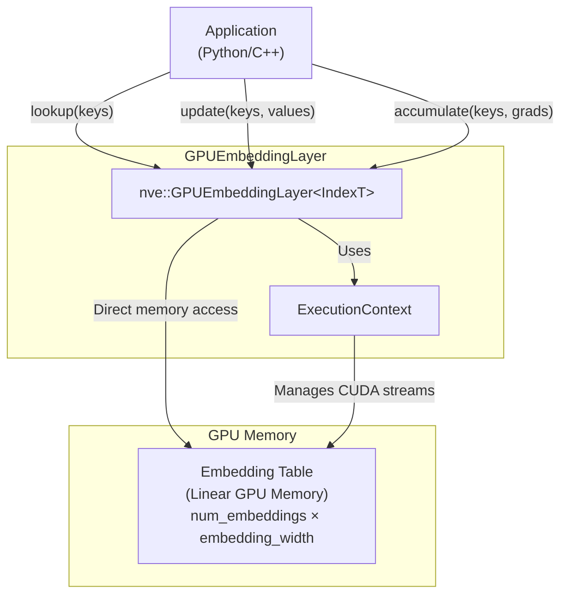
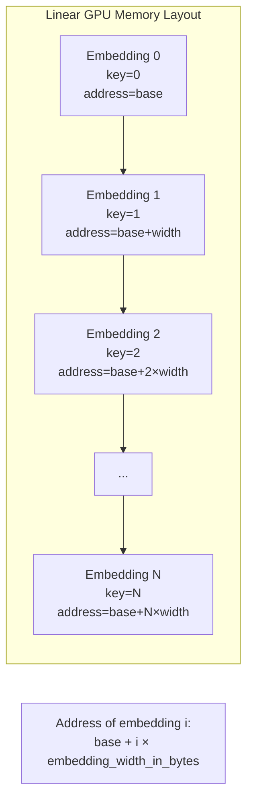
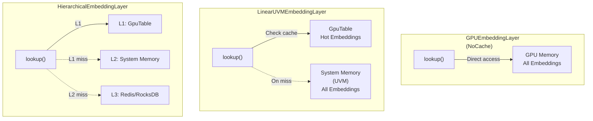
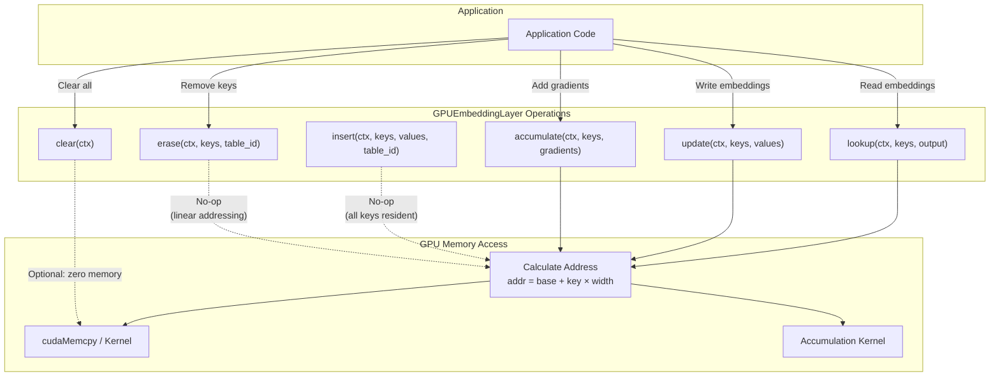
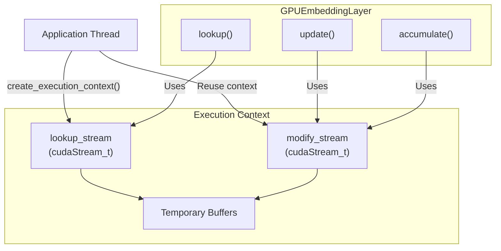
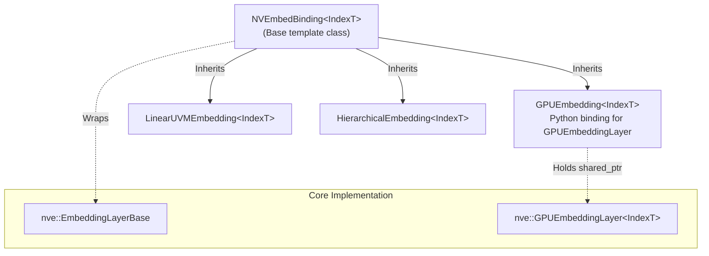

<!-- source: DeepWiki mcp.deepwiki.com · repo NVIDIA/nv-embedding-cache · extra page GPUEmbeddingLayer · fetched 2026-10-26 -->

# GPUEmbeddingLayer

<details>
<summary>Relevant source files</summary>

The following files were used as context for generating this wiki page:

- [README.md](README.md)
- [docs/cpp_api.md](docs/cpp_api.md)
- [python/pynve/bindings/binding_layers.hpp](python/pynve/bindings/binding_layers.hpp)

</details>


## Purpose and Scope

`GPUEmbeddingLayer` is the simplest embedding layer implementation in the NV Embedding Cache SDK. It stores all embedding data directly in GPU memory without any caching hierarchy. This layer is designed for scenarios where the complete embedding table fits within available GPU memory, providing the fastest possible lookup performance with zero cache misses.

This page covers the architecture, configuration, and usage of `GPUEmbeddingLayer`. For embedding layers with caching support, see:
- [LinearUVMEmbeddingLayer](#3.1.2) - GPU cache with system memory fallback
- [HierarchicalEmbeddingLayer](#3.1.3) - Multi-tier caching with remote storage

For the high-level layer abstraction and common operations, see [Embedding Layers](#3.1).

## When to Use GPUEmbeddingLayer

Use `GPUEmbeddingLayer` when your embedding table satisfies these conditions:

| Condition | Requirement |
|-----------|-------------|
| **Dataset Size** | Total embedding table < Available GPU memory |
| **Access Pattern** | Any distribution (uniform, power-law, random) |
| **Performance Goal** | Lowest possible latency |
| **Deployment** | Single GPU |
| **Cache Complexity** | None desired (simplest configuration) |

**Advantages:**
- Zero cache miss overhead
- Minimal CPU involvement in lookups
- Simplest configuration and operation
- Predictable performance

**Limitations:**
- Constrained by GPU memory capacity (typically 16-80 GB)
- No automatic scaling to larger datasets
- Inefficient for sparse access patterns where most embeddings are rarely used

**Sources:** [README.md:12-12](), [docs/cpp_api.md:20-20]()

## Architecture Overview

### System Structure



**Diagram: GPUEmbeddingLayer Architecture** - Shows the direct access pattern from the layer to GPU memory without any caching hierarchy.

**Sources:** [docs/cpp_api.md:20-20](), [python/pynve/bindings/binding_layers.hpp:626-657]()

### Memory Layout



**Diagram: Linear Memory Layout** - Embeddings are stored consecutively in GPU memory, allowing direct address calculation without hash table lookups.

**Sources:** [README.md:17-17]()

### Comparison with Other Layers



**Diagram: Layer Type Comparison** - GPUEmbeddingLayer has the simplest architecture with no caching hierarchy.

**Sources:** [README.md:11-15](), [docs/cpp_api.md:19-22]()

## Configuration

### GPUEmbeddingLayerConfig Structure

The layer is configured using the `GPUEmbeddingLayerConfig` structure:

| Parameter | Type | Description |
|-----------|------|-------------|
| `device_id` | `int` | CUDA device ID where embeddings reside |
| `num_embeddings` | `size_t` | Total number of embeddings in the table |
| `embedding_width_in_bytes` | `size_t` | Size of each embedding row in bytes |
| `embedding_table` | `void*` | Pointer to pre-allocated GPU memory containing embeddings |
| `value_dtype` | `DataType_t` | Data type of embedding values (Float32 or Float16) |
| `layer_name` | `std::string` | Name for logging and identification |

**Important:** The `embedding_table` pointer must reference pre-allocated GPU memory. `GPUEmbeddingLayer` does not allocate this memory; the application is responsible for allocation and lifetime management.

**Sources:** [python/pynve/bindings/binding_layers.hpp:642-648]()

### C++ API Usage

```cpp
// Example configuration (from binding_layers.hpp:642-649)
nve::GPUEmbeddingLayerConfig layer_cfg;
layer_cfg.device_id = device_id;
layer_cfg.num_embeddings = num_embeddings;
layer_cfg.embedding_width_in_bytes = row_size_in_bytes;
layer_cfg.embedding_table = pre_allocated_gpu_memory_ptr;
layer_cfg.value_dtype = nve::DataType_t::Float32;
layer_cfg.layer_name = "gpu_layer";

auto layer = std::make_shared<nve::GPUEmbeddingLayer<int64_t>>(
    layer_cfg, 
    allocator  // Optional: custom allocator, or nullptr for default
);
```

**Sources:** [python/pynve/bindings/binding_layers.hpp:642-649](), [docs/cpp_api.md:20-20]()

### Python API Mapping

In Python, `GPUEmbeddingLayer` is exposed through the `NVEmbedding` class with `cache_type="NoCache"`:

```python
# Python equivalent (conceptual)
from pynve import NVEmbedding

embedding_layer = NVEmbedding(
    row_size=128,              # Embedding dimension
    num_embeddings=1000000,    # Total number of embeddings
    dtype=torch.float32,       # float32 or float16
    embedding_table=gpu_tensor_ptr,  # Pointer to GPU tensor
    device_id=0,
    cache_type="NoCache"       # Uses GPUEmbeddingLayer
)
```

**Sources:** [README.md:12-12](), [python/pynve/bindings/binding_layers.hpp:627-657]()

## Core Operations

### Operation Flow Diagram



**Diagram: Operation Flow** - Shows how operations map to GPU memory accesses. Insert and Erase are typically no-ops since all embeddings are always resident.

**Sources:** [docs/cpp_api.md:24-37](), [python/pynve/bindings/binding_layers.hpp:61-264]()

### Lookup Operation

The `lookup` operation retrieves embedding vectors for a list of keys:

```cpp
// C++ signature (from EmbeddingLayerBase interface)
void lookup(
    std::shared_ptr<ExecutionContext> ctx,
    size_t num_keys,
    const void* keys,                    // Array of keys (IndexT*)
    void* output,                        // Output buffer for embeddings
    size_t row_size_in_bytes,
    void* hitmask,                       // Optional: nullptr for GPUEmbeddingLayer
    PoolingParams* pool_params,          // Optional pooling configuration
    float* hitrates                      // Output: always 1.0 for GPUEmbeddingLayer
);
```

**Key Points:**
- Hitrate is always 1.0 (100%) since all embeddings are resident
- Direct memory access via: `output[i] = embedding_table[keys[i]]`
- No cache miss handling required
- Optional pooling support (sum, mean) over embedding sets

**Sources:** [python/pynve/bindings/binding_layers.hpp:61-103](), [docs/cpp_api.md:24-25]()

### Update Operation

The `update` operation replaces embedding values for specified keys:

```cpp
// C++ signature
void update(
    std::shared_ptr<ExecutionContext> ctx,
    size_t num_keys,
    const void* keys,                    // Array of keys to update
    size_t key_size_in_bytes,
    size_t row_size_in_bytes,
    const void* values                   // New embedding values
);
```

**Behavior:**
- Directly overwrites: `embedding_table[keys[i]] = values[i]`
- No residency changes (all keys always resident)
- Synchronous or asynchronous based on CUDA stream in ExecutionContext

**Sources:** [python/pynve/bindings/binding_layers.hpp:232-240](), [docs/cpp_api.md:32-33]()

### Accumulate Operation

The `accumulate` operation adds gradients to existing embeddings (used in training):

```cpp
// C++ signature
void accumulate(
    std::shared_ptr<ExecutionContext> ctx,
    size_t num_keys,
    const void* keys,
    size_t key_size_in_bytes,
    size_t row_size_in_bytes,
    const void* gradients,               // Gradient values to add
    DataType_t dtype
);
```

**Behavior:**
- Element-wise addition: `embedding_table[keys[i]] += gradients[i]`
- Atomic operations on GPU for thread safety
- Essential for distributed training scenarios

**Sources:** [python/pynve/bindings/binding_layers.hpp:221-230](), [docs/cpp_api.md:34-35]()

### Insert and Erase Operations

For `GPUEmbeddingLayer`, these operations have special semantics:

| Operation | Behavior | Rationale |
|-----------|----------|-----------|
| **insert** | No-op or validation | All keys [0, num_embeddings) are always resident |
| **erase** | No-op or error | Cannot remove embeddings from linear address space |
| **clear** | Optional: zeros memory | Resets all embeddings to zero |

These operations are more meaningful for cached layers where residency management is required.

**Sources:** [docs/cpp_api.md:36-37](), [python/pynve/bindings/binding_layers.hpp:242-264]()

## Execution Contexts

### ExecutionContext Role

`GPUEmbeddingLayer` uses `ExecutionContext` to manage CUDA stream resources:



**Diagram: Execution Context Usage** - Shows stream management and buffer reuse pattern.

**Key Points:**
- One context can be reused across multiple operations
- Lookup operations use `lookup_stream` for read concurrency
- Modify operations (update, accumulate) use `modify_stream` for write serialization
- Contexts cache temporary buffers to avoid repeated allocations

**Sources:** [python/pynve/bindings/binding_layers.hpp:308-321](), [docs/cpp_api.md:38-38]()

### Context Creation

```cpp
// Create execution context (from binding code pattern)
cudaStream_t lookup_stream;  // Can be provided by application
cudaStream_t modify_stream;  // Typically shared across operations

auto ctx = layer->create_execution_context(
    lookup_stream,
    modify_stream,
    allocator,      // Optional: custom allocator
    thread_pool     // Optional: for CPU parallelism
);

// Reuse context for operations
layer->lookup(ctx, num_keys, keys, output, ...);
layer->update(ctx, num_keys, keys, values, ...);
```

**Sources:** [python/pynve/bindings/binding_layers.hpp:308-321](), [docs/cpp_api.md:38-38]()

## Python Binding Implementation

### Binding Class Hierarchy



**Diagram: Python Binding Class Structure** - Shows how `GPUEmbedding` wraps the C++ `GPUEmbeddingLayer`.

**Sources:** [python/pynve/bindings/binding_layers.hpp:48-657]()

### GPUEmbedding Class Structure

The `GPUEmbedding` template class provides Python bindings:

```cpp
// Class definition (binding_layers.hpp:626-657)
template<typename IndexT>
class GPUEmbedding : public NVEmbedBinding<IndexT>
{
private:
    using layer_type = nve::GPUEmbeddingLayer<IndexT>;
    
public:
    GPUEmbedding(
        size_t row_size,              // Embedding dimension × element_size
        size_t num_embeddings,        // Total number of embeddings
        nve::DataType_t dtype,        // Float32 or Float16
        uintptr_t embedding_table,    // Pre-allocated GPU memory pointer
        int device_id,                // CUDA device
        EmbedLayerConfig config       // Logging and kernel config
    );
    
    // Inherited operations:
    // - lookup(num_keys, keys, output, stream)
    // - update(num_keys, keys, values, stream)
    // - accumulate(num_keys, keys, gradients, stream)
    // - insert(...), erase(...), clear(...)
};
```

**Key Features:**
- Template on key type (`IndexT = int32_t` or `int64_t`)
- Inherits common operations from `NVEmbedBinding` base class
- Manages CUDA stream contexts internally
- Provides hit rate logging (always 1.0 for GPU-only)

**Sources:** [python/pynve/bindings/binding_layers.hpp:626-657]()

### Memory Management

`GPUEmbeddingLayer` does **not** allocate the embedding table memory:

```cpp
// Application is responsible for allocation
void* gpu_memory;
size_t memory_size = num_embeddings * embedding_width_in_bytes;
cudaMalloc(&gpu_memory, memory_size);

// Initialize embeddings (application's responsibility)
// ... load or initialize data ...

// Pass to layer
layer_cfg.embedding_table = gpu_memory;
auto layer = std::make_shared<nve::GPUEmbeddingLayer<int64_t>>(layer_cfg);

// Application must keep memory alive until layer is destroyed
// cudaFree(gpu_memory);  // Only after layer destruction
```

This design allows:
- Pre-loading embeddings from checkpoints
- Sharing memory with training frameworks
- Custom memory allocation strategies (e.g., unified memory)

**Sources:** [python/pynve/bindings/binding_layers.hpp:642-649]()

## Performance Characteristics

### Latency and Throughput

| Metric | Value | Notes |
|--------|-------|-------|
| **Hit Rate** | 100% | All embeddings always resident |
| **Lookup Latency** | ~1-10 μs | Direct GPU memory access |
| **Bandwidth** | ~80-90% of GPU memory bandwidth | Limited by PCIe/NVLink for keys |
| **Concurrency** | High | Multiple streams can read concurrently |
| **Scalability** | Limited by GPU RAM | Typically 16-80 GB |

**Best Performance When:**
- Batch sizes are large (>1000 keys per lookup)
- Keys are already on GPU (avoid PCIe transfer overhead)
- Sequential memory access patterns (better cache locality)

**Sources:** [README.md:7-9]()

### Comparison Table: Layer Performance

| Aspect | GPUEmbeddingLayer | LinearUVMEmbeddingLayer | HierarchicalEmbeddingLayer |
|--------|-------------------|-------------------------|----------------------------|
| **Capacity** | 16-80 GB | 100s GB | TBs |
| **Hit Rate** | 100% | 70-99% (configurable) | 50-95% (multi-tier) |
| **Latency (hit)** | 1-10 μs | 1-10 μs (GPU hit) | 1-10 μs (L1 hit) |
| **Latency (miss)** | N/A | 10-100 μs (UVM) | 100-1000 μs (L2), 1-10 ms (L3) |
| **Complexity** | Minimal | Medium | High |
| **Use Case** | Small-medium tables | Medium-large single node | Large distributed |

**Sources:** [README.md:11-15]()

## Usage Examples

### Basic C++ Example

```cpp
// Reference: samples/simple_cpp/ pattern
#include "include/gpu_embedding_layer.hpp"
#include "include/execution_context.hpp"

// Allocate GPU memory
size_t num_embeddings = 100000;
size_t embedding_dim = 128;
size_t element_size = sizeof(float);
size_t row_size_bytes = embedding_dim * element_size;
size_t total_bytes = num_embeddings * row_size_bytes;

float* d_embeddings;
cudaMalloc(&d_embeddings, total_bytes);
// Initialize embeddings...

// Configure layer
nve::GPUEmbeddingLayerConfig config;
config.device_id = 0;
config.num_embeddings = num_embeddings;
config.embedding_width_in_bytes = row_size_bytes;
config.embedding_table = d_embeddings;
config.value_dtype = nve::DataType_t::Float32;
config.layer_name = "example_layer";

// Create layer
auto layer = std::make_shared<nve::GPUEmbeddingLayer<int64_t>>(
    config, nullptr /* default allocator */
);

// Create execution context
cudaStream_t stream;
cudaStreamCreate(&stream);
auto ctx = layer->create_execution_context(stream, stream, nullptr, nullptr);

// Lookup embeddings
int64_t keys[] = {0, 1, 2, 3, 4};
float output[5 * 128];  // 5 embeddings × 128 dimensions
float hitrates[3];

layer->lookup(
    ctx,
    5,                      // num_keys
    keys,                   // keys
    output,                 // output buffer
    row_size_bytes,
    nullptr,                // hitmask
    nullptr,                // pooling params
    hitrates
);

// hitrates[0] will be 1.0 (100% hit rate)

// Cleanup
cudaStreamDestroy(stream);
cudaFree(d_embeddings);
```

**Sources:** [docs/cpp_api.md:40-43]()

### Python Example

```python
# Conceptual Python usage
import torch
from pynve import NVEmbedding

# Allocate embedding table on GPU
num_embeddings = 100000
embedding_dim = 128
device = torch.device('cuda:0')

embedding_table = torch.zeros(
    num_embeddings, embedding_dim,
    dtype=torch.float32,
    device=device
)

# Initialize embeddings (e.g., load from checkpoint)
# ...

# Create layer
layer = NVEmbedding(
    row_size=embedding_dim,
    num_embeddings=num_embeddings,
    dtype=torch.float32,
    embedding_table=embedding_table.data_ptr(),
    device_id=0,
    cache_type="NoCache"  # Uses GPUEmbeddingLayer
)

# Lookup embeddings
keys = torch.tensor([0, 1, 2, 3, 4], dtype=torch.int64, device=device)
output = torch.empty(5, embedding_dim, dtype=torch.float32, device=device)
stream = torch.cuda.current_stream().cuda_stream

layer.lookup(
    num_keys=5,
    keys=keys.data_ptr(),
    output=output.data_ptr(),
    stream=stream
)

# output now contains the embeddings
```

**Sources:** [README.md:12-12](), [python/pynve/bindings/binding_layers.hpp:626-657]()

## Limitations and Considerations

### Memory Constraints

**Maximum Table Size:**
- A100 (80GB): ~75 GB embeddings (accounting for OS/framework overhead)
- A100 (40GB): ~38 GB embeddings
- V100 (32GB): ~30 GB embeddings

**Memory Calculation:**
```
total_memory = num_embeddings × embedding_dim × element_size

For example:
- 10M embeddings × 128 dims × 4 bytes (fp32) = 5.12 GB ✓
- 50M embeddings × 256 dims × 4 bytes (fp32) = 51.2 GB ✓ (on A100-80GB)
- 100M embeddings × 512 dims × 4 bytes (fp32) = 204.8 GB ✗ (exceeds A100-80GB)
```

**Sources:** [README.md:12-12]()

### When Not to Use GPUEmbeddingLayer

Avoid `GPUEmbeddingLayer` when:

1. **Table exceeds GPU memory** → Use `LinearUVMEmbeddingLayer` or `HierarchicalEmbeddingLayer`
2. **Sparse access patterns** → Majority of embeddings unused → Caching layers more efficient
3. **Multi-node deployment** → `HierarchicalEmbeddingLayer` with shared parameter server
4. **Dynamic embedding table size** → Growing/shrinking tables require more flexible storage
5. **Cost optimization** → GPU memory is expensive; cached layers allow CPU memory usage

**Sources:** [README.md:11-15]()

### Thread Safety

- **Concurrent reads:** Safe with multiple threads/streams using different `ExecutionContext` instances
- **Concurrent writes:** Use separate modify streams per context or synchronize externally
- **Mixed read/write:** Application must ensure proper ordering via CUDA stream dependencies

**Sources:** [docs/cpp_api.md:79-79]()

## Related Components

### EmbeddingLayerBase Interface

`GPUEmbeddingLayer` implements the `EmbeddingLayerBase` interface defined in [include/embedding_layer.hpp](). All layer types share this common API, enabling polymorphic usage:

```cpp
std::shared_ptr<nve::EmbeddingLayerBase> layer;

// Can be any layer type:
// layer = std::make_shared<nve::GPUEmbeddingLayer<int64_t>>(...);
// layer = std::make_shared<nve::LinearUVMEmbeddingLayer<int64_t>>(...);
// layer = std::make_shared<nve::HierarchicalEmbeddingLayer<int64_t>>(...);

// Common operations work on all layer types
layer->lookup(ctx, ...);
layer->update(ctx, ...);
```

**Sources:** [docs/cpp_api.md:14-16]()

### No Internal Tables

Unlike `LinearUVMEmbeddingLayer` (which uses `GpuTable`) and `HierarchicalEmbeddingLayer` (which uses multiple table types), `GPUEmbeddingLayer` does not use any table implementations internally. It directly accesses the linear GPU memory buffer.

**Sources:** [docs/cpp_api.md:49-56]()

### Allocator Integration

Like all layer types, `GPUEmbeddingLayer` accepts an optional `Allocator` for temporary buffer allocations:

```cpp
auto custom_allocator = std::make_shared<MyAllocator>();
auto layer = std::make_shared<nve::GPUEmbeddingLayer<int64_t>>(
    config, 
    custom_allocator  // Used for temporary buffers during operations
);
```

The allocator is **not** used for the embedding table itself (which is pre-allocated), only for internal temporary buffers.

**Sources:** [docs/cpp_api.md:75-77](), [python/pynve/bindings/binding_layers.hpp:649-649]()

---

**Document Sources:**
- [README.md:1-94]()
- [docs/cpp_api.md:1-80]()
- [python/pynve/bindings/binding_layers.hpp:1-660]()

---

