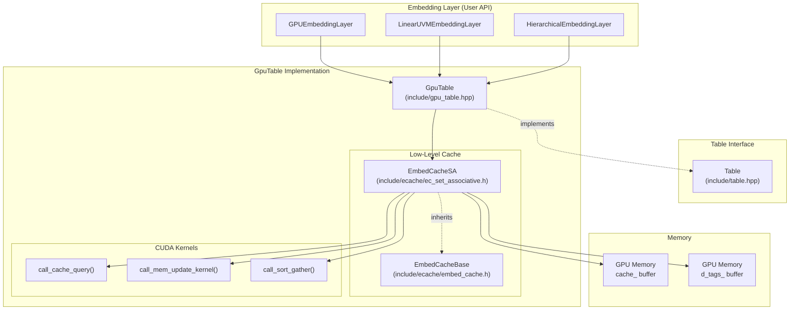
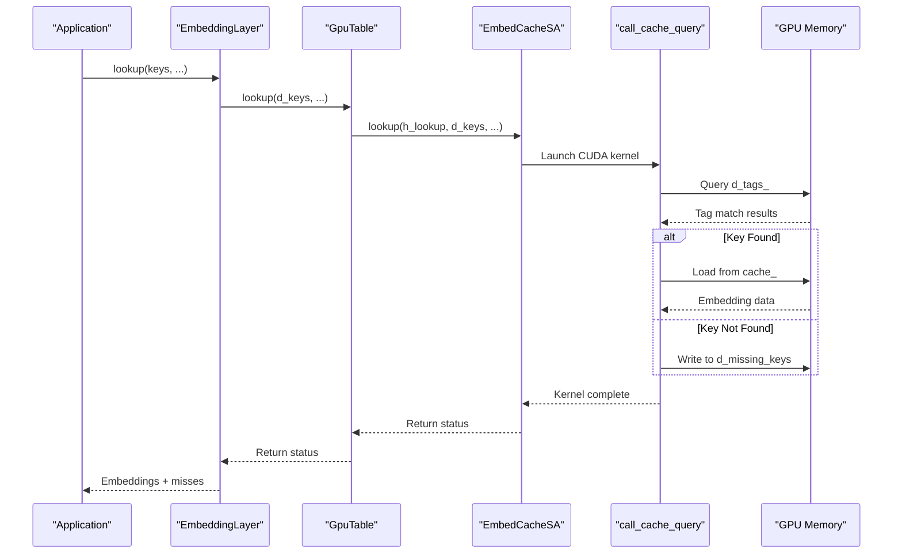
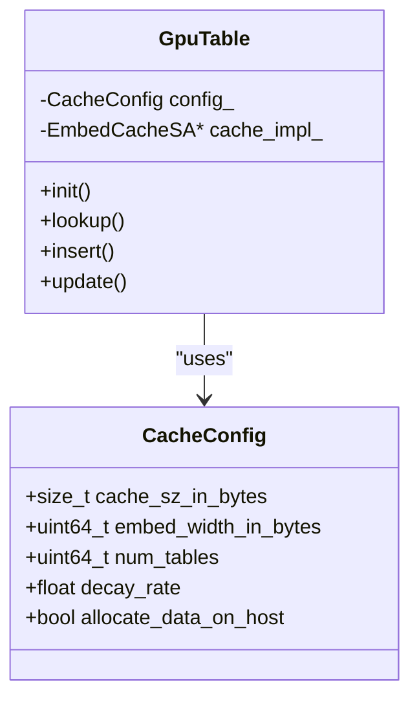
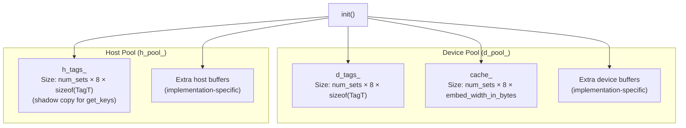
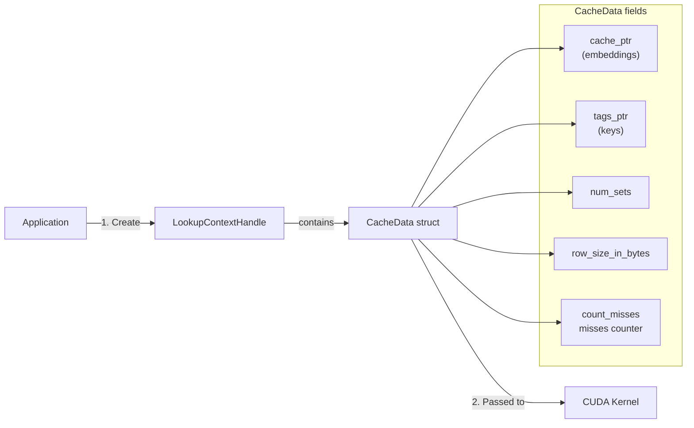
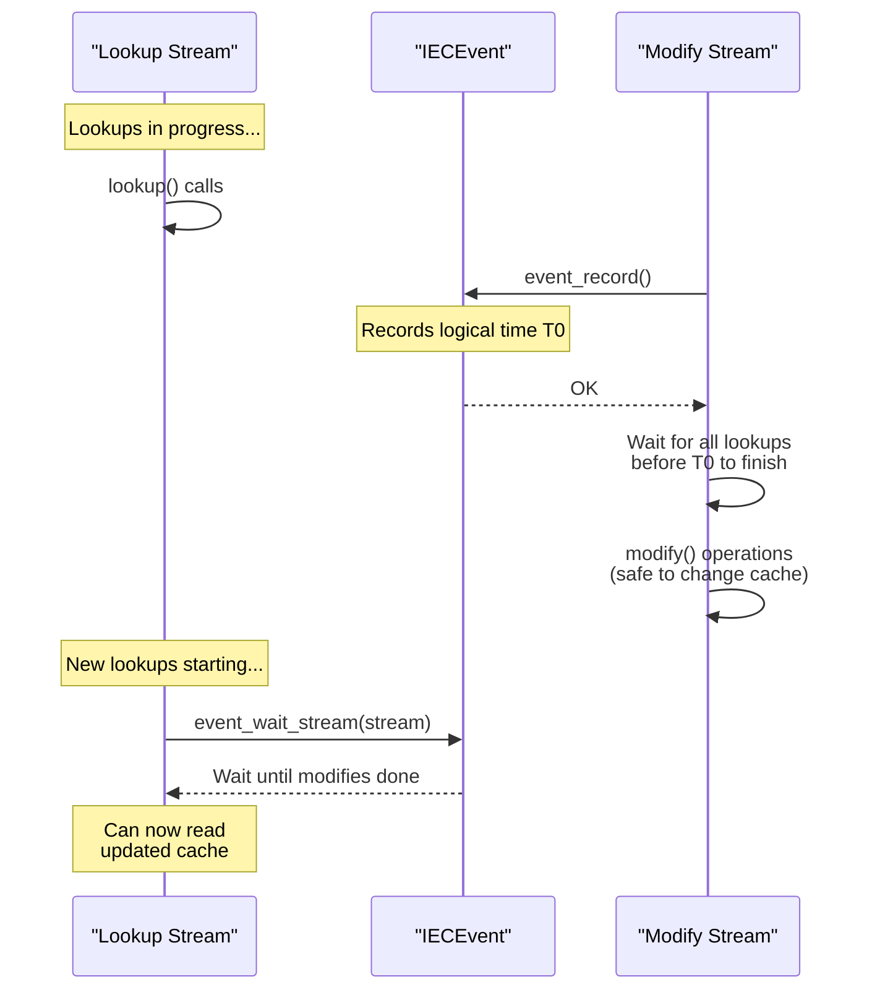
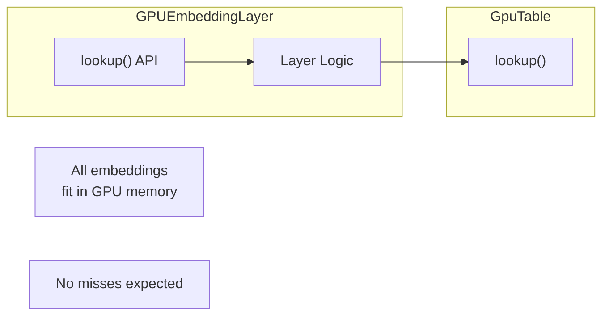
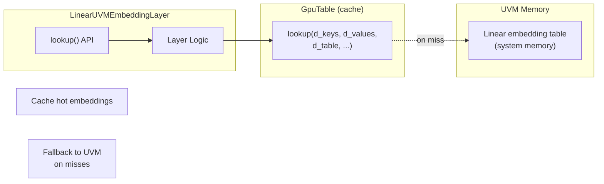
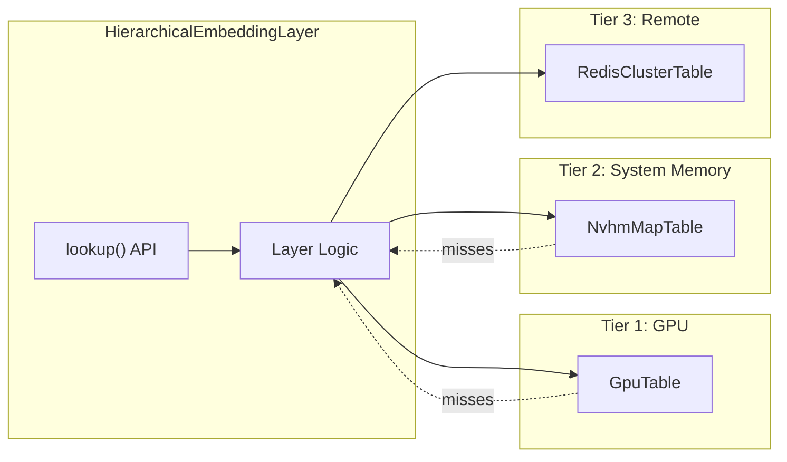

<!-- source: DeepWiki mcp.deepwiki.com · repo NVIDIA/nv-embedding-cache · extra page GpuTable · fetched 2026-10-26 -->

# GpuTable

<details>
<summary>Relevant source files</summary>

The following files were used as context for generating this wiki page:

- [docs/cpp_api.md](docs/cpp_api.md)
- [include/ecache/ec_set_associative.h](include/ecache/ec_set_associative.h)
- [include/ecache/embed_cache.h](include/ecache/embed_cache.h)

</details>


## Purpose and Scope

This document describes the `GpuTable` class, a GPU-resident hash table implementation that serves as the primary storage backend for embedding vectors in GPU memory. `GpuTable` is the foundational component used by all three embedding layer types ([GPUEmbeddingLayer](#3.1.1), [LinearUVMEmbeddingLayer](#3.1.2), and [HierarchicalEmbeddingLayer](#3.1.3)) to cache hot embeddings on the GPU.

For information about other storage backends (system memory and remote storage), see [Host Memory Tables](#3.2.2) and [Remote Storage Tables](#3.2.3). For details on the low-level GPU cache implementation, see [GPU Embedding Cache Internals](#7).

**Sources:** [docs/cpp_api.md:49-50](), [include/gpu_table.hpp]()

---

## Overview

`GpuTable` is a hardware-accelerated hash table that stores embedding vectors in GPU memory and provides fast lookup, insert, update, and accumulate operations. It implements the `Table` interface defined in [include/table.hpp]() and wraps the low-level `EmbedCacheSA` set-associative cache implementation.

**Key characteristics:**
- **Storage location**: GPU memory (device-side)
- **Capacity**: Determined by available GPU memory and configured cache size
- **Access pattern**: Optimized for power-law distributed keys (hot keys get cached, cold keys miss)
- **Concurrency**: Supports multiple concurrent lookup contexts and modify contexts
- **Eviction policy**: Configurable (LRU, LFU, Random) via insert heuristics

**Sources:** [docs/cpp_api.md:46-50](), [include/ecache/ec_set_associative.h:98-99]()

---

## Architecture and Relationships

### Component Hierarchy



**Sources:** [docs/cpp_api.md:14-23](), [include/ecache/ec_set_associative.h:98-99](), Diagram 1 from system architecture

---

### Data Flow: Lookup Operation



**Sources:** [include/ecache/ec_set_associative.h:411-429](), [include/ecache/embed_cache.h:464-467]()

---

## Implementation Details

### Set-Associative Cache Backend

`GpuTable` is built on top of the `EmbedCacheSA` template class, which implements a set-associative cache optimized for embedding lookups. The cache is parameterized by two types:

| Template Parameter | Description | Common Values |
|-------------------|-------------|---------------|
| `IndexT` | Key/index type | `int64_t`, `uint64_t` |
| `TagT` | Tag type for cache lines | `int64_t`, `int32_t` |

The set-associative design uses **8 ways per set** (defined as `NUM_WAYS = 8` at [include/ecache/ec_set_associative.h:749]()):

```
Set-Associative Organization:
┌─────────────────────────────────────┐
│ Set 0: [Way 0][Way 1]...[Way 7]   │
│ Set 1: [Way 0][Way 1]...[Way 7]   │
│ ...                                 │
│ Set N: [Way 0][Way 1]...[Way 7]   │
└─────────────────────────────────────┘

Each Way contains:
- Tag (IndexT): Key identifier
- Data: Embedding vector (embed_width_in_bytes)
```

**Key address calculation:**
- `set_index = key % num_sets`
- `tag = key / num_sets`

This organization allows up to 8 different keys to be stored in the same set, reducing conflicts for nearby keys.

**Sources:** [include/ecache/ec_set_associative.h:98-99](), [include/ecache/ec_set_associative.h:749](), [include/ecache/ec_set_associative.h:690-694]()

---

### Configuration Structure

The cache is configured via `EmbedCacheSA::CacheConfig`:



| Field | Purpose | Typical Values |
|-------|---------|----------------|
| `cache_sz_in_bytes` | Total memory budget for cache | 1GB - 32GB |
| `embed_width_in_bytes` | Size of each embedding vector | 512, 1024, 2048 bytes (128-512 floats) |
| `num_tables` | Number of independent caches (multi-GPU) | 1 (single GPU), N (multi-GPU) |
| `decay_rate` | LFU counter decay (not used by default) | 0.95 |
| `allocate_data_on_host` | Store embeddings in host memory (UVM use case) | `false` (normal), `true` (UVM) |

**Sources:** [include/ecache/ec_set_associative.h:113-121]()

---

### Memory Layout and Allocation

The cache allocates two main memory pools during initialization:



**Allocation logic** ([include/ecache/ec_set_associative.h:326-401]()):

1. **Calculate number of sets**: `num_sets = cache_sz_in_bytes / (num_tables × bytes_per_set)`
   - `bytes_per_set = tag_size + entry_size` (aligned to 16 bytes)
   
2. **Allocate device pool**: Tags always on device, cache data on device (unless `allocate_data_on_host=true`)

3. **Allocate host pool**: Shadow tags for CPU-side operations, plus temporary buffers

4. **Initialize tags to INVALID_IDX**: All cache lines start empty ([include/ecache/ec_set_associative.h:378]())

**Memory formulas:**

| Component | Size Formula |
|-----------|-------------|
| Tags per set | `ALIGN(8 × sizeof(TagT), 16)` |
| Data per set | `ALIGN(8 × embed_width_in_bytes, 16)` |
| Total device | `num_sets × (tags_per_set + data_per_set) × num_tables` |
| Total host | `num_sets × tags_per_set × num_tables` |

**Sources:** [include/ecache/ec_set_associative.h:148-176](), [include/ecache/ec_set_associative.h:326-401](), [include/ecache/ec_set_associative.h:676-694]()

---

## Core Operations

### Lookup Context

Before performing lookups, a `LookupContextHandle` must be created. This handle wraps a `CacheData` structure that kernels use to access the cache:



**Creation** ([include/ecache/ec_set_associative.h:185-211]()):
```cpp
ECError lookup_context_create(
    LookupContextHandle& out_handle,
    const PerformanceMetric* metrics,
    size_t num_metrics
)
```

The context is allocated on the host and contains pointers to device memory that kernels will access.

**Sources:** [include/ecache/ec_set_associative.h:103-111](), [include/ecache/ec_set_associative.h:185-211]()

---

### Lookup Operation Types

`GpuTable` supports three lookup variants:

#### 1. Lookup with Missing Keys

```cpp
ECError lookup(
    const LookupContextHandle& h_lookup,
    const IndexT* d_keys,           // Input: keys to lookup
    const size_t len,                // Input: number of keys
    int8_t* d_values,                // Output: found embeddings
    uint64_t* d_missing_index,       // Output: indices of misses
    IndexT* d_missing_keys,          // Output: keys that missed
    size_t* d_missing_len,           // Output: number of misses
    uint32_t curr_table,             // Input: table index (multi-GPU)
    size_t stride,                   // Input: embedding size in bytes
    cudaStream_t stream
)
```

**Behavior** ([include/ecache/ec_set_associative.h:411-429]()):
- For each key in `d_keys[i]`:
  - If key found in cache → copy embedding to `d_values[i * stride]`
  - If key not found → append `i` to `d_missing_index`, append key to `d_missing_keys`
- Returns number of misses in `d_missing_len`

**Use case**: When you need to know which keys missed and handle them separately (e.g., fetch from slower storage).

#### 2. Lookup with Hit Mask

```cpp
ECError lookup(
    const LookupContextHandle& h_lookup,
    const IndexT* d_keys,
    const size_t len,
    int8_t* d_values,
    uint64_t* d_hit_mask,            // Output: bitmask (1=hit, 0=miss)
    uint32_t curr_table,
    size_t stride,
    cudaStream_t stream
)
```

**Behavior**: Similar to above, but instead of compacting misses, sets bit `i` in `d_hit_mask` to 1 if `d_keys[i]` was found.

**Use case**: When you want parallel processing of hits/misses without compaction overhead.

**Sources:** [include/ecache/ec_set_associative.h:431-448]()

#### 3. Lookup with UVM Fallback

```cpp
ECError lookup(
    const LookupContextHandle& h_lookup,
    const IndexT* d_keys,
    const size_t len,
    int8_t* d_values,
    const int8_t* d_table,           // Input: UVM table to fallback to
    uint32_t curr_table,
    size_t stride,
    cudaStream_t stream
)
```

**Behavior**: For each key:
- If found in cache → copy from cache
- If not found → copy from `d_table[key * stride]` (direct UVM access)

**Use case**: Used by `LinearUVMEmbeddingLayer` to seamlessly handle cache misses by falling back to system memory.

**Sources:** [include/ecache/ec_set_associative.h:450-467](), [docs/cpp_api.md:21]()

---

### Advanced Lookup: Sort-Gather

For very large tables, a specialized lookup path performs residency check, sorts results, then gathers:

```cpp
ECError lookup_sort_gather(
    const LookupContextHandle& h_lookup,
    const IndexT* d_keys,
    const size_t len,
    int8_t* d_values,
    const int8_t* d_table,
    int8_t* d_auxiliary_buffer,      // Scratch space for sorting
    size_t& auxiliary_buffer_bytes,  // In/Out: buffer size
    uint32_t curr_table,
    size_t stride,
    int64_t block_size,              // Kernel tuning parameter
    cudaStream_t stream
)
```

**Two-phase usage**:
1. **Query buffer size**: Pass `d_auxiliary_buffer = nullptr`, function returns required size in `auxiliary_buffer_bytes`
2. **Execute**: Allocate buffer, call again with allocated buffer

**Phases** ([include/ecache/ec_set_associative.h:479-535]()):
1. Check cache residency for all keys
2. Sort keys by residency (cache hits vs. misses)
3. Gather hits from cache, misses from `d_table`

**Benefit**: Better memory coalescing for large batches by grouping accesses to cache vs. UVM separately.

**Sources:** [include/ecache/ec_set_associative.h:479-535](), [include/ecache/embed_cache.h:544-545]()

---

### Modify Operations

All modify operations require a `ModifyContextHandle` for thread-safe concurrent modifications.

#### Insert Operation

Decides which keys should be cached based on priority (insert heuristic):

```cpp
virtual ECError insert(
    ModifyContextHandle& modify_context_handle,
    const IndexT* keys,              // Keys to consider for caching
    const float* priority,           // Priority scores (higher = more important)
    const int8_t* const* data,       // Array of pointers to embedding data
    size_t num_keys,
    uint32_t table_index,
    IECEvent* sync_event,            // Synchronization with lookups
    cudaStream_t stream
)
```

**Behavior**:
- Evaluates which keys should reside in cache based on `priority` values
- May evict existing low-priority keys to make room
- Not all provided keys are guaranteed to be inserted (capacity-limited)

**Important**: `insert()` is for **residency management**, not updating values. For value updates, use `update()` or `update_accumulate()`.

**Sources:** [include/ecache/embed_cache.h:664-687](), [docs/cpp_api.md:26-31]()

---

#### Update Operation

Overwrites embedding values for keys already in cache:

```cpp
virtual ECError update(
    ModifyContextHandle& modify_context_handle,
    const IndexT* keys,
    const int8_t* d_values,          // New embedding values (dense)
    int64_t stride,
    size_t num_keys,
    uint32_t table_index,
    IECEvent* sync_event,
    cudaStream_t stream
)
```

**Behavior**:
- For each key in `keys[]`: if resident in cache, overwrite with data from `d_values[i * stride]`
- Keys not resident are ignored (no eviction, no insertion)

**Use case**: Updating embeddings after a training step or model update.

**Sources:** [include/ecache/embed_cache.h:689-712](), [docs/cpp_api.md:32-33]()

---

#### Update-Accumulate Operation

Adds (accumulates) gradients to existing embeddings:

```cpp
virtual ECError update_accumulate(
    ModifyContextHandle& modify_context_handle,
    const IndexT* keys,
    const int8_t* d_values,          // Gradient/delta values
    int64_t stride,
    size_t num_keys,
    uint32_t table_index,
    DataTypeFormat update_format,    // Format of d_values (FP16/FP32/INT8_SCALED)
    DataTypeFormat cache_format,     // Format in cache
    IECEvent* sync_event,
    cudaStream_t stream
)
```

**Behavior**:
- For each key: `cache[key] += d_values[i * stride]` (with type conversion if needed)
- Supports mixed-precision: gradients can be in different format than cache storage

**Use case**: Gradient accumulation during training.

**Sources:** [include/ecache/embed_cache.h:714-743](), [docs/cpp_api.md:34-35]()

---

#### Unsynchronized Update-Accumulate

Optimized variant that skips synchronization when caller guarantees no concurrent operations:

```cpp
ECError update_accumulate_no_sync(
    const LookupContextHandle& h_lookup,
    ModifyContextHandle& hModify,
    const IndexT* d_keys,
    const size_t len,
    const int8_t* d_values,
    uint32_t curr_table,
    size_t stride,
    DataTypeFormat input_format,
    DataTypeFormat output_format,
    cudaStream_t stream
)
```

**Performance benefit**: Avoids synchronization overhead (event recording, stream waits) when application can guarantee:
- No concurrent lookups or modify operations in flight
- No other threads modifying the same cache

**Warning**: Using this incorrectly can cause race conditions and data corruption.

**Sources:** [include/ecache/ec_set_associative.h:537-552](), [include/ecache/embed_cache.h:549-568]()

---

### Invalidate Operation

Removes keys from the cache:

```cpp
virtual ECError invalidate(
    ModifyContextHandle& modify_context_handle,
    const IndexT* keys,
    size_t num_keys,
    uint32_t table_index,
    IECEvent* sync_event,
    cudaStream_t stream
)
```

**Behavior**: Marks specified keys as invalid (sets tag to `INVALID_IDX`). They will no longer be found by lookup operations.

**Note**: Typically unnecessary – eviction happens automatically during `insert()`. Use this only when you explicitly want to remove stale data.

**Sources:** [include/ecache/embed_cache.h:745-762](), [docs/cpp_api.md:36-37]()

---

## Synchronization and Thread Safety

### IECEvent Interface

Modify operations use `IECEvent` for synchronization between lookup and modify streams:



**DefaultECEvent implementation** ([include/ecache/embed_cache.h:258-310]()):
- Records `cudaEvent_t` on all lookup streams
- Modify stream waits on all events before proceeding
- Ensures memory consistency between readers and writers

**Sources:** [include/ecache/embed_cache.h:155-186](), [include/ecache/embed_cache.h:258-310]()

---

### Custom Flow Lock

For multi-kernel gather operations, the cache provides a custom flow mechanism:

```cpp
ECError start_custom_flow();  // Acquires read lock
ECError end_custom_flow();    // Releases read lock
```

**Purpose**: When implementing custom gather kernels that span multiple CUDA kernel launches, wrap them with `start_custom_flow()` / `end_custom_flow()` to prevent concurrent `invalidate()` or `commit()` operations from interfering.

**Mechanism** ([include/ecache/ec_set_associative.h:734-746]()):
- Uses `std::shared_mutex` for read-write locking
- Lookups acquire shared (read) locks
- Modifies acquire exclusive (write) locks
- Custom flow explicitly acquires shared lock across multiple operations

**Sources:** [include/ecache/ec_set_associative.h:469-477](), [include/ecache/ec_set_associative.h:734-746](), [include/ecache/embed_cache.h:793-808]()

---

## Performance Metrics

The cache supports performance tracking via `PerformanceMetric` objects:

### Miss Counter

Tracks number of cache misses during lookups:

```cpp
// Create metric
PerformanceMetric miss_metric;
cache->performance_metric_create(miss_metric, MERTIC_COUNT_MISSES);

// Bind to lookup context
LookupContextHandle h_lookup;
cache->lookup_context_create(h_lookup, &miss_metric, 1);

// Perform lookups (misses accumulate)
cache->lookup(h_lookup, ...);

// Read value
int64_t miss_count;
cache->performance_metric_get_value(miss_metric, &miss_count, stream);
cudaStreamSynchronize(stream);
printf("Misses: %lld\n", miss_count);

// Reset for next measurement
cache->performance_metric_reset(miss_metric, stream);
```

**Implementation**: Device-side counter atomically incremented by lookup kernel when keys miss ([include/ecache/ec_set_associative.h:224-246]()).

**Sources:** [include/ecache/ec_set_associative.h:224-306](), [include/ecache/embed_cache.h:312-347]()

---

## Cache Introspection

### Get Keys Stored in Cache

Retrieve all keys currently resident in the cache:

```cpp
IndexT* keys_buffer = malloc(
    cache->get_max_num_embedding_vectors_in_cache() * sizeof(IndexT)
);
size_t num_keys;

cache->get_keys_stored_in_cache(lookup_handle, keys_buffer, num_keys);

// keys_buffer[0..num_keys-1] now contains resident keys
```

**Behavior**: Copies tag arrays from device to host, filters out `INVALID_IDX` entries.

**Use case**: Debugging, checkpoint saving, cache analysis.

**Sources:** [include/ecache/embed_cache.h:777-790]()

---

### Clear Cache

Invalidate all cache contents:

```cpp
cache->clear_cache(stream);
```

**Behavior**: Sets all tags to `INVALID_IDX`, making all subsequent lookups miss. Data itself is not overwritten (for performance).

**Important**: User must synchronize with any in-flight operations before calling.

**Sources:** [include/ecache/embed_cache.h:764-775]()

---

## Configuration and Tuning

### Capacity Planning

**Formula for number of embeddings cached:**

```
num_embeddings = num_sets × 8 ways
num_sets = cache_sz_in_bytes / (bytes_per_set × num_tables)
bytes_per_set = ALIGN(8 × sizeof(TagT), 16) + ALIGN(8 × embed_width_in_bytes, 16)
```

**Example calculation:**
- `cache_sz_in_bytes = 4 GB = 4,294,967,296 bytes`
- `embed_width_in_bytes = 512 bytes` (128 floats)
- `sizeof(TagT) = 8 bytes` (int64_t)
- `num_tables = 1`

```
bytes_per_set = 16 + 4096 = 4112 bytes (rounded up for alignment)
num_sets = 4,294,967,296 / 4112 ≈ 1,044,385 sets
num_embeddings = 1,044,385 × 8 ≈ 8.4 million embeddings
```

**Sources:** [include/ecache/ec_set_associative.h:148-176](), [include/ecache/ec_set_associative.h:690-694]()

---

### Tag and Key Type Selection

| Scenario | IndexT | TagT | Reasoning |
|----------|--------|------|-----------|
| Small embedding tables (<2B entries) | `int32_t` | `int32_t` | Smaller memory footprint |
| Large embedding tables (>2B entries) | `int64_t` | `int64_t` | Support full key range |
| Mixed (optimize cache) | `int64_t` | `int32_t` | Keys can be large, but tag collisions tolerable for cache |

**Warning** ([include/ecache/ec_set_associative.h:642-662]()):
- Tags and keys must both be integer types
- They must have matching signedness
- If `TagT` is smaller than `IndexT`, maximum supported key is limited to `TagT::max() × num_sets`

**Sources:** [include/ecache/ec_set_associative.h:642-662]()

---

### Multi-GPU Configuration

For multi-GPU deployments, use `num_tables` to create independent caches:

```cpp
CacheConfig config;
config.cache_sz_in_bytes = 4ULL * 1024 * 1024 * 1024;  // 4GB
config.embed_width_in_bytes = 512;
config.num_tables = 4;  // One per GPU
```

Each table gets `cache_sz_in_bytes / num_tables` memory allocation. Operations specify `table_index` to route to correct cache.

**Use case**: Used by embedding layers to shard embeddings across GPUs for scaling.

**Sources:** [include/ecache/ec_set_associative.h:113-121]()

---

## Usage Patterns

### Pattern 1: Simple Lookup

```cpp
// One-time setup
GpuTable table(...);
table.init();

LookupContextHandle h_lookup;
table.lookup_context_create(h_lookup, nullptr, 0);

// Per-batch usage
table.lookup(h_lookup, d_keys, batch_size, d_embeddings, 
             d_missing_idx, d_missing_keys, d_missing_len,
             0 /*table_index*/, embed_size, stream);

// Handle misses from slower storage...

// Cleanup
table.lookup_context_destroy(h_lookup);
```

**Sources:** Based on API patterns from [docs/cpp_api.md:24-39]()

---

### Pattern 2: Training with Update-Accumulate

```cpp
// Forward pass
table.lookup(h_lookup, d_keys, ...);

// Backward pass - accumulate gradients
ModifyContextHandle h_modify;
table.modify_context_create(h_modify, max_batch_size);

IECEvent sync_event(lookup_streams);
sync_event.event_record();  // Mark point in time

table.update_accumulate(h_modify, d_keys, d_gradients, stride,
                        num_keys, table_index, 
                        DATATYPE_FP32, DATATYPE_FP32,
                        &sync_event, stream);

sync_event.event_wait_stream(lookup_stream);  // Synchronize

table.modify_context_destroy(h_modify);
```

**Sources:** Based on [include/ecache/embed_cache.h:714-743]() and synchronization patterns

---

### Pattern 3: Insert Heuristic (Cache Population)

```cpp
// After collecting access statistics
DefaultHistogram<IndexT> hist(access_keys, num_accesses, 
                              embeddings_data, embed_size, false);

// Insert top-K by priority
table.insert(h_modify,
             hist.get_keys(),
             hist.get_priority(),
             hist.get_data(),
             hist.get_num_bins(),
             table_index,
             &sync_event,
             stream);
```

**Purpose**: Populate cache with hot embeddings based on observed access patterns.

**Sources:** [include/ecache/embed_cache.h:189-256](), [docs/cpp_api.md:25-26]()

---

## Integration with Embedding Layers

### GPUEmbeddingLayer Usage



`GPUEmbeddingLayer` stores the complete embedding table in `GpuTable`. All lookups are expected to hit.

**Sources:** [docs/cpp_api.md:20]()

---

### LinearUVMEmbeddingLayer Usage



Uses `GpuTable` as a cache. Misses automatically fall back to system memory via UVM.

**Sources:** [docs/cpp_api.md:21](), [include/ecache/ec_set_associative.h:450-467]()

---

### HierarchicalEmbeddingLayer Usage



`GpuTable` is the first-level cache in a multi-tier hierarchy. Misses are resolved by querying slower tiers.

**Sources:** [docs/cpp_api.md:22]()

---

## Performance Considerations

### Memory Bandwidth

**GPU cache bandwidth:**
- **Peak**: ~1-2 TB/s (A100 HBM2)
- **Achieved**: Depends on access pattern and kernel efficiency
- **Optimization**: Coalesced memory access via set-associative design

**Comparison to alternatives:**
- **UVM (PCIe 4.0)**: ~32 GB/s
- **System memory (NVLink)**: ~300 GB/s
- **Redis (network)**: ~10 GB/s

`GpuTable` provides 10-100× faster access than slower tiers.

**Sources:** System architecture understanding and hardware specifications

---

### Hit Rate Optimization

**Factors affecting hit rate:**

| Factor | Impact | Tuning |
|--------|--------|--------|
| Cache size | Larger = more capacity = higher hit rate | Increase `cache_sz_in_bytes` |
| Access distribution | Power-law = better hit rate | Use insert heuristics to cache hot keys |
| Eviction policy | Affects which keys stay cached | Configure via insert heuristic (see [Advanced Topics](#8)) |
| Number of sets | More sets = fewer conflicts | Indirectly controlled by `cache_sz_in_bytes` |

**Typical hit rates** (with good insert heuristics):
- Power-law distributed access: 90-99% hit rate with 10-20% cache capacity
- Uniform random access: Hit rate ≈ cache_size / total_size

**Sources:** General cache theory and [Advanced Topics](#8) documentation

---

### Kernel Mode Selection

Different CUDA kernel implementations optimize for different scenarios:

| Mode | Optimization Target | Use When |
|------|---------------------|----------|
| Standard | Balanced | General purpose |
| Sort-Gather | Memory coalescing | Large tables (>100M embeddings) |
| Fused | Reduced kernel launches | Training with accumulation |

Mode selection typically handled by embedding layer based on configuration.

**Sources:** [include/ecache/ec_set_associative.h:479-535]() (sort-gather), [include/ecache/ec_set_associative.h:554-581]() (fused)

---

## Related Components

- **[Embedding Layers](#3.1)**: High-level API that uses `GpuTable`
- **[Host Memory Tables](#3.2.2)**: System memory alternatives (NvhmMapTable, etc.)
- **[GPU Embedding Cache Internals](#7)**: Deep dive into `EmbedCacheSA` implementation
- **[Cache Eviction Policies](#7.3)**: Insert heuristic details
- **[Performance Tuning](#8.3)**: Advanced optimization techniques

---

## Summary

`GpuTable` is the foundational storage component for GPU-resident embeddings in the NV Embedding Cache SDK. Key takeaways:

1. **Architecture**: Wraps `EmbedCacheSA` set-associative cache (8-way, configurable number of sets)
2. **Operations**: Supports lookup (3 variants), insert, update, update-accumulate, and invalidate
3. **Synchronization**: Thread-safe via `IECEvent` and custom flow locks
4. **Performance**: Optimized for power-law distributed access patterns common in recommender systems
5. **Integration**: Used by all three embedding layer types as primary GPU cache

The set-associative design with 8 ways per set balances capacity utilization with lookup performance, while the configurable size allows scaling from small (1 GB) to large (32+ GB) GPU memory budgets.

**Sources:** Summary synthesized from all sources above

---

