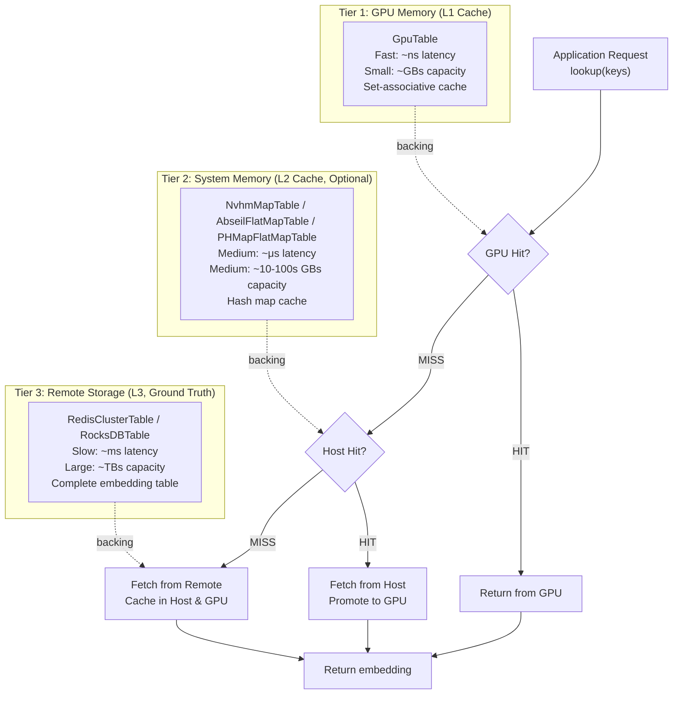
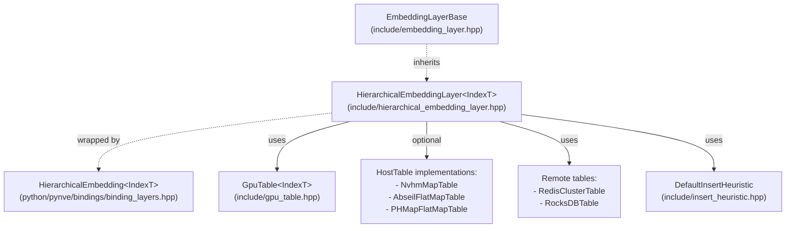
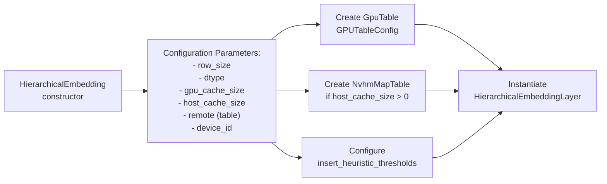
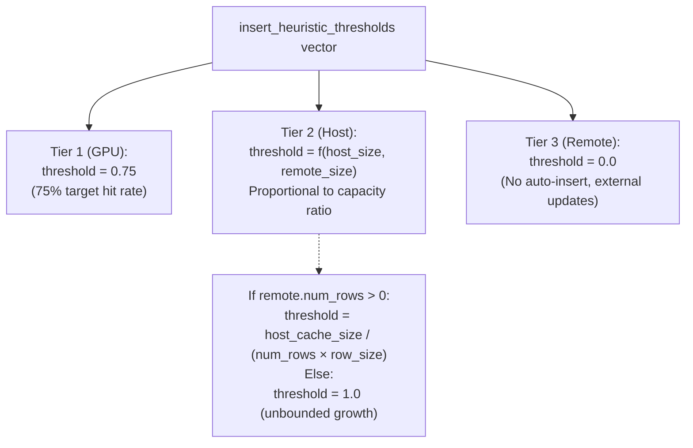
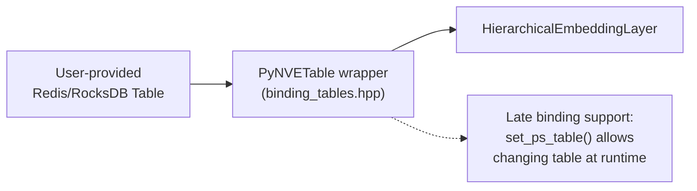
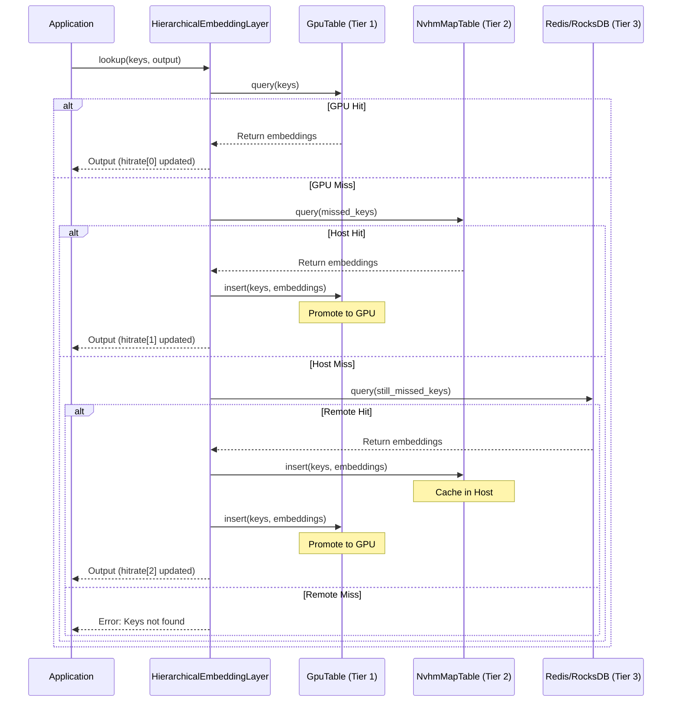
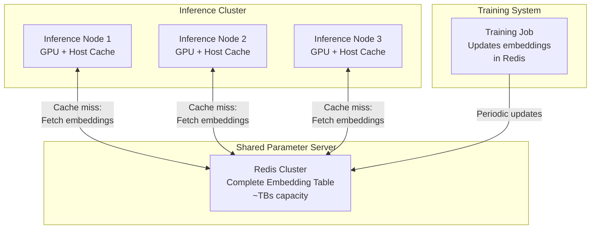

<!-- source: DeepWiki mcp.deepwiki.com · repo NVIDIA/nv-embedding-cache · extra page HierarchicalEmbeddingLayer · fetched 2026-10-26 -->

# HierarchicalEmbeddingLayer

<details>
<summary>Relevant source files</summary>

The following files were used as context for generating this wiki page:

- [README.md](README.md)
- [docs/cpp_api.md](docs/cpp_api.md)
- [python/pynve/bindings/binding_layers.hpp](python/pynve/bindings/binding_layers.hpp)

</details>


## Purpose and Scope

The `HierarchicalEmbeddingLayer` implements a three-tier memory hierarchy for embedding storage and retrieval, designed for datasets that exceed both GPU and system memory capacity. This layer stores the complete embedding table in a remote parameter server (Redis or RocksDB) while maintaining caches in GPU memory (tier 1) and optionally in system memory (tier 2) for frequently accessed embeddings.

This page covers the architecture, configuration, and usage of `HierarchicalEmbeddingLayer`. For simpler caching strategies, see [GPUEmbeddingLayer](#3.1.1) for GPU-only storage and [LinearUVMEmbeddingLayer](#3.1.2) for GPU cache with UVM backing. For detailed information about the remote storage backends, see [Remote Storage Tables](#3.2.3).

**Sources:** [README.md:14-15](), [docs/cpp_api.md:22]()

## Architecture Overview

### Three-Tier Memory Hierarchy

The `HierarchicalEmbeddingLayer` implements a cascading cache architecture where each tier has different performance and capacity characteristics:



**Diagram: Hierarchical Lookup Flow Through Three Memory Tiers**

Each tier acts as a cache for the tier below it:
- **Tier 1 (GPU)**: Holds the hottest embeddings with fastest access
- **Tier 2 (Host)**: Holds warm embeddings, optional but recommended for better hit rates
- **Tier 3 (Remote)**: Holds all embeddings, acts as the source of truth

**Sources:** [python/pynve/bindings/binding_layers.hpp:363-427](), [README.md:14-15]()

### Class Hierarchy and Key Components



**Diagram: Class Structure and Dependencies**

**Sources:** [python/pynve/bindings/binding_layers.hpp:363-366](), [docs/cpp_api.md:19-22]()

## Configuration

### C++ Configuration

The `HierarchicalEmbeddingLayer` is configured by providing a vector of tables representing each tier. The class definition is in [include/hierarchical_embedding_layer.hpp]().

**Configuration Structure:**

| Component | Type | Purpose |
|-----------|------|---------|
| `tables` | `std::vector<std::shared_ptr<Table>>` | Ordered list of tables: GPU → Host (optional) → Remote |
| `insert_heuristic` | `std::shared_ptr<InsertHeuristic>` | Controls cache promotion thresholds for each tier |
| `layer_name` | `std::string` | Identifier for logging and debugging |

**Sources:** [docs/cpp_api.md:22]()

### Python Configuration

The Python binding `HierarchicalEmbedding` simplifies configuration by automatically creating and configuring the table hierarchy:



**Diagram: Python Configuration Flow**

**Key Parameters:**

| Parameter | Type | Description |
|-----------|------|-------------|
| `row_size` | `size_t` | Number of elements per embedding (not bytes) |
| `dtype` | `DataType_t` | `Float32` or `Float16` |
| `gpu_cache_size` | `uint64_t` | GPU cache size in bytes |
| `host_cache_size` | `uint64_t` | Host cache size in bytes (0 to disable) |
| `remote` | `table_ptr_t` | Remote parameter server table (Redis/RocksDB) |
| `device_id` | `int` | GPU device ID |
| `use_private_stream` | `bool` | Whether to use a private CUDA stream for async operations |

**Sources:** [python/pynve/bindings/binding_layers.hpp:369-427]()

### Insert Heuristic Thresholds

The `DefaultInsertHeuristic` controls when embeddings are promoted to higher tiers based on target hit rates. Each tier has an associated threshold value:

**Threshold Configuration Logic:**



**Diagram: Insert Heuristic Threshold Configuration**

The host tier threshold is dynamically computed based on the size ratio between host cache and remote storage. This ensures the cache doesn't grow beyond its intended capacity while maximizing hit rate.

**Sources:** [python/pynve/bindings/binding_layers.hpp:396-423]()

## Table Creation and Integration

### GPU Table Configuration

The GPU tier uses `GpuTable` with a set-associative cache optimized for power-law key distributions:

**GPU Table Configuration (from Python binding):**

| Field | Value | Description |
|-------|-------|-------------|
| `device_id` | User-specified | GPU device to use |
| `cache_size` | `gpu_cache_size` parameter | Number of cache entries |
| `max_modify_size` | `1 << 20` (1M) | Maximum keys per modify operation |
| `row_size_in_bytes` | `row_size * sizeof(dtype)` | Bytes per embedding |
| `uvm_table` | `nullptr` | No UVM backing (unlike LinearUVM) |
| `value_dtype` | User-specified | `Float32` or `Float16` |
| `private_stream` | Optional | Private CUDA stream for async ops |

**Sources:** [python/pynve/bindings/binding_layers.hpp:383-394]()

### Host Table Configuration

When `host_cache_size > 0`, an `NvhmMapTable` is created using the nvHashMap plugin:

**NVHM Configuration Parameters:**

| Field | Value | Description |
|-------|-------|-------------|
| `key_size` | `sizeof(IndexT)` | Size of key type (int32/int64) |
| `max_value_size` | `row_size_in_bytes` | Size of embedding row |
| `num_partitions` | `1` | Single partition for inference (increase for concurrent inserts) |
| `value_dtype` | User-specified dtype | Data type string |
| `value_alignment` | `32` | Alignment for GPU-friendly access |
| `overflow_policy` | `"evict_random"` | Random eviction (assumes GPU cache handles hot keys) |
| `overflow_margin` | `keys_per_partition` | Buffer space before eviction triggers |
| `resolution_margin` | `0.9` | Eviction target (90% of margin) |

**Sources:** [python/pynve/bindings/binding_layers.hpp:434-459]()

### Remote Parameter Server Integration

The remote table is provided by the user and wrapped in a `PyNVETable` for late binding support:



**Diagram: Remote Parameter Server Integration**

The wrapper allows the remote table to be set or changed after layer construction via `set_ps_table()`, enabling flexible deployment patterns.

**Sources:** [python/pynve/bindings/binding_layers.hpp:420-432]()

## Lookup Operation

### Lookup Flow Through Tiers

The `lookup()` operation queries each tier in sequence until the key is found or all tiers are exhausted:



**Diagram: Lookup Operation Sequence**

**Sources:** [python/pynve/bindings/binding_layers.hpp:61-76](), [docs/cpp_api.md:24-26]()

### Hit Rate Tracking

The layer tracks hit rates for each tier, providing visibility into cache effectiveness:

| Index | Tier | Meaning |
|-------|------|---------|
| `hitrates[0]` | GPU | Fraction of keys found in GPU cache |
| `hitrates[1]` | Host | Fraction of keys found in host cache (among GPU misses) |
| `hitrates[2]` | Remote | Fraction of keys found in remote (among host misses) |

The Python binding logs these periodically if `logging_interval > 0` is configured.

**Sources:** [python/pynve/bindings/binding_layers.hpp:324-341]()

## Modify Operations

### Insert Operation

The `insert()` operation adds or updates embeddings in a specific tier. The `table_id` parameter specifies which tier:

| `table_id` | Tier | Usage |
|------------|------|-------|
| `0` | GPU | Promote hot embeddings to GPU cache |
| `1` | Host | Add embeddings to host cache |
| `2` | Remote | Update remote parameter server |

**Sources:** [python/pynve/bindings/binding_layers.hpp:242-252]()

### Update and Accumulate Operations

These operations modify existing embeddings in all tiers where the key is present:

- **`update()`**: Replace embedding values for specified keys
- **`accumulate()`**: Add gradient values to existing embeddings (for training)

Both operations propagate through all tiers to maintain consistency.

**Sources:** [python/pynve/bindings/binding_layers.hpp:221-240](), [docs/cpp_api.md:32-35]()

### Erase Operation

The `erase()` operation removes keys from a specific tier:

```python
# Remove keys from GPU cache
layer.erase(num_keys, keys_ptr, table_id=0, stream)

# Remove keys from host cache  
layer.erase(num_keys, keys_ptr, table_id=1, stream)
```

**Note:** Erasing from the remote parameter server (tier 3) is typically not performed, as it holds the complete embedding table.

**Sources:** [python/pynve/bindings/binding_layers.hpp:260-264](), [docs/cpp_api.md:36-37]()

## Use Cases and Deployment Scenarios

### When to Use HierarchicalEmbeddingLayer

Use `HierarchicalEmbeddingLayer` when:

1. **Embedding table exceeds system memory**: Total embeddings require more storage than available on a single node
2. **Distributed deployment**: Multiple inference nodes share a common embedding table via Redis/RocksDB
3. **Power-law access pattern**: A small subset of embeddings accounts for most lookups (cache-friendly)
4. **Remote parameter server exists**: You already maintain embeddings in Redis/RocksDB for training or other purposes

### Comparison with Other Layers

| Scenario | Recommended Layer | Rationale |
|----------|------------------|-----------|
| Embeddings fit in GPU memory | [GPUEmbeddingLayer](#3.1.1) | Simplest, fastest, no caching overhead |
| Embeddings fit in system memory | [LinearUVMEmbeddingLayer](#3.1.2) | UVM provides transparent access, simpler than hierarchical |
| Embeddings require remote storage | **HierarchicalEmbeddingLayer** | Only option supporting external parameter servers |
| Multiple inference nodes | **HierarchicalEmbeddingLayer** | Share embeddings via Redis cluster |
| Training workload | [LinearUVMEmbeddingLayer](#3.1.2) | Better for frequent updates to all embeddings |

**Sources:** [README.md:11-15](), [docs/cpp_api.md:19-22]()

### Typical Deployment Architecture



**Diagram: Multi-Node Deployment with Shared Redis Parameter Server**

**Sources:** [README.md:14-15]()

## API Reference

### C++ API

The C++ interface is defined in [include/hierarchical_embedding_layer.hpp](). Key methods inherited from `EmbeddingLayerBase`:

**Constructor:**
```cpp
HierarchicalEmbeddingLayer(
    const Config& config,
    const std::vector<std::shared_ptr<Table>>& tables,
    allocator_ptr_t allocator
)
```

**Configuration Structure:**
```cpp
struct Config {
    std::string layer_name;
    std::shared_ptr<InsertHeuristic> insert_heuristic;
};
```

**Primary Operations:**
- `lookup()`: Retrieve embeddings for given keys
- `insert()`: Add embeddings to specified tier
- `update()`: Modify existing embedding values
- `accumulate()`: Add gradients to embeddings
- `erase()`: Remove keys from specified tier
- `create_execution_context()`: Create context for operations

**Sources:** [docs/cpp_api.md:14-38]()

### Python API

The Python interface is implemented in [python/pynve/bindings/binding_layers.hpp]() as `HierarchicalEmbedding`:

**Constructor:**
```python
HierarchicalEmbedding(
    row_size: int,                    # Embedding dimension (number of elements)
    dtype: DataType,                  # Float32 or Float16
    gpu_cache_size: int,              # GPU cache size in bytes
    host_cache_size: int,             # Host cache size in bytes (0 to disable)
    remote: Table,                    # Remote parameter server table
    use_private_stream: bool,         # Use private CUDA stream
    device_id: int,                   # GPU device ID
    config: EmbedLayerConfig          # Additional configuration
)
```

**Methods:**
```python
# Lookup embeddings
lookup(num_keys, keys_ptr, output_ptr, stream)

# Lookup with pooling (sum/mean)
lookup_with_pooling(num_keys, keys_ptr, output_ptr, pooling_type, 
                    num_offsets, offsets_ptr, weight_dtype, weights_ptr, stream)

# Modify operations
accumulate(num_keys, keys_ptr, updates_ptr, stream)
update(num_keys, keys_ptr, updates_ptr, stream)
insert(num_keys, keys_ptr, values_ptr, table_id, stream)
erase(num_keys, keys_ptr, table_id, stream)

# Gradient computation for backpropagation
concat_backprop(num_keys, keys_ptr, grads_ptr, unique_keys_ptr, output_grads_ptr, stream)
pooling_backprop(num_keys, keys_ptr, grads_ptr, unique_keys_ptr, output_grads_ptr,
                 pooling_type, num_offsets, offsets_ptr, dtype, weights_ptr, stream)

# Set/change remote parameter server
set_ps_table(table: Table)
```

**Sources:** [python/pynve/bindings/binding_layers.hpp:363-476]()

## Performance Considerations

### Cache Size Configuration

Optimal cache sizes depend on the access pattern:

- **GPU cache**: Size to hold ~75% of accessed keys (based on default 0.75 threshold)
- **Host cache**: Size to hold warm working set not fitting in GPU
- **Remote**: Complete embedding table

For power-law distributions, relatively small caches can achieve high hit rates.

### Private Stream Usage

Setting `use_private_stream=true` creates a dedicated CUDA stream for asynchronous cache operations, improving throughput when overlapping lookups with computation.

**Sources:** [python/pynve/bindings/binding_layers.hpp:390-394]()

### Host Table Plugin Selection

Different host table implementations have different characteristics:

| Plugin | Best For | Trade-offs |
|--------|----------|------------|
| `NvhmMapTable` | High concurrency, GPU-friendly | Requires CUDA for best performance |
| `AbseilFlatMapTable` | General purpose | CPU-only, good all-around |
| `PHMapFlatMapTable` | High throughput | Parallel hash map, good for multi-threaded |

See [Host Memory Tables](#3.2.2) for detailed comparison.

**Sources:** [python/pynve/bindings/binding_layers.hpp:434-460]()

---

**Page Sources:** [README.md:14-15](), [docs/cpp_api.md:19-22](), [python/pynve/bindings/binding_layers.hpp:363-476](), [include/hierarchical_embedding_layer.hpp]()

---

