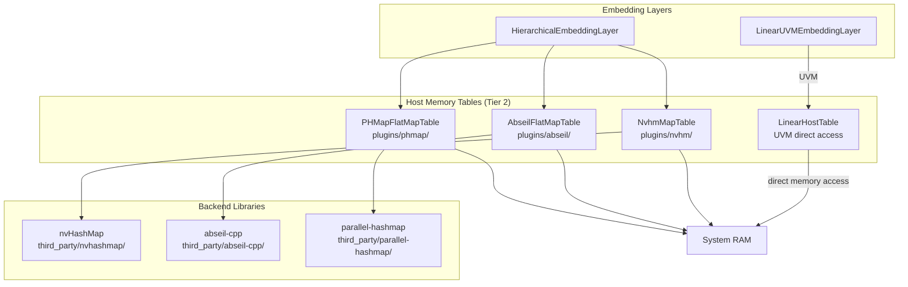
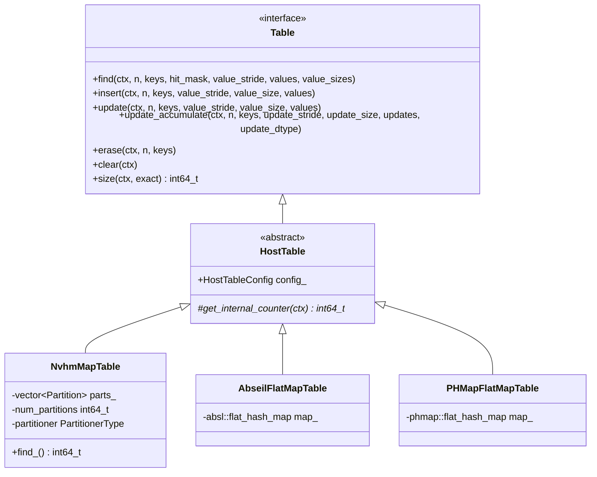
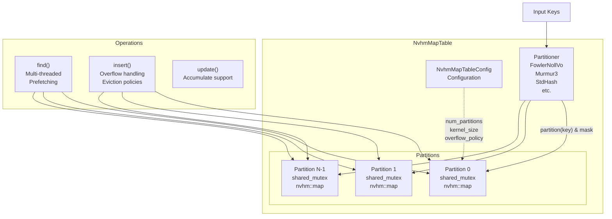
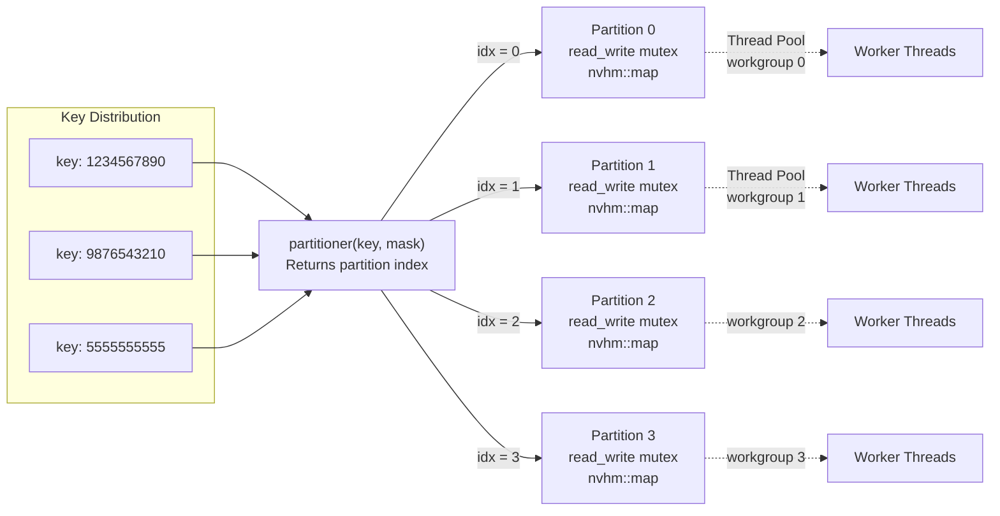
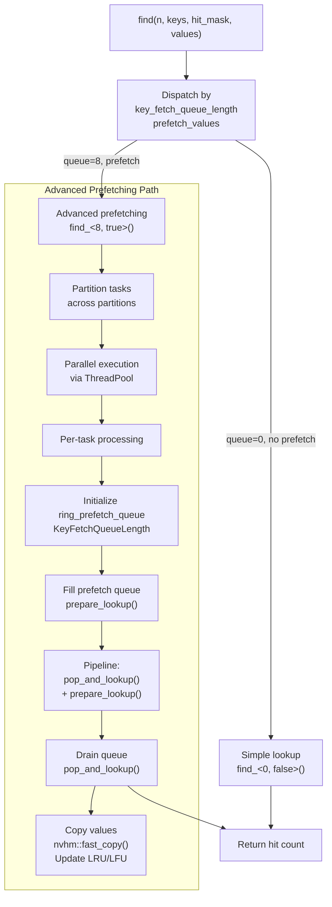
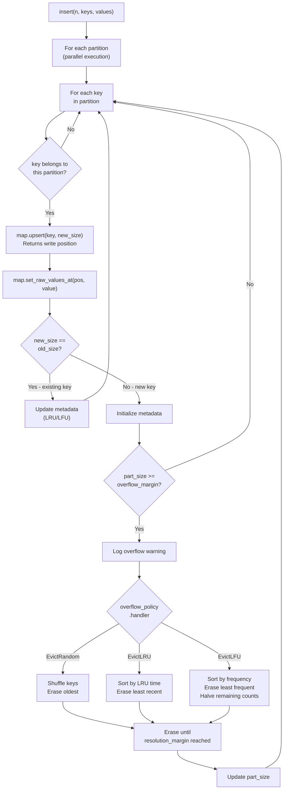
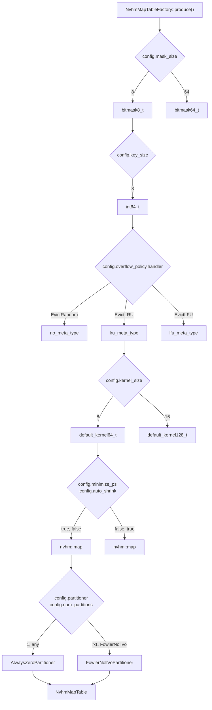

<!-- source: DeepWiki mcp.deepwiki.com · repo NVIDIA/nv-embedding-cache · extra page Host Memory Tables · fetched 2026-10-26 -->

# Host Memory Tables

<details>
<summary>Relevant source files</summary>

The following files were used as context for generating this wiki page:

- [docs/cpp_api.md](docs/cpp_api.md)
- [plugins/nvhm/include/nvhm_map_table.hpp](plugins/nvhm/include/nvhm_map_table.hpp)
- [plugins/nvhm/src/nvhm_map_table.cpp](plugins/nvhm/src/nvhm_map_table.cpp)

</details>


## Purpose and Scope

This page documents the **host memory table** implementations available in NV Embedding Cache. Host memory tables store embedding key-value pairs in system RAM (as opposed to GPU memory) and serve as an intermediate cache tier between GPU memory and remote storage. These tables are critical components in the [LinearUVMEmbeddingLayer](#3.1.2) and [HierarchicalEmbeddingLayer](#3.1.3) configurations.

For GPU-resident storage, see [GpuTable](#3.2.1). For remote persistent storage, see [Remote Storage Tables](#3.2.3).

**Sources:** [plugins/nvhm/include/nvhm_map_table.hpp:1-153](), [docs/cpp_api.md:45-58]()

---

## Overview

Host memory tables provide system memory-based hash table implementations optimized for embedding lookup workloads. The SDK includes four implementations:

| Implementation | Backend Library | Plugin Library | Key Features |
|---------------|----------------|----------------|--------------|
| **NvhmMapTable** | [nvHashMap](https://github.com/NVIDIA/nvhashmap) | `libnve-plugin-nvhm.so` | Partitioned, prefetching, overflow policies |
| **AbseilFlatMapTable** | [Abseil](https://github.com/abseil/abseil-cpp) | `libnve-plugin-abseil.so` | Google's flat hash map |
| **PHMapFlatMapTable** | [parallel-hashmap](https://github.com/greg7mdp/parallel-hashmap) | `libnve-plugin-phmap.so` | Parallel hash map |
| **LinearHostTable** | Linear UVM memory | Built-in | Direct linear access via UVM |

All host memory tables implement the `HostTable` interface defined in [include/host_table.hpp]() and support the same core operations: `find`, `insert`, `update`, `update_accumulate`, `erase`, `clear`, and `size`.

**Sources:** [docs/cpp_api.md:49-58](), [plugins/nvhm/include/nvhm_map_table.hpp:61-124]()

---

## Host Memory Tables in System Architecture



**Diagram: Host Memory Tables Position in Architecture**

Host memory tables sit between GPU memory (Tier 1) and remote storage (Tier 3) in the memory hierarchy. They provide microsecond-latency lookups with capacities of 10-100s of GB.

**Sources:** High-level system diagrams, [plugins/nvhm/include/nvhm_map_table.hpp:61-124]()

---

## Base Interface: HostTable

All host memory table implementations inherit from `HostTable<ConfigType>` defined in [include/host_table.hpp](). The base class defines the common operations:



**Diagram: Host Memory Table Class Hierarchy**

**Sources:** [plugins/nvhm/include/nvhm_map_table.hpp:61-124](), [docs/cpp_api.md:49-58]()

### Common Configuration

All host memory tables inherit configuration from `HostTableConfig`:

| Parameter | Type | Default | Description |
|-----------|------|---------|-------------|
| `key_size` | `int64_t` | 8 | Size of keys in bytes (typically 8 for int64_t) |
| `max_value_size` | `int64_t` | Required | Maximum size of embedding vectors in bytes |
| `value_dtype` | `DataType_t` | `DataType_t::Float32` | Data type of embedding values |
| `mask_size` | `int64_t` | 8 | Size of bitmask representation for hit masks |

**Sources:** [plugins/nvhm/include/nvhm_map_table.hpp:31-54]()

---

## NvhmMapTable: Primary Implementation

`NvhmMapTable` is the primary host memory table implementation, built on NVIDIA's [nvHashMap](https://github.com/NVIDIA/nvhashmap) library. It provides advanced features including partitioning, prefetching, and sophisticated overflow handling.

### Architecture



**Diagram: NvhmMapTable Internal Architecture**

**Sources:** [plugins/nvhm/src/nvhm_map_table.cpp:88-98](), [plugins/nvhm/include/nvhm_map_table.hpp:114-124]()

### Configuration Parameters

`NvhmMapTableConfig` extends `HostTableConfig` with additional parameters:

| Parameter | Type | Default | Description |
|-----------|------|---------|-------------|
| **Partitioning** ||||
| `num_partitions` | `int64_t` | 1 | Number of partitions (must be power of 2) |
| `partitioner` | `Partitioner_t` | `default_partitioner` | Hash function for partitioning |
| `workgroups` | `vector<int64_t>` | `{0}` | Thread pool workgroup assignment per partition |
| `max_find_task_size` | `int64_t` | 128 | Max bitmask chunks per find task |
| **Storage** ||||
| `kernel_size` | `int64_t` | `nvhm::default_kernel_t::size` | nvHashMap kernel size (power of 2, 1-1024) |
| `initial_capacity` | `int64_t` | 4096 | Initial capacity of each partition's map |
| `value_alignment` | `int64_t` | 16 | Memory alignment for stored values (power of 2) |
| **Performance** ||||
| `key_fetch_queue_length` | `int64_t` | 8 | Prefetch queue depth (0, 1, 2, 4, or 8) |
| `prefetch_values` | `bool` | `true` | Enable software prefetching of values |
| `minimize_psl` | `bool` | `false` | Minimize probe sequence length in nvHashMap |
| `auto_shrink` | `bool` | `false` | Auto-shrink map after evictions |
| **Overflow** ||||
| `overflow_policy` | `OverflowPolicyConfig` | - | Overflow detection and eviction policy |

**Sources:** [plugins/nvhm/include/nvhm_map_table.hpp:31-54](), [plugins/nvhm/src/nvhm_map_table.cpp:29-42]()

### Partitioning Strategy

`NvhmMapTable` partitions keys across multiple independent hash maps to enable parallel operations and reduce lock contention:



**Diagram: Partitioning and Parallel Execution**

The partitioning logic at [plugins/nvhm/src/nvhm_map_table.cpp:129-141]() shows how keys are distributed:

```cpp
const int64_t num_parts_mask{num_parts - 1};
for (int64_t i{}; i != n; ++i) {
  const key_type key{keys[i]};
  if (partitioner(key, num_parts_mask) != task_idx) continue;
  // Process key in this partition
}
```

Each partition has its own `std::shared_mutex` (read-write lock) allowing concurrent reads but exclusive writes [plugins/nvhm/include/nvhm_map_table.hpp:119]().

**Sources:** [plugins/nvhm/src/nvhm_map_table.cpp:129-141](), [plugins/nvhm/include/nvhm_map_table.hpp:114-124]()

### Find Operation with Prefetching

The `find` operation implements sophisticated prefetching to minimize memory access latency:



**Diagram: Find Operation Flow with Prefetching**

The implementation at [plugins/nvhm/src/nvhm_map_table.cpp:156-200]() dispatches to specialized templates based on configuration:

```cpp
if (config.prefetch_values) {
  switch (config.key_fetch_queue_length) {
    case 0: n = find_<0, true>(ctx, n, keys, hm, value_stride, values, value_sizes); break;
    case 1: n = find_<1, true>(ctx, n, keys, hm, value_stride, values, value_sizes); break;
    case 8: n = find_<8, true>(ctx, n, keys, hm, value_stride, values, value_sizes); break;
  }
}
```

The prefetch queue implementation uses `ring_prefetch_queue` from nvHashMap [plugins/nvhm/src/nvhm_map_table.cpp:527-565]():

```cpp
nvhm::experimental::ring_prefetch_queue<key_type, prefetch_type, KeyFetchQueueLength> queue;
while (mask_type::has_next(it_head)) {
  const key_type key{keys[ij]};
  queue.prepare_lookup(map, key, use_optimistic_prefetch);
  if (queue.full()) break;
}
// Pipeline: pop previous, prepare next
const read_pos_type pos{queue.pop_and_lookup(map)};
if (pos != nvhm::npos) {
  process_tail(mask_type::next(it_tail), pos);
}
```

**Sources:** [plugins/nvhm/src/nvhm_map_table.cpp:144-200](), [plugins/nvhm/src/nvhm_map_table.cpp:403-640]()

### Insert Operation and Overflow Handling

The `insert` operation handles both insertion and overflow management using configurable eviction policies:



**Diagram: Insert Operation with Overflow Handling**

The overflow handling logic at [plugins/nvhm/src/nvhm_map_table.cpp:259-303]() implements three eviction strategies:

**EvictRandom** (no metadata):
```cpp
std::vector<key_type> keys(map.size());
auto it{keys.begin()};
it = map.keys(it);
std::shuffle(keys.begin(), keys.end(), std::default_random_engine{random_device()});
const auto margin_it{keys.end() - resolution_margin};
for (it = keys.begin(); it < margin_it; ++it) {
  map.erase(*it);
}
```

**EvictLRU/EvictLFU** (with metadata):
```cpp
std::vector<std::pair<key_type, meta_type>> keys_metas(map.size());
auto it{keys_metas.begin()};
it = map.keys_and_values(it);
std::sort(keys_metas.begin(), keys_metas.end(),
          [](const auto& a, const auto& b) { return a.second < b.second; });
const auto margin_it{keys_metas.end() - resolution_margin};
for (it = keys_metas.begin(); it < margin_it; ++it) {
  map.erase(it->first);
}
```

**Sources:** [plugins/nvhm/src/nvhm_map_table.cpp:202-307](), [plugins/nvhm/src/nvhm_map_table.cpp:259-303]()

### Update Operations

`NvhmMapTable` supports two update operations:

#### Standard Update

Replaces existing embedding values [plugins/nvhm/src/nvhm_map_table.cpp:332-364]():

```cpp
const write_pos_type pos{map.update(key)};
if (pos == nvhm::npos) continue;  // Key not found, skip
map.set_raw_values_at(pos, &values[i * value_stride], value_size);
```

#### Accumulate Update

Applies gradients to existing values using CPU update kernels [plugins/nvhm/src/nvhm_map_table.cpp:367-400]():

```cpp
const update_kernel_t update_kernel{pick_cpu_update_kernel(config.value_dtype, update_dtype)};
const write_pos_type pos{map.update(key)};
if (pos == nvhm::npos) continue;
update_kernel(map.raw_values_at(pos), &updates[i * update_stride], update_size);
```

The update kernels handle different data type combinations (e.g., Float32 values + Float16 gradients).

**Sources:** [plugins/nvhm/src/nvhm_map_table.cpp:332-400]()

### Performance Features

#### Metadata Tracking

`NvhmMapTable` supports three metadata modes for tracking access patterns:

| Mode | Metadata Type | Usage | Overhead |
|------|---------------|-------|----------|
| `no_meta_type` | None | Random eviction | Zero |
| `lru_meta_type` | Timestamp | LRU eviction | 8 bytes per key |
| `lfu_meta_type` | Counter | LFU eviction | 8 bytes per key |

During `find`, metadata is updated [plugins/nvhm/src/nvhm_map_table.cpp:516-523]():

```cpp
if constexpr (std::is_same_v<meta_type, lru_meta_type>) {
  const_cast<lru_meta_type&>(map.value_at(pos)) = lru_time;
} else if constexpr (std::is_same_v<meta_type, lfu_meta_type>) {
  ++const_cast<lfu_meta_type&>(map.value_at(pos));
}
```

#### Memory Prefetching

Software prefetching reduces memory latency [plugins/nvhm/src/nvhm_map_table.cpp:495-510]():

```cpp
if constexpr (PrefetchValues) {
  l1_prefetch(src, dst, std::min(value_size, 8 * cpu_cache_line_size));
  if (prev_src) {
    nvhm::fast_copy(prev_dst, prev_src, prev_value_size);
  }
  prev_src = src;
  prev_dst = dst;
  prev_value_size = value_size;
}
```

This pipelined approach prefetches the next value while copying the previous one.

**Sources:** [plugins/nvhm/src/nvhm_map_table.cpp:471-633]()

---

## Other Host Memory Table Implementations

### AbseilFlatMapTable

Uses Google's `absl::flat_hash_map` from the Abseil library. Suitable for general-purpose use cases with good performance characteristics.

- **Plugin:** `libnve-plugin-abseil.so`
- **Header:** [plugins/abseil/include/abseil_flat_map_table.hpp]()
- **Backend:** [third_party/abseil-cpp]()

### PHMapFlatMapTable

Uses `phmap::flat_hash_map` from the parallel-hashmap library, which provides additional optimization for parallel access patterns.

- **Plugin:** `libnve-plugin-phmap.so`
- **Header:** [plugins/phmap/include/phmap_flat_map_table.hpp]()
- **Backend:** [third_party/parallel-hashmap]()

### LinearHostTable

Direct linear memory access via CUDA Unified Virtual Memory (UVM). Not a hash table, but provides direct indexed access to embedding rows stored in system memory.

- **Built-in:** No plugin required
- **Usage:** Automatically used by `LinearUVMEmbeddingLayer`

**Sources:** [docs/cpp_api.md:49-58]()

---

## Factory Pattern

Host memory tables use the factory pattern for instantiation. `NvhmMapTableFactory` creates `NvhmMapTable` instances with appropriate template parameters based on configuration:



**Diagram: NvhmMapTableFactory Template Instantiation**

The factory implementation at [plugins/nvhm/src/nvhm_map_table.cpp:656-821]() uses nested template selection to choose the correct specialization based on configuration parameters.

**Sources:** [plugins/nvhm/src/nvhm_map_table.cpp:656-821](), [plugins/nvhm/include/nvhm_map_table.hpp:136-149]()

---

## Configuration Example

Example JSON configuration for `NvhmMapTable`:

```json
{
  "table_type": "NvhmMapTable",
  "key_size": 8,
  "max_value_size": 512,
  "value_dtype": "Float32",
  "num_partitions": 16,
  "partitioner": "Murmur3",
  "workgroups": [0, 1, 2, 3],
  "max_find_task_size": 128,
  "kernel_size": 8,
  "initial_capacity": 1048576,
  "value_alignment": 16,
  "key_fetch_queue_length": 8,
  "prefetch_values": true,
  "minimize_psl": false,
  "auto_shrink": false,
  "overflow_policy": {
    "handler": "EvictLRU",
    "overflow_margin": 1000000,
    "resolution_margin": 0.8
  }
}
```

This configuration creates a table with:
- 16 partitions using Murmur3 hash
- 8-byte kernel size (64-bit operations)
- Initial 1M capacity per partition
- 8-deep prefetch queue
- LRU eviction when partition exceeds 1M keys
- Evicts down to 800K keys (80% of margin)

**Sources:** [plugins/nvhm/src/nvhm_map_table.cpp:44-86]()

---

## Performance Characteristics

### Lookup Performance

| Configuration | Throughput | Use Case |
|---------------|-----------|----------|
| No prefetch, no partitioning | Baseline | Simple workloads |
| 8-deep prefetch, 1 partition | 1.5-2x | Sequential access |
| 8-deep prefetch, 16 partitions | 3-5x | Random access, parallel |

Prefetching effectiveness depends on access pattern predictability. Partitioning scales linearly with available CPU cores up to the number of partitions.

### Memory Overhead

- **Base map:** ~8-16 bytes per key (nvHashMap overhead)
- **Value storage:** `max_value_size` rounded to `value_alignment`
- **Metadata:** 0-8 bytes per key (depending on overflow policy)
- **Partitioning:** Linear multiplication by `num_partitions`

**Example:** 10M keys, 128-byte embeddings, 16 partitions, LRU policy:
- Values: 10M × 128 bytes = 1.28 GB
- Map overhead: 10M × 16 bytes = 160 MB
- Metadata: 10M × 8 bytes = 80 MB
- **Total per partition:** ~95 MB
- **Total:** ~1.52 GB

**Sources:** [plugins/nvhm/include/nvhm_map_table.hpp:31-54]()

---

## Thread Safety

`NvhmMapTable` uses `std::shared_mutex` per partition [plugins/nvhm/include/nvhm_map_table.hpp:119]():

- **Read operations** (`find`, `size`): Acquire shared lock - multiple threads can read concurrently
- **Write operations** (`insert`, `update`, `erase`, `clear`): Acquire exclusive lock - only one writer per partition

Operations are parallelized across partitions, so with `N` partitions, up to `N` write operations can execute concurrently (one per partition).

**Sources:** [plugins/nvhm/src/nvhm_map_table.cpp:101-142](), [plugins/nvhm/include/nvhm_map_table.hpp:119]()

---

## Summary

Host memory tables provide the critical middle tier in NV Embedding Cache's memory hierarchy:

- **NvhmMapTable:** Production-grade implementation with partitioning, prefetching, and overflow management
- **AbseilFlatMapTable/PHMapFlatMapTable:** Alternative implementations for different performance profiles
- **LinearHostTable:** Direct UVM access for `LinearUVMEmbeddingLayer`

For most applications, `NvhmMapTable` is the recommended choice due to its optimizations for embedding lookup workloads. Configuration should be tuned based on:
1. **Dataset size** → `initial_capacity`, `overflow_policy.overflow_margin`
2. **Concurrency** → `num_partitions`, `workgroups`
3. **Access pattern** → `key_fetch_queue_length`, `overflow_policy.handler`

**Sources:** [plugins/nvhm/src/nvhm_map_table.cpp:1-825](), [plugins/nvhm/include/nvhm_map_table.hpp:1-153]()

---

