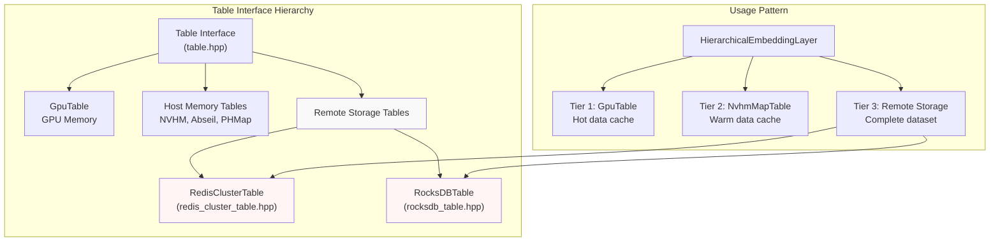
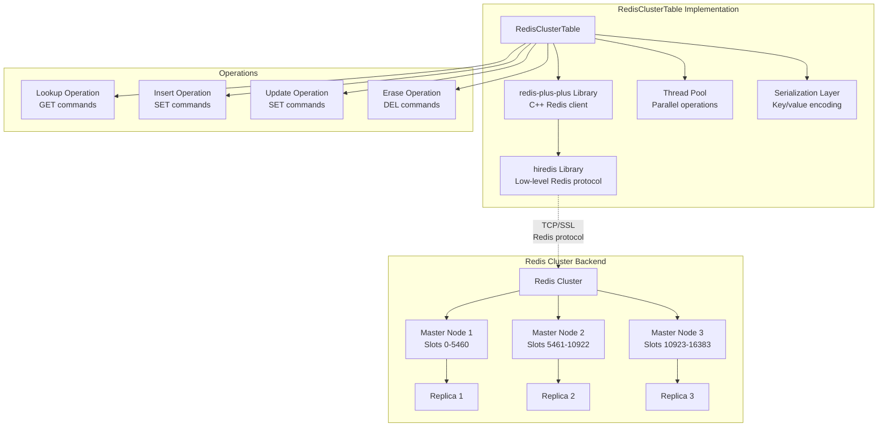
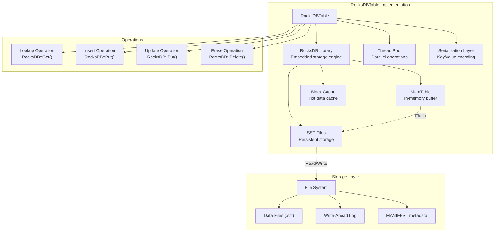
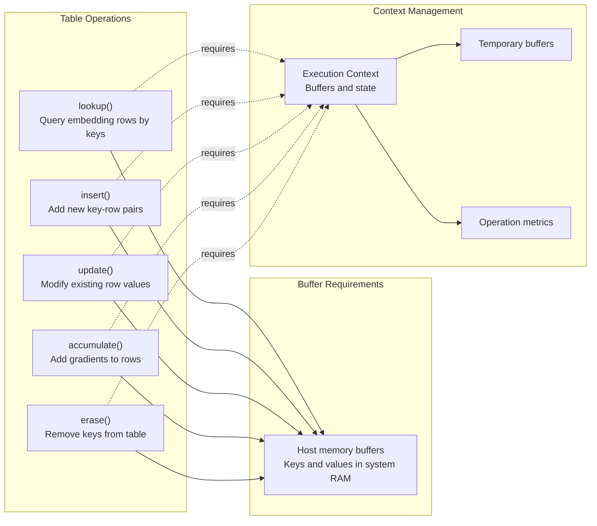
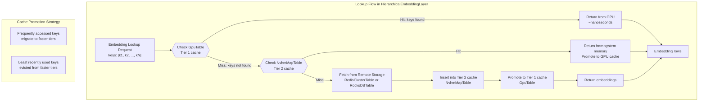
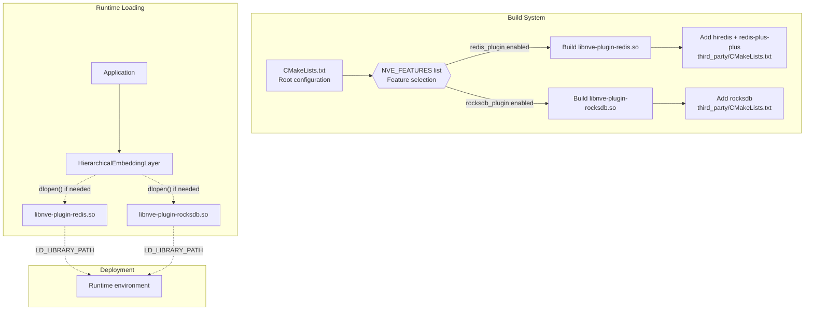

<!-- source: DeepWiki mcp.deepwiki.com · repo NVIDIA/nv-embedding-cache · extra page Remote Storage Tables · fetched 2026-10-26 -->

# Remote Storage Tables

<details>
<summary>Relevant source files</summary>

The following files were used as context for generating this wiki page:

- [README.md](README.md)
- [docs/cpp_api.md](docs/cpp_api.md)
- [third_party/CMakeLists.txt](third_party/CMakeLists.txt)

</details>


## Purpose and Scope

This document describes the remote storage table implementations in NV Embedding Cache, specifically `RedisClusterTable` and `RocksDBTable`. These tables provide the third tier in the memory hierarchy, offering massive storage capacity (~TBs) at the cost of higher latency (~ms). Remote storage tables are used exclusively with the `HierarchicalEmbeddingLayer` to enable embedding datasets that exceed the combined capacity of GPU and system memory.

For information about GPU-resident tables, see [GpuTable](#3.2.1). For system memory tables, see [Host Memory Tables](#3.2.2). For the overall hierarchical caching strategy, see [HierarchicalEmbeddingLayer](#3.1.3).

---

## Overview

Remote storage tables implement the `Table` interface defined in [include/table.hpp]() to provide access to embeddings stored in external storage systems. Unlike GPU and host memory tables that cache subsets of embeddings, remote storage tables are designed to hold the complete embedding dataset as the authoritative source of truth.



**Diagram: Remote Storage Tables in the System Architecture**

Both implementations are built as separate plugin libraries to minimize dependencies on applications that don't require remote storage capabilities:
- `libnve-plugin-redis.so` - Redis cluster support
- `libnve-plugin-rocksdb.so` - RocksDB support

Sources: [docs/cpp_api.md:1-56](), [README.md:14-15]()

---

## RedisClusterTable

### Overview

`RedisClusterTable` provides distributed embedding storage using Redis cluster as the backend. Redis is well-suited for scenarios requiring:
- Distributed multi-node deployments
- High availability and replication
- Shared embedding access across multiple inference servers
- Dynamic scaling of storage capacity

The implementation is located in [plugins/redis/include/redis_cluster_table.hpp]().

### Architecture



**Diagram: RedisClusterTable Architecture and Dependencies**

Sources: [plugins/redis/include/redis_cluster_table.hpp](), [third_party/CMakeLists.txt:94-112](), [docs/cpp_api.md:54-55]()

### Dependencies

The Redis plugin depends on two third-party libraries managed as git submodules:

| Library | Purpose | Configuration |
|---------|---------|---------------|
| `hiredis` | Low-level Redis protocol implementation | SSL support enabled via `ENABLE_SSL` |
| `redis-plus-plus` | C++ client library with cluster support | Built as static library with TLS support |

These dependencies are configured in [third_party/CMakeLists.txt:94-112]() with the following key settings:
- SSL/TLS support is enabled for secure connections
- Static linking to simplify deployment
- Test suites are disabled to reduce build time

### Thread Safety

`RedisClusterTable` uses a thread pool for parallel operations on batches of keys. The `redis-plus-plus` library provides thread-safe connection pooling, allowing concurrent operations across multiple threads. Applications should use separate execution contexts per thread when performing concurrent operations.

### Performance Characteristics

Redis cluster operations exhibit:
- **Latency**: Typically 1-5 ms per lookup depending on network topology
- **Throughput**: Scales linearly with cluster size due to key partitioning
- **Batch operations**: Pipelined commands significantly improve throughput for large batches
- **Network overhead**: Dominant factor in operation latency

Sources: [third_party/CMakeLists.txt:94-112]()

---

## RocksDBTable

### Overview

`RocksDBTable` provides local persistent storage using RocksDB, an embeddable key-value store optimized for fast storage (SSDs). RocksDB is ideal for:
- Single-node deployments requiring persistence
- Scenarios where network latency is prohibitive
- Embedding datasets with infrequent updates
- Local caching of remote parameter servers

The implementation is located in [plugins/rocksdb/include/rocksdb_table.hpp]().

### Architecture



**Diagram: RocksDBTable Architecture and Storage Hierarchy**

Sources: [plugins/rocksdb/include/rocksdb_table.hpp](), [third_party/CMakeLists.txt:82-92](), [docs/cpp_api.md:55-56]()

### Dependencies

The RocksDB plugin depends on the RocksDB library, configured in [third_party/CMakeLists.txt:82-92]() with build optimizations:

| Build Option | Setting | Rationale |
|--------------|---------|-----------|
| `ROCKSDB_BUILD_SHARED` | `OFF` | Static linking for deployment simplicity |
| `WITH_BENCHMARK_TOOLS` | `OFF` | Reduce dependencies |
| `WITH_TESTS` | `OFF` | Skip unnecessary test builds |
| `WITH_TOOLS` | `OFF` | Exclude command-line utilities |
| `WITH_JNI` | `OFF` | No Java binding needed |

Additional compiler flags are set to suppress warnings: `-Wno-nontrivial-memcall` is added in [third_party/CMakeLists.txt:18]().

### Thread Safety

`RocksDBTable` leverages RocksDB's thread-safe API. Multiple threads can safely perform concurrent reads and writes. The implementation uses a thread pool to parallelize batch operations across keys. Write operations may block due to RocksDB's internal compaction processes.

### Performance Characteristics

RocksDB operations exhibit:
- **Latency**: 0.1-1 ms per lookup with SSDs, depending on cache hit rates
- **Throughput**: Limited by storage I/O bandwidth
- **Memory usage**: Block cache significantly improves read performance
- **Write amplification**: Multiple writes to storage per logical update due to LSM-tree structure

Sources: [third_party/CMakeLists.txt:82-92]()

---

## Common Table API Surface

Both remote storage table implementations provide the standard `Table` interface operations:



**Diagram: Remote Storage Table API Operations**

### Key Differences from GPU Tables

Remote storage tables differ from `GpuTable` in several important ways:

| Aspect | GpuTable | Remote Storage Tables |
|--------|----------|----------------------|
| **Buffer location** | GPU or host memory | Host memory only |
| **Asynchronous execution** | CUDA streams | Thread pool |
| **Operation latency** | Sub-microsecond | Milliseconds |
| **Capacity** | Limited by GPU VRAM | Virtually unlimited |
| **Data persistence** | Volatile | Persistent (RocksDB) or distributed (Redis) |

Sources: [include/table.hpp](), [docs/cpp_api.md:46-56]()

---

## Integration with HierarchicalEmbeddingLayer

Remote storage tables serve as the backing store for `HierarchicalEmbeddingLayer`, providing the complete embedding dataset. The hierarchical layer implements a multi-tier lookup strategy:



**Diagram: Remote Storage Integration in Hierarchical Lookup**

### Data Flow Characteristics

1. **Cold start**: Initial lookups result in remote fetches with ~ms latency
2. **Warm cache**: Frequently accessed keys migrate to faster tiers
3. **Cache coherency**: Updates propagate from GPU → Host → Remote storage
4. **Capacity management**: Each tier evicts to maintain its capacity limits

Sources: [include/hierarchical_embedding_layer.hpp](), [docs/cpp_api.md:22-23]()

---

## Configuration and Setup

### Redis Cluster Setup

To use `RedisClusterTable`, a Redis cluster must be configured and accessible:

**Prerequisites:**
- Redis 7.0.15 or later (specified in [README.md:27]())
- Network connectivity from inference nodes to Redis cluster
- Optional: TLS certificates for encrypted connections

**Configuration Parameters:**
- Cluster endpoints (host:port for seed nodes)
- Connection pool size for concurrent operations
- Timeout settings for network operations
- SSL/TLS configuration (optional)

### RocksDB Configuration

`RocksDBTable` requires local filesystem access:

**Prerequisites:**
- Sufficient disk space for the complete embedding dataset
- Fast storage (NVMe SSD recommended) for optimal performance
- Write permissions to the database directory

**Configuration Parameters:**
- Database path (directory for RocksDB files)
- Block cache size (controls memory usage for hot data)
- Compression settings (reduces disk usage at CPU cost)
- Write buffer size (impacts write performance)

Sources: [README.md:27](), [docs/cpp_api.md:54-56]()

---

## Plugin Architecture and Loading

Remote storage tables are built as optional plugin libraries to avoid imposing dependencies on applications that don't require remote storage.



**Diagram: Plugin Build and Loading Architecture**

### Build Configuration

Plugins are enabled via the `NVE_FEATURES` list in CMake:

```cmake
# Enable Redis plugin
list(APPEND NVE_FEATURES "redis_plugin")

# Enable RocksDB plugin  
list(APPEND NVE_FEATURES "rocksdb_plugin")
```

The build system automatically includes required dependencies when a plugin is enabled, as seen in [third_party/CMakeLists.txt:114-145]().

### Runtime Requirements

Applications using remote storage tables must ensure plugin libraries are discoverable:

1. **Library path**: Add plugin directory to `LD_LIBRARY_PATH`
2. **Dependency libraries**: Ensure `hiredis` and `redis++` (for Redis) or `rocksdb` (for RocksDB) are available
3. **Dynamic loading**: Plugins are loaded on-demand when `HierarchicalEmbeddingLayer` is instantiated with the corresponding table type

Sources: [third_party/CMakeLists.txt:114-145](), [docs/cpp_api.md:11-12]()

---

## Comparison: Redis vs RocksDB

| Characteristic | RedisClusterTable | RocksDBTable |
|----------------|-------------------|--------------|
| **Deployment** | Distributed multi-node | Single-node local |
| **Persistence** | Optional (depends on Redis config) | Always persistent |
| **Sharing** | Multiple servers can share | Local to one server |
| **Latency** | Network-bound (~1-5 ms) | Disk-bound (~0.1-1 ms) |
| **Scalability** | Horizontal (add cluster nodes) | Vertical (faster disks) |
| **High Availability** | Built-in replication | Requires external replication |
| **Complexity** | Requires cluster management | Simple file-based storage |
| **Best For** | Multi-GPU distributed inference | Single-node with local persistence |

Sources: [plugins/redis/include/redis_cluster_table.hpp](), [plugins/rocksdb/include/rocksdb_table.hpp]()

---

## Performance Considerations

### Batch Size Optimization

Both remote storage implementations benefit significantly from batching:

- **Small batches** (< 100 keys): Dominated by per-request overhead
- **Medium batches** (100-1000 keys): Optimal throughput/latency trade-off
- **Large batches** (> 1000 keys): May exceed single-request timeout limits

### Network vs Disk I/O

- **RedisClusterTable**: Network bandwidth and latency are primary bottlenecks
- **RocksDBTable**: Disk I/O patterns and block cache hit rate dominate performance

### Memory Overhead

- **Redis**: Minimal client-side memory; server-side memory scales with dataset
- **RocksDB**: Block cache size directly impacts performance; default 8 MB per open database

Sources: [docs/cpp_api.md:54-56]()

---

