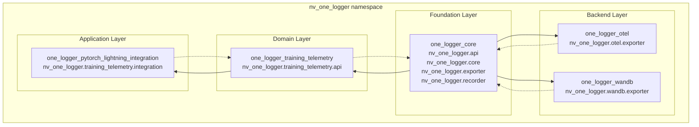
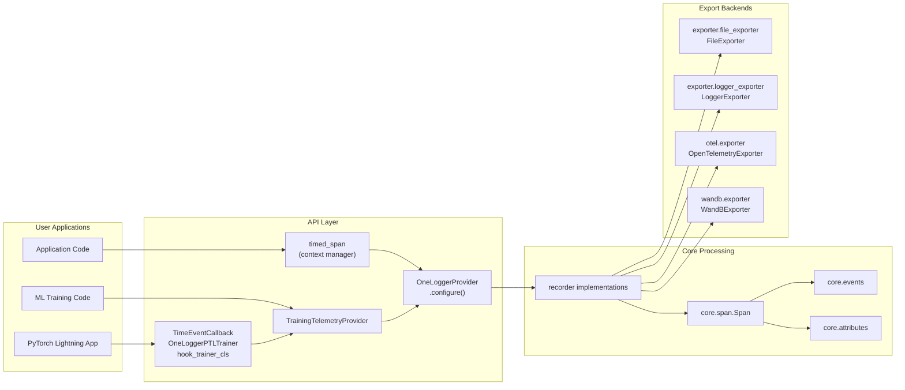
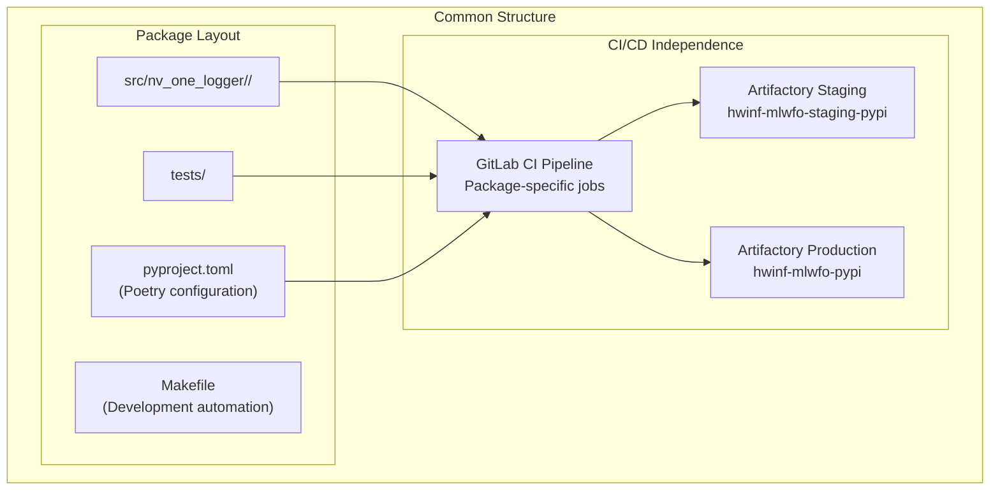

<!-- source: DeepWiki mcp.deepwiki.com · repo NVIDIA/nv-one-logger · page 1 Overview · fetched 2026-10-26 -->

# Overview

Relevant source files

The following files were used as context for generating this wiki page:

- [README.md](README.md)

## Purpose and Scope

This document provides an overview of the `nv-one-logger` monorepo, a comprehensive logging and telemetry system designed for machine learning and general application telemetry. The system provides a foundational core library with specialized extensions for different domains and backend integrations. This overview covers the monorepo architecture, component relationships, and how the different packages work together to provide a flexible telemetry solution.

For specific implementation details of individual packages, see [Core Package (one_logger_core)](#2), [Training Telemetry Package](#3), [Backend Integrations](#4), and [Application Integrations](#5). For development and deployment procedures, see [Development and Deployment](#6).

## Monorepo Architecture

The `nv-one-logger` system is organized as a monorepo containing five independent Python packages that share common development practices while maintaining separate CI/CD pipelines and release cycles. Each package serves a specific architectural role within the larger telemetry ecosystem.

### Package Structure and Dependencies

**Sources:** [README.md:1-106]()

### Component Relationships and Data Flow

The following diagram shows the key classes and modules that enable data flow between components:

**Sources:** [README.md:14-46](), [README.md:63-100]()

## Package Overview

The monorepo contains five packages organized by architectural responsibility:

| Package | Purpose | Key Modules | Dependencies |
|---------|---------|-------------|--------------|
| `one_logger_core` | Foundation logging functionality | `api`, `core`, `exporter`, `recorder` | None (base layer) |
| `one_logger_training_telemetry` | ML training telemetry specialization | `training_telemetry.api` | `one_logger_core` |
| `one_logger_otel` | OpenTelemetry integration | `otel.exporter` | `one_logger_core` |
| `one_logger_wandb` | Weights & Biases integration | `wandb.exporter` | `one_logger_core` |
| `one_logger_pytorch_lightning_integration` | PyTorch Lightning callbacks | `training_telemetry.integration` | `one_logger_training_telemetry` |

**Sources:** [README.md:63-100]()

### Development Structure

Each package follows a consistent development structure that enables independent evolution while maintaining shared practices:

**Sources:** [README.md:52-60]()

### Namespace Organization

All packages share the `nv_one_logger` Python namespace, allowing for consistent imports and logical organization:

- **Core APIs**: `from nv_one_logger.api import timed_span, OneLoggerProvider`
- **Training APIs**: `from nv_one_logger.training_telemetry.api import TrainingTelemetryProvider`
- **Backend Exporters**: `from nv_one_logger.otel.exporter import OpenTelemetryExporter`
- **Integration Callbacks**: `from nv_one_logger.training_telemetry.integration import TimeEventCallback`

This namespace design enables users to import functionality from different packages seamlessly while maintaining clear package boundaries and dependencies.

**Sources:** [README.md:14-46](), [README.md:55]()

## Key Architectural Patterns

The system employs several key patterns that enable flexibility and maintainability:

1. **Layered Dependencies**: Foundation → Domain → Backend/Application layers prevent circular dependencies
2. **Extensible Exporters**: Base exporter classes in `one_logger_core` enable custom backend implementations
3. **Configuration Management**: Declarative configuration through `ExporterConfigManager` supports multiple configuration sources
4. **Independent Deployment**: Each package has its own CI/CD pipeline enabling independent release cycles
5. **Shared Namespace**: Common `nv_one_logger` namespace provides consistent user experience across packages

**Sources:** [README.md:5-8]()

---

